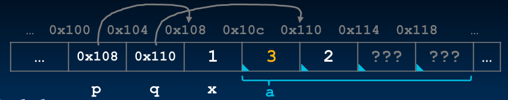

# CS61C

## 资料
* [👍CS61C 2022 中文配音视频](https://www.bilibili.com/video/BV1gWKZ6eEdY/?spm_id_from=333.788.top_right_bar_window_default_collection.content.click&vd_source=2a33d03ec3e67e46971208a7faa0dcda)
* [👍CS61C 2020 FALL视频](https://www.bilibili.com/video/BV17b42177VG/?spm_id_from=333.337.search-card.all.click&vd_source=2a33d03ec3e67e46971208a7faa0dcda)
* [CS61C 2020 SUMMER视频](https://www.bilibili.com/video/BV1PV411U7Hv?spm_id_from=333.788.videopod.episodes&vd_source=2a33d03ec3e67e46971208a7faa0dcda)
* [看到这里](https://www.bilibili.com/video/BV1gWKZ6eEdY?spm_id_from=333.788.player.switch&vd_source=2a33d03ec3e67e46971208a7faa0dcda&p=18)

## Lecture 1 课程介绍

1. Learn 6 great ideas in computer architecture to enable high performance programming via parallelism, not just learn C.

    - Abstraction (Layers of Representation/Interpretation)
    - Moore's Law
    - Principles of Locality/Memory Hierarchy
    - Parallelism
    - Performance Measurement and Improvement
    - Dependability via Redundancy

## Lecture 2 C语言入门

1. 以下是UB (Undefined Behavior)

    ```C
    int *ptr;
    *ptr = 5;
    ```

    `ptr` 是一个**局部指针变量**，定义在函数内部（栈上）。局部自动变量**不会被初始化**，`ptr` 里面存的是一个**随机垃圾地址值**（野指针）。**往 ptr 所指向的内存地址写入整数 5**。
但 ptr 指向哪里完全未知：

      - 可能指向只读内存 → 程序崩溃，段错误 `segmentation fault`
      - 可能改写了你其他变量 → 悄无声息破坏数据
      - 运气 “好”，刚好一块可写空闲内存，代码跑过去了（隐藏炸弹，不定什么时候炸）

2. An array name is not a variable：数组名 `a`**不是独立变量**

      - `a` 在表达式中，**绝大多数时候自动退化成 `&a[0]`（数组首元素地址）** → 值为 `0x10c`
      - `&a`：取**整个数组**的地址，结果也是 `0x10c`
      - 所以 a == &a，虽然地址数值相等，但是**类型不一样！**导致加法差异：

        - `a` → `int*`，首元素地址
        - `&a` → `int (*)[4]`，指向整个长度为 4 的数组的指针

        ```C
        a + 1;   // +1个int → 前进4字节 → 0x110
        &a + 1;  // +1个完整数组(4个int) → 前进16字节 → 0x11c
        ```

    ```C
    int *p, *q, x;
    int a[4];

    p = &x;
    q = a + 1;

    *p = 1;
    printf("*p:%d, p:%x, &p:%x\n", *p, p, &p);

    *q = 2;
    printf("*q:%d, q:%x, &q:%x\n", *q, q, &q);

    *a = 3;
    printf("*a:%d, a:%x, &a:%x\n", *a, a, &a);
    ```

    ```
    *p:1, p:108,  &p:100
    *q:2, q:110,  &q:104
    *a:3, a:10c,  &a:10c   ← ⭐重点！a 和 &a 的地址一模一样！
    ```

    

3. C 语言规则：**函数形参写 `short arr[]`，编译器等价翻译成 `short *arr`（指针）**，数组传参发生**数组→指针退化**，`arr`不再是数组，它就是普通指针变量。


    ```C
    void mystery(short arr[], int len) 
    {
        printf("%d ", len);
        printf("%d\n", sizeof(arr));
    }

    int main() 
    {
        short nums[] = {1, 2, 3, 99, 100};
        printf("%d ", sizeof(nums));
        mystery(nums, sizeof(nums)/sizeof(short));
        return 0;
    }

    // OUTPUT: 10 5 4
    ```

    `sizeof()` 是【编译期运算符】，不是函数；结果在编译阶段就直接算出来，运行时不会执行任何代码。
