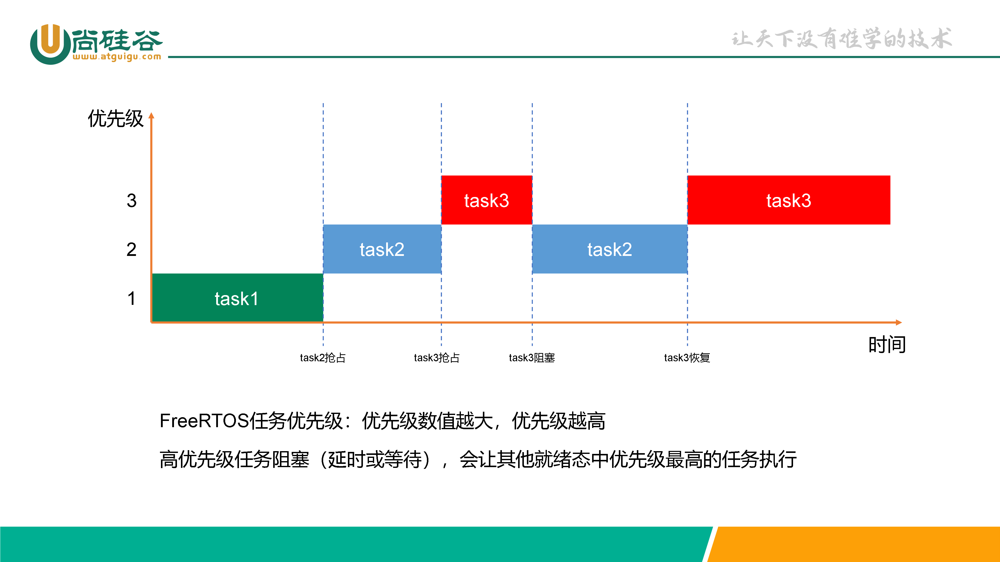
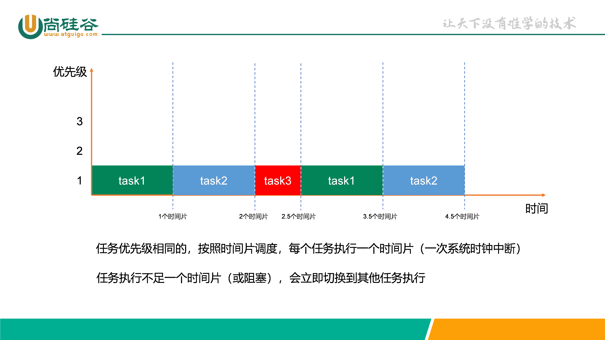
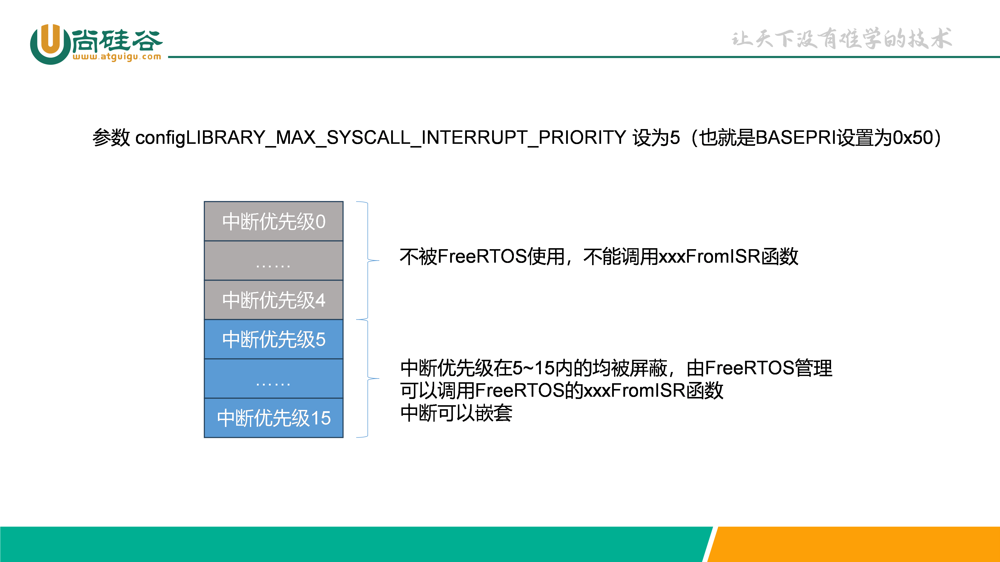
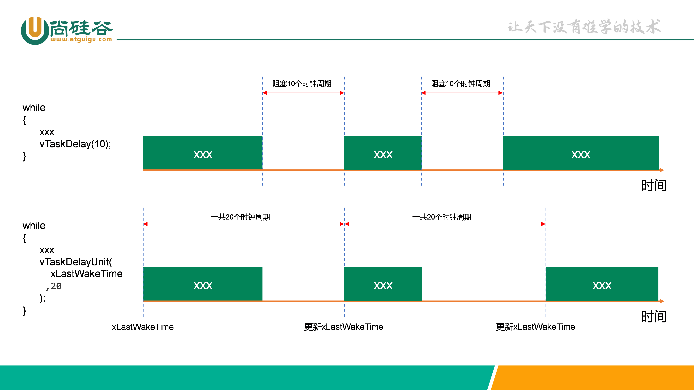
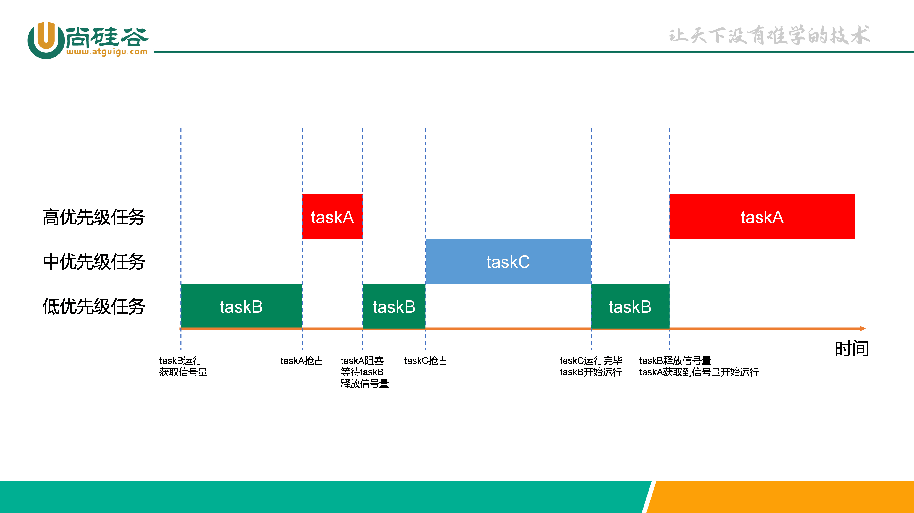
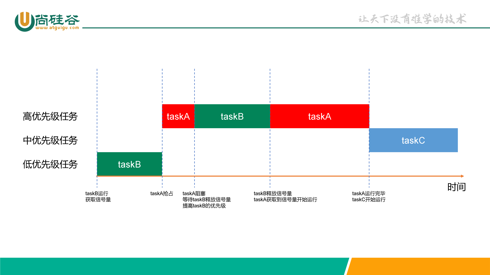
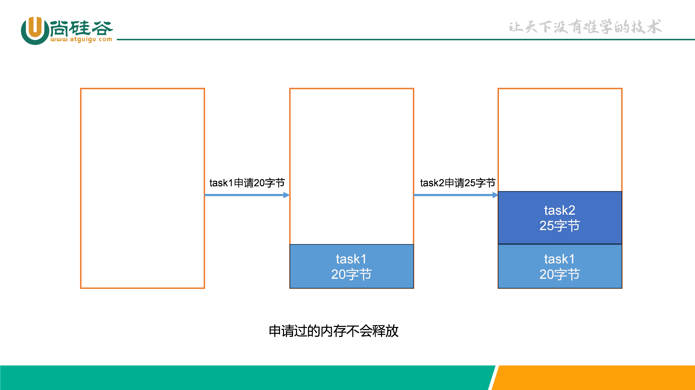
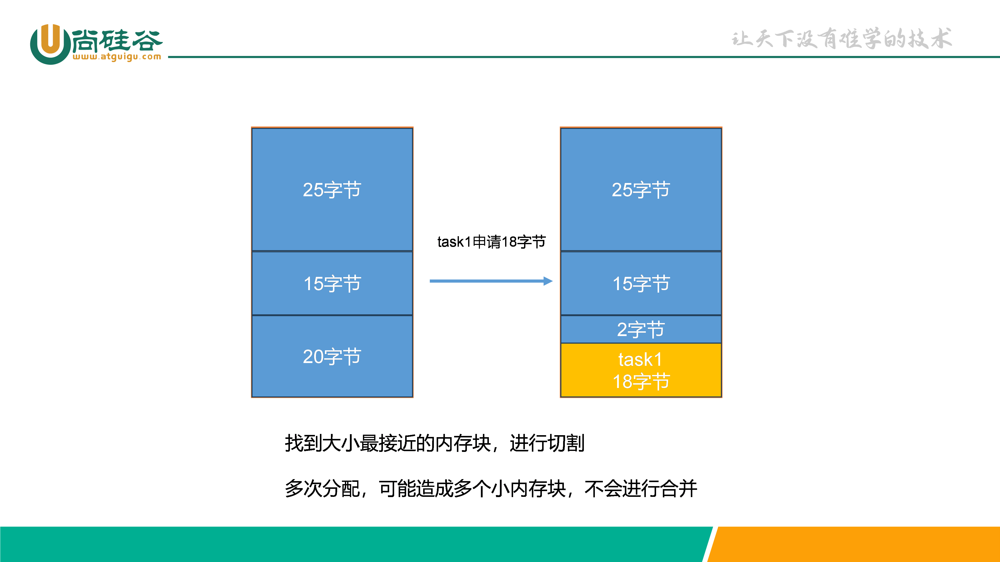
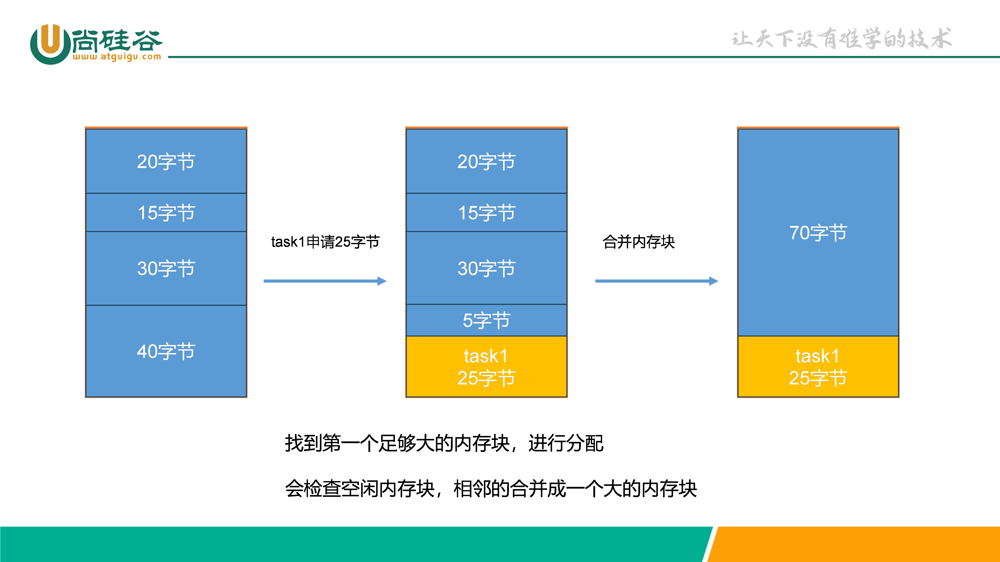

# FreeRTOS 尚硅谷课程笔记

## 第1章 操作系统介绍

### 1.1 什么是裸机开发

裸机开发指的是在没有操作系统（OS）或者其他高级软件支持的情况下，直接在裸机硬件上进行软件开发的过程。在裸机开发中，开发者需要直接面对硬件层面的操作和控制，亲自管理CPU、内存以及I/O资源，而不依赖于任何操作系统提供的抽象层或者服务。

我们前面学习的STM32单片机代码都属于裸机开发。

### 1.2 什么是操作系统

一个计算机系统可以大致分为三个部分：硬件（Hardware），操作系统（operating system），应用程序（application programs）。

1.  硬件包含了芯片，存储空间，输入输出等设备为整个系统提供了基础的计算资源。

2.  操作系统是一个控制程序，作为硬件和应用程序之间的桥梁，主要是和硬件打交道，负责协调分配计算资源和内存资源给不同的应用程序使用，并防止系统出现故障。面对来自不同应用程序的大量且互相竞争的资源请求，操作系统通过一个调度算法和内存管理算法尽可能把资源公平且有效率地分配给不同的程序。

3.  应用程序则通过调用操作系统提供的API接口获得相应资源完成指定的任务。

操作系统从整体上分为两大类：**通用操作系统**和**实时操作系统**。

#### 1.2.1 通用操作系统

通用操作系统包括Linux，Windows，MACOS等主流的操作系统。这些操作系统大家每天都在使用，功能也十分强大，只是它们有时为了保障系统的流畅运行，就不能保证每个程序都能实时响应，在易用性和实时性之间有所取舍。而且单片机有限的片上资源也不足以支撑通用操作系统的运行。

#### 1.2.2 实时操作系统

实时操作系统（RTOS-Real Time Operating System）中实时（Real Time）指的是任务（Task）或者说实现一个功能的线程（Thread）必须在给定的时间（Deadline）内完成。

人们总有种误解认为如果能堆砌更多的处理器核心数目，更高的处理器频率，更大的内存，更快的总线速度系统就一定能达到实时性。然而事与愿违强大的计算能力并不能保证系统的实时性。举一个简单的例子比如汽车中的安全气囊，在传感器检测到汽车发生碰撞后，安全气囊需要在30ms内完全打开，不然司机和乘客的人身安全将受到极大的威胁。倘若车载ECU有很强大的计算能力，但是如果因为要执行其他复杂计算任务或者任务调度的问题导致对汽车异常状态的监测和安全气囊的响应时间超过了规定的时间，系统实时性将无法得到保障从而导致系统失效和人员伤亡，这将会是非常严重的问题。

为了保障这些实时任务能在给定的时间内完成，需要一个实时系统对这些任务进行调度和管理。一个实时操作系统能尽力保障每个任务的运行时间在规定时间内完成，这包括：

1.  对中断和内部异常的处理

2.  对安全相关的事件的处理

3.  任务调度机制等

正所谓术业有专攻，在嵌入式领域中，嵌入式实时操作系统(RTOS)可以更合理、更有效地利用CPU的资源，简化应用软件的设计，缩短系统开发时间，从而更好地保证系统的实时性和可靠性。

目前比较流行的实时操作系统包括黑莓QNX，**FreeRTOS**，uCOS，RT-Thread等

### 1.3 FreeRTOS简介

RTOS(实时操作系统)是指一类系统，如 FreeRTOS，uC/OS，RTX，RT-Thread 等，都是 RTOS 类操作系统。

FreeRTOS是所有实时操作系统中最受欢迎的一款.

#### 1.3.1 FreeRTOS发展历史

FreeRTOS 由美国的 Richard Barry 于 2003 年发布。

FreeRTOS 于 2017 年被亚马逊收购，改名为 AWS FreeRTOS。

#### 1.3.2 FreeRTOS优势

FreeRTOS 是市场领先的面向微控制器和小型微处理器的实时操作系统 (RTOS)，与世界领先的芯片公司合作开发，现在每 170 秒下载一次。

FreeRTOS 通过 MIT 开源许可免费分发，包括一个内核和一组不断丰富的 IoT 库，适用于**所有行业领域**。FreeRTOS 的构建突出**可靠性和易用性**。

FreeRTOS是一款受欢迎、广泛应用于嵌入式系统的RTOS，其开源、轻量级、可移植的特点使其成为许多嵌入式开发者的首选，主要优势如下：

- 开源和免费：FreeRTOS是一款开源的RTOS，采用MIT许可证发布，可以免费使用、修改和分发。

- 轻量级设计：FreeRTOS注重轻量级设计，适用于资源受限的嵌入式系统，不占用过多内存和处理器资源。

- 广泛应用：FreeRTOS在嵌入式领域得到广泛应用，包括工业自动化、医疗设备、消费电子产品、汽车电子等。

- 多平台支持：FreeRTOS的设计注重可移植性，可以轻松地移植到不同的硬件平台，支持多种处理器架构。

- 丰富的功能：提供了多任务调度、任务通信、同步等功能，适用于复杂的嵌入式应用场景。

#### 1.3.3 FreeRTOS特点

官网：<https://freertos.org/>，并且支持中文。

- 任务调度：FreeRTOS通过任务调度器管理多个任务，支持不同优先级的任务，实现任务的有序执行。

- 任务通信和同步：提供了队列、信号量等机制，支持任务之间的通信和同步，确保数据的安全传递。

- 内存管理：提供简单的内存管理机制，适用于嵌入式环境，有效利用有限的内存资源。

- 定时器和中断处理：支持定时器功能，能够处理中断，提供了可靠的实时性能。

- 开发社区：拥有庞大的用户社区，开发者可以在社区中获取支持、解决问题，并分享经验。

- 可移植性：设计注重可移植性，可以轻松地移植到不同的硬件平台，提高了代码的重用性。


## 第2章 FreeRTOS基础知识

### 2.1 多任务处理

**内核**是操作系统的核心组件。诸如 Linux 这样的操作系统采用的内核， 看似允许用户同时访问计算机。很明显，**多个用户可以同时执行多个程序** 。

每个执行程序都是受操作系统控制的任务（或线程）。如果一个操作系统能够以这种方式执行多个任务， 则可称其为**多任务操作系统**。

使用多任务操作系统可以**简化**原本**复杂**的软件应用程序的**设计** ：

1.  操作系统的多任务处理和任务间通信功能允许将复杂的应用程序分割成一组更小、更易于管理的任务。

2.  通过分割，您可以更轻松地执行软件测试、分解团队内部工作以及复用代码。

3.  复杂的时序和排序细节可以从应用程序代码中移除，由操作系统负责。

即使单核处理器一次只能执行一项任务。 多任务操作系统可以通过任务之间的快速切换制造并发执行的假象。下图展示了与时间相关的三项任务的执行模式。 任务名称采用颜色编码，并写在左手边。 时间从左向右移动， 彩色线条显示了在任何特定时间正在执行的任务。 上方展示了所感知的并发执行模式， 下方展示了实际的多任务执行模式。


### 2.2 任务调度

一个处理器核心在某一时刻只能运行一个任务，如在各个任务之间迅速切换，这样看起来就像多个任务在同时运行。操作系统中任务调度器的责任就是决定在某一时刻要执行哪个任务。

调度器是内核中负责决定在任何特定时间应执行哪些任务的部分。内核可以在任务生命周期内多次挂起并且稍后恢复一个任务。

调度策略是调度器用来决定在任何时间点执行哪个任务的算法。

FreeRTOS 默认使用**固定优先级**的**抢占式调度策略**，对**同等优先级**的任务执行**时间片轮询**调度：

- 抢占式调度：FreeRTOS采用抢占式调度方式，允许更高优先级的任务在任何时刻抢占正在执行的低优先级任务。这确保了高优先级任务能够及时响应，并提高了系统的实时性。

- 时间片轮询：在相同优先级的任务之间，FreeRTOS采用时间片轮转策略。每个任务执行一个时间片，如果有其他同优先级的任务等待执行，则切换到下一个任务。这有助于公平地分配CPU时间。

但是并不是说高优先级的任务会一直执行，导致低优先级的任务无法得到执行。如果高优先级任务**等待某个资源（延时或等待信号量等）**而无法执行，调度器会选择执行其他就绪的高优先级的任务。





### 2.3 任务状态

FreeRTOS中任务共存在4种状态：

- 运行态：当任务实际执行时，它被称为处于运行状态。如果运行 RTOS 的处理器只有一个内核， 那么在任何给定时间内都只能有一个任务处于运行状态。注意在STM32中，同一时间仅一个任务处于运行态。

- 就绪态：准备就绪任务指那些能够执行（它们不处于阻塞或挂起状态）， 但目前没有执行的任务， 因为同等或更高优先级的不同任务已经处于运行状态。

- 阻塞态：如果任务当前正在等待延时或外部事件，则该任务被认为处于阻塞状态。

- 挂起态：类似暂停，调用函数 vTaskSuspend() 进入挂起态，需要调用解挂函数vTaskResume()才可以进入就绪态。

**只有就绪态可转变成运行态**，其他状态的任务想运行，必须先转变成就绪态。转换关系如下：


这四种状态中，除了运行态，其他三种任务状态的任务都有其对应的任务状态列表：

- 就绪列表：pxReadyTasksLists[x]，其中x代表任务优先级数值。

- 阻塞列表：pxDelayedTaskList。

- 挂起列表：xSuspendedTaskList。

列表类似于链表，后面章节会专门介绍。

以就绪列表为例。如果在32位的硬件中，会保存一个32位的变量，代表0-31的优先级。当某个位，置一时，代表所对应的优先级就绪列表有任务存在。


如果有多个任务优先级相同，会连接在同一个就绪列表上：


调度器总是在所有处于就绪列表的任务中，选择具有最高优先级的任务来执行。

### 2.4 FreeRTOS的滴答

休眠时，RTOS 任务将指定需要“唤醒”的时间。 阻塞时，RTOS 任务可以指定希望等待的最长时间。

FreeRTOS 实时内核通过**滴答计数变量**测量时间。定时器中断（RTOS 滴答中断）以严格的时间精度增加滴答数——允许实时内核以所选择的定时器**中断频率**的分辨率来测量时间。

每次滴答数增加时，实时内核必须检查是否现在是解除阻塞或唤醒任务的时间。在滴答 ISR 期间唤醒或解除阻塞的任务的优先级可能高于被中断任务的优先级。

### 2.5 上下文切换

#### 2.5.1 什么是上下文切换

当一个任务执行时，它会利用处理器/微控制器寄存器，并像其他程序一样访问 RAM 和 ROM。这些资源（处理器寄存器，堆栈等）一起组成了任务执行**上下文**。

一个任务是一段有顺序的代码——它不知道什么时候会被内核挂起（换出或换入）或恢复（换入或换入）， 甚至不知道什么时候自己被挂起或恢复过。

一个任务在即将执行将两个处理器寄存器内包含的数值相加之前被挂起。 当该任务被挂起时，其他任务会执行，还可能会修改处理器寄存器的数值。恢复时， 该任务不会知道处理器寄存器已经被修改过了——如果它使用经修改过的数值， 那么求和会得到一个错误的数值。

为了防止这种类型的错误，**任务**在**恢复时**必须有一个与**挂起之前相同的上下文** 。通过在任务挂起时保存任务的上下文，操作系统内核负责确保上下文保持不变。任务恢复时，其保存的上下文在执行之前由操作系统内核恢复。

保存被挂起的任务的上下文和恢复被恢复的任务的上下文的过程被称为 **上下文切换**。

上下文切换主要包含两个步骤：

1. 将 TaskA 在相应处理器寄存器中的上下文保存到它的任务堆栈中。

    

2. 将 TaskB 的上下文从它的任务堆栈中恢复到相应的处理器寄存器中。

    

#### 2.5.2 什么时候进行上下文切换

在需要切换任务的时候进行上下文切换，真正执行上下文切换是在PendSV (Pending Service Call，可挂起服务调用) 的ISR中处理的。使用PendSV是因为其可以手动触发，并且可以在其他更高中断优先级的ISR中来进行设置，比较灵活。具体触发操作是将中断控制和状态寄存器 ICSR 的 bit28，也就是 PendSV 的挂起位置 1 来触发PendSV 中断。FreeRTOS会将PendSV设置为最低中断优先级，避免任务切换影响到其他正常的ISR。

在FreeRTOS中有以下几个情况会触发PendSV异常产生切换：

1.  **RTOS 滴答中断**：会处理就绪列表，判断是否要切换任务（包括抢占式、时间片轮转）。

2.  **任务执行完毕**：主动调用任务切换函数进行强制切换。

### 2.6 空闲任务

RTOS 调度器启动时，**自动创建空闲任务**，以确保始终存在一个能够运行的任务。

空闲以最低优先级创建，以确保如果有更高的优先级应用程序任务处于准备就绪状态，空闲任务则不使用任何 CPU 时间。

空闲任务负责释放被删除的任务的内存。

## 第3章 FreeRTOS移植

### 3.1 FreeRTOS源码结构介绍

#### 3.1.1 获取源码

1. 官网下载

    官网地址：<https://www.freertos.org/>

    

    这里我们选择当前最新的分发包202212.01版本下载。

2. Github下载

    Github地址：<https://github.com/FreeRTOS/FreeRTOS/releases>

    

    现在FreeRTOS已经将源码迁移到Github上，可以直接下载。

#### 3.1.2 源码结构介绍

1.  源码整体结构

    | 名称                      | 描述                                         |
    |---------------------------|----------------------------------------------|
    | FreeRTOS                  | FreeRTOS内核                                 |
    | FreeRTOS-Plus             | FreeRTOS组件，一般我们会选择使用第三方的组件 |
    | tools                     | 工具                                         |
    | GitHub-FreeRTOS-Home      | FreeRTOS的GitHub仓库链接                     |
    | Quick_Start_Guide         | 快速入门指南官方文档链接                     |
    | Upgrading-to-FreeRTOS-xxx | 升级到指定FreeRTOS版本官方文档链接           |
    | History.txt               | FreeRTOS历史更新记录                         |
    | 其他                      | 其他                                         |

2.  FreeRTOS文件夹结构

    | 名称    | 描述                                             |
    |---------|--------------------------------------------------|
    | Demo    | FreeRTOS演示例程，支持多种芯片架构、多种型号芯片 |
    | License | FreeRTOS相关许可                                 |
    | Source  | FreeRTOS源码，最重要的文件夹                     |
    | Test    | 公用以及移植层测试代码                           |

3.  Source文件夹结构如下

    | 名称            | 描述                                             |
    |-----------------|--------------------------------------------------|
    | **include**         | **内包含了FreeRTOS的头文件**                         |
    | **portable**        | **包含FreeRTOS移植文件：与编译器相关、keil编译环境** |
    | croutine.c      | 协程相关文件                                     |
    | event_groups.c  | 事件相关文件                                     |
    | **list.c**          | **列表相关文件**                                     |
    | **queue.c**         | **队列相关文件**                                     |
    | stream_buffer.c | 流式缓冲区相关文件                               |
    | **tasks.c**         | **任务相关文件**                                     |
    | timers.c        | 软件定时器相关文件                               |

    include文件夹和.c文件是通用的头文件和 C 文件，这两部分的文件适用于各种编译器和处理器，是通用的。标粗的是移植必需的，其他.c文件根据需要选取。

    portable文件夹里根据编译器、内核等实际环境对应选取。

4.  portable文件夹结构

    FreeRTOS操作系统归根到底是一个软件层面的东西，需要跟硬件联系在一起，portable文件夹里面的东西就是连接桥梁。由于我们使用MDK开发，因此这里只重点介绍其中的部分移植文件。

    | 名称    | 描述                   |
    |---------|------------------------|
    | Keil    | 指向RVDS文件夹         |
    | RVDS    | 不同内核芯片的移植文件 |
    | MemMang | 内存管理相关文件       |

    Keil文件夹里只有一个See-also-the-RVDS-directory.txt，意思是让我们看RVDS文件夹。

    1) RVDS文件夹

    RVDS 文件夹包含了各种处理器相关的文件夹，FreeRTOS 是一个软件，单片机是一个硬件，FreeRTOS 要想运行在一个单片机上面，它们就必须关联在一起。

    关联还是得通过写代码来关联，这部分关联的文件叫接口文件，通常由汇编和 C 联合编写。这些接口文件都是跟硬件密切相关的，不同的硬件接口文件是不一样的，但都大同小异。编写这些接口文件的过程我们就叫移植，移植的过程通常由 FreeRTOS 和 mcu 原厂的人来负责，移植好的这些接口文件就放在 RVDS 这个文件夹的目录下。

    

    FreeRTOS 为我们提供了 cortex-m0、m3、m4 和 m7 等内核的单片机的接口文件，根据mcu的内核选择对应的接口文件即可。其实准确来说，不能够叫移植，应该叫使用官方的移植， 因为这些跟硬件相关的接口文件，RTOS 官方都已经写好了，我们只是使用而已。

    以 ARM_CM3 这个文件夹为例，里面只有“port.c”与“portmacro.h” 两个文件，

    - port.c文件：里面的内容是由 FreeRTOS 官方的技术人员为 Cortex-M3 内核的处理器写的接口文件，里面核心的上下文切换代码是由汇编语言编写而成，对技术员的要求比较高，我们只是使用的话只需拷贝过来用即可。

    - portmacro.h文件：port.c文件对应的头文件，主要是一些数据类型和宏定义。

    2) MemMang文件夹

    MemMang 文件夹下存放的是跟内存管理相关的，总共有五个 heap 文件以及一个 readme 说明文件。

    

    这五个 heap 文件在移植的时候必须使用一个，因为 FreeRTOS 在创建内核对象的时候使用的是动态分配内存，而这些动态内存分配的函数则在这几个文件里面实现，不同的分配算法会导致不同的效率与结果，后面在内存管理中我们会讲解每个文件的区别，由于现在是初学，所以我们选用 **heap4.c** 即可。

### 3.2 FreeRTOS在基于HAL库项目中移植步骤

#### 3.2.1 目录添加源码文件

在例程的根路径下，新建“FreeRTOS”文件夹，并且在里面新建“portable”和“source”两个空文件夹。


拷贝FreeRTOS源码的Source文件夹的7个.c文件到例程的source文件夹。


拷贝FreeRTOS源码portable文件夹下的Keil、RVDS、MemMang到例程的portable文件夹下。


其中例程的MemMang可只保留heap_4.c:


其中例程的RVDS可只保留ARM_CM3（对应我们的芯片内核）。

拷贝FreeRTOS源码include文件夹到例程的FreeRTOS文件夹下。


FreeRTOSConfig.h 文件是 FreeRTOS 的工程配置文件，因为 FreeRTOS 是可以裁剪的 实时操作内核，应用于不同的处理器平台，用户可以通过修改这个 FreeRTOS 内核的配置 头文件来裁剪 FreeRTOS 的功能，所以我们把它拷贝一份放在 user 这个文件夹下面。

在源码“..\FreeRTOS\Demo”文件夹下面找到 “ CORTEX_STM32F103_Keil ” 这个文件夹下，找到 “FreeRTOSConfig.h”文件，然后拷贝到我们工程下的 “Core/Inc” 文件夹下即可，等下我们需要对这个文件进行修改。


#### 3.2.2 工程添加源码文件

工程新建Group“FreeRTOS/Source”和“FreeRTOS/Portable”。


FreeRTOS/Source添加.c文件。


FreeRTOS/Portable添加port.c和heap_4.c文件。


添加配置头文件。


添加头文件。

FreeRTOS 的源码已经添加到开发环境的组文件夹下面，编译的时候需要为这些源文件指定头文件的路径，不然编译会报错。FreeRTOS 的源码里面只有 include 和RVDS\ARM_CM3这两个文件夹下面有头文件，只需要将这两个头文件的路径在开发环境里面指定即可。


同时我们还将 FreeRTOSConfig.h 这个头文件拷贝到了工程根目录下的 Core/Inc 文件夹下，这个路径本身就在开发环境里面。(放其他路径也可以, 就是一个.h文件)

#### 3.2.3 系统配置文件修改

FreeRTOSConfig.h中添加如下3个配置：

```c
#define xPortPendSVHandler  PendSV_Handler
#define vPortSVCHandler     SVC_Handler
#define INCLUDE_xTaskGetSchedulerState   1
```

#### 3.2.4 修改stm32f1xx_it.c

1.  引入头文件

```c
/* Private includes ----------------------------------------------------------*/
/* USER CODE BEGIN Includes */
#include "FreeRTOS.h"
#include "task.h"
/* USER CODE END Includes */
```

2.  注释掉2个函数

```c
// void SVC_Handler(void)
// {
// }
// void PendSV_Handler(void)
// {
// }
```

3.  添加SysTick时钟中断服务函数

```c
/* Private variables ---------------------------------------------------------*/
/* USER CODE BEGIN PV */
extern void xPortSysTickHandler(void);
/* USER CODE END PV */
void SysTick_Handler(void)
{
    /* USER CODE BEGIN SysTick_IRQn 0 */
    /* USER CODE END SysTick_IRQn 0 */
    /* USER CODE BEGIN SysTick_IRQn 1 */
    if (xTaskGetSchedulerState() != taskSCHEDULER_NOT_STARTED)
    {
        xPortSysTickHandler();
    }
    /* USER CODE END SysTick_IRQn 1 */
}
```

注意：HAL本身和FreeRTOS都默认依赖SysTick，可能出现卡死的问题。

为了保险起见，可以考虑在SYS选择HAL时钟源的时候换成其他的，并且中断优先级设为较高，比如1。


### 3.3 FreeRTOS在基于寄存器项目中移植步骤

#### 3.3.1 目录添加源码文件

在例程的根路径下，新建“FreeRTOS”文件夹，并且在里面新建“portable”和“source”两个空文件夹。


拷贝FreeRTOS源码的Source文件夹的7个.c文件到例程的source文件夹。


拷贝FreeRTOS源码portable文件夹下的Keil、RVDS、MemMang到例程的portable文件夹下。


其中例程的MemMang可只保留heap_4.c:


其中例程的RVDS可只保留ARM_CM3（对应我们的芯片内核）。

拷贝FreeRTOS源码include文件夹到例程的FreeRTOS文件夹下。


FreeRTOSConfig.h 文件是 FreeRTOS 的工程配置文件，因为 FreeRTOS 是可以裁剪的 实时操作内核，应用于不同的处理器平台，用户可以通过修改这个 FreeRTOS 内核的配置头文件来裁剪 FreeRTOS 的功能，所以我们把它拷贝一份放在 user 这个文件夹下面。

#### 3.3.2 工程添加源码文件

工程新建Group“FreeRTOS/Source”和“FreeRTOS/Portable”。


#### 3.3.3 系统配置文件修改

FreeRTOSConfig.h中添加如下3个配置：

```c
#define xPortPendSVHandler  PendSV_Handler
#define vPortSVCHandler     SVC_Handler
#define INCLUDE_xTaskGetSchedulerState   1
```

#### 3.3.4 main.c中添加如下代码

FreeRTOS使用滴答定时器来实现的系统时基, 需要实现滴答定时器的中断,并在中断中添加下面的代码.

```c
extern void xPortSysTickHandler(void);
void  SysTick_Handler(void)
{
    if(xTaskGetSchedulerState() != taskSCHEDULER_NOT_STARTED)
    {
        xPortSysTickHandler();
    }
}
```

### 3.4 系统配置文件说明

FreeRTOSConfig.h 配置文件作用：对FreeRTOS的功能进行配置和裁剪，以及API函数的使能等。

官网中文说明：<https://www.freertos.org/zh-cn-cmn-s/Documentation/02-Kernel/03-Supported-devices/02-Customization>

整体的配置项可以分为三类：

- INCLUDE开头：一般是“INCLUDE_函数名”，函数的使能，1表示可用，0表示禁用。

- config开头：FreeRTOS的一些功能配置，比如基本配置、内存配置、钩子配置、中断配置等。

- 其他配置：PendSV宏定义、SVC宏定义。

根据需要去配置，后续章节的知识点和案例，会涉及到其中一些配置，再去熟悉即可。

```c
#ifndef FREERTOS_CONFIG_H
#define FREERTOS_CONFIG_H
/* 头文件 */
#include "./SYSTEM/sys/sys.h"
#include "./SYSTEM/usart/usart.h"
#include <stdint.h>
extern uint32_t SystemCoreClock;
/* 基础配置项 */
#define configUSE_PREEMPTION                            1                       /* 1: 抢占式调度器, 0: 协程式调度器, 无默认需定义 */
#define configUSE_PORT_OPTIMISED_TASK_SELECTION         1                       /* 1: 使用硬件计算下一个要运行的任务, 0: 使用软件算法计算下一个要运行的任务, 默认: 0 */
#define configUSE_TICKLESS_IDLE                         0                       /* 1: 使能tickless低功耗模式, 默认: 0 */
#define configCPU_CLOCK_HZ                              SystemCoreClock         /* 定义CPU主频, 单位: Hz, 无默认需定义 */
//#define configSYSTICK_CLOCK_HZ                          (configCPU_CLOCK_HZ / 8)/* 定义SysTick时钟频率，当SysTick时钟频率与内核时钟频率不同时才可以定义, 单位: Hz, 默认: 不定义 */
#define configTICK_RATE_HZ                              1000                    /* 定义系统时钟节拍频率, 单位: Hz, 无默认需定义 */
#define configMAX_PRIORITIES                            32                      /* 定义最大优先级数, 最大优先级=configMAX_PRIORITIES-1, 无默认需定义 */
#define configMINIMAL_STACK_SIZE                        128                     /* 定义空闲任务的栈空间大小, 单位: Word, 无默认需定义 */
#define configMAX_TASK_NAME_LEN                         16                      /* 定义任务名最大字符数, 默认: 16 */
#define configUSE_16_BIT_TICKS                          0                       /* 1: 定义系统时钟节拍计数器的数据类型为16位无符号数, 无默认需定义 */
#define configIDLE_SHOULD_YIELD                         1                       /* 1: 使能在抢占式调度下,同优先级的任务能抢占空闲任务, 默认: 1 */
#define configUSE_TASK_NOTIFICATIONS                    1                       /* 1: 使能任务间直接的消息传递,包括信号量、事件标志组和消息邮箱, 默认: 1 */
#define configTASK_NOTIFICATION_ARRAY_ENTRIES           1                       /* 定义任务通知数组的大小, 默认: 1 */
#define configUSE_MUTEXES                               1                       /* 1: 使能互斥信号量, 默认: 0 */
#define configUSE_RECURSIVE_MUTEXES                     1                       /* 1: 使能递归互斥信号量, 默认: 0 */
#define configUSE_COUNTING_SEMAPHORES                   1                       /* 1: 使能计数信号量, 默认: 0 */
#define configUSE_ALTERNATIVE_API                       0                       /* 已弃用!!! */
#define configQUEUE_REGISTRY_SIZE                       8                       /* 定义可以注册的信号量和消息队列的个数, 默认: 0 */
#define configUSE_QUEUE_SETS                            1                       /* 1: 使能队列集, 默认: 0 */
#define configUSE_TIME_SLICING                          1                       /* 1: 使能时间片调度, 默认: 1 */
#define configUSE_NEWLIB_REENTRANT                      0                       /* 1: 任务创建时分配Newlib的重入结构体, 默认: 0 */
#define configENABLE_BACKWARD_COMPATIBILITY             0                       /* 1: 使能兼容老版本, 默认: 1 */
#define configNUM_THREAD_LOCAL_STORAGE_POINTERS         0                       /* 定义线程本地存储指针的个数, 默认: 0 */
#define configSTACK_DEPTH_TYPE                          uint16_t                /* 定义任务堆栈深度的数据类型, 默认: uint16_t */
#define configMESSAGE_BUFFER_LENGTH_TYPE                size_t                  /* 定义消息缓冲区中消息长度的数据类型, 默认: size_t */
/* 内存分配相关定义 */
#define configSUPPORT_STATIC_ALLOCATION                 0                       /* 1: 支持静态申请内存, 默认: 0 */
#define configSUPPORT_DYNAMIC_ALLOCATION                1                       /* 1: 支持动态申请内存, 默认: 1 */
#define configTOTAL_HEAP_SIZE                           ((size_t)(10 * 1024))   /* FreeRTOS堆中可用的RAM总量, 单位: Byte, 无默认需定义 */
#define configAPPLICATION_ALLOCATED_HEAP                0                       /* 1: 用户手动分配FreeRTOS内存堆(ucHeap), 默认: 0 */
#define configSTACK_ALLOCATION_FROM_SEPARATE_HEAP       0                       /* 1: 用户自行实现任务创建时使用的内存申请与释放函数, 默认: 0 */
/* 钩子函数相关定义 */
#define configUSE_IDLE_HOOK                             0                       /* 1: 使能空闲任务钩子函数, 无默认需定义  */
#define configUSE_TICK_HOOK                             0                       /* 1: 使能系统时钟节拍中断钩子函数, 无默认需定义 */
#define configCHECK_FOR_STACK_OVERFLOW                  0                       /* 1: 使能栈溢出检测方法1, 2: 使能栈溢出检测方法2, 默认: 0 */
#define configUSE_MALLOC_FAILED_HOOK                    0                       /* 1: 使能动态内存申请失败钩子函数, 默认: 0 */
#define configUSE_DAEMON_TASK_STARTUP_HOOK              0                       /* 1: 使能定时器服务任务首次执行前的钩子函数, 默认: 0 */
/* 运行时间和任务状态统计相关定义 */
#define configGENERATE_RUN_TIME_STATS                   0                       /* 1: 使能任务运行时间统计功能, 默认: 0 */
#if configGENERATE_RUN_TIME_STATS
#include "./BSP/TIMER/btim.h"
#define portCONFIGURE_TIMER_FOR_RUN_TIME_STATS()        ConfigureTimeForRunTimeStats()
extern uint32_t FreeRTOSRunTimeTicks;
#define portGET_RUN_TIME_COUNTER_VALUE()                FreeRTOSRunTimeTicks
#endif
#define configUSE_TRACE_FACILITY                        1                       /* 1: 使能可视化跟踪调试, 默认: 0 */
#define configUSE_STATS_FORMATTING_FUNCTIONS            1                       /* 1: configUSE_TRACE_FACILITY为1时，会编译vTaskList()和vTaskGetRunTimeStats()函数, 默认: 0 */
/* 协程相关定义 */
#define configUSE_CO_ROUTINES                           0                       /* 1: 启用协程, 默认: 0 */
#define configMAX_CO_ROUTINE_PRIORITIES                 2                       /* 定义协程的最大优先级, 最大优先级=configMAX_CO_ROUTINE_PRIORITIES-1, 无默认configUSE_CO_ROUTINES为1时需定义 */
/* 软件定时器相关定义 */
#define configUSE_TIMERS                                1                               /* 1: 使能软件定时器, 默认: 0 */
#define configTIMER_TASK_PRIORITY                       ( configMAX_PRIORITIES - 1 )    /* 定义软件定时器任务的优先级, 无默认configUSE_TIMERS为1时需定义 */
#define configTIMER_QUEUE_LENGTH                        5                               /* 定义软件定时器命令队列的长度, 无默认configUSE_TIMERS为1时需定义 */
#define configTIMER_TASK_STACK_DEPTH                    ( configMINIMAL_STACK_SIZE * 2) /* 定义软件定时器任务的栈空间大小, 无默认configUSE_TIMERS为1时需定义 */
/* 可选函数, 1: 使能 */
#define INCLUDE_vTaskPrioritySet                        1                       /* 设置任务优先级 */
#define INCLUDE_uxTaskPriorityGet                       1                       /* 获取任务优先级 */
#define INCLUDE_vTaskDelete                             1                       /* 删除任务 */
#define INCLUDE_vTaskSuspend                            1                       /* 挂起任务 */
#define INCLUDE_xResumeFromISR                          1                       /* 恢复在中断中挂起的任务 */
#define INCLUDE_vTaskDelayUntil                         1                       /* 任务绝对延时 */
#define INCLUDE_vTaskDelay                              1                       /* 任务延时 */
#define INCLUDE_xTaskGetSchedulerState                  1                       /* 获取任务调度器状态 */
#define INCLUDE_xTaskGetCurrentTaskHandle               1                       /* 获取当前任务的任务句柄 */
#define INCLUDE_uxTaskGetStackHighWaterMark             1                       /* 获取任务堆栈历史剩余最小值 */
#define INCLUDE_xTaskGetIdleTaskHandle                  1                       /* 获取空闲任务的任务句柄 */
#define INCLUDE_eTaskGetState                           1                       /* 获取任务状态 */
#define INCLUDE_xEventGroupSetBitFromISR                1                       /* 在中断中设置事件标志位 */
#define INCLUDE_xTimerPendFunctionCall                  1                       /* 将函数的执行挂到定时器服务任务 */
#define INCLUDE_xTaskAbortDelay                         1                       /* 中断任务延时 */
#define INCLUDE_xTaskGetHandle                          1                       /* 通过任务名获取任务句柄 */
#define INCLUDE_xTaskResumeFromISR                      1                       /* 恢复在中断中挂起的任务 */
/* 中断嵌套行为配置 */
#ifdef __NVIC_PRIO_BITS
    #define configPRIO_BITS __NVIC_PRIO_BITS
#else
    #define configPRIO_BITS 4
#endif
#define configLIBRARY_LOWEST_INTERRUPT_PRIORITY         15                  /* 中断最低优先级 */
#define configLIBRARY_MAX_SYSCALL_INTERRUPT_PRIORITY    5                   /* FreeRTOS可管理的最高中断优先级 */
#define configKERNEL_INTERRUPT_PRIORITY                 ( configLIBRARY_LOWEST_INTERRUPT_PRIORITY << (8 - configPRIO_BITS) )
#define configMAX_SYSCALL_INTERRUPT_PRIORITY            ( configLIBRARY_MAX_SYSCALL_INTERRUPT_PRIORITY << (8 - configPRIO_BITS) )
#define configMAX_API_CALL_INTERRUPT_PRIORITY           configMAX_SYSCALL_INTERRUPT_PRIORITY
/* FreeRTOS中断服务函数相关定义 */
#define xPortPendSVHandler                              PendSV_Handler
#define vPortSVCHandler                                 SVC_Handler
/* 断言 */
#define vAssertCalled(char, int) printf("Error: %s, %d\r\n", char, int)
#define configASSERT( x ) if( ( x ) == 0 ) vAssertCalled( __FILE__, __LINE__ )
/* FreeRTOS MPU 特殊定义 */
//#define configINCLUDE_APPLICATION_DEFINED_PRIVILEGED_FUNCTIONS 0
//#define configTOTAL_MPU_REGIONS                                8
//#define configTEX_S_C_B_FLASH                                  0x07UL
//#define configTEX_S_C_B_SRAM                                   0x07UL
//#define configENFORCE_SYSTEM_CALLS_FROM_KERNEL_ONLY            1
//#define configALLOW_UNPRIVILEGED_CRITICAL_SECTIONS             1
/* ARMv8-M 安全侧端口相关定义。 */
//#define secureconfigMAX_SECURE_CONTEXTS         5
#endif /* FREERTOS_CONFIG_H */
```

### 3.5 FreeRTOS数据类型

针对每个移植定义四种类型。即：

#### 3.5.1 TickType_t

如果 configUSE_16_BIT_TICKS 设置为非零 (true) ，则将 TickType_t 定义为无符号的 16 位类型。如果 configUSE_16_BIT_TICKS 设置为零（假），则将 TickType_t 定义为无符号的 32 位类型。

这个类型的变量, 通常用来表示系统节拍计数器的值。FreeRTOS系统中，每隔一段时间会进行一次滴答定时器中断处理，这个时间间隔就是系统的节拍周期。TickType_t类型的变量记录了系统过去的节拍次数。

#### 3.5.2 BaseType_t

架构中最有效、最自然的类型。例如，在 32 位架构上，BaseType_t 会被定义为 32 位类型。在 16 位架构上，BaseType_t 会被定义为 16 位类型。是有符号的.

#### 3.5.3 UBaseType_t

是无符号的BaseType_t

#### 3.5.4 StackType_t

意指架构用于存储堆栈项目的类型。通常是 16 位架构上的 16 位类型和 32 位架构上的 32 位类型，但也有例外情况。**供 FreeRTOS 内部使用**。

### 3.6 FreeROS的命名规范

了解FreeRTOS的编码规范,有助于我们理解和学习FreeRTOS的使用.

#### 3.6.1 变量

1.  变量名称使用驼峰式大小写，具有明确的描述性，并使用完整的单词（没有缩写，但普遍接受的缩写除外）。

2.  uint32_t 类型变量以 ul 为前缀，其中“u”表示“unsigned” ，“l”表示“long”。

3.  uint16_t 类型变量以 us 为前缀，其中“u”表示“unsigned” ， “s”表示“short”。

4.  uint8_t 类型变量以 uc 为前缀，其中“u”表示“unsigned” ， “c”表示“char ”。

5.  非 stdint 类型的变量以 x 为前缀。例如，BaseType_t 和 TickType_t，二者分别是可移植层定义的定义类型，主要架构的自然类型或最有效类型，以及用于保存 RTOS ticks 计数的类型。

6.  非 stdint 类型的未签名变量存在附加前缀 u。例如，UBaseType_t（无符号的BaseType_t）类型变量以 ux 为前缀。

7.  size_t 类型变量也带有 x 前缀。

8.  枚举变量以 e 为前缀

9.  指针以附加 p 为前缀，例如，指向 uint16_t 的指针将以 pus 为前缀。

10. 根据 MISRA 指南，无符号 char 类型仅可包含 ASCII 字符，并以 c 为前缀。

11. 根据 MISRA 指南，char * 类型变量仅可包含指向 ASCII 字符串的指针，并以 pc 为前缀。

#### 3.6.2 函数

1.  函数名称使用驼峰式大小写，具有明确的描述性，并使用完整的单词（无缩写，但普遍接受的缩写除外）。

2.  文件作用域静态（私有）函数以 prv 为前缀。

3.  根据变量定义的相关规定，API 函数以其**返回类型为前缀**，并为 void 添加前缀 v。

4.  API 函数名称以定义 API 函数文件的名称开头。

比如一个函数 **vTaskDelay** , 从函数名可以得到如下信息:v表示这个函数的返回值是void, Task表示这个函数定义在Task.c文件中, Delay表示函数的功能

#### 3.6.3 宏

1.  宏具有明确的描述性，并使用完整的单词（无缩写，但普遍接受的缩写除外）。

2.  宏以定义宏的文件为前缀。前缀为小写。例如，在 FreeRTOSConfig.h 中定义 configUSE_PREEMPTION。

3.  除前缀外，所有宏均使用大写字母书写，并使用下划线来分隔单词。

## 第4章 FreeRTOS的任务创建和删除

### 4.1 任务创建和删除的API函数（熟悉）

任务的创建和删除本质就是调用FreeRTOS的API函数，主要如下：

| API函数             | 描述             |
|---------------------|------------------|
| xTaskCreate()       | 动态方式创建任务 |
| xTaskCreateStatic() | 静态方式创建任务 |
| vTaskDelete()       | 删除任务         |

- 动态创建任务：任务的任务控制块以及任务的栈空间所需的内存，均由 FreeRTOS 从 FreeRTOS 管理的堆中分配。

- 静态创建任务：任务的任务控制块以及任务的栈空间所需的内存，需用户分配提供。

#### 4.1.1 动态创建任务函数

1. 函数说明

    ```c
    BaseType_t xTaskCreate
    (
        TaskFunction_t pxTaskCode,                  /* 指向任务函数的指针 */
        const char * const pcName,                  /* 任务名字，最大长度configMAX_TASK_NAME_LEN */
        const configSTACK_DEPTH_TYPE usStackDepth,  /* 任务堆栈大小，默认单位4字节 */
        void * const pvParameters,                  /* 传递给任务函数的参数 */
        UBaseType_t uxPriority,                     /* 任务优先级，范围：0 ~ configMAX_PRIORITIES - 1 */
        TaskHandle_t * const pxCreatedTask          /* 任务句柄，就是任务的任务控制块 */
    )  
    ```

    返回值说明如下：

    - pdPASS：任务创建成功。

    - errCOULD_NOT_ALLOCATE_REQUIRED_MEMORY：任务创建失败。

2. 动态创建任务步骤

    1. 将宏configSUPPORT_DYNAMIC_ALLOCATION 配置为 1。

    2. 定义函数入口参数。

    3. 编写任务函数。

    此函数创建的任务会立刻进入就绪态，由任务调度器调度运行。

3. 动态创建任务函数内部实现

    1. 申请堆栈内存 & 任务控制块内存。

    2. TCB结构体成员赋值。

    3. 添加新任务到就绪列表中。

    任务控制块结构体成员介绍。

    ```c
    typedef struct tskTaskControlBlock      
    {
        volatile StackType_t * pxTopOfStack; /* 任务栈栈顶，必须为TCB的第一个成员 */
        ListItem_t xStateListItem;                  /* 任务状态列表项 */
        ListItem_t xEventListItem;                  /* 任务事件列表项 */
        UBaseType_t uxPriority;                     /* 任务优先级，数值越大，优先级越大 */
        StackType_t * pxStack;                      /* 任务栈起始地址 */
        char pcTaskName[configMAX_TASK_NAME_LEN]; /* 任务名字 */  
        …省略很多条件编译的成员
    } tskTCB;
    ```

    任务栈栈顶，在任务切换时的任务上下文保存、任务恢复息息相关。每个任务都有属于自己的任务控制块，类似身份证。

#### 4.1.2 静态创建任务函数

1.  函数说明

    ```c
    TaskHandle_t xTaskCreateStatic
    (
        TaskFunction_t pxTaskCode,          /* 指向任务函数的指针 */
        const char * const pcName,          /* 任务函数名 */
        const uint32_t ulStackDepth,        /* 任务堆栈大小,单位是4字节 */
        void * const pvParameters,          /* 传递的任务函数参数 */
        UBaseType_t uxPriority,             /* 任务优先级 */
        StackType_t * const puxStackBuffer, /* 任务堆栈，一般为数组，由用户分配 */
        StaticTask_t * const pxTaskBuffer   /* 任务控制块指针，由用户分配 */
    )
    ```

    返回值如下：

    - NULL：用户没有提供相应的内存，任务创建失败。

    - 其他值：任务句柄，任务创建成功。

2.  静态创建任务步骤

    1.  将宏configSUPPORT_STATIC_ALLOCATION 配置为 1。

    2.  定义空闲任务&定时器任务的任务堆栈及TCB。

    3.  实现接口函数：

        - vApplicationGetIdleTaskMemory()

        - vApplicationGetTimerTaskMemory()（如果开启软件定时器）

    4.  定义函数入口参数。

    5.  编写任务函数。

    此函数创建的任务会立刻进入就绪态，由任务调度器调度运行。

3.  静态创建内部实现

    1.  TCB结构体成员赋值

    2.  添加新任务到就绪列表中

#### 4.1.3 任务删除函数

1.  函数说明

    ```c
    void vTaskDelete( TaskHandle_t xTaskToDelete )
    ```

    参数说明：xTaskToDelete待删除任务的任务句柄。当传入的参数为NULL，则代表删除任务自身（当前正在运行的任务）。

    该函数用于删除已被创建的任务，被删除的任务将从就绪态任务列表、阻塞态任务列表、挂起态任务列表和事件列表中移除。

    需要注意的是，空闲任务会负责释放被删除任务中由系统分配的内存，但是由用户在任务删除前申请的内存，则需要由用户在任务被删除前提前释放，否则将导致内存泄露。

2.  删除任务流程

    1.  使用删除任务函数，需将宏INCLUDE_vTaskDelete 配置为 1

    2.  入口参数输入需要删除的任务句柄（NULL代表删除本身）

3.  内部实现过程

    1.  获取所要删除任务的控制块

        通过传入的任务句柄，判断所需要删除哪个任务，NULL代表删除自身。

    2.  将被删除任务，移除所在列表

        将该任务在所在列表中移除，包括：就绪、阻塞、挂起、事件等列表。

    3.  判断所需要删除的任务

        如果删除任务自身，需先添加到等待删除列表，内存释放将在空闲任务执行；如果删除其他任务，释放内存，任务数量--。

    4.  更新下个任务的阻塞时间

        更新下一个任务的阻塞超时时间，以防被删除的任务就是下一个阻塞超时的任务。

### 4.2 任务创建和删除实验（动态方法）（掌握）

动态创建，堆栈是在FreeRTOS管理的堆内存里，注意任务不要重复创建。

xxxxx_STACK_SIZE 128

uxTaskGetStackHighWaterMark()获取指定任务的任务栈的历史剩余最小值，根据这个结果适当调整启动任务的大小。

#### 4.2.1 实验目标

学会 xTaskCreate( ) 和 vTaskDelete( ) 的使用：

- start_task：用来创建其他的三个任务。

- task1：实现LED1每500ms闪烁一次。

- task2：实现LED2每500ms闪烁一次。

- task3：判断按键KEY1是否按下，按下则删掉task1。

#### 4.2.2 FreeRTOSConfig.h代码清单

```c
#define configSUPPORT_DYNAMIC_ALLOCATION                1
```

####  4.2.3 freertos_demo.c代码清单

1. 任务设置

```c
/* 启动任务函数 */
#define START_TASK_PRIORITY 1
#define START_TASK_STACK_DEPTH 128
TaskHandle_t start_task_handler;
void Start_Task(void *pvParameters);
/* Task1 任务 配置 */
#define TASK1_PRIORITY 2
#define TASK1_STACK_DEPTH 128
TaskHandle_t task1_handler;
void Task1(void *pvParameters);
/* Task2 任务 配置 */
#define TASK2_PRIORITY 3
#define TASK2_STACK_DEPTH 128
TaskHandle_t task2_handler;
void Task2(void *pvParameters);
/* Task3 任务 配置 */
#define TASK3_PRIORITY 4
#define TASK3_STACK_DEPTH 128
TaskHandle_t task3_handler;
void Task3(void *pvParameters);
```

2. 入口函数

```c
/**
 * @description: FreeRTOS入口函数：创建任务函数并开始调度
 * @return {*}
 */
void FreeRTOS_Start(void)
{
    xTaskCreate((TaskFunction_t)Start_Task,
                (char *)"Start_Task",
                (configSTACK_DEPTH_TYPE)START_TASK_STACK_DEPTH,
                (void *)NULL,
                (UBaseType_t)START_TASK_PRIORITY,
                (TaskHandle_t *)&start_task_handler);
    vTaskStartScheduler();
}
```

3. 启动任务函数

```c
void Start_Task( void * pvParameters )
{
    taskENTER_CRITICAL();               /* 进入临界区 */
    xTaskCreate((TaskFunction_t         )   Task1,
                (char *                 )   "Task1",
                (configSTACK_DEPTH_TYPE )   TASK1_STACK_DEPTH,
                (void *                 )   NULL,
                (UBaseType_t            )   TASK1_PRIORITY,
                (TaskHandle_t *         )   &task1_handler );
```

               

```c
    xTaskCreate((TaskFunction_t         )   Task2,
                (char *                 )   "Task2",
                (configSTACK_DEPTH_TYPE )   TASK2_STACK_DEPTH,
                (void *                 )   NULL,
                (UBaseType_t            )   TASK2_PRIORITY,
                (TaskHandle_t *         )   &task2_handler );
```

               

```c
    xTaskCreate((TaskFunction_t         )   Task3,
                (char *                 )   "Task2",
                (configSTACK_DEPTH_TYPE )   TASK3_STACK_DEPTH,
                (void *                 )   NULL,
                (UBaseType_t            )   TASK3_PRIORITY,
                (TaskHandle_t *         )   &task3_handler );
    vTaskDelete(NULL);                  
    taskEXIT_CRITICAL();                /* 退出临界区 */
}
```

4. task1函数

```c
/**
 * @description: LED1每500ms翻转一次
 * @param {void *} pvParameters
 * @return {*}
 */
void Task1(void * pvParameters)
{
    while(1)
    {
        printf("task1运行....\r\n");
        LED_Toggle(LED1_Pin);
        vTaskDelay(500);
    }
}
```

5. task2函数

```c
/**
 * @description: LED2每500ms翻转一次
 * @param {void *} pvParameters
 * @return {*}
 */
void Task2(void * pvParameters)
{
    while(1)
    {
        printf("task2运行....\r\n");
        LED_Toggle(LED2_Pin);
        vTaskDelay(500);
    }
}
```

6. task3函数

```c
/**
 * @description: 按下KEY1删除task1
 * @param {void *} pvParameters
 * @return {*}
 */
void Task3(void * pvParameters)
{
    uint8_t key = 0;
    while(1)
    {
        printf("task3正在运行...\r\n");
        key = Key_Detect();
        if(key == KEY1_PRESS)
        {
            if(task1_handler != NULL)
            {
                printf("删除task1任务...\r\n");
                vTaskDelete(task1_handler);
                task1_handler = NULL;
            }
        }
        vTaskDelay(10);
    }
}
```

### 4.3 任务创建和删除实验（静态方法）（掌握）

#### 4.3.1 实验目标

学会 xTaskCreateStatic( )和 vTaskDelete( ) 的使用：

- start_task：用来创建其他的三个任务。

- task1：实现LED1每500ms闪烁一次。

- task2：实现LED2每500ms闪烁一次。

- task3：判断按键KEY1是否按下，按下则删掉task1。

#### 4.3.2 FreeRTOSConfig.h代码清单

```c
#define configSUPPORT_STATIC_ALLOCATION   1
```

#### 4.3.3 freertos_demo.c代码清单

1.  任务设置

```c
/* START_TASK 任务 配置
 * 包括: 任务句柄 任务优先级 堆栈大小 创建任务
 */
#define START_TASK_PRIO         1
#define START_TASK_STACK_SIZE   128
TaskHandle_t    start_task_handler;
StackType_t     start_task_stack[START_TASK_STACK_SIZE];
StaticTask_t    start_task_tcb;
void start_task( void * pvParameters );
/* TASK1 任务 配置
 * 包括: 任务句柄 任务优先级 堆栈大小 创建任务
 */
#define TASK1_PRIO         2
#define TASK1_STACK_SIZE   128
TaskHandle_t    task1_handler;
StackType_t     task1_stack[TASK1_STACK_SIZE];
StaticTask_t    task1_tcb;
void task1( void * pvParameters );
/* TASK2 任务 配置
 * 包括: 任务句柄 任务优先级 堆栈大小 创建任务
 */
#define TASK2_PRIO         3
#define TASK2_STACK_SIZE   128
TaskHandle_t    task2_handler;
StackType_t     task2_stack[TASK2_STACK_SIZE];
StaticTask_t    task2_tcb;
void task2( void * pvParameters );
/* TASK3 任务 配置
 * 包括: 任务句柄 任务优先级 堆栈大小 创建任务
 */
#define TASK3_PRIO         4
#define TASK3_STACK_SIZE   128
TaskHandle_t    task3_handler;
StackType_t     task3_stack[TASK3_STACK_SIZE];
StaticTask_t    task3_tcb;
void task3( void * pvParameters );
```

2.  空闲任务置及接口函数

```c
/* 空闲任务配置 */
StaticTask_t idle_task_tcb;
StackType_t  idle_task_stack[configMINIMAL_STACK_SIZE];
/* 软件定时器任务配置 */
StaticTask_t timer_task_tcb;
StackType_t  timer_task_stack[configTIMER_TASK_STACK_DEPTH];
/* 空闲任务内存分配 */
void vApplicationGetIdleTaskMemory( StaticTask_t ** ppxIdleTaskTCBBuffer,
                                    StackType_t ** ppxIdleTaskStackBuffer,
                                    uint32_t * pulIdleTaskStackSize )
{
    * ppxIdleTaskTCBBuffer = &idle_task_tcb;
    * ppxIdleTaskStackBuffer = idle_task_stack;
    * pulIdleTaskStackSize = configMINIMAL_STACK_SIZE;
}
```

3.  入口函数

```c
/**
 * @description: FreeRTOS入口函数：创建任务函数并开始调度
 * @return {*}
 */
void FreeRTOS_Start(void)
{
    start_task_handler = xTaskCreateStatic((TaskFunction_t)Start_Task,
                                           (char *)"Start_Task",
                                           (uint32_t)START_TASK_STACK_DEPTH,
                                           (void *)NULL,
                                           (UBaseType_t)START_TASK_PRIORITY,
                                           (StackType_t *)start_task_stack,
                                           (StaticTask_t *)&start_task_tcb);
    vTaskStartScheduler();
}
```

4.  启动函数

```c
void Start_Task(void *pvParameters)
{
    taskENTER_CRITICAL(); /* 进入临界区 */
    task1_handler = xTaskCreateStatic((TaskFunction_t)Task1,
                                      (char *)"Task1",
                                      (uint32_t)TASK1_STACK_DEPTH,
                                      (void *)NULL,
                                      (UBaseType_t)TASK1_PRIORITY,
                                      (StackType_t *)task1_stack,
                                      (StaticTask_t *)&task1_tcb);
    task2_handler = xTaskCreateStatic((TaskFunction_t)Task2,
                                      (char *)"Task2",
                                      (uint32_t)TASK2_STACK_DEPTH,
                                      (void *)NULL,
                                      (UBaseType_t)TASK2_PRIORITY,
                                      (StackType_t *)task2_stack,
                                      (StaticTask_t *)&task2_tcb);
    task3_handler = xTaskCreateStatic((TaskFunction_t)Task3,
                                      (char *)"Task3",
                                      (uint32_t)TASK3_STACK_DEPTH,
                                      (void *)NULL,
                                      (UBaseType_t)TASK3_PRIORITY,
                                      (StackType_t *)task3_stack,
                                      (StaticTask_t *)&task3_tcb);
    vTaskDelete(start_task_handler);  
    taskEXIT_CRITICAL(); /* 退出临界区 */
}
```

5.  task1函数

```c
/**
 * @description: LED1每500ms翻转一次
 * @param {void *} pvParameters
 * @return {*}
 */
void Task1(void * pvParameters)
{
    while(1)
    {
        printf("task1运行....\r\n");
        LED_Toggle(LED1_Pin);
        vTaskDelay(500);
    }
}
```

6.  task2函数

```c
/**
 * @description: LED2每500ms翻转一次
 * @param {void *} pvParameters
 * @return {*}
 */
void Task2(void * pvParameters)
{
    while(1)
    {
        printf("task2运行....\r\n");
        LED_Toggle(LED2_Pin);
        vTaskDelay(500);
    }
}
```

7.  task3函数

```c
/**
 * @description: 按下KEY1删除task1
 * @param {void *} pvParameters
 * @return {*}
 */
void Task3(void * pvParameters)
{
    uint8_t key = 0;
    while(1)
    {
        printf("task3正在运行...\r\n");
        key = Key_Detect();
        if(key == KEY1_PRESS)
        {
            if(task1_handler != NULL)
            {
                printf("删除task1任务...\r\n");
                vTaskDelete(task1_handler);
                task1_handler = NULL;
            }
        }
        vTaskDelay(10);
    }
}
```

## 第5章 FreeRTOS的任务挂起与恢复

### 5.1 任务的挂起与恢复的API函数（熟悉）

- vTaskSuspend()：挂起任务, 类似暂停，可恢复

- vTaskResume()：恢复被挂起的任务

- xTaskResumeFromISR()：在中断中恢复被挂起的任务

#### 5.1.1 任务挂起函数

```c
void vTaskSuspend( TaskHandle_t xTaskToSuspend )
```

- xTaskToSuspend：待挂起任务的任务句柄，为NULL表示挂起任务自身。

- 需将宏INCLUDE_vTaskSuspend配置为 1。

#### 5.1.2 任务恢复函数

```c
void vTaskResume( TaskHandle_t xTaskToResume )
```

- INCLUDE_vTaskSuspend必须定义为 1。

- 不论任务被使用 vTaskSuspend() 挂起多少次，只需调用 vTaskResume() 一次，即可使其继续执行。被恢复的任务会重新进入就绪状态。

#### 5.1.3 任务恢复函数（中断中恢复）

1.  函数说明

```c
BaseType_t xTaskResumeFromISR( TaskHandle_t xTaskToResume )
```

返回值如下：

- pdTRUE：任务恢复后需要进行任务切换。

- pdFALSE：任务恢复后不需要进行任务切换。

  1.  注意事项

      - INCLUDE_vTaskSuspend 和 INCLUDE_xTaskResumeFromISR 必须定义为 1。

      - 在中断服务程序中调用FreeRTOS的API函数时，中断的优先级不能高于FreeRTOS所管理的最高中断优先级。

#### 5.1.4 挂起与恢复调度器

- vTaskSuspendAll()：挂起任务调度器，调度器不会进行任务切换，当前任务一直运行。

- xTaskResumeAll()：恢复任务调度器，调度器继续任务切换。

#### 5.1.5 查看任务状态

```c
/* 开启跟踪task信息 */
#define configUSE_TRACE_FACILITY 1
#define configUSE_STATS_FORMATTING_FUNCTIONS 1
void vTaskList( char * pcWriteBuffer )
```


名称 状态 优先级 堆栈使用 任务编号

'X'(运行) 'B'（阻塞）、'R'（就绪）、'S'（暂停）或 'D'（删除）。

### 5.2 任务挂起与恢复实验（掌握）

#### 5.2.1 实验目标

学会vTaskSuspend( )、vTaskResume( ) 任务挂起与恢复及vTaskSuspendAll( )、xTaskResumeAll( )挂起与恢复调度器的相关API函数使用：

- start_task:用来创建其他的三个任务。

- task1：实现LED1每500ms闪烁一次。

- task2：实现LED2每500ms闪烁一次。

- task3：判断按键按下逻辑，KEY1按下，挂起task1，按下KEY2在任务中恢复task1，KEY3按下，挂起调度器，KEY4按下，恢复调度器，并打印任务的状态。

#### 5.2.2 FreeRTOSConfig.h代码清单

```c
#define INCLUDE_vTaskSuspend                            1
#define INCLUDE_xResumeFromISR                          1
/* 开启跟踪task信息 */
#define configUSE_TRACE_FACILITY 1
#define configUSE_STATS_FORMATTING_FUNCTIONS 1
```

#### 5.2.3 freertos_demo.c代码清单

1.  任务设置

```c
/* 启动任务函数 */
#define START_TASK_PRIORITY 1
#define START_TASK_STACK_DEPTH 128
TaskHandle_t start_task_handler;
void Start_Task(void *pvParameters);
/* Task1 任务 配置 */
#define TASK1_PRIORITY 2
#define TASK1_STACK_DEPTH 128
TaskHandle_t task1_handler;
void Task1(void *pvParameters);
/* Task2 任务 配置 */
#define TASK2_PRIORITY 3
#define TASK2_STACK_DEPTH 128
TaskHandle_t task2_handler;
void Task2(void *pvParameters);
/* Task3 任务 配置 */
#define TASK3_PRIORITY 4
#define TASK3_STACK_DEPTH 128
TaskHandle_t task3_handler;
void Task3(void *pvParameters);
```

2.  入口函数

```c
/**
 * @description: FreeRTOS入口函数：创建任务函数并开始调度
 * @return {*}
 */
void FreeRTOS_Start(void)
{
    xTaskCreate((TaskFunction_t)Start_Task,
                (char *)"Start_Task",
                (configSTACK_DEPTH_TYPE)START_TASK_STACK_DEPTH,
                (void *)NULL,
                (UBaseType_t)START_TASK_PRIORITY,
                (TaskHandle_t *)&start_task_handler);
    vTaskStartScheduler();
}
```

3.  启动任务函数

```c
void Start_Task( void * pvParameters )
{
    taskENTER_CRITICAL();               /* 进入临界区 */
    xTaskCreate((TaskFunction_t         )   Task1,
                (char *                 )   "Task1",
                (configSTACK_DEPTH_TYPE )   TASK1_STACK_DEPTH,
                (void *                 )   NULL,
                (UBaseType_t            )   TASK1_PRIORITY,
                (TaskHandle_t *         )   &task1_handler );
```

               

```c
    xTaskCreate((TaskFunction_t         )   Task2,
                (char *                 )   "Task2",
                (configSTACK_DEPTH_TYPE )   TASK2_STACK_DEPTH,
                (void *                 )   NULL,
                (UBaseType_t            )   TASK2_PRIORITY,
                (TaskHandle_t *         )   &task2_handler );
```

               

```c
    xTaskCreate((TaskFunction_t         )   Task3,
                (char *                 )   "Task2",
                (configSTACK_DEPTH_TYPE )   TASK3_STACK_DEPTH,
                (void *                 )   NULL,
                (UBaseType_t            )   TASK3_PRIORITY,
                (TaskHandle_t *         )   &task3_handler );
    vTaskDelete(NULL);                  
    taskEXIT_CRITICAL();                /* 退出临界区 */
}
```

4.  task1函数

```c
/**
 * @description: LED1每500ms翻转一次
 * @param {void *} pvParameters
 * @return {*}
 */
void Task1(void * pvParameters)
{
    while(1)
    {
        printf("task1运行....\r\n");
        LED_Toggle(LED1_Pin);
        vTaskDelay(500);
    }
}
```

5.  task2函数

```c
/**
 * @description: LED2每500ms翻转一次
 * @param {void *} pvParameters
 * @return {*}
 */
void Task2(void * pvParameters)
{
    while(1)
    {
        printf("task2运行....\r\n");
        LED_Toggle(LED2_Pin);
        vTaskDelay(500);
    }
}
```

6.  task3函数

```c
/**
 * @description: 按下KEY1挂起task1，按下KEY2恢复task1
 * @param {void *} pvParameters
 * @return {*}
 */
char task_info[500];
void Task3(void *pvParameters)
{
    uint8_t key = 0;
    while (1)
{
printf("task3运行....\r\n");
        key = Key_Detect();
        if (key == KEY1_PRESS)
        {
            printf("挂起task1...\r\n");
            vTaskSuspend(task1_handler);
        }
```

        else if (key == KEY2_PRESS)

```c
        {
            printf("恢复task1...\r\n");
            vTaskResume(task1_handler);
        }
```

        else if (key == KEY3_PRESS)

```c
        {
            /* 按下KEY3，挂起调度器 */
            printf("挂起调度器....\r\n");
            vTaskSuspendAll();
        }
```

        else if (key == KEY4_PRESS)

```c
        {
            /* 按下KEY4，恢复调度器 */
            printf("恢复调度器....\r\n");
            xTaskResumeAll();
        }
        vTaskList(task_info);
        printf("%s\r\n",task_info);
```

       

```c
        vTaskDelay(10);
    }
}
```

## 第6章 FreeRTOS中断管理

### 6.1 FreeRTOS中断管理（熟悉）

#### 6.1.1 FreeRTOS的中断管理

在STM32中，中断优先级是通过中断优先级配置寄存器的高4位 [7:4] 来配置的。因此STM32支持最多16级中断优先级，其中数值越小表示优先级越高，即更紧急的中断。（FreeRTOS任务调度的任务优先级相反，是数值越大越优先）

FreeRTOS可以与STM32原生的中断机制结合使用，但它提供了自己的中断管理机制，主要是为了提供更强大和灵活的任务调度和管理功能。

FreeRTOS中，将PendSV和SysTick设置最低中断优先级（数值最大，15），保证系统任务切换不会阻塞系统其他中断的响应。

FreeRTOS利用**BASEPRI**寄存器实现中断管理，屏蔽优先级低于某一个阈值的中断。比如： **BASEPRI**设置为0x50（只看高四位，也就是5），代表中断优先级在5~15内的均被屏蔽，0~4的中断优先级正常执行。



在中断服务函数中调用FreeRTOS的API函数需注意：

- 中断服务函数的优先级需在FreeRTOS所管理的范围内，阈值由configMAX_SYSCALL_INTERRUPT_PRIORITY指定。

- 建议将**所有优先级位指定为抢占优先级位**，方便FreeRTOS管理。

- 在中断服务函数里边需调用FreeRTOS的API函数，必须使用带“**FromISR**”后缀的函数。

#### 6.1.2 FreeRTOS的开关中断

FreeRTOS 开关中断函数其实是宏定义，在 portmacro.h 中有定义，如下：

```c
#define portDISABLE_INTERRUPTS()                  vPortRaiseBASEPRI()
#define portENABLE_INTERRUPTS()                   vPortSetBASEPRI( 0 )
```

调用portENABLE_INTERRUPTS() 它, FreeRTOS会打开管理的所有中断

调用portDISABLE_INTERRUPTS() 它, FreeRTOS会关闭管理的所有中断

#### 6.1.3 FreeRTOS的临界段代码

临界段代码，又称为临界区，指的是那些必须在不被打断的情况下完整运行的代码段。例如，某些外设的初始化可能要求严格的时序，因此在初始化过程中不允许被中断打断。在FreeRTOS中，进入临界段代码时需要关闭中断，在处理完临界段代码后再重新开启中断。FreeRTOS系统本身包含许多临界段代码，并对其进行了保护。在编写用户程序时，有些情况下也需要添加临界段代码以确保代码的完整性。

与临界段代码保护有关的函数有 4 个：

- taskENTER_CRITICAL() ：进入临界段。

- taskEXIT_CRITICAL() ：退出临界段。

- taskENTER_CRITICAL_FROM_ISR() ：进入临界段（中断级）。

- taskEXIT_CRITICAL_FROM_ISR()：退出临界段（中断级）。

进入和退出临界段是成对使用的。每进入一次临界段，全局变量uxCriticalNesting都会加一，每调用一次退出临界段，uxCriticalNesting减一，只有当 uxCriticalNesting 为 0 的时候才会调用函数 portENABLE_INTERRUPTS()使能中断。这确保了在存在多个临界段代码的情况下，不会因为某个临界段代码的退出而破坏其他临界段的保护。只有当所有的临界段代码都退出时，中断才会被重新使能。

#### 6.1.4 挂起和恢复任务调度器

挂起和恢复任务调度器， 调用此函数不需要关闭中断：

- vTaskSuspendAll()：挂起任务调度器。

- xTaskResumeAll()：恢复任务调度器。

与临界区不同的是，挂起任务调度器时**未关闭中断**；这种方式仅仅防止了任务之间的资源争夺，中断仍然可以直接响应；挂起调度器的方法适用于临界区位于任务与任务之间的情况；这样既不需要延迟中断，同时又能确保临界区的安全性。

### 6.2 FreeRTOS中断管理实验（掌握）

#### 6.2.1 实验目标

学会FreeRTOS中断管理：

- 设置管理的优先级范围：5~15。

- 使用两个定时器，一个优先级为4，一个优先级为6。

- 两个定时器每1s，打印一段字符串。

- task1：按下KEY1，关中断，按下KEY2，开中断。

  观察两个定时器的打印情况。

#### 6.2.2 添加定时器


添加完定时器，重新注释掉stm32f1xx_it.c的SVC_Handler和PendSV_Handler函数。

#### 6.2.3 main.c代码清单

```c
/* USER CODE BEGIN 0 */
void HAL_TIM_PeriodElapsedCallback(TIM_HandleTypeDef *htim)
{
    if (htim->Instance == TIM2)
    {
       printf("TIM2优先级为4,运行中...\r\n");
    }
    else if(htim->Instance == TIM3)
    {
       printf("TIM3优先级为6,运行中...\r\n");
    }
}
/* USER CODE END 0 */
  /* USER CODE BEGIN 2 */
  HAL_TIM_Base_Start_IT(&htim2);  
  HAL_TIM_Base_Start_IT(&htim3);  
  /* USER CODE END 2 */
```

#### 6.2.4 FreeRTOSConfig.h代码清单

```c
/*3. 中断嵌套行为相关配置 cm3内核:我们要求4个优先级位全部为抢占优先级位
```

    最高优先级是 0

    最低优先级是 15

```c
*/
/* 设置 RTOS 内核自身使用的中断优先级。 一般设置为最低优先级, 不至于屏蔽其他优先级程序*/
#define configKERNEL_INTERRUPT_PRIORITY (15 << 4)
/* 设置了 调用中断安全的 FreeRTOS API 函数的最高中断优先级。 FreeRTOS 的管理的最高优先级 */        
#define configMAX_SYSCALL_INTERRUPT_PRIORITY  (5 << 4)
/* 同上. 仅用于新版移植。 这两者是等效的。 */  
#define configMAX_API_CALL_INTERRUPT_PRIORITY   configMAX_SYSCALL_INTERRUPT_PRIORITY
```

#### 6.2.5 freertos_demo.c代码清单

1.  任务配置

```c
/* 启动任务函数 */
#define START_TASK_PRIORITY 1
#define START_TASK_STACK_DEPTH 128
TaskHandle_t start_task_handler;
void Start_Task(void *pvParameters);
/* Task1 任务 配置 */
#define TASK1_PRIORITY 2
#define TASK1_STACK_DEPTH 128
TaskHandle_t task1_handler;
void Task1(void *pvParameters);
```

2.  入口函数

```c
/**
 * @description: FreeRTOS入口函数：创建任务函数并开始调度
 * @return {*}
 */
void FreeRTOS_Start(void)
{
    xTaskCreate((TaskFunction_t)Start_Task,
                (char *)"Start_Task",
                (configSTACK_DEPTH_TYPE)START_TASK_STACK_DEPTH,
                (void *)NULL,
                (UBaseType_t)START_TASK_PRIORITY,
                (TaskHandle_t *)&start_task_handler);
    vTaskStartScheduler();
}
```

3.  初始任务函数

```c
void Start_Task(void *pvParameters)
{
    taskENTER_CRITICAL(); /* 进入临界区 */
    xTaskCreate((TaskFunction_t)Task1,
                (char *)"Task1",
                (configSTACK_DEPTH_TYPE)TASK1_STACK_DEPTH,
                (void *)NULL,
                (UBaseType_t)TASK1_PRIORITY,
                (TaskHandle_t *)&task1_handler);
    vTaskDelete(NULL);  
    taskEXIT_CRITICAL(); /* 退出临界区 */
}
```

4.  task1任务函数

```c
/**
 * @description: 开关中断
 * @param {void *} pvParameters
 * @return {*}
 */
void Task1(void *pvParameters)
{
    uint8_t key = 0;
    while (1)
    {
        key = Key_Detect();
        if (key == KEY1_PRESS)
        {
            /* 关中断 */
            printf(">>>>关中断.....\r\n");
            portDISABLE_INTERRUPTS();
        }
```

        else if (key == KEY2_PRESS)

```c
        {
            /* 开中断 */
            printf(">>>>开中断.....\r\n");
            portENABLE_INTERRUPTS();
        }
        /* 为了观察实验现象，不要调用freertos的延时函数，底层会去开关中断，影响现象 */
        // vTaskDelay(500);
        /* 使用HAL_Delay前提：HAL时钟修改成其他定时器，并且中断优先级高于freertos的管理范围 */
        HAL_Delay(500);
    }
}
```

## 第7章 FreeRTOS时间片调度

### 7.1 时间片调度简介（熟悉）

在FreeRTOS中，同等优先级的任务会轮流分享相同的CPU时间，这个时间被称为时间片。在这里，一个时间片的长度等同于SysTick中断的周期。

### 7.2 时间片调度实验演示（掌握）

#### 7.2.1 实验目标

理解FreeRTOS的时间片调度：

- start_task：用来创建其他的2个任务。

- task1：通过串口打印task1的运行次数，设置任务优先级为2。

- task2：通过串口打印task2的运行次数，设置任务优先级为2。

为了更好观察现象，滴答定时器的中断频率设置为50ms中断一次（一个时间片）。

#### 7.2.2 FreeRTOSConfig.h代码清单

```c
#define configUSE_TIME_SLICING                          1
#define configUSE_PREEMPTION                            1
#define configTICK_RATE_HZ          ( ( TickType_t ) 20 )
```

#### 7.2.3 freertos_demo.c代码清单

1.  任务配置

```c
/* 启动任务函数 */
#define START_TASK_PRIORITY 1
#define START_TASK_STACK_DEPTH 128
TaskHandle_t start_task_handler;
void Start_Task(void *pvParameters);
/* Task1 任务 配置 */
#define TASK1_PRIORITY 2
#define TASK1_STACK_DEPTH 128
TaskHandle_t task1_handler;
void Task1(void *pvParameters);
/* Task2 任务 配置 */
#define TASK2_PRIORITY 2
#define TASK2_STACK_DEPTH 128
TaskHandle_t task2_handler;
void Task2(void *pvParameters);
```

2.  入口函数

```c
/**
 * @description: FreeRTOS入口函数：创建任务函数并开始调度
 * @return {*}
 */
void FreeRTOS_Start(void)
{
    xTaskCreate((TaskFunction_t)Start_Task,
                (char *)"Start_Task",
                (configSTACK_DEPTH_TYPE)START_TASK_STACK_DEPTH,
                (void *)NULL,
                (UBaseType_t)START_TASK_PRIORITY,
                (TaskHandle_t *)&start_task_handler);
    vTaskStartScheduler();
}
```

3.  初始任务函数

```c
void Start_Task( void * pvParameters )
{
    taskENTER_CRITICAL();               /* 进入临界区 */
    xTaskCreate((TaskFunction_t         )   Task1,
                (char *                 )   "Task1",
                (configSTACK_DEPTH_TYPE )   TASK1_STACK_DEPTH,
                (void *                 )   NULL,
                (UBaseType_t            )   TASK1_PRIORITY,
                (TaskHandle_t *         )   &task1_handler );
```

               

```c
    xTaskCreate((TaskFunction_t         )   Task2,
                (char *                 )   "Task2",
                (configSTACK_DEPTH_TYPE )   TASK2_STACK_DEPTH,
                (void *                 )   NULL,
                (UBaseType_t            )   TASK2_PRIORITY,
                (TaskHandle_t *         )   &task2_handler );
```

               

```c
    vTaskDelete(NULL);                  
    taskEXIT_CRITICAL();                /* 退出临界区 */
}
```

4.  task1任务函数

```c
/**
 * @description: 打印任务1执行次数
 * @param {void *} pvParameters
 * @return {*}
 */
void Task1(void * pvParameters)
{
    uint16_t task1_count=0;
    while(1)
    {
        /* 临界区避免printf执行一半被打断 */
        taskENTER_CRITICAL();
        printf("task1运行次数=%d..\r\n",++task1_count);
        // vTaskDelay(500); //为了观察时间片调度，不使用freertos的延时函数
        HAL_Delay(10); // 使用该延时的前提：HAL时钟修改成其他定时器，并且中断优先级较高
        taskEXIT_CRITICAL();
    }
}
```

5.  task2任务函数

```c
/**
 * @description: 打印任务2执行次数
 * @param {void *} pvParameters
 * @return {*}
 */
void Task2(void * pvParameters)
{
    uint16_t task2_count=0;
    while(1)
    {
        /* 临界区避免printf执行一半被打断 */
        taskENTER_CRITICAL();
        printf("task2运行次数=%d..\r\n",++task2_count);
        // vTaskDelay(500); //为了观察时间片调度，不使用freertos的延时函数
        HAL_Delay(10); // 使用该延时的前提：HAL时钟修改成其他定时器，并且中断优先级较高
        taskEXIT_CRITICAL();
    }
}
```

## 第8章 FreeRTOS任务相关API函数

### 8.1 FreeRTOS任务相关API函数介绍（熟悉）

任务相关的API主要如下：

| 函数                          | 描述                           |
|-------------------------------|--------------------------------|
| uxTaskPriorityGet()           | 获取任务优先级                 |
| vTaskPrioritySet()            | 设置任务优先级                 |
| uxTaskGetNumberOfTasks()      | 获取系统中任务的数量           |
| uxTaskGetSystemState()        | 获取所有任务状态信息           |
| vTaskGetInfo()                | 获取指定单个的任务信息         |
| xTaskGetCurrentTaskHandle()   | 获取当前任务的任务句柄         |
| xTaskGetHandle()              | 根据任务名获取该任务的任务句柄 |
| uxTaskGetStackHighWaterMark() | 获取任务的任务栈历史剩余最小值 |
| eTaskGetState()               | 获取任务状态                   |
| vTaskList()                   | 以“表格”形式获取所有任务的信息 |
| vTaskGetRunTimeStats()        | 获取任务的运行时间             |

官网：<https://www.freertos.org/zh-cn-cmn-s/Documentation/02-Kernel/04-API-references/03-Task-utilities/00-Task-utilities>

### 8.2 任务状态查询API函数实验（掌握）

#### 8.2.1 实验目标

学会使用 FreeRTOS 任务状态查询相关 API 函数：

- start_task：用来创建其他的2个任务。

- task1：LED1每500ms闪烁一次，提示程序正在运行。

- task2：用于展示任务状态查询相关API函数的使用。

#### 8.2.2 FreeRTOSConfig.h代码清单

```c
#define INCLUDE_xTaskGetSchedulerState 1
#define configUSE_TRACE_FACILITY 1
#define configUSE_STATS_FORMATTING_FUNCTIONS 1
#define INCLUDE_xTaskGetHandle 1
#define INCLUDE_uxTaskGetStackHighWaterMark 1
#define INCLUDE_eTaskGetState 1
```

#### 8.2.3 freertos_demo.c代码清单

1.  任务配置

```c
/* 启动任务函数 */
#define START_TASK_PRIORITY 1
#define START_TASK_STACK_DEPTH 128
TaskHandle_t start_task_handler;
void Start_Task(void *pvParameters);
/* Task1 任务 配置 */
#define TASK1_PRIORITY 2
#define TASK1_STACK_DEPTH 128
TaskHandle_t task1_handler;
void Task1(void *pvParameters);
/* Task2 任务 配置 */
#define TASK2_PRIORITY 3
#define TASK2_STACK_DEPTH 128
// #define TASK2_STACK_DEPTH 105
TaskHandle_t task2_handler;
void Task2(void *pvParameters);
```

2.  入口函数

```c
/**
 * @description: FreeRTOS入口函数：创建任务函数并开始调度
 * @return {*}
 */
void FreeRTOS_Start(void)
{
    xTaskCreate((TaskFunction_t)Start_Task,
                (char *)"Start_Task",
                (configSTACK_DEPTH_TYPE)START_TASK_STACK_DEPTH,
                (void *)NULL,
                (UBaseType_t)START_TASK_PRIORITY,
                (TaskHandle_t *)&start_task_handler);
    vTaskStartScheduler();
}
```

3.  初始函数

```c
void Start_Task(void *pvParameters)
{
    taskENTER_CRITICAL(); /* 进入临界区 */
    xTaskCreate((TaskFunction_t)Task1,
                (char *)"Task1",
                (configSTACK_DEPTH_TYPE)TASK1_STACK_DEPTH,
                (void *)NULL,
                (UBaseType_t)TASK1_PRIORITY,
                (TaskHandle_t *)&task1_handler);
    xTaskCreate((TaskFunction_t)Task2,
                (char *)"Task2",
                (configSTACK_DEPTH_TYPE)TASK2_STACK_DEPTH,
                (void *)NULL,
                (UBaseType_t)TASK2_PRIORITY,
                (TaskHandle_t *)&task2_handler);
    vTaskDelete(NULL);  
    taskEXIT_CRITICAL(); /* 退出临界区 */
}
```

4.  task1任务函数

```c
/**
 * @description: LED1每500ms翻转一次
 * @param {void *} pvParameters
 * @return {*}
 */
void Task1(void *pvParameters)
{
    while (1)
    {
        LED_Toggle(LED1_Pin);
        vTaskDelay(500);
    }
}
```

5.  task2任务函数

```c
/**
 * @description: 查询任务信息
 * @param {void *} pvParameters
 * @return {*}
 */
char task_info[500];
void Task2(void *pvParameters)
{
    UBaseType_t task_priority = 0;
    UBaseType_t task_num = 0;
    UBaseType_t task_num2 = 0;
    TaskStatus_t task_status[4] = 0;
    TaskStatus_t task_status2[1] = 0;
    TaskHandle_t task_handle = 0;
    UBaseType_t task_stack_remain_min = 0;
    eTaskState task_state = 0;
    /* 查询任务优先级 */
    task_priority = uxTaskPriorityGet(task1_handler);
    printf("task1任务优先级=%d....\r\n", task_priority);
    task_priority = uxTaskPriorityGet(task2_handler);
    printf("task2任务优先级=%d....\r\n", task_priority);
    /* 设置任务优先级 */
    vTaskPrioritySet(task1_handler, 4);
    task_priority = uxTaskPriorityGet(task1_handler);
    printf("task1任务优先级=%d....\r\n", task_priority);
    /* 查询任务数量：包含启动调度器时底层启动的任务 */
    task_num = uxTaskGetNumberOfTasks();
    printf("任务数量=%d....\r\n", task_num);
    /* 获取系统状态 */
    task_num2 = uxTaskGetSystemState(task_status, task_num, NULL);
    printf("任务名\t任务编号\t任务优先级\r\n");
    for (uint8_t i = 0; i < task_num2; i++)
    {
        printf("%s\t%d\t%d\r\n",
               task_status[i].pcTaskName,
               task_status[i].xTaskNumber,
               task_status[i].uxCurrentPriority);
    }
    /* 获取单个任务信息 */
    vTaskGetInfo(task1_handler,
                 task_status2,
                 pdTRUE,
                 eInvalid);
    printf("任务名：%s\r\n", task_status2->pcTaskName);
    printf("任务编号：%d\r\n", task_status2->xTaskNumber);
    printf("任务优先级：%d\r\n", task_status2->uxCurrentPriority);
    printf("任务状态：%d\r\n", task_status2->eCurrentState);
    /* 根据任务名获取任务句柄 */
    task_handle = xTaskGetHandle("Task1");
    printf("获取Task1任务句柄:%#x\r\n",task_handle);
    printf("Task1任务句柄:%#x\r\n",task1_handler);
    /* 获取指定任务的任务栈历史最小剩余值 */
    task_stack_remain_min = uxTaskGetStackHighWaterMark( task2_handler );
    printf("task2任务栈历史最小值=%d\r\n",task_stack_remain_min);
    /* 获取指定任务的状态 */
    task_state = eTaskGetState( task2_handler );
    printf("task2当前任务状态=%d\r\n",task_state);
    /* 以表格形式获取系统中任务的信息 */
    vTaskList(task_info);
    printf("%s\r\n",task_info);
    while (1)
    {
        vTaskDelay(100);
    }
}
```

### 8.3 任务时间统计API函数实验（掌握）

#### 8.3.1 实验目标

学会使用 FreeRTOS 任务运行时间统计相关 API 函数：

- start_task：用来创建其他的2个任务。

- task1：LED1每500ms闪烁一次，提示程序正在运行。

- task2：用于展示任务运行时间统计相关API函数的使用。

#### 8.3.2 tim.c代码清单

```c
void MX_TIM2_Init(void)
{
```

……

```c
  htim2.Instance = TIM2;
  htim2.Init.Prescaler = 72-1;  
  htim2.Init.CounterMode = TIM_COUNTERMODE_UP;
  htim2.Init.Period = 10-1;
  htim2.Init.ClockDivision = TIM_CLOCKDIVISION_DIV1;
  htim2.Init.AutoReloadPreload = TIM_AUTORELOAD_PRELOAD_DISABLE;
```

……

```c
}
```

#### 8.3.3 main.c代码清单

```c
/* USER CODE BEGIN 0 */
volatile unsigned long ulHighFrequencyTimerTicks;
void HAL_TIM_PeriodElapsedCallback(TIM_HandleTypeDef *htim)
{
    if (htim->Instance == TIM2)
    {
        ulHighFrequencyTimerTicks++;
    }
}
/* USER CODE END 0 */
```

#### 8.3.4 FreeRTOSConfig.h代码清单

```c
/* 运行时间和任务状态统计相关定义 */
#define configGENERATE_RUN_TIME_STATS    1      /* 1: 使能任务运行时间统计功能, 默认: 0 */
#if configGENERATE_RUN_TIME_STATS
extern volatile unsigned long ulHighFrequencyTimerTicks;
#define portCONFIGURE_TIMER_FOR_RUN_TIME_STATS() ( ulHighFrequencyTimerTicks = 0UL )
#define portGET_RUN_TIME_COUNTER_VALUE()    ulHighFrequencyTimerTicks
#endif
#define configUSE_TRACE_FACILITY               1                      
#define configUSE_STATS_FORMATTING_FUNCTIONS   1                      
```

- portCONFIGURE_TIMER_FOR_RUNTIME_STATE()：用于初始化用于配置任务运行时间统计的时基定时器。它的时间精度需要比 tick 中断具有更高的精度，建议10到100倍。

- portGET_RUN_TIME_COUNTER_VALUE()：返回该定时器的计数值，即当前已运行的时间。

参数说明：<https://freertos.org/zh-cn-cmn-s/rtos-run-time-stats.html>

#### 8.3.5 freertos_demo.c代码清单

1.  任务配置

```c
/* 启动任务函数 */
#define START_TASK_PRIORITY 1
#define START_TASK_STACK_DEPTH 128
TaskHandle_t start_task_handler;
void Start_Task(void *pvParameters);
/* Task1 任务 配置 */
#define TASK1_PRIORITY 2
#define TASK1_STACK_DEPTH 128
TaskHandle_t task1_handler;
void Task1(void *pvParameters);
/* Task2 任务 配置 */
#define TASK2_PRIORITY 3
#define TASK2_STACK_DEPTH 128
TaskHandle_t task2_handler;
void Task2(void *pvParameters);
```

2.  入口函数

```c
/**
 * @description: FreeRTOS入口函数：创建任务函数并开始调度
 * @return {*}
 */
void FreeRTOS_Start(void)
{
    xTaskCreate((TaskFunction_t)Start_Task,
                (char *)"Start_Task",
                (configSTACK_DEPTH_TYPE)START_TASK_STACK_DEPTH,
                (void *)NULL,
                (UBaseType_t)START_TASK_PRIORITY,
                (TaskHandle_t *)&start_task_handler);
    vTaskStartScheduler();
}
```

3.  初始任务函数

```c
void Start_Task(void *pvParameters)
{
    taskENTER_CRITICAL(); /* 进入临界区 */
    xTaskCreate((TaskFunction_t)Task1,
                (char *)"Task1",
                (configSTACK_DEPTH_TYPE)TASK1_STACK_DEPTH,
                (void *)NULL,
                (UBaseType_t)TASK1_PRIORITY,
                (TaskHandle_t *)&task1_handler);
    xTaskCreate((TaskFunction_t)Task2,
                (char *)"Task2",
                (configSTACK_DEPTH_TYPE)TASK2_STACK_DEPTH,
                (void *)NULL,
                (UBaseType_t)TASK2_PRIORITY,
                (TaskHandle_t *)&task2_handler);
    vTaskDelete(NULL);  
    taskEXIT_CRITICAL(); /* 退出临界区 */
}
```

4.  task1任务函数

```c
/**
 * @description:LED1每500ms翻转一次
 * @param {void *} pvParameters
 * @return {*}
 */
void Task1(void *pvParameters)
{
    while(1)
    {
        LED_Toggle(LED1_Pin);
        vTaskDelay(500);
    }
}
```

5.  task2任务函数

```c
/**
 * @description: 按下KEY1，打印任务运行时间
 * @param {void *} pvParameters
 * @return {*}
 */
char task_stat[500];
void Task2(void *pvParameters)
{
    uint8_t key = 0;
    while(1)
    {
        key = Key_Detect();
        if(key == KEY1_PRESS)
        {
            vTaskGetRunTimeStats(task_stat);
            printf("%s\r\n",task_stat);
        }
        vTaskDelay(10);
    }
}
```

## 第9章 FreeRTOS时间管理

### 9.1 延时函数介绍（了解）

- vTaskDelay()：相对延时。从执行vTaskDelay()函数开始，直到指定延时的时间结束。

- xTaskDelayUntil()：绝对延时。将整个任务的运行周期视为一个整体，适用于需要以固定频率定期执行的任务。

假设有一个定时器，每隔1秒触发一次，希望在每次触发时执行某个任务。如果使用 vTaskDelay 来实现，那么你只能实现任务每秒执行一次，而不能确保任务在每秒的开始时刻执行。但如果你使用 xTaskDelayUntil，你可以指定任务在每秒的开始时刻执行，即使任务执行的时间不同。



### 9.2 延时函数演示实验（掌握）

#### 9.2.1 实验目标

学习 FreeRTOS延时函数的使用，了解相对延时和绝对延时的区别：

- start_task：用来创建其他的2个任务。

- task1：用于展示相对延时函数vTaskDelay ( )的使用。

- task2：用于展示绝对延时函数vTaskDelayUntil( )的使用。

为了观察两个延时函数的区别，将使用LED1 和 LED2的翻转波形来表示。

#### 9.2.2 freertos_demo.c代码清单

1.  任务配置

```c
/* 启动任务函数 */
#define START_TASK_PRIORITY 1
#define START_TASK_STACK_DEPTH 128
TaskHandle_t start_task_handler;
void Start_Task(void *pvParameters);
/* Task1 任务 配置 */
#define TASK1_PRIORITY 2
#define TASK1_STACK_DEPTH 128
TaskHandle_t task1_handler;
void Task1(void *pvParameters);
/* Task2 任务 配置 */
#define TASK2_PRIORITY 3
#define TASK2_STACK_DEPTH 128
TaskHandle_t task2_handler;
void Task2(void *pvParameters);
```

2.  入口函数

```c
/**
 * @description: FreeRTOS入口函数：创建任务函数并开始调度
 * @return {*}
 */
void FreeRTOS_Start(void)
{
    xTaskCreate((TaskFunction_t)Start_Task,
                (char *)"Start_Task",
                (configSTACK_DEPTH_TYPE)START_TASK_STACK_DEPTH,
                (void *)NULL,
                (UBaseType_t)START_TASK_PRIORITY,
                (TaskHandle_t *)&start_task_handler);
    vTaskStartScheduler();
}
```

3.  初始任务函数

```c
void Start_Task(void *pvParameters)
{
    taskENTER_CRITICAL(); /* 进入临界区 */
    xTaskCreate((TaskFunction_t)Task1,
                (char *)"Task1",
                (configSTACK_DEPTH_TYPE)TASK1_STACK_DEPTH,
                (void *)NULL,
                (UBaseType_t)TASK1_PRIORITY,
                (TaskHandle_t *)&task1_handler);
    xTaskCreate((TaskFunction_t)Task2,
                (char *)"Task2",
                (configSTACK_DEPTH_TYPE)TASK2_STACK_DEPTH,
                (void *)NULL,
                (UBaseType_t)TASK2_PRIORITY,
                (TaskHandle_t *)&task2_handler);
    vTaskDelete(NULL);
    taskEXIT_CRITICAL(); /* 退出临界区 */
}
```

4.  task1任务函数

```c
/**
 * @description: LED1每500ms翻转一次
 * @param {void *} pvParameters
 * @return {*}
 */
void Task1(void *pvParameters)
{
    while (1)
    {
        LED_Toggle(LED1_Pin);
        HAL_Delay(20);
        vTaskDelay(500);
    }
}
```

5.  task2任务函数

```c
/**
 * @description: LED2每500ms翻转一次
 * @param {void *} pvParameters
 * @return {*}
 */
void Task2(void *pvParameters)
{
    TickType_t xLastWakeTime;
    xLastWakeTime = xTaskGetTickCount();
    while (1)
    {
        LED_Toggle(LED2_Pin);
        HAL_Delay(20);
        vTaskDelayUntil(&xLastWakeTime,500);
    }
}
```

## 第10章 FreeRTOS消息队列

### 10.1 队列简介（了解）

队列是任务间通信的主要形式。 它们可以用于在**任务之间**以及**中断和任务之间**发送消息。

队列是线程安全的数据结构，任务可以通过队列在彼此之间传递数据。有以下关键特点：

- FIFO顺序：队列采用先进先出 (FIFO) 的顺序，即先发送的消息会被先接收。

- 线程安全：队列操作是原子的，确保在多任务环境中的数据完整性。

- 阻塞和非阻塞操作：任务可以通过阻塞或非阻塞的方式发送和接收消息。如果队列满了或者为空，任务可以选择等待直到有空间或者数据可用，或者立即返回。

- 优先级继承：FreeRTOS 支持基于优先级的消息传递，确保高优先级任务在队列操作期间不会被低优先级任务阻塞。

- 可变长度项：队列中的项可以是不同长度的数据块，而不是固定大小。

使用队列，任务可以通过发送消息来共享信息，从而更好地协调和同步系统中的不同部分。

### 10.2 队列相关API函数介绍（熟悉）

#### 10.2.1 创建队列

| 函数                 | 描述             |
|----------------------|------------------|
| xQueueCreate()       | 动态方式创建队列 |
| xQueueCreateStatic() | 静态方式创建队列 |

动态创建队列时，FreeRTOS会在运行时从其内置的堆中为队列分配所需的内存空间。这种方式更加灵活，允许系统根据需要动态调整内存。

相反，静态创建队列要求用户在编译时手动为队列分配内存，而不依赖于FreeRTOS的堆管理。这使得内存的分配在编写代码时就能确定，因此在资源受限或对内存使用有严格要求的嵌入式系统中可能更为合适。

总体而言，动态创建提供了更大的灵活性，但可能会增加堆管理的复杂性。静态创建则更为直观，适用于在编译时就能确定内存分配的情况。选择使用哪种方式通常取决于系统的需求和设计考虑。

#### 10.2.2 往队列写入消息

| 函数 | 描述 |
|----|----|
| xQueueSend() | 往队列的尾部写入消息 |
| xQueueSendToBack() | 同 xQueueSend() |
| xQueueSendToFront() | 往队列的头部写入消息 |
| xQueueOverwrite() | 覆写队列消息（只用于队列长度为 1 的情况） |
| xQueueSendFromISR() | 在中断中往队列的尾部写入消息 |
| xQueueSendToBackFromISR() | 同 xQueueSendFromISR() |
| xQueueSendToFrontFromISR() | 在中断中往队列的头部写入消息 |
| xQueueOverwriteFromISR() | 在中断中覆写队列消息（只用于队列长度为 1 的情况） |

#### 10.2.3 从队列读取消息

| 函数                   | 描述                                   |
|------------------------|----------------------------------------|
| xQueueReceive()        | 从队列头部读取消息，并删除消息         |
| xQueuePeek()           | 从队列头部读取消息                     |
| xQueueReceiveFromISR() | 在中断中从队列头部读取消息，并删除消息 |
| xQueuePeekFromISR()    | 在中断中从队列头部读取消息             |

### 10.3 队列操作实验（掌握）

#### 10.3.1 实验目标

学习使用 FreeRTOS的队列相关函数，包括创建队列、入队和出队操作：

- start_task：用来创建其他的3个任务。

- task1：当按键key1或key2按下，将键值拷贝到队列queue1（入队）；当按键key3按下，将传输大数据，这里拷贝大数据的地址到队列big_queue中。

- task2：读取队列queue1中的消息（出队），打印出接收到的键值。

- task3：从队列big_queue读取大数据地址，通过地址访问大数据。

#### 10.3.2 freertos_demo.c代码清单

1.  引入队列头文件

```c
#include "queue.h"
```

2.  任务配置

```c
/* 启动任务函数 */
#define START_TASK_PRIORITY 1
#define START_TASK_STACK_DEPTH 128
TaskHandle_t start_task_handler;
void Start_Task(void *pvParameters);
/* Task1 任务 配置 */
#define TASK1_PRIORITY 2
#define TASK1_STACK_DEPTH 128
TaskHandle_t task1_handler;
void Task1(void *pvParameters);
/* Task2 任务 配置 */
#define TASK2_PRIORITY 3
#define TASK2_STACK_DEPTH 128
TaskHandle_t task2_handler;
void Task2(void *pvParameters);
/* Task3 任务 配置 */
#define TASK3_PRIORITY 4
#define TASK3_STACK_DEPTH 128
TaskHandle_t task3_handler;
void Task3(void *pvParameters);
```

3.  入口函数

```c
QueueHandle_t queue1;    /* 小数据句柄 */
QueueHandle_t big_queue; /* 大数据句柄 */
char buff[100] = {"大大大fdahjk324hjkhfjksdahjk#\$@!@#jfaskdfhjka"};
/**
 * @description: FreeRTOS入口函数：创建任务函数并开始调度
 * @return {*}
 */
void FreeRTOS_Start(void)
{
    /* 创建queue1队列 */
    queue1 = xQueueCreate(2, sizeof(uint8_t));
    if (queue1 != NULL)
    {
        printf("queue1队列创建成功\r\n");
    }
```

    else

```c
    {
        printf("queue1队列创建失败\r\n");
    }
    /* 创建big_queue队列 */
    big_queue = xQueueCreate(1, sizeof(char *));
    if (big_queue != NULL)
    {
        printf("big_queue队列创建成功\r\n");
    }
```

    else

```c
    {
        printf("big_queue队列创建失败\r\n");
    }
    xTaskCreate((TaskFunction_t)Start_Task,
                (char *)"Start_Task",
                (configSTACK_DEPTH_TYPE)START_TASK_STACK_DEPTH,
                (void *)NULL,
                (UBaseType_t)START_TASK_PRIORITY,
                (TaskHandle_t *)&start_task_handler);
    vTaskStartScheduler();
}
```

4.  初始任务函数

```c
void Start_Task(void *pvParameters)
{
    taskENTER_CRITICAL(); /* 进入临界区 */
    xTaskCreate((TaskFunction_t)Task1,
                (char *)"Task1",
                (configSTACK_DEPTH_TYPE)TASK1_STACK_DEPTH,
                (void *)NULL,
                (UBaseType_t)TASK1_PRIORITY,
                (TaskHandle_t *)&task1_handler);
    xTaskCreate((TaskFunction_t)Task2,
                (char *)"Task2",
                (configSTACK_DEPTH_TYPE)TASK2_STACK_DEPTH,
                (void *)NULL,
                (UBaseType_t)TASK2_PRIORITY,
                (TaskHandle_t *)&task2_handler);
    xTaskCreate((TaskFunction_t)Task3,
                (char *)"Task2",
                (configSTACK_DEPTH_TYPE)TASK3_STACK_DEPTH,
                (void *)NULL,
                (UBaseType_t)TASK3_PRIORITY,
                (TaskHandle_t *)&task3_handler);
    vTaskDelete(NULL);
    taskEXIT_CRITICAL(); /* 退出临界区 */
}
```

5.  task1任务函数

```c
/**
 * @description: 入队
 * @param {void *} pvParameters
 * @return {*}
 */
void Task1(void *pvParameters)
{
    uint8_t key = 0;
    char *buf;
    BaseType_t err = 0;
    buf = &buff[0];
    while (1)
    {
        key = Key_Detect();
        if (key == KEY1_PRESS \|\| key == KEY2_PRESS)
        {
            err = xQueueSend(queue1, &key, portMAX_DELAY);
            if (err != pdTRUE)
            {
                printf("queue1队列发送失败\r\n");
            }
        }
```

        else if (key == KEY3_PRESS)

```c
        {
            err = xQueueSend(big_queue, &buf, portMAX_DELAY);
            if (err != pdTRUE)
            {
                printf("big_queue队列发送失败\r\n");
            }
        }
        vTaskDelay(10);
    }
}
```

6.  task2任务函数

```c
/**
 * @description: 小数据出队
 * @param {void *} pvParameters
 * @return {*}
 */
void Task2(void *pvParameters)
{
    uint8_t key = 0;
    BaseType_t err = 0;
    while (1)
    {
        err = xQueueReceive(queue1, &key, portMAX_DELAY);
        if (err != pdTRUE)
        {
            printf("queue1队列读取失败\r\n");
        }
```

        else

```c
        {
            printf("queue1读取队列成功，数据：%d\r\n", key);
        }
    }
}
```

7.  task3任务函数

```c
/**
 * @description: 大数据出队
 * @param {void *} pvParameters
 * @return {*}
 */
void Task3(void *pvParameters)
{
    char *buf;
    BaseType_t err = 0;
    while (1)
    {
        err = xQueueReceive(big_queue, &buf, portMAX_DELAY);
        if (err != pdTRUE)
        {
            printf("big_queue队列读取失败\r\n");
        }
```

        else

```c
        {
            printf("数据：%s\r\n", buf);
        }
    }
}
```

## 第11章 信号量

### 11.1 信号量的简介（了解）

FreeRTOS中的信号量是一种用于任务间同步和资源管理的机制。信号量可以是二进制的（只能取0或1）也可以是计数型的（可以是任意正整数）。信号量的基本操作包括“获取”和“释放”。

比如动车上的卫生间，一个卫生间同时只能容纳一个人，由指示灯来表示是否有人在使用。当我们想使用卫生间的时候，有如下过程：

1.  判断卫生间是否有人使用（判断信号量是否有资源）

2.  卫生间空闲（信号量有资源），那么就可以直接进入卫生间（获取信号量成功）

3.  卫生间使用中（信号量没有资源），那么这个人可以选择不上卫生间（获取信号量失败），也可以在门口等待（任务阻塞）

信号量与队列的区别如下：

| 信号量 | 队列 |
|----|----|
| 主要用于管理对共享资源的访问，确保在同一时刻只有一个任务可以访问共享资源 | 用于任务之间的数据通信，通过在任务之间传递消息，实现信息的传递和同步。 |
| 可以是二进制信号量（Binary Semaphore）或计数信号量（Counting Semaphore） | 存储和传递消息的数据结构，任务可以发送消息到队列，也可以从队列接收消息。 |
| 适用于对资源的互斥访问，控制任务的执行顺序，或者限制同时访问某一资源的任务数量。 | 适用于在任务之间传递数据，实现解耦和通信。 |

### 11.2 二值信号量（熟悉）

二值信号量（Binary Semaphore）是一种特殊类型的信号量，它只有两个可能的值：0和1。这种信号量主要用于实现对共享资源的互斥访问或者任务之间的同步。

- 两个状态： 二值信号量只能处于两个状态之一，通常用0和1表示。当信号量的值为0时，表示资源不可用；当值为1时，表示资源可用。

- 互斥访问： 常用于控制对共享资源的互斥访问，确保在同一时刻只有一个任务可以访问共享资源。任务在访问资源之前会尝试获取信号量，成功则继续执行，失败则等待。

- 任务同步： 也可以用于任务之间的同步，例如一个任务等待另一个任务完成某个操作。

信号量 API 函数允许指定阻塞时间。 阻塞时间表示当一个任务试图“获取”信号量时， 如果信号不是立即可用，那么该任务进入阻塞状态的最大 “tick” 数。 如果 多个任务在同一个信号量上阻塞，那么具有**最高优先级的任务**将在下次信号量可用时**最先解除阻塞** 。

可将二进制信号量视为仅能**容纳一个项目的队列**。 因此，队列只能为空或满（因此称为二进制）。 使用队列的任务和中断 不在乎队列容纳的是什么——它们只想知道队列是空的还是满的。 可以 利用该机制来同步任务和中断。

二值信号量相关函数：

| 函数                           | 描述                       |
|--------------------------------|----------------------------|
| xSemaphoreCreateBinary()       | 使用动态方式创建二值信号量 |
| xSemaphoreCreateBinaryStatic() | 使用静态方式创建二值信号量 |
| xSemaphoreGive()               | 释放信号量                 |
| xSemaphoreGiveFromISR()        | 在中断中释放信号量         |
| xSemaphoreTake()               | 获取信号量                 |
| xSemaphoreTakeFromISR()        | 在中断中获取信号量         |

### 11.3 二值信号量实验（掌握）

#### 11.3.1 实验目标

学习使用 FreeRTOS 的二值信号量相关函数：

- start_task：用来创建其他的2个任务。

- task1：用于按键扫描，当检测到按键KEY1被按下时，释放二值信号量。

- task2：获取二值信号量，当成功获取后打印提示信息。

#### 11.3.2 freertos_demo.c代码清单

1.  引入信号量头文件

```c
#include "semphr.h"
```

2.  任务配置

```c
/* 启动任务函数 */
#define START_TASK_PRIORITY 1
#define START_TASK_STACK_DEPTH 128
TaskHandle_t start_task_handler;
void Start_Task(void *pvParameters);
/* Task1 任务 配置 */
#define TASK1_PRIORITY 2
#define TASK1_STACK_DEPTH 128
TaskHandle_t task1_handler;
void Task1(void *pvParameters);
/* Task2 任务 配置 */
#define TASK2_PRIORITY 3
#define TASK2_STACK_DEPTH 128
TaskHandle_t task2_handler;
void Task2(void *pvParameters);
```

3.  入口函数

```c
QueueHandle_t semphore_handle;
/**
 * @description: FreeRTOS入口函数：创建任务函数并开始调度
 * @return {*}
 */
void FreeRTOS_Start(void)
{
    semphore_handle = xSemaphoreCreateBinary();
    if (semphore_handle != NULL)
    {
        printf("二值信号量创建成功\r\n");
    }
    xTaskCreate((TaskFunction_t)Start_Task,
                (char *)"Start_Task",
                (configSTACK_DEPTH_TYPE)START_TASK_STACK_DEPTH,
                (void *)NULL,
                (UBaseType_t)START_TASK_PRIORITY,
                (TaskHandle_t *)&start_task_handler);
    vTaskStartScheduler();
}
```

4.  初始任务函数

```c
void Start_Task(void *pvParameters)
{
    taskENTER_CRITICAL(); /* 进入临界区 */
    xTaskCreate((TaskFunction_t)Task1,
                (char *)"Task1",
                (configSTACK_DEPTH_TYPE)TASK1_STACK_DEPTH,
                (void *)NULL,
                (UBaseType_t)TASK1_PRIORITY,
                (TaskHandle_t *)&task1_handler);
    xTaskCreate((TaskFunction_t)Task2,
                (char *)"Task2",
                (configSTACK_DEPTH_TYPE)TASK2_STACK_DEPTH,
                (void *)NULL,
                (UBaseType_t)TASK2_PRIORITY,
                (TaskHandle_t *)&task2_handler);
    vTaskDelete(NULL);
    taskEXIT_CRITICAL(); /* 退出临界区 */
}
```

5.  task1任务函数

```c
/**
 * @description: 释放二值信号量
 * @param {void *} pvParameters
 * @return {*}
 */
void Task1(void *pvParameters)
{
    uint8_t key = 0;
    BaseType_t err;
    while (1)
    {
        key = Key_Detect();
        if (key == KEY1_PRESS)
        {
            if (semphore_handle != NULL)
            {
                err = xSemaphoreGive(semphore_handle);
                if (err == pdPASS)
                {
                    printf("信号量释放成功\r\n");
                }
```

                else

```c
                    printf("信号量释放失败\r\n");
            }
        }
        vTaskDelay(10);
    }
}
```

6.  task2任务函数

```c
/**
 * @description: 获取二值信号量
 * @param {void *} pvParameters
 * @return {*}
 */
void Task2(void *pvParameters)
{
    uint32_t i = 0;
    BaseType_t err;
    while (1)
    {
        /* 一直等待获取信号量 */
        err = xSemaphoreTake(semphore_handle, portMAX_DELAY);
        if (err == pdTRUE)
        {
            printf("获取信号量成功\r\n");
        }
```

        else

```c
        {
            printf("已超时%d\r\n", ++i);
        }
    }
}
```

### 11.4 计数型信号量（熟悉）

正如二进制信号量可以被认为是长度为 1 的队列那样，计数信号量也可以被认为是长度大于 1 的队列。 信号量的用户对存储在队列中的数据不感兴趣，他们只关心队列是否为空。

计数信号量通常用于两种情况：

1.  事件计数：在此使用方案中，每次事件发生时，事件处理程序将“给出”一个信号量（信号量计数值递增） ，并且 处理程序任务每次处理事件（信号量计数值递减）时“获取”一个信号量。因此，计数值是 已发生的事件数与已处理的事件数之间的差值。在这种情况下， 创建信号量时计数值可以为零。

2.  资源管理：在此使用情景中，计数值表示可用资源的数量。要获得对资源的控制权，任务必须首先获取 一个信号量——同时递减信号量计数值。当计数值达到零时，表示没有空闲资源可用。当任务使用完资源时， “返还”一个信号量——同时递增信号量计数值。在这种情况下， 创建信号量时计数值可以等于最大计数值。

计数型信号量相关函数：

| 函数                             | 描述                           |
|----------------------------------|--------------------------------|
| xSemaphoreCreateCounting()       | 使用动态方法创建计数型信号量。 |
| xSemaphoreCreateCountingStatic() | 使用静态方法创建计数型信号量   |
| uxSemaphoreGetCount()            | 获取信号量的计数值             |

### 11.5 计数型信号量实验（掌握）

#### 11.5.1 实验目标

学习使用 FreeRTOS 的计数型信号量相关函数：

- start_task：用来创建其他的2个任务。

- task1：用于按键扫描，当检测到按键KEY1被按下时，释放计数型信号量。

- task2：每过一秒获取一次计数型信号量，当成功获取后打印信号量计数值。

#### 11.5.2 FreeRTOSConfig.h代码清单

```c
#define configUSE_COUNTING_SEMAPHORES 1
```

#### 11.5.3 freertos_demo.c代码清单

1.  引入信号量头文件

```c
#include "semphr.h"
```

2.  任务配置

```c
/* 启动任务函数 */
#define START_TASK_PRIORITY 1
#define START_TASK_STACK_DEPTH 128
TaskHandle_t start_task_handler;
void Start_Task(void *pvParameters);
/* Task1 任务 配置 */
#define TASK1_PRIORITY 2
#define TASK1_STACK_DEPTH 128
TaskHandle_t task1_handler;
void Task1(void *pvParameters);
/* Task2 任务 配置 */
#define TASK2_PRIORITY 3
#define TASK2_STACK_DEPTH 128
TaskHandle_t task2_handler;
void Task2(void *pvParameters);
```

3.  入口函数

```c
QueueHandle_t count_semphore_handle;
/**
 * @description: FreeRTOS入口函数：创建任务函数并开始调度
 * @return {*}
 */
void FreeRTOS_Start(void)
{
    /* 创建计数型信号量 */
    count_semphore_handle = xSemaphoreCreateCounting(100 , 0);  
    if(count_semphore_handle != NULL)
    {
        printf("计数型信号量创建成功\r\n");
    }
    xTaskCreate((TaskFunction_t)Start_Task,
                (char *)"Start_Task",
                (configSTACK_DEPTH_TYPE)START_TASK_STACK_DEPTH,
                (void *)NULL,
                (UBaseType_t)START_TASK_PRIORITY,
                (TaskHandle_t *)&start_task_handler);
    vTaskStartScheduler();
}
```

4.  初始任务函数

```c
void Start_Task(void *pvParameters)
{
    taskENTER_CRITICAL(); /* 进入临界区 */
    xTaskCreate((TaskFunction_t)Task1,
                (char *)"Task1",
                (configSTACK_DEPTH_TYPE)TASK1_STACK_DEPTH,
                (void *)NULL,
                (UBaseType_t)TASK1_PRIORITY,
                (TaskHandle_t *)&task1_handler);
    xTaskCreate((TaskFunction_t)Task2,
                (char *)"Task2",
                (configSTACK_DEPTH_TYPE)TASK2_STACK_DEPTH,
                (void *)NULL,
                (UBaseType_t)TASK2_PRIORITY,
                (TaskHandle_t *)&task2_handler);
    vTaskDelete(NULL);
    taskEXIT_CRITICAL(); /* 退出临界区 */
}
```

5.  task1任务函数

```c
/**
 * @description: 释放计数型信号量
 * @param {void *} pvParameters
 * @return {*}
 */
void Task1(void *pvParameters)
{
    uint8_t key = 0;
    while(1)
    {
        key = Key_Detect();
        if(key == KEY1_PRESS)
        {
            if(count_semphore_handle != NULL)
            {
                /* 释放信号量 */
                xSemaphoreGive(count_semphore_handle);    
            }
        }
        vTaskDelay(10);
    }
}
```

6.  task2任务函数

```c
/**
 * @description: 获取计数型信号量
 * @param {void *} pvParameters
 * @return {*}
 */
void Task2(void *pvParameters)
{
    BaseType_t err = 0;
    while(1)
    {
        /* 一直等待获取信号量 */
        err = xSemaphoreTake(count_semphore_handle,portMAX_DELAY);
        if(err == pdTRUE)
        {
            printf("信号量的计数值=%d\r\n",(int)uxSemaphoreGetCount(count_semphore_handle));
        }
        vTaskDelay(1000);
    }
}
```

### 11.6 优先级翻转简介（熟悉）

优先级翻转是一个在实时系统中可能出现的问题，特别是在多任务环境中。该问题指的是一个较低优先级的任务阻塞了一个较高优先级任务的执行，从而导致高优先级任务无法及时完成。

典型的优先级翻转场景如下：

- 任务A（高优先级）：拥有高优先级，需要访问共享资源，比如一个关键数据结构。

- 任务B（低优先级）：拥有低优先级，目前正在访问该共享资源。

- 任务C（中优先级）：位于任务A和任务B之间，具有介于两者之间的优先级。

具体流程如下：

1.  任务A开始执行，但由于任务B正在访问共享资源，任务A被阻塞等待。

2.  任务C获得执行权，由于优先级高于任务B，它可以抢占任务B。

3.  任务C执行完成后，任务B被解除阻塞，开始执行，完成后释放了共享资源。

4.  任务A重新获取执行权，继续执行。

这个过程中，任务A因为资源被占用而被阻塞，而任务B却被中优先级的任务C抢占，导致任务B无法及时完成。这种情况称为优先级翻转，因为任务C的介入翻转了高优先级任务A的执行顺序。



### 11.7 优先级翻转实验（掌握）

#### 11.7.1 实验目标

模拟优先级翻转，观察对抢占式内核的影响：

- start_task：用来创建其他的3个任务。

- task1：低优先级任务，同高优先级一样的操作，不同的是低优先级任务占用信号量的时间久一点。

- task2：中等优先级任务，简单的应用任务。

- task3：高优先级任务，会获取二值信号量，获取成功以后打印提示信息，处理完后释放信号量。

#### 11.7.2 freertos_demo.c代码清单

1.  引入信号量头文件

```c
#include "semphr.h"
```

2.  任务配置

```c
/* 启动任务函数 */
#define START_TASK_PRIORITY 1
#define START_TASK_STACK_DEPTH 128
TaskHandle_t start_task_handler;
void Start_Task(void *pvParameters);
/* Task1 任务 配置 */
#define TASK1_PRIORITY 2
#define TASK1_STACK_DEPTH 128
TaskHandle_t task1_handler;
void Task1(void *pvParameters);
/* Task2 任务 配置 */
#define TASK2_PRIORITY 3
#define TASK2_STACK_DEPTH 128
TaskHandle_t task2_handler;
void Task2(void *pvParameters);
```

3.  入口函数

```c
QueueHandle_t semphore_handle;
/**
 * @description: FreeRTOS入口函数：创建任务函数并开始调度
 * @return {*}
 */
void FreeRTOS_Start(void)
{
    /* 创建二值信号量，并释放一次信号量 */
    semphore_handle = xSemaphoreCreateBinary();
    if(semphore_handle != NULL)
    {
        printf("二值信号量创建成功\r\n");
    }
    xSemaphoreGive(semphore_handle);    
    xTaskCreate((TaskFunction_t)Start_Task,
                (char *)"Start_Task",
                (configSTACK_DEPTH_TYPE)START_TASK_STACK_DEPTH,
                (void *)NULL,
                (UBaseType_t)START_TASK_PRIORITY,
                (TaskHandle_t *)&start_task_handler);
    vTaskStartScheduler();
}
```

4.  初始任务函数

```c
void Start_Task( void * pvParameters )
{
    taskENTER_CRITICAL();               /* 进入临界区 */
    xTaskCreate((TaskFunction_t         )   Task1,
                (char *                 )   "Task1",
                (configSTACK_DEPTH_TYPE )   TASK1_STACK_DEPTH,
                (void *                 )   NULL,
                (UBaseType_t            )   TASK1_PRIORITY,
                (TaskHandle_t *         )   &task1_handler );
```

               

```c
    xTaskCreate((TaskFunction_t         )   Task2,
                (char *                 )   "Task2",
                (configSTACK_DEPTH_TYPE )   TASK2_STACK_DEPTH,
                (void *                 )   NULL,
                (UBaseType_t            )   TASK2_PRIORITY,
                (TaskHandle_t *         )   &task2_handler );
```

               

```c
    xTaskCreate((TaskFunction_t         )   Task3,
                (char *                 )   "Task3",
                (configSTACK_DEPTH_TYPE )   TASK3_STACK_DEPTH,
                (void *                 )   NULL,
                (UBaseType_t            )   TASK3_PRIORITY,
                (TaskHandle_t *         )   &task3_handler );
    vTaskDelete(NULL);                  
    taskEXIT_CRITICAL();                /* 退出临界区 */
}
```

5.  低优先级任务函数

```c
/**
 * @description: 低优先级任务
 * @param {void *} pvParameters
 * @return {*}
 */
void Task1(void * pvParameters)
{
    while(1)
    {
        printf("低优先级Task1获取信号量\r\n");
        xSemaphoreTake(semphore_handle,portMAX_DELAY);
        printf("低优先级Task1正在运行\r\n");
        HAL_Delay(3000);
        printf("低优先级Task1释放信号量\r\n");
        xSemaphoreGive(semphore_handle);
        vTaskDelay(1000);
    }
}
```

6.  中优先级任务函数

```c
/**
 * @description: 任务2：获取二值信号量，打印相关信息
 * @return {*}
 */
void Task2(void *pvParameters)
{
    while (1)
    {
        printf("中优先级的Task2正在执行\r\n");
        HAL_Delay(1500);
        printf("Task2 执行完成一次.....\r\n");
        vTaskDelay(1000);
    }
}
```

7.  高优先级任务函数

```c
/**
 * @description: 高优先级任务
 * @param {void *} pvParameters
 * @return {*}
 */
void Task3(void * pvParameters)
{
    while(1)
    {
        printf("高优先级Task3获取信号量\r\n");
        xSemaphoreTake(semphore_handle,portMAX_DELAY);
        printf("高优先级Task3正在运行\r\n");
        HAL_Delay(1000);
        printf("高优先级Task3释放信号量\r\n");
        xSemaphoreGive(semphore_handle);
        vTaskDelay(1000);
    }
}
```

### 11.8 互斥信号量（熟悉）

互斥信号量是包含优先级继承机制的二进制信号量。二进制信号量能更好实现实现同步（任务间或任务与中断之间）， 而互斥信号量有助于更好实现简单互斥（即相互排斥）。

优先级继承是一种解决实时系统中任务调度引起的优先级翻转问题的机制。在具体的任务调度中，当一个高优先级任务等待一个低优先级任务所持有的资源时，系统会提升低优先级任务的优先级，以避免高优先级任务长时间等待的情况。



优先级继承无法完全解决优先级翻转，只是在某些情况下将影响降至最低。

```c
**不能在中断**中使用互斥信号量，原因如下：
```

- 互斥信号量使用的优先级继承机制要求从任务中（而不是从中断中）获取和释放互斥信号量。

- 中断无法保持阻塞来等待一个被互斥信号量保护的资源。

互斥信号量相关函数：

| 函数                          | 描述                         |
|-------------------------------|------------------------------|
| xSemaphoreCreateMutex()       | 使用动态方法创建互斥信号量。 |
| xSemaphoreCreateMutexStatic() | 使用静态方法创建互斥信号量。 |

互斥信号量的获取和释放函数与二值信号量的相应函数相似，但有一个重要的区别：互斥信号量不支持在中断服务程序中直接调用。注意，当创建互斥信号量时，系统会自动进行一次信号量的释放操作。

### 11.9 互斥信号量实验（掌握）

#### 11.9.1 实验目标

在前面优先级翻转实验的案例中，通过互斥信号量来解决优先级翻转问题：

信号量函数改成互斥信号量，通过串口打印提示信息。

#### 11.9.2 FreeRTOSConfig.h代码清单

```c
#define configUSE_MUTEXES 1
```

#### 11.9.3 freertos_demo.c代码清单

1.  引入信号量头文件

```c
#include "semphr.h"
```

2.  任务配置

```c
/* 启动任务函数 */
#define START_TASK_PRIORITY 1
#define START_TASK_STACK_DEPTH 128
TaskHandle_t start_task_handler;
void Start_Task(void *pvParameters);
/* Task1 任务 配置 */
#define TASK1_PRIORITY 2
#define TASK1_STACK_DEPTH 128
TaskHandle_t task1_handler;
void Task1(void *pvParameters);
/* Task2 任务 配置 */
#define TASK2_PRIORITY 3
#define TASK2_STACK_DEPTH 128
TaskHandle_t task2_handler;
void Task2(void *pvParameters);
```

3.  入口函数

```c
QueueHandle_t mutex_semphore_handle;
/**
 * @description: FreeRTOS入口函数：创建任务函数并开始调度
 * @return {*}
 */
void FreeRTOS_Start(void)
{
    /* 创建互斥信号量，并且主动释放一次信号量 */
    mutex_semphore_handle = xSemaphoreCreateMutex();
    if (mutex_semphore_handle != NULL)
    {
        printf("互斥信号量创建成功\r\n");
    }
    xTaskCreate((TaskFunction_t)Start_Task,
                (char *)"Start_Task",
                (configSTACK_DEPTH_TYPE)START_TASK_STACK_DEPTH,
                (void *)NULL,
                (UBaseType_t)START_TASK_PRIORITY,
                (TaskHandle_t *)&start_task_handler);
    vTaskStartScheduler();
}
```

4.  初始任务函数

```c
void Start_Task( void * pvParameters )
{
    taskENTER_CRITICAL();               /* 进入临界区 */
    xTaskCreate((TaskFunction_t         )   Task1,
                (char *                 )   "Task1",
                (configSTACK_DEPTH_TYPE )   TASK1_STACK_DEPTH,
                (void *                 )   NULL,
                (UBaseType_t            )   TASK1_PRIORITY,
                (TaskHandle_t *         )   &task1_handler );
```

               

```c
    xTaskCreate((TaskFunction_t         )   Task2,
                (char *                 )   "Task2",
                (configSTACK_DEPTH_TYPE )   TASK2_STACK_DEPTH,
                (void *                 )   NULL,
                (UBaseType_t            )   TASK2_PRIORITY,
                (TaskHandle_t *         )   &task2_handler );
```

               

```c
    xTaskCreate((TaskFunction_t         )   Task3,
                (char *                 )   "Task2",
                (configSTACK_DEPTH_TYPE )   TASK3_STACK_DEPTH,
                (void *                 )   NULL,
                (UBaseType_t            )   TASK3_PRIORITY,
                (TaskHandle_t *         )   &task3_handler );
    vTaskDelete(NULL);                  
    taskEXIT_CRITICAL();                /* 退出临界区 */
}
```

5.  低优先级任务函数

```c
/**
 * @description: 低优先级任务
 * @param {void *} pvParameters
 * @return {*}
 */
void Task1(void * pvParameters)
{
    while(1)
    {
        printf("低优先级Task1获取信号量\r\n");
        xSemaphoreTake(mutex_semphore_handle,portMAX_DELAY);
        printf("低优先级Task1正在运行\r\n");
        HAL_Delay(3000);
        printf("低优先级Task1释放信号量\r\n");
        xSemaphoreGive(mutex_semphore_handle);
        vTaskDelay(1000);
    }
}
```

6.  中优先级任务函数

```c
/**
 * @description: 任务2：获取二值信号量，打印相关信息
 * @return {*}
 */
void Task2(void *pvParameters)
{
    while (1)
    {
        printf("中优先级的Task2正在执行\r\n");
        HAL_Delay(1500);
        printf("Task2 for循环完毕.....\r\n");
        vTaskDelay(1000);
    }
}
```

7.  高优先级任务函数

```c
/**
 * @description: 高优先级任务
 * @param {void *} pvParameters
 * @return {*}
 */
void Task3(void * pvParameters)
{
    while(1)
    {
        printf("高优先级Task3获取信号量\r\n");
        xSemaphoreTake(mutex_semphore_handle,portMAX_DELAY);
        printf("高优先级Task3正在运行\r\n");
        HAL_Delay(1000);
        printf("高优先级Task3释放信号量\r\n");
        xSemaphoreGive(mutex_semphore_handle);
        vTaskDelay(1000);
    }
}
```

## 第12章 队列集

### 12.1 队列集简介（了解）

队列集（Queue Set）是 FreeRTOS 中的一种数据结构，用于管理多个队列。它提供了一种有效的方式，通过单个 API 调用来操作和访问一组相关的队列。

在多任务系统中，任务之间可能需要共享数据，而这些数据可能存储在不同的队列中。队列集的作用就是为了更方便地管理这些相关队列，使得任务能够轻松地访问和处理多个队列的数据。

队列集的特点和用法：

- 集中管理多个队列：队列集允许你将多个相关联的队列组织在一起，方便集中管理。

- 单一 API 调用：通过单一的 API 调用，任务可以同时操作多个队列，而无需分别处理每个队列。

- 简化任务代码：对于需要处理多个相关队列的任务，使用队列集可以简化代码，提高可读性和维护性。

- 提高系统效率：在需要协同工作的任务之间共享和传递数据时，队列集可以提高系统的效率。

- 协同工作：任务可以更方便地协同工作，共享数据，实现更复杂的任务间通信和同步。

使用队列集时，你需要了解如何创建、添加和访问队列集，以及如何使用队列集 API 进行数据的发送和接收。队列集是 FreeRTOS 提供的一个强大工具，用于更灵活地组织和处理任务之间的数据流。

想象一下你有一个智能家居系统，有一个任务负责处理温度信息，另一个任务负责光照信息。你可能有两个队列，一个用于温度，一个用于光照。现在，通过队列集，你可以方便地管理这两个队列，让控制任务能够在需要时从这两个队列中获取信息，从而更智能地控制环境。

### 12.2 队列集相关API函数介绍（熟悉）

队列集相关函数：

| 函数                         | 描述                                 |
|------------------------------|--------------------------------------|
| xQueueCreateSet()            | 创建队列集                           |
| xQueueAddToSet()             | 队列添加到队列集中                   |
| xQueueRemoveFromSet()        | 从队列集中移除队列                   |
| xQueueSelectFromSet()        | 获取队列集中有有效消息的队列         |
| xQueueSelectFromSetFromISR() | 在中断中获取队列集中有有效消息的队列 |

### 12.3 队列集操作实验（掌握）

#### 12.3.1 实验目标

学习使用 FreeRTOS 的队列集相关函数：

- start_task：用来创建其他2个任务，并创建队列集、队列/信号量，将队列/信号量添加到队列集中。

- task1：用于扫描按键，当KEY1按下，往队列写入数据，当KEY2按下，释放二值信号量。

- task2：读取队列集中的消息，并打印。

#### 12.3.2 FreeRTOSConfig.h代码清单

```c
#define configUSE_QUEUE_SETS                            1
```

#### 12.3.3 freertos_demo.c代码清单

1.  引入头文件

```c
#include "queue.h"
#include "semphr.h"
```

2.  任务配置

```c
/* 启动任务函数 */
#define START_TASK_PRIORITY 1
#define START_TASK_STACK_DEPTH 128
TaskHandle_t start_task_handler;
void Start_Task(void *pvParameters);
/* Task1 任务 配置 */
#define TASK1_PRIORITY 2
#define TASK1_STACK_DEPTH 128
TaskHandle_t task1_handler;
void Task1(void *pvParameters);
/* Task2 任务 配置 */
#define TASK2_PRIORITY 3
#define TASK2_STACK_DEPTH 128
TaskHandle_t task2_handler;
void Task2(void *pvParameters);
```

3.  入口函数

```c
QueueSetHandle_t queueset_handle;
QueueHandle_t queue_handle;
QueueHandle_t semphr_handle;
/**
 * @description: FreeRTOS入口函数：创建任务函数并开始调度
 * @return {*}
 */
void FreeRTOS_Start(void)
{
    xTaskCreate((TaskFunction_t)Start_Task,
                (char *)"Start_Task",
                (configSTACK_DEPTH_TYPE)START_TASK_STACK_DEPTH,
                (void *)NULL,
                (UBaseType_t)START_TASK_PRIORITY,
                (TaskHandle_t *)&start_task_handler);
    vTaskStartScheduler();
}
```

4.  初始任务函数

```c
void Start_Task(void *pvParameters)
{
    taskENTER_CRITICAL(); /* 进入临界区 */
    /* 创建队列集，可以存放2个队列 */
    queueset_handle = xQueueCreateSet(2);
    if (queueset_handle != NULL)
    {
        printf("队列集创建成功\r\n");
    }
    /* 创建队列 */
    queue_handle = xQueueCreate(1, sizeof(uint8_t));
    /* 创建二值信号量 */
    semphr_handle = xSemaphoreCreateBinary();
    /* 添加到队列集 */
    xQueueAddToSet(queue_handle, queueset_handle);
    xQueueAddToSet(semphr_handle, queueset_handle);
    xTaskCreate((TaskFunction_t)Task1,
                (char *)"Task1",
                (configSTACK_DEPTH_TYPE)TASK1_STACK_DEPTH,
                (void *)NULL,
                (UBaseType_t)TASK1_PRIORITY,
                (TaskHandle_t *)&task1_handler);
    xTaskCreate((TaskFunction_t)Task2,
                (char *)"Task2",
                (configSTACK_DEPTH_TYPE)TASK2_STACK_DEPTH,
                (void *)NULL,
                (UBaseType_t)TASK2_PRIORITY,
                (TaskHandle_t *)&task2_handler);
    vTaskDelete(NULL);
    taskEXIT_CRITICAL(); /* 退出临界区 */
}
```

5.  task1任务函数

```c
/**
 * @description: 实现队列发送以及信号量释放
 * @param {void *} pvParameters
 * @return {*}
 */
void Task1(void *pvParameters)
{
    uint8_t key = 0;
    BaseType_t err = 0;
    while (1)
    {
        key = Key_Detect();
        if (key == KEY1_PRESS)
        {
            err = xQueueSend(queue_handle, &key, portMAX_DELAY);
            if (err == pdPASS)
            {
                printf("往队列queue_handle写入数据成功\r\n");
            }
        }
```

        else if (key == KEY2_PRESS)

```c
        {
            err = xSemaphoreGive(semphr_handle);
            if (err == pdPASS)
            {
                printf("释放信号量成功\r\n");
            }
        }
        vTaskDelay(10);
    }
}
```

6.  task2任务函数

```c
/**
 * @description: 获取队列集的消息
 * @param {void *} pvParameters
 * @return {*}
 */
void Task2(void *pvParameters)
{
    QueueSetMemberHandle_t member_handle;
    uint8_t key;
    while (1)
    {
        member_handle = xQueueSelectFromSet(queueset_handle, portMAX_DELAY);
        if (member_handle == queue_handle)
        {
            xQueueReceive(member_handle, &key, portMAX_DELAY);
            printf("获取到的队列数据=%d\r\n", key);
        }
```

        else if (member_handle == semphr_handle)

```c
        {
            xSemaphoreTake(member_handle, portMAX_DELAY);
            printf("获取信号量成功\r\n");
        }
    }
}
```

## 第13章 事件标志组

### 13.1 事件标志组简介（了解）

#### 13.1.1 基本概念

当在嵌入式系统中运行多个任务时，这些任务可能需要相互通信，协调其操作。FreeRTOS中的事件标志组（Event Flags Group）提供了一种轻量级的机制，用于在任务之间传递信息和同步操作。

事件标志组就像是一个共享的标志牌集合，每个标志位都代表一种特定的状态或事件。任务可以等待或设置这些标志位，从而实现任务之间的协同工作。

1.  事件位（事件标志）

事件位用于指示事件是否发生。 事件位通常称为事件标志。例如，应用程序可以：

- 定义一个位（或标志）， 设置为 1 时表示“已收到消息并准备好处理”， 设置为 0 时表示“没有消息等待处理”。

- 定义一个位（或标志）， 设置为 1 时表示“应用程序已将准备发送到网络的消息排队”， 设置为 0 时表示 “没有消息需要排队准备发送到网络”。

- 定义一个位（或标志）， 设置为 1 时表示“需要向网络发送心跳消息”， 设置为 0 时表示“不需要向网络发送心跳消息”。

  1.  事件组

      事件组就是一组事件位。事件组中的事件位通过位编号来引用。同样，以上面列出的三个例子为例：

      - 事件标志组位编号为 0 表示“已收到消息并准备好处理”。

      - 事件标志组位编号为 1 表示“应用程序已将准备发送到网络的消息排队”。

      - 事件标志组位编号为 2 表示“需要向网络发送心跳消息”。

#### 13.1.2 事件组和事件位数据类型

事件组由 EventGroupHandle_t 类型的变量引用。

在事件组中实现的位数（或标志数）取决于是使用 configUSE_16_BIT_TICKS 还是 configTICK_TYPE_WIDTH_IN_BITS 来控制 TickType_t 的类型：

- 如果 configUSE_16_BIT_TICKS 设置为 1，则事件组内实现的位数（或标志数）为 8； 如果 configUSE_16_BIT_TICKS 设置为 0，则为 24。

- 如果 configTICK_TYPE_WIDTH_IN_BITS 设为 TICK_TYPE_WIDTH_16_BITS，则事件组内实现的位数（或标志数）为 8。

- 如果 configTICK_TYPE_WIDTH_IN_BITS 设为 TICK_TYPE_WIDTH_32_BITS，则为 24 。

- 如果 configTICK_TYPE_WIDTH_IN_BITS 设为 TICK_TYPE_WIDTH_64_BITS，则为 56。

对configUSE_16_BIT_TICKS或configTICK_TYPE_WIDTH_IN_BITS 的依赖源于 RTOS 任务内部实现中用于线程本地存储的数据类型。我们当前的版本不支持configTICK_TYPE_WIDTH_IN_BITS配置，只有configUSE_16_BIT_TICKS配置。

事件组中的所有事件位都 存储在 EventBits_t 类型的单个无符号整数变量中。 事件位 0 存储在位 0 中，事件位 1 存储在位1 中，依此类推。

下图表示一个 24 位事件组，使用 3 个位来保存前面描述的 3 个示例事件。 在图片中，仅设置了事件位2。


#### 13.1.3 事件标志组和信号量的区别

事件标志组（Event Flags Group）和信号量（Semaphore）都是FreeRTOS中用于任务同步和通信的机制，但它们在用途和行为上有一些关键的区别。

| 事件标志组 | 信号量 |
|----|----|
| 主要用于任务之间的事件通知和同步。每个标志位通常代表一个特定的状态或事件，任务可以等待某些标志的发生或者设置标志来通知其他任务。 | 用于任务之间的资源控制和同步。信号量通常用来保护共享资源，控制对共享资源的访问，以及在任务之间提供同步。 |
| 每个标志位通常代表一个不同的事件，每个标志位只有两个状态，即已设置或未设置。 | 信号量是一个计数器，可以具有大于1的值，表示可用的资源数量。信号量的计数可以动态增减，而且可以用于实现互斥、同步等场景。 |
| 适用于需要向其他任务通知事件发生或等待特定事件的场景，例如数据准备就绪、某个条件满足等。 | 适用于需要对共享资源进行控制，限制同时访问某个资源的任务数量，以及确保任务按顺序访问共享资源的场景。 |
| 任务可以等待多个特定的标志位同时发生，或者等待任意一个标志位发生。 | 任务等待信号量的发放，当信号量的计数大于零时，任务可以继续执行。 |

总体来说，事件标志组更侧重于任务间的事件通知和同步，而信号量更侧重于资源的控制和同步。在设计中，根据具体需求选择合适的机制会更有利于系统的设计和性能。

### 13.2 事件标志组相关API函数介绍（熟悉）

事件标志组相关函数：

| 函数                          | 描述                             |
|-------------------------------|----------------------------------|
| xEventGroupCreate()           | 使用动态方式创建事件标志组       |
| xEventGroupCreateStatic()     | 使用静态方式创建事件标志组       |
| xEventGroupClearBits()        | 清零事件标志位                   |
| xEventGroupClearBitsFromISR() | 在中断中清零事件标志位           |
| xEventGroupSetBits()          | 设置事件标志位                   |
| xEventGroupSetBitsFromISR()   | 在中断中设置事件标志位           |
| xEventGroupWaitBits()         | 等待事件标志位                   |
| xEventGroupSync()             | 设置事件标志位，并等待事件标志位 |

### 13.3 事件标志组实验（掌握）

#### 13.3.1 实验目标

学习使用 FreeRTOS 的事件标志组相关函数：

- start_task：用来创建其他2个任务，并创建事件标志组。

- task1：读取按键按下键值，根据不同键值将事件标志组相应事件位置一，模拟事件发生。

- task2：同时等待事件标志组中的多个事件位，当这些事件位都置 1 的话就执行相应的处理。

#### 13.3.2 freertos_demo.c代码清单

1.  引入头文件

```c
#include "event_groups.h"
```

2.  任务配置

```c
/* 启动任务函数 */
#define START_TASK_PRIORITY 1
#define START_TASK_STACK_DEPTH 128
TaskHandle_t start_task_handler;
void Start_Task(void *pvParameters);
/* Task1 任务 配置 */
#define TASK1_PRIORITY 2
#define TASK1_STACK_DEPTH 128
TaskHandle_t task1_handler;
void Task1(void *pvParameters);
/* Task2 任务 配置 */
#define TASK2_PRIORITY 3
#define TASK2_STACK_DEPTH 128
TaskHandle_t task2_handler;
void Task2(void *pvParameters);
```

3.  入口函数

```c
EventGroupHandle_t  eventgroup_handle;
#define EVENTBIT_0  (1 << 0)
#define EVENTBIT_1  (1 << 1)
/**
 * @description: FreeRTOS入口函数：创建任务函数并开始调度
 * @return {*}
 */
void FreeRTOS_Start(void)
{
    xTaskCreate((TaskFunction_t)Start_Task,
                (char *)"Start_Task",
                (configSTACK_DEPTH_TYPE)START_TASK_STACK_DEPTH,
                (void *)NULL,
                (UBaseType_t)START_TASK_PRIORITY,
                (TaskHandle_t *)&start_task_handler);
    vTaskStartScheduler();
}
```

4.  初始任务函数

```c
void Start_Task( void * pvParameters )
{
    taskENTER_CRITICAL();               /* 进入临界区 */
    /* 创建事件标志组 */
    eventgroup_handle = xEventGroupCreate();
    if(eventgroup_handle != NULL)
    {
        printf("事件标志组创建成功\r\n");
    }
    xTaskCreate((TaskFunction_t         )   Task1,
                (char *                 )   "Task1",
                (configSTACK_DEPTH_TYPE )   TASK1_STACK_DEPTH,
                (void *                 )   NULL,
                (UBaseType_t            )   TASK1_PRIORITY,
                (TaskHandle_t *         )   &task1_handler );
```

               

```c
    xTaskCreate((TaskFunction_t         )   Task2,
                (char *                 )   "Task2",
                (configSTACK_DEPTH_TYPE )   TASK2_STACK_DEPTH,
                (void *                 )   NULL,
                (UBaseType_t            )   TASK2_PRIORITY,
                (TaskHandle_t *         )   &task2_handler );
    vTaskDelete(NULL);                  
    taskEXIT_CRITICAL();                /* 退出临界区 */
}
```

5.  task1任务函数

```c
/**
 * @description: 根据按键，事件标志组相应为置一
 * @param {void *} pvParameters
 * @return {*}
 */
void Task1(void * pvParameters)
{
    uint8_t key = 0;
    while(1)
    {
        key = Key_Detect();
        if(key == KEY1_PRESS)
        {
            /* 将事件标志组的bit0位置1 */
            xEventGroupSetBits( eventgroup_handle, EVENTBIT_0);
        }
```

        else if(key == KEY2_PRESS)

```c
        {
            /* 将事件标志组的bit1位置1 */
            xEventGroupSetBits( eventgroup_handle, EVENTBIT_1);
        }
        vTaskDelay(10);
    }
}
```

6.  task2任务函数

```c
/**
 * @description: 同时等待事件标志组中的多个事件位
 * @param {void *} pvParameters
 * @return {*}
 */
void Task2(void * pvParameters)
{
    EventBits_t event_bit = 0;
    while(1)
    {
```

        event_bit = xEventGroupWaitBits( eventgroup_handle,         /* 事件标志组句柄 */

                                         EVENTBIT_0 \| EVENTBIT_1,   /* 等待事件标志组的bit0和bit1位 */

                                         pdTRUE,                    /* 成功等待到事件标志位后，清除事件标志组中的bit0和bit1位 */

                                         pdTRUE,                    /* 等待事件标志组的bit0和bit1位都置1,就成立 */

```c
                                         portMAX_DELAY );           /* 一直等 */
        printf("等待到的事件标志位值=%#x\r\n",event_bit);
    }
}
```

## 第14章 FreeRTOS任务通知

### 14.1 任务通知的简介（了解）

任务通知是 FreeRTOS 中一种用于任务间通信的机制，它允许一个任务向其他任务发送简单的通知或信号，以实现任务间的同步和协作。任务通知通常用于替代二值信号量或事件标志组，提供了更轻量级的任务间通信方式。

大多数任务间通信方法通过中间对象，如队列、信号量或事件组。发送任务写入通信对象，接收任务从通信对象读取。当使用直接任务通知时，顾名思义，发送任务直接向接收任务发送通知，而无需中间对象。


每个 RTOS 任务都有一个任务通知组，每条通知均独立运行，都有“挂起”或“非挂起”的通知状态，以及一个 32 位通知值。常量 configTASK_NOTIFICATION_ARRAY_ENTRIES 可设置任务通知组中的索引数量。在 FreeRTOS V10.4.0 版本前，任务只有单条任务通知（即只能一对一），没有任务通知组。

向任务发送“任务通知” 会将目标任务通知设为“挂起”状态。 正如任务可以阻塞中间对象 （如等待信号量可用的信号量），任务也可以阻塞任务通知， 以等待通知状态变为“挂起”。向任务发送“任务通知”也可以更新目标通知的值（可选），可使用下列任一方法：

- 覆盖原值，无论接收任务是否已读取被覆盖的值。

- 覆盖原值（仅当接收任务已读取被覆盖的值时）。

- 在值中设置一个或多个位。

- 对值进行增量（添加 1）。

RTOS 任务通知功能默认为启用状态，将configUSE_TASK_NOTIFICATIONS 设为0可以禁用。

### 14.2 任务通知相关API函数介绍（熟悉）

任务通知相关函数如下：

<table style="width:99%;">
<colgroup>
<col style="width: 39%" />
<col style="width: 60%" />
</colgroup>
<thead>
<tr>
<th>函数</th>
<th>描述</th>
</tr>
</thead>
<tbody>
<tr>
<td>xTaskNotify()</td>
<td>发送通知，带有通知值</td>
</tr>
<tr>
<td>xTaskNotifyAndQuery()</td>
<td>发送通知，带有通知值并且保留接收任务的原通知值</td>
</tr>
<tr>
<td>xTaskNotifyGive()</td>
<td>发送通知，不带通知值</td>
</tr>
<tr>
<td>xTaskNotifyFromISR()</td>
<td rowspan="3">在中断中发送任务通知</td>
</tr>
<tr>
<td>xTaskNotifyAndQueryFromISR()</td>
</tr>
<tr>
<td>vTaskNotifyGiveFromISR()</td>
</tr>
<tr>
<td>ulTaskNotifyTake()</td>
<td>获取任务通知，可选退出函数时对通知值清零或减1</td>
</tr>
<tr>
<td>xTaskNotifyWait()</td>
<td>获取任务通知，可获取通知值和清除通知值的指定位</td>
</tr>
</tbody>
</table>

注意：发送通知有相关ISR函数，接收通知没有ISR函数，不能在ISR中接收任务通知。

### 14.3 任务通知模拟信号量实验（掌握）

#### 14.3.1 实验目标

学习将任务通知用作轻量级二进制信号量：

- start_task：用来创建其他2个任务。

- task1：用于按键扫描，当检测到按键KEY1被按下时，将发送任务通知。

- task2：用于接收任务通知，并打印相关提示信息。

#### 14.3.2 freertos_demo.c代码清单

1.  任务配置

```c
/* 启动任务函数 */
#define START_TASK_PRIORITY 1
#define START_TASK_STACK_DEPTH 128
TaskHandle_t start_task_handler;
void Start_Task(void *pvParameters);
/* Task1 任务 配置 */
#define TASK1_PRIORITY 2
#define TASK1_STACK_DEPTH 128
TaskHandle_t task1_handler;
void Task1(void *pvParameters);
/* Task2 任务 配置 */
#define TASK2_PRIORITY 3
#define TASK2_STACK_DEPTH 128
TaskHandle_t task2_handler;
void Task2(void *pvParameters);
```

2.  入口函数

```c
/**
 * @description: FreeRTOS入口函数：创建任务函数并开始调度
 * @return {*}
 */
void FreeRTOS_Start(void)
{
    xTaskCreate((TaskFunction_t)Start_Task,
                (char *)"Start_Task",
                (configSTACK_DEPTH_TYPE)START_TASK_STACK_DEPTH,
                (void *)NULL,
                (UBaseType_t)START_TASK_PRIORITY,
                (TaskHandle_t *)&start_task_handler);
    vTaskStartScheduler();
}
```

3.  初始任务函数

```c
void Start_Task( void * pvParameters )
{
    taskENTER_CRITICAL();               /* 进入临界区 */
    xTaskCreate((TaskFunction_t         )   Task1,
                (char *                 )   "Task1",
                (configSTACK_DEPTH_TYPE )   TASK1_STACK_DEPTH,
                (void *                 )   NULL,
                (UBaseType_t            )   TASK1_PRIORITY,
                (TaskHandle_t *         )   &task1_handler );
```

               

```c
    xTaskCreate((TaskFunction_t         )   Task2,
                (char *                 )   "Task2",
                (configSTACK_DEPTH_TYPE )   TASK2_STACK_DEPTH,
                (void *                 )   NULL,
                (UBaseType_t            )   TASK2_PRIORITY,
                (TaskHandle_t *         )   &task2_handler );
    vTaskDelete(NULL);                  
    taskEXIT_CRITICAL();                /* 退出临界区 */
}
```

4.  task1任务函数

```c
/**
 * @description: 发送任务通知值
 * @param {void *} pvParameters
 * @return {*}
 */
void Task1(void * pvParameters)
{
    uint8_t key = 0;
```

   

```c
    while(1)
    {
        key = Key_Detect();
        if(key == KEY1_PRESS)
        {
            printf("任务通知模拟二值信号量释放\r\n");
            xTaskNotifyGive(task2_handler);
        }
        vTaskDelay(10);
    }
}
```

5.  task2任务函数

```c
/**
 * @description: 接收任务通知值
 * @param {void *} pvParameters
 * @return {*}
 */
void Task2(void * pvParameters)
{
    uint32_t rev = 0;
    while(1)
    {
        rev = ulTaskNotifyTake(pdTRUE , portMAX_DELAY);
        if(rev != 0)
        {
            printf("接收任务通知成功，模拟获取二值信号量\r\n");
        }
    }
}
```

### 14.4 任务通知模拟消息邮箱实验（掌握）

#### 14.4.1 实验目标

学习将任务通知用作轻量级邮箱：

- start_task：用来创建其他2个任务。

- task1：用于按键扫描，将按下的按键键值通过任务通知发送给指定任务。

- task2：用于接收任务通知，并根据接收到的数据做相应动作。

#### 14.4.2 freertos_demo.c代码清单

1.  任务配置

```c
/* 启动任务函数 */
#define START_TASK_PRIORITY 1
#define START_TASK_STACK_DEPTH 128
TaskHandle_t start_task_handler;
void Start_Task(void *pvParameters);
/* Task1 任务 配置 */
#define TASK1_PRIORITY 2
#define TASK1_STACK_DEPTH 128
TaskHandle_t task1_handler;
void Task1(void *pvParameters);
/* Task2 任务 配置 */
#define TASK2_PRIORITY 3
#define TASK2_STACK_DEPTH 128
TaskHandle_t task2_handler;
void Task2(void *pvParameters);
```

2.  入口函数

```c
/**
 * @description: FreeRTOS入口函数：创建任务函数并开始调度
 * @return {*}
 */
void FreeRTOS_Start(void)
{
    xTaskCreate((TaskFunction_t)Start_Task,
                (char *)"Start_Task",
                (configSTACK_DEPTH_TYPE)START_TASK_STACK_DEPTH,
                (void *)NULL,
                (UBaseType_t)START_TASK_PRIORITY,
                (TaskHandle_t *)&start_task_handler);
    vTaskStartScheduler();
}
```

3.  初始任务函数

```c
void Start_Task( void * pvParameters )
{
    taskENTER_CRITICAL();               /* 进入临界区 */
    xTaskCreate((TaskFunction_t         )   Task1,
                (char *                 )   "Task1",
                (configSTACK_DEPTH_TYPE )   TASK1_STACK_DEPTH,
                (void *                 )   NULL,
                (UBaseType_t            )   TASK1_PRIORITY,
                (TaskHandle_t *         )   &task1_handler );
```

               

```c
    xTaskCreate((TaskFunction_t         )   Task2,
                (char *                 )   "Task2",
                (configSTACK_DEPTH_TYPE )   TASK2_STACK_DEPTH,
                (void *                 )   NULL,
                (UBaseType_t            )   TASK2_PRIORITY,
                (TaskHandle_t *         )   &task2_handler );
    vTaskDelete(NULL);                  
    taskEXIT_CRITICAL();                /* 退出临界区 */
}
```

4.  task1任务函数

```c
/**
 * @description: 发送任务通知值
 * @param {void *} pvParameters
 * @return {*}
 */
void Task1(void *pvParameters)
{
    uint8_t key = 0;
    while (1)
    {
        key = Key_Detect();
        if ((key != 0) && (task2_handler != NULL))
        {
            printf("任务通知模拟消息邮箱发送，发送的键值为：%d\r\n", key);
            xTaskNotify(task2_handler, key, eSetValueWithOverwrite);
        }
        vTaskDelay(10);
    }
}
```

5.  task2任务函数

```c
/**
 * @description: 接收任务通知值
 * @param {void *} pvParameters
 * @return {*}
 */
void Task2(void *pvParameters)
{
    uint32_t noyify_val = 0;
    while (1)
    {
        xTaskNotifyWait(0, 0xFFFFFFFF, &noyify_val, portMAX_DELAY);
        switch (noyify_val)
        {
```

        case KEY1_PRESS:

```c
        {
            printf("接收到的通知值为：%d\r\n", noyify_val);
            LED_Toggle(LED1_Pin);
            break;
        }
```

        case KEY2_PRESS:

```c
        {
            printf("接收到的通知值为：%d\r\n", noyify_val);
            LED_Toggle(LED2_Pin);
            break;
        }
```

        default:

```c
            break;
        }
    }
}
```

### 14.5 任务通知模拟事件标志组实验（掌握）

#### 14.5.1 实验目标

学习将任务通知用作轻量级事件标志组：

- start_task：用来创建其他2个任务。

- task1：用于按键扫描，当检测到按键按下时，发送任务通知设置不同标志位。

- task2：用于接收任务通知，并打印相关提示信息。

#### 14.5.2 freertos_demo.c代码清单

1.  任务配置

```c
/* 启动任务函数 */
#define START_TASK_PRIORITY 1
#define START_TASK_STACK_DEPTH 128
TaskHandle_t start_task_handler;
void Start_Task(void *pvParameters);
/* Task1 任务 配置 */
#define TASK1_PRIORITY 2
#define TASK1_STACK_DEPTH 128
TaskHandle_t task1_handler;
void Task1(void *pvParameters);
/* Task2 任务 配置 */
#define TASK2_PRIORITY 3
#define TASK2_STACK_DEPTH 128
TaskHandle_t task2_handler;
void Task2(void *pvParameters);
#define EVENTBIT_0  (1 << 0)
#define EVENTBIT_1  (1 << 1)
```

2.  入口函数

```c
/**
 * @description: FreeRTOS入口函数：创建任务函数并开始调度
 * @return {*}
 */
void FreeRTOS_Start(void)
{
    xTaskCreate((TaskFunction_t)Start_Task,
                (char *)"Start_Task",
                (configSTACK_DEPTH_TYPE)START_TASK_STACK_DEPTH,
                (void *)NULL,
                (UBaseType_t)START_TASK_PRIORITY,
                (TaskHandle_t *)&start_task_handler);
    vTaskStartScheduler();
}
```

3.  初始任务函数

```c
void Start_Task( void * pvParameters )
{
    taskENTER_CRITICAL();               /* 进入临界区 */
    xTaskCreate((TaskFunction_t         )   Task1,
                (char *                 )   "Task1",
                (configSTACK_DEPTH_TYPE )   TASK1_STACK_DEPTH,
                (void *                 )   NULL,
                (UBaseType_t            )   TASK1_PRIORITY,
                (TaskHandle_t *         )   &task1_handler );
```

               

```c
    xTaskCreate((TaskFunction_t         )   Task2,
                (char *                 )   "Task2",
                (configSTACK_DEPTH_TYPE )   TASK2_STACK_DEPTH,
                (void *                 )   NULL,
                (UBaseType_t            )   TASK2_PRIORITY,
                (TaskHandle_t *         )   &task2_handler );
    vTaskDelete(NULL);                  
    taskEXIT_CRITICAL();                /* 退出临界区 */
}
```

4.  task1任务函数

```c
/**
 * @description: 发送任务通知值
 * @param {void *} pvParameters
 * @return {*}
 */
void Task1(void *pvParameters)
{
    uint8_t key = 0;
    while (1)
    {
        key = Key_Detect();
        if (key == KEY1_PRESS)
        {
            printf("将bit0位置1\r\n");
            xTaskNotify(task2_handler, EVENTBIT_0, eSetBits);
        }
```

        else if (key == KEY2_PRESS)

```c
        {
            printf("将bit1位置1\r\n");
            xTaskNotify(task2_handler, EVENTBIT_1, eSetBits);
        }
        vTaskDelay(10);
    }
}
```

5.  task2任务函数

```c
/**
 * @description: 接收任务通知值
 * @param {void *} pvParameters
 * @return {*}
 */
void Task2(void *pvParameters)
{
    uint32_t notify_val = 0,event_bit = 0;
    while(1)
    {
        xTaskNotifyWait( 0, 0xFFFFFFFF, &notify_val, portMAX_DELAY );
        if(notify_val & EVENTBIT_0)
        {
            event_bit \|= EVENTBIT_0;
        }
        if(notify_val & EVENTBIT_1)
        {
            event_bit \|= EVENTBIT_1;
        }
        if(event_bit == (EVENTBIT_0\|EVENTBIT_1))
        {
            printf("任务通知模拟事件标志组接收成功\r\n");
            event_bit = 0;
        }
    }
}
```

## 第15章 FreeRTOS软件定时器

### 15.1 软件定时器的简介（了解）

FreeRTOS 中的软件定时器是一种轻量级的时间管理工具，用于在任务中创建和管理定时器。软件定时器是基于 FreeRTOS 内核提供的时间管理功能实现的，允许开发者创建、启动、停止、删除和管理定时器，从而实现在任务中对时间的灵活控制。

软件定时器与硬件定时器的主要区别如下：

| 软件定时器 | 硬件定时器 |
|----|----|
| FreeRTOS提供的功能来模拟定时器，依赖系统的任务调度器来进行计时和任务调度 | 由芯片或微控制器提供，独立于 CPU，可以在后台运行，不受任务调度器的影响 |
| 精度和分辨率可能受到任务调度的影响 | 具有更高的精度和分辨率 |
| 不需要额外的硬件资源，但可能会增加系统的负载 | 占用硬件资源，不会增加 CPU 的负载 |

软件定时器能够让函数在未来的设定时间执行。由定时器执行的函数称为定时器的回调函数。从定时器启动到其回调函数执行之间的时间被称为定时器的周期。简而言之，当定时器的周期到期时，定时器的回调函数会被执行。

定时器回调函数在定时器服务任务的上下文中执行，在定时器回调函数中不能调用导致阻塞的API函数。

软件定时器服务任务是任务调度器中的一个特殊任务，专门用于管理和维护软件定时器的正常运行。如果configUSE_TIMERS 设置为1，在开启任务调度器的时候，会自动创建软件定时器服务的任务。它主要负责软件定时器超时的逻辑判断、调用超时软件定时器的超时回调函数、处理软件定时器命令队列。

### 15.2 软件定时器的状态（熟悉）

FreeRTOS 中的软件定时器有三种状态，分别是：

- 未创建（Uncreated）：软件定时器被创建之前的状态。在这个状态下，定时器的数据结构已经被定义，但尚未通过 xTimerCreate() 函数创建。

- 已创建（Created）：软件定时器已被成功创建，但尚未启动。在这个状态下，可以对定时器进行配置，如设置定时器的周期、回调函数等，但定时器并未开始计时。

- 已运行（Running）：软件定时器已经被启动，正在运行中。在这个状态下，定时器会按照预定的周期定时触发超时事件，执行注册的回调函数。

### 15.3 单次定时器和周期定时器（熟悉）

在 FreeRTOS 中，软件定时器主要有两种类型：一次性定时器和周期性定时器。

- 一次性定时器（One-shot Timer）： 这种定时器在触发一次超时后就会停止，不再执行。适用于只需在特定时间执行一次任务或动作的场景。

- 周期性定时器（Periodic Timer）： 这种定时器会在每个超时周期都触发一次，循环执行。适用于需要在固定的时间间隔内重复执行任务或动作的场景。

### 15.4 FreeRTOS软件定时器相关API函数（熟悉）

软件定时器相关函数如下：

| 函数                        | 描述                         |
|-----------------------------|------------------------------|
| xTimerCreate()              | 动态方式创建软件定时器       |
| xTimerCreateStatic()        | 静态方式创建软件定时器       |
| xTimerStart()               | 开启软件定时器定时           |
| xTimerStartFromISR()        | 在中断中开启软件定时器定时   |
| xTimerStop()                | 停止软件定时器定时           |
| xTimerStopFromISR()         | 在中断中停止软件定时器定时   |
| xTimerReset()               | 复位软件定时器定时           |
| xTimerResetFromISR()        | 在中断中复位软件定时器定时   |
| xTimerChangePeriod()        | 更改软件定时器的定时超时时间 |
| xTimerChangePeriodFromISR() | 在中断中更改定时超时时间     |

### 15.5 FreeRTOS软件定时器实验（掌握）

#### 15.5.1 实验目标

学习使用FreeRTOS软件定时器的函数：

- start_task：用来创建task1任务，并创建一次性定时器和周期性定时器。

- task1：用于按键扫描，并对软件定时器进行开启、停止操作。

#### 15.5.2 FreeRTOSConfig.h代码清单

```c
/* 软件定时器相关定义 */
#define configUSE_TIMERS 1                                          /* 1: 使能软件定时器, 默认: 0。使能后需指定下面3个 */
#define configTIMER_TASK_PRIORITY (configMAX_PRIORITIES - 1)        /* 定义软件定时器任务的优先级 */
#define configTIMER_QUEUE_LENGTH 5                                  /* 定义软件定时器命令队列的长度*/
#define configTIMER_TASK_STACK_DEPTH (configMINIMAL_STACK_SIZE * 2) /* 定义软件定时器任务的栈空间大小*/
```

#### 15.5.3 freertos_demo.c代码清单

1.  引入头文件

```c
#include "timers.h"
```

2.  任务配置

```c
/* 启动任务函数 */
#define START_TASK_PRIORITY 1
#define START_TASK_STACK_DEPTH 128
TaskHandle_t start_task_handler;
void Start_Task(void *pvParameters);
/* Task1 任务 配置 */
#define TASK1_PRIORITY 2
#define TASK1_STACK_DEPTH 128
TaskHandle_t task1_handler;
void Task1(void *pvParameters);
void timer1_callback( TimerHandle_t pxTimer );
void timer2_callback( TimerHandle_t pxTimer );
```

3.  入口函数

```c
/**
 * @description: FreeRTOS入口函数：创建任务函数并开始调度
 * @return {*}
 */
void FreeRTOS_Start(void)
{
    xTaskCreate((TaskFunction_t)Start_Task,
                (char *)"Start_Task",
                (configSTACK_DEPTH_TYPE)START_TASK_STACK_DEPTH,
                (void *)NULL,
                (UBaseType_t)START_TASK_PRIORITY,
                (TaskHandle_t *)&start_task_handler);
    vTaskStartScheduler();
}
```

4.  初始任务函数

```c
TimerHandle_t timer1_handle = 0; /* 单次定时器 */
TimerHandle_t timer2_handle = 0; /* 周期定时器 */
void Start_Task(void *pvParameters)
{
    taskENTER_CRITICAL(); /* 进入临界区 */
    /* 创建单次定时器 */
    timer1_handle = xTimerCreate("timer1",
                                 500,
                                 pdFALSE,
                                 (void *)1,
                                 timer1_callback);
    /* 创建周期定时器 */
    timer2_handle = xTimerCreate("timer2",
                                 2000,
                                 pdTRUE,
                                 (void *)2,
                                 timer2_callback);
    xTaskCreate((TaskFunction_t)Task1,
                (char *)"Task1",
                (configSTACK_DEPTH_TYPE)TASK1_STACK_DEPTH,
                (void *)NULL,
                (UBaseType_t)TASK1_PRIORITY,
                (TaskHandle_t *)&task1_handler);
    vTaskDelete(NULL);
    taskEXIT_CRITICAL(); /* 退出临界区 */
}
```

5.  task1任务函数

```c
/**
 * @description: 根据按键控制软件定时器
 * @param {void *} pvParameters
 * @return {*}
 */
void Task1(void *pvParameters)
{
    uint8_t key = 0;
    while (1)
    {
        key = Key_Detect();
        if (key == KEY1_PRESS)
        {
            xTimerStart(timer1_handle, portMAX_DELAY);
            xTimerStart(timer2_handle, portMAX_DELAY);
        }
```

        else if (key == KEY2_PRESS)

```c
        {
            xTimerStop(timer1_handle, portMAX_DELAY);
            xTimerStop(timer2_handle, portMAX_DELAY);
        }
        vTaskDelay(10);
    }
}
```

6.  超时回调函数

```c
/**
 * @description: timer1的超时回调函数
 * @param {TimerHandle_t} pxTimer 定时器句柄
 * @return {*}
 */
void timer1_callback(TimerHandle_t pxTimer)
{
    static uint32_t timer = 0;
    printf("timer1的运行次数=%d\r\n", ++timer);
}
/**
 * @description: timer2的超时回调函数
 * @param {TimerHandle_t} pxTimer 定时器句柄
 * @return {*}
 */
void timer2_callback(TimerHandle_t pxTimer)
{
    static uint32_t timer = 0;
    printf("timer2的运行次数=%d\r\n", ++timer);
}
```

## 第16章 Tickless低功耗模式 

### 16.1 低功耗模式简介（了解）

FreeRTOS 的 Tickless 模式是一种特殊的运行模式，用于最小化系统的时钟中断频率，以降低功耗。在 Tickless 模式下，系统只在有需要时才会启动时钟中断，而在无任务要运行时则完全进入休眠状态，从而降低功耗。在滴答中断重启时，会对 RTOS 滴答计数值进行校正调整。

Tickless模式的实现方式通常依赖于微控制器的硬件特性，尤其是低功耗定时器或实时时钟单元。以下是 Tickless 模式的一般工作原理：

- 空闲任务检测：FreeRTOS 会通过空闲任务（Idle Task）来检测系统是否有任务需要执行。如果没有任务需要执行，系统可以进入休眠状态。

- 时钟中断：当有任务需要执行时，系统会启动时钟中断，唤醒处理器。

- 时钟中断处理：在时钟中断处理函数中，FreeRTOS 将检查任务的状态并决定是否继续执行。

- 休眠状态：如果没有任务需要执行，系统可以进入休眠状态，关闭时钟中断。在休眠状态下，处理器可以进入更低功耗的模式。

- 任务唤醒：当有任务需要执行时，系统会再次启动时钟中断，唤醒处理器，然后执行相应的任务。

在 Tickless 模式下，系统的时钟中断频率明显降低，从而降低了系统的平均功耗。Tickless 模式适用于那些对功耗要求较高、需要长时间运行在低功耗状态的嵌入式系统。比如：电池驱动设备、物联网（IoT）设备、低功耗传感器节点、无线通信模块等。

### 16.2 Tickless模式详解（熟悉）

STM32F103xC、STM32F103xD和STM32F103xE增强型产品支持三种低功耗模式，可以在要求低功耗、短启动时间和多种唤醒事件之间达到最佳的平衡。

1.  睡眠模式（Sleep Mode）

只有CPU停止，所有外设处于工作状态并可在发生中断/事件时唤醒CPU。

2.  停机模式（Stop Mode）

在保持SRAM和寄存器内容不丢失的情况下，停机模式可以达到最低的电能消耗。在停机模式下，停止所有内部1.8V部分的供电，PLL、HSI的RC振荡器和HSE晶体振荡器被关闭，调压器可以被置于普通模式或低功耗模式。可以通过任一配置成EXTI的信号把微控制器从停机模式中唤醒，EXTI信号可以是16个外部I/O 口之一、PVD的输出、RTC闹钟或USB的唤醒信号。

3.  待机模式（Standby Mode）

在待机模式下可以达到最低的电能消耗。内部的电压调压器被关闭，因此所有内部1.8V部分的供电被切断；PLL、HSI的RC振荡器和HSE晶体振荡器也被关闭；进入待机模式后，SRAM和寄存器的内容将消失，但后备寄存器的内容仍然保留，待机电路仍工作。从待机模式退出的条件是：NRST上的外部复位信号、IWDG复位、WKUP引脚上的一个上升边 沿或RTC的闹钟到时。

注意：在进入停机或待机模式时，RTC、IWDG和对应的时钟不会被停止。


主要使用睡眠模式，任何中断或事件都可以唤醒睡眠模式。Tickless低功耗模式通过调用指令 __WFI 实现睡眠模式

FreeRTOS系统中的所有其它任务都不在运行时（处于阻塞或挂起），会运行空闲任务。所以想不影响系统运行又降低功耗，可以在空闲任务执行的期间，让MCU 进入相应的低功耗模式。

由于滴答定时器频繁中断则会影响低功耗，所以FreeRTOS的Tickless低功耗模式会自动把滴答定时器的中断周期修改为低功耗运行时间，退出低功耗后再补上系统时钟节拍数。

### 16.3 Tickless模式相关配置项（掌握）

| 配置项 | 说明 |
|----|----|
| configUSE_TICKLESS_IDLE | 使能低功耗 Tickless 模式，默认0 |
| configEXPECTED_IDLE_TIME_BEFORE_SLEEP | 系统进入相应低功耗模式的最短时长，默认2 |
| configPRE_SLEEP_PROCESSING(x) | 在系统进入低功耗模式前执行的事务，比如关闭外设时钟 |
| configPOST_SLEEP_PROCESSING(x) | 系统退出低功耗模式后执行的事务，比如开启之前关闭的外设时钟 |

### 16.4 Tickless低功耗模式实验（掌握）

#### 16.4.1 实验目标

学习使用 FreeRTOS 中的Tickless低功耗模式：

在11.3二值信号量实验案例中，加入低功耗模式，对比功耗结果，观察是否降低功耗。

#### 16.4.2 FreeRTOSConfig.h代码清单

```c
#define configUSE_TICKLESS_IDLE                         1
#include "freertos_demo.h"
#define configPRE_SLEEP_PROCESSING( x )         PRE_SLEEP_PROCESSING()
#define configPOST_SLEEP_PROCESSING( x )        POST_SLEEP_PROCESSING()
```

#### 16.4.3 freertos_demo.c代码清单

1.  引入信号量头文件

```c
#include "semphr.h"
```

2.  低功耗处理函数

```c
/* 进入低功耗前所需要执行的操作 */
void PRE_SLEEP_PROCESSING(void)
{
    __HAL_RCC_GPIOA_CLK_DISABLE();
    __HAL_RCC_GPIOB_CLK_DISABLE();
    __HAL_RCC_GPIOC_CLK_DISABLE();
    __HAL_RCC_GPIOD_CLK_DISABLE();
    __HAL_RCC_GPIOE_CLK_DISABLE();
    __HAL_RCC_GPIOF_CLK_DISABLE();
    __HAL_RCC_GPIOG_CLK_DISABLE();
}
/* 退出低功耗后所需要执行的操作 */
void POST_SLEEP_PROCESSING(void)
{
    __HAL_RCC_GPIOA_CLK_ENABLE();
    __HAL_RCC_GPIOB_CLK_ENABLE();
    __HAL_RCC_GPIOC_CLK_ENABLE();
    __HAL_RCC_GPIOD_CLK_ENABLE();
    __HAL_RCC_GPIOE_CLK_ENABLE();
    __HAL_RCC_GPIOF_CLK_ENABLE();
    __HAL_RCC_GPIOG_CLK_ENABLE();
}
```

3.  任务配置

```c
/* 启动任务函数 */
#define START_TASK_PRIORITY 1
#define START_TASK_STACK_DEPTH 128
TaskHandle_t start_task_handler;
void Start_Task(void *pvParameters);
/* Task1 任务 配置 */
#define TASK1_PRIORITY 2
#define TASK1_STACK_DEPTH 128
TaskHandle_t task1_handler;
void Task1(void *pvParameters);
/* Task2 任务 配置 */
#define TASK2_PRIORITY 3
#define TASK2_STACK_DEPTH 128
TaskHandle_t task2_handler;
void Task2(void *pvParameters);
```

4.  入口函数

```c
QueueHandle_t semphore_handle;
/**
 * @description: FreeRTOS入口函数：创建任务函数并开始调度
 * @return {*}
 */
void FreeRTOS_Start(void)
{
    semphore_handle = xSemaphoreCreateBinary();
    if (semphore_handle != NULL)
    {
        printf("二值信号量创建成功\r\n");
    }
    xTaskCreate((TaskFunction_t)Start_Task,
                (char *)"Start_Task",
                (configSTACK_DEPTH_TYPE)START_TASK_STACK_DEPTH,
                (void *)NULL,
                (UBaseType_t)START_TASK_PRIORITY,
                (TaskHandle_t *)&start_task_handler);
    vTaskStartScheduler();
}
```

5.  初始任务函数

```c
void Start_Task(void *pvParameters)
{
    taskENTER_CRITICAL(); /* 进入临界区 */
    xTaskCreate((TaskFunction_t)Task1,
                (char *)"Task1",
                (configSTACK_DEPTH_TYPE)TASK1_STACK_DEPTH,
                (void *)NULL,
                (UBaseType_t)TASK1_PRIORITY,
                (TaskHandle_t *)&task1_handler);
    xTaskCreate((TaskFunction_t)Task2,
                (char *)"Task2",
                (configSTACK_DEPTH_TYPE)TASK2_STACK_DEPTH,
                (void *)NULL,
                (UBaseType_t)TASK2_PRIORITY,
                (TaskHandle_t *)&task2_handler);
    vTaskDelete(NULL);
    taskEXIT_CRITICAL(); /* 退出临界区 */
}
```

6.  task1任务函数

```c
/**
 * @description: 释放二值信号量
 * @param {void *} pvParameters
 * @return {*}
 */
void Task1(void *pvParameters)
{
    uint8_t key = 0;
    BaseType_t err;
    while (1)
    {
        key = Key_Detect();
        if (key == KEY1_PRESS)
        {
            if (semphore_handle != NULL)
            {
                err = xSemaphoreGive(semphore_handle);
                if (err == pdPASS)
                {
                    printf("信号量释放成功\r\n");
                }
```

                else

```c
                    printf("信号量释放失败\r\n");
            }
        }
        vTaskDelay(10);
    }
}
```

7.  task2任务函数

```c
/**
 * @description: 获取二值信号量
 * @param {void *} pvParameters
 * @return {*}
 */
void Task2(void *pvParameters)
{
    uint32_t i = 0;
    BaseType_t err;
    while (1)
    {
        /* 一直等待获取信号量 */
        err = xSemaphoreTake(semphore_handle, portMAX_DELAY);
        if (err == pdTRUE)
        {
            printf("获取信号量成功\r\n");
        }
```

        else

```c
        {
            printf("已超时%d\r\n", ++i);
        }
    }
}
```

## 第17章 FreeRTOS内存管理

### 17.1 FreeRTOS内存管理简介（了解）

在使用 FreeRTOS 创建任务、队列、信号量等对象时，通常都有动态创建和静态创建的方式。动态方式提供了更灵活的内存管理，而静态方式则更注重内存的静态分配和控制。

如果是动态创建的，那么标准 C 库 malloc() 和 free() 函数有时可用于此目的，但是有以下缺点：

- 它们在嵌入式系统上并不总是可用。

- 它们占用了宝贵的代码空间。

- 它们不是线程安全的。

- 它们不是确定性的 （执行函数所需时间将因调用而异）。

- ...

所以更多的时候需要的不是一个替代的内存分配实现。一个嵌入式/实时系统的 RAM 和定时要求可能与另一个非常不同，所以单一的 RAM 分配算法将永远只适用于一个应用程序子集。为了避免此问题，FreeRTOS 将内存分配 API 保留在其可移植层，提供了五种内存管理算法：

- heap_1：最简单，不允许释放内存。

- heap_2：允许释放内存，但不会合并相邻的空闲块。

- heap_3：简单包装了标准 malloc() 和 free()，以保证线程安全。

- heap_4：合并相邻的空闲块以避免碎片化。包含绝对地址放置选项。

- heap_5：如同 heap_4，能够跨越多个不相邻内存区域的堆。

### 17.2 FreeRTOS内存管理算法（熟悉）

#### 17.2.1 heap_1算法

heap_1 是最简单的实现方式。内存一经分配，它不允许内存再被释放。尽管如此，heap_1.c 还是适用于大量嵌入式应用程序。这是因为许多小型和深度嵌入的应用程序在系统启动时创建了所需的所有任务、队列、信号量等，并在程序的生命周期内使用所有这些对象（直到应用程序再次关闭或重新启动）。任何内容都不会被删除。



#### 17.2.2 heap_2算法

heap_2 使用**最佳**适应算法，并且与方案 1 不同，它允许释放先前分配的块，它不将相邻的空闲块组合成一个大块。

heap_2.c 适用于许多必须动态创建对象的小型实时系统 。

- 如果动态地创建和删除任务，且分配给正在创建任务的堆栈大小总是相同的，那么 heap2.c 可以在大多数情况下使用。

- 但是，如果分配给正在创建任务的堆栈的大小不是总相同，那么可用的空闲内存可能会被碎片化成许多小块，最终导致分配失败。

heap_2 使用最佳适应算法，该算法在空闲内存中选择与请求的内存大小最接近的块来分配内存。下面是一个简单的例子来说明最佳适应算法：



假设有一个空闲内存，其中包含以下块：

- 大小为 20 字节的空闲块。

- 大小为 15 字节的空闲块。

- 大小为 25 字节的空闲块。

现在有一个任务请求分配 18 字节的内存。最佳适应算法将选择大小为 20 字节的块，因为它与请求的大小最接近。在选择这个块后，分配器可能会将该块分割为两部分，一部分大小为 18 字节，用于任务的内存，另一部分大小为 2 字节，留作未分配的块。

#### 17.2.3 heap_3算法

heap_3使用 C 库的 malloc 和 free 函数来进行内存分配和释放。它通过分配固定大小的块来管理内存，这些块的大小在配置 FreeRTOS 时进行定义，不会动态改变。

假设我们使用 Heap_3 管理内存，其中块的大小固定为 32 字节。初始时，整个内存被分割成大小为 32 字节的块：

- 块 1（32 字节）。

- 块 2（32 字节）。

- 块 3（32 字节）。

现在，有一个任务请求分配 20 字节的内存。Heap_3 算法将选择块 1，并将其分割成两部分：

- 分配给任务的内存块（20 字节）。

- 剩余未分配的块（12 字节）。

再假设另一个任务请求分配 40 字节的内存。由于没有足够大的块可供分配，heap_3 将返回分配失败的状态。

heap_3 的特点是块大小固定，这样可以简化内存管理。然而，也因为块大小不可变，可能导致内存碎片问题，即一些块可能无法完全被利用，从而浪费了一些内存。

#### 17.2.4 heap_4算法

heap_4使用第一适应算法，并且会将相邻的空闲内存块合并成大内存块，减少内存碎片。

第一适应算法会在可用内存块中选择第一个足够大的内存块进行分配。



假设有一个内存块链表，其中包含以下顺序的内存块：

- 大小为 40 字节的块。

- 大小为 30 字节的块。

- 大小为 15 字节的块。

- 大小为 20 字节的块。

如果一个任务需要申请 25 字节的内存，第一适应算法将选择大小为 40 字节的块，因为它是第一个足够大以容纳任务需求的内存块。（如果是heap_2的最佳适应算法，会选择30字节的块）

#### 17.2.5 heap_5算法

heap_5使用与 heap_4 相同的第一适应和内存合并算法，允许堆跨越多个不相邻（非连续）内存区域。适用于内存地址不连续的复杂场景。

### 17.3 FreeRTOS内存管理相关API函数介绍（熟悉）

内存管理相关函数如下：

| 函数                                        | 描述                   |
|---------------------------------------------|------------------------|
| void * pvPortMalloc( size_t xWantedSize ); | 申请内存               |
| void vPortFree( void * pv );               | 释放内存               |
| size_t xPortGetFreeHeapSize( void );        | 获取当前空闲内存的大小 |

### 17.4 FreeRTOS内存管理实验（掌握）

#### 17.4.1 实验目标

学习FreeRTOS 内存管理的函数，观察内存变化情况：

- start_task：用来创建其他1个任务。

- task1：用于按键扫描，当KEY1按下则申请内存，当KEY2按下则释放内存，并打印剩余内存信息。

#### 17.4.2 freertos_demo.c代码清单

1.  任务配置

```c
/* 启动任务函数 */
#define START_TASK_PRIORITY 1
#define START_TASK_STACK_DEPTH 128
TaskHandle_t start_task_handler;
void Start_Task(void *pvParameters);
/* Task1 任务 配置 */
#define TASK1_PRIORITY 2
#define TASK1_STACK_DEPTH 128
TaskHandle_t task1_handler;
void Task1(void *pvParameters);
```

2.  入口函数

```c
/**
 * @description: FreeRTOS入口函数：创建任务函数并开始调度
 * @return {*}
 */
void FreeRTOS_Start(void)
{
    xTaskCreate((TaskFunction_t)Start_Task,
                (char *)"Start_Task",
                (configSTACK_DEPTH_TYPE)START_TASK_STACK_DEPTH,
                (void *)NULL,
                (UBaseType_t)START_TASK_PRIORITY,
                (TaskHandle_t *)&start_task_handler);
    vTaskStartScheduler();
}
```

3.  初始任务函数

```c
void Start_Task( void * pvParameters )
{
    taskENTER_CRITICAL();               /* 进入临界区 */
    xTaskCreate((TaskFunction_t         )   Task1,
                (char *                 )   "Task1",
                (configSTACK_DEPTH_TYPE )   TASK1_STACK_DEPTH,
                (void *                 )   NULL,
                (UBaseType_t            )   TASK1_PRIORITY,
                (TaskHandle_t *         )   &task1_handler );
    vTaskDelete(NULL);                  
    taskEXIT_CRITICAL();                /* 退出临界区 */
}
```

4.  task1任务函数

```c
/**
 * @description: 申请及释放内存，并显示空闲内存大小
 * @param {void *} pvParameters
 * @return {*}
 */
void Task1(void * pvParameters)
{
    uint8_t key = 0, t = 0;
    uint8_t * buf = NULL;
    while(1)
    {
        key = Key_Detect();
        if(key == KEY1_PRESS)
        {
            /* 申请内存 */
            buf = pvPortMalloc(30);                
            if(buf != NULL)
            {
                printf("申请内存成功\r\n");
            }
```

            else

```c
            {
                printf("申请内存失败\r\n");
            }
        }
```

        else if(key == KEY2_PRESS)

```c
        {
            if(buf != NULL)
            {
                /* 释放内存 */
                vPortFree(buf);                    
                printf("释放内存\r\n");
            }                
        }
        if(t++ > 50)
        {
            t = 0;
            printf("剩余的空闲内存大小=%d\r\n",xPortGetFreeHeapSize());
        }
        vTaskDelay(10);
    }
}
```
