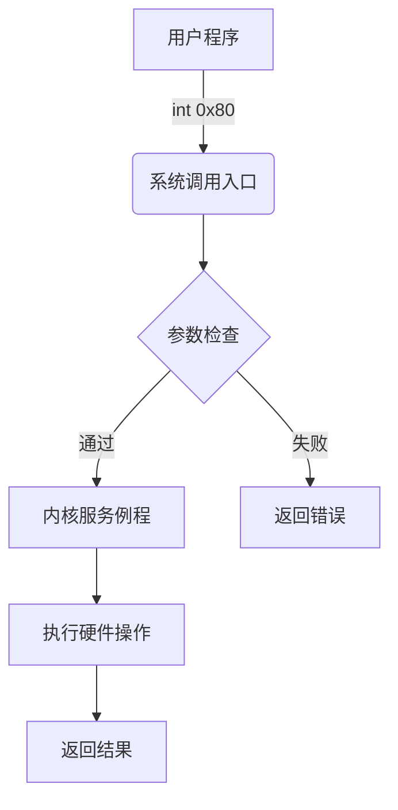
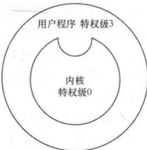
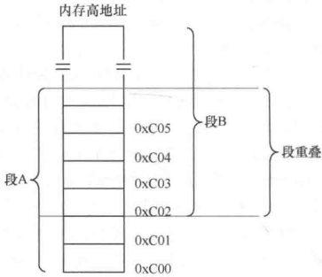
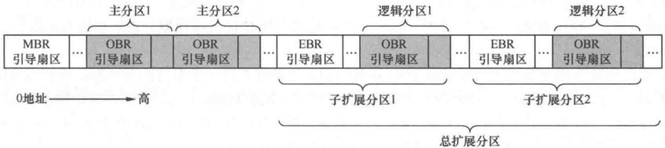

# 第0章 一些你可能正感到迷惑的问题

> **本章导读**：操作系统开发之旅充满迷雾，本章将拨开云雾见青天。从操作系统本质到内存分段机制，从编译原理到指令集架构，我们将直面初学者最困惑的26个核心问题，用简洁代码和清晰图表为您扫清学习障碍，为后续实战打下坚实基础。

## 0.1 操作系统是什么

> **核心洞察**：操作系统是计算机世界的"政府"，既是资源管理者又是服务提供者。它通过分层架构实现硬件与软件的完美协作。

**类比模型**：

```C
// 操作系统 = 资源管理者 + 服务提供者
struct OperatingSystem {
    ResourceManager rm;  // 硬件资源管理（CPU、内存、外设）
    ServiceProvider sp;  // 为应用程序提供系统服务
};
```

**分层架构**：

```
| 应用程序 |  ← 用户空间
|------------|
| 系统调用  |  ← 接口层
|------------|
| 内核服务  |  ← 核心层
|------------|
| 硬件抽象 |  ← 驱动层
|------------|
| 物理硬件 |  ← 硬件层
```

## 0.2 你想研究到什么程度

> **学习定位**：明确学习边界是高效学习的关键。操作系统开发需要聚焦核心原理，避免陷入无限递归的知识黑洞。

**知识边界模型**：

```
          +-----------------+
          | 应用层开发      | ← 无需深入
          +-----------------+
          | 系统调用实现    | ← 核心关注
          +-----------------+
          | 硬件抽象层      | ← 适度掌握
          +-----------------+
          | 晶体管物理实现 | ← 无需深入
          +-----------------+
```

## 0.3 写操作系统，哪些需要我来做

> **职责划分**：操作系统开发者需聚焦硬件交互与核心服务，硬件细节由厂商封装提供。

**开发矩阵**：

| 任务类型 | 开发者职责                   | 硬件/固件职责          |
| -------- | ---------------------------- | ---------------------- |
| 内存管理 | 设计页表结构，实现分配算法   | 提供分页机制硬件支持   |
| 进程调度 | 设计调度策略，实现上下文切换 | 提供定时器中断         |
| 文件系统 | 设计存储结构，实现读写接口   | 提供磁盘控制器操作接口 |
| 设备驱动 | 实现设备控制逻辑             | 提供设备寄存器规范     |

## 0.4 软件是如何访问硬件的

> **访问机制**：软件通过IO接口与硬件通信，本质是读写设备寄存器。

**硬件访问模型**：

```C
// 示例：通过端口映射访问硬件
#define VIDEO_MEMORY 0xB8000 // 显存映射地址

void print_char(char c, int pos) {
    volatile char* vmem = (volatile char*)VIDEO_MEMORY;
    vmem[pos*2] = c;      // 字符ASCII
    vmem[pos*2+1] = 0x07; // 属性字节（白底黑字）
}
```

**两种访问方式**：

1. **内存映射IO**：硬件寄存器映射到内存地址空间
2. **端口IO**：通过专用IO指令访问硬件端口

```asm
; 端口IO示例
in al, 0x60    ; 从键盘控制器读取数据
out 0x20, al   ; 向中断控制器发送命令
```

## 0.5 应用程序是什么，和操作系统是如何配合到一起的

> **协作模型**：应用程序通过系统调用使用操作系统服务，形成"用户-内核"协作体系。

**系统调用流程**：



`int 0x80` 是 **x86 32 位 Linux** 的**软中断指令**，用来触发系统调用（用户态 → 内核态）。

> `int 0x80` 只用于 **32 位 i386 Linux**；64 位 x86_64 Linux 不再用 `int 0x80`，改用 `syscall` 指令。

!!! abstract "软中断（软件中断）"

    一句话：**不是硬件引脚触发、而是 CPU 执行一条指令主动触发的中断，就叫软中断**。

    **硬中断 vs 软中断对比**

    - **硬中断**：外部硬件（网卡、键盘、硬盘）通过主板上的物理信号线，给 CPU 发信号 → CPU 停下当前代码，去处理硬件事件。
    > 
    > 例子：键盘按下，硬件触发中断。硬件主动 “打断” CPU。
    - **软中断**：**软件代码执行专门指令，主动叫 CPU 进入中断处理流程**，没有外部硬件信号。是程序自己主动请求进入内核。
    > 
    > 例子：`int 0x80`，程序执行这条汇编指令，主动触发中断。

    > 
    > 关键词区分：
    >
    > - 中断本质：改变 CPU 执行流，切换到中断处理函数，**进入内核态**。
    > - 硬中断：硬件发起；软中断：软件指令发起。

**特权级转换**：

```
用户态(3) → 系统调用 → 内核态(0) → 返回 → 用户态(3)
```

## 0.6 为什么称为“陷入”内核

> **形象解析**：用户程序通过系统调用进入内核态，如同陷入核心执行层。



## 0.7 内存访问为什么要分段

> **历史根源**：分段机制解决了16位时代寻址空间限制问题，实现内存高效管理。

**地址转换原理**：

```
逻辑地址 = 段基址:偏移地址
物理地址 = (段基址 << 4) + 偏移地址
```

**实模式寻码示例**：

```asm
mov ax, 0x07C0   ; 设置数据段基址
mov ds, ax
mov si, msg       ; 偏移地址
mov al, [si]      ; 实际访问物理地址 = 0x07C0<<4 + msg

; ds(Data Segment，数据段寄存器) = 数据段的段基址（段地址）
; 8086 CPU 的硬件规定：段寄存器不能直接用立即数赋值，不允许写 mov ds, 0x07C0
```

## 0.8 代码中为什么分为代码段、数据段

> **设计哲学**：分段提升程序安全性与执行效率，实现逻辑隔离与硬件优化。

**段寄存器功能表**：

| 段寄存器 | 用途       | 特权级 | 典型属性    |
| -------- | ---------- | ------ | ----------- |
| CS       | 代码段     | CPL    | 只读/可执行 |
| DS       | 数据段     | DPL    | 读写        |
| SS       | 栈段       | CPL    | 读写        |
| ES       | 附加数据段 | DPL    | 读写        |

**保护模式段描述符**：

```C
struct SegmentDescriptor {
    uint16_t limit_low;     // 段界限0-15
    uint16_t base_low;      // 段基址0-15
    uint8_t base_mid;       // 段基址16-23
    uint8_t type : 4;       // 段类型
    uint8_t s : 1;          // 系统段标志
    uint8_t dpl : 2;        // 描述符特权级
    uint8_t present : 1;    // 存在位
    uint8_t limit_high : 4; // 段界限16-19
    uint8_t avl : 1;        // 可用位
    uint8_t reserved : 1;   // 保留
    uint8_t db : 1;         // 操作数大小
    uint8_t g : 1;          // 粒度
    uint8_t base_high;      // 段基址24-31
};
```

## 0.9 物理地址、逻辑地址、有效地址、线性地址、虚拟地址的区别

> **地址体系**：五层地址转换体系是现代操作系统内存管理核心。

**地址转换流程**：

```
逻辑地址 → 分段转换 → 线性地址 → 分页转换 → 物理地址
```

**地址类型对照表**：

| 地址类型 | 产生位置     | 组成形式          | 示例            |
| -------- | ------------ | ----------------- | --------------- |
| 有效地址 | 指令译码阶段 | 纯偏移量          | [bx+si+0x10]    |
| 逻辑地址 | 程序编写阶段 | 段选择子:有效地址 | 0x08:0x00001000 |
| 线性地址 | 分段单元输出 | 32位连续地址      | 0x08001000      |
| 虚拟地址 | 分页机制输入 | 同线性地址        | 0x08001000      |
| 物理地址 | 页表转换输出 | 实际内存地址      | 0x0010A000      |

## 0.10 什么是段重叠

> **机制解析**：段重叠允许多个逻辑段映射相同物理区域，实现内存高效复用。



**段重叠计算**：

```
// 段A：基址0xC00 范围0xC00~0xCFF
// 段B：基址0xC02 范围0xC02~0xD01
// 重叠区域：0xC02~0xCFF
```

## 0.11 什么是平坦模型

> **现代架构**：平坦模型简化内存管理，32位系统下实现4GB线性地址空间统一访问。

**平坦模型配置**：

```asm
; 设置GDT全局描述符表
gdt_start:
    dq 0x0000000000000000   ; 空描述符
    dq 0x00CF9A000000FFFF   ; 代码段：基址0，界限0xFFFFF，粒度4KB
    dq 0x00CF92000000FFFF   ; 数据段：基址0，界限0xFFFFF，粒度4KB
gdt_end:

; 加载GDTR
mov eax, gdt_start
mov [gdtr + 2], eax
lgdt [gdtr]
```

## 0.12 CS、DS这类sreg段寄存器，位宽是多少

> **硬件真相**：段寄存器固定16位宽，在保护模式下存储段选择子。

**段选择子结构**：

```
 15              3 2 1 0
+-----------------+-+---+
|     索引        |TI|RPL|
+-----------------+-+---+
```

## 0.13 什么是工程，什么是协议

> **开发基础**：工程是开发实体，协议是交互规范。

**开发要素对比**：

| 概念 | 定义               | 示例              |
| ---- | ------------------ | ----------------- |
| 工程 | 软件项目组织单元   | Linux内核源代码树 |
| 协议 | 通信/交互规范      | TCP/IP网络协议栈  |
| 接口 | 功能访问点         | 系统调用表        |
| ABI  | 应用二进制接口规范 | ELF文件格式       |

## 0.14 为什么Linux系统下的应用程序不能在Windows系统下运行

> **兼容壁垒**：三大差异导致跨平台运行障碍。

**不兼容原因**：

1. **文件格式差异**

	- Linux：ELF格式
	- Windows：PE格式

2. **系统API差异**

	```asm
	// Linux系统调用
	mov eax, 1    ; sys_exit
	int 0x80
	
	// Windows API调用
	call ExitProcess
	```

3. **库依赖差异**

	- Linux：glibc
	- Windows：msvcrt.dll

## 0.15 局部变量和函数参数为什么要放在栈中

> **栈的优势**：栈提供自动生命周期管理和高效内存复用。

**函数调用栈帧**：

```
+-----------------+
| 返回地址        | ← 调用者保存
+-----------------+
| 旧ebp           | ← 当前栈帧开始
+-----------------+
| 局部变量1       |
+-----------------+
| 局部变量2       |
+-----------------+
| 参数1           | ← 被调用者访问
+-----------------+
| 参数2           |
+-----------------+
```

## 0.16 为什么说汇编语言比C语言快

> **性能真相**：汇编优势在于精确控制，而非绝对速度。

**性能对比表**：

| 对比维度 | 汇编语言           | C语言              |
| -------- | ------------------ | ------------------ |
| 指令控制 | 直接控制CPU指令    | 编译器生成指令     |
| 优化空间 | 可手工优化关键路径 | 依赖编译器优化能力 |
| 可维护性 | 差                 | 好                 |
| 开发效率 | 低                 | 高                 |
| 实际速度 | 特定场景快         | 整体优化后更快     |

## 0.17 先有的语言，还是先有的编译器，第1个编译器是怎么产生的

> **自举之谜**：编译器通过渐进式自举实现自我进化。

**编译器自举过程**：

```
机器码编译器0 → 汇编编译器1 → C编译器2 → 优化C编译器3
```

## 0.18 编译型程序与解释型程序的区别

> **执行差异**：编译型程序直接运行，解释型程序需要运行时环境。

**执行流程对比**：

```
编译型：
源代码 → 编译器 → 机器码 → CPU执行

解释型：
源代码 → 解释器逐行解析 → 解释器执行
```

## 0.19 什么是大端字节序、小端字节序

> **字节序**：多字节数据在内存中的存储顺序差异。

**存储方式对比**：

```
数值0x12345678存储：

大端序（Big-Endian）：
地址：0x00  0x01  0x02  0x03
数据：0x12  0x34  0x56  0x78

小端序（Little-Endian）：
地址：0x00  0x01  0x02  0x03
数据：0x78  0x56  0x34  0x12
```

**检测代码**：

```C
#include <stdio.h>

int main() {
    int num = 0x12345678;
    char* p = (char*)#
    
    if (*p == 0x78) {
        printf("Little-Endian\n");
    } else {
        printf("Big-Endian\n");
    }
    return 0;
}
```

## 0.20 BIOS中断、DOS中断、Linux中断的区别

> **中断演进**：三代中断机制反映操作系统发展历程。

**中断对比表**：

| 特性       | BIOS中断              | DOS中断        | Linux中断         |
| ---------- | --------------------- | -------------- | ----------------- |
| 运行模式   | 实模式                | 实模式         | 保护模式          |
| 中断表     | IVT(中断向量表)       | IVT            | IDT(中断描述符表) |
| 安装方式   | 固件初始化            | DOS运行时安装  | 内核初始化        |
| 典型中断号 | 0x10(视频),0x13(磁盘) | 0x21(系统功能) | 0x80(系统调用)    |
| 特权级     | 0级                   | 0级            | 0级               |

## 0.21 Section和Segment的区别

> **链接视角**：Section是编译单元，Segment是执行视图。

**ELF文件结构**：

```C
ELF Header
Program Headers (Segments)
  Segment1 → 包含多个Section
  Segment2 → 包含多个Section
Section Headers
  .text Section
  .data Section
  .bss Section
  ...
```

**映射关系**：

```C
// Segment包含Section示例
Text Segment {
    .text Section
    .rodata Section
}

Data Segment {
    .data Section
    .bss Section
}
```

## 0.22 什么是魔数

> **文件指纹**：魔数是文件格式的标识签名。

**常见魔数**：

| 文件格式 | 魔数值        | ASCII表示 |
| -------- | ------------- | --------- |
| ELF      | 0x7F 45 4C 46 | .ELF      |
| PNG      | 0x89 50 4E 47 | .PNG      |
| JPEG     | 0xFF D8 FF E0 | 不可打印  |
| ZIP      | 0x50 4B 03 04 | PK..      |

## 0.23 操作系统是如何识别文件系统的

> **识别机制**：通过超级块魔数识别文件系统类型。

**文件系统识别流程**：

```
读取磁盘分区 → 定位超级块 → 检查魔数 → 匹配文件系统类型
```

**常见文件系统魔数**：

| 文件系统 | 魔数值   |
| -------- | -------- |
| ext2     | 0xEF53   |
| NTFS     | "NTFS "  |
| FAT32    | "FAT32 " |

## 0.24 如何控制CPU的下一条指令

> **流程控制**：通过修改程序计数器改变执行流。

**控制方式**：

```asm
; 1. 直接跳转
jmp label

; 2. 函数调用
call function

; 3. 中断触发
int 0x80

; 4. 修改程序计数器（特殊架构）
mov pc, address
```

## 0.25 指令集、体系结构、微架构、编程语言

> **计算机层次**：四层抽象构建完整计算机系统。

**计算机体系金字塔**：

```
| 应用软件     | ← 高级语言实现
|--------------|
| 编程语言     | ← C/C++/Rust等
|--------------|
| 指令集架构   | ← x86/ARM/RISC-V
|--------------|
| 微架构       | ← Intel Core/AMD Zen
|--------------|
| 物理硬件     | ← 晶体管/电路
```

## 0.26 库函数是用户进程与内核的桥梁

> **桥梁作用**：库函数封装系统调用，简化用户程序开发。

**调用链**：

```
用户程序 → 库函数 → 系统调用 → 内核服务
```

**glibc封装示例**：

```C
// write系统调用封装
ssize_t write(int fd, const void *buf, size_t count) {
    return syscall(SYS_write, fd, buf, count);
}
```

## 0.27 转义字符与ASCII码

> **编码艺术**：转义字符提供特殊字符表示方法。

**常用转义字符**：

| 转义序列 | ASCII值 | 描述     |
| -------- | ------- | -------- |
| \n       | 0x0A    | 换行     |
| \r       | 0x0D    | 回车     |
| \t       | 0x09    | 水平制表 |
| \\       | 0x5C    | 反斜杠   |
| \0       | 0x00    | 空字符   |

## 0.28 MBR、EBR、DBR和OBR各是什么

> **引导体系**：四类引导记录构成系统启动链条。

**引导记录对比表**：

| 类型 | 全称                 | 位置                | 大小    | 主要功能            |
| ---- | -------------------- | ------------------- | ------- | ------------------- |
| MBR  | Master Boot Record   | 磁盘0柱面0磁道1扇区 | 512字节 | 分区表+初始引导程序 |
| EBR  | Extended Boot Record | 扩展分区起始扇区    | 512字节 | 逻辑分区表          |
| DBR  | DOS Boot Record      | 分区起始扇区        | 512字节 | DOS系统引导程序     |
| OBR  | OS Boot Record       | 分区起始扇区        | 512字节 | 操作系统引导程序    |

**磁盘布局**：



------

## 本章总结

1. **操作系统本质**：资源管理者与服务提供者双重角色
2. **内存管理基础**：分段机制解决寻址限制，平坦模型简化现代系统
3. **地址体系**：五层地址转换（逻辑→线性→物理）
4. **编译原理**：编译器自举实现自我进化
5. **系统启动**：MBR→OBR引导链启动操作系统
6. **硬件交互**：端口IO与内存映射IO两种方式
7. **执行差异**：编译型与解释型程序本质区别
8. **开发基础**：工程组织与协议规范的重要性
9. **跨平台壁垒**：文件格式、系统API、库依赖三重障碍
10. **指令集体系**：指令集→微架构→编程语言层次关系

> **学习建议**：本章概念是操作系统开发基石，建议结合实践代码加深理解。后续章节将逐步实现这些理论概念。