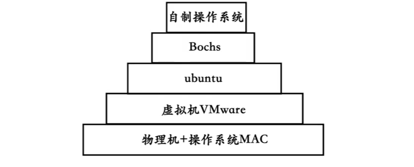

# 第1章 部署工作环境

> **本章导读**：工欲善其事，必先利其器，操作系统开发之旅始于环境搭建。
>
> 本章将构建完整的开发工具链，从虚拟机配置到编译器选型，一步步搭建起操作系统开发的"数字实验室"。[学习视频](https://www.bilibili.com/video/BV1rT4AzbE8v?spm_id_from=333.788.player.switch&vd_source=2a33d03ec3e67e46971208a7faa0dcda&trackid=web_related_0.router-related-2589621-4d422.1789290968178.168)，[源代码](https://github.com/lingyu11/dahuashuoke_os/tree/main)。

## 1.1 工欲善其事，必先利其器

操作系统虽属底层软件，但依然可用高级语言构建。

开发者用C语言构建GCC编译器，我们同样能用高效工具开发操作系统。关键在于选择合适的工具链：

> Bochs是一个 开源的 IA-32（x86）PC 模拟器，它可以在电脑上完整模拟出一台个人计算机——从 CPU、内存、硬盘、显卡、键盘，到 BIOS，全都用软件"造"出来。

{ width="520" }

## 1.3 操作系统的宿主环境

### 1.3.1 什么是虚拟机

虚拟机解决的核心问题：

​	**资源隔离**：单物理机多用户环境  **安全测试**：崩溃不影响宿主机.  **环境复制**：快速部署相同配置

​    **选择Bochs的理由**：开源免费、内置调试器、精准模拟x86架构

### 1.3.2 开发环境架构

```
物理机（Win/Mac/Linux）
└── VirtualBox虚拟机
    └── CentOS系统
        └── Bochs模拟器
            └── 自开发操作系统
```

### 1.3.3 Bochs安装

基于6.18.33.2-microsoft-standard-WSL2 Ubuntu 26.04 LTS。

**编译安装步骤**：

安装需要的东西: 

```shell
sudo apt update
sudo apt install build-essential nasm
sudo apt install libsdl2-dev libsdl2-ttf-dev

# WSL 下必须用 SDL2 作为显示库
# 真实Linux才需要：sudo apt-get install libghc-x11-dev
# 真实Linux才需要：sudo apt-get install xorg-dev
```

下载bochs 2.7 并安装到`/usr/local/bochs`目录下: 

```shell
wget https://sourceforge.net/projects/bochs/files/bochs/2.7/bochs-2.7.tar.gz
tar -zxvf bochs-2.7.tar.gz
cd bochs-2.7
# 配置安装选项
./configure --prefix=/usr/local/bochs --enable-debugger --enable-disasm --enable-iodebug --enable-x86-debugger --with-sdl2 LDFLAGS='-pthread'
# 编译
make -j$(nproc)
# 安装
sudo make install

# WSL要用上面的--with-sdl2，如果是真实Linux则：./configure --prefix=/usr/local/bochs --enable-debugger --enable-disasm --enable-iodebug --enable-x86-debugger --with-x --with-x11 LDFLAGS='-pthread'
```

## 1.2 我们需要哪些编译器

### 1.2.1 世界顶级编译器GCC

**选择理由**：支持多平台开发、成熟的优化能力、丰富的语言特性支持

### 1.2.2 汇编语言编译器新贵NASM

**核心优势**：免费开源、语法简洁（类Intel语法）、跨平台支持

**典型应用场景**：

```asm
; 示例：端口读写（必须用汇编实现）
in al, 0x60     ; 从键盘控制器读取数据（从 I/O 端口 0x60 读取1 字节到 al 寄存器）
out 0x20, al    ; 向中断控制器发送命令（将 al 寄存器中的1 字节写入 I/O 端口 0x20）
```

## 1.4 配置Bochs

```shell
# 创建配置文件目录
cd /usr/local/bochs

# 创建基本配置文件bochsrc.disk
vi bochsrc.disk
```

**配置文件示例** (`bochsrc.disk`)：

```apl
megs : 32
romimage: file=/usr/local/bochs/share/bochs/BIOS-bochs-latest
vgaromimage: file=/usr/local/bochs/share/bochs/VGABIOS-lgpl-latest
boot: disk
log: bochs.out
mouse:enabled=0
display_library: sdl2
keyboard: keymap=/usr/local/bochs/share/bochs/keymaps/sdl2-pc-us.map
ata0:enabled=1,ioaddr1=0x1f0,ioaddr2=0x3f0,irq=14
ata0-master: type=disk, path="hd60M.img", mode=flat,cylinders=121,heads=16,spt=63
```

## 1.5 运行测试Bochs

**测试汇编程序 mbr.s**

> mbr.s 是经典的 "Hello World" 引导扇区，作用是让计算机启动后在屏幕上显示文字。Master Boot Record，磁盘第一个扇区（512字节），会被加载到内存 0x7c00 处，这是 BIOS 约定。

```asm
SECTION MBR vstart=0x7c00       ; MBR标准加载地址
	mov ax,0x0000	            ; 初始化栈段寄存器
	mov ss,ax
	mov ax,0x7c00	            ; 栈顶指针指向0x7c00（向下增长）
	mov sp,ax	
 
	mov ax,0x0600	            ; 功能06H:滚动窗口
	mov bx,0x0700	            ; BH=07H:黑底白字属性
	mov cx,0x0000	            ; 左上角坐标(0,0)
	mov dx,0x184f	            ; 右下角坐标(79,24)[6](@ref)
	int 0x10	                ; 调用BIOS中断 -> 清屏
	
	mov ax,0x0300	            ; 功能03H:获取光标位置
	mov bx,0x0000	            ; BH=页号(0)
	int 0x10	                ; 调用BIOS中断
	
	mov ax,0x0000               ; 设置ES段寄存器
	mov es,ax
	
	mov ax,message              ; 获取字符串地址
	mov bp,ax                   ; ES:BP指向字符串
	
	mov ax,0x1301	            ; 功能13H:写字符串(AL=01H:光标跟随移动)
	mov bx,0x0007	            ; BH=页号(0),BL=属性(07H:黑底白字)
	mov cx,0x000c	            ; 字符串长度(12字符)
	int 0x10	                ; 调用BIOS中断 -> 显示字符串
	
	jmp $	                    ; 无限循环(保持程序运行)
	message db "Hello World!"   ; 要显示的字符串
	times 510-($-$$) db 0       ; 填充剩余空间(确保512字节)
	db 0x55,0xaa                ; MBR结束标志[6,7,8](@ref)
```

**程序运行准备**

```sh
# step0 创建mbr.s
cd /usr/local/bochs
vi mbr.s
# step1 编译生成生成二进制文件
nasm -o mbr.bin mbr.s
# step2 创建虚拟磁盘
/usr/local/bochs/bin/bximage 
1
hd
flat
512
60
hd60M.img
# step3 二进制文件写进磁盘
dd if=/usr/local/bochs/mbr.bin of=/usr/local/bochs/hd60M.img bs=512 count=1 conv=notrunc
```

**程序启动命令**

```shell
cd /usr/local/bochs
bin/bochs -f bochsrc.disk # 必须在root权限下运行
```

启动之后，输入c即可看见Hello World!

------

## 本章总结

1. **工具链选择**：

    C编译器：GCC（版本≥11.4）								汇编器：NASM（版本≥2.15）

1. **环境架构**：

	```linenums="0"
	物理机 → VMware → ubuntu → Bochs → 自开发OS
	```

2. **关键配置**：

    Bochs编译参数：启用调试功能

    硬盘创建：bximage工具

3. **排错重点**：

    编译错误：添加`-lpthread`链接选项

    启动失败：检查硬盘路径和引导标志

4. **开发流程**：

    ```mermaid
    graph TD
    A[编写源码] --> B[编译]
    B --> C[生成镜像]
    C --> D[Bochs加载]
    D --> E[调试运行]
    ```

> **环境验证**：
>
> 成功运行Bochs并显示`Hello World`，表明环境搭建完成。