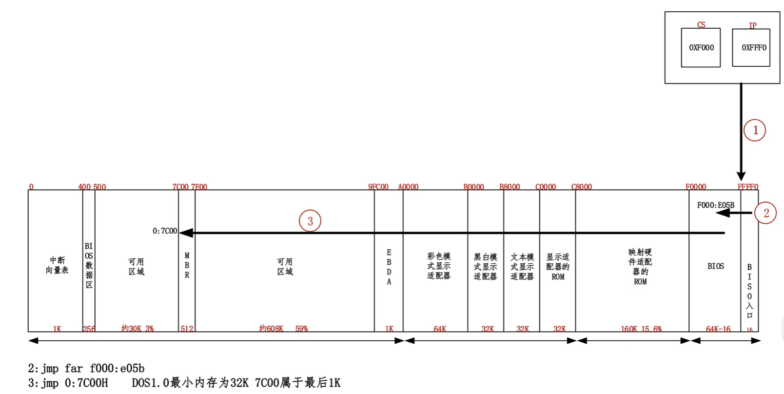
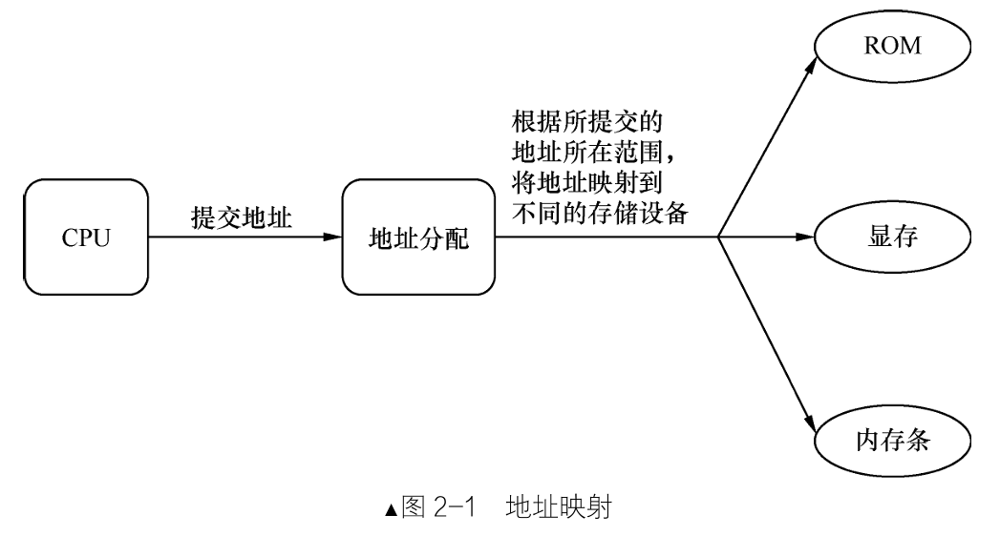
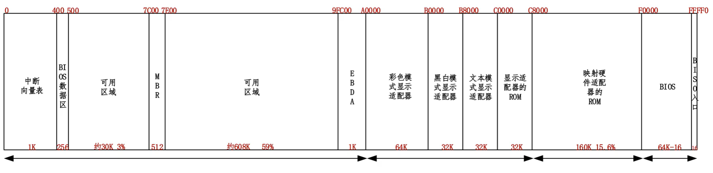
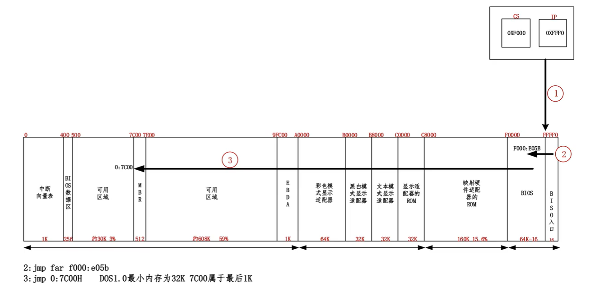
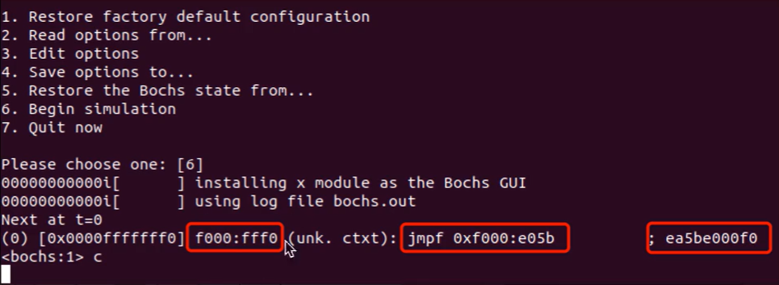
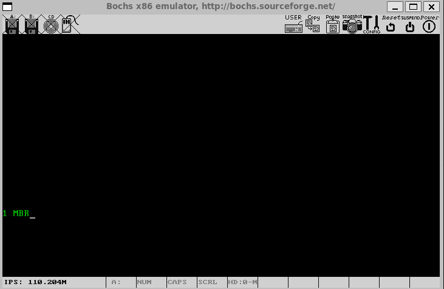

# 第2章 编写MBR主引导记录，开始掌权

> **本章导读**：
>
> 本章将带您深入计算机启动流程，解密实模式内存布局。
>
> 并且编写第一个裸机程序——主引导记录(MBR)，自此迈出操作系统开发的第一步。
>
> 计算机启动的奥秘从BIOS到MBR的接力开始。

## 2.1 计算机的启动过程

> **核心洞察**：程序必须载入内存才能执行，这是CPU的硬件设计决定的。
>
> 启动过程是精心设计的接力赛，BIOS完成硬件初始化后，需将控制权交给MBR。

**启动大概流程**：



!!! abstract "实模式下的1MB内存布局"

    8086 CPU 一共有20位地址线，所以它可以访问 1MB 的内存。8086内部寄存器是 16 位，所以采用 **段基址：偏移地址** 的方式合成 20 位物理地址：

    \(\boldsymbol{物理地址 = 段地址 \times 16 + 偏移地址}\)

    这 1MB的内存空间布局如上图所示：（0~0xFFFFF）

## 2.2 软件接力第一棒，BIOS

> **BIOS本质**：固化在ROM中的基础输入输出系统，负责硬件初始化和启动流程控制。

{ width="520" }

### 2.2.1 实模式下的1MB内存布局

**内存映射表**：



### 2.2.2 BIOS是如何苏醒的



**唤醒流程**：

1. 通电瞬间CPU强制设置CS:IP = 0xF000:0xFFF0
2. 执行0xFFFF0处的跳转指令
3. 跳转到0xFE05B开始执行真正的BIOS代码
4. BIOS进行硬件检测和初始化
5. 建立中断向量表(IVT)



### 2.2.3 为什么是0x7c00

**历史原因**：
:   早期PC最小内存32KB（0x8000）
:   MBR需要512字节+栈空间≈1KB
:   32KB末尾预留1KB：0x8000 - 0x400 = 0x7C00
:   BIOS约定将MBR加载到此地址

**验证过程**：

```asm
; BIOS加载MBR后的跳转指令
jmp 0:0x7c00  ; 设置CS=0, IP=0x7c00
```

## 2.3 让MBR先飞一会儿

> **MBR使命**：512字节的主引导记录，负责加载操作系统并移交控制权。

### 2.3.1 `$`、`$$` 和 section 符号

**NASM关键字解析**：

```asm
section mbr vstart=0x7c00  ; 定义代码段，虚拟起始地址0x7c00
start:
    mov ax, cs
    mov ds, ax
    
    ; $表示当前行地址
    ; $$表示当前section起始地址
    mov si, $       ; SI = 当前指令地址
    mov di, $$      ; DI = 0x7c00
    
    ; 计算剩余空间填充
    times 510-($-$$) db 0
    db 0x55, 0xaa   ; MBR结束标志
```

### 2.3.2 NASM简单用法

**编译命令**：

```sh
nasm -f bin mbr.s -o mbr.bin  # 生成纯二进制文件
```

**输出格式**：

| 格式  | 描述             | 适用场景      |
| ----- | ---------------- | ------------- |
| bin   | 纯二进制(默认)   | MBR、引导程序 |
| elf   | ELF可执行文件    | 操作系统内核  |
| macho | Mac OS可执行文件 | Mac开发环境   |


### 2.3.3 请下一位选手MBR同学做准备

**MBR示例代码**：

```asm
; 主引导程序
SECTION MBR vstart=0x7c00
    ; 初始化段寄存器
    mov ax, cs
    mov ds, ax
    mov es, ax
    mov ss, ax
    mov fs, ax
    mov sp, 0x7c00  ; 栈指针初始化

    ; 清屏功能(INT 0x10, AH=0x06)
    ; AL=0: 全部行; BH=属性(0x07灰底白字)
    ; CX=(0,0): 左上角坐标; DX=(24,79): 右下角坐标
    mov ax, 0x0600
    mov bx, 0x0700
    mov cx, 0x0000
    mov dx, 0x184f
    int 0x10

    ; 获取光标位置(INT 0x10, AH=0x03)
    ; BH=0: 第0页
    mov ah, 0x03
    mov bh, 0
    int 0x10

    ; 打印字符串(INT 0x10, AH=0x13)
    ; ES:BP=字符串地址; CX=字符串长度
    ; DH=行号; DL=列号; BL=属性(0x02绿字)
    mov ax, message
    mov bp, ax
    mov cx, 5
    mov ax, 0x1301
    mov bx, 0x0002
    int 0x10

    jmp $  ; 无限循环

message db "1 MBR"
times 510-($-$$) db 0
db 0x55, 0xaa
```

**代码功能说明：**

| 功能 | 说明 |
| --- | --- |
| 清屏 | 使用 BIOS 中断 `0x10` 的 `06h` 号功能 |
| 获取光标 | 使用 `03h` 号功能获取当前光标位置 |
| 打印字符串 | 使用 `13h` 号功能在光标处打印 |
| 填充扇区 | 确保大小为 512 字节，最后两个字节为 `0x55, 0xaa` |

**写入磁盘命令**：

```sh
dd if=mbr.bin of=hd60M.img bs=512 count=1 conv=notrunc
```

**运行效果**：



------

## 本章总结

1. **启动流程**：通电 → BIOS初始化 → 加载MBR → 执行MBR

2. **内存布局**：实模式1MB内存严格分区，BIOS位于顶部64KB

3. **BIOS入口**：0xFFFF0处跳转指令进入BIOS主程序

4. **MBR规范：**
    - 位于磁盘0盘0道1扇区
    - 大小严格512字节
    - 最后两个字节为 `0x55, 0xaa`
    - 被加载到 `0x7C00` 执行

5. **开发工具：**
    - 使用 NASM 汇编器编译 MBR
    - 使用 `dd` 命令写入磁盘映像

6. **调试方法**：Bochs模拟器运行和调试MBR

7. **核心概念**：BIOS中断调用


> **实践建议**：亲手编写并运行第一个MBR程序是操作系统开发的重要里程碑。
>
> 理解BIOS到MBR的控制权交接过程，为后续操作系统的加载奠定基础。