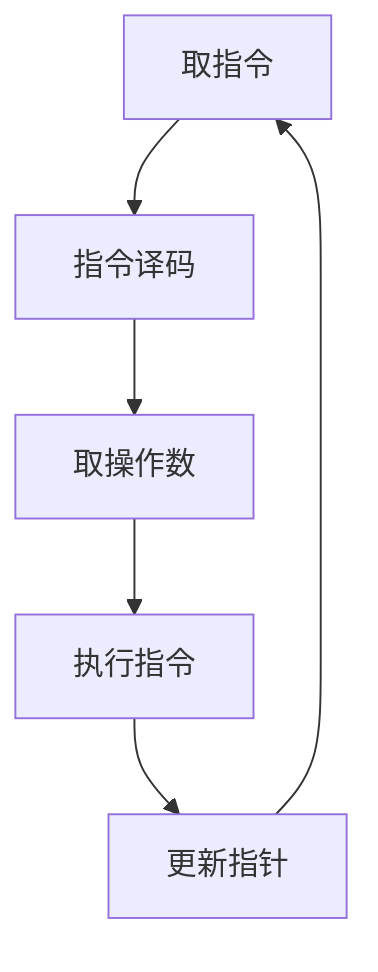
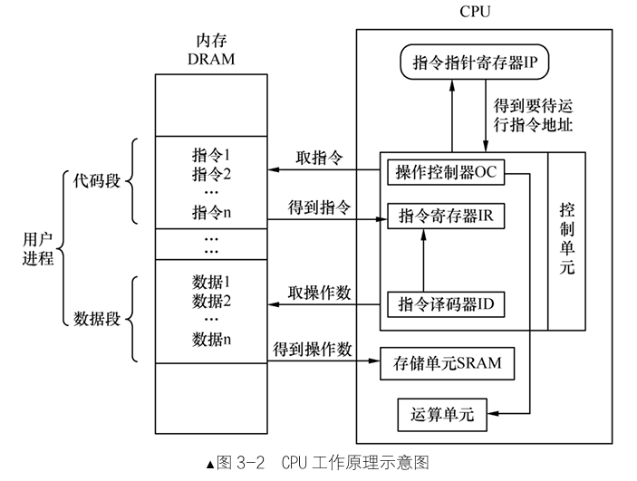
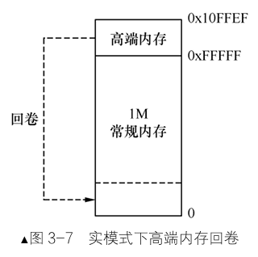
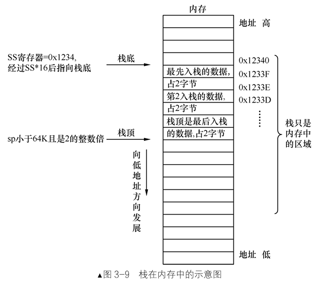
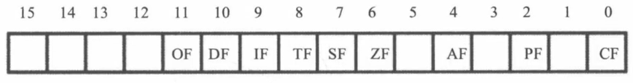
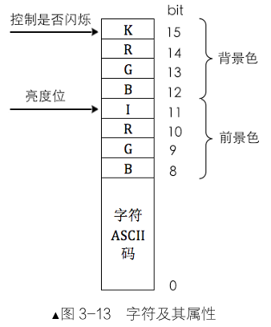
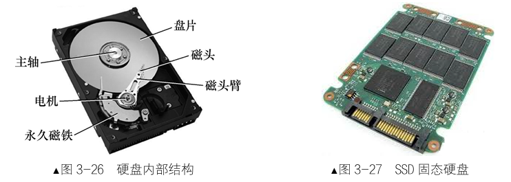
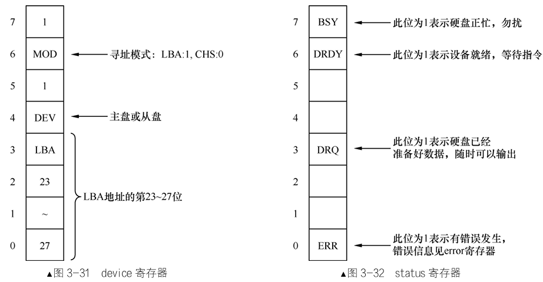
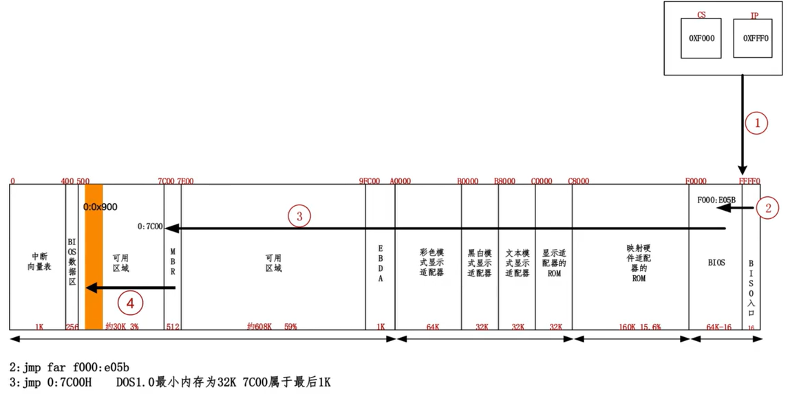

# 第3章 完善MBR

> **本章导读**：MBR最多只能是512字节，因此很多功能需要由loader完成，本章将在MBR雏形的基础上进一步完善MBR，使MBR可以加载lodaer，并将控制权移交给loader。
>
> 为完善MBR，本章将深入讲解地址空间规划、实模式工作原理、显存操作和硬盘控制。

## 3.1 地址、section、vstart浅尝辄止

> **核心概念**：本节深入分析地址本质、section作用和vstart的实际应用，进一步理解程序编址原理。

### 3.1.1 什么是地址

地址是符号在程序中的偏移位置，由编译器分配。

**示例说明：**

```asm
; 示例代码展示地址分配       反汇编代码		  机器码或数据        地址
mov ax, $$      			;mov ax,0x0			B80000			   00000000
mov ds, ax      			;mov ds,ax			8ED8			   00000003
mov ax, [var]   			;mov ax,[0xd]  		A10D00			   00000005
label: mov ax, $			;mov ax,0x8			B80800			   00000008
jmp label       			;jmp short 0x8		EBFB			   0000000B
var dw 0x0099     		    ;					99				   0000000D
     					    ;					00				   0000000E
```

**地址分配规律**：

- 每个符号地址 = 前一个地址 + 前一个地址内容长度
- 编译器自动计算并替换标号为实际地址
- 数据存储遵循小端字节序

### 3.1.2 什么是section

Section是逻辑程序段，用于代码组织，不影响实际地址分配。

**示例说明**：

```asm
                           ; 机器码或数据				地址                  
section code							 
mov ax, $$                 ; B80000               00000000
mov ax, section.data.start ; B81000               00000003
mov ax, [var1]             ; A11000               00000006
mov ax, [var2]             ; A11400               00000009
label:jmp label            ; EBFE                 0000000C
                           ; 0000                 0000000E ;为了内存对齐，下一个
                                                           ;section地址为16的整数倍
section data
var1 dd 0x4                ; 0400                 00000010
                           ; 0000                 00000012
var2 dw 0x0099             ; 99                   00000014
						   ; 00                   00000015
```

**Section特性**：

- 逻辑划分，方便代码管理
- 编译器可合并相同类型section
- 编译后section本身不占用地址，但会引起内存对齐

### 3.1.3 什么是vstart

vstart设置虚拟起始地址，影响section内编址。

**示例说明**：

```asm
section code vstart=0x7c00
mov ax, $$          	   ; 编译: mov ax,0x7c00
mov ax, section.code.start ; 编译: mov ax,0x0
mov ax, section.data.start ; 编译: mov ax,0x14
mov ax, $           	   ; 编译: mov ax,0x7c09
mov ax, [var1]             ; 编译: mov ax,[0x900]
mov ax, [var2]             ; 编译: mov ax,[0x904]
jmp $                      ; 编译: jmp -2 机器码EBFE

section data vstart=0x900
var1 dd 0x4         	   ; 虚拟地址: 0x900
var2 dw 0x99        	   ; 虚拟地址: 0x904
```

**vstart作用机制**：

- 不影响程序在文件中的实际偏移

- 设置section内地址编址起始值，必须与加载地址匹配才能正确运行

## 3.2 CPU的实模式

> **实模式揭秘**：掌握8086CPU的工作和内存访问机制，为理解保护模式奠定基础。

### 3.2.1 CPU工作原理

**CPU执行流程**：

不管在什么模式下CPU执行的流程都具有下面的特征。



**核心组件**：

更加详细的说，CPU内部具有以下三个核心组件：

- 控制单元：指令处理流程控制。

- 运算单元：算术逻辑运算执行。

- 存储单元：数据暂存和高速缓存。

{ width="520" }

### 3.2.2 实模式下寄存器

**寄存器分类表**：

| 类型       | 寄存器                 | 功能描述       |
| ---------- | ---------------------- | -------------- |
| 段寄存器   | CS, DS, ES, SS, FS, GS | 内存段基址     |
| 指针寄存器 | IP, SP, BP             | 指令和栈指针   |
| 通用寄存器 | AX, BX, CX, DX, SI, DI | 数据存储和运算 |
| 标志寄存器 | FLAGS                  | 状态标志存储   |

**专用功能(约定)**：

- AX：累加器，主要算术运算
- BX：基址寄存器，内存访问
- CX：计数器，循环控制
- DX：数据寄存器，端口访问

### 3.2.3 实模式下内存分段由来

**分段机制产生原因**：

- 16位寄存器无法直接访问20位地址空间
- 通过"段基址×16 + 偏移"实现1MB寻址
- 解决8086之前地址硬编码问题

**高端内存回卷：**

```linenums="0"
物理地址 = 段寄存器值 × 16 + 偏移地址
CS:IP   =  0xFFFF:0xFFF0 → 0xFFFF0 + 0xFFF0 = 0x10FFE0 → 0x0FFE0
```

{ width="260" }

### 3.2.4 实模式下内存寻址方式

**寻址方式分类**：

1. **寄存器寻址**：操作数在寄存器中

	```asm
	mov ax, 0x10
	mul dx
	```

2. **立即数寻址**：操作数为常数

	```asm
	mov ax, 0x18
	mov ds, ax
	```

3. **内存寻址**：

	- 直接寻址：`mov ax, [0x1234]`
	- 基址寻址：`add word [bx], 0x1234`
	- 变址寻址：`mov [di], ax`
	- 基址变址寻址：`mov [bx+di], ax`

### 3.2.5 栈到底是什么玩意儿

**栈的特点**：

- 栈也是内存的一块存储数据的区域。
- 后进先出(LIFO)数据结构，向下增长（高地址向低地址）。
- 由SS:SP指定栈顶位置，即第一个可用的数据。

{ width="500" }

**栈操作原理**：

```asm
; 压栈操作
push ax  						; 等效于: sub sp, 2 → mov [ss:sp], ax
; 出栈操作  
pop ax   						; 等效于: mov ax, [ss:sp] → add sp, 2
```

### 3.2.7 实模式下的call

**四种调用方式**：

1. **直接相对近调用**（操作数为相对偏移）

	```asm
	call near proc_name  ; 机器码: E8 [相对偏移]
	```

2. **间接绝对近调用**（操作数为寄存器/内存）

	```asm
	call ax              ; 机器码: FF D0
	call [addr]          ; 机器码: FF 16 [地址]
	```

3. **直接绝对远调用**（立即数段和偏移）

	```asm
	call 0:far_proc      ; 机器码: 9A [偏移] [段]
	```

4. **间接绝对远调用**（内存中间接地址）

	```asm
	call far [addr]      ; 机器码: FF 1E [地址]
	```

### 3.2.6 实模式下的ret

**返回指令区别**：

- `ret`：  近返回，从栈弹出2字节→IP
- `retf`：远返回，从栈弹出4字节→IP和CS

**调用约定**：

- near call → near return
- far call → far return

### 3.2.8 实模式下的jmp

**五种跳转方式**：

| 类型           | 指令格式                 | 操作数范围   | 机器码                |
| -------------- | ------------------------ | ------------ | --------------------- |
| 相对短转移     | `jmp short label`        | -128~127     | EB [偏移]             |
| 相对近转移     | `jmp near label`         | -32768~32767 | E9 [偏移]             |
| 间接绝对近转移 | `jmp ax` 或 `jmp [addr]` | 16位地址     | FF E0 或 FF 26 [地址] |
| 直接绝对远转移 | `jmp 0:9000h`            | 32位地址     | EA [偏移][段]         |
| 间接绝对远转移 | `jmp far [addr]`         | 32位地址     | FF 2E [地址]          |

### 3.2.9 标志寄存器flags

**EFLAGS寄存器结构**：



**重要标志位**：

- CF(0)：进位标志
- PF(2)：奇偶标志
- AF(4)：辅助进位标志
- ZF(6)：零标志
- SF(7)：符号标志
- TF(8)：陷阱标志
- IF(9)：中断允许标志
- DF(10)：方向标志
- OF(11)：溢出标志

### 3.2.10 有条件转移

**条件跳转指令示例**：

```asm
cmp ax, bx
je  equal    ; ZF=1时跳转
jne not_equal; ZF=0时跳转
jg  greater  ; SF=OF且ZF=0时跳转
jl  less     ; SF≠OF时跳转
```

### 3.2.11 实模式小结

**实模式特点**：

- 通过分段机制寻址
- 直接物理内存访问
- 无内存保护机制
- 1MB内存空间限制

## 3.3 让我们直接对显示器说点什么

> **显示控制**：第2章利用BIOS中断显示字符串，但是保护模式下是不能使用BIOS中断的，需要绕过BIOS直接操作显卡，实现自主显示输出。

### 3.3.1 CPU如何与外设通信 — **IO接口**

**外设访问原理**：

```linenums="0"
CPU → IO接口 → 外设设备
```

CPU访问不能直接访问外设，通过IO接口间接控制外设，更加准确的说是通过读写IO接口中的寄存器(端口)。

**IO接口功能**：

1. 数据缓冲：解决速度不匹配
2. 信号转换：电平转换和信号调理
3. 数据格式转换：并行/串行转换
4. 时序协调：设备间同步
5. 地址译码：设备选择

**端口访问指令**：

```asm
mov dx 0x90   ; 定位端口
in al, dx     ; 从端口读取数据
out dx, al    ; 向端口写入数据
```

### 3.3.2 显卡概述

**显卡发展**：

- 集成显卡：

	早期的集成显卡是**直接集成在北桥芯片**内部的，从系统主内存中划出一部分作为显存使用。

- 独立显卡：

	独立显卡是一块**独立的、专用于图形处理的电路板**，通过特定接口插在主板上。

	它拥有自己的**图形处理单元(GPU)**、**显存**。PCI/AGP/PCIe接口的发展路径。

- 当前主流：AMD和NVIDIA方案

### 3.3.3 显存、显卡、显示器

> 显卡包含 GPU、显存、显示控制器与视频输出接口；CPU 通过总线向显卡发送绘图指令，显卡完成图形渲染后，通过视频接口输出图像到显示器。

**文本模式显存布局**：

| 起始地址 | 结束地址 | 大小 | 用途               |
| -------- | -------- | ---- | ------------------ |
| 0xB8000  | 0xBFFFF  | 32KB | 文本模式显示适配器 |

**字符显示格式**：

字符ASCII码+属性字节

{width=40%}

**颜色编码表**：

| RGB  | I=0  | I=1    |
| ---- | ---- | ------ |
| 000  | 黑   | 灰     |
| 001  | 蓝   | 浅蓝   |
| 010  | 绿   | 浅绿   |
| 011  | 青   | 浅青   |
| 100  | 红   | 浅红   |
| 101  | 品红 | 浅品红 |
| 110  | 棕   | 黄     |
| 111  | 白   | 亮白   |


### 3.3.4 改进MBR，直接操作显卡

直接操作显卡就是直接往显存里面写入数据，BIOS本身显示字符串的功能也是往显存里面写数据。

**直接写显存示例**：

```asm
; 主引导程序
SECTION MBR vstart=0x7c00
    ; 初始化段寄存器
    mov ax, cs
    mov ds, ax
    mov es, ax
    mov ss, ax
    mov fs, ax
    mov sp, 0x7c00  ; 栈指针初始化

    ; 清屏功能(INT 0x10, AH=0x06)
    ; AL=0: 全部行; BH=属性(0x07灰底白字)
    ; CX=(0,0): 左上角坐标; DX=(24,79): 右下角坐标
    mov ax, 0x0600
    mov bx, 0x0700
    mov cx, 0x0000
    mov dx, 0x184f
    int 0x10


		mov ax, 0xb800
		mov gs, ax          ; 设置显存段
		; 显示绿色背景、红色闪烁的"1 MBR"
		mov byte [gs:0x00], '1'
		mov byte [gs:0x01], 0xA4  ; A4=10100100b(闪烁+绿背景+红前景)
		mov byte [gs:0x02], ' '
		mov byte [gs:0x03], 0xA4
		mov byte [gs:0x04], 'M'  
		mov byte [gs:0x05], 0xA4
		mov byte [gs:0x06], 'B'
		mov byte [gs:0x07], 0xA4
		mov byte [gs:0x08], 'R'
		mov byte [gs:0x09], 0xA4

    jmp $  ; 无限循环
    
times 510-($-$$) db 0
db 0x55, 0xaa
```

```sh
cd /usr/local/bochs
nasm -f bin mbr.s -o mbr.bin  # 生成纯二进制文件
dd if=mbr.bin of=hd60M.img bs=512 count=1 conv=notrunc
bin/bochs -f bochsrc.disk
```

## 3.4 bochs调试方法

> **调试利器**：掌握bochs调试技巧，有效排查系统问题，需要的时候再讲解，先建立一个整体上的认识。

### 3.4.1 bochs一般用法

**常用调试命令**：

| 命令 | 功能    | 示例       |
| ---- | ------- | ---------- |
| `b   | break`  | 设置断点   |b 0x7c00|
| `c   | cont`   | 继续执行   |c|
| `s   | step`   | 单步步入   |s|
| `n   | next`   | 单步步过   |n|
| `r   | reg`    | 显示寄存器 |r、info eflags|
| `x   | xp`     | 查看内存   |xp  /512xb  0x7c00|
| `u   | disasm` | 反汇编     |u  /512  0x7c00|

**启动配置**：

```asm
bochs -f bochsrc.disk  # 指定配置文件启动
```

### 3.4.2 bochs调试实例

**典型调试流程**：

1. 设置断点：`b 0x7c00`
2. 运行到断点：`c`
3. 单步跟踪：`s` 或 `n`
4. 查看状态：`r`、`x`、`u`
5. 分析问题：根据寄存器/内存值判断

**异常调试示例**：

```shell
<bochs:1> show int         # 开启中断显示
<bochs:2> b 0x7c00         # 设置MBR入口断点
<bochs:3> c                # 运行到断点
<bochs:4> s                # 单步执行
<bochs:5> xp /512xb 0x7c00 # 查看内存
```

## 3.5 硬盘介绍

> **存储基础**：MBR需要读取硬盘，接下里了解硬盘工作原理和控制方法，实现自主数据读写。

### 3.5.1 硬盘发展简史

**硬盘发展核心里程碑：**

- **1956年**：IBM 350 RAMAC，首台商用硬盘，容量5MB，实现了**随机存取**。
- **1973年**：IBM 3340，引入**“温彻斯特”技术**（密封盘体、悬浮磁头），奠定现代HDD(硬盘驱动器)基础。
- **1980年代**：**IDE/ATA接口**标准化，推动硬盘成为PC标准配置，成本大幅降低。
- **2000年代**：**SATA接口**取代PATA，采用串行传输，速率更高，线缆更简洁。
- **2010年代**：**SSD（固态硬盘）** 普及，基于闪存芯片，性能、抗震、静音性远超HDD。

{width=85%}

### 3.5.2 硬盘工作原理

**硬盘结构示意图**：

{width=60%}

```linenums="0"
磁头 → 磁头臂 → 步进电机
盘片 → 磁道 → 扇区（512字节）
```

**CHS寻址方式**：

- Cylinder：柱面号，编号从0开始
- Head：磁头号，编号从0开始
- Sector：扇区号，编号从1开始

**LBA寻址**：LBA = (C × Hpc + H) × SpT + S - 1

- 线性扇区编号
- LBA28：28位地址，支持128GB

### 3.5.3 硬盘控制器端口

硬盘控制器属于IO接口，端口是位于控制器上的寄存器。

**结构示意图**

{width=30%}

**硬盘控制器主要端口寄存器**

|         寄存器类别          | Primary | Secondary |    读操作功能    |   写操作功能   |     功能说明      |
| :-------------------------: | :-----: | :-------: | :--------------: | :------------: | :---------------: |
| **Command Block Registers** |         |           |                  |                |                   |
|         数据寄存器          |  0x1F0  |   0x170   |       Data       |      Data      | 16位数据读写端口  |
|       错误/特性寄存器       |  0x1F1  |   0x171   |      Error       |    Features    | 错误代码/特性设置 |
|       扇区计数寄存器        |  0x1F2  |   0x172   |   Sector count   |  Sector count  |   传输扇区数量    |
|        LBA地址寄存器        |  0x1F3  |   0x173   |     LBA low      |    LBA low     |   LBA地址低8位    |
|        LBA地址寄存器        |  0x1F4  |   0x174   |     LBA mid      |    LBA mid     |   LBA地址中8位    |
|        LBA地址寄存器        |  0x1F5  |   0x175   |     LBA high     |    LBA high    |   LBA地址高8位    |
|       设备选择寄存器        |  0x1F6  |   0x176   |      Device      |     Device     | 设备选择和LBA模式 |
|       状态/命令寄存器       |  0x1F7  |   0x177   |      Status      |    Command     | 设备状态/发送命令 |
| **Control Block Registers** |         |           |                  |                |                   |
|       控制状态寄存器        |  0x3F6  |   0x376   | Alternate status | Device Control | 备用状态/设备控制 |

**寄存器数值示例**



### 3.5.4 常用的硬盘操作方法

**硬盘读写标准化流程**

1. **设置扇区数**   → 端口 0x1F2
2. **设置LBA地址**  → 端口 0x1F3-0x1F6
3. **发送命令**     → 端口 0x1F7
4. **等待就绪**     → 检查端口 0x1F7 状态
5. **数据传输**     → 端口 0x1F0

**程序实例**

下面是一个简短完整的硬盘读取汇编函数，实现了上述所有步骤：

```asm
;-------------------------------------------------------------------------------
;功能:读取硬盘n个扇区
;eax=LBA扇区号
;bx=将数据写入的内存地址
;cx=读入的扇区数
;-------------------------------------------------------------------------------
rd_disk_m_16:
    mov esi,eax    ; 备份eax
    mov di,cx      ; 备份cx
;读写硬盘:
;第1步：设置要读取的扇区数
    mov dx,0x1f2
    mov al,cl      
    out dx,al      ; 读取的扇区数

    mov eax,esi    ; 恢复eax

;第2步：将LBA地址存入0x1f3～0x1f6

    ;LBA地址7~0位写入端口0x1f3
    mov dx,0x1f3
    out dx,al

    ;LBA地址15~8位写入端口0x1f4
    mov cl,8
    shr eax,cl
    mov dx,0x1f4
    out dx,al

    ;LBA地址23~16位写入端口0x1f5
    shr eax,cl
    mov dx,0x1f5
    out dx,al

    ;LBA地址27～24为写入端口0x1f6 设置LBA方式操作磁盘
    shr eax,cl
    and al,0x0f    ; lba第24~27位
    or al,0xe0     ; 设置7～4位为1110，表示lba模式
    mov dx,0x1f6
    out dx,al

;第3步：向0x1f7端口写入读命令，0x20
    mov dx,0x1f7
    mov al,0x20     ;b0010 0000
    out dx,al

;第4步：读取0x1f7端口，检测硬盘状态
.not_ready:
    ;同一端口，写时表示写入命令字，读时表示读入硬盘状态
    nop
    in al,dx
    and al,0x88    ; 第4位为1表示硬盘控制器已准备好数据传输
                   ; 第7位为1表示硬盘忙
    cmp al,0x08
    jnz .not_ready ; 若未准备好，继续等

;第5步：从0x1f0端口读数据
    mov ax,di      ; 要读取的扇区数
    mov dx,256     ; 一个扇区有512字节，每次读入一个字，共需di*512/2次
    mul dx         ; 所以di*256
    mov cx,ax
    mov dx,0x1f0
    
.go_on_read:
    in ax,dx
    mov [bx],ax
    add bx,2
    loop .go_on_read
    ret
```

## 3.6 让MBR使用硬盘

> **实践应用**：MBR需要将磁盘上的loader程序复制到内存，再将控制权交给loader，接下来改造MBR实现硬盘读取，让loader接力MBR。



### 3.6.1 改造MBR

改造MBR，读取硬盘2号扇区的程序并加载进内存。

**配置文件(boot.inc)**：

```asm
; 加载器配置
LOADER_BASE_ADDR    equ 0x900   ; 加载到内存地址
LOADER_START_SECTOR equ 0x2     ; 从2号扇区开始
```

> 磁盘上0号扇区是MBR，1号扇区留空，2号扇区是loader程序

**改造MBR读取磁盘(mbr.s)**：

```asm
%include "boot.inc"
SECTION MBR vstart=0x7c00
    mov ax,cs
    mov ds,ax
    mov es,ax
    mov ss,ax
    mov fs,ax
    mov sp,0x7c00
    mov ax,0xb800 ;显存位置
    mov gs,ax

;INT 0x10 功能号:0x06 功能描述:上卷窗口清屏
;------------------------------------------------------
;输入:
;AH 功能号= 0x06
;AL = 上卷的行数(如果为0，表示全部)
;BH = 上卷行属性
;(CL,CH) = 窗口左上角的(X,Y)位置
;(DL,DH) = 窗口右下角的(X,Y)位置
;无返回值:
    mov ax,0x600
    mov bx,0x700
    mov cx,0         ; 左上角: (0,0)
    mov dx,0x184f    ; 右下角: (80,25)
                     ; VGA文本模式中，一行只能容纳80个字符，共25行
                     ; 下标从0开始，所以0x18=24，0x4f=79
    int 0x10

; 输出背景色绿色，前景色红色，并且跳动的字符串"1 MBR"
    mov byte [gs:0x00],'1'
    mov byte [gs:0x01],0xA4    ; A表示绿色背景闪烁，4表示前景色为红色

    mov byte [gs:0x02],' '
    mov byte [gs:0x03],0xA4

    mov byte [gs:0x04],'M'
    mov byte [gs:0x05],0xA4

    mov byte [gs:0x06],'B'
    mov byte [gs:0x07],0xA4

    mov byte [gs:0x08],'R'
    mov byte [gs:0x09],0xA4

    mov eax,LOADER_START_SECTOR ; 起始扇区lba地址
    mov bx,LOADER_BASE_ADDR     ; 写入的地址
    mov cx,1                    ; 待读入的扇区数
    call rd_disk_m_16           ; 以下读取程序的起始部分（一个扇区）

    jmp LOADER_BASE_ADDR

;-------------------------------------------------------------------------------
;功能:读取硬盘n个扇区
;eax=LBA扇区号
;bx=将数据写入的内存地址
;cx=读入的扇区数
;-------------------------------------------------------------------------------
rd_disk_m_16:
    mov esi,eax    ; 备份eax
    mov di,cx      ; 备份cx
;读写硬盘:
;第1步：设置要读取的扇区数
    mov dx,0x1f2
    mov al,cl      
    out dx,al      ; 读取的扇区数

    mov eax,esi    ; 恢复eax

;第2步：将LBA地址存入0x1f3～0x1f6

    ;LBA地址7~0位写入端口0x1f3
    mov dx,0x1f3
    out dx,al

    ;LBA地址15~8位写入端口0x1f4
    mov cl,8
    shr eax,cl
    mov dx,0x1f4
    out dx,al

    ;LBA地址23~16位写入端口0x1f5
    shr eax,cl
    mov dx,0x1f5
    out dx,al

    ;LBA地址27～24为写入端口0x1f6 设置LBA方式操作磁盘
    shr eax,cl
    and al,0x0f    ; lba第24~27位
    or al,0xe0     ; 设置7～4位为1110，表示lba模式
    mov dx,0x1f6
    out dx,al

;第3步：向0x1f7端口写入读命令，0x20
    mov dx,0x1f7
    mov al,0x20
    out dx,al

;第4步：读取0x1f7端口，检测硬盘状态
.not_ready:
    ;同一端口，写时表示写入命令字，读时表示读入硬盘状态
    nop
    in al,dx
    and al,0x88    ; 第4位为1表示硬盘控制器已准备好数据传输
                   ; 第8位为1表示硬盘忙
    cmp al,0x08
    jnz .not_ready ; 若未准备好，继续等

;第5步：从0x1f0端口读数据
    mov ax,di      ; 要读取的扇区数
    mov dx,256     ; 一个扇区有512字节，每次读入一个字，共需di*512/2次
    mul dx         ; 所以di*256
    mov cx,ax
    mov dx,0x1f0
.go_on_read:
    in ax,dx
    mov [bx],ax
    add bx,2
    loop .go_on_read
    ret

times 510-($-$$) db 0
db 0x55,0xaa
```

### 3.6.2 实现内核加载器

**Loader示例代码(loader.s)**：

```asm
%include "boot.inc"
 section loader vstart=LOADER_BASE_ADDR
; 输出背景色绿色,前景色红色,并且跳动的字符串"2 LOADER"
 mov byte[gs:0x00],'2'
 mov byte[gs:0x01],0xA4 ; A表示绿色背景闪烁,4表示前景色为红色

 mov byte[gs:0x02],' '
 mov byte[gs:0x03],0xA4

 mov byte[gs:0x04],'L'
 mov byte[gs:0x05],0xA4

 mov byte[gs:0x06],'O'
 mov byte[gs:0x07],0xA4

 mov byte[gs:0x08],'A'
 mov byte[gs:0x09],0xA4

 mov byte[gs:0x0a],'D'
 mov byte[gs:0x0b],0xA4

 mov byte[gs:0x0c],'E'
 mov byte[gs:0x0d],0xA4

 mov byte[gs:0x0e],'R'
 mov byte[gs:0x0f],0xA4

 jmp $ ;通过死循环使程序悬停在此
```

**编译和写入命令**：

```shell
# 编译MBR
nasm -o mbr.bin mbr.s

# 编译Loader  
nasm  -o loader.bin loader.s

# 写入硬盘
dd if=mbr.bin of=hd60M.img bs=512 count=1 conv=notrunc
dd if=loader.bin of=hd60M.img bs=512 count=1 seek=2 conv=notrunc

# 启动bochs
bin/bochs -f bochsrc.disk
```

------

## 本章总结

1. **地址管理**：    理解vstart虚拟地址和实际地址的关系,MBR使用vstart=0x7c00匹配加载地址
2. **实模式编程**：掌握8086CPU寄存器结构和内存访问方式
3. **显存操作**：    直接写显存地址0xB8000实现自主显示
4. **硬盘控制**：    通过端口寄存器实现硬盘扇区读写
5. **调试技巧**：    使用bochs进行底层调试和问题排查

> **学习建议**：实模式是理解保护模式的基础，重点掌握分段机制、端口编程和调试方法，为后续保护模式学习打下坚实基础。