# 第4章 保护模式入门

**本章引导**：从实模式到保护模式是x86架构的重大飞跃，本章将深入理解保护模式的原理、全局描述符表、处理器微架构以及内存保护机制，为后续操作系统开发奠定坚实基础。

## 4.1 保护模式概述

> 本节介绍为什么需要保护模式及其基本概念。
>
> 实模式无法满足现代计算需求，保护模式应运而生。
>
> 与实模式相比，保护模式解决了安全性、内存访问限制等问题。
>
> 保护模式是Intel处理器的一种运行模式，提供了内存保护、特权级管理等高级特性。

### 4.1.1 为什么要有保护模式

实模式存在以下缺陷：

- **内存访问**：直接物理地址访问，无保护机制。
- **内存限制**：1MB内存空间不足。
- **安全缺陷**：操作系统和用户程序同一特权级，用户程序可随意修改内存。

保护模式通过虚拟地址、段描述符和特权级解决了这些问题。

### 4.1.2 实模式不是32位CPU，变成了16位

32位CPU兼容实模式，实模式下仍可使用32位资源。

实模式是CPU的一种运行状态，在指令的执行层面来讲兼容以前16位CPU的指令格式。

**三大典型CPU**

| 特性   维度      | Intel 8086                      | Intel 80286                                    | Intel 80386                                |
| :--------------- | :------------------------------ | :--------------------------------------------- | :----------------------------------------- |
| **推出   时间**  | 1978年                          | 1982年                                         | 1985年                                     |
| **架构   位数**  | 16位                            | 16位                                           | 32位                                       |
| **地址   总线**  | 20位                            | 24位                                           | 32位                                       |
| **最大物理内存** | 1 MB (2^20)                     | 16 MB (2^24)                                   | 4 GB (2^32)                                |
| **工作    模式** | **实模式**                      | **实模式**、**保护模式**                       | **实模式**、**保护模式**                   |
| **意义**         | x86架构开端，个人计算机的奠基者 | 首次引入保护模式，为多任务操作系统打下硬件基础 | 从16位到32位的飞跃，奠定现代PC操作系统基础 |

## 4.2 初见保护模式

> 保护模式引入了新概念，如寄存器扩展、寻址方式扩展。本节初步探索保护模式的特点。

### 4.2.1 保护模式之寄存器扩展

在保护模式下，80386CPU寄存器扩展到32位，如EAX、EBX等。

段寄存器仍为16位，但用于存储选择子而非段基址。

**80386CPU寄存器：**

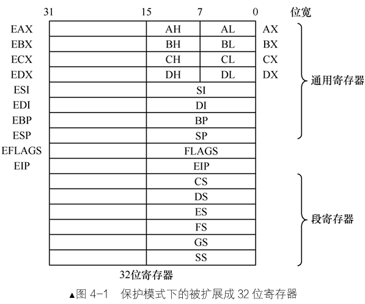{width=70%}

### 4.2.2 保护模式之寻址扩展

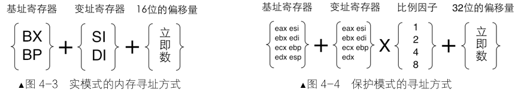

保护模式下寻址更灵活：

- 基址寄存器：所有32位通用寄存器。
- 变址寄存器：除ESP外的所有32位通用寄存器。
- 偏移量：32位，支持比例因子（1,2,4,8）。

**示例：**

```asm
;实模式内存寻址
mov ax, [si]
mov ax, [di]
mov ax, [bx]
mov ax, [bx+si]
mov ax, [bx+si+0x1234]
mov ax, [bx+di]
mov ax, [bx+di+0x1234]

;保护模式内存寻址
mov eax, [eax + edx*8 + 0x12345678]  ; 基址变址寻址带比例因子
```

### 4.2.3 保护模式之运行模式反转

80386CPU既可以运行在32位模式下，也可以运行16位模式下。

80386CPU运行在保护模式下操作数和地址默认是32位，实模式下操作数和地址默认是16位模式。

80386CPU运行在16位模式下时，可临时使用32位的操作数，由前缀**0x66**明确。

反之亦然。

**操作数前缀0x66：**

```asm
;16位模式下运行时
;指令                ;机器码
mov ax,  0x1234      ;B83412
mov eax, 0x1234      ;66B834120000


;32模式下运行时
;指令                ;机器码
mov eax, 0x1234      ;B834120000
mov ax, 0x1234       ;66B83412
```

**操作地址前缀0x67：**

80386CPU运行在16位模式下时，可临时使用32位的地址，由前缀**0x67**明确。

反之亦然。

```asm
;16位模式下运行时
;指令                        ;机器码
mov word [bx], 0x1234        ;C7073412
mov word [eax],0x1234        ;67C7003412
mov dword [eax],0x1234       ;6667C70034120000

;32模式下运行时
;指令                         ;机器码
mov dword [eax],0x00001234    ;C70034120000
mov dword [bx],0x00001234     ;67C70734120000
```

程序运行时，CPU本身在运行时清楚自己是处于什么模式下，但是编译器如何知道一段指令将来会在什么模式运行？

- `[bits 16]`：明确告知汇编器这段程序将来运行在CPU32位模式下。
- `[bits 32]`：明确告知汇编器这段程序将来运行在CPU16位模式下。

```asm
; 16位模式
[bits 16]
mov ax, 0x1234        ; 16位操作数
mov eax, 0x1234       ; 添加0x66前缀，临时32位操作数

; 32位模式
[bits 32]
mov ax, 0x1234        ; 添加0x66前缀，临时16位操作数
mov eax, 0x1234       ; 32位操作数
```

### 4.2.4 保护模式之指令扩展

指令支持32位操作数，如：`mul`、`div`指令结果存储到EDX:EAX。

**PUSH 指令行为总结**

| 目标操作数         | 16位模式下的指令与结果         | 32位模式下的指令与结果          |
| :----------------- | :----------------------------- | :------------------------------ |
| **2字节 (如 AX)**  | **`PUSH AX`**  SP = SP - 2     | **`66 PUSH AX`**  ESP = ESP - 2 |
| **4字节 (如 EAX)** | **`66 PUSH EAX`**  SP = SP - 4 | **`PUSH EAX`**  ESP = ESP - 4   |
| **1字节 (如 AL)**  | **无效操作**  (无变化)         | **无效操作**  (无变化)          |

## 4.3 全局描述符表

> 本节详细讲解GDT结构和使用。
>
> 全局描述符表（GDT）是保护模式的核心数据结构，用于管理内存段。

!!! question "为何保护模式需要GDT？"

    实模式：段寄存器直接存放段基址，`段 << 4 + 偏移`，没有权限、界限检查。

    保护模式：段寄存器不再存基址，而是存**选择子(索引)**，去 GDT 查表拿到段信息。段的基址、界限、权限、类型全部放在 GDT 这个内存表中，由 CPU 硬件自动查表做安全校验。没有 GDT，CPU 无法开启保护模式的内存保护、特权分级能力。
    
    核心原因：

    1. **内存分段安全隔离（权限 DPL）**
    GDT 里每个段描述符记录 `DPL`（特权级 0~3）。CPU 硬件自动校验：低特权代码不能随意访问高特权段。
    实模式没有权限检查，任何代码都能读写全部内存。
    2. **段界限检查，防止越界访问**
    描述符自带**段界限**，CPU 硬件检查访问地址不能超出段范围，避免程序越界篡改其他代码 / 数据。
    3. **支持 32 位全地址空间（基址不再限制 20 位）**
    实模式段基址只能是 20 位。保护模式段描述符基址可以是 32 位，能访问 4GB 空间。
    4. **支持多种段类型区分**
    代码段、数据段、栈段、TSS 任务状态段都由 GDT 描述。CPU 硬件区分：**代码段不可写，数据段不可执行**，阻止代码注入。
    5. **硬件支持任务切换（TSS）**
    GDT 中可以放 TSS 描述符，CPU 硬件原生支持任务切换，保存 / 恢复寄存器。

### 4.3.2 全局、局部描述符表及选择子

GDT为段描述符数组，由GDTR寄存器指向。选择子用于索引GDT中的描述符。

选择子结构 (16位段寄存器)：

- 索引：13位，索引描述符。
- TI位：0表示GDT，1表示LDT。LDT在以后再介绍。
- RPL：请求特权级。

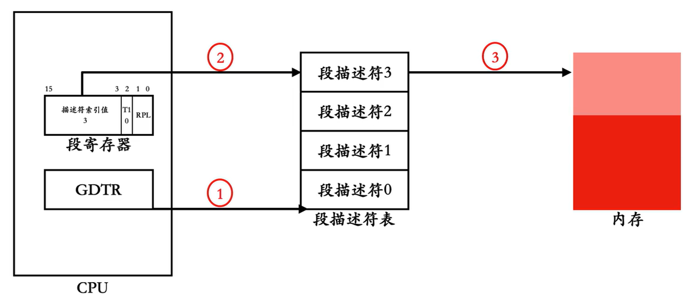

> GDT（全局描述符表）放在物理内存（RAM）里，CPU GDTR 寄存器记录 GDT 的「基地址 + 表界限」，用 `lgdt` 指令加载这个信息给 CPU。GDTR**不存 GDT 本身**，只存 GDT 在哪里。

### 4.3.1 段描述符表项

段描述符8字节，描述内存段的属性：

- 段基址：32位。
- 段界限：20位，粒度由G位决定（1字节或4KB）。
- 属性字段：类型、特权级、存在位等。

段描述符格式：
{: #segment-descriptor-format }


段描述符位于内存，且由于历史原因，段描述符的信息是比较分散的，为了提高cpu访问段信息的效率，从80286开始增加了段描述符缓冲寄存器，为段寄存器赋予新数值时，段描述符缓冲寄存器会被更新。

段描述符缓冲寄存器：

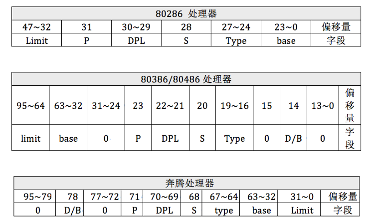

### 4.3.3 打开A20地址线

开启A20地址线，也就是将0x92端口的1号位置1，以访问超过1MB内存：

```asm
in al, 0x92
or al, 00000010B     ; 设置A20使能位
out 0x92, al
```

### 4.3.4 保护模式开关：CR0寄存器PE位

设置CR0的PE位进入保护模式：

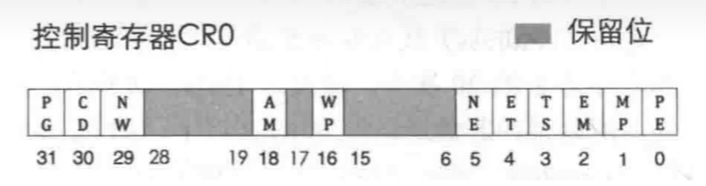{width=75%}

```asm
mov eax, cr0
or eax, 0x00000001    ; 设置PE位
mov cr0, eax
```

### 4.3.5 让我们进入保护模式

实现从实模式到保护模式切换的**关键步骤：**

1. 定义GDT和描述符。

2. 加载GDTR。

3. 打开A20。

4. 设置CR0.PE=1。

5. 远跳转刷新流水线。

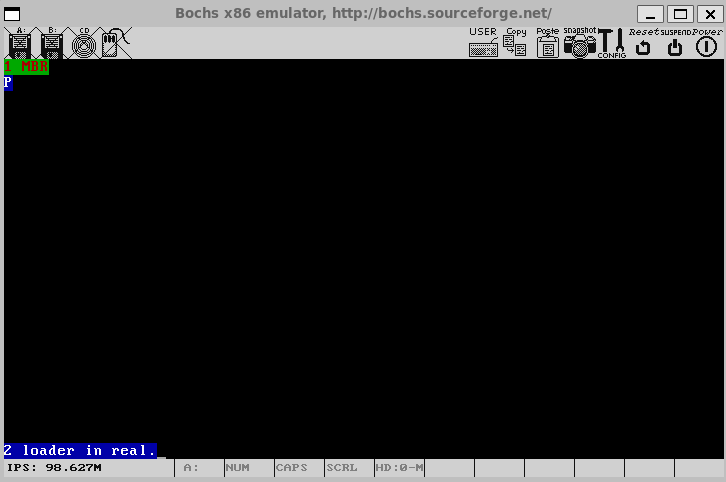

**配置文件(boot.inc)**：

> 这里主要描述了段描述符表项的高32位，需要对照[这个图](#segment-descriptor-format)看。和低32位的拼接会在loader.s里进行。例如：
> ```asm linenums="0"
> CODE_DESC: dd   0x0000FFFF
>            dd   DESC_CODE_HIGH4
> ```

```asm
;-----------------  boot.inc

LOADER_BASE_ADDR     equ 0x900
LOADER_START_SECTOR  equ 0x2

;-----------------  gdt 描述符属性
; 单个位标志
DESC_G_4K    equ     (1 << 23)   ; 粒度位 (G) G=1时，段界限以4KB为单位
DESC_D_32    equ     (1 << 22)   ; 操作数大小位 (D/B)
DESC_L       equ     (0 << 21)   ; 64位代码标志，0表示32位
DESC_AVL     equ     (0 << 20)   ; 可用位

; 段界限字段(下面会组合成64位)
DESC_LIMIT_CODE2  equ (0xF << 16)  ; 段界限 bits 16-19
DESC_LIMIT_DATA2  equ DESC_LIMIT_CODE2
DESC_LIMIT_VIDEO2 equ (0x0 << 16)  ; 视频段界限 显存段0x000B8000 

; 描述符特权级
DESC_P       equ     (1 << 15)   ; 存在位 P=1表示位于内存
DESC_DPL_0   equ     (0 << 13)   ; DPL = 0
DESC_DPL_1   equ     (1 << 13)   ; DPL = 1  
DESC_DPL_2   equ     (2 << 13)   ; DPL = 2
DESC_DPL_3   equ     (3 << 13)   ; DPL = 3

; 系统标志和类型字段
DESC_S_CODE  equ     (1 << 12)   ; 代码/数据段标志 S=1：代码或数据段；S=0：系统段
DESC_S_DATA  equ     DESC_S_CODE
DESC_S_sys   equ     (0 << 12)   ; 系统段标志

DESC_TYPE_CODE equ   (0x8 << 8)  ; 1000b 代码段类型: EXEC, NON-CONFORMING
DESC_TYPE_DATA equ   (0x2 << 8)  ; 0010b 数据段类型: READ/WRITE, EXPAND-UP

; 高4字节组合
DESC_CODE_HIGH4 equ (0x00 << 24) + DESC_G_4K + DESC_D_32 + \
                   DESC_L + DESC_AVL + DESC_LIMIT_CODE2 + \
                   DESC_P + DESC_DPL_0 + DESC_S_CODE + \
                   DESC_TYPE_CODE + 0x00

DESC_DATA_HIGH4 equ (0x00 << 24) + DESC_G_4K + DESC_D_32 + \
                   DESC_L + DESC_AVL + DESC_LIMIT_DATA2 + \
                   DESC_P + DESC_DPL_0 + DESC_S_DATA + \
                   DESC_TYPE_DATA + 0x00

;显存段为0x000B8000，所以高4字节为0x000B，所以最后是+0x0B(段基址)
DESC_VIDEO_HIGH4 equ (0x00 << 24) + DESC_G_4K + DESC_D_32 + \
                    DESC_L + DESC_AVL + DESC_LIMIT_VIDEO2 + DESC_P + \
                    DESC_DPL_0 + DESC_S_DATA + DESC_TYPE_DATA + 0x0B                

;----------------- 选择子属性----------------
RPL0 equ 0x0
RPL1 equ 0x1  
RPL2 equ 0x2
RPL3 equ 0x3
TI_GDT equ 0x0
TI_LDT equ 0x4
```

**loader代码：**

```asm
%include "boot.inc"

section loader vstart=LOADER_BASE_ADDR
LOADER_STACK_TOP equ LOADER_BASE_ADDR
jmp loader_start

;构建gdt及其内部的描述符
;总共4个描述符，每个占8字节，分别是：
;0：空描述符，1：代码段描述符，2：数据 & 栈段描述符，3：显存段描述符
GDT_BASE: dd   0x00000000
          dd   0x00000000

;代码段描述符拼接，低32位和高32位
CODE_DESC: dd   0x0000FFFF
           dd   DESC_CODE_HIGH4

DATA_STACK_DESC: dd   0x0000FFFF
                 dd   DESC_DATA_HIGH4

VIDEO_DESC: dd   0x80000007;limit=(0xbffff-0xb8000)/4k=0x7 显存段0x000B8000
            dd   DESC_VIDEO_HIGH4  ;此时dpl为0
            

GDT_SIZE   equ   $ - GDT_BASE
GDT_LIMIT  equ   GDT_SIZE - 1

times 60 dq 0             ;此处预留60个描述符的空位

SELECTOR_CODE  equ  (0x0001<<3) + TI_GDT + RPL0
SELECTOR_DATA  equ  (0x0002<<3) + TI_GDT + RPL0     ;同上
SELECTOR_VIDEO equ  (0x0003<<3) + TI_GDT + RPL0     ;同上

;以下是gdt的指针，前2字节是gdt界限，后4字节是gdt起始地址
gdt_ptr  dw  GDT_LIMIT
         dd  GDT_BASE
         
loadermsg db '2 loader in real.'

loader_start:

;-----------------------------
;INT 0x10   功能号:0x13   功能描述:打印字符串
mov ax,cs
mov es,ax
mov sp, LOADER_BASE_ADDR   

mov bp, loadermsg          ;ES:BP=字符串地址
mov cx, 17       ;CX=字符串长度
mov ax, 0x1301   ;AH = 13子功能号
                 ;AL=1——字符串中只含显示字符，其显示属性在BL中;显示后，光标位置改变
mov bx, 0x001f   ;页号为0(BH = 0)蓝底粉红字(BL = 1fh)
mov dx, 0x1800   ;坐标
int 0x10         ;10h中断   

;----------------------------------------
;准备进入保护模式:
;1 打开A20
;2 加载gdt
;3 将cr0的pe位置1
;----------------- 打开A20 ----------------
in al, 0x92
or al, 0000_0010B
out 0x92, al
;----------------- 加载GDT -----------------
lgdt [gdt_ptr]
;----------------- cr0第0位置1 -----------------
mov eax, cr0
or eax, 0x00000001
mov cr0, eax

jmp dword SELECTOR_CODE:p_mode_start ;刷新流水线
;把代码段选择子 SELECTOR_CODE 加载到 CS 段寄存器，切换到保护模式的代码段描述符；
;刷新 CPU 指令流水线，清空实模式遗留的预取指令，防止实模式的残留指令被 CPU 继续译码执行，造成异常。

[bits 32]
p_mode_start:
mov ax, SELECTOR_DATA
mov ds, ax
mov es, ax
mov ss, ax
;初始化 DS、ES、SS 这几个数据类段寄存器，全部加载 GDT 中数据段的选择子，
;让数据访问、栈访问都使用保护模式下的平坦数据段。

mov esp, LOADER_STACK_TOP

mov ax, SELECTOR_VIDEO
mov gs, ax

mov byte [gs:160], 'P'
mov byte [gs:161], 0x1F   ; 属性：蓝底粉红字
jmp $
```

**mbr代码：**

`mov cx,1`改为`mov cx,4`，表示读取4个扇区到内存。

```asm
%include "boot.inc"
SECTION MBR vstart=0x7c00
    mov ax,cs
    mov ds,ax
    mov es,ax
    mov ss,ax
    mov fs,ax
    mov sp,0x7c00
    mov ax,0xb800 ;显存位置
    mov gs,ax

;INT 0x10 功能号:0x06 功能描述:上卷窗口清屏
;------------------------------------------------------
;输入:
;AH 功能号= 0x06
;AL = 上卷的行数(如果为0，表示全部)
;BH = 上卷行属性
;(CL,CH) = 窗口左上角的(X,Y)位置
;(DL,DH) = 窗口右下角的(X,Y)位置
;无返回值:
    mov ax,0x600
    mov bx,0x700
    mov cx,0         ; 左上角: (0,0)
    mov dx,0x184f    ; 右下角: (80,25)
                     ; VGA文本模式中，一行只能容纳80个字符，共25行
                     ; 下标从0开始，所以0x18=24，0x4f=79
    int 0x10

; 输出背景色绿色，前景色红色，并且跳动的字符串"1 MBR"
    mov byte [gs:0x00],'1'
    mov byte [gs:0x01],0xA4    ; A表示绿色背景闪烁，4表示前景色为红色

    mov byte [gs:0x02],' '
    mov byte [gs:0x03],0xA4

    mov byte [gs:0x04],'M'
    mov byte [gs:0x05],0xA4

    mov byte [gs:0x06],'B'
    mov byte [gs:0x07],0xA4

    mov byte [gs:0x08],'R'
    mov byte [gs:0x09],0xA4

    mov eax,LOADER_START_SECTOR ; 起始扇区lba地址
    mov bx,LOADER_BASE_ADDR     ; 写入的地址
    mov cx,4                    ; 待读入的扇区数
    call rd_disk_m_16           ; 以下读取程序的起始部分（一个扇区）

    jmp LOADER_BASE_ADDR

;-------------------------------------------------------------------------------
;功能:读取硬盘n个扇区
;eax=LBA扇区号
;bx=将数据写入的内存地址
;cx=读入的扇区数
;-------------------------------------------------------------------------------
rd_disk_m_16:
    mov esi,eax    ; 备份eax
    mov di,cx      ; 备份cx
;读写硬盘:
;第1步：设置要读取的扇区数
    mov dx,0x1f2
    mov al,cl      
    out dx,al      ; 读取的扇区数

    mov eax,esi    ; 恢复eax

;第2步：将LBA地址存入0x1f3～0x1f6

    ;LBA地址7~0位写入端口0x1f3
    mov dx,0x1f3
    out dx,al

    ;LBA地址15~8位写入端口0x1f4
    mov cl,8
    shr eax,cl
    mov dx,0x1f4
    out dx,al

    ;LBA地址23~16位写入端口0x1f5
    shr eax,cl
    mov dx,0x1f5
    out dx,al

    ;LBA地址27～24为写入端口0x1f6 设置LBA方式操作磁盘
    shr eax,cl
    and al,0x0f    ; lba第24~27位
    or al,0xe0     ; 设置7～4位为1110，表示lba模式
    mov dx,0x1f6
    out dx,al

;第3步：向0x1f7端口写入读命令，0x20
    mov dx,0x1f7
    mov al,0x20
    out dx,al

;第4步：读取0x1f7端口，检测硬盘状态
.not_ready:
    ;同一端口，写时表示写入命令字，读时表示读入硬盘状态
    nop
    in al,dx
    and al,0x88    ; 第4位为1表示硬盘控制器已准备好数据传输
                   ; 第8位为1表示硬盘忙
    cmp al,0x08
    jnz .not_ready ; 若未准备好，继续等

;第5步：从0x1f0端口读数据
    mov ax,di      ; 要读取的扇区数
    mov dx,256     ; 一个扇区有512字节，每次读入一个字，共需di*512/2次
    mul dx         ; 所以di*256
    mov cx,ax
    mov dx,0x1f0
.go_on_read:
    in ax,dx
    mov [bx],ax
    add bx,2
    loop .go_on_read
    ret

times 510-($-$$) db 0
db 0x55,0xaa
```

**运行步骤：**

```sh
# 编译MBR
nasm -o mbr.bin mbr.s

# 编译Loader  
nasm  -o loader.bin loader.s

# 写入硬盘
dd if=mbr.bin of=hd60M.img bs=512 count=1 conv=notrunc
dd if=loader.bin of=hd60M.img bs=512 count=4 seek=2 conv=notrunc

# 运行
bin/bochs -f bochsrc.disk
```

### 4.3.6 段描述符字段详解

段描述符是x86保护模式下定义内存段属性的核心数据结构，8字节，分为低32位和高32位。

每个位字段都有特定含义，用于控制段的基址、界限、特权级、类型等。


**段描述符整体结构**

段描述符的64位布局如下图所示，它直观展示了高32位和低32位的字段分布：

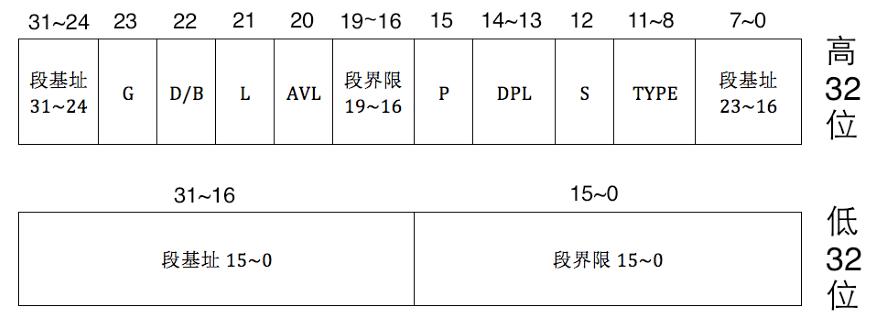

**低32位字段详解**

低32位（位0-31）主要定义段界限和段基址的低端部分：

- **位0-15：段界限低16位**
- **位16-31：段基址低16位**
	- 在平坦模型中，段基址常设为0，以便直接使用偏移地址访问整个4GB空间。


**高32位字段详解**

- **位0-7：段基址16-23位**

- **位12：系统段标志（S）**

	用于区分系统段和非系统段：
    
    - 0表示系统段（如门描述符）
    - 1表示非系统段（即普通的数据段或代码段）。

- **位8-11：类型字段（Type）**

	4位，指定段的子类型，其含义取决于S位。当S=1（非系统段，即数据段或代码段）时：

	- 位3：Executable（X）位，1表示代码段（可执行），0表示数据段（不可执行）。

	- 位2：对于代码段，是Conforming位（1=一致性代码段，0=非一致性）

	- 位2：对于数据段，是Expand-down位（1=向下扩展，0=向上扩展）。

	- 位1：对于代码段，是Readable位（1=可读，0=不可读），

	- 位1：对于数据段，是Writable位（1=可写，0=不可写）。

	- 位0：最高位，Accessed位，由CPU设置，当段被访问时置1，初始时应置0。

	常见类型值：代码段通常为0x8（1000b，表示可执行、非一致性、不可读）。数据段通常为0x2（0010b，表示不可执行、向上扩展、可读可写）。

	**为什么代码段可执行却设置为不可读？**

	执行指令和读取代码段内容是两种不同的操作。

	CPU在执行指令时（通过CS:EIP取指），不需要“读”权限，因为取指是执行特权的一部分；

	但如果程序主动尝试读取代码段内容（如使用MOV指令访问CS段），则会检查R位


- **位13-14：描述符特权级（DPL）**

	2位，定义段的特权级，值0-3：0为最高特权级（通常用于内核），3为最低特权级（用于用户程序）。CPU通过比较当前特权级（CPL）和DPL来实施保护检查。

	

- **位15：存在位（P）**

	指示段是否存在于内存中：0表示段不在内存，访问会触发异常；1表示段在内存中。操作系统负责在段被换出时置0，换入时置1。

- **位16-19：段界限高4位**


- **位20：可用位（AVL）**

	保留给操作系统使用，CPU不处理，通常置0。

- **位21：64位代码段标志（L）**

	用于64位模式：0表示32位代码段，1表示64位代码段。在32位保护模式下，此位应置0。


- **位22：操作数大小/栈指针大小标志（D/B）**

	其含义依赖段类型：

	- 对于代码段，这是D位，控制指令的有效地址（段内偏移地址）和操作数的默认大小。

	​            (0表示默认16位（使用IP寄存器），1表示默认32位(使用EIP寄存器))

	- 对于数据段或栈段，这是B位，控制栈指针寄存器的大小和栈操作的默认字节数

	​             (0表示默认16位（SP），1表示默认32位(ESP))

- **位23：粒度位（G）**

	​		控制段界限的单位：0表示字节粒度，1表示4KB粒度。

- **位24-31：段基址24-31位**

## 4.4 处理器微架构简介

> 本节介绍流水线、乱序执行、缓存和分支预测。
>
> 有利于理解为什么需要使用远跳转清空流水线和更新段描述符缓冲寄存器。


### 4.4.1 流水线

流水线提高指令执行效率，将指令分为取指、译码、执行等阶段。示例：砸钉子流水线类比。

**顺序执行**

| 时间(秒) | 动作    |
| -------- | ------- |
| 1        | 取钉子1 |
| 2        | 砸钉子1 |
| 3        | 取钉子2 |
| 4        | 砸钉子2 |

**重叠执行**

| 时间(秒) | 工人A   | 工人B   |
| -------- | ------- | ------- |
| 1        | 取钉子1 | -       |
| 2        | 取钉子2 | 砸钉子1 |
| 3        | 取钉子3 | 砸钉子2 |

### 4.4.2 乱序执行

CPU将指令分解为微操作，并行执行无关指令以提高效率。

### 4.4.3 缓存

利用局部性原理，将常用数据缓存到SRAM中，减少内存访问延迟。

### 4.4.4 分支预测

使用BTB和静态预测器预测分支方向，减少流水线清空。

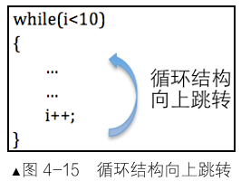

## 4.5 远跳转清空流水线更新段描述符缓冲寄存器

> 进入保护模式后，需远跳转以清空流水线并更新段寄存器缓冲值。

原因：实模式下的段描述符缓冲寄存器值对于保护模式而言无效

​           流水线中的指令译码错误。

解决方案：

```asm linenums="0"
jmp dword SELECTOR_CODE:p_mode_start  ; 远跳转清空流水线
```

## 4.6 保护模式之内存段的保护

> 保护模式通过段描述符属性实现内存保护。
>
> 段描述符属性描述一块内存的性质，CPU用属性检查动作是否合规，从而起到保护作用。
>
> 本节围绕内存段的保护做基本阐述，详细内容后续章节逐步展开。

### 4.6.1 向段寄存器加载选择子时的保护

引用某段内存会往段寄存器加载选择子，CPU会进行检查：

- 选择子索引值是否越界，**选择子中的索引值 \* 8 + 7 <= 描述符表基地址 + 描述符表界限值**。

- **通过段描述符type字段**，判断段类型是否匹配段寄存器。

- 通过P位判断段是否位于内存，若P为1，表示在内存，更新段描述符缓冲寄存器和段寄存器，A位由CPU再置1，不是已访问。若P位0，还需先将该段载入内存再处理。

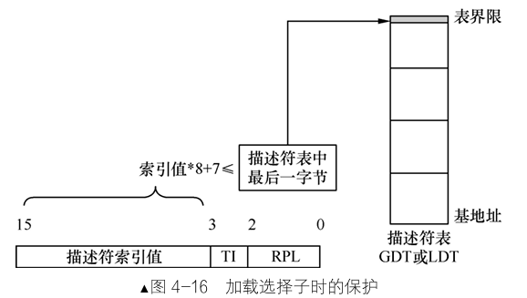


### 4.6.2 代码段和数据段的保护

确保指令或数据完全在段界限内，段界限指向最后一个可以使用的字节：

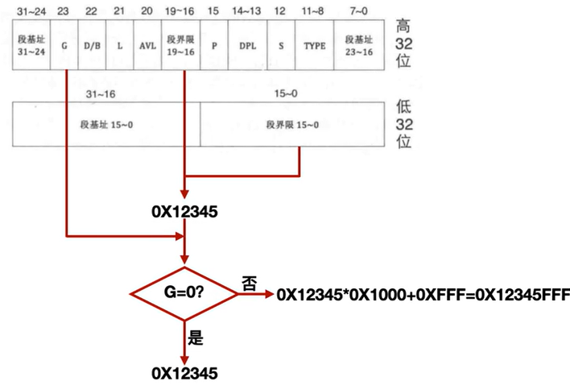

- 指令或数据偏移地址 + 长度 - 1 ≤ 段界限

- **举例**：若实际段界限是 `0x12345FFF`，访问其最后1字节是合法的，但试图读取2字节（会用到下一个地址 `0x12346000`）就会因越界而触发异常。

### 4.6.3 栈段的保护

向下扩展段的段界限意义不同，段界限指的是第一个不可使用的地址。

每次对栈进行操作前都会先进行预先的判断：实际段界限 + 1 ≤ ESP - 预备操作数大小 ≤ 0xFFFFFFFF

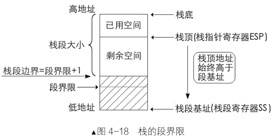

------

## 本章要点总结

- **保护模式优势**：       内存保护、特权级管理、4GB内存访问。
- **关键数据结构**：       全局描述符表（GDT）、段描述符、选择子。
- **进入保护模式步骤**：打开A20、加载GDTR、设置CR0.PE、远跳转。
- **处理器微架构**：       流水线、乱序执行、缓存、分支预测提高效率。
- **内存保护机制**：       段界限检查、类型检查、特权级检查。

​       通过本章学习，掌握了保护模式的基本原理和实现方法，为后续操作系统开发打下基础。