# 第5章 保护模式进阶，向内核迈进

**本章引导语**：

从实模式到保护模式是x86架构的重要飞跃。

本章探讨物理内存检测、分页机制实现、内核加载过程以及特权级管理，为构建操作系统内核奠定坚实基础。

我们将通过代码展示如何获取内存容量、启用分页、加载ELF格式内核、CPU特权级保护机制。

## 5.1 获取物理内存容量

**节引导语**：操作系统需要知道可用物理内存大小才能有效管理资源。

​					本节介绍三种BIOS中断方法检测内存容量，为后续内存管理做准备。

### 5.1.1 学习Linux获取内存的方法

Linux内核通过BIOS中断0x15的3个子功能检测内存，将按功能从强到弱的顺序尝试这三种方法。

​		EAX=0xE820：遍历全部内存，返回ARDS结构的数组

​		AX=0xE801：  检测低15MB和16MB~4GB内存

​		AH=0x88：      最多检测64MB内存

### 5.1.2 利用子功能0xe820获取内存

这是最灵活的内存获取方式，通过地址范围描述符结构（ARDS，每个ARDS是20字节）返回内存布局信息。

**地址范围描述符结构ARDS**

| 字节偏移 | 属性名称       | 描述                                             |
| -------- | -------------- | ------------------------------------------------ |
| 0        | BaseAddrLow    | 内存区域起始地址的低32位                         |
| 4        | BaseAddrHigh   | 内存区域起始地址的高32位                         |
| 8        | LengthLow      | 内存区域长度的低32位（以字节为单位）             |
| 12       | LengthHigh     | 内存区域长度的高32位（以字节为单位）             |
| 16       | Type           | 内存区域类型（1=可用RAM，其他=保留/不可用）       |


type=1表示该内存可被操作系统使用；type=2表示该内存操作系统不可使用，使用中或者被系统保留。


**BIOS中断0x15子功能0xE820说明:**

| 调用阶段 | 寄存器/状态位 | 参数用途 |
| ---- | ---- | ---- |
| 调用前输入 | EAX | 子功能号：0xE820（获取内存信息） |
| | EBX | ARDS后续值：第一次调用时置0，BIOS通过此值跟踪返回的内存块位置 |
| | ES:DI | ARDS缓冲区地址：BIOS将内存信息写入此地址指向的内存区域 |
| | ECX | ARDS结构大小：通常设为20字节（标准ARDS结构大小） |
| | EDX | 签名标记：0x534D4150（"SMAP"的ASCII码），用于校验 |
| 返回后输出 | CF位 | 状态标志：0=调用成功，1=调用出错 |
| | EAX | 签名验证：0x534D4150（"SMAP"的ASCII码） |
| | ES:DI | ARDS缓冲区地址：同输入值，此时已填充内存信息 |
| | ECX | 实际写入字节数：BIOS实际写入ARDS结构的字节数（≥20） |
| | EBX | 后续值：下一个ARDS的位置。若为0表示已是最后一个结构 |

### 5.1.3 利用子功能0xe801获取内存

该方法简单但功能有限，最大识别4GB内存，结果分别存放在两组寄存器中。

**BIOS中断0x15子功能0xE801实例**

| 实际物理内存 | AX寄存器值 | BX寄存器值 | 计算过程 | 检测到的内存大小 |
| ---- | ---- | ---- | ---- | ---- |
| 14MB | 0x3400<br>(13,312 KB) | 0x0000<br>(0块) | 0x3400×1024 + 0×65536 | 13MB + 1MB = 14MB |
| 15MB | 0x3800<br>(14,336 KB) | 0x0000<br>(0块) | 0x3800×1024 + 0×65536 | 14MB + 1MB = 15MB |
| 16MB | 0x3C00<br>(15,360 KB) | 0x0000<br>(0块) | 0x3C00×1024 + 0×65536 | 15MB + 1MB = 16MB |
| 17MB | 0x3C00<br>(15,360 KB) | 0x0010<br>(16块) | 0x3C00×1024 + 0x10×65536 | 15MB + 1MB + 1MB = 17MB |
| 18MB | 0x3C00<br>(15,360 KB) | 0x0020<br>(32块) | 0x3C00×1024 + 0x20×65536 | 15MB + 1MB + 2MB = 18MB |

> 15~16MB内存无法检测，所以需要人为 + 1MB

**BIOS中断0x15子功能0xE801说明**

| 调用阶段 | 寄存器/标志位 | 功能用途 | 详细说明 |
| ---- | ---- | ---- | ---- |
| 调用前输入 | AX | 功能号设置 | 必须设置为0xE801，指定使用此子功能进行内存检测 |
| 返回后输出 | CF标志位 | 调用状态 | CF=0表示调用成功，CF=1表示调用过程中出现错误 |
| | AX | 扩展内存1 | 以1KB为单位，返回15MB以下的内存容量，最大值为0x3C00（15MB） |
| | BX | 扩展内存2 | 以64KB为单位，返回16MB~4GB之间的内存块数量 |
| | CX | 配置内存1 | 功能同AX寄存器，通常与AX返回相同值 |
| | DX | 配置内存2 | 功能同BX寄存器，通常与BX返回相同值 |

### 5.1.4 利用子功能0x88获取内存

最简单的内存检测方法，但只能识别最多64MB内存。

**BIOS中断0x15子功能0x88说明：**

| 调用阶段 | 寄存器/状态位 | 详细功能说明 |
| ---- | ---- | ---- |
| 调用前输入 | AH | 设置子功能号为0x88，指示BIOS执行内存检测功能 |
| 返回后输出 | CF位 | 调用状态标志：CF=0表示调用成功，CF=1表示调用过程中出现错误 |
| | AX | 返回1MB以上内存的连续KB单位数量，不包括低端1MB内存。最大返回值为0xFC00（64MB），故最大检测内存为64MB+1MB=65MB |

### 5.1.5 实战内存容量检测

下面代码展示三种内存检测方法的实现，**程序实现逻辑**：

1. 首先尝试0xE820方法， 遍历所有ARDS结构
2. 如果失败尝试0xE801方法，分别计算低15MB和16MB以上内存
3. 最后尝试0x88方法，获取最多64MB内存
4. 最终结果存储在total_mem_bytes变量中

```asm
%include "boot.inc"

section loader vstart=LOADER_BASE_ADDR
LOADER_STACK_TOP equ LOADER_BASE_ADDR
ARDS_SIZE         equ 20           ;20字节
MB_SIZE           equ 0x100000     ;1M
SMAP_SIGNATURE    equ 0x534D4150   ; "SMAP"签名  用于验证BIOS中断返回数据的有效性


; 内存检测变量
total_mem_bytes   dd 0
ards_count        dw 0
ards_buffer       times 256 db 0


jmp loader_start

; 全局描述符表
GDT_BASE:
    dq 0x0000000000000000        ; 空描述符
    dq 0x00CF9A000000FFFF        ; 代码段
    dq 0x00CF92000000FFFF        ; 数据段
            

GDT_SIZE   equ   $ - GDT_BASE
GDT_LIMIT  equ   GDT_SIZE - 1


times 60 dq 0             ;此处预留60个描述符的空位


;以下是gdt的指针，前2字节是gdt界限，后4字节是gdt起始地址
gdt_ptr  dw  GDT_LIMIT
         dd  GDT_BASE
         

loader_start:
    mov ax, cs
    mov ds, ax
    mov es, ax
    mov ss, ax
    mov sp, LOADER_STACK_TOP 

;=============================================================================
; 内存检测主函数
; 输出: 成功时EDX=内存容量，失败时EDX=0
;=============================================================================
detect_memory:
    mov ax, cs
    mov ds, ax
    mov ss, ax
    mov sp, LOADER_STACK_TOP
    
    ; 方法1: E820 - 详细内存映射
    call detect_memory_e820
    test edx, edx                  ;检查EDX（返回值）是否为0
    jnz memory_detected_success
    
    ; 方法2: E801 - 最大4GB
    call detect_memory_e801
    test edx, edx
    jnz memory_detected_success
    
    ; 方法3: 88 - 最大64MB  
    call detect_memory_88
    test edx, edx
    jnz memory_detected_success
    
    ; 所有方法失败
    jmp error_halt

memory_detected_success:        
    mov [total_mem_bytes], edx
    ret

;=============================================================================
; E820内存检测
;=============================================================================
detect_memory_e820:
    push es                     ; 保存ES寄存器
    push ds
    pop  es                     ; 设置ES=DS
    
    xor ebx, ebx                ; EBX=0（初始后续值）
    mov edi, ards_buffer
    mov word [ards_count], 0

.e820_loop:
    mov eax, 0xE820            ; 功能号：E820
    mov ecx, 20                ; ECX=20（ARDS大小）
    mov edx, SMAP_SIGNATURE    ; EDX="SMAP"（签名）
    int 0x15
    jc .e820_failed
    
    ; 验证签名
    cmp eax, SMAP_SIGNATURE     ; 添加签名验证
    jne .e820_failed
    
    add edi, ecx
    inc word [ards_count]
    
    test ebx, ebx
    jnz .e820_loop
    
    ; 分析ARDS
    call analyze_ards
    pop es                      ; 恢复ES
    ret

.e820_failed:
    xor edx, edx
    pop es                      ; 恢复ES
    ret

;=============================================================================
; 分析ARDS结构
;=============================================================================
analyze_ards:
    movzx ecx, word [ards_count] ;ECX=ARDS数量
    test ecx, ecx                ; 添加安全检查
    jz .analysis_failed
    
    mov esi, ards_buffer
    xor edx, edx

.analyze_loop:
    ; 只处理可用内存区域(TYPE=1)
    cmp dword [esi+16], 1
    jne .skip_ards
    
    mov eax, [esi]              ; 基地址低32位
    add eax, [esi+8]            ; 基地址+长度
    
    ; 检查是否溢出
    jc .skip_ards               ; 添加溢出检查
    
    cmp edx, eax
    jae .skip_ards
    mov edx, eax

.skip_ards:
    add esi, ARDS_SIZE
    loop .analyze_loop
    
    test edx, edx               ; 确保找到有效内存
    jnz .analysis_ok

.analysis_failed:
    xor edx, edx

.analysis_ok:
    ret

;=============================================================================
; E801内存检测
;=============================================================================
detect_memory_e801:
    mov ax, 0xE801
    int 0x15
    jc .e801_failed             ; CF=1则失败
    
    ; 验证结果有效性
    test ax, ax                 ; 添加有效性检查
    jz .e801_failed
    
    ; 计算低15MB内存 AX × 1024 + 1MB
    xor edx, edx
    movzx eax, ax
    shl eax, 10                 ; ×1024
    add edx, eax                ; EDX += 低15MB字节数
    add edx, MB_SIZE            ; EDX += 1MB（补偿BIOS报告的偏移）
    
    ; 计算16MB以上内存 BX × 64KB
    test bx, bx                 ; 检查是否有扩展内存
    jz .e801_done
    
    movzx eax, bx
    shl eax, 16                 ; ×65536 64K
    add edx, eax

.e801_done:
    ret

.e801_failed:
    xor edx, edx
    ret

;=============================================================================
; 88内存检测
;=============================================================================
detect_memory_88:
    mov ah, 0x88
    int 0x15
    jc .88_failed
    
    ; 验证结果有效性
    test ax, ax                 ;添加有效性检查
    jz .88_failed
    cmp ax, 0xFFFF              ;排除错误值
    je .88_failed
    
    and eax, 0xFFFF             ; 确保EAX高16位为0
    shl eax, 10                 ; ×1024
    add eax, MB_SIZE            ; EAX += 1MB
    mov edx, eax
    ret

.88_failed:
    xor edx, edx
    ret

;=============================================================================
; 错误处理
;=============================================================================
error_halt:         
    hlt             ; 停机指令（等待中断）
    jmp error_halt
```

**运行步骤：**

```sh
# 编译MBR
nasm -o mbr.bin mbr.s

# 编译Loader  
nasm  -o loader.bin loader.s

# 写入硬盘
dd if=mbr.bin of=hd60M.img bs=512 count=1 conv=notrunc
dd if=loader.bin of=hd60M.img bs=512 count=4 seek=2 conv=notrunc

# 启动
bin/bochs -f bochsrc.disk

<bochs:1> c                         
<bochs:2> xp /1wx 0x900    # total_mem_bytes
[bochs]:
0x00000900 <bogus+       0>:    0x01ff0000 # = 32MB - 64KB
```

这和之前`bochsrc.disk`里的配置信息`megs : 32`几乎一致。这段代码并没有计算“总内存容量”，而是找出 E820 返回的所有可用内存区域（`type = 1`）中，最大的区域结束地址：它用 `base + length` 计算区域末端，再保留最大值。Bochs 的 E820 映射很可能把顶端的 64 KiB 标成了非可用区域，所以最高可用地址是 0x01FF0000。所以这里的 `total_mem_bytes` 名称有些误导：当前值代表最高可用内存地址，不是可用内存总字节数。若目标是统计总量，应累加每个 `type = 1` 区域的长度。

## 5.2 启用分页机制，畅游虚拟空间

**节引导语**：分页机制是实现虚拟内存的关键。

​					本节讲解分页原理、二级页表结构，并通过程序展示如何启用分页机制。

### 5.2.1 内存为什么要分页

在分段机制下，内存分配需要连续空间，容易产生碎片。

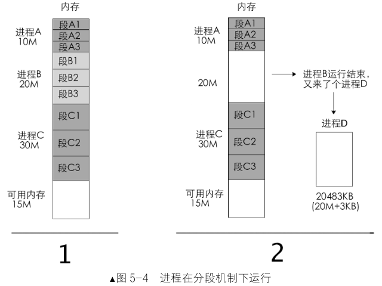{width=80%}

根本原因在于：线性地址是连续的，物理地址也要是连续的。

**分页**可使的线性地址连续，但是物理地址不连续：

分页机制将内存划分为固定大小的页，通过页表实现虚拟地址到物理地址的映射，解决内存碎片问题。

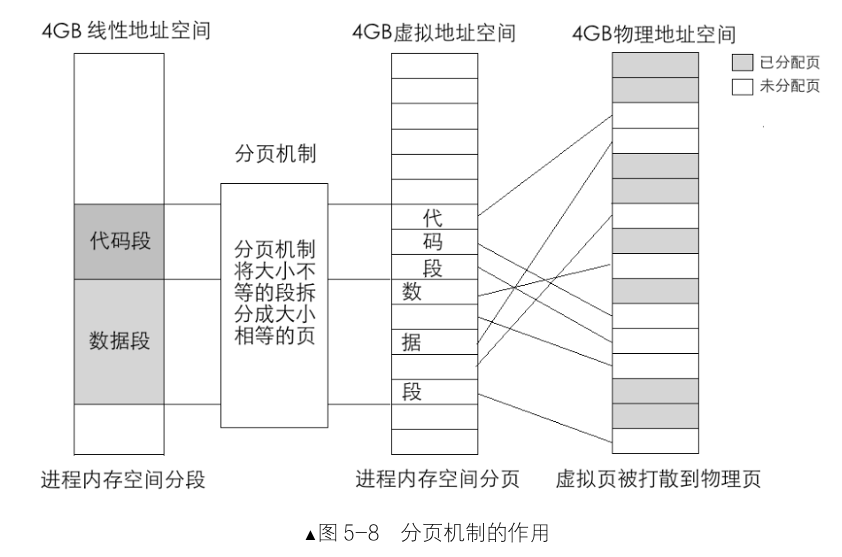{width=80%}

### 5.2.2 一级页表

一级页表直接**将线性地址映射到物理地址**，地址转换由CPU的页部件自动完成。过程如下：

- **步骤1**：从控制寄存器CR3获取页表物理地址。
- **步骤2**：用线性地址的高20位乘以4（页表项4字节），得到页表项在页表中的偏移量。
- **步骤3**：访问页表项，获取物理页地址。
- **步骤4**：物理页地址与线性地址的低12位（页内偏移）相加，得到最终物理地址。

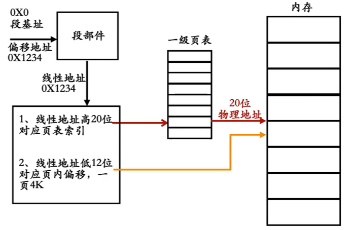{width=70%}

例如，指令`mov ax, [0x1234]`中，线性地址0x1234的高20位是0x1(索引)，低12位是0x234(偏移)。

假设页表物理地址来自CR3，索引0x1对应页表项中的物理页地址0x9000，则最终物理地址为0x9000 + 0x234 = 0x9234。


**一级页表的缺点：**

页表项数量庞大（1M个表项=4G/4K，每个表项占4字节），占用大量内存（4MB），且页表需提前建好，不够灵活，无法动态适应内存变化。这促使了二级页表的发展。

### 5.2.3 二级页表

二级页表通过页目录和页表两级结构减少内存占用，提高灵活性。

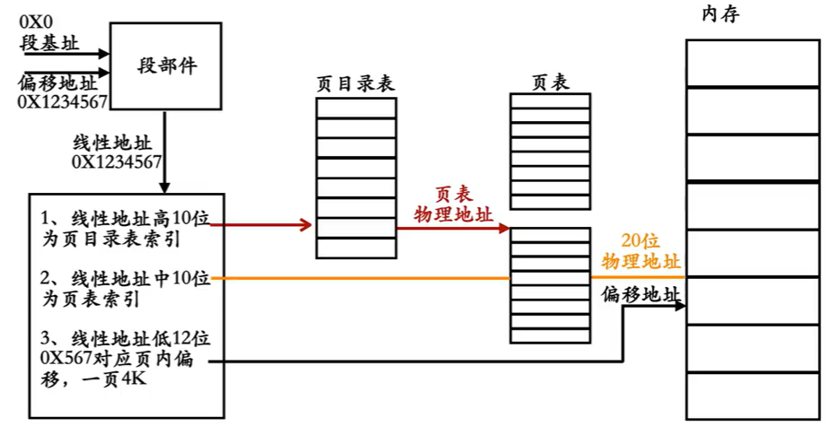{width=85%}

> 页目录表大小是2^10=1KB，一个页表也是1KB，页表是根据内存使用的多寡来创建的，因此总共也就是占用几KB内存。

**页目录项和页表项结构**：

{width=75%}

| 位置 | 属性名称                   | 描述                                                         |
| ---- | -------------------------- | ------------------------------------------------------------ |
| 0    | P                          | 存在位：1表示存在于物理内存中；<br />0表示不在物理内存中，访问会触发缺页异常。 |
| 1    | (Read/Write)               | 读写位：1表示可读可写；0表示只读，写操作会触发异常。         |
| 2    | (User/Supervisor)          | 用户/超级用户位：1表示User级；0表示Supervisor级。            |
| 3    | (Page-level Write-Through) | 页级通写位：1表示采用通写方式（用于高速缓存）；<br />                        0表示采用回写方式。通常置0。 |
| 4    | (Page-level Cache Disable) | 页级高速缓存禁止位：1表示启用高速缓存；<br />                                       0表示禁止缓存该页。通常置0。 |
| 5    | (Accessed)                 | 访问位：1表示该页近期被CPU访问过（由CPU设置）；0表示未访问。操作系统可定期清0以统计使用频率。 |
| 6    | 保留                       | 在页目录项中保留无效<br />(脏页位D仅对页表项有效，PDE中此位无意义）。 |
| 7    | (Page Attribute Table)     | 页属性表位：用于在页面粒度设置内存属性。复杂，通常置0。      |
| 8    | (Global)                   | 全局位：1表示该页为全局页，在TLB中持久缓存；<br />                0表示非全局页。 |
| 9-11 | (Available)                | 可用位：共3位，供操作系统软件使用，CPU忽略其值。             |

### 5.2.4 操作系统与用户进程的关系

操作系统和用户进程需要配合才能实现相应功能：

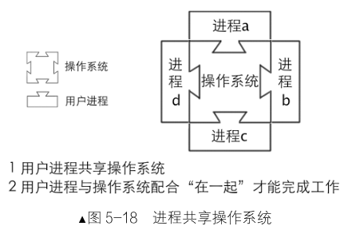{width=60%}

通过页表实现内存隔离和共享。

操作系统位于高地址空间(3GB-4GB)，用户进程位于低地址空间(0-3GB)。

为了实现共享操作系统，让所有用户进程高地址空间都指向同一片物理页内存，这片物理页上的是操作系统的实体代码，即页表项对应的物理地址相同。

### 5.2.5 启用分页机制

启用分页需要三个步骤：

2. 准备页目录表和页表
2. 将页目录表地址写入CR3寄存器
3. 设置CR0的PG位

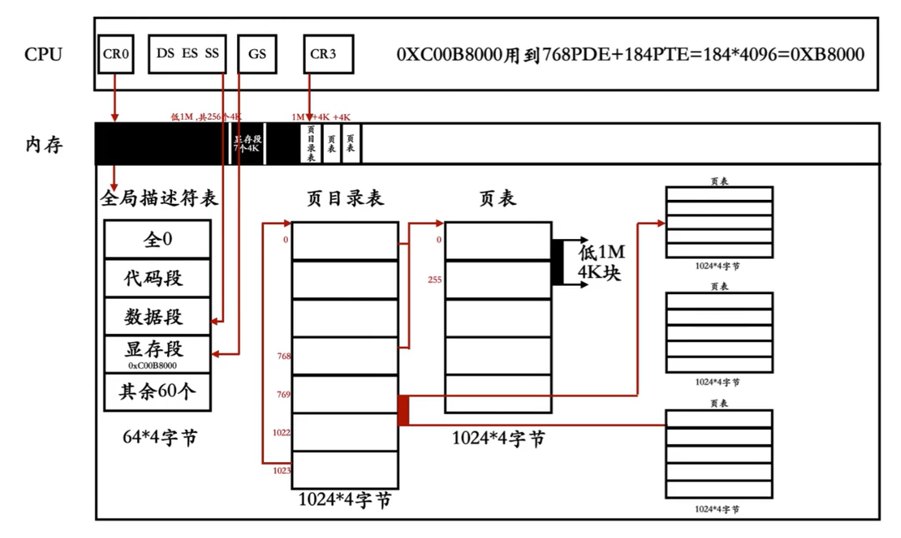

!!! question "为何通过地址0xC00B8000可以对分页模式下的显存访问？"

    实模式下1MB内存空间下，显存地址是0xB8000。现在内存升级到了4GB，为了和以前的计算机系统保持一致性，显存还是放在内存头1MB的0xB8000位置（物理地址）。0xC00B8000这个虚拟地址指向页目录表的第768项，也就是指向第一个页表（第一个页表的0~255项指向物理内存的低 1MB 空间），然后是第一个页表里的第184项。

    1. 32 位虚拟地址拆分：`[10bit PDE索引][10bit PTE索引][12bit页内偏移]`

        - 10 位 PDE 索引：取值范围 `0 ~ 1023`
        - 10 位 PTE 索引：`0 ~1023`
        - 12 位页内偏移：`0~4095`

        虚拟地址公式：

        `虚拟地址 = PDE_index << 22 | PTE_index << 12 | offset`

        PDE_index = 768 对应的起始虚拟地址：

        ```linenums="0"
        768 << 22
        = 768 * 2^22
        = 768 * 4194304
        = 0xC0000000
        ```

        ✅ 所以 PDE 第 768 项，**管辖的虚拟地址区间：`0xC0000000 ~ 0xC03FFFFF`**

        > 
        > 一共 4MB 范围（一个 PDE 管理 1024 个 PTE，每个 PTE 映射 4KB，1024*4K=4MB）。
        > Linux 经典 3G/1G 划分：
        > PDE 0~767：用户空间 `0x00000000 ~ 0xBFFFFFFF`（3GB）；
        > PDE 768~1023：内核空间 `0xC0000000 ~ 0xFFFFFFFF`（1GB）。
  
    2. 第184项PTE为184 * 4K = 0xB8000。
    3. 虚拟地址`0xC00B8000`经过MMU地址翻译，等价访问物理地址`0xB8000`，于是开启分页后，内核通过该虚拟地址读写VGA显存。

        ```linenums="0"
        0xC00B8000
        二进制：1100 0000 00 | 00 1011 1000 | 0000 0000 0000
        PDE索引 = 高10bit = 768
        PTE索引 = 中间10bit = 184
        offset = 低12bit = 0
        ```

**boot.inc核心变化：**

```asm
;-----------------loader和kernel----------------
PAGE_DIR_TABLE_POS equ 0x100000

;-----------------页表相关属性----------------
PG_P equ 1b
PG_RW_R equ 00b
PG_RW_W equ 10b
PG_US_S equ 000b
PG_US_U equ 100b
```

**boot.inc完整文件：**

```asm
;-----------------  loader和 kernel

LOADER_BASE_ADDR  equ 0x900
LOADER_START_SECTOR  equ 0x2
PAGE_DIR_TABLE_POS equ 0x100000

;-----------------  gdt 描述符属性
; 单个位标志
DESC_G_4K    equ     (1 << 23)   ; 粒度位 (G) G=1时，段界限以4KB为单位
DESC_D_32    equ     (1 << 22)   ; 操作数大小位 (D/B)
DESC_L       equ     (0 << 21)   ; 64位代码标志，0表示32位
DESC_AVL     equ     (0 << 20)   ; 可用位

; 段界限字段
DESC_LIMIT_CODE2  equ (0xF << 16)  ; 段界限 bits 16-19
DESC_LIMIT_DATA2  equ DESC_LIMIT_CODE2
DESC_LIMIT_VIDEO2 equ (0x0 << 16)  ; 视频段界限 显存段0x000B8000 

; 描述符特权级
DESC_P       equ     (1 << 15)   ; 存在位 P=1表示位于内存
DESC_DPL_0   equ     (0 << 13)   ; DPL = 0
DESC_DPL_1   equ     (1 << 13)   ; DPL = 1  
DESC_DPL_2   equ     (2 << 13)   ; DPL = 2
DESC_DPL_3   equ     (3 << 13)   ; DPL = 3

; 系统标志和类型字段
DESC_S_CODE  equ     (1 << 12)   ; 代码/数据段标志 S=1：代码或数据段；S=0：系统段
DESC_S_DATA  equ     DESC_S_CODE
DESC_S_sys   equ     (0 << 12)   ; 系统段标志

DESC_TYPE_CODE equ   (0x8 << 8)  ; 1000b 代码段类型: EXEC, NON-CONFORMING
DESC_TYPE_DATA equ   (0x2 << 8)  ; 0010b 数据段类型: READ/WRITE, EXPAND-UP

; 高4字节组合
DESC_CODE_HIGH4 equ (0x00 << 24) + DESC_G_4K + DESC_D_32 + \
                   DESC_L + DESC_AVL + DESC_LIMIT_CODE2 + \
                   DESC_P + DESC_DPL_0 + DESC_S_CODE + \
                   DESC_TYPE_CODE + 0x00

DESC_DATA_HIGH4 equ (0x00 << 24) + DESC_G_4K + DESC_D_32 + \
                   DESC_L + DESC_AVL + DESC_LIMIT_DATA2 + \
                   DESC_P + DESC_DPL_0 + DESC_S_DATA + \
                   DESC_TYPE_DATA + 0x00

;显存段为0x000B8000   所以高4字节为0x000B
DESC_VIDEO_HIGH4 equ (0x00 << 24) + DESC_G_4K + DESC_D_32 + \
                    DESC_L + DESC_AVL + DESC_LIMIT_VIDEO2 + DESC_P + \
                    DESC_DPL_0 + DESC_S_DATA + DESC_TYPE_DATA + 0x0B
                    

;----------------- 选择子属性----------------
RPL0 equ 0x0
RPL1 equ 0x1  
RPL2 equ 0x2
RPL3 equ 0x3
TI_GDT equ 0x0
TI_LDT equ 0x4
;-----------------页表相关属性----------------
PG_P equ 1b
PG_RW_R equ 00b
PG_RW_W equ 10b
PG_US_S equ 000b
PG_US_U equ 100b
```

**loader.s核心变化：**

```asm
;----------------- 页目录及页表初始化 -----------------
setup_page:
    ; 清零页目录区域（4096字节）
    xor esi, esi
    mov ecx, 1024            ; 1024个双字
.clear_dir:
    mov dword [PAGE_DIR_TABLE_POS + esi*4], 0
    inc esi
    loop .clear_dir

    ; 设置第一个页表并创建PDE映射
    mov eax, PAGE_DIR_TABLE_POS + 0x1000  ; 第一个页表地址
    or eax, PG_US_U | PG_RW_W | PG_P      ; 设置页目录项属性
    
    ; 映射低端和内核地址到同一页表
    mov [PAGE_DIR_TABLE_POS + 0x0],   eax ; 目录项0 →   第一个页表
    mov [PAGE_DIR_TABLE_POS + 0xc00], eax ; 目录项768 → 第一个页表
    
    ; 设置自映射目录项
    mov eax, PAGE_DIR_TABLE_POS
    or  eax,  PG_US_U | PG_RW_W | PG_P
    mov [PAGE_DIR_TABLE_POS + 4092], eax  ; 目录项1023 → 页目录自身

    ; 初始化第一个页表的PTE（映射低端1MB内存）
    mov edi, PAGE_DIR_TABLE_POS + 0x1000   ; 第一个页表地址
    mov eax, PG_US_U | PG_RW_W |  PG_P     ; 属性 + 物理地址0
    mov ecx, 256                           ; 256个页表项
.init_pte:
    mov [edi], eax
    add edi, 4
    add eax, 4096                         ; 下一物理页
    loop .init_pte


    ; 初始化内核空间PDE（目录项769-1022）
    mov edi, PAGE_DIR_TABLE_POS + 0x2000    ; 第二个页表开始
    mov ebx, PAGE_DIR_TABLE_POS + 769 * 4   ; 目录项769地址
    mov ecx, 254                            ; 254个目录项
.init_kernel_pde:
    mov eax, edi
    or eax, PG_US_U | PG_RW_W | PG_P
    mov [ebx], eax                        ; 设置页目录项
    add ebx, 4                            ; 下一个目录项
    add edi, 0x1000                       ; 下一个页表
    loop .init_kernel_pde

    ret
```

**loader.s完整文件:**

```asm
%include "boot.inc"

section loader vstart=LOADER_BASE_ADDR
LOADER_STACK_TOP equ LOADER_BASE_ADDR
jmp loader_start

;构建gdt及其内部的描述符
GDT_BASE: dd   0x00000000
          dd   0x00000000

CODE_DESC: dd   0x0000FFFF
           dd   DESC_CODE_HIGH4

DATA_STACK_DESC: dd   0x0000FFFF
                 dd   DESC_DATA_HIGH4

VIDEO_DESC: dd   0x80000007;limit=(0xbffff-0xb8000)/4k=0x7 显存段0x000B8000
            dd   DESC_VIDEO_HIGH4  ;此时dpl为0
            

GDT_SIZE   equ   $ - GDT_BASE
GDT_LIMIT  equ   GDT_SIZE - 1

times 60 dq 0             ;此处预留60个描述符的空位

SELECTOR_CODE  equ  (0x0001<<3) + TI_GDT + RPL0
SELECTOR_DATA  equ  (0x0002<<3) + TI_GDT + RPL0     ;同上
SELECTOR_VIDEO equ  (0x0003<<3) + TI_GDT + RPL0     ;同上

;以下是gdt的指针，前2字节是gdt界限，后4字节是gdt起始地址
gdt_ptr  dw  GDT_LIMIT
         dd  GDT_BASE
         
loadermsg db '2 loader in real.'

loader_start:
;-----------------------------
;INT 0x10   功能号:0x13   功能描述:打印字符串
mov ax,cs
mov es,ax
mov sp, LOADER_BASE_ADDR   

mov bp, loadermsg          ;ES:BP=字符串地址
mov cx, 17       ;CX=字符串长度
mov ax, 0x1301   ;AH = 13子功能号
                 ;AL=1——字符串中只含显示字符，其显示属性在BL中;显示后，光标位置改变
mov bx, 0x001f   ;页号为0(BH = 0)蓝底粉红字(BL = 1fh)
mov dx, 0x1800   ;坐标
int 0x10         ;10h中断   

;----------------------------------------
;准备进入保护模式:
;1 打开A20
;2 加载gdt
;3 将cr0的pe位置1
;----------------- 打开A20 ----------------
in al, 0x92
or al, 0000_0010B
out 0x92, al
;----------------- 加载GDT -----------------
lgdt [gdt_ptr]
;----------------- cr0第0位置1 -----------------
mov eax, cr0
or eax, 0x00000001
mov cr0, eax

jmp dword SELECTOR_CODE:p_mode_start ;刷新流水线

[bits 32]
p_mode_start:
mov ax, SELECTOR_DATA
mov ds, ax
mov es, ax
mov ss, ax

mov esp, LOADER_STACK_TOP

;mov ax, SELECTOR_VIDEO
;mov gs, ax

;mov byte [gs:160], 'P'
;mov byte [gs:161], 0x1F   ; 属性：蓝底粉红字
;jmp $


; 初始化内存分页管理
call setup_page                    ; 创建页目录、页表并初始化位图

; 调整全局描述符表(GDT)地址映射
sgdt [gdt_ptr]                     ; 保存当前GDT地址信息

; 更新显存段描述符基址（第3个描述符）
; 将物理地址0x000B8000改为虚拟地址0xC00B8000
mov ebx, [gdt_ptr + 2]                 ; +2跳过gdt_ptr前2字节界限，获取GDT的基地址
or dword [ebx + 0x18 + 4], 0xc0000000  ; 将基址映射到内核空间
; 0x18 = 24字节，第3个描述符的起始地址从第24字节开始
;dword是4 字节访问，覆盖：描述符内偏移 4、5、6、7 这 4 个字节
;也就是描述符的高32位：base[16:23] | 访问位 | G/D/B | base[24:31]

; 将GDT基址和栈指针映射到高地址空间
add dword [gdt_ptr + 2], 0xc0000000    ; GDT基址映射
add esp, 0xc0000000                    ; 栈指针重映射


; 启用分页机制
mov eax, PAGE_DIR_TABLE_POS
mov cr3, eax

mov eax, cr0
or eax, 0x80000000
mov cr0, eax                           ; 设置CR0的PG位

; 重新加载更新后的GDT
lgdt [gdt_ptr]

; 重新加载视频段选择子
mov ax, SELECTOR_VIDEO
mov gs, ax

; 现在可以安全访问显存
mov byte [gs:160], 'V'
; 系统挂起
jmp $

;----------------- 页目录及页表初始化 -----------------
setup_page:
    ; 清零页目录区域 一次清空4字节 清空1024次 共4096字节
    xor esi, esi
    mov ecx, 1024           
.clear_dir:
    mov dword [PAGE_DIR_TABLE_POS + esi*4], 0
    inc esi
    loop .clear_dir

    ; 确定第一个页表
    mov eax, PAGE_DIR_TABLE_POS + 0x1000  ; 第一个页表地址
    or eax, PG_US_U | PG_RW_W | PG_P      ; 设置页目录项属性
    
    ; 映射目录项0和768到同一页表
    mov [PAGE_DIR_TABLE_POS + 0x0],   eax ; 目录项0 →   第一个页表
    mov [PAGE_DIR_TABLE_POS + 0xc00], eax ; 目录项768 → 第一个页表
    
    ; 设置自映射目录项
    mov eax, PAGE_DIR_TABLE_POS
    or  eax,  PG_US_U | PG_RW_W | PG_P
    mov [PAGE_DIR_TABLE_POS + 4092], eax  ; 目录项1023 → 页目录自身

    ; 初始化第一个页表的256个PTE（一起映射低端1MB内存  物理地址0开始）
    mov edi, PAGE_DIR_TABLE_POS + 0x1000   ; 第一个页表地址
    mov eax, PG_US_U | PG_RW_W |  PG_P     ; 物理地址0 + 属性
    mov ecx, 256                           ; 256个页表项
.init_pte:
    mov [edi], eax
    add edi, 4
    add eax, 4096                         ; 下一物理页
    loop .init_pte

    ; 初始化页目录项769-1022号，内核空间PDE
    mov edi, PAGE_DIR_TABLE_POS + 0x2000    ; 第二个页表开始
    mov ebx, PAGE_DIR_TABLE_POS + 769 * 4   ; 目录项769地址
    mov ecx, 254                            ; 254个目录项
.init_kernel_pde:
    mov eax, edi
    or eax, PG_US_U | PG_RW_W | PG_P
    mov [ebx], eax                        ; 设置页目录项
    add ebx, 4                            ; 下一个目录项
    add edi, 0x1000                       ; 下一个页表
    loop .init_kernel_pde
    ret
```


**运行步骤：**

```sh
# 编译MBR
nasm -o mbr.bin mbr.s

# 编译Loader  
nasm  -o loader.bin loader.s

# 写入硬盘
dd if=mbr.bin of=hd60M.img bs=512 count=1 conv=notrunc
dd if=loader.bin of=hd60M.img bs=512 count=4 seek=2 conv=notrunc
```

### 5.2.6 用虚拟地址访问页表

分页后，虚拟地址连续，物理地址可不连续，映射关系由页目录表、页表决定。

接下来理解现有虚拟地址与物理地址映射关系。

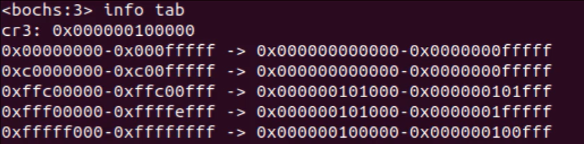{width=70%}

根据Bochs输出的页表映射信息，以下是每个映射关系的简要解释：

- 映射5: 0xfffff000-0xffffffff -> 0x00100000-0x00100fff
	虚拟地址空间最顶端映射到页目录表自身物理地址，设置关键，允许通过虚拟地址修改**页目录表**。

- 映射3: 0xffc00000-0xffc00fff -> 0x00101000-0x00101fff
	虚拟地址0xffc00000区域映射到第一个页表的物理地址，允许操作系统用虚拟地址访问**第一个页表**结构。

- 映射4: 0xfff00000-0xffffefff -> 0x000000101000-0x0000001fffff
	虚拟地址0xfff00000区域对应页目录项768（内核空间起始）指向的页表，映射到**第一个页表**物理地址。

- 映射1: 0x00000000-0x000fffff -> 0x00000000-0x0000fffff
	**用户空间低端1MB**虚拟地址直接映射到相同物理地址（恒等映射）。

- 映射2: 0xc0000000-0xc00fffff -> 0x00000000-0x0000fffff
	**内核空间低端1MB**虚拟地址映射到物理内存低端1MB，使内核能通过高地址访问相同物理内存。

### 5.2.7 快表TLB简介

分页机制下虚拟地址转换需多次访问内存，效率低下。

TLB（Translation Lookaside Buffer）缓存虚拟地址到物理地址的转换结果，提高地址转换速度。TLB 是硬件，属于 CPU 内部的高速缓存硬件单元。

**TLB结构：**

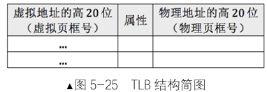{width=50%}

**TLB特点：**

- **不自动更新**：    处理器将维护责任交给操作系统开发人员

- 两种更新方法：
  
    - 重载CR3寄存器：  使整个TLB失效
    - 使用`invlpg`指令：刷新特定虚拟地址对应的条目

## 5.3 加载内核

**节引导语**：内核是操作系统的核心，经过漫长的学习，本节迈入内核阶段。

​					本节介绍如何用C语言编写内核、ELF文件格式解析，以及如何将内核加载到内存并执行。

### 5.3.1 用C语言编写内核

**内核开发特点**：脱离操作系统环境，无法使用标准库和系统调用，需直接控制硬件。

**代码**（main.c）：

```c
int main(void) {
    while(1); // 死循环防止程序退出
    return 0;
}
```

**编译链接命令**：

```shell
mkdir kernel&&cd kernel # /usr/local/bochs/kernel

vi main.c

cd ..

gcc -m32 -c -o kernel/main.o kernel/main.c

ld -m elf_i386 kernel/main.o -Ttext 0xc0001500 -e main -o kernel/kernel.bin
```

`-Ttext`指定虚拟地址起始为`0xc0001500`，`-e`指定入口函数为`main`。

仔细观察编译连接过程，还可以发现几个**信息**：

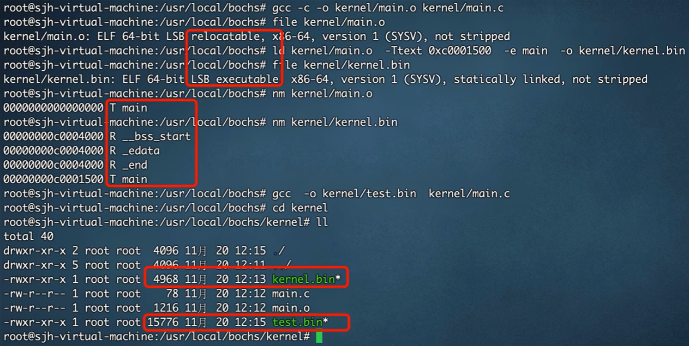

### 5.3.2 二进制程序运行原理

MBR的地址是0x7c00，所以BIOS可以通过jmp指令跳转到MBR，同样，loader的地址也是固定的0X900，所以MBR通过jmp可以跳转到loader。这依赖于调用方需提前知道被调用方的内存地址，方法不灵活。

**解决方案**：在程序文件中添加**文件头**（Header），记录程序尺寸、入口地址等元数据。

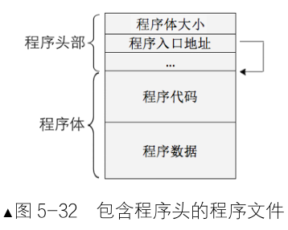{width=50%}

**自定义文件头示例（汇编）**：

```asm
header:
    program_length dd program_end - program_start  ; 程序长度
    start_addr dd program_start                  ; 入口地址
program_start:
    mov ax, 0x1234
    jmp $
program_end:
```

**调用方调用流程：**

​		读取文件头，获取程序尺寸和入口地址。

​		将程序体复制到入口地址对应的内存。

​		跳转到入口地址执行。

### 5.3.3 ELF文件格式精要

“**节**”用于组织源代码，用于链接。

“**段**”用于加载时组织内存。

链接器的工作就是把许多“节”打包成少数几个“段”，以便加载器高效地将程序加载到内存并运行。

**多节程序示例：**

```asm
section .data       ; 数据节：初始化数据
    welcome db 'Welcome, ', 0   ; 欢迎消息前缀

section .rodata     ; 只读数据节：常量数据
    prompt db 'Enter your name: ', 0   ; 提示消息

section .bss        ; 未初始化数据节：用于动态数据
    name resb 16    ; 预留16字节的缓冲区（用于存储输入）

section .text       ; 代码节：主程序代码
    global _start

_start:
    ; 显示提示消息（使用.rodata节）
    mov eax, 4      ; sys_write
    mov ebx, 1      ; stdout
    mov ecx, prompt ; 地址在.rodata节
    mov edx, 17     ; 长度
    int 0x80

    ; 读取用户输入（使用.bss节）
    mov eax, 3      ; sys_read
    mov ebx, 0      ; stdin
    mov ecx, name   ; 缓冲区地址在.bss节
    mov edx, 16     ; 最大长度
    int 0x80

    ; 显示欢迎消息（使用.data节）
    mov eax, 4
    mov ebx, 1
    mov ecx, welcome
    mov edx, 9      ; "Welcome, " 的长度
    int 0x80

    ; 显示输入的名称（使用.bss节）
    mov eax, 4
    mov ebx, 1
    mov ecx, name
    mov edx, 16     ; 假设输入长度
    int 0x80

    ; 退出程序
    mov eax, 1
    xor ebx, ebx
    int 0x80
```

- **代码段**：包含 **.text** 节和 **.rodata** 节。在内存中，代码段被标记为只读，防止意外修改。
- **数据段**：包含 **.data** 节和 **.bss** 节。**.data**节在可执行文件中占用空间，而 **.bss**节仅在加载时分配内存（初始化为零）。

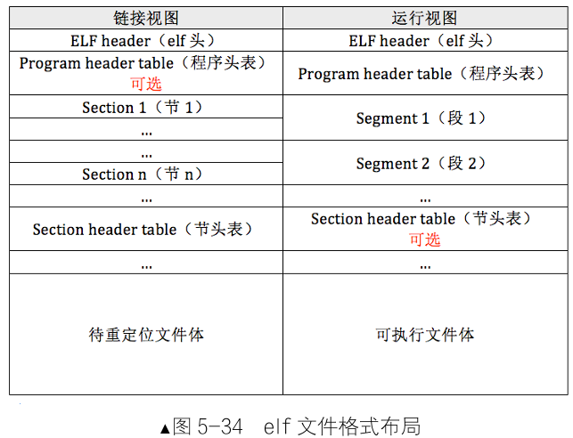

```c
// 程序头内容
typedef struct {
    uint32_t p_type;   // 段类型（偏移0）
    uint32_t p_offset; // 段在文件中的偏移（偏移4）
    uint32_t p_vaddr;  // 段在内存中的虚拟地址（偏移8）
    uint32_t p_paddr;  // 物理地址（通常同vaddr，偏移12）
    uint32_t p_filesz; // 段在文件中的大小（偏移16）
    uint32_t p_memsz;  // 段在内存中的大小（偏移20）
    uint32_t p_flags;  // 段标志（偏移24）
    uint32_t p_align;  // 段对齐（偏移28）
} Elf32_Phdr;
```

### 5.3.4 ELF实例分析

**查看ELF内容**（使用`xxd`工具）：

```shell
readelf -h kernel.bin
xxd -u -a -g 1 -s 0 -l 512 kernel.bin
```

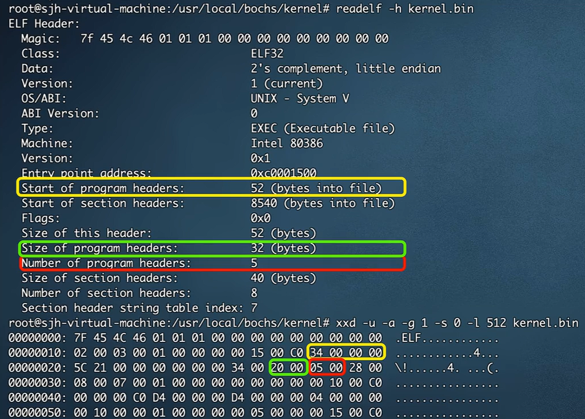

| 字段 | 含义 |
| ---- | ---- |
| Magic | ELF魔数 `7f 45 4c 46`，用于标识该文件为ELF格式 |
| Class | ELF32，32位ELF文件，适配x86 32位保护模式 |
| Data | 2's complement, little endian，小端序，x86原生字节序 |
| Version | 1 (current)，ELF版本 |
| OS/ABI | UNIX - System V，类Unix ABI |
| ABI Version | 0，ABI版本号 |
| Type | EXEC (Executable file)，可执行文件 |
| Machine | Intel 80386，目标架构i386 |
| Entry point address | 0xc0001500，内核入口**虚拟地址**，分页开启后从此处开始执行 |
| Start of program headers | 52，程序头表在文件内偏移52字节 |
| Start of section headers | 8540，节头表在文件内偏移8540字节 |
| Flags | 0x0，无特殊标记 |
| Size of this header | 52，ELF头部大小52字节 |
| Size of program headers | 32，单条程序头entry占32字节 |
| Number of program headers | 5，共5个程序头，供加载器读取ELF时循环读取全部程序头 |
| Size of section headers | 40，单条节头占40字节 |
| Number of section headers | 8，一共8个节（.text/.data等），链接阶段使用 |
| Section header string table index | 7，第7个节为字符串表，存放节名字符串 |

- 字节0-3：魔数字段0x7F 45 4C 46，标识ELF文件格式。

- 字节4：架构标识0x01表示32位架构。

- 字节5：字节序标识0x01表示小端模式。

- 程序入口地址0xC0001500。

- 程序头表在文件中的偏移量0x34(偏移28)，程序头大小0x20(偏移42)，程序头数量0x5(偏移44)。

### 5.3.5 将内核载入内存

内核是操作系统的核心，必须由Loader将其从硬盘加载至内存。

内核加载分两步：从硬盘读取内核二进制文件（kernel.bin）至内存缓冲区；再解析ELF文件结构，将程序段拷贝到正确的内存地址。

关键数据：

- 内核缓冲区：0x70000（物理地址，为分页模式开启之前，下图中约608K的位置） 

- 内核入口地址：0xc0001500（虚拟地址，其物理地址为0x1500，下图中④标号的黄色位置）   

- 内核栈指针：0xc009f000               

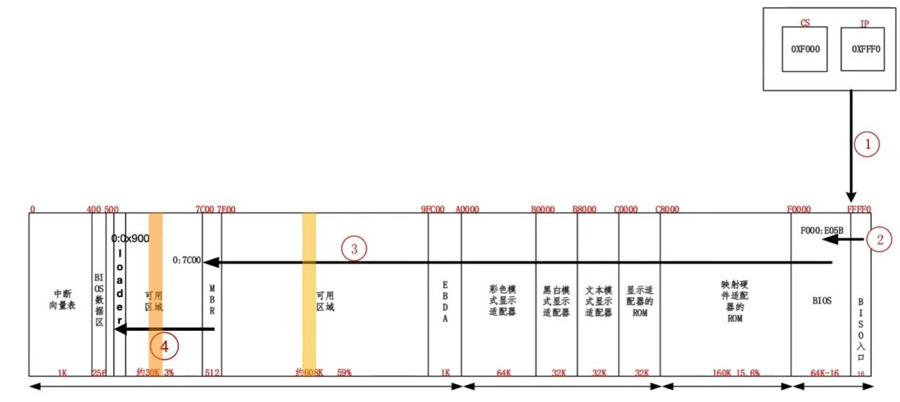

**boot.inc核心变化：**

```asm
KERNEL_START_SECTOR  equ 0x9            ;内核磁盘扇区
KERNEL_BIN_BASE_ADDR equ 0x70000        ;内核缓冲区
KERNEL_ENTRY_POINT   equ 0xc0001500     ;内核入口地址
PT_NULL equ 0                           
```

**boot.inc完整文件：**

```asm
;-----------------  loader和 kernel

LOADER_BASE_ADDR  equ 0x900
LOADER_START_SECTOR  equ 0x2
PAGE_DIR_TABLE_POS equ 0x100000
KERNEL_START_SECTOR  equ 0x9            ;内核磁盘扇区
KERNEL_BIN_BASE_ADDR equ 0x70000        ;内核缓冲区
KERNEL_ENTRY_POINT   equ 0xc0001500     ;内核入口地址
PT_NULL equ 0   

;-----------------  gdt 描述符属性
; 单个位标志
DESC_G_4K    equ     (1 << 23)   ; 粒度位 (G) G=1时，段界限以4KB为单位
DESC_D_32    equ     (1 << 22)   ; 操作数大小位 (D/B)
DESC_L       equ     (0 << 21)   ; 64位代码标志，0表示32位
DESC_AVL     equ     (0 << 20)   ; 可用位

; 段界限字段
DESC_LIMIT_CODE2  equ (0xF << 16)  ; 段界限 bits 16-19
DESC_LIMIT_DATA2  equ DESC_LIMIT_CODE2
DESC_LIMIT_VIDEO2 equ (0x0 << 16)  ; 视频段界限 显存段0x000B8000 

; 描述符特权级
DESC_P       equ     (1 << 15)   ; 存在位 P=1表示位于内存
DESC_DPL_0   equ     (0 << 13)   ; DPL = 0
DESC_DPL_1   equ     (1 << 13)   ; DPL = 1  
DESC_DPL_2   equ     (2 << 13)   ; DPL = 2
DESC_DPL_3   equ     (3 << 13)   ; DPL = 3

; 系统标志和类型字段
DESC_S_CODE  equ     (1 << 12)   ; 代码/数据段标志 S=1：代码或数据段；S=0：系统段
DESC_S_DATA  equ     DESC_S_CODE
DESC_S_sys   equ     (0 << 12)   ; 系统段标志

DESC_TYPE_CODE equ   (0x8 << 8)  ; 1000b 代码段类型: EXEC, NON-CONFORMING
DESC_TYPE_DATA equ   (0x2 << 8)  ; 0010b 数据段类型: READ/WRITE, EXPAND-UP

; 高4字节组合
DESC_CODE_HIGH4 equ (0x00 << 24) + DESC_G_4K + DESC_D_32 + \
                   DESC_L + DESC_AVL + DESC_LIMIT_CODE2 + \
                   DESC_P + DESC_DPL_0 + DESC_S_CODE + \
                   DESC_TYPE_CODE + 0x00

DESC_DATA_HIGH4 equ (0x00 << 24) + DESC_G_4K + DESC_D_32 + \
                   DESC_L + DESC_AVL + DESC_LIMIT_DATA2 + \
                   DESC_P + DESC_DPL_0 + DESC_S_DATA + \
                   DESC_TYPE_DATA + 0x00

;显存段为0x000B8000   所以高4字节为0x000B
DESC_VIDEO_HIGH4 equ (0x00 << 24) + DESC_G_4K + DESC_D_32 + \
                    DESC_L + DESC_AVL + DESC_LIMIT_VIDEO2 + DESC_P + \
                    DESC_DPL_0 + DESC_S_DATA + DESC_TYPE_DATA + 0x0B
                    


;----------------- 选择子属性----------------
RPL0 equ 0x0
RPL1 equ 0x1  
RPL2 equ 0x2
RPL3 equ 0x3
TI_GDT equ 0x0
TI_LDT equ 0x4
;-----------------页表相关属性----------------
PG_P equ 1b
PG_RW_R equ 00b
PG_RW_W equ 10b
PG_US_S equ 000b
PG_US_U equ 100b
```

**loader主要变化：**

1. 读取内核到内存缓冲区（地址**0x70000**）：

	```asm
	; 加载 kernel 
	mov eax, KERNEL_START_SECTOR  ; KERNEL_START_SECTOR=0x9，内核起始扇区号
	mov ebx, KERNEL_BIN_BASE_ADDR ; KERNEL_BIN_BASE_ADDR=0x70000，内核加载的内存地址
	mov ecx, 200                  ; 读取200个扇区
	call rd_disk_m_32             ; 调用磁盘读取函数
	```

2. 解析ELF并初始化内核：

	​		遍历程序头表，将各段拷贝到编译指定的虚拟地址（代码段拷贝到**0xc0001500**）。

	​		关键函数kernel_init：逐段复制数据到目标地址。

3. 跳转到内核入口：

	```asm
	mov esp, 0xc009f000          ; 设置内核栈指针
	jmp KERNEL_ENTRY_POINT       ; 跳转到内核入口地址（0xc0001500）
	```

**完整loader:**

```asm
%include "boot.inc"

section loader vstart=LOADER_BASE_ADDR
LOADER_STACK_TOP equ LOADER_BASE_ADDR
jmp loader_start

;构建gdt及其内部的描述符
GDT_BASE: dd   0x00000000
          dd   0x00000000

CODE_DESC: dd   0x0000FFFF
           dd   DESC_CODE_HIGH4

DATA_STACK_DESC: dd   0x0000FFFF
                 dd   DESC_DATA_HIGH4

VIDEO_DESC: dd   0x80000007;limit=(0xbffff-0xb8000)/4k=0x7 显存段0x000B8000
            dd   DESC_VIDEO_HIGH4  ;此时dpl为0
            

GDT_SIZE  equ   $ - GDT_BASE
GDT_LIMIT  equ   GDT_SIZE - 1

times 60 dq 0             ;此处预留60个描述符的空位

SELECTOR_CODE  equ  (0x0001<<3) + TI_GDT + RPL0
SELECTOR_DATA  equ  (0x0002<<3) + TI_GDT + RPL0     ;同上
SELECTOR_VIDEO equ  (0x0003<<3) + TI_GDT + RPL0     ;同上

;以下是gdt的指针，前2字节是gdt界限，后4字节是gdt起始地址
gdt_ptr  dw  GDT_LIMIT
         dd  GDT_BASE
         
loadermsg db '2 loader in real.'

loader_start:
;-----------------------------
;INT 0x10   功能号:0x13   功能描述:打印字符串
mov ax,cs
mov es,ax
mov sp, LOADER_BASE_ADDR   

mov bp, loadermsg          ;ES:BP=字符串地址
mov cx, 17       ;CX=字符串长度
mov ax, 0x1301   ;AH = 13子功能号
                 ;AL=1——字符串中只含显示字符，其显示属性在BL中;显示后，光标位置改变
mov bx, 0x001f   ;页号为0(BH = 0)蓝底粉红字(BL = 1fh)
mov dx, 0x1800   ;坐标
int 0x10         ;10h中断   

;----------------------------------------
;准备进入保护模式:
;1 打开A20
;2 加载gdt
;3 将cr0的pe位置1
;----------------- 打开A20 ----------------
in al, 0x92
or al, 0000_0010B
out 0x92, al
;----------------- 加载GDT -----------------
lgdt [gdt_ptr]
;----------------- cr0第0位置1 -----------------
mov eax, cr0
or eax, 0x00000001
mov cr0, eax

jmp dword SELECTOR_CODE:p_mode_start ;刷新流水线

[bits 32]
p_mode_start:
mov ax, SELECTOR_DATA
mov ds, ax
mov es, ax
mov ss, ax

mov esp, LOADER_STACK_TOP


; --------------step1:加载kernel进内存---------------------------
mov eax, KERNEL_START_SECTOR       ; 内核扇区号
mov ebx, KERNEL_BIN_BASE_ADDR      ; 内存缓冲区
mov ecx, 200                       ; 扇区数
call rd_disk_m_32                  ; 磁盘读取函数


; 初始化内存分页管理
call setup_page                    ; 创建页目录、页表并初始化位图

; 调整全局描述符表(GDT)地址映射
sgdt [gdt_ptr]                     ; 保存当前GDT地址信息

; 更新显存段描述符基址（第3个描述符）
; 将物理地址0x000B8000改为虚拟地址0xC00B8000
mov ebx, [gdt_ptr + 2]                 ; +2跳过gdt_ptr前2字节界限，获取GDT的基地址
or dword [ebx + 0x18 + 4], 0xc0000000  ; 将基址映射到内核空间

; 将GDT基址和栈指针映射到高地址空间
add dword [gdt_ptr + 2], 0xc0000000    ; GDT基址映射
add esp, 0xc0000000                    ; 栈指针重映射


; 启用分页机制
mov eax, PAGE_DIR_TABLE_POS
mov cr3, eax

mov eax, cr0
or eax, 0x80000000
mov cr0, eax                           ; 设置CR0的PG位

; 重新加载更新后的GDT
lgdt [gdt_ptr]

; 重新加载视频段选择子
;mov ax, SELECTOR_VIDEO
;mov gs, ax

; 现在可以安全访问显存
;mov byte [gs:160], 'V'
; 系统挂起
;jmp $

;------------- step2:将kernel.bin中的segment拷贝到编译的地址--------------
jmp SELECTOR_CODE:enter_kernel   
enter_kernel:
	call kernel_init
	mov esp, 0xc009f000           ; 设置内核栈指针
	jmp KERNEL_ENTRY_POINT        ; 跳转到内核入口地址（0xc0001500）

; 内核初始化函数
kernel_init:
    xor eax, eax
    xor ebx, ebx
    xor ecx, ecx
    xor edx, edx
    
    ; 获取程序头表信息
    mov ebx, [KERNEL_BIN_BASE_ADDR + 28]         ; 读取程序头表偏移
    add ebx, KERNEL_BIN_BASE_ADDR                ; 将文件偏移转换为内存地址
    movzx edx,word [KERNEL_BIN_BASE_ADDR + 42]   ; 读取程序头大小
    movzx ecx,word [KERNEL_BIN_BASE_ADDR + 44]   ; 读取程序头数量
    

.each_segment:
    cmp byte [ebx + 0], PT_NULL    ;PT_NULL为0，表示该程序头未使用，跳过
    je .PTNULL
    
    ; 复制段到目标地址
    push dword [ebx + 16]    ; 段大小
    mov  eax,  [ebx + 4]     ; 段在文件内的偏移
    add  eax,  KERNEL_BIN_BASE_ADDR
    push eax               ; src
    push dword [ebx + 8]   ; dst 段内有关于该段需被加载到什么地址的信息
    call mem_cpy
    add esp, 12

.PTNULL:
    add ebx, edx
    loop .each_segment
    ret

; 内存复制函数
mem_cpy:
    push ebp
    mov  ebp, esp
    push ecx
    mov  edi, [ebp + 8]   ; dst
    mov  esi, [ebp + 12]  ; src
    mov  ecx, [ebp + 16]  ; size
    cld
    rep movsb
    pop ecx
    pop ebp
    ret


;-------------------------------------------------------------------------------
; 功能: 读取硬盘n个扇区（32位模式）
; 输入: eax = LBA扇区号
;   	 ebx = 将数据写入的内存地址（32位线性地址）
;   	 ecx = 读入的扇区数
;-------------------------------------------------------------------------------
rd_disk_m_32:
    push esi
    push edi
    push edx
    push eax
    push ebx
    push ecx
    
    mov esi, eax       ; 备份LBA扇区号
    mov edi, ecx       ; 备份扇区数

; 第1步：设置要读取的扇区数
    mov dx, 0x1f2
    mov al, cl         ; 扇区数（8位）
    out dx, al

    mov eax, esi       ; 恢复LBA扇区号

; 第2步：将LBA地址存入0x1f3～0x1f6
    ; LBA地址7~0位写入端口0x1f3
    mov dx, 0x1f3
    out dx, al

    ; LBA地址15~8位写入端口0x1f4
    shr eax, 8
    mov dx, 0x1f4
    out dx, al

    ; LBA地址23~16位写入端口0x1f5
    shr eax, 8
    mov dx, 0x1f5
    out dx, al

    ; LBA地址27~24位写入端口0x1f6
    shr eax, 8
    and al, 0x0f      ; 保留低4位（LBA 24-27）
    or al, 0xe0       ; 设置LBA模式，主盘
    mov dx, 0x1f6
    out dx, al

; 第3步：发送读命令（0x20）
    mov dx, 0x1f7
    mov al, 0x20      ; 读扇区命令
    out dx, al

; 第4步：检测硬盘状态
.not_ready:
    in al, dx
    and al, 0x88      ; 检查第3位（DRQ）和第7位（BSY）
    cmp al, 0x08      ; 就绪且不忙？
    jnz .not_ready

; 第5步：从数据端口读取数据
    mov eax, edi       ; 扇区数
    mov ecx, 256       ; 每扇区256字（512字节）
    mul ecx            ; eax = 总字数 = 扇区数 * 256
    mov ecx, eax       ; 设置循环次数
    
    mov dx, 0x1f0      ; 数据端口
    mov edi, ebx       ; 目标内存地址
    
; 使用32位内存写入优化循环
.read_loop:
    in ax, dx         ; 从端口读取2字节
    mov [edi], ax     ; 存储到内存
    add edi, 2        ; 移动内存指针
    loop .read_loop   ; 循环直到所有数据读取完成

; 恢复寄存器并返回
    pop ecx
    pop ebx
    pop eax
    pop edx
    pop edi
    pop esi
    ret


;----------------- 页目录及页表初始化 -----------------
setup_page:
    ; 清零页目录区域 一次清空4字节 清空1024次 共4096字节
    xor esi, esi
    mov ecx, 1024           
.clear_dir:
    mov dword [PAGE_DIR_TABLE_POS + esi*4], 0
    inc esi
    loop .clear_dir

    ; 确定第一个页表
    mov eax, PAGE_DIR_TABLE_POS + 0x1000  ; 第一个页表地址
    or eax, PG_US_U | PG_RW_W | PG_P      ; 设置页目录项属性
    
    ; 映射目录项0和768到同一页表
    mov [PAGE_DIR_TABLE_POS + 0x0],   eax ; 目录项0 →   第一个页表
    mov [PAGE_DIR_TABLE_POS + 0xc00], eax ; 目录项768 → 第一个页表
    
    ; 设置自映射目录项
    mov eax, PAGE_DIR_TABLE_POS
    or  eax,  PG_US_U | PG_RW_W | PG_P
    mov [PAGE_DIR_TABLE_POS + 4092], eax  ; 目录项1023 → 页目录自身

    ; 初始化第一个页表的256个PTE（一起映射低端1MB内存  物理地址0开始）
    mov edi, PAGE_DIR_TABLE_POS + 0x1000   ; 第一个页表地址
    mov eax, PG_US_U | PG_RW_W |  PG_P     ; 物理地址0 + 属性
    mov ecx, 256                           ; 256个页表项
.init_pte:
    mov [edi], eax
    add edi, 4
    add eax, 4096                         ; 下一物理页
    loop .init_pte

    ; 初始化页目录项769-1022号，内核空间PDE
    mov edi, PAGE_DIR_TABLE_POS + 0x2000    ; 第二个页表开始
    mov ebx, PAGE_DIR_TABLE_POS + 769 * 4   ; 目录项769地址
    mov ecx, 254                            ; 254个目录项
.init_kernel_pde:
    mov eax, edi
    or eax, PG_US_U | PG_RW_W | PG_P
    mov [ebx], eax                        ; 设置页目录项
    add ebx, 4                            ; 下一个目录项
    add edi, 0x1000                       ; 下一个页表
    loop .init_kernel_pde
    ret
```

**内核运行流程：**

```shell
# 编译Loader  
nasm  -o loader.bin loader.s

# loader写入硬盘
dd if=loader.bin of=hd60M.img bs=512 count=4 seek=2 conv=notrunc

# 内核编译链接
gcc -m32 -c -o kernel/main.o kernel/main.c

ld -m elf_i386 kernel/main.o -Ttext 0xc0001500 -e main -o kernel/kernel.bin

dd if=kernel/kernel.bin of=hd60M.img bs=512 count=200 seek=9 conv=notrunc

# 从虚拟机界面启动bochs
bin/bochs -f bochsrc.disk
```

## 5.4 特权级深入浅出

**节引导语**：在成功加载内核后，我们需深入理解保护模式下的特权级机制，这是确保系统安全的核心。

​                  本节将循序渐进地讲解特权级的原理、围绕应用程序与内核场景讲述关键概念，夯实系统底层知识。

### 5.4.1 特权级那点事

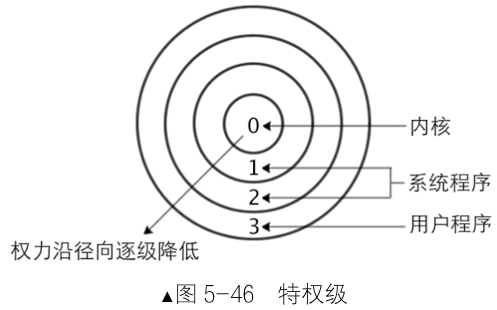{width=55%}

特权级是保护模式的基石，隔离系统与用户程序。特权检查发生在访问资源时(如内存、IO)，由CPU自动完成。数据段强调**绝对保护**，代码段强调**可控共享**。

**CPL**表示**当前正在执行的代码所处的特权级别**，存储在CS寄存器的最低两位。

**DPL**定义在**段描述符中**，规定了访问该段所需的最低特权级别。

**RPL**是**选择子（Selector）中的特权级字段**，代表的是"请求发起者"的特权级。


| 机制 | 全称 | 含义 | 存储位置 | 类比 |
| --- | --- | --- | --- | --- |
| CPL | Current Privilege Level | 当前正在执行的代码的权限级别。 | CS 寄存器低两位 | 你当前的实际官职（如省长）。 |
| DPL | Descriptor Privilege Level | 一个段（代码或数据）所要求的最低访问权限。 | 段描述符中 | 你要拜访的部门规定的准入门槛。 |
| RPL | Request Privilege Level | 本次访问请求的请求权限，用于临时降级。 | 段选择子低两位 | 你这次是代表谁去拜访（如代表县长去，权限就临时降为县长级）。 |

**关键点**：

- **0级**：操作系统内核，直接控制硬件。

- **3级**：用户程序，权限受限，需通过系统调用访问核心资源。

​这种设计确保低特权代码无法越权访问高特权资源，提升系统稳定性。

> 那岂不是用户永远无法调用内核代码？所以需要“调用门”。

### 5.4.2 调用门

**什么是“门”？**

“门”是一种特殊的描述符，可以理解为进入高特权级代码的“安全通道”。处理器设计规定，**只有通过“门结构”，才能从低特权级转移到高特权级**。这就像进入一个保密区域，必须通过一道有安检的门，而不能直接翻墙。我们重点关注**调用门**，因为它最直观地展示了特权级转换的过程。

**调用门描述符的结构**，调用门描述符（8字节）告诉处理器两件事：

- **目标代码在哪里**：通过一个代码段选择子和**段内偏移量**共同确定。

- **如何传递参数**：有一个**参数个数**字段，指明需要从低特权级栈复制多少个参数到高特权级栈。

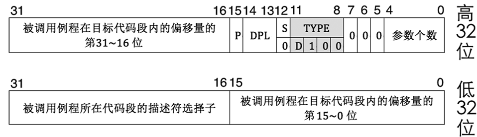

!!! question "用户怎么合法进入内核？"

    **只能通过内核预先放在GDT/LDT/IDT里的「门描述符」**——这些门是硬件唯一允许「从低特权级合法升到高特权级」的通道，而调用门就是其中最适合「用户主动发起系统调用」的门。调用门是一种Type=0xC的系统段描述符（和普通代码段的Type=0x8完全不同），存在于GDT/LDT中（内存），64位结构如上图所示。

    调用门不是 “进去就随便跑内核代码”，调用门本身自带硬限制：调用门里写死了唯一目标代码段 + 入口偏移，硬件强制只能跳转到这一个固定入口点，不能任意指定内核地址。

### 5.4.3 用户程序的权限图

用户程序运行示意图：

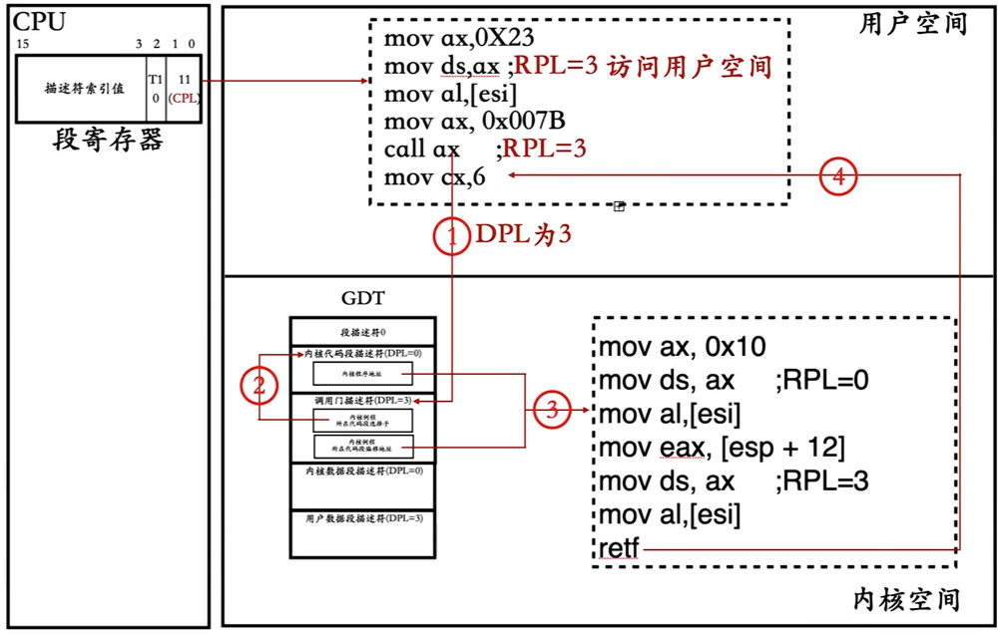

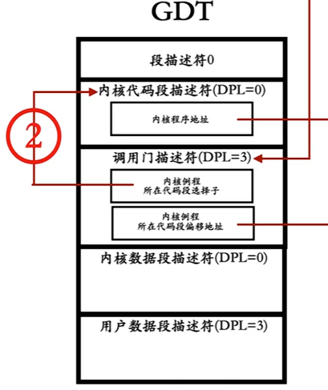

- 用户程序只能访问用户数据，不能访问内核数据 **(数据权限规则：CPL ≤ DPL 且 RPL ≤ DPL)**。
- 用户程序正常只能调用用户程序，不能调用内核程序 **（代码权限规则：CPL = DPL平级转移)**。
- 门是提升特权级的唯一通道，且门不能降低特权级。
- 用户程序如果跳转至一致性内核代码，CPL不提升，保持以前的数值。一致性代码段通常用于操作系统内核提供的服务函数，但不要求完全内核特权。
- 在用户程序中，其实RPL的重要性较低，因为CPL=3是底板。

### 5.4.4 用户程序陷入内核的过程

每个特权级有独立的栈，高特权级代码使用独立栈，避免数据混乱。

TSS(任务状态段)包含多个字段，低特权级切换高特权级任务时，CPU自动从**TSS**加载目标特权级的栈。

**TSS**核心作用是管理特权级切换时的栈指针，并存储任务其他环境(如寄存器状态)，是硬件支持的多任务数据结构。


!!! note "TSS"

    TSS（任务状态段）本身是内存里的数据结构，存放一个任务的硬件上下文。CPU 内部有 TR（任务寄存器），只保存 TSS 的选择子。

    作用：任务切换时，CPU 硬件自动把当前寄存器现场保存进 TSS；切回来时自动从 TSS 恢复寄存器。

    `ltr 选择子` 加载 TR → CPU 通过 TR 里的选择子去 GDT 找到 TSS 描述符 → 拿到 TSS 在内存的基地址，访问内存里的 TSS 结构体。

通过TSS切换到高权限级栈后，在新栈会存储部分低权限级的**信息**：

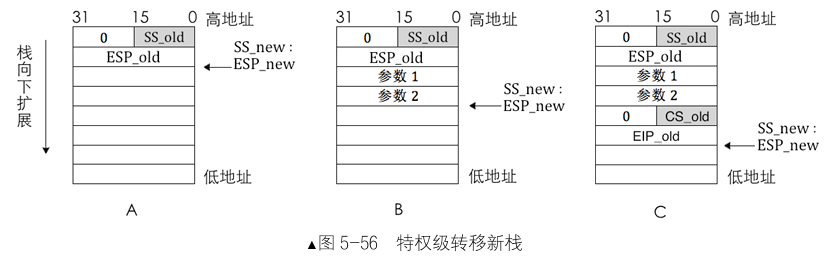

### 5.4.5 内核程序的权限图

内核程序运行示意图：

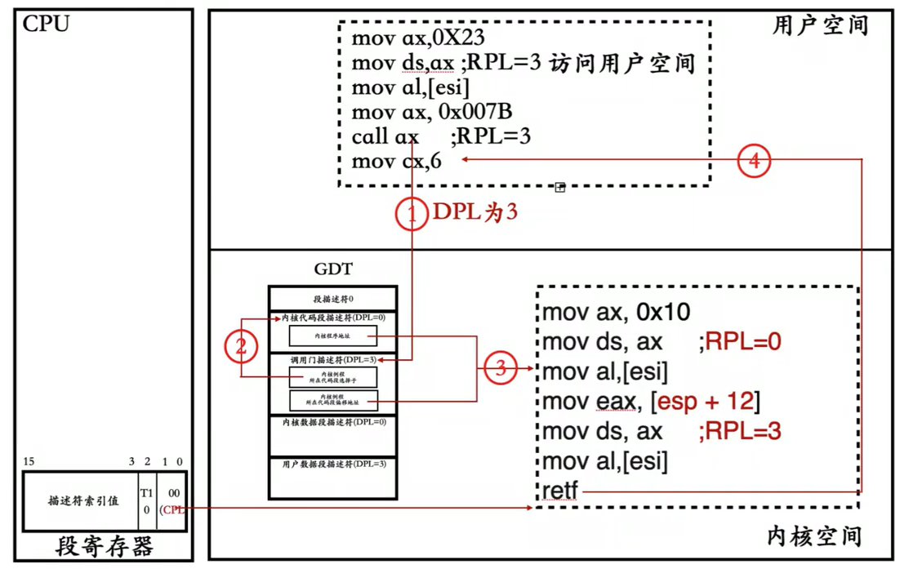

- 内核可以访问用户数据和内核数据 **(数据权限规则：CPL ≤ DPL 且 RPL ≤ DPL)**。
- 内核程序只能调用内核程序，但能通过retf等返回**（代码权限规则：CPL = DPL平级转移)**。
- 对于用户传递的选择子，内核要使用arpl指令进行修正，防止欺骗(**arpl [用户选择子], cs**)。

### 5.4.6 内核返回用户程序的过程

从内核返回用户程序，需恢复相关环境，包括栈切换和寄存器恢复，过程是由**处理器硬件自动完成**的，而不是由操作系统代码完成的。这确保了过程的可靠性和原子性，是硬件提供的“过程保护”机制。

**内核执行与返回**

- 例程执行完毕后，使用**retf**指令返回。
- **retf**指令让处理器**逆向执行上述过程**：它从栈中弹出**EIP_old**和**CS_old**（导致CPL从0降回3），然后弹出参数，最后弹出**ESP_old**和**SS_old**，从而完全恢复到用户态的栈环境。
- 处理器继续在用户态(CPL=3)执行**call**指令之后的代码。

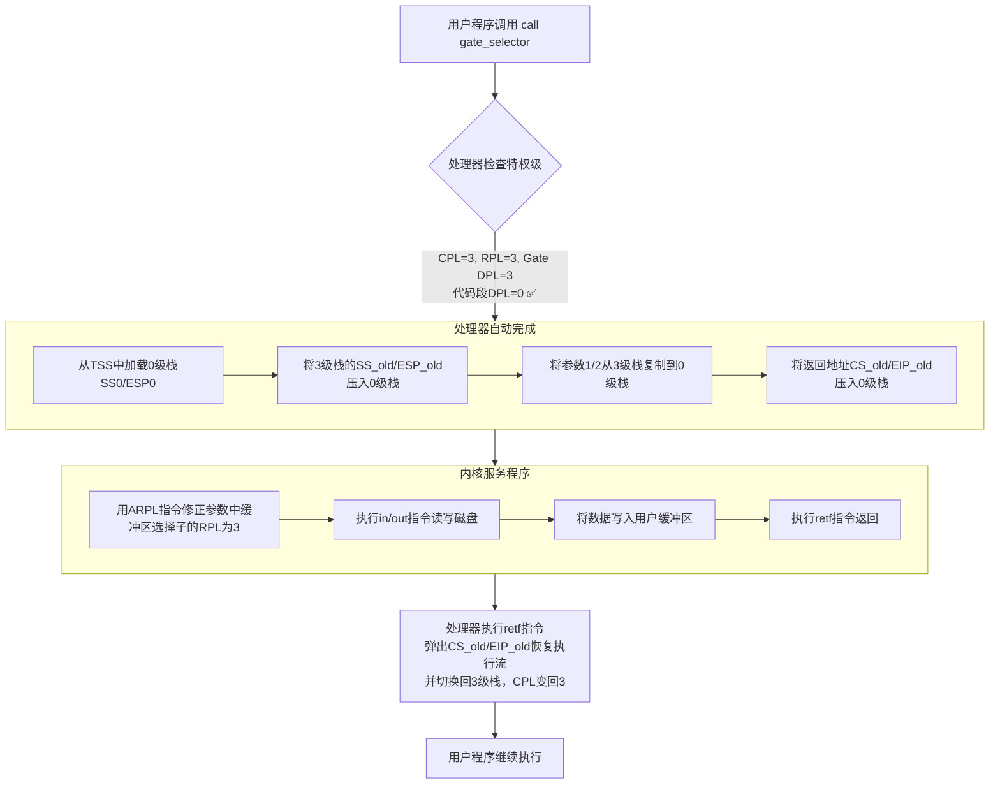

### 5.4.7 IO特权级

本节的核心是讲解保护模式下，处理器如何对**输入/输出(I/O)**指令进行特权级保护。

**核心概念：IO敏感指令与IO特权级**

在保护模式下，与I/O操作相关的指令被称为 **IO敏感指令**，只能在特定的特权级下被执行， **IO敏感指令**包括：

- 用于端口读写:**in, out**.

- 用于开关中断:**cli, sti.**

处理器通过 **IO特权级**(IOPL)来控制这些指令的执行，IOPL位于eflags的第12-13位，并且个任务都有自己的一份eflags。

只有当前特权级(CPL)的数值小于等于IOPL时，才允许执行IO敏感指令。否则，处理器将引发异常。修改IOPL本身也是一种特权操作，通常只有CPL=0的操作系统才能通过**popf**或**iret**等指令修改它。

**IO保护的层次：全局开关与精细控制**

I/O保护机制分为两个层次：

**层次一：IOPL —— 全局“总开关”**

如果任务的CPL足够高（≤IOPL），则它拥有完整的I/O权限，可以访问所有65536个端口。这相当于打开了I/O访问的“总开关”。驱动程序通常需要此权限。

**层次二：I/O位图 —— 精细化的“权限列表”**

对于CPL > IOPL的低特权级任务（如普通用户程序），I/O“总开关”是关闭的。但处理器提供了第二种更精细的机制：**I/O位图**。

- 位置与结构：I/O位图位于任务的TSS末尾。它是一个比特数组，每个比特对应一个I/O端口地址。**比特=0**表允许访问对应端口。**比特=1**表禁止访问对应端口。

- **定位方法**：TSS中有一个字段指示了I/O位图在TSS内的起始偏移量。

- **边界保护**：I/O位图的大小可以小于8KB（即不必映射所有端口）。为了处理访问位图范围之外的端口的情况，处理器要求**位图的最后一个字节必须为0xFF**。0xFF表示所有位为1，即禁止访问，这确保了任何越界端口的访问都会被安全地拒绝。

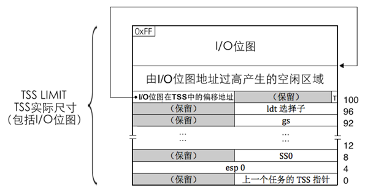

## 本章要点总结

1. **内存检测**：	掌握三种BIOS中断检测物理内存容量的方法，理解内存空洞概念
2. **分页机制**：    理解二级页表工作原理，掌握页目录和页表设置方法
3. **内核加载**：    学会ELF文件格式解析和内核加载到内存的过程
4. **特权级保护**：理解CPL、DPL、RPL的作用和特权级检查规则
5. **系统调用**：   了解调用门实现特权级转换的机制

通过本章学习，已经掌握了保护模式下的内存管理、内核加载和特权级保护等核心概念，为后续操作系统开发奠定了坚实基础。