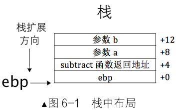
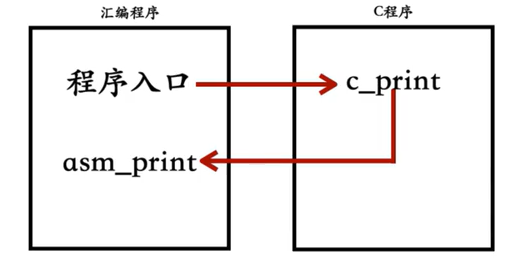
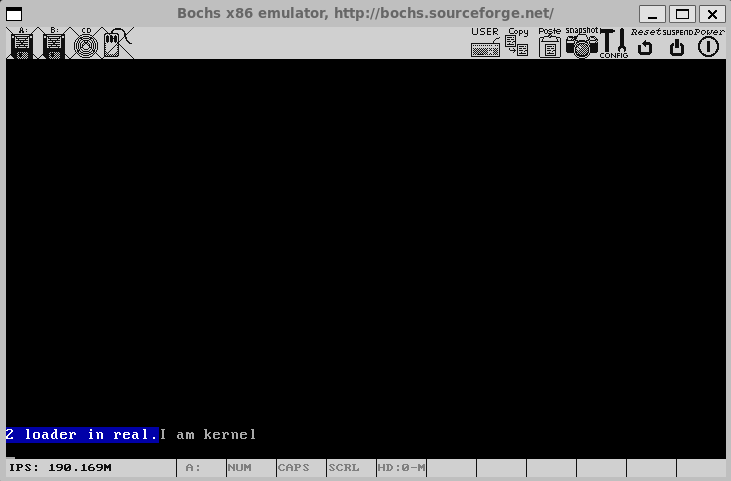

# 第6章 完善内核

在上一章中，我们成功构建了一个简易内核，功能较为基础。

本章将深入完善内核功能，重点介绍函数调用约定、汇编与C语言混合编程、实现关键打印函数,为内核开发奠定坚实基础。

## 6.1 函数调用约定简介

在混合编程中，汇编与C代码相互调用需遵循统一的接口规范，即函数调用约定（Calling Conventions）。

调用约定的**核心**要明确了以下细节：

- **参数传递方式**：通过寄存器或栈传递。

- **参数传递顺序**：从左到右或从右到左。

- **寄存器环境恢复**：由调用者或被调用者负责。

例如，C函数调用**subtract(3, 2)**，若在汇编层需解决参数存储顺序和栈空间清理问题。

本节将解析参数传递、栈清理等关键机制，并通过实例对比**cdecl**与**stdcall**约定。

C语言遵守的是cdecl，以下通过对比cdecl与stdcall约定说明其差异。

**cdecl约定示例**

- 参数从右向左入栈，调用者清理栈空间。
- 支持变长参数，如**printf**函数。

```asm
; 主调者代码
push 2       ; 参数b入栈
push 3       ; 参数a入栈
call subtract
add esp, 8   ; 调用者清理栈

; 被调者subtract函数
subtract:
push ebp
mov ebp, esp
mov eax, [ebp+8]   ; 获取参数a
sub eax, [ebp+12]  ; 减去参数b
mov esp, ebp
pop ebp
ret
```

{width=40%}

**stdcall约定示例**

- 参数从右向左入栈，被调用者清理栈空间。
- 通过**ret n**指令回收栈空间。

```asm
; 主调者代码
push 2
push 3
call subtract

; 被调者subtract函数
subtract:
push ebp
mov ebp, esp
mov eax, [ebp+8]
sub eax, [ebp+12]
mov esp, ebp
pop ebp
ret 8   ; 被调用者清理8字节参数空间
```

**关键区别总结**

| 约定类型 | 参数顺序 | 栈清理方 | 适用场景                |
| -------- | -------- | -------- | ----------------------- |
| cdecl    | 从右到左 | 调用者   | C语言默认，支持变长参数 |
| stdcall  | 从右到左 | 被调用者 | Windows API常用         |

## 6.2 汇编语言和C语言混合编程

混合编程是内核开发的核心技术，本节将讲述库函数与系统调用的关系，并用实例展示汇编与C代码相互调用的实现。

### 6.2.1 浅析C库函数与系统调用

系统调用是内核提供的服务接口。应用程序可**通过C库函数**间接使用系统调用：

```c
#include <unistd.h>
int main() {
    write(1, "hello\n", 6);  // 依赖C库
    return 0;
}
```

间接使用库函数进行系统调用最终还是需要软中断**int 0x80**请求内核功能，**write**系统调用功能号4，只是库函数封装了软中断**int 0x80**。用户程序可以跨过库函数，直接与系统内核通信。

**程序实例**：

```asm
section .data
str_c_lib: db "c library says: hello world!", 0xa ;0xa为LF ASCII码
str_c_lib_len equ $-str_c_lib

str_syscall: db "syscall says: hello world!", 0xa
str_syscall_len equ $-str_syscall

section .text
global _start
_start:
 
;方式1:模拟C语言中系统调用库函数 write 
push str_c_lib_len     ;按照C调用约定压入参数
push str_c_lib
push 1
call simu_write        ;调用下面定义的 simu_write
add esp,12             ;回收栈空间

                       ;下面是自定义的 simu_write 函数
simu_write:
push ebp               ;保存ebp
mov ebp, esp           ;设置栈帧
mov ebx, [ebp+8]       ;第一个参数:文件描述符
mov ecx, [ebp+12]      ;第二个参数:要打印的字符串
mov edx, [ebp+16]      ;第三个参数:字符串长度
mov eax, 4             ;第4号子功能是 write 系统调用
int 0x80
pop ebp                ;恢复ebp
ret

;方式2:跨过库函数，直接进行系统调用                       
mov ebx, 1
mov ecx, str_syscall
mov edx, str_syscall_len
mov eax,4              ;第4号子功能是 write 系统调用(不是C库函数 write)
int 0x80               ;发起中断，通知 Linux 完成请求的功能                
mov eax,1              ;第1号子功能是 exit ;退出程序
int 0x80
```

### 6.2.2 汇编与C相互调用实例

汇编程序与C最终都是生成二进制的机器语言文件才可被执行，汇编和C正是通过机器语言这个桥梁可以相互调用。以下代码演示汇编调用C函数、C函数再回调汇编的过程：

{width=60%}

**汇编代码（c_with_s_s.s）**：

```asm
section .data
    str:db "asm_print says hello!",0xa,0 ;0xa是换行符，0是手工加上的字符串结束符的ASCII码
    str_len equ $-str

section .text
extern c_print       ; 声明C函数
global _start

_start:
    push str         ; 参数入栈
    call c_print     ; 调用C函数
    add esp, 4       ; 清理栈

    mov eax, 1       ; 退出程序
    int 0x80

global asm_print

asm_print:
    push ebp
    mov ebp, esp
    mov ebx, 1
    mov ecx, [ebp+8] ; 第一个参数
    mov edx, [ebp+12] ; 第二个参数
    mov eax, 4       ; write系统调用
    int 0x80
    pop ebp
    ret
```

**C代码(c_with_s_c.c)**：

```c
extern void asm_print(char*, int);  // 声明汇编函数

void c_print(char* str) {
    int len = 0;
    while (str[len++]);            // 计算字符串长度
    asm_print(str, len);           // 调用汇编函数
}
```

**编译命令**：

```shell
nasm -f elf32 -o c_with_s_s.o c_with_s_s.s

gcc -m32 -c -o c_with_s_c.o c_with_s_c.c

ld -m elf_i386 -o c_with_s.bin c_with_s_s.o c_with_s_c.o
```

> 关键点：通过**extern**和**global**声明跨文件函数，确保链接器正确解析符号。

## 6.3 实现自己的打印函数

直接操作硬件是内核开发的基本能力，本节实现字符打印、字符串打印及整数打印函数，逐步构建内核输出模块。

### 6.3.1 显卡的端口控制

显卡通过端口寄存器控制文本模式输出，关键寄存器组如下：

| 寄存器组  | 地址寄存器端口 | 数据寄存器端口 | 说明                 |
| --------- | -------------- | -------------- | -------------------- |
| CRT控制器 | 0x3D4          | 0x3D5          | 控制光标位置、滚屏等 |

<center>CRT Controller Data Registers</center>

| 索引 | 寄存器 | 索引 | 寄存器 |
| --- | --- | --- | --- |
| 00h | Horizontal Total Register | 0Dh | Start Address Low Register |
| 01h | End Horizontal Display Register | 0Eh | Cursor Location High Register |
| 02h | Start Horizontal Blanking Register | 0Fh | Cursor Location Low Register |
| 03h | End Horizontal Blanking Register | 10h | Vertical Retrace Start Register |
| 04h | Start Horizontal Retrace Register | 11h | Vertical Retrace End Register |
| 05h | End Horizontal Retrace Register | 12h | Vertical Display End Register |
| 06h | Vertical Total Register | 13h | Offset Register |
| 07h | Overflow Register | 14h | Underline Location Register |
| 08h | Preset Row Scan Register | 15h | Start Vertical Blanking Register |
| 09h | Maximum Scan Line Register | 16h | End Vertical Blanking |
| 0Ah | Cursor Start Register | 17h | CRTC Mode Control Register |
| 0Bh | Cursor End Register | 18h | Line Compare Register |
| 0Ch | Start Address High Register |  |  |	

**示例：获取光标位置**：

```asm
; 读取光标位置高8位
mov dx, 0x3D4    ; CRT控制器地址寄存器端口
mov al, 0x0E     ; 光标位置高8位寄存器索引
out dx, al       ; 将索引写入地址寄存器

mov dx, 0x3D5    ; CRT控制器数据寄存器端口
in al, dx        ; 读取光标位置高8位到AL
mov ah, al       ; 保存到AH寄存器

; 读取光标位置低8位
mov dx, 0x3D4    ; 重新设置地址寄存器端口
mov al, 0X0F     ; 光标位置低8位寄存器索引
out dx, al       ; 指定要访问的寄存器

mov dx, 0x3D5    ; 数据寄存器端口
in al, dx        ; 读取光标位置低8位到AL

; 此时AX寄存器中包含完整的光标位置（16位）
; AH = 高8位，AL = 低8位
```

### 6.3.2 实现单个字符打印

**put_char**函数是打印功能的核心。流程包括：**获取**光标位置;**处理**控制字符(如退格、换行);**滚屏**判断与实现;**更新**光标位置。**注意**：mbr基于4.3.5， loader基于5.3.5。



**测试代码（lib/kernel/main.c）**：

```c
#include "print.h"
void main() {
    put_char('I');
    put_char(' ');
    put_char('a');
    put_char('m');
    put_char(' ');
    put_char('k');
    put_char('e');
    put_char('r');
    put_char('n');
    put_char('e');
    put_char('l');
    put_char('\n');
    while(1);
}
```

**完整代码lib/kernel/print.s**：

```asm
TI_GDT equ 0
RPL0 equ 0
SELECTOR_VIDEO equ (0x0003<<3)+TI_GDT+RPL0

[bits 32]
section .text
global put_char

put_char:
    pushad                     ; 备份寄存器
    mov ax, SELECTOR_VIDEO     ; 设置视频段选择子
    mov gs, ax

    ; 获取光标位置（高8位）
    mov dx, 0x3D4
    mov al, 0x0E
    out dx, al
    mov dx, 0x3D5
    in al, dx
    mov ah, al

    ; 获取光标位置（低8位）
    mov dx, 0x3D4
    mov al, 0x0F
    out dx, al
    mov dx, 0x3D5
    in al, dx

    ; 光标值存入bx
    mov bx, ax
    mov ecx, [esp+36]          ; 获取传入的字符

    ; 判断字符类型
    cmp cl, 0x0D               ; 回车符
    jz .carriage_return
    cmp cl, 0x0A               ; 换行符
    jz .line_feed
    cmp cl, 0x08               ; 退格符
    jz .backspace
    
    jmp .printable

;退格
.backspace:
    dec bx                     ; 光标前移
    shl bx, 1                  ; 转换为显存偏移
    mov byte [gs:bx], 0x20     ; 写入空格
    inc bx
    mov byte [gs:bx], 0x07     ; 属性字节
    shr bx, 1
    jmp .set_cursor

;打印可见字符
.printable:
    shl bx, 1
    mov [gs:bx], cl            ; 写入字符
    inc bx
    mov byte [gs:bx], 0x07     ; 属性字节
    shr bx, 1
    inc bx                     ; 光标后移
    cmp bx, 2000               ; 是否需滚屏
    jl .set_cursor

;回车换行处理
.line_feed:
.carriage_return:
    ; 处理换行/回车：光标移到下一行首
    xor dx, dx
    mov ax, bx
    mov si, 80
    div si                     ; bx/80，商在ax，余数在dx
    sub bx, dx                 ; 回车：回到行首
    add bx, 80                 ; 换行：移到下一行
    cmp bx, 2000
    jl .set_cursor

;滚屏处理
.roll_screen:
    ; 滚屏：第1-24行内容上移，清空最后一行
    cld
    mov ecx, 960               ; 3840字节/4字节
    mov edi, 0xC00B8000        ; 第1行起始
    mov esi, 0xC00B80A0        ; 第2行起始
    rep movsd                  ; 复制内存
;滚屏时最后一行空白处理
    mov ebx, 3840              ; 最后一行起始偏移
    mov ecx, 80
.clear_line:
    mov word [gs:ebx], 0x0720  ; 黑底白字空格
    add ebx, 2
    loop .clear_line
    mov bx, 1920               ; 光标置最后一行首

;更新光标位置
.set_cursor:
    ; 更新光标位置寄存器
    mov dx, 0x3D4
    mov al, 0x0E
    out dx, al
    
    mov dx, 0x3D5
    mov al, bh
    out dx, al                 ; 写入高8位

    mov dx, 0x3D4
    mov al, 0x0F
    out dx, al
    
    mov dx, 0x3D5
    mov al, bl
    out dx, al                 ; 写入低8位

    popad                      ; 恢复寄存器
    ret
```

**头文件lib/kernel/print.h**：

```c
#ifndef __LIB_KERNEL_PRINT_H
#define __LIB_KERNEL_PRINT_H
#include "stdint.h"
void put_char(uint8_t char_asci);
#endif
```

**测试步骤：**

```shell
# /usr/local/bochs
# 编译print
nasm -f elf -o lib/kernel/print.o lib/kernel/print.s
# 编译内核main
gcc -m32 -c -o lib/kernel/main.o lib/kernel/main.c
# 链接生成可执行内核
ld -m elf_i386 lib/kernel/main.o lib/kernel/print.o  -Ttext 0xc0001500 -e main -o lib/kernel/kernel.bin
# 可执行文件写入硬盘
dd if=lib/kernel/kernel.bin of=hd60M.img bs=512 count=200 seek=9 conv=notrunc
# 从虚拟机界面启动bochs
bin/bochs -f bochsrc.disk
```

### 6.3.3 实现字符串打印

基于**put_char**封装**put_str**，自动计算字符串长度并循环输出。

**测试代码（main.c）**：

```c
#include "print.h"
void main() {
    put_str("I am kernel of put_str\n");
    while(1);
}
```

**代码实现（print.s追加）**：

```asm
[bits 32]
section .text
global put_str
put_str:
    push ebx
    push ecx
    xor ecx, ecx
    mov ebx, [esp+12]          ; 获取字符串地址

.next_char:
    mov cl, [ebx]
    cmp cl, 0                   ; 遇到\0结束
    jz .done
    push ecx                    ; 参数入栈
    call put_char
    add esp, 4                  ; 清理栈
    inc ebx                     ; 下一个字符
    jmp .next_char

.done:
    pop ecx
    pop ebx
    ret
```

**头文件lib/kernel/print.h**：

```c
#ifndef __LIB_KERNEL_PRINT_H
#define __LIB_KERNEL_PRINT_H
#include "stdint.h"
void put_char(uint8_t char_asci);
void put_str(char* message);
#endif
```

**测试步骤：**

```shell
#编译print
nasm -f elf -o lib/kernel/print.o lib/kernel/print.s
#编译内核main
gcc -m32 -c -o lib/kernel/main.o lib/kernel/main.c
#链接生成可执行内核
ld -m elf_i386 lib/kernel/main.o lib/kernel/print.o  -Ttext 0xc0001500 -e main -o lib/kernel/kernel.bin
#可执行文件写入硬盘
dd if=lib/kernel/kernel.bin of=hd60M.img bs=512 count=200 seek=9 conv=notrunc
#从虚拟机界面启动bochs
bin/bochs -f bochsrc.disk
```

### 6.3.4 实现整数打印

函数**put_int**将32位整数转为16进制字符串输出，并跳过高位零。

**测试代码（main.c）**：

```c
#include "print.h"

void main(void) {
    put_str("I am kernel\n");
    put_int(0);
    put_char('\n');
    put_int(9);
    put_char('\n');
    put_int(0x00021a3f);
    put_char('\n');
    put_int(0x12345678);
    put_char('\n');
    put_int(0x00000000);
    while(1);
}
```

**代码实现（print.s追加）**：

```asm
section .data
    put_int_buffer dq 0         ; 8字节缓冲区

section .text
global put_int

put_int:
    ; 保存所有寄存器
    pushad
    mov ebp, esp
    
    ; 获取参数（跳过8个pushad的寄存器和返回地址）
    mov eax, [ebp + 4 * 9]
    
    ; 初始化
    mov edx, eax                  ; 保存原始值
    mov edi, 7                    ; 缓冲区偏移，从高位开始
    mov ecx, 8                    ; 8个十六进制数字
    mov ebx, put_int_buffer       ; 缓冲区地址
    
    ; 将缓冲区清零
    mov dword [ebx], 0
    mov dword [ebx+4], 0
    
; 转换循环：将32位整数转为十六进制字符
.convert_loop:
    and edx, 0x0000000F          ; 取最低4位
    cmp edx, 9
    jg .hex_letter               ; 如果大于9，转为字母
    
    ; 数字0-9
    add edx, '0'                 ; 转为'0'-'9'
    jmp .store
    
.hex_letter:
    ; 字母A-F
    sub edx, 10
    add edx, 'A'                 ; 转为'A'-'F'
    
.store:
    ; 将字符存入缓冲区
    mov [ebx + edi], dl
    dec edi                     ; 移到下一个位置
    shr eax, 4                  ; 右移4位，处理下一个十六进制数字
    mov edx, eax
    loop .convert_loop
    
; edi=-1 从头开始扫描 跳过高位零
    inc edi
    cmp edi, 8
    je .full_zero               ; 如果全零，跳转到全零处理
    
.skip_zeros:
    ; 查找第一个非零字符
    mov cl, [ebx + edi]
    cmp cl, '0'
    jne .print                  ; 找到非零字符，开始打印
    inc edi
    cmp edi, 8
    jl .skip_zeros              ; 继续查找
    
    ; 如果到这里，说明全是零
    jmp .full_zero
    
.full_zero:
    ; 处理全零情况：输出单个'0'
    push dword '0'              ; 压入字符'0'
    call put_char               ; 调用put_char输出
    add esp, 4                  ; 清理栈
    jmp .end_function           ; 跳转到函数结束
    
.print:
    ; 输出十六进制字符串
.print_loop:
    movzx ecx, byte [ebx + edi] ; 获取字符（零扩展）
    push ecx                    ; 压入参数
    call put_char               ; 调用put_char输出字符
    add esp, 4                  ; 清理栈
    
    inc edi                     ; 移到下一个字符
    cmp edi, 8
    jl .print_loop              ; 继续输出直到8个字符都处理完
    
.end_function:
    ; 恢复所有寄存器
    popad
    ret
```

**头文件lib/kernel/print.h**：

```c
#ifndef __LIB_KERNEL_PRINT_H
#define __LIB_KERNEL_PRINT_H
#include "stdint.h"
void put_char(uint8_t char_asci);
void put_str(char* message);
void put_int(uint32_t num);  //以十六进制打印
#endif
```

**测试步骤：**

```shell
#编译print
nasm -f elf -o lib/kernel/print.o lib/kernel/print.s
#编译内核main
gcc -m32 -c -o lib/kernel/main.o lib/kernel/main.c
#链接生成可执行内核
ld -m elf_i386 lib/kernel/main.o lib/kernel/print.o  -Ttext 0xc0001500 -e main -o lib/kernel/kernel.bin
#可执行文件写入硬盘
dd if=lib/kernel/kernel.bin of=hd60M.img bs=512 count=200 seek=9 conv=notrunc
#从虚拟机界面启动bochs
bin/bochs -f bochsrc.disk
```

## 6.4 内联汇编

内联汇编允许在C代码中嵌入汇编指令，兼具高效性与灵活性。本节简单介绍AT&T语法与GCC内联汇编规范。

### 6.4.1 什么是内联汇编

内联汇编分为两类：

- **基本内联汇编**：直接嵌入汇编代码，简单但功能有限。

- **扩展内联汇编**：通过约束条件与C变量交互，功能强大。

### 6.4.2 汇编语言AT&T语法简介

AT&T语法与Intel语法**主要区别**：

| 特性       | Intel语法 | AT&T语法 |
| ---------- | --------- | -------- |
| 操作数顺序 | 目标在左  | 源在左   |
| 寄存器前缀 | 无        | %前缀    |
| 立即数前缀 | 无        | $前缀    |
| 内存引用   | [eax]     | (%eax)   |

**示例**：

```asm
; Intel语法
mov eax, [ebx+4]
mov eax, 32

; AT&T语法
movl 4(%ebx), %eax
mov $32, %eax
```

### 6.4.3 基本内联汇编

基本内联汇编格式简单，使用 **asm [volatile] ("asm code")**的形式，直接嵌入汇编代码。

主要用于执行简单的汇编指令，功能有限，只能通过全局变量与C代码交互，不支持局部变量或精细的参数传递。

**示例：**

```c
#include<st>
int in_a = 1, in_b = 2, out_sum;

void main() {
asm("pusha;         \
movl in_a, %eax;    \
movl in_b, %ebx;    \
addl %ebx, %eax;    \
movl %eax, out_sum; \
popa");
printf("sum is %d\n", out_sum);

}
```

### 6.4.4 扩展内联汇编

扩展内联汇编采用 **asm [volatile] ("asm code" : output : input : clobber/modify)**的复杂格式，引入了输出、输入和clobber/modify部分。

它支持约束（如寄存器约束 "a" 表示eax），以及占位符（如 %0）来精确控制操作数，允许与C变量交互，包括局部变量。

**示例：**

```c
#include<stdio.h>

void main() {
    int in_a=1,in_b=2,out_sum;
    asm("addl %%ebx,%%eax":"=a"(out_sum):"a"(in_a),"b"(in_b));
    printf("sum is %d\n",out_sum);
}
```

```shell
linux# ./a.out
sum is 3
```

```c linenums="0"
asm("movb %1,%0":"=m"(low_byte):"a"(in_a));
```

### 6.4.5 扩展内联汇编之机器模式

机器模式用于在扩展内联汇编中指定数据的大小和格式，解决操作数大小模糊的问题。

通过 "b" 指定低8位、"h" 指定寄存器高8位、"w" 指定2字节部分，确保汇编指令正确引用寄存器的特定部分。

```c
#include <stdio.h>
int main() {
    unsigned int in_a = 0x12345678;
    unsigned char low_byte, high_byte;
    unsigned short word_part;

    // 复制低8位:使用操作码"b"指定al部分
    asm("movb %b1,%0":"=m"(low_byte):"a"(in_a));

    // 复制高8位:使用操作码"h"指定ah部分
    asm("movb %h1,%0":"=m"(high_byte):"a"(in_a));

    // 复制低16位:使用操作码"w"指定ax部分
    asm("movw %w1,%0":"=m"(word_part):"a"(in_a));

    printf("原始值:0x%x\n",in_a);
    printf("低8位(使用'b'):0x%x\n",low_byte);
    printf("高8位(使用'h'):0x%x\n",high_byte);
    printf("低16位(使用'w'):0x%x\n",word_part);

    return 0;
}
```

```shell
linux# ./a.out
原始值:0x12345678
低8位(使用'b'):0x78
高8位(使用'h'):0x56
低16位(使用'w'):0x5678
```

------

## 本章要点总结

1. **函数调用约定**：掌握**cdecl**与**stdcall**的区别，理解参数传递与栈清理规则。
2. **混合编程**：       通过**extern/global**实现汇编与C的相互调用，熟悉系统调用机制。
3. **打印函数实现**：核心包括光标控制、滚屏逻辑与数字转换算法。
4. **内联汇编**：        了解AT&T语法与约束条件，实现高效底层操作。

> 关键技巧：滚屏通过内存复制实现；内联汇编需注意寄存器的保护。

## 源码附件

**lib/kernel/print.h**:(截止6.3.4)

```c
#ifndef __LIB_KERNEL_PRINT_H
#define __LIB_KERNEL_PRINT_H
#include "stdint.h"
void put_char(uint8_t char_asci);
void put_str(char* message);
void put_int(uint32_t num);  //以十六进制打印
void set_cursor(uint32_t pos);
#endif
```

**lib/kernel/print.s**:(截止6.3.4)

```asm
TI_GDT equ 0
RPL0 equ 0
SELECTOR_VIDEO equ (0x0003<<3)+TI_GDT+RPL0

[bits 32]
section .text
global put_char

put_char:
    pushad                     ; 备份寄存器
    mov ax, SELECTOR_VIDEO     ; 设置视频段选择子
    mov gs, ax

    ; 获取光标位置（高8位）
    mov dx, 0x3D4
    mov al, 0x0E
    out dx, al
    mov dx, 0x3D5
    in al, dx
    mov ah, al

    ; 获取光标位置（低8位）
    mov dx, 0x3D4
    mov al, 0x0F
    out dx, al
    mov dx, 0x3D5
    in al, dx

    ; 光标值存入bx
    mov bx, ax
    mov ecx, [esp+36]          ; 获取传入的字符

    ; 判断字符类型
    cmp cl, 0x0D               ; 回车符
    jz .carriage_return
    cmp cl, 0x0A               ; 换行符
    jz .line_feed
    cmp cl, 0x08               ; 退格符
    jz .backspace
    
    jmp .printable

;退格
.backspace:
    dec bx                     ; 光标前移
    shl bx, 1                  ; 转换为显存偏移
    mov byte [gs:bx], 0x20     ; 写入空格
    inc bx
    mov byte [gs:bx], 0x07     ; 属性字节
    shr bx, 1
    jmp .set_cursor

;打印可见字符
.printable:
    shl bx, 1
    mov [gs:bx], cl            ; 写入字符
    inc bx
    mov byte [gs:bx], 0x07     ; 属性字节
    shr bx, 1
    inc bx                     ; 光标后移
    cmp bx, 2000               ; 是否需滚屏
    jl .set_cursor

;回车换行处理
.line_feed:
.carriage_return:
    ; 处理换行/回车：光标移到下一行首
    xor dx, dx
    mov ax, bx
    mov si, 80
    div si                     ; bx/80，商在ax，余数在dx
    sub bx, dx                 ; 回车：回到行首
    add bx, 80                 ; 换行：移到下一行
    cmp bx, 2000
    jl .set_cursor

;滚屏处理
.roll_screen:
    ; 滚屏：第1-24行内容上移，清空最后一行
    cld
    mov ecx, 960               ; 3840字节/4字节
    mov edi, 0xC00B8000        ; 第1行起始
    mov esi, 0xC00B80A0        ; 第2行起始
    rep movsd                  ; 复制内存
;滚屏时最后一行空白处理
    mov ebx, 3840              ; 最后一行起始偏移
    mov ecx, 80
.clear_line:
    mov word [gs:ebx], 0x0720  ; 黑底白字空格
    add ebx, 2
    loop .clear_line
    mov bx, 1920               ; 光标置最后一行首

;更新光标位置
.set_cursor:
    ; 更新光标位置寄存器
    mov dx, 0x3D4
    mov al, 0x0E
    out dx, al
    
    mov dx, 0x3D5
    mov al, bh
    out dx, al                 ; 写入高8位

    mov dx, 0x3D4
    mov al, 0x0F
    out dx, al
    
    mov dx, 0x3D5
    mov al, bl
    out dx, al                 ; 写入低8位

    popad                      ; 恢复寄存器
    ret
    
    
  
[bits 32]
section .text
global put_str
put_str:
    push ebx
    push ecx
    xor ecx, ecx
    mov ebx, [esp+12]          ; 获取字符串地址

.next_char:
    mov cl, [ebx]
    cmp cl, 0                   ; 遇到\0结束
    jz .done
    push ecx                    ; 参数入栈
    call put_char
    add esp, 4                  ; 清理栈
    inc ebx                     ; 下一个字符
    jmp .next_char

.done:
    pop ecx
    pop ebx
    ret


section .data
    put_int_buffer dq 0         ; 8字节缓冲区

section .text
global put_int

put_int:
    ; 保存所有寄存器
    pushad
    mov ebp, esp
    
    ; 获取参数（跳过8个pushad的寄存器和返回地址）
    mov eax, [ebp + 4 * 9]
    
    ; 初始化
    mov edx, eax                  ; 保存原始值
    mov edi, 7                    ; 缓冲区偏移，从高位开始
    mov ecx, 8                    ; 8个十六进制数字
    mov ebx, put_int_buffer      ; 缓冲区地址
    
    ; 将缓冲区清零
    mov dword [ebx], 0
    mov dword [ebx+4], 0
    
; 转换循环：将32位整数转为十六进制字符
.convert_loop:
    and edx, 0x0000000F          ; 取最低4位
    cmp edx, 9
    jg .hex_letter               ; 如果大于9，转为字母
    
    ; 数字0-9
    add edx, '0'                 ; 转为'0'-'9'
    jmp .store
    
.hex_letter:
    ; 字母A-F
    sub edx, 10
    add edx, 'A'                 ; 转为'A'-'F'
    
.store:
    ; 将字符存入缓冲区
    mov [ebx + edi], dl
    dec edi                     ; 移到下一个位置
    shr eax, 4                 ; 右移4位，处理下一个十六进制数字
    mov edx, eax
    loop .convert_loop
    
; edi=-1 从头开始扫描 跳过高位零
    inc edi
    cmp edi, 8
    je .full_zero               ; 如果全零，跳转到全零处理
    
.skip_zeros:
    ; 查找第一个非零字符
    mov cl, [ebx + edi]
    cmp cl, '0'
    jne .print                  ; 找到非零字符，开始打印
    inc edi
    cmp edi, 8
    jl .skip_zeros              ; 继续查找
    
    ; 如果到这里，说明全是零
    jmp .full_zero
    
.full_zero:
    ; 处理全零情况：输出单个'0'
    push dword '0'              ; 压入字符'0'
    call put_char               ; 调用put_char输出
    add esp, 4                  ; 清理栈
    jmp .end_function           ; 跳转到函数结束
    
.print:
    ; 输出十六进制字符串
.print_loop:
    movzx ecx, byte [ebx + edi] ; 获取字符（零扩展）
    push ecx                    ; 压入参数
    call put_char               ; 调用put_char输出字符
    add esp, 4                  ; 清理栈
    
    inc edi                     ; 移到下一个字符
    cmp edi, 8
    jl .print_loop              ; 继续输出直到8个字符都处理完
    
.end_function:
    ; 恢复所有寄存器
    popad
    ret

global set_cursor
set_cursor:
    pushad                     ; 保存所有寄存器（与 put_char 一致）
    mov bx, [esp + 36]         ; cdecl: 参数 = pushad(32B) + ret_addr(4B) = 36
    
    ; --- 更新光标位置（与 .set_cursor 局部标签代码完全一致）---
    mov dx, 0x3D4
    mov al, 0x0E
    out dx, al
    mov dx, 0x3D5
    mov al, bh
    out dx, al

    mov dx, 0x3D4
    mov al, 0x0F
    out dx, al
    mov dx, 0x3D5
    mov al, bl
    out dx, al

    popad
    ret                        ; cdecl: 调用者清理栈
```

## 源码结构

```linenums="0"
.
├── boot.inc
├── lib              # 💡新增
│   └── kernel
│       ├── main.c
│       ├── print.h
│       └── print.s
├── loader.s
└── mbr.s
```