# 第7章 中断

在计算机系统的核心机制中，中断是实现**异步处理**和**设备管理**的基石。它使CPU能够高效响应外部事件和内部异常，从而支持多任务并发执行。

本章逐步深入讲解中断原理、分类、处理流程及硬件实现，通过剖析中断描述符表、可编程中断控制器8259A和定时器8253，揭示中断系统的软硬件协同工作方式。

## 7.1 中断是什么,为什么要有中断

当事件发生时，CPU暂停当前程序，转去执行事件处理程序，完成后恢复原程序。这种机制提升了系统效率，允许**设备与CPU并行**工作。

在计算机中，中断使系统能够并发处理多任务。中断通过打断CPU当前任务，让外部设备(如网卡、硬盘)与CPU同步运行，从而**提升整体吞吐量**。

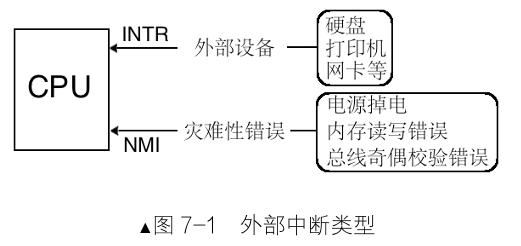{width=50%}

- INTR（INTeRrupt），可屏蔽中断。
-  NMI（Non Maskable Interrupt），不可屏蔽中断。

## 7.2 操作系统是中断驱动的

操作系统通过中断机制实现**事件驱动**。中断使操作系统能够被动响应事件，而非主动轮询，节省CPU资源。当无中断时，CPU可能执行空转或进入低功耗状态；一旦中断发生，操作系统调用对应的处理程序。

中断驱动模型的核心是：操作系统通过**中断描述符表**(IDT)注册处理程序，CPU根据**中断向量号**索引IDT，执行相应代码。例如，Linux内核通过中断处理网络数据包或磁盘读写。

## 7.3 中断分类

中断按来源分为外部中断和内部中断。外部中断来自CPU外部硬件设备，内部中断来自CPU内部指令或指令运行时引发的异常。

### 7.3.1 外部中断

外部中断由硬件设备发起，如网卡收到数据包时通知CPU。CPU通过**INTR**和**NMI**引脚接收中断信号。

所有外部设备共享INTR引脚，CPU通过中断代理（如8259A）管理多个中断源。

- **可 屏 蔽 中 断**：通过INTR引脚进入，可被软件屏蔽（如设置eflags的IF位）
- **不可屏蔽中断**：通过NMI引脚进入，表示系统致命错误（如断电），无法屏蔽

### 7.3.2 内部中断

内部中断分为软中断和异常：

- **软中断**：由软件指令主动发起，如**int 0x80**用于系统调用
- **异    常**：CPU执行指令时产生的错误，如除零或无效操作码，包括可修复异常(故障)、用于调试的陷阱(陷阱)；不可恢复的错误(终止)三类。


中断发生后，根据该中断信号分配的整数在中断描述符定位处理程序，然后进行调用，这个中断信号就是中断向量号。**异常**和**不可屏蔽**中断的中断向量号由CPU自动提供，**可屏蔽**中断由中断代理提供，**软中断**由软件提供。


部分中断的中断向量号：

| Vector No. | Mnemonic | Description   | Type      |
| ---------- | -------- | ------------- | --------- |
| 0          | #DE      | Divide Error  | Fault     |
| 2          | -        | NMI Interrupt | Interrupt |
| 14         | #PF      | Page Fault    | Fault     |

## 7.4 中断描述符表

中断描述符表(**IDT**)是保护模式下存储中断处理程序入口的数组。每个中断向量号对应一个中断描述符，CPU通过IDTR寄存器定位IDT，IDTR寄存器设置的指令为**`idtr 48位内存数据`**，前16位是IDT表界限，后32位是IDT线性基地址。

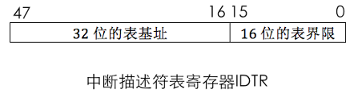{width=50%}

中断描述符包含目标代码段**选择子**和**偏移地址**，并定义特权级检查规则。构建IDT时，P位置1。

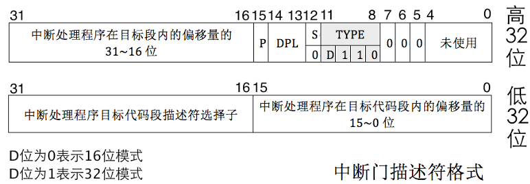{width=85%}

### 7.4.1 中断处理过程及保护

中断处理流程包括：

1. CPU根据中断向量号索引**IDT**，获取门描述符。
2. 进行**特权级检查**，CPL需大于等于门描述符的特权级，且CPL的特权级需小于目标代码段DPL，若中断导致特权级切换，CPU从TSS加载新栈。
3. 保存当前**上下文**(eflags、CS、EIP等)，执行中断处理程序，在运行中断处理程序前IF会被清0，避免中断嵌套。
4. 通过**iret**指令恢复上下文，返回原程序。

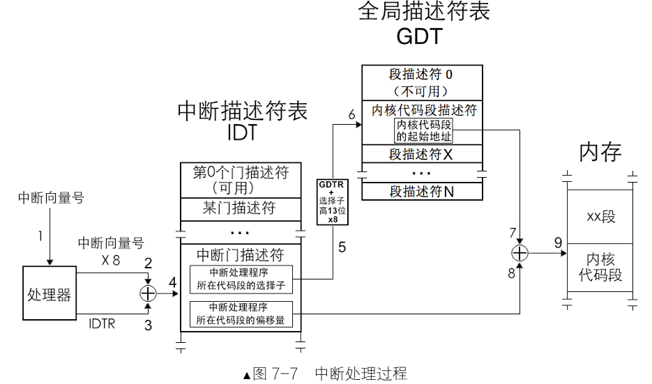

### 7.4.2 中断发生时的压栈

中断发生时，CPU会自动压栈保存状态。若特权级变化，压入SS、ESP、eflags、CS、EIP；若含错误码，压入错误码。

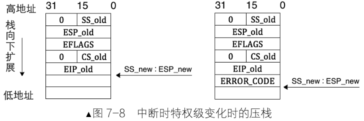{width=80%}

执行**iret**，从中断返回时，需注意:

如果有中断码，处理器不会主动跳过，需在iret之前，将其手动跳过；返回过程中会判断特权级是否改变，从而确定是否需要pop SS和ESP；如特权级改变，会自动检查是否需对DS、ES、FS、GS清零。

### 7.4.3 中断错误码

通常错误码用于中断向量号在0到32内的异常，外部中断、软中断不会产生错误码。错误码用于指明中断发生在哪个段上，主要部分是选择子，用于定位引起异常的段描述符，格式如下：

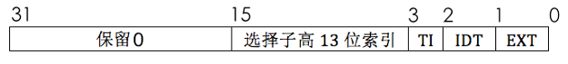{width=70%}

EXT指明中断源是否来自处理器外部，是即为1；IDT表示是否指向中断描述符表，为0表示指向GDT或LDT；TI为0表示从GDT检索，TI为1表示从LDT检索。

## 7.5 可编程中断控制器8259A

8259A是中断代理芯片，负责接收、优先级仲裁和转发外部中断。它支持级联，可管理多个中断源。

### 7.5.1 8259A介绍

8259A是x86架构中广泛使用的中断控制芯片，其核心价值在于解决多设备中断管理难题。由于CPU引脚资源有限，无法为每个外设单独分配中断线路，8259A通过级联方式完美解决了这一瓶颈。

**核心功能特性**：

- **中断集中管理**：    帮助CPU通过INTR和NMI两根信号线接收所有外设中断请求
- **智能优先级仲裁**：硬件级优先级判断，确保关键中断优先响应
- **向量号自动分配**：为每个中断源分配唯一标识，快速定位处理程序
- **灵活级联扩展**：    支持主从片级联，支持7n+1个中断源(n为芯片数量)

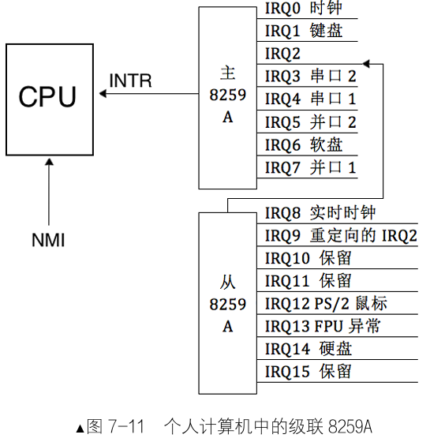{width=55%}

8259A内部寄存器位8位，主要有：

- **IRR**(中断请求寄存器)：存储待处理中断
- **ISR**(中断服务寄存器)：记录正在处理的中断
- **IMR**(中断屏蔽寄存器)：控制中断使能

8259A相关信号主要有：

- **INT**，多个中断同时发生时由**PR**(优先级仲裁器)比较，选出最高优先级中断请求后，发送**中断信号**给CPU。
- **INTA**，接收CPU发送的**中断响应信号**。

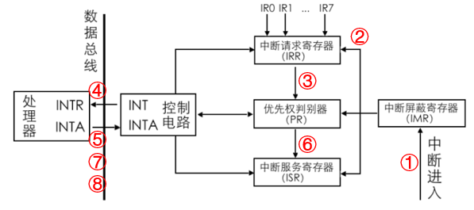

1、接收设备中断信号，若IMR对应位没有置1，中断通过。

2、中断对应的IRR位置1。

3、通过PR裁决，选出优先级做高的中断。

4、发送中断信号至CPU。

5、CPU发送中断响应给8259A，表示准备好了处理中断。

6、8259A将最高优先级中断对应ISR位置1，IRR位置0。

7、CPU发送中断响应给8259A，8259A将中断向量号通过数据总线传输给CPU。

8、中断处理程序结束后，CPU再发送中断响应给8259A，8259A中ISR相应位置0。

### 7.5.2 8259A的编程

8259A的可编程特性使其能够适应各种系统需求。8259A通过**初始化命令字**(ICW)和**操作命令字**(OCW)配置，**ICW序列**配置工作模式，运行时**OCW动态**调整中断屏蔽状态。

- **ICW**：Initialization Command Word，**初始化命令字**
- **OCW**：Operation Command Word，**操作命令字**

**核心配置要点**

初始化顺序：ICW1→ICW2→ICW3→ICW4必须严格顺序执行，OCW的发送顺序不固定。

端口区分：   ICW1、OCW2、OCW3写端口(0x20/0xA0)，ICW2、ICW3、ICW4、OCW1写端口(0x21/0xA1)

级联协调：   主从片配置需匹配，确保中断正确路由

**ICW初始化命令字**

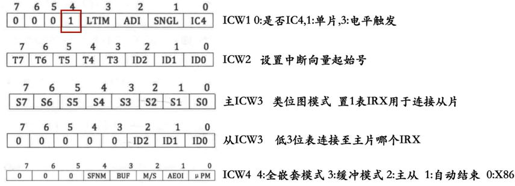

**OCW操作命令字**

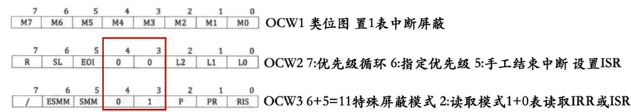

**示例代码：**

```asm
void init_8259a(void) {
    // 主片初始化序列
    outb(0x20, 0x11);  // ICW1: 级联,边沿触发,需要ICW4
    outb(0x21, 0x20);  // ICW2: 向量号基址0x20
    outb(0x21, 0x04);  // ICW3: IR2接从片
    outb(0x21, 0x01);  // ICW4: 8086模式,正常EOI
    
    // 从片初始化序列  
    outb(0xA0, 0x11);  // ICW1
    outb(0xA1, 0x28);  // ICW2: 向量号基址0x28
    outb(0xA1, 0x02);  // ICW3: 连接到主片IR2
    outb(0xA1, 0x01);  // ICW4
    
    // 初始屏蔽设置
    outb(0x21, 0xFE);  // 只允许时钟中断
    outb(0xA1, 0xFF);  // 屏蔽所有从片中断
}
```

## 7.6 编写中断处理程序

本节通过汇编和C语言实现**中断处理系统**的内核，内核可以响应时钟，在屏幕上打印字符串。

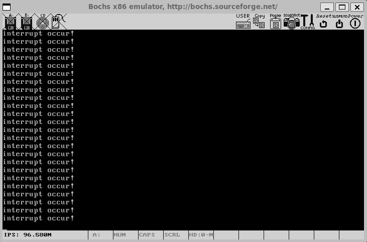

### 7.6.1 从最简单的中断处理程序开始

中断处理系统和核心为**中断描述符表**、每个中断对应的**中断处理程序**，并将中断处理程序注册到IDT。

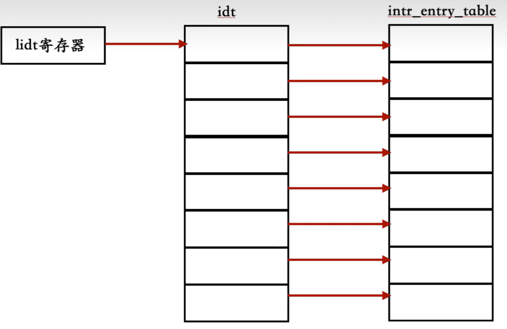{width=60%}

lib/kernel/**io.h**：

封装了对x86 I/O端口的底层读写操作，提供了四种不同位宽和方向的端口访问函数。

```c
#ifndef __LIB_IO_H
#define __LIB_IO_H

#include "stdint.h"

/* 向端口port写入一个字节 */
static inline void outb(uint16_t port, uint8_t data) {
    //指定N表示0~255，d表示用dx存储端口号，%b0表示对应al，%w1表示对应dx
    asm volatile("outb %b0, %w1" : : "a"(data), "Nd"(port));
}


/* 将addr处起始的word_cnt个字写入端口port */
static inline void outsw(uint16_t port, const void* addr, uint32_t word_cnt) {
    /**************************************************************************
    +表示此限制既做输入，又做输出。
    outsw是把ds:esi处的16位的内容写入port端口
    我们在设置段描述符时，已经将ds,es,ss段的选择子都设置为相同的值了 */
    asm volatile("cld; rep outsw" : "+S"(addr), "+c"(word_cnt) : "d"(port));
}


/* 从端口port读入的一个字节返回 */
static inline uint8_t inb(uint16_t port) {
    uint8_t data;
    asm volatile("inb %w1, %b0" : "=a"(data) : "Nd"(port));
    return data;
}


/* 从端口port读入的word_cnt个字写入addr */
static inline void insw(uint16_t port, void* addr, uint32_t word_cnt) {
    /**************************************************************************
    insw是将从端口port处读入的16位内容写入es:edi指向的内存*/
    asm volatile("cld; rep insw" : "+D"(addr), "+c"(word_cnt) : "d"(port) : "memory");
}

#endif
```

kernel/**global.h**：(/usr/local/bochs/kernel/global.h)

主要定义了保护模式下**段选择子**和**中断描述符**的关键属性常量。

{width=85%}

```c
#ifndef __KERNEL_GLOBAL_H
#define __KERNEL_GLOBAL_H
#include "stdint.h"

//选择子信息
#define RPL0 0
#define RPL1 1
#define RPL2 2
#define RPL3 3

#define TI_GDT 0
#define TI_LDT 1

#define SELECTOR_K_CODE  ((1 << 3)+(TI_GDT << 2)+RPL0)
#define SELECTOR_K_DATA  ((2 << 3)+(TI_GDT << 2)+RPL0)
#define SELECTOR_K_STACK SELECTOR_K_DATA
#define SELECTOR_K_GS    ((3 << 3)+(TI_GDT << 2)+RPL0)

//中断描述符信息
#define IDT_DESC_P    1
#define IDT_DESC_DPL0 0
#define IDT_DESC_DPL3 3
#define IDT_DESC_32_TYPE 0xE      // 32位的门
#define IDT_DESC_16_TYPE 0x6      // 16位的门，不会用到，定义它只为和32位门区分

//将分散的位组合成一个完整的8位属性字节，用于填充中断门描述符的attribute字段
#define IDT_DESC_ATTR_DPL0  ((IDT_DESC_P<<7)+(IDT_DESC_DPL0<<5)+IDT_DESC_32_TYPE)
#define IDT_DESC_ATTR_DPL3  ((IDT_DESC_P<<7)+(IDT_DESC_DPL3<<5)+IDT_DESC_32_TYPE)

#endif
```

kernel/**stdint.h **：定义了常用数据类型的别名。

```c
#ifndef _STDINT_H
#define _STDINT_H

typedef unsigned char uint8_t;
typedef unsigned short uint16_t;
typedef unsigned int uint32_t;
typedef unsigned long long uint64_t;

typedef signed char int8_t;
typedef short int16_t;
typedef int int32_t;
typedef long long int64_t;

#endif
```

kernel/**main.c**：

```c
#include "print.h"
#include "init.h"

void main(void) {
    put_str("I am kernel\n");
    init_all();
    asm volatile("sti"); // 为演示中断处理，在此临时开中断
    while(1);
}
```

kernel/init.c：

```c
#include "print.h"
#include "interrupt.h"
#include "init.h"  

/* 负责初始化所有模块 */
void init_all(void) {
    put_str("init_all\n");
    intr_init(); // 初始化中断
}
```

kernel/init.h：

```c
#ifndef _INIT_H
#define _INIT_H

void init_all(void);
#endif 
```

kernel/**interrupt.c**：

中断系统初始化模块，主要负责**构建中断描述符表**(IDT)和**配置可编程中断控制器**(8259A)。

{width=60%}

```c
#include "global.h" 
#include "stdint.h" 
#include "io.h"
#include "print.h"
#include "interrupt.h"

#define IDT_DESC_CNT 0x21         // 目前总共支持的中断数

/* 主片和从片的端口定义 */
#define PIC_M_CTRL 0x20           // 主片的控制端口是0x20
#define PIC_M_DATA 0x21           // 主片的数据端口是0x21
#define PIC_S_CTRL 0xa0           // 从片的控制端口是0xa0
#define PIC_S_DATA 0xa1           // 从片的数据端口是0xa1

/* 中断门描述符结构体 */
struct gate_desc {
    uint16_t   func_offset_low_word;   // 中断处理程序在目标代码段内的偏移量低16位
    uint16_t   selector;               // 中断处理程序目标代码段选择子
    uint8_t    dcount;                 // 双字计数字段，固定值
    uint8_t    attribute;              // 门描述符属性
    uint16_t   func_offset_high_word;  // 中断处理程序在目标代码段内的偏移量高16位
};

/* 静态函数声明 */
static void make_idt_desc(struct gate_desc* p_gdesc, uint8_t attr, intr_handler function);
static void idt_init(void);
static void pic_init(void);

/* 全局变量声明 */
static struct gate_desc idt[IDT_DESC_CNT];      // idt是中断描述符表，本质上是中断门描述符数组
extern intr_handler intr_entry_table[IDT_DESC_CNT];  //声明引用kernel.s的中断处理函数入口数组

/* 完成有关中断的所有初始化工作 - 主函数（调用者） */
void intr_init() {
    put_str("idt_init start\n");
    idt_init();       // 初始化中断描述符表
    pic_init();       // 初始化8259A
    /* 加载idt  */
    //界限在低16位：sizeof(idt)-1， 基地址在高32位：(uint32_t)idt << 16
    uint64_t idt_operand = ((sizeof(idt)-1)|((uint64_t)((uint32_t)idt)<<16));
    asm volatile("lidt %0" : : "m"(idt_operand));
    put_str("idt_init done\n");
}

/* 初始化中断描述符表 - 被idt_init调用 */
static void idt_init(void) {
    int i;
    for (i = 0; i < IDT_DESC_CNT; i++) {
        make_idt_desc(&idt[i], IDT_DESC_ATTR_DPL0, intr_entry_table[i]);}
    put_str("idt_desc_init done\n");
}

/* 创建中断门描述符 - 被idt_desc_init调用 */
static void make_idt_desc(struct gate_desc* p_gdesc, uint8_t attr, intr_handler function) {
    p_gdesc->func_offset_low_word = (uint32_t)function & 0x0000FFFF;
    p_gdesc->selector = SELECTOR_K_CODE; 
    p_gdesc->dcount = 0;                  // 固定值
    p_gdesc->attribute = attr;            // 门描述符属性
    p_gdesc->func_offset_high_word = ((uint32_t)function & 0xFFFF0000) >> 16;
}


/* 初始化可编程中断控制器 8259A - 被idt_init调用 */
static void pic_init(void) {
    /* 初始化主片 */
    outb(PIC_M_CTRL, 0x11);  // ICW1: 边沿触发, 级联8259, 需要ICW4
    outb(PIC_M_DATA, 0x20);  // ICW2: 起始中断向量号为0x20 (IR[0-7]为0x20~0x27)
    outb(PIC_M_DATA, 0x04);  // ICW3: IR2接从片
    outb(PIC_M_DATA, 0x01);  // ICW4: 8086模式, 正常EOI
    
    /* 初始化从片 */
    outb(PIC_S_CTRL, 0x11);  // ICW1: 边沿触发, 级联8259, 需要ICW4
    outb(PIC_S_DATA, 0x28);  // ICW2: 起始中断向量号为0x28 (IR[8-15]为0x28~0x2F)
    outb(PIC_S_DATA, 0x02);  // ICW3: 设置从片连接到主片的IR2引脚
    outb(PIC_S_DATA, 0x01);  // ICW4: 8086模式, 正常EOI
    
    /* 打开主片上IR0, 也就是目前只接受时钟产生的中断 */
    outb(PIC_M_DATA, 0xfe);  // 主片屏蔽字: 只开放IR0(时钟中断)
    outb(PIC_S_DATA, 0xff);  // 从片屏蔽字: 屏蔽所有中断
    
    put_str("pic_init done\n");
}
```

kernel/**interrupt.h **：

```c
#ifndef _INTERRUPT_H
#define _INTERRUPT_H
#include "stdint.h"

// 中断处理函数类型
typedef void (*intr_handler)(void);
// 函数声明
void intr_init(void);                    // 初始化中断描述符表
#endif
```

kernel/**kernel.s**:

创建统一的中断处理程序框架，为每个中断向量生成对应的入口代码，建立中断向量与处理程序的映射关系。

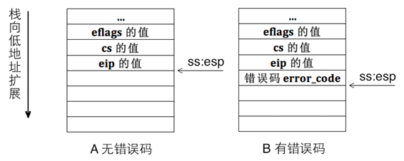

```asm
[bits 32]
%define ERROR_CODE nop ; 若相关异常CPU已自动压入错误码，为保持栈格式统一，此处不做操作
%define ZERO push 0    ; 若相关异常CPU未压入错误码，为统一栈格式，手工压入0

extern put_str ; 外部函数声明

section .data
intr_str db "interrupt occur!", 0xa, 0

global intr_entry_table

intr_entry_table:

%macro VECTOR 2
section .text
intr%1entry:      ; 每个中断处理程序，例如 intr0x20entry
    %2            ; 展开为 ZERO(push 0) 或者 ERROR_CODE(nop)
    push intr_str ; 压入字符串指针，作为put_str参数
    call put_str  ; 调用C函数打印 "interrupt occur!"
    add esp,4     ; 清理put_str的参数
    
    ; 发送EOI结束中断
    mov al,0x20
    out 0xa0,al
    out 0x20,al
    
    add esp,4     ; 把栈上4字节错误码（或者我们手动push的0）弹出丢掉
    iret          ; 中断返回

section .data
    dd intr%1entry
%endmacro

VECTOR 0x00,ZERO
VECTOR 0x01,ZERO
VECTOR 0x02,ZERO
VECTOR 0x03,ZERO
VECTOR 0x04,ZERO
VECTOR 0x05,ZERO
VECTOR 0x06,ZERO
VECTOR 0x07,ZERO
VECTOR 0x08,ERROR_CODE
VECTOR 0x09,ZERO
VECTOR 0x0a,ERROR_CODE
VECTOR 0x0b,ERROR_CODE
VECTOR 0x0c,ERROR_CODE
VECTOR 0x0d,ERROR_CODE
VECTOR 0x0e,ERROR_CODE
VECTOR 0x0f,ZERO
VECTOR 0x10,ZERO
VECTOR 0x11,ERROR_CODE
VECTOR 0x12,ZERO
VECTOR 0x13,ZERO
VECTOR 0x14,ZERO
VECTOR 0x15,ZERO
VECTOR 0x16,ZERO
VECTOR 0x17,ZERO
VECTOR 0x18,ZERO
VECTOR 0x19,ZERO
VECTOR 0x1a,ZERO
VECTOR 0x1b,ZERO
VECTOR 0x1c,ZERO
VECTOR 0x1d,ZERO
VECTOR 0x1e,ERROR_CODE
VECTOR 0x1f,ZERO
VECTOR 0x20,ZERO
```

注意这里还要用到第6章的`lib/kernel/print.h`和`lib/kernel/print.s`，这里再次附上：

lib/kernel/print.h：

```C
#ifndef __LIB_KERNEL_PRINT_H
#define __LIB_KERNEL_PRINT_H
#include "stdint.h"
void put_char(uint8_t char_asci);
void put_str(char* message);
void put_int(uint32_t num);  //以十六进制打印
void set_cursor(uint32_t pos);
#endif
```

lib/kernel/print.s：

```asm
TI_GDT equ 0
RPL0 equ 0
SELECTOR_VIDEO equ (0x0003<<3)+TI_GDT+RPL0

[bits 32]
section .text
global put_char

put_char:
    pushad                     ; 备份寄存器
    mov ax, SELECTOR_VIDEO     ; 设置视频段选择子
    mov gs, ax

    ; 获取光标位置（高8位）
    mov dx, 0x3D4
    mov al, 0x0E
    out dx, al
    mov dx, 0x3D5
    in al, dx
    mov ah, al

    ; 获取光标位置（低8位）
    mov dx, 0x3D4
    mov al, 0x0F
    out dx, al
    mov dx, 0x3D5
    in al, dx

    ; 光标值存入bx
    mov bx, ax
    mov ecx, [esp+36]          ; 获取传入的字符

    ; 判断字符类型
    cmp cl, 0x0D               ; 回车符
    jz .carriage_return
    cmp cl, 0x0A               ; 换行符
    jz .line_feed
    cmp cl, 0x08               ; 退格符
    jz .backspace
    
    jmp .printable

;退格
.backspace:
    dec bx                     ; 光标前移
    shl bx, 1                  ; 转换为显存偏移
    mov byte [gs:bx], 0x20     ; 写入空格
    inc bx
    mov byte [gs:bx], 0x07     ; 属性字节
    shr bx, 1
    jmp .set_cursor

;打印可见字符
.printable:
    shl bx, 1
    mov [gs:bx], cl            ; 写入字符
    inc bx
    mov byte [gs:bx], 0x07     ; 属性字节
    shr bx, 1
    inc bx                     ; 光标后移
    cmp bx, 2000               ; 是否需滚屏
    jl .set_cursor

;回车换行处理
.line_feed:
.carriage_return:
    ; 处理换行/回车：光标移到下一行首
    xor dx, dx
    mov ax, bx
    mov si, 80
    div si                     ; bx/80，商在ax，余数在dx
    sub bx, dx                 ; 回车：回到行首
    add bx, 80                 ; 换行：移到下一行
    cmp bx, 2000
    jl .set_cursor

;滚屏处理
.roll_screen:
    ; 滚屏：第1-24行内容上移，清空最后一行
    cld
    mov ecx, 960               ; 3840字节/4字节
    mov edi, 0xC00B8000        ; 第1行起始
    mov esi, 0xC00B80A0        ; 第2行起始
    rep movsd                  ; 复制内存
;滚屏时最后一行空白处理
    mov ebx, 3840              ; 最后一行起始偏移
    mov ecx, 80
.clear_line:
    mov word [gs:ebx], 0x0720  ; 黑底白字空格
    add ebx, 2
    loop .clear_line
    mov bx, 1920               ; 光标置最后一行首

;更新光标位置
.set_cursor:
    ; 更新光标位置寄存器
    mov dx, 0x3D4
    mov al, 0x0E
    out dx, al
    
    mov dx, 0x3D5
    mov al, bh
    out dx, al                 ; 写入高8位

    mov dx, 0x3D4
    mov al, 0x0F
    out dx, al
    
    mov dx, 0x3D5
    mov al, bl
    out dx, al                 ; 写入低8位

    popad                      ; 恢复寄存器
    ret
    
    
  
[bits 32]
section .text
global put_str
put_str:
    push ebx
    push ecx
    xor ecx, ecx
    mov ebx, [esp+12]          ; 获取字符串地址

.next_char:
    mov cl, [ebx]
    cmp cl, 0                   ; 遇到\0结束
    jz .done
    push ecx                    ; 参数入栈
    call put_char
    add esp, 4                  ; 清理栈
    inc ebx                     ; 下一个字符
    jmp .next_char

.done:
    pop ecx
    pop ebx
    ret


section .data
    put_int_buffer dq 0         ; 8字节缓冲区

section .text
global put_int

put_int:
    ; 保存所有寄存器
    pushad
    mov ebp, esp
    
    ; 获取参数（跳过8个pushad的寄存器和返回地址）
    mov eax, [ebp + 4 * 9]
    
    ; 初始化
    mov edx, eax                  ; 保存原始值
    mov edi, 7                    ; 缓冲区偏移，从高位开始
    mov ecx, 8                    ; 8个十六进制数字
    mov ebx, put_int_buffer      ; 缓冲区地址
    
    ; 将缓冲区清零
    mov dword [ebx], 0
    mov dword [ebx+4], 0
    
; 转换循环：将32位整数转为十六进制字符
.convert_loop:
    and edx, 0x0000000F          ; 取最低4位
    cmp edx, 9
    jg .hex_letter               ; 如果大于9，转为字母
    
    ; 数字0-9
    add edx, '0'                 ; 转为'0'-'9'
    jmp .store
    
.hex_letter:
    ; 字母A-F
    sub edx, 10
    add edx, 'A'                 ; 转为'A'-'F'
    
.store:
    ; 将字符存入缓冲区
    mov [ebx + edi], dl
    dec edi                     ; 移到下一个位置
    shr eax, 4                 ; 右移4位，处理下一个十六进制数字
    mov edx, eax
    loop .convert_loop
    
; edi=-1 从头开始扫描 跳过高位零
    inc edi
    cmp edi, 8
    je .full_zero               ; 如果全零，跳转到全零处理
    
.skip_zeros:
    ; 查找第一个非零字符
    mov cl, [ebx + edi]
    cmp cl, '0'
    jne .print                  ; 找到非零字符，开始打印
    inc edi
    cmp edi, 8
    jl .skip_zeros              ; 继续查找
    
    ; 如果到这里，说明全是零
    jmp .full_zero
    
.full_zero:
    ; 处理全零情况：输出单个'0'
    push dword '0'              ; 压入字符'0'
    call put_char               ; 调用put_char输出
    add esp, 4                  ; 清理栈
    jmp .end_function           ; 跳转到函数结束
    
.print:
    ; 输出十六进制字符串
.print_loop:
    movzx ecx, byte [ebx + edi] ; 获取字符（零扩展）
    push ecx                    ; 压入参数
    call put_char               ; 调用put_char输出字符
    add esp, 4                  ; 清理栈
    
    inc edi                     ; 移到下一个字符
    cmp edi, 8
    jl .print_loop              ; 继续输出直到8个字符都处理完
    
.end_function:
    ; 恢复所有寄存器
    popad
    ret

global set_cursor
set_cursor:
    pushad                     ; 保存所有寄存器（与 put_char 一致）
    mov bx, [esp + 36]         ; cdecl: 参数 = pushad(32B) + ret_addr(4B) = 36
    
    ; --- 更新光标位置（与 .set_cursor 局部标签代码完全一致）---
    mov dx, 0x3D4
    mov al, 0x0E
    out dx, al
    mov dx, 0x3D5
    mov al, bh
    out dx, al

    mov dx, 0x3D4
    mov al, 0x0F
    out dx, al
    mov dx, 0x3D5
    mov al, bl
    out dx, al

    popad
    ret                        ; cdecl: 调用者清理栈
```

**目录结构：**

```linenums="0"
.
├── boot.inc
├── kernel           # 💡新增
│   ├── global.h
│   ├── init.c
│   ├── init.h
│   ├── interrupt.c
│   ├── interrupt.h
│   ├── kernel.s      # ➡️中断保存上下文（看下面7.6.2改进的kernel.s）
│   ├── main.c
│   └── stdint.h
├── lib
│   └── kernel
│       ├── io.h      # 💡新增
│       ├── print.h
│       └── print.s
├── loader.s
└── mbr.s
```

**测试步骤：**

```shell
# # 编译MBR
# nasm -o mbr.bin mbr.s
# # 编译Loader  
# nasm  -o loader.bin loader.s
# # 写入硬盘
# dd if=mbr.bin of=hd60M.img bs=512 count=1 conv=notrunc
# dd if=loader.bin of=hd60M.img bs=512 count=4 seek=2 conv=notrunc


mkdir build # /usr/local/bochs/build

# 编译print
nasm -f elf -o build/print.o lib/kernel/print.s

# 编译kernel.s
nasm -f elf -o build/kernel.o kernel/kernel.s

# 编译interrupt.c
gcc -m32 -I lib/kernel/ -I lib/ -I kernel/ -c -fno-builtin -fno-stack-protector -o build/interrupt.o kernel/interrupt.c

# 编译init.c
gcc -m32 -I lib/kernel/ -I lib/ -I kernel/ -c -fno-builtin -fno-stack-protector -o build/init.o kernel/init.c

# 编译main.c
gcc -m32 -I lib/kernel/ -I lib/ -I kernel/ -c -fno-builtin -fno-stack-protector -o build/main.o kernel/main.c

# 链接生成可执行内核
ld -m elf_i386 -Ttext 0xc0001500 -e main -o build/kernel.bin \
   build/main.o build/init.o build/interrupt.o build/print.o build/kernel.o

# 可执行文件写入硬盘
dd if=build/kernel.bin of=hd60M.img bs=512 count=200 seek=9 conv=notrunc

# 从虚拟机界面启动bochs
bin/bochs -f bochsrc.disk
```

### 7.6.2 改进中断处理程序

优化处理程序结构，分离汇编入口和C核心逻辑。

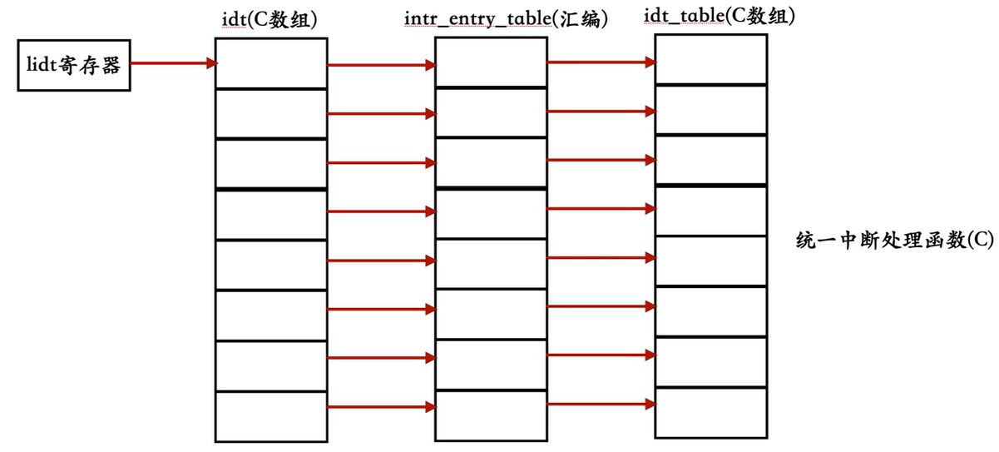

kernel/**interrupt.c**主要变化：

```c
char* intr_name[IDT_DESC_CNT];          //用于保存异常的名字
intr_handler idt_table[IDT_DESC_CNT];   //定义中断处理程序数组,最终调用的是ide_table中的程序

/* 通用中断处理函数，一般用在异常出现时的处理 */
static void general_intr_handler(uint8_t vec_nr) {
  if(vec_nr == 0x27 || vec_nr == 0x2f) {
     //IRQ7和IRQ15会产生伪中断,无需处理,0x2f是从片8259A上的最后一个IRQ引脚，保留项
     return;
  }
  put_str("int vector:0x");
  put_int(vec_nr);
  put_char('\n');
}


/* 注册通用中断处理函数及异常名称 */
static void exception_init(void) {
    int i;
    for (i=0;i<IDT_DESC_CNT;i++) {
        idt_table[i] = general_intr_handler;// 默认为 general_intr_handler
        intr_name[i] = "unknown"; // 先统一赋值为 unknown
    }
    intr_name[0] = "#DE Divide Error";
    intr_name[1] = "#DB Debug Exception";
    intr_name[2] = "NMI Interrupt";
    intr_name[3] = "#BP Breakpoint Exception";
    intr_name[4] = "#OF Overflow Exception";
    intr_name[5] = "#BR BOUND Range Exceeded Exception";
    intr_name[6] = "#UD Invalid Opcode Exception";
    intr_name[7] = "#NM Device Not Available Exception";
    intr_name[8] = "#DF Double Fault Exception";
    intr_name[9] = "Coprocessor Segment Overrun";
    intr_name[10] = "#TS Invalid TSS Exception";
    intr_name[11] = "#NP Segment Not Present";
    intr_name[12] = "#SS Stack Fault Exception";
    intr_name[13] = "#GP General Protection Exception";
    intr_name[14] = "#PF Page-Fault Exception";
    // intr_name[15] 第15项是intel保留项，未使用
    intr_name[16] = "#MF x87 FPU Floating-Point Error";
    intr_name[17] = "#AC Alignment Check Exception";
    intr_name[18] = "#MC Machine-Check Exception";
    intr_name[19] = "#XF SIMD Floating-Point Exception";
}

/*完成有关中断的所有初始化工作*/
void intr_init() {
    put_str("idt_init start\n");
    idt_desc_init();   
    exception_init();  //异常名初始化并注册通常的中断处理函数
    pic_init();        
```

kernel/**interrupt.h **：

```c
typedef void (*intr_handler)(void);
// 修改为接受一个uint8_t参数
typedef void (*intr_handler)(uint8_t vec_nr);
```

完整interrupt.c与interrupt.h见[源码附件](#source-code)。

kernel/**kernel.s**:

```asm
[bits 32]
%define ERROR_CODE nop ; 若相关异常CPU已自动压入错误码，为保持栈格式统一，此处不做操作
%define ZERO push 0    ; 若相关异常CPU未压入错误码，为统一栈格式，手工压入0

extern put_str ; 外部函数声明
extern idt_table ;7.6.2 加1

section .data
intr_str db "interrupt occur!", 0xa, 0
global intr_entry_table

intr_entry_table:

%macro VECTOR 2
section .text
intr%1entry: ; 每个中断处理程序
    %2
    ;保护上下文环境
    push ds
    push es
    push fs
    push gs
    pushad
    
    ; 发送EOI结束中断
    mov al,0x20
    out 0xa0,al
    out 0x20,al
    
    push %1
    call [idt_table+%1 * 4]
    jmp intr_exit

section .data
    dd intr%1entry
%endmacro

section .text
global intr_exit

intr_exit:
   add esp, 4     
   popad
   pop gs
   pop fs         
   pop es
   pop ds
   add esp, 4    
   iretd

VECTOR 0x00,ZERO
VECTOR 0x01,ZERO
VECTOR 0x02,ZERO
VECTOR 0x03,ZERO
VECTOR 0x04,ZERO
VECTOR 0x05,ZERO
VECTOR 0x06,ZERO
VECTOR 0x07,ZERO
VECTOR 0x08,ERROR_CODE
VECTOR 0x09,ZERO
VECTOR 0x0a,ERROR_CODE
VECTOR 0x0b,ERROR_CODE
VECTOR 0x0c,ERROR_CODE
VECTOR 0x0d,ERROR_CODE
VECTOR 0x0e,ERROR_CODE
VECTOR 0x0f,ZERO
VECTOR 0x10,ZERO
VECTOR 0x11,ERROR_CODE
VECTOR 0x12,ZERO
VECTOR 0x13,ZERO
VECTOR 0x14,ZERO
VECTOR 0x15,ZERO
VECTOR 0x16,ZERO
VECTOR 0x17,ZERO
VECTOR 0x18,ZERO
VECTOR 0x19,ZERO
VECTOR 0x1a,ZERO
VECTOR 0x1b,ZERO
VECTOR 0x1c,ZERO
VECTOR 0x1d,ZERO
VECTOR 0x1e,ERROR_CODE
VECTOR 0x1f,ZERO
VECTOR 0x20,ZERO
```

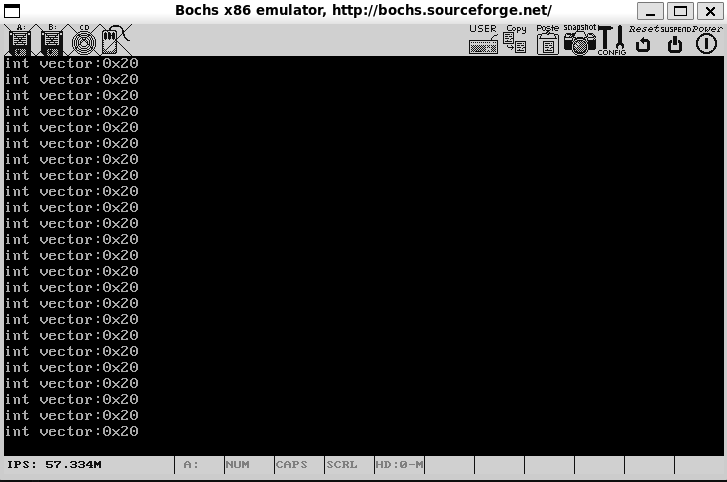

## 7.7 可编程定时器8253简介

定时器是计算机系统中的重要组件，它为系统提供时间基准和定时功能。8253作为经典的可编程定时计数器，通过硬件方式实现精确计时，有效减轻CPU负担。

### 7.7.1 时钟-给设备打拍子

时钟信号协调计算机各部件工作的节拍。CPU内部时钟由晶振产生，频率较高；外部时钟则用于同步低速外设。8253定时器通过分频原理将高频时钟转换为所需频率，为系统提供精准定时。

硬件定时的优势在于不占用CPU资源，通过独立计数实现精确计时。当计数值归零时，定时器自动触发中断或启动外部设备，实现高效的事件调度。

### 7.7.2 8253入门

8253内部包含三个独立的16位计数器，,计数器CLK引脚接收时钟脉冲信号，GATE引脚控制计数启停，OUT引脚输出定时信号。,三个计数器的专用分工：

- 计数器0（端口0x40）：系统时钟中断
- 计数器1（端口0x41）：内存刷新控制
- 计数器2（端口0x42）：声音频率生成

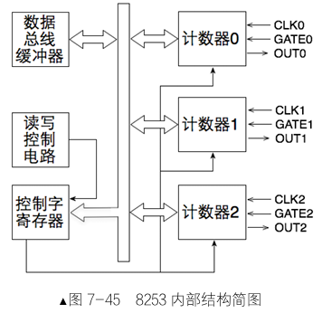{width="40%"}

每个计数器具备完整寄存器组，计数器采用倒计时方式工作，初始值载入后随时钟脉冲递减。计数值为零时，OUT引脚产生输出信号，可用于触发中断或设备操作。

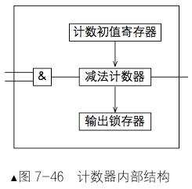

### 7.7.3 8253控制字

控制字寄存器(端口0x43)用于配置计数器工作模式：

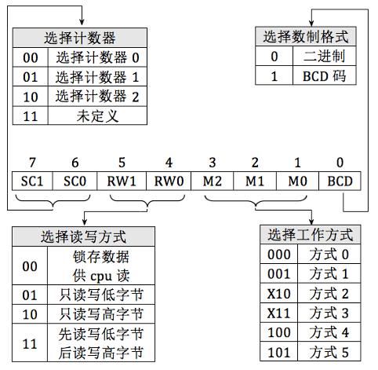{width="60%"}

| 位域    | 功能说明   | 取值含义                                                     |
| ------- | ---------- | ------------------------------------------------------------ |
| SC1-SC0 | 计数器选择 | 00-计数器0, 01-计数器1, 10-计数器2                           |
| RW1-RW0 | 读写方式   | 00-锁存当前值, 01-只读/写低8位, 10-只读/写高8位, 11-先低后高16位 |
| M2-M0   | 工作模式   | 000-方式0, 001-方式1, 010-方式2, 011-方式3, 100-方式4, 101-方式5 |
| BCD     | 数制选择   | 0-二进制, 1-BCD码                                            |

### 7.7.4 8253工作方式

8253提供六种工作模式满足不同应用场景：

- **方式0 (计数结束中断)**       
  软件启动，单次计数；计数期间OUT为低电平，结束产生上升沿；适用于单次定时

- **方式1 (硬件可重触发单稳)** 
  硬件启动，GATE上升沿触发；产生可编程宽度脉冲；适用于脉冲信号生成

- **方式2 (比率发生器)** 💡          
  软件启动，自动重装初值；周期性输出脉冲（N分频）；适用于时钟分频和定时中断

- **方式3 (方波发生器)**           
  软件启动，自动重装初值；生成对称方波信号；适用于方波生成和对称分频

- **方式4 (软件触发选通)**        
  软件启动，单次计数；计数结束产生单个脉冲；适用于软件控制单脉冲

- **方式5 (硬件触发选通)**       
  硬件启动，GATE上升沿触发；计数结束产生单个脉冲；适用于硬件控制单脉冲


通过合理选择工作方式，8253能够高效完成定时、计数、波形生成等任务，为计算机系统提供可靠的时间基准。方式2和方式3支持自动重装，适合周期性应用；方式0、1、4、5为单次计数，适用于事件触发场景。

### 7.7.5 8253初始化步骤

初始化8253需要两个步骤：

**写入控制字**

控制字指定计数器编号、工作模式和读写方式。

```c
outb(0x43, control_word);
```

**写入计数初值**

16位初值分两次写入指定计数器端口。

```c
outb(counter_port, low_byte);  // 先写低8位
outb(counter_port, high_byte); // 再写高8位
```

## 7.8 提高时钟中断的频率

通过8253计数器0提升时钟中断频率至100Hz。计算初值：1193180/100 = 11932。

device/**timer.c：**

```c
#include "timer.h"
#include "io.h"
#include "print.h"

#define PIT_CONTROL_PORT 0x43       //控制字寄存器端口


#define CONTRER0_PORT 0x40          //计数器0端口
#define COUNTER0_NO  0              //00  表选控制计数器0
#define READ_WRITE_LATCH 3          //11  先读写低字节 再读写高字节
#define COUNTER_MODE 2              //010 工作方式2


#define IRQ0_FREQUENCY 100
#define INPUT_FREQUENCY 1193180
#define COUNTER0_VALUE INPUT_FREQUENCY / IRQ0_FREQUENCY

/* 设置控制寄存器、初始化计数器0的初始值 */
static void frequency_set (uint8_t counter_port, uint8_t counter_no, uint8_t rw1,uint8_t counter_mode, uint16_t counter_value) {
  
  outb(PIT_CONTROL_PORT, (uint8_t)(counter_no << 6 | rw1 << 4 | counter_mode << 1));
  outb (counter_port, (uint8_t)counter_value);     //先写入counter_value的低8位
  outb (counter_port, (uint8_t)counter_value >> 8);//再写入counter_value的高8位
}

/*初始化PIT8253*/
void timer_init() {
  put_str("timer_init start\n");
  //设置8253
  frequency_set(CONTRER0_PORT,COUNTER0_NO,READ_WRITE_LATCH,COUNTER_MODE,COUNTER0_VALUE);
  put_str("timer_init done\n");
}
```

device/**timer.h：**：

```c
#ifndef _DEVICE_TIMER_H
#define _DEVICE_TIMER_H
/* 定时器初始化函数 */
void timer_init(void);
#endif
```

kernel/init.c：

```c
#include "print.h"
#include "interrupt.h"
#include "../device/timer.h"

/* 负责初始化所有模块 */
void init_all() {
    put_str("init_all\n");
    intr_init();  // 中断初始化中断
    timer_init();//定时器初始化     7.8加
}
```

**测试步骤：**

```shell
#编译timer.c
gcc -m32 -I lib/kernel/ -I lib/ -I kernel/ -c -fno-builtin -fno-stack-protector -o build/timer.o device/timer.c


#编译init.c
gcc -m32 -I lib/kernel/ -I lib/ -I kernel/ -c -fno-builtin -fno-stack-protector -o build/init.o kernel/init.c

#编译main.c
gcc -m32 -I lib/kernel/ -I lib/ -I kernel/ -c -fno-builtin -fno-stack-protector -o build/main.o kernel/main.c


#链接生成可执行内核
ld -m elf_i386 -Ttext 0xc0001500 -e main -o build/kernel.bin \
   build/main.o build/init.o build/interrupt.o build/print.o build/kernel.o build/timer.o

#可执行文件写入硬盘
dd if=build/kernel.bin of=hd60M.img bs=512 count=200 seek=9 conv=notrunc

#从虚拟机界面启动bochs
bin/bochs -f bochsrc.disk
```

目录结构：

```linenums="0"
.
├── boot.inc
├── device      # 💡新增
│   ├── timer.c
│   └── timer.h
├── kernel
│   ├── global.h
│   ├── init.c
│   ├── init.h
│   ├── interrupt.c
│   ├── interrupt.h
│   ├── kernel.s
│   ├── main.c
│   └── stdint.h
├── lib
│   └── kernel
│       ├── io.h
│       ├── print.h
│       └── print.s
├── loader.s
└── mbr.s
```

## 本章要点总结

1. **中断机制核心**：中断使CPU能响应异步事件，实现多任务并发。分为外部中断(硬件触发)和内部中断(软件或异常触发)。
2. **处理流程**：CPU通过IDT定位处理程序，保存上下文后执行中断代码，通过iret返回。关键步骤中包括特权级检查和栈操作。
3. **8259A控制器**：管理外部中断优先级和转发，支持级联扩展。通过ICW和OCW配置工作模式。
4. **8253定时器**：生成精确时序信号，通过分频原理调整时钟中断频率。方式2适用于周期中断。
5. **编程实践**：中断处理需结合汇编和C语言，汇编处理上下文保存，C实现核心逻辑。
6. **性能优化**：通过8253提高频率，为多任务系统提供更细粒度时间片。计算公式：初值=1193180/期望频率。

中断机制是操作系统的核心基础，理解其软硬件协同工作原理对系统编程至关重要。本章内容为后续进程调度和设备管理奠定了理论基础。


## 源码依赖

```c
bochsrc.disk       1.4
mbr.s              4.3.5
boot.inc           5.3.5
loader.s           5.3.5
print.s print.h    第6章源码附件

```

## 完整源码 { #source-code }

kernel/**interrupt.c**(截止7.6.2节)

```c
#include "global.h" 
#include "stdint.h" 
#include "io.h"
#include "print.h"
#include "interrupt.h"

#define IDT_DESC_CNT 0x21         // 目前总共支持的中断数

/* 主片和从片的端口定义 */
#define PIC_M_CTRL 0x20           // 主片的控制端口是0x20
#define PIC_M_DATA 0x21           // 主片的数据端口是0x21
#define PIC_S_CTRL 0xa0           // 从片的控制端口是0xa0
#define PIC_S_DATA 0xa1           // 从片的数据端口是0xa1

/* 中断门描述符结构体 */
struct gate_desc {
    uint16_t   func_offset_low_word;   // 中断处理程序在目标代码段内的偏移量低16位
    uint16_t   selector;               // 中断处理程序目标代码段选择子
    uint8_t    dcount;                 // 双字计数字段，固定值
    uint8_t    attribute;              // 门描述符属性
    uint16_t   func_offset_high_word;  // 中断处理程序在目标代码段内的偏移量高16位
};

/* 静态函数声明 */
static void make_idt_desc(struct gate_desc* p_gdesc, uint8_t attr, intr_handler function);
static void idt_desc_init(void);
static void pic_init(void);


/* 全局变量声明 */
static struct gate_desc idt[IDT_DESC_CNT];   // idt是中断描述符表，本质上是中断门描述符数组
extern intr_handler intr_entry_table[IDT_DESC_CNT];  //声明引用kernel.s的中断处理函数入口数组

char* intr_name[IDT_DESC_CNT];          //用于保存异常的名字
intr_handler idt_table[IDT_DESC_CNT];   //定义中断处理程序数组,最终调用的是ide_table中的程序
/* 通用中断处理函数，一般用在异常出现时的处理 */
static void general_intr_handler(uint8_t vec_nr) {
  if(vec_nr == 0x27 || vec_nr == 0x2f) {
     //IRQ7和IRQ15会产生伪中断,无需处理,0x2f是从片8259A上的最后一个IRQ引脚，保留项
     return;
  }
  put_str("int vector:0x");
  put_int(vec_nr);
  put_char('\n');
}


/* 注册通用中断处理函数及异常名称 */
static void exception_init(void) {
    int i;
    for (i=0;i<IDT_DESC_CNT;i++) {
        idt_table[i] = general_intr_handler;// 默认为 general_intr_handler
        intr_name[i] = "unknown"; // 先统一赋值为 unknown
    }
    intr_name[0] = "#DE Divide Error";
    intr_name[1] = "#DB Debug Exception";
    intr_name[2] = "NMI Interrupt";
    intr_name[3] = "#BP Breakpoint Exception";
    intr_name[4] = "#OF Overflow Exception";
    intr_name[5] = "#BR BOUND Range Exceeded Exception";
    intr_name[6] = "#UD Invalid Opcode Exception";
    intr_name[7] = "#NM Device Not Available Exception";
    intr_name[8] = "#DF Double Fault Exception";
    intr_name[9] = "Coprocessor Segment Overrun";
    intr_name[10] = "#TS Invalid TSS Exception";
    intr_name[11] = "#NP Segment Not Present";
    intr_name[12] = "#SS Stack Fault Exception";
    intr_name[13] = "#GP General Protection Exception";
    intr_name[14] = "#PF Page-Fault Exception";
    // intr_name[15] 第15项是intel保留项，未使用
    intr_name[16] = "#MF x87 FPU Floating-Point Error";
    intr_name[17] = "#AC Alignment Check Exception";
    intr_name[18] = "#MC Machine-Check Exception";
    intr_name[19] = "#XF SIMD Floating-Point Exception";
}

/* 完成有关中断的所有初始化工作 - 主函数（调用者） */
void intr_init() {
    put_str("idt_init start\n");
    idt_desc_init();  // 初始化中断描述符表
    exception_init();  //异常名初始化并注册通常的中断处理函数
    pic_init();       // 初始化8259A
    
    /* 加载idt */
    uint64_t idt_operand = ((sizeof(idt) - 1) | ((uint64_t)((uint32_t)idt) << 16));
    asm volatile("lidt %0" : : "m"(idt_operand));
    put_str("idt_init done\n");
}

/* 初始化中断描述符表 - 被idt_init调用 */
static void idt_desc_init(void) {
    int i;
    for (i = 0; i < IDT_DESC_CNT; i++) {
        make_idt_desc(&idt[i], IDT_DESC_ATTR_DPL0, intr_entry_table[i]);
    }
    put_str("idt_desc_init done\n");
}

/* 创建中断门描述符 - 被idt_desc_init调用 */
static void make_idt_desc(struct gate_desc* p_gdesc, uint8_t attr, intr_handler function) {
    p_gdesc->func_offset_low_word = (uint32_t)function & 0x0000FFFF;
    p_gdesc->selector = SELECTOR_K_CODE;  // 修正：应该是SELECTOR_K_CODE
    p_gdesc->dcount = 0;                  // 固定值
    p_gdesc->attribute = attr;            // 门描述符属性
    p_gdesc->func_offset_high_word = ((uint32_t)function & 0xFFFF0000) >> 16;
}


/* 初始化可编程中断控制器 8259A - 被idt_init调用 */
static void pic_init(void) {
    /* 初始化主片 */
    outb(PIC_M_CTRL, 0x11);  // ICW1: 边沿触发, 级联8259, 需要ICW4
    outb(PIC_M_DATA, 0x20);  // ICW2: 起始中断向量号为0x20 (IR[0-7]为0x20~0x27)
    outb(PIC_M_DATA, 0x04);  // ICW3: IR2接从片
    outb(PIC_M_DATA, 0x01);  // ICW4: 8086模式, 正常EOI
    
    /* 初始化从片 */
    outb(PIC_S_CTRL, 0x11);  // ICW1: 边沿触发, 级联8259, 需要ICW4
    outb(PIC_S_DATA, 0x28);  // ICW2: 起始中断向量号为0x28 (IR[8-15]为0x28~0x2F)
    outb(PIC_S_DATA, 0x02);  // ICW3: 设置从片连接到主片的IR2引脚
    outb(PIC_S_DATA, 0x01);  // ICW4: 8086模式, 正常EOI
    
    /* 打开主片上IR0, 也就是目前只接受时钟产生的中断 */
    outb(PIC_M_DATA, 0xfe);  // 主片屏蔽字: 只开放IR0(时钟中断)
    outb(PIC_S_DATA, 0xff);  // 从片屏蔽字: 屏蔽所有中断
    
    put_str("pic_init done\n");
}
```

kernel/**interrupt.h **：(截止7.6.2节)

```c
#ifndef __KERNEL_INTERRUPT_H
#define __KERNEL_INTERRUPT_H

#include "stdint.h"

// 修改为接受一个uint8_t参数
typedef void (*intr_handler)(uint8_t vec_nr);
void intr_init(void);

#endif
```