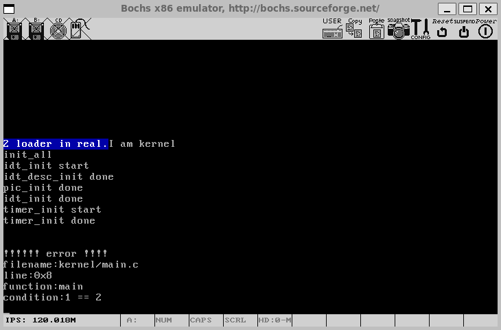
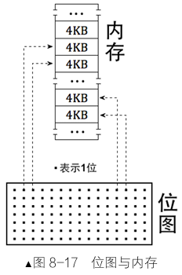
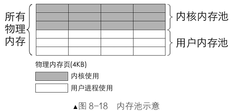
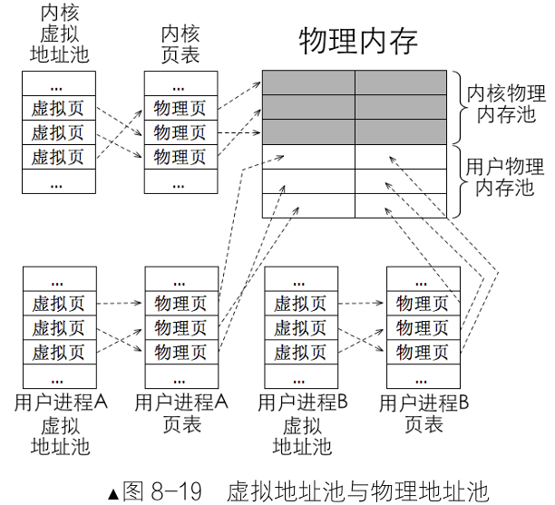
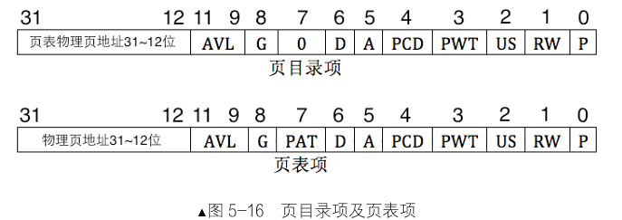
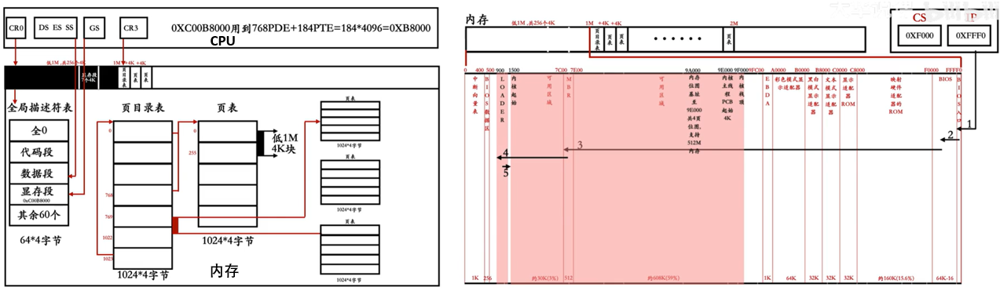
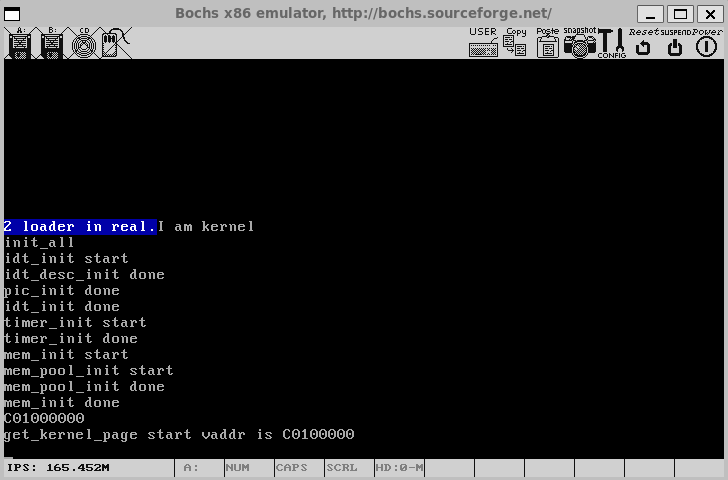
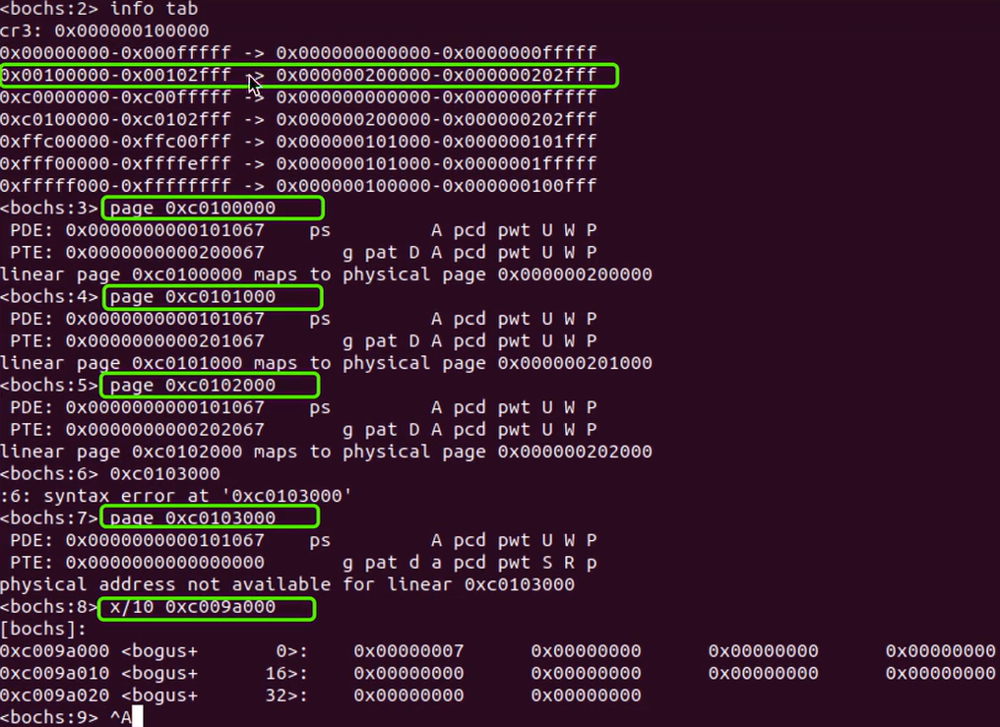

# 第8章 内存管理系统

完成了中断处理模块后，我们迎来操作系统开发中的核心环节——**内存管理**。

作为连接硬件与软件的桥梁，内存管理系统直接决定了整个系统的性能和稳定性。

本章从编译工具使用的优化，到完整内存管理系统的构建，系统打造高效可靠的内存管理系统。

## 8.1 makefile简介

随着项目规模扩大，源文件数量增多，手动编译每个文件变得繁琐。这种重复劳动不仅效率低下，还容易出错。Linux下的**makefile**工具正是为解决这一问题而生，它通过定义**依赖关系**和**编译规则**，实现自动化编译，让开发者专注于代码逻辑。

### 8.1.1 makefile是什么

makefile的核心作用是管理文件间的**依赖关系**。它通过对比文件**修改时间**（mtime）判断是否需要重新编译：若被依赖文件的mtime比目标文件新，则执行编译命令。

```shell
root@DESKTOP-P4JEDQL:/usr/local/bochs# stat hd60M.img 
  File: hd60M.img
  size: 62447616        Blocks: 40         IO Block: 4096   regular file
Device: 8,48    Inode: 14469       Links: 1
Access: (0640/-rw-r-----)  Uid: (    0/    root)   Gid: (    0/    root)
Access: 2026-10-01 17:13:42.687916342 +0800
Modify: 2026-10-01 17:13:39.747917653 +0800
Change: 2026-10-01 17:13:39.747917653 +0800
 Birth: 2026-09-13 11:17:12.079888030 +0800
```

makefile遵循特定语法，定义变量、函数和规则；**make**作为解析器，解析makefile规则，执行这些逻辑。

makefile与make的关系类似于脚本解析器与脚本文件(如Python与.py文件)。

### 8.1.2 makefile基本语法

makefile的基本语法由三部分组成，构成一组规则：

```makefile
目标文件:依赖文件
[Tab]命令
```

- **目标文件**：规则要生成的文件，如.o目标文件、可执行文件或伪目标。
- **依赖文件**：生成目标所需文件的列表。
- **命       令**： 执行的Shell命令，每行以Tab开头。

规则含义是：若依赖文件中任意文件的**mtime**比目标文件新，则执行命令,若依赖文件无更新，则跳过命令执行。

makefile文件名默认为GNUmakefile、makefile或Makefile(按优先级排序)。也可通过**-f**参数指定自定义文件名，如**make -f  i_makefile**。以下示例演示了makefile的简单用法：

```makefile
1:2
    echo "makefile test ok"
```

若文件2的mtime比文件1新，则打印字符串。

```shell
root@DESKTOP-P4JEDQL:/usr/local/bochs/files# ls
1  2  makefile
root@DESKTOP-P4JEDQL:/usr/local/bochs/files# make
echo "makefile test ok"
makefile test ok
```

执行make时，默认先显示命令本身。通过在命令前添加`@`符号(如`@echo "test ok"`)，可隐藏命令输出。

### 8.1.3 跳到目标处执行

当makefile包含多个目标时，可通过**make 目标名**单独执行特定规则。例如：

```makefile
t1:
	@echo "target1"
t2:
	@echo "target2"
```

执行**make t1**仅输出"target1"，随后退出。若未指定目标，make会把文件**第一条规则的目标**当作默认终极目标（default goal）。(目标之间如果**没有写依赖关系**，互相完全独立，所以以下`make`只输出了"target1")。

```shell
root@DESKTOP-P4JEDQL:/usr/local/bochs/files# make t1
target1
root@DESKTOP-P4JEDQL:/usr/local/bochs/files# make
target1
```

### 8.1.4 伪目标

伪目标不生成实际文件，仅用于执行命令(如清理临时文件)。通过省略依赖文件定义伪目标：

```makefile
all:
	@echo "test ok"
```

为避免与真实文件重名，可用`.PHONY`显式声明：

```makefile
.PHONY:clean

clean:
	rm ./*.o
```

常用伪目标名及功能如下表：

| 伪目标名 | 功能描述           |
| -------- | ------------------ |
| all      | 编译所有模块       |
| clean    | 清除目标文件       |
| dist     | 打包压缩文件       |
| install  | 复制程序到安装目录 |

### 8.1.5 make递归式推导目标

make通过递归方式解析依赖关系。以下面的项目为例：test1.c调用test2.c中的函数，需编译为test.bin。

**makefile内容：**

```makefile
test2.o:test2.c
	gcc -c -o test2.o test2.c
	
test1.o:test1.c
	gcc -c -o test1.o test1.c
	
test.bin:test1.o test2.o
	gcc -o test.bin test1.o test2.o
	
all:test.bin
	@echo "compile done"
```

执行**make all**时，make依次查找test.bin的依赖项(test1.o和test2.o)，编译后再链接，最终输出完成信息。

### 8.1.6 自定义变量与系统变量

makefile支持**自定义变量**，格式为**变量名=值**(值均为字符串)。例如：

```makefile
objfiles = test1.o test2.o

test.bin:$(objfiles)
	gcc -o test.bin $(objfiles)
```

除自定义变量外，还包含**系统变量**，可分为**命令**相关(如CC默认为gcc)和**参数**相关(如CFLAGS用于C编译器参数)。

通过**make -f i_makefile**可打印变量值，其中命令变量有默认值，参数变量多无默认值。

**测试makefile文件**

```makefile
all:
	@echo AR $(AR)
	@echo AS $(AS)
	@echo CC $(CC)
	@echo CXX $(CXX)
	@echo CPP $(CPP)
	@echo FC $(FC)
	@echo GET $(GET)
	@echo PC $(PC)
	@echo MAKEINFO $(MAKEINFO)
	@echo RM $(RM)
	@echo YACC $(YACC)
	@echo "______ command var end_______"
	@echo ARFLAGS $(ARFLAGS)
	@echo ASFLAGS $(ASFLAGS)
	@echo CFLAGS $(CFLAGS)
	@echo CXXFLAGS $(CXXFLAGS)
	@echo CPPFLAGS $(CPPFLAGS)
	@echo FFLAGS $(FFLAGS)
	@echo LDFLAGS $(LDFLAGS)
	@echo PFLAGS $(PFLAGS)
	@echo YFLAGS $(YFLAGS)
	@echo "______ para var end_______"
```

```shell
root@DESKTOP-P4JEDQL:/usr/local/bochs/files# make
AR ar
AS as
CC cc
CXX g++
CPP cc -E
FC f77
GET get
PC pc
MAKEINFO makeinfo
RM rm -f
YACC yacc
______ command var end_______
ARFLAGS -rv
ASFLAGS
CFLAGS
CXXFLAGS
CPPFLAGS
FFLAGS
LDFLAGS
PFLAGS
YFLAGS
______ para var end_______
```

### 8.1.8 自动化变量

自动化变量代表**文件名集合**，用于简化对集合的操作，常用变量包括：

- `$@`：目标文件名。
- `$<`：第一个依赖文件。
- `$^`：所有依赖文件(去重)。
- `$?`：比目标新的依赖文件。

示例：

```makefile
test.bin:test1.o test2.o
	gcc -o $@ $^    # 等价于 gcc -o test.bin test1.o test2.o
```

### 8.1.7 隐含规则

make提供常用规则的默认实现，称为**隐含规则**。例如，若未显式定义生成.o文件的规则，make自动执行**$(CC) -c $(CFLAGS)**编译.c文件，就是因为隐含规则的作用。

隐含规则基于文件扩展名(如.c对应C程序)自动推导，简化makefile编写。

以下代码注释了显式规则，但make仍通过隐含规则完成编译：

makefile:

```makefile
objfiles = test1.o test2.o
	
test.bin:$(objfiles)
	gcc -o test.bin $(objfiles)
	
all:test.bin
	@echo "compile done"
```

test1.c:

```c
void my_print(char*);
void main() {
 my_print("hello,world\n");
}
```

test2.c

```c
#include <stdio.h>
void my_print(char* str) {
  printf("%s", str); 
}
```

```shell
root@DESKTOP-P4JEDQL:/usr/local/bochs/files# make
cc    -c -o test1.o test1.c
cc    -c -o test2.o test2.c
gcc -o test.bin test1.o test2.o
```

### 8.1.9 模式规则

模式规则使用**%**匹配字符串，如**%.o:%.c**表示所有.c文件生成对应.o文件，从而简化批量操作。

以下示例演示了模式规则的应用：

```shell
%.o : %.c
	gcc -c -o $@ $<

objfiles = test1.o test2.o

test.bin:$(objfiles)
	gcc -o $@ $^
```

```shell
root@DESKTOP-P4JEDQL:/usr/local/bochs/files# make
gcc -c -o test1.o test1.c
gcc -c -o test2.o test2.c
gcc -o test.bin test1.o test2.o
```

但是模式规则仅处理目标相关的文件，目录中存在其他.c文件(如1.c、2.c)不会参与执行。

## 8.2 实现assert断言

随着系统模块的增多，程序出错的概率也随之增加。

为了提升调试效率，需要在关键代码区域设置"**哨兵**"机制来验证数据正确性。

本节将专门为内核实现**ASSERT**功能，为后续开发提供可靠的调试手段。

assert断言正是这样一种调试机制，它可以在运行时**检查条件表达式**，并在条件不满足时及时报告错误。

### 8.2.1 实现开、关中断的函数

内核运行中出现的问题通常属于严重错误，需要立即终止执行。为了保证错误信息能够完整输出而不被其他进程干扰，最好在关闭中断的情况下进行错误处理。

中断状态的管理通过**eflags**寄存器中的IF位实现。当IF=1时表示开中断，IF=0时表示关中断。

头文件**interrupt.h**中定义中断状态类型：

```c
/* 定义中断的两种状态 */
enum intr_status {
    INTR_OFF,    // 中断关闭
    INTR_ON      // 中断打开
};

enum intr_status intr_get_status(void);
enum intr_status intr_set_status(enum intr_status);
enum intr_status intr_enable(void);
enum intr_status intr_disable(void);
```

下面在**interrupt.c**中新增中断控制函数：

```c
/* 定义eflags寄存器中的IF位 */
#define EFLAGS_IF 0x00000200

/* 获取eflags寄存器值 */
#define GET_EFLAGS(EFLAG_VAR) asm volatile("pushfl;popl %0":"=g"(EFLAG_VAR))

/* 获取当前中断状态 */
enum intr_status intr_get_status() {
    uint32_t eflags = 0;
    GET_EFLAGS(eflags);
    return (EFLAGS_IF&eflags)?INTR_ON:INTR_OFF;
}

/* 开中断    并返回之前的中断状态 */
enum intr_status intr_enable() {
    enum intr_status old_status;
    if (INTR_ON == intr_get_status()) {
        old_status = INTR_ON;
        return old_status;
    }else{
        old_status = INTR_OFF;
        asm volatile("sti");     // 开中断，sti指令将IF位置1
        return old_status;
    }
}

/* 关中断  并返回之前中断状态 */
enum intr_status intr_disable() {
    enum intr_status old_status;
    if (INTR_ON == intr_get_status()) {
        old_status = INTR_ON;
        asm volatile("cli" : : : "memory");  // 关中断，cli指令将IF位置0
        return old_status;
    } else {
        old_status = INTR_OFF;
        return old_status;
    }
}

/* 设置中断状态 */
enum intr_status intr_set_status(enum intr_status status) {
    return status & INTR_ON ? intr_enable() : intr_disable();
}
```

以上函数通过**内联汇编**直接操作eflags寄存器，实现了对中断状态的精确控制。

其中**intr_disable**和**intr_enable**函数将在ASSERT机制中发挥关键作用，确保错误处理过程不被中断打断。

### 8.2.2 实现ASSERT

ASSERT宏用于在调试阶段验证程序条件。当传入的条件表达式为假时，ASSERT会打印错误信息并挂起程序。

其基本用法为:**ASSERT(条件表达式)**。

在kernel/**debug.h**中实现ASSERT宏：

```c
#ifndef __KERNEL_DEBUG_H
#define __KERNEL_DEBUG_H
#define NULL ((void*)0)

void panic_spin(char* filename, int line, const char* func, const char* condition);

/* 定义ASSERT宏 */
#ifdef NDEBUG
    #define ASSERT(CONDITION) ((void)0)
#else
    #define ASSERT(CONDITION) \
        if (CONDITION) {} else { \
            panic_spin(__FILE__, __LINE__, __func__, #CONDITION); \
        }
#endif

#endif
```

当定义了NDEBUG宏时，ASSERT被定义为空操作，避免在发布版本中产生开销。kernel/**debug.c**中的panic_spin函数实现错误处理和程序挂起：

```c
#include "debug.h"
#include "print.h"
#include "interrupt.h"

/* 打印错误信息并挂起程序 */
void panic_spin(char* filename, int line, const char* func, const char* condition) {
    intr_disable();  // 关中断确保输出不被干扰
    
    put_str("\n\n!!!!!! error !!!!\n");
    put_str("filename:"); put_str(filename);         put_str("\n");
    put_str("line:0x");   put_int(line);             put_str("\n");
    put_str("function:"); put_str((char*)func);      put_str("\n");
    put_str("condition:");put_str((char*)condition); put_str("\n");
    
    while(1);  // 死循环挂起程序
}
```

在kernel/**main.c**中测试ASSERT功能：

```c
#include "print.h"
#include "init.h"
#include "debug.h"

int main(void) {
    put_str("I am kernel\n");
    init_all();
    ASSERT(1 == 2);  // 测试断言机制
    while(1);
    return 0;
}
```

**测试步骤：**

```shell
#编译 interrupt.c
gcc -m32 -I lib/kernel/ -I lib/ -I kernel/ -c -fno-builtin -fno-stack-protector -o build/interrupt.o kernel/interrupt.c

#编译 debug.c
gcc -m32 -I lib/kernel/ -I lib/ -I kernel/ -c -fno-builtin -fno-stack-protector -o build/debug.o kernel/debug.c

#编译 main.c
gcc -m32 -I lib/kernel/ -I lib/ -I kernel/ -c -fno-builtin -fno-stack-protector -o build/main.o kernel/main.c

#链接生成可执行内核
# ld -m elf_i386 -Ttext 0xc0001500 -e main -o build/kernel.bin \
#    build/main.o build/debug.o build/init.o build/interrupt.o build/print.o build/kernel.o

# 编译timer.c
gcc -m32 -I lib/kernel/ -I lib/ -I kernel/ -c -fno-builtin -fno-stack-protector -o build/timer.o device/timer.c

# 链接生成可执行内核
ld -m elf_i386 -Ttext 0xc0001500 -e main -o build/kernel.bin \
   build/main.o build/debug.o build/init.o build/interrupt.o build/print.o build/kernel.o build/timer.o

# 可执行文件写入硬盘
dd if=build/kernel.bin of=hd60M.img bs=512 count=200 seek=9 conv=notrunc

# 从虚拟机界面启动bochs
bin/bochs -f bochsrc.disk
```

**测试结果**



条件1==2不成立，ASSERT会触发panic_spin函数，输出错误信息并挂起程序。这种机制为内核开发提供了有效的调试手段。

### 8.2.3 通过makefile来编译

为了高效管理编译过程，需要编写专门的makefile。

以下**makefile**支持内核的完整编译流程，定义了完整的编译规则，包括目录创建、文件编译、链接和磁盘写入：

```shell
BUILD_DIR = ./build
ENTRY_POINT = 0xc0001500
AS = nasm
CC = gcc
LD = ld
LIB = -I lib/ -I lib/kernel/ -I lib/user/ -I kernel/ -I device/
ASFLAGS = -f elf
CFLAGS = -std=gnu11 -m32 $(LIB) -c -fno-builtin -fno-stack-protector -W -Wstrict-prototypes \
	-Wmissing-prototypes  
LDFLAGS = -m elf_i386 -Ttext $(ENTRY_POINT) -e main -Map $(BUILD_DIR)/kernel.map
OBJS = $(BUILD_DIR)/main.o $(BUILD_DIR)/init.o $(BUILD_DIR)/interrupt.o \
	$(BUILD_DIR)/timer.o $(BUILD_DIR)/kernel.o $(BUILD_DIR)/print.o \
	$(BUILD_DIR)/debug.o
  

#############  c代码编译   #############
$(BUILD_DIR)/main.o: kernel/main.c lib/kernel/print.h \
	kernel/stdint.h kernel/init.h
	$(CC) $(CFLAGS) $< -o $@

$(BUILD_DIR)/init.o: kernel/init.c kernel/init.h lib/kernel/print.h \
	kernel/stdint.h kernel/interrupt.h device/timer.h
	$(CC) $(CFLAGS) $< -o $@

$(BUILD_DIR)/interrupt.o: kernel/interrupt.c kernel/interrupt.h \
	kernel/stdint.h kernel/global.h lib/kernel/io.h lib/kernel/print.h
	$(CC) $(CFLAGS) $< -o $@ 

$(BUILD_DIR)/timer.o: device/timer.c device/timer.h kernel/stdint.h\
	lib/kernel/io.h lib/kernel/print.h
	$(CC) $(CFLAGS) $< -o $@

$(BUILD_DIR)/debug.o: kernel/debug.c kernel/debug.h \
	lib/kernel/print.h kernel/stdint.h kernel/interrupt.h
	$(CC) $(CFLAGS) $< -o $@

#############    汇编代码编译    #############
$(BUILD_DIR)/kernel.o: kernel/kernel.s
	$(AS) $(ASFLAGS) $< -o $@

$(BUILD_DIR)/print.o: lib/kernel/print.s
	$(AS) $(ASFLAGS) $< -o $@

#############   链接所有目标文件   #############
$(BUILD_DIR)/kernel.bin: $(OBJS)
	$(LD) $(LDFLAGS) $^ -o $@

.PHONY : mk_dir hd clean all

mk_dir:
	if [ ! -d ./build ]; then mkdir ./build; fi

hd:
	dd if=$(BUILD_DIR)/kernel.bin of=hd60M.img bs=512 count=200 seek=9 conv=notrunc
  
clean:
	cd $(BUILD_DIR) && rm -f ./*

build: $(BUILD_DIR)/kernel.bin

all: mk_dir build hd
```

通过`make all`命令可以一键完成内核编译和部署，大大提升了开发效率。

```linenums="0"
.
├── boot.inc
├── device
│   ├── timer.c
│   └── timer.h
├── kernel
│   ├── debug.c      # 💡新增
│   ├── debug.h
│   ├── global.h
│   ├── init.c
│   ├── init.h
│   ├── interrupt.c
│   ├── interrupt.h
│   ├── kernel.s
│   ├── main.c
│   └── stdint.h
├── lib
│   └── kernel
│       ├── io.h
│       ├── print.h
│       └── print.s
├── loader.s
├── makefile          # 💡新增
└── mbr.s
```

## 8.3 实现字符串操作函数

字符串处理函数是系统编程的基础工具，它们为数据操作提供了核心能力。

虽然C标准库提供了丰富的字符串函数，但操作系统内核不能依赖外部库，需要独立实现这些功能。

本小节以C语言标准函数为参考，实现常用字符串相关操作，包括**内存设置**、**复制**和**字符串处理**等函数。

lib/**string.h**文件：

```c
#ifndef __STRING_H__
#define __STRING_H__

#include "global.h"

// 内存操作函数
void memset(void* dst_, uint8_t value, uint32_t size);       //内存设置 
void memcpy(void* dst_, const void* src_, uint32_t size);    //实现内存数据拷贝
int  memcmp(const void* a_, const void* b_, uint32_t size);  //比较两段内存数据的内容

// 字符串操作函数
char*    strcpy(char* dst_, const char* src_);       //复制字符串
uint32_t strlen(const char* str);                    //计算字符串长度
int8_t strcmp(const char* a, const char* b);         //比较两个字符串的内容
char*  strchr(const char* str, const uint8_t ch);    //定位字符在字符串中的首次出现位置
char*  strrchr(const char* str, const uint8_t ch);   //从字符串末尾开始查找字符
char*  strcat(char* dst_, const char* src_);         //实现字符串拼接
uint32_t strchrs(const char* str, uint8_t ch);       //统计字符在字符串中出现的次数

#endif // __STRING_H__
```

lib/**string.c**文件，实现以下函数：

```c
#include "string.h"
#include "global.h"
#include "debug.h"

/*将dst_起始的size个字节置为value*/
void memset(void* dst_, uint8_t value, uint32_t size) {
    ASSERT(dst_ != NULL);
    uint8_t* dst = (uint8_t*) dst_;
    while(size-- > 0){
        *dst++ = value;
    }
}

/*将src_起始的size个字节复制到dst_ */
void memcpy(void* dst_, const void* src_, uint32_t size) {
    ASSERT(dst_ != NULL && src_ != NULL);
    uint8_t* dst = dst_;
    const uint8_t* src = src_;
    while (size-- >0){
        *dst++ = *src++;
    }
}

/* 比较以地址a_和地址b_起始的size个字节
 * 相等返回0，a_大于b_返回1，否则返回-1 */
int memcmp(const void* a_, const void* b_, uint32_t size) {
    const char* a = a_;
    const char* b = b_;
    ASSERT(a != NULL && b != NULL);
    while (size-- > 0) {
        if (*a != *b) {
            return *a > *b ? 1 : -1;
        }
        a++;
        b++;
    }
    return 0;
}

/*将字符串从src_复制到dst_ */
char* strcpy(char* dst_, const char* src_) {
    ASSERT(dst_ != NULL && src_ != NULL);
    char* r = dst_;
    while ((*dst_++ = *src_++));
    return r;
}

/* 返回字符串长度 */
uint32_t strlen(const char* str) {
    ASSERT(str != NULL);
    const char* p = str;
    while (*p++);
    return (p - str - 1);
}

/* 比较两个字符串，a_大于b_返回1，相等返回0，否则返回-1 */
int8_t strcmp(const char* a, const char* b) {
    ASSERT(a != NULL && b != NULL);
    while (*a != 0 && *a == *b) {
        a++;
        b++;
    }
    return *a < *b ? -1 : *a > *b;
}

/* 从左到右查找字符串str中首次出现字符ch的地址 */
char* strchr(const char* str, const uint8_t ch) {
    ASSERT(str != NULL);
    while (*str != 0) {
        if (*str == ch) {
            return (char*)str;
        }
        str++;
    }
    return NULL;
}

/* 从右向左查找字符串str中首次出现字符ch的地址 */
char* strrchr(const char* str, const uint8_t ch) {
    ASSERT(str != NULL);
    const char* last_char = NULL;
    while (*str != 0) {
        if (*str == ch) {
            last_char = str;
        }
        str++;
    }
    return (char*)last_char;
}

/* 将字符串src_拼接到dst_后，返回拼接的串地址 */
char* strcat(char* dst_, const char* src_) {
    ASSERT(dst_ != NULL && src_ != NULL);
    char* str = dst_;
    while (*str++);
    --str;  // 回退到字符串结束符
    while ((*str++ = *src_++));
    return dst_;
}

/* 在字符串str中查找字符ch出现的次数 */
uint32_t strchrs(const char* str, uint8_t ch) {
    ASSERT(str != NULL);
    uint32_t ch_cnt = 0;
    const char* p = str;
    while (*p != 0) {
        if (*p == ch) {
            ch_cnt++;
        }
        p++;
    }
    return ch_cnt;
}
```

这些函数构成了字符串操作的基础工具集，为后续内核开发提供了必要的字符串处理能力。

## 8.4 位图(bitmap)及其函数的实现

**位图**是内存管理系统的核心数据结构，它通过**二进制位**映射资源状态，实现高效资源跟踪。

本节将完整实现位图**结构**及其操作**函数**，为内存池管理提供支持。

### 8.4.1 位图简介

位图(bitmap)由"位"(bit)和"映射"(map)两部分组成。其核心原理是用二进制位来映射资源单位，位与资源单位形成一对一对应关系。这种"管理结构最小化，资源单位最大化"的设计理念，使位图成为大规模资源管理的理想选择。

在计算机系统中，位图主要用于管理**大容量资源**(如内存或硬盘空间)。传统管理方法需要维护复杂的**数据结构**，而位图通过单个二进制位表示资源单位的状态，大幅降低管理开销。

**例如**，用位图管理内存时，**每个位对应物理内存中的一页（通常为4KB）**。位值为0表示该页空闲，位值为1表示已占用。

{width="27%"}

位图的优势在于极低的**管理开销**。假设系统有1GB内存，页大小为4KB，则需要262144个页。传统方法可能需要维护每个页的元数据，而位图仅需**32768**字节(262144/8)即可跟踪所有页状态。

### 8.4.2 位图的定义与实现

位图管理采用字节数组存储位信息，每个字节管理8个资源单位。这种设计平衡了访问效率和内存开销，为后续内存池管理提供了坚实基础。

位图的实现包括**结构定义**和**操作函数**。以下代码在lib/kernel/目录下创建bitmap.h和bitmap.c文件。

头文件lib/kernel/**bitmap.h**定义位图结构：

```c
#ifndef __LIB_KERNEL_BITMAP_H
#define __LIB_KERNEL_BITMAP_H

#include "global.h"
#include "stdbool.h"

#define BITMAP_MASK 1  // 位操作掩码

struct bitmap {
    uint32_t btmp_bytes_len;  // 位图字节长度
    uint8_t* bits;            // 位图指针(单字节类型)
};

//通过memset清零位图
void bitmap_init(struct bitmap* btmp);

//检查特定位是否被占用
bool bitmap_scan_test(struct bitmap* btmp, uint32_t bit_idx);

//核心函数，用于查找连续空闲位
int  bitmap_scan(struct bitmap* btmp, uint32_t cnt);

//设置特定位设为1(占用)或0(空闲)
void bitmap_set(struct bitmap* btmp, uint32_t bit_idx, int8_t value);

#endif
```

创建lib/**stdbool.h**：

```c
#ifndef _STDBOOL_H
#define _STDBOOL_H

typedef int bool;
#define true 1
#define false 0

#endif
```

位图操作函数在lib/kernel/**bitmap.c**中实现：

```c
#include "bitmap.h"
#include "stdint.h"
#include "string.h"
#include "print.h"
#include "interrupt.h"
#include "debug.h"
#include "stdbool.h"

/* 初始化位图,将所有位清零 */
void bitmap_init(struct bitmap* btmp) {
    memset(btmp->bits, 0, btmp->btmp_bytes_len);
}

/* 检查指定位是否为1*/
bool bitmap_scan_test(struct bitmap* btmp, uint32_t bit_idx) {
    uint32_t byte_idx = bit_idx / 8;    // 计算字节索引
    uint32_t bit_odd  = bit_idx % 8;    // 计算位在字节内的偏移
    return ( btmp->bits[byte_idx] & (BITMAP_MASK << bit_odd) );
}


/* 在位图中查找连续cnt个位，返回起始位索引(失败返回-1) */
int bitmap_scan(struct bitmap* btmp, uint32_t cnt) {
    uint32_t idx_byte = 0;
    // 逐字节查找空闲位
    while (idx_byte < btmp->btmp_bytes_len) {
      if (btmp->bits[idx_byte] != 0xFF) {
           break;
         }
      idx_byte++;
     }
  
    if (idx_byte  >=  btmp->btmp_bytes_len) {
        return -1;  // 位图已满
    }

    // 在字节内逐位查找空闲位
    int idx_bit = 0;
    while ( (uint8_t)(BITMAP_MASK << idx_bit) & btmp->bits[idx_byte] ) {
        idx_bit++;
    }

    int bit_idx_start = idx_byte * 8 + idx_bit;  // 计算全局位索引
    if (cnt == 1) {
        return bit_idx_start;
    }

    uint32_t bit_left = btmp->btmp_bytes_len * 8 - bit_idx_start;//代表剩余空闲
    uint32_t next_bit = bit_idx_start + 1;    //记录当前位的整体偏移值
    uint32_t count = 1;                       //记录已找到的位的数量
    bit_idx_start = -1;

    // 查找连续cnt个空闲位
    while (bit_left-- > 0) {
        if (!(bitmap_scan_test(btmp, next_bit))) {
            count++;
        } else {
            count = 0;
        }
        if (count == cnt) {
            bit_idx_start = next_bit - cnt + 1;//计算连续空闲位的起始偏移
            break;
        }
        next_bit++;
    }
    return bit_idx_start;
}

/* 设置指定位的值（0或1） */
void bitmap_set(struct bitmap* btmp, uint32_t bit_idx, int8_t value) {
    ASSERT((value == 0) || (value == 1));
    uint32_t byte_idx = bit_idx / 8;
    uint32_t bit_odd = bit_idx % 8;

    if (value) {
        btmp->bits[byte_idx] |= (BITMAP_MASK << bit_odd);
    } else {
        btmp->bits[byte_idx] &= ~(BITMAP_MASK << bit_odd);
    }
}
```

## 8.5 内存管理系统

内存管理是操作系统的核心功能，它负责协调内核和应用程序对**内存资源**的使用。

在分页机制下，我们需管理物理内存和虚拟内存，本节将循序渐进地实现内存管理系统。

### 8.5.1 内存池规划

在分页环境下，内存管理需要区分物理地址和虚拟地址。**物理地址**对应实际的硬件内存单元，**虚拟地址**是程序使用的逻辑地址空间。

为了有效管理这两种地址资源，我们采用**内存池**的概念进行组织。

**物理内存池规划**将可用物理内存划分为内核专用和用户程序专用两部分，这种分离设计保证了系统稳定性，即使用户进程耗尽内存也不会影响内核运行：

- **内核**物理内存池：专供操作系统内核使用，确保系统核心始终有可用内存

- **用户**物理内存池：为所有用户进程共享，按需分配

{width="50%"}

**虚拟内存池规划**为每个任务维护独立的虚拟地址空间，分为：

- **内核**虚拟地址池：管理内核的虚拟地址分配
- **进程**虚拟地址池：为每个用户进程维护独立的虚拟地址映射

虚拟地址与物理地址通过**页表**建立映射，映射单位为一页(4KB)。32位系统下每个任务拥有4GB虚拟地址空间。

{width="60%"}

### 8.5.2 内存管理实现

在kernel/**memory.h**中定义内存管理所需的数据结构：

{width=75%}

```c
#ifndef __KERNEL_MEMORY_H
#define __KERNEL_MEMORY_H

#include "stdint.h"
#include "bitmap.h"

/* 内存池类型标记 */
enum pool_flags {
    PF_KERNEL = 1,  /* 内核内存池 */
    PF_USER   = 2   /* 用户内存池 */
};

/* 页表项属性标志位 */
#define PG_P_1   1   /* 页表项存在位 */
#define PG_P_0   0   /* 页表项不存在 */
#define PG_RW_R  0   /* 读/执行权限 */
#define PG_RW_W  2   /* 读/写/执行权限 */
#define PG_US_S  0   /* 系统级权限 */
#define PG_US_U  4   /* 用户级权限 */

/* 虚拟地址池结构体 */
struct virtual_addr {
    struct bitmap vaddr_bitmap;  /* 虚拟地址位图结构 */
    uint32_t vaddr_start;        /* 虚拟地址分配起始地址 */
};

extern struct pool kernel_pool, user_pool;

void  mem_init(void);
void* get_kernel_pages(uint32_t pg_cnt);

#endif 
```

kernel/**memory.c**实现内存管理核心功能，源码按照功能划分为**3个区域**(数据准备、内存池初始化、页分配)：



```c
#include "memory.h"
#include "stdint.h"
#include "print.h"
#include "bitmap.h"
#include "string.h"
#include "debug.h"

// area1 数据准备
#define PG_SIZE 4096                // 一页4K
#define MEM_BITMAP_BASE 0xc009a000  // 位图基地址
#define K_HEAP_START 0xc0100000     // 内核堆起始地址1M
#define MEM_SIZE 0X2000000          // 内存大小32M

/* 物理内存池结构 */
struct pool {
    struct bitmap pool_bitmap;  // 物理内存位图
    uint32_t phy_addr_start;    // 物理内存起始地址
    uint32_t pool_size;         // 内存池容量
};

/* 全局内存池实例 */
struct pool kernel_pool, user_pool;    // 内核物理内存池 用户内存池
struct virtual_addr kernel_vaddr_pool; // 此结构用于给内核分配虚拟地址

/* 地址转换宏 */
#define PDE_IDX(addr) ((addr & 0xffc00000) >> 22)  // 页目录索引
#define PTE_IDX(addr) ((addr & 0x003ff000) >> 12)  // 页表索引

/* 获取虚拟地址对应的页目录项指针*/
static uint32_t* pde_ptr(uint32_t vaddr) {
    //0xfffff000是特殊地址 利用页目录表1023项的映射页目录表自身
    uint32_t* pde = (uint32_t*)(0xfffff000 + PDE_IDX(vaddr) * 4);
    return pde;
}

/* 获取虚拟地址对应的页表项指针*/
static uint32_t* pte_ptr(uint32_t vaddr) {
    uint32_t* pte=(uint32_t*)(0xffc00000+( (vaddr & 0xffc00000) >> 10) + PTE_IDX(vaddr) * 4);
    return pte;
}
// (vaddr & 0xffc00000) >> 10 = ((vaddr & 0xffc00000) >> 22) << 12 = PDE_IDX(vaddr) << 12 
// = PDE_IDX(vaddr) * 4K = 找到它所在页表的"字节偏移"

// area2 内存池初始化，建立完整的内存管理框架，包括物理内存划分和虚拟地址空间设置

/* 内存池初始化 */
static void mem_pool_init(uint32_t all_mem) {
    put_str("mem_pool_init start\n");
    
    // 计算已使用内存（低端1MB+已分配页表空间）
    uint32_t page_table_size = PG_SIZE * 256;        // 加起来256个页框,1M
    uint32_t used_mem = page_table_size + 0x100000;  // 低1M加1M的页目录表和页表占用的空间
    uint32_t free_mem = all_mem - used_mem;
    uint16_t all_free_pages = free_mem / PG_SIZE;    // 可分配页
    
    // 计算分配空闲页给内核和用户,单位为页
    uint16_t kernel_free_pages = all_free_pages / 2;
    uint16_t user_free_pages = all_free_pages - kernel_free_pages;
    
    // 计算位图长度（每页对应1位）,单位为字节 
    uint32_t kbm_length = kernel_free_pages / 8;  //余数对应页直接丢弃 不算在内
    uint32_t ubm_length = user_free_pages / 8;
  
    kernel_free_pages = kbm_length*8;
    user_free_pages = ubm_length*8;
  
    // 计算内存池起始地址
    uint32_t kp_start = used_mem;  // 内核物理内存池的起始地址 计算后为2M
    uint32_t up_start = kp_start + kernel_free_pages * PG_SIZE;  // 用户物理内存池起始地址
    
    // 初始化内核物理内存池
    kernel_pool.phy_addr_start = kp_start;
    kernel_pool.pool_size = kernel_free_pages * PG_SIZE;
    kernel_pool.pool_bitmap.btmp_bytes_len = kbm_length;     // 位图字节数
    kernel_pool.pool_bitmap.bits = (void*)MEM_BITMAP_BASE;   
    
    // 初始化用户物理内存池
    user_pool.phy_addr_start = up_start;
    user_pool.pool_size = user_free_pages * PG_SIZE;
    user_pool.pool_bitmap.btmp_bytes_len = ubm_length;       
    user_pool.pool_bitmap.bits = (void*)(MEM_BITMAP_BASE + kbm_length); 
    
    // 初始化位图
    bitmap_init(&kernel_pool.pool_bitmap);
    bitmap_init(&user_pool.pool_bitmap);
    
    // 初始化内核虚拟地址池 匹配内核物理内存池大小
    kernel_vaddr_pool.vaddr_bitmap.btmp_bytes_len = kbm_length;
    kernel_vaddr_pool.vaddr_bitmap.bits = (void*)(MEM_BITMAP_BASE + kbm_length + ubm_length);
    kernel_vaddr_pool.vaddr_start = K_HEAP_START;
    
    // 初始化位图
    bitmap_init(&kernel_vaddr_pool.vaddr_bitmap);
    
    put_str("mem_pool_init done\n");
}

// 内存管理部分初始化入口
void mem_init() {
    put_str("mem_init start\n");
    //uint32_t mem_bytes_total = (*(uint32_t*)(0xb00)); //此地址存储了物理内存大小
    uint32_t mem_bytes_total=MEM_SIZE;
    mem_pool_init(mem_bytes_total);
    put_str("mem_init done\n");
}

// area3 页分配，核心部分，主要包括虚拟地址分配、物理页分配和页表映射三个步骤

/* 在虚拟地址池中分配pg_cnt个虚拟页  返回分配后的虚拟地址起始地址信息 */
static void* vaddr_get(enum pool_flags pf, uint32_t pg_cnt) {
    int vaddr_start = 0, bit_idx_start = -1;
    uint32_t cnt = 0;
    if (pf == PF_KERNEL) {
        bit_idx_start = bitmap_scan(&kernel_vaddr_pool.vaddr_bitmap, pg_cnt); 
        if (bit_idx_start == -1) {
            return NULL;
        }
        while (cnt < pg_cnt) {
            bitmap_set(&kernel_vaddr_pool.vaddr_bitmap, bit_idx_start + cnt, 1);
            cnt++;
        }
        // 计算获得分配的虚拟地址起始地址
        vaddr_start = kernel_vaddr_pool.vaddr_start + bit_idx_start * PG_SIZE;
        put_int(kernel_vaddr_pool.vaddr_start);
        put_int(bit_idx_start);
        put_str("\n");
    } else {
        // 用户内存池暂不实现
        return NULL;
    }
    return (void*)vaddr_start;
}

/* 在物理内存池中分配1个物理页  返回分配的物理地址起始地址信息*/
static void* palloc(struct pool* m_pool) {
    int bit_idx = bitmap_scan(&m_pool->pool_bitmap, 1); //1个物理页
    if (bit_idx == -1) {
        return NULL;
    }
    bitmap_set(&m_pool->pool_bitmap, bit_idx, 1);
    uint32_t page_phyaddr = m_pool->phy_addr_start + bit_idx * PG_SIZE;
    return (void*)page_phyaddr;
}

/* 设置页目录项、页表项，在页表中添加虚拟地址到物理地址的映射 */
static void page_table_add(void* _vaddr, void* _page_phyaddr) {
    uint32_t  vaddr = (uint32_t)_vaddr;
    uint32_t  page_phyaddr = (uint32_t)_page_phyaddr;
    uint32_t* pde = pde_ptr(vaddr);
    uint32_t* pte = pte_ptr(vaddr);
    
    if (*pde & 0x00000001) {           // 页目录项对应的页表存在
        ASSERT(!(*pte & 0x00000001));
        *pte = (page_phyaddr | PG_US_U | PG_RW_W | PG_P_1);
    } else {                            // 创建新页表
        uint32_t pde_phyaddr = (uint32_t)palloc(&kernel_pool);
        *pde = (pde_phyaddr | PG_US_U | PG_RW_W | PG_P_1);     //设置页目录表项
        memset( (void*)((int)pte & 0xfffff000), 0, PG_SIZE );  // 清空新页表
        *pte = (page_phyaddr | PG_US_U | PG_RW_W | PG_P_1);
    }
   
}

/* 分配pg_cnt个页(包括物理页 虚拟地址页 映射关系设置)*/
static void* malloc_page(enum pool_flags pf, uint32_t pg_cnt) {
    ASSERT(pg_cnt > 0 && pg_cnt < 3840);
    // 分配虚拟地址
    void* vaddr_start = vaddr_get(pf, pg_cnt);
    if (vaddr_start == NULL) {
        return NULL;
    }
    
    uint32_t vaddr = (uint32_t)vaddr_start;
    uint32_t cnt = pg_cnt;
    struct pool* mem_pool = (pf == PF_KERNEL) ? &kernel_pool : &user_pool;//物理池指针
    
    // 为每个虚拟页分配物理页并建立映射
    while (cnt-- > 0) {
        void* page_phyaddr = palloc(mem_pool);
        if (page_phyaddr == NULL) {
                           // 分配失败应回滚已分配资源
          return NULL; 
        }
        page_table_add((void*)vaddr, page_phyaddr);
        vaddr += PG_SIZE;
    }
    return vaddr_start;
}

/* 内核内存分配接口 malloc_page的简单封装 */
void* get_kernel_pages(uint32_t pg_cnt) {
    void* vaddr = malloc_page(PF_KERNEL, pg_cnt);
    if (vaddr != NULL) {
        memset(vaddr, 0, pg_cnt * PG_SIZE);  // 清空分配的内存
    }
    return vaddr;
}
```

```linenums="0"
MEM_BITMAP_BASE (0xc009a000)
│
├── kernel_pool.pool_bitmap.bits          ← 1. 内核物理内存位图
│   覆盖范围：[0, kbm_length)
│
├── user_pool.pool_bitmap.bits            ← 2. 用户物理内存位图
│   覆盖范围：[kbm_length, kbm_length + ubm_length)
│
└── kernel_vaddr_pool.vaddr_bitmap.bits   ← 3. 内核虚拟地址位图
    覆盖范围：[kbm_length + ubm_length, ...)
```

为什么需要两个池？

内存分配不是一步完成的，而是三段式：

```linenums="0"
1. vaddr_get()      → 从 kernel_vaddr_pool 分配【虚拟地址】
2. palloc()         → 从 kernel_pool 分配【物理页框】
3. page_table_add() → 在页表中建立 虚拟地址 → 物理页框 的映射
```

### 8.5.3 内存管理系统测试

在**main.c**中添加测试代码验证内存分配功能：

```c
#include "print.h"
#include "init.h"
#include "memory.h"

int main(void) {
    put_str("I am kernel\n");
    init_all();
    
    // 测试内存分配
    void* addr = get_kernel_pages(3);
    put_str("get_kernel_page start vaddr is ");
    put_int((uint32_t)addr);
    put_str("\n");
    
    while(1);
    return 0;
}
```

修改kernel/**init.c**：

```c
#include "print.h"
#include "interrupt.h"
#include "init.h"
#include "../device/timer.h"
#include "memory.h"

/* 负责初始化所有模块 */
void init_all() {
    put_str("init_all\n");
    intr_init();  // 中断初始化中断
    timer_init(); // 定时器初始化     7.8加
    mem_init();   // 内存初始化       8.5.3加
}
```

**makefile**：

```shell
BUILD_DIR = ./build
ENTRY_POINT = 0xc0001500
AS = nasm
CC = gcc
LD = ld
LIB = -I lib/ -I lib/kernel/ -I lib/user/ -I kernel/ -I device/
ASFLAGS = -f elf
# CFLAGS = -m32 $(LIB) -c -fno-builtin -fno-stack-protector -W -Wstrict-prototypes \
# 	-Wmissing-prototypes
CFLAGS = -std=gnu11 -m32 $(LIB) -c -fno-builtin -fno-stack-protector -W -Wstrict-prototypes \
	-Wmissing-prototypes  
LDFLAGS = -m elf_i386 -Ttext $(ENTRY_POINT) -e main -Map $(BUILD_DIR)/kernel.map
OBJS = $(BUILD_DIR)/main.o $(BUILD_DIR)/init.o $(BUILD_DIR)/interrupt.o \
	$(BUILD_DIR)/timer.o $(BUILD_DIR)/kernel.o $(BUILD_DIR)/print.o \
	$(BUILD_DIR)/debug.o $(BUILD_DIR)/string.o $(BUILD_DIR)/bitmap.o $(BUILD_DIR)/memory.o
  

#############  c代码编译   #############
$(BUILD_DIR)/main.o: kernel/main.c lib/kernel/print.h \
	kernel/stdint.h kernel/init.h
	$(CC) $(CFLAGS) $< -o $@

$(BUILD_DIR)/init.o: kernel/init.c kernel/init.h lib/kernel/print.h \
	kernel/stdint.h kernel/interrupt.h device/timer.h
	$(CC) $(CFLAGS) $< -o $@

$(BUILD_DIR)/interrupt.o: kernel/interrupt.c kernel/interrupt.h \
	kernel/stdint.h kernel/global.h lib/kernel/io.h lib/kernel/print.h
	$(CC) $(CFLAGS) $< -o $@ 

$(BUILD_DIR)/timer.o: device/timer.c device/timer.h kernel/stdint.h\
	lib/kernel/io.h lib/kernel/print.h
	$(CC) $(CFLAGS) $< -o $@

$(BUILD_DIR)/debug.o: kernel/debug.c kernel/debug.h \
	lib/kernel/print.h kernel/stdint.h kernel/interrupt.h
	$(CC) $(CFLAGS) $< -o $@
	
$(BUILD_DIR)/string.o: lib/string.c lib/string.h \
	kernel/global.h  kernel/debug.h
	$(CC) $(CFLAGS) $< -o $@
	
$(BUILD_DIR)/bitmap.o: lib/kernel/bitmap.c lib/kernel/bitmap.h \
	kernel/stdint.h  lib/string.h lib/kernel/print.h kernel/interrupt.h kernel/debug.h
	$(CC) $(CFLAGS) $< -o $@
	
$(BUILD_DIR)/memory.o: kernel/memory.c kernel/memory.h \
	kernel/stdint.h lib/kernel/print.h lib/kernel/bitmap.h  lib/string.h  kernel/debug.h
	$(CC) $(CFLAGS) $< -o $@

#############    汇编代码编译    #############
$(BUILD_DIR)/kernel.o: kernel/kernel.s
	$(AS) $(ASFLAGS) $< -o $@

$(BUILD_DIR)/print.o: lib/kernel/print.s
	$(AS) $(ASFLAGS) $< -o $@

#############   链接所有目标文件   #############
$(BUILD_DIR)/kernel.bin: $(OBJS)
	$(LD) $(LDFLAGS) $^ -o $@

.PHONY : mk_dir hd clean all

mk_dir:
	if [ ! -d ./build ]; then mkdir ./build; fi

hd:
	dd if=$(BUILD_DIR)/kernel.bin of=hd60M.img bs=512 count=200 seek=9 conv=notrunc
  
clean:
	cd $(BUILD_DIR) && rm -f ./*

build: $(BUILD_DIR)/kernel.bin

all: mk_dir build hd
```

```linenums="0"
.
├── boot.inc
├── device
│   ├── timer.c
│   └── timer.h
├── kernel
│   ├── debug.c      
│   ├── debug.h
│   ├── global.h
│   ├── init.c
│   ├── init.h
│   ├── interrupt.c
│   ├── interrupt.h
│   ├── kernel.s
│   ├── main.c
│   ├── memory.c     # 💡新增
│   ├── memory.h
│   └── stdint.h
├── lib
│   ├── kernel
│   │   ├── bitmap.c  # 💡新增
│   │   ├── bitmap.h
│   │   ├── io.h
│   │   ├── print.h
│   │   └── print.s
│   ├── stdbool.h
│   ├── string.c      # 💡新增
│   └── string.h
├── loader.s
├── makefile
└── mbr.s
```

系统运行后输出内存分配信息，显示成功分配的虚拟地址。通过bochs调试命令可验证页表映射的正确性：

```shell
root@DESKTOP-P4JEDQL:/usr/local/bochs# make clean
root@DESKTOP-P4JEDQL:/usr/local/bochs# make all
root@DESKTOP-P4JEDQL:/usr/local/bochs# bin/bochs -f bochsrc.disk
```





内存管理系统的完成为操作系统提供了可靠的内存分配基础，支持内核和用户程序的内存需求。

## 本章要点总结

1. **自动化构建工具**：makefile通过依赖关系分析实现增量编译，显著提升多模块项目管理效率
2. **调试支持机制**：   assert断言提供运行时状态验证，结合中断控制确保错误处理可靠性
3. **基础数据处理**：   完整字符串函数库实现独立的数据处理能力，减少外部依赖
4. **高效资源管理**：   位图机制以极小开销实现大容量资源状态跟踪，支持连续空间分配
5. **内存系统架构**：   双内存池设计确保系统稳定性，页表映射提供地址隔离和保护
6. **分层设计理念**：   从工具到组件再到系统，体现模块化开发的层次性和可维护性

本章构建的完整内存管理框架，不仅解决了基础内存分配问题，更为后续进程管理、虚拟内存等高级功能奠定了坚实基础。通过实践性学习，读者能够深入理解操作系统内存管理的核心原理和实现方法。

## 本章源码附件

kernel/**interrupt.c**(截止8.2.1节)

```c
#include "global.h" 
#include "stdint.h" 
#include "io.h"
#include "print.h"
#include "interrupt.h"

#define IDT_DESC_CNT 0x21         // 目前总共支持的中断数

/* 主片和从片的端口定义 */
#define PIC_M_CTRL 0x20           // 主片的控制端口是0x20
#define PIC_M_DATA 0x21           // 主片的数据端口是0x21
#define PIC_S_CTRL 0xa0           // 从片的控制端口是0xa0
#define PIC_S_DATA 0xa1           // 从片的数据端口是0xa1

/* 定义eflags寄存器中的IF位 */
#define EFLAGS_IF 0x00000200

/* 获取eflags寄存器值 */
#define GET_EFLAGS(EFLAG_VAR) asm volatile("pushfl;popl %0":"=g"(EFLAG_VAR))

/* 中断门描述符结构体 */
struct gate_desc {
    uint16_t   func_offset_low_word;   // 中断处理程序在目标代码段内的偏移量低16位
    uint16_t   selector;               // 中断处理程序目标代码段选择子
    uint8_t    dcount;                 // 双字计数字段，固定值
    uint8_t    attribute;              // 门描述符属性
    uint16_t   func_offset_high_word;  // 中断处理程序在目标代码段内的偏移量高16位
};

/* 静态函数声明 */
static void make_idt_desc(struct gate_desc* p_gdesc, uint8_t attr, intr_handler function);
static void idt_desc_init(void);
static void pic_init(void);


/* 全局变量声明 */
static struct gate_desc idt[IDT_DESC_CNT];           // idt是中断描述符表，本质上是中断门描述符数组
extern intr_handler intr_entry_table[IDT_DESC_CNT];  // 声明引用kernel.s的中断处理函数入口数组

char* intr_name[IDT_DESC_CNT];          //用于保存异常的名字
intr_handler idt_table[IDT_DESC_CNT];   //定义中断处理程序数组,最终调用的是ide_table中的程序
/* 通用中断处理函数，一般用在异常出现时的处理 */
static void general_intr_handler(uint8_t vec_nr) {
  if(vec_nr == 0x27 || vec_nr == 0x2f) {
     //IRQ7和IRQ15会产生伪中断,无需处理,0x2f是从片8259A上的最后一个IRQ引脚，保留项
     return;
  }
  put_str("int vector:0x");
  put_int(vec_nr);
  put_char('\n');
}


/* 注册通用中断处理函数及异常名称 */
static void exception_init(void) {
    int i;
    for (i=0;i<IDT_DESC_CNT;i++) {
        idt_table[i] = general_intr_handler;// 默认为 general_intr_handler
        intr_name[i] = "unknown"; // 先统一赋值为 unknown
    }
    intr_name[0] = "#DE Divide Error";
    intr_name[1] = "#DB Debug Exception";
    intr_name[2] = "NMI Interrupt";
    intr_name[3] = "#BP Breakpoint Exception";
    intr_name[4] = "#OF Overflow Exception";
    intr_name[5] = "#BR BOUND Range Exceeded Exception";
    intr_name[6] = "#UD Invalid Opcode Exception";
    intr_name[7] = "#NM Device Not Available Exception";
    intr_name[8] = "#DF Double Fault Exception";
    intr_name[9] = "Coprocessor Segment Overrun";
    intr_name[10] = "#TS Invalid TSS Exception";
    intr_name[11] = "#NP Segment Not Present";
    intr_name[12] = "#SS Stack Fault Exception";
    intr_name[13] = "#GP General Protection Exception";
    intr_name[14] = "#PF Page-Fault Exception";
    // intr_name[15] 第15项是intel保留项，未使用
    intr_name[16] = "#MF x87 FPU Floating-Point Error";
    intr_name[17] = "#AC Alignment Check Exception";
    intr_name[18] = "#MC Machine-Check Exception";
    intr_name[19] = "#XF SIMD Floating-Point Exception";
}

/* 完成有关中断的所有初始化工作 - 主函数（调用者） */
void intr_init() {
    put_str("idt_init start\n");
    idt_desc_init();  // 初始化中断描述符表
    exception_init();  //异常名初始化并注册通常的中断处理函数
    pic_init();       // 初始化8259A
    
    /* 加载idt */
    uint64_t idt_operand = ((sizeof(idt) - 1) | ((uint64_t)((uint32_t)idt) << 16));
    asm volatile("lidt %0" : : "m"(idt_operand));
    put_str("idt_init done\n");
}

/* 初始化中断描述符表 - 被idt_init调用 */
static void idt_desc_init(void) {
    int i;
    for (i = 0; i < IDT_DESC_CNT; i++) {
        make_idt_desc(&idt[i], IDT_DESC_ATTR_DPL0, intr_entry_table[i]);
    }
    put_str("idt_desc_init done\n");
}

/* 创建中断门描述符 - 被idt_desc_init调用 */
static void make_idt_desc(struct gate_desc* p_gdesc, uint8_t attr, intr_handler function) {
    p_gdesc->func_offset_low_word = (uint32_t)function & 0x0000FFFF;
    p_gdesc->selector = SELECTOR_K_CODE;  // 修正：应该是SELECTOR_K_CODE
    p_gdesc->dcount = 0;                  // 固定值
    p_gdesc->attribute = attr;            // 门描述符属性
    p_gdesc->func_offset_high_word = ((uint32_t)function & 0xFFFF0000) >> 16;
}


/* 初始化可编程中断控制器 8259A - 被idt_init调用 */
static void pic_init(void) {
    /* 初始化主片 */
    outb(PIC_M_CTRL, 0x11);  // ICW1: 边沿触发, 级联8259, 需要ICW4
    outb(PIC_M_DATA, 0x20);  // ICW2: 起始中断向量号为0x20 (IR[0-7]为0x20~0x27)
    outb(PIC_M_DATA, 0x04);  // ICW3: IR2接从片
    outb(PIC_M_DATA, 0x01);  // ICW4: 8086模式, 正常EOI
    
    /* 初始化从片 */
    outb(PIC_S_CTRL, 0x11);  // ICW1: 边沿触发, 级联8259, 需要ICW4
    outb(PIC_S_DATA, 0x28);  // ICW2: 起始中断向量号为0x28 (IR[8-15]为0x28~0x2F)
    outb(PIC_S_DATA, 0x02);  // ICW3: 设置从片连接到主片的IR2引脚
    outb(PIC_S_DATA, 0x01);  // ICW4: 8086模式, 正常EOI
    
    /* 打开主片上IR0, 也就是目前只接受时钟产生的中断 */
    outb(PIC_M_DATA, 0xfe);  // 主片屏蔽字: 只开放IR0(时钟中断)
    outb(PIC_S_DATA, 0xff);  // 从片屏蔽字: 屏蔽所有中断
    
    put_str("pic_init done\n");
}

/* 获取当前中断状态 */
enum intr_status intr_get_status() {
    uint32_t eflags = 0;
    GET_EFLAGS(eflags);
    return (EFLAGS_IF&eflags)?INTR_ON:INTR_OFF;
}

/* 开中断    并返回之前的中断状态 */
enum intr_status intr_enable() {
    enum intr_status old_status;
    if (INTR_ON == intr_get_status()) {
        old_status = INTR_ON;
        return old_status;
    }else{
        old_status = INTR_OFF;
        asm volatile("sti");     // 开中断，sti指令将IF位置1
        return old_status;
    }
}

/* 关中断  并返回之前中断状态 */
enum intr_status intr_disable() {
    enum intr_status old_status;
    if (INTR_ON == intr_get_status()) {
        old_status = INTR_ON;
        asm volatile("cli" : : : "memory");  // 关中断，cli指令将IF位置0
        return old_status;
    } else {
        old_status = INTR_OFF;
        return old_status;
    }
}

/* 设置中断状态 */
enum intr_status intr_set_status(enum intr_status status) {
    return status & INTR_ON ? intr_enable() : intr_disable();
}

```

kernel/**interrupt.h **：(截止8.2.1节)

```c
#ifndef __KERNEL_INTERRUPT_H
#define __KERNEL_INTERRUPT_H

#include "stdint.h"

// 修改为接受一个uint8_t参数
typedef void (*intr_handler)(uint8_t vec_nr);
void intr_init(void);

/* 定义中断的两种状态 */
enum intr_status {
    INTR_OFF,    // 中断关闭
    INTR_ON      // 中断打开
};
enum intr_status intr_get_status(void);
enum intr_status intr_set_status(enum intr_status);
enum intr_status intr_enable(void);
enum intr_status intr_disable(void);

#endif
```

## 本章依赖源码

```c
bochsrc.disk       1.4
mbr.s              4.3.5
boot.inc           5.3.5
loader.s           5.3.5
print.s print.h    第6章源码附件
  
io.h global.h stdint.h init.c init.h 7.6.1
kernel.s                             7.6.2
interrupt.c interrupt.h              第7章完整源码
timer.c  timer.h  init.c             7.8
```