# 第9章 线程

操作系统中的并发执行是通过进程和线程实现的。线程作为进程内部的执行流，能够共享进程资源，同时提供更高的并发性能。本章将深入探讨线程的概念、实现方式及其与进程的关系，逐步实现一个简单的**内核级线程机制**，为后续的多任务调度打下基础。

## 9.1 内核线程介绍

线程是进程中的执行单元，允许一个进程内同时运行多个代码流。本节从线程的基本概念入手，逐步展开对**内核空间中的线程机制**介绍。

### 9.1.1 执行流

程序执行流是处理器执行指令的轨迹。

执行流的独立性体现在资源的隔离性。任何代码块只要具备独立的上下文(如栈和寄存器映像)，就可以成为调度单元。线程正是通过这种机制，使函数能够被单独调度。

**调度器**维护任务表，按算法选择任务运行。调度器像轮盘一样将任务轮流调度到处理器上，实现伪并行。

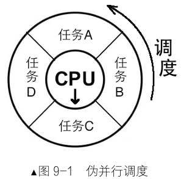{width=30%}

在单任务系统中，任务串行执行，耗时长的任务会阻塞其他任务。多任务系统通过时间片轮转模拟并行，调度器在任务间切换，降低平均响应时间。多任务系统中，任务切换会增加总执行时间，但能提高响应性。

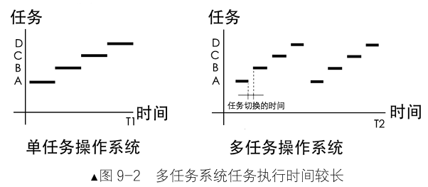{width=60%}

### 9.1.2 线程到底是什么

线程在高级语言中常通过库函数(如pthread_create)创建。以下示例演示线程的基本用法：

```c
#include <stdio.h>
#include <pthread.h>
#include <unistd.h>

void* thread_func(void* _arg) {
    // 在线程函数内部获取自己的线程ID
    pthread_t tid = pthread_self();
    printf("new thread: my tid is %lu\n", (unsigned long)tid);
    return NULL;
}

int main(void) {
    pthread_t new_thread_id;  
    // 创建新线程
    pthread_create(&new_thread_id, NULL, thread_func, NULL);
    printf("main thread: my tid is %lu\n", (unsigned long)pthread_self()); 
    // 等待线程结束
    pthread_join(new_thread_id, NULL);
    return 0;
}
```

```shell
root@DESKTOP-P4JEDQL:/usr/local/bochs/files# gcc -o test.bin -lpthread test.c
root@DESKTOP-P4JEDQL:/usr/local/bochs/files# ./test.bin 
main thread: my tid is 136447396206400
new thread: my tid is 136447392741056
```

线程本质上是**函数的载体**，与普通函数调用不同，线程拥有独立的上下文，可被调度器专门调度。**线程使函数成为调度单元，单独占用处理器资源。**

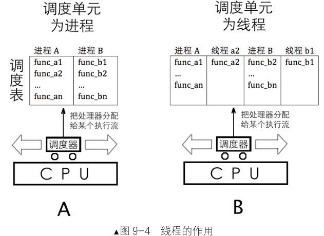

### 9.1.3 进程与线程的关系、区别简述

- **程序**：静态指令代码。
- **进程**：运行中的程序，拥有资源(如地址空间)。
- **线程**：进程内的执行流，共享同一进程的资源。

进程是资源容器，线程是资源使用者。多线程进程包含多个执行流，单线程进程仅有一个主线程。线程依赖进程的资源，没有独立地址空间。

表达式概括：**进程 = 线程 + 资源**。

### 9.1.4 进程、线程的状态

执行流可能因等待I/O等事件阻塞。操作系统将状态大致分为：

- **运行态**：正在处理器上执行。
- **就绪态**：可运行，等待调度。
- **阻塞态**：等待外部条件。

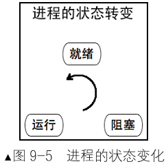{width=30%}

调度器的调度单位是执行流，“状态”所描述的对象也是执行流，并且主要是供调度器进行决策使用的。归根结底，状态是描述线程的，通常所说的“进程状态”，实质上是指单线程进程中唯一线程的状态。

### 9.1.5 进程的身份证——PCB

每个进程有**PCB**(进程控制块)，记录进程信息(如状态、PID、页表等)。PCB是调度器管理任务的依据，解决以下问题：

- 任务定位与资源分配。
- 时间片管理。
- 上下文保存(如寄存器映像)。

PCB结构包含寄存器映像、栈指针、状态等。所有PCB组成**进程表**。

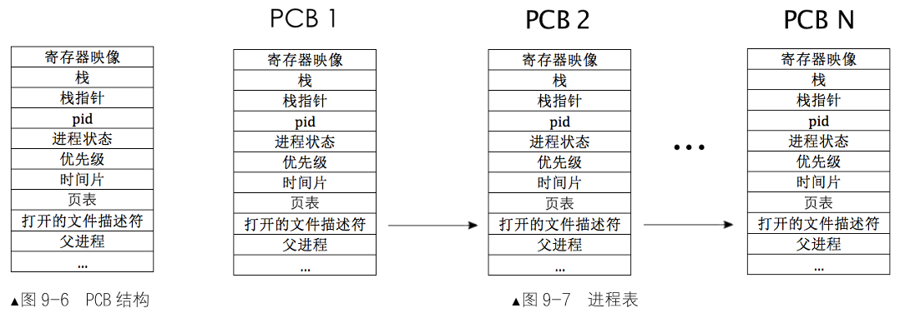

### 9.1.6 实现线程的两种方式

线程可在内核或用户空间实现：

- **内核级线程**：由操作系统原生支持，通过系统调用使用。优点是可真正利用多处理器资源，阻塞时不影响进程内其他线程。

- **用户级线程**：在进程内实现，可移植性强；内核感觉不到进程内部线程的数量与状况，某个线程系统调用的阻塞可能会阻碍整个进程；应用层没有底层硬件功能的支撑，依赖线程主动让出CPU。

	**对比:**

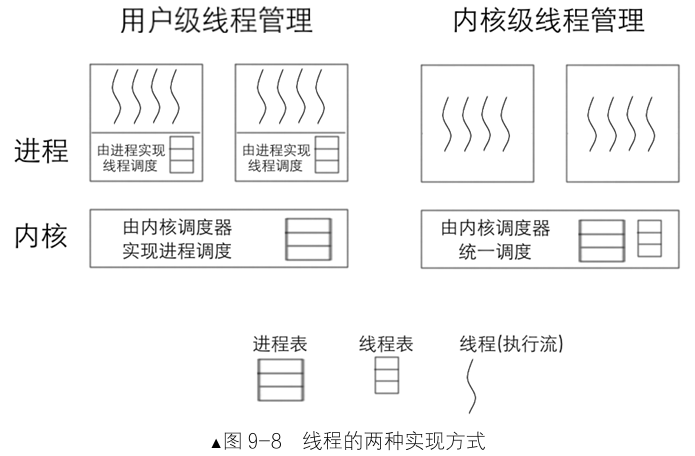{width=70%}

本书选择内核级线程，因其效率更高且易于管理。

## 9.2 在内核空间实现线程

前面探讨了线程的基本**概念**、**执行流**特性以及进程与线程的**关系**。现在，我们将进入内核空间线程的具体实现阶段。

本节将逐步构建**程序控制块**(PCB)、**线程栈**结构，创建、初始化并运行线程，为多线程调度奠定基础。

### 9.2.1 简单的PCB及线程栈的实现

**程序控制块(**PCB)是操作系统管理线程的核心数据结构，用于保存线程的上下文信息，以下是PCB及线程相关数据结构的定义，结合图示可以更加清楚理解数据的内存位置，thread/**thread.h**：。

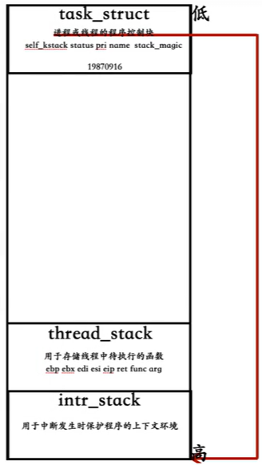{width=45%}

```c
#ifndef __THREAD_THREAD_H
#define __THREAD_THREAD_H
#include "stdint.h"

/* 自定义通用函数类型，它将在很多线程函数中作为形参类型 */
typedef void thread_func(void*);

/* 进程或线程的状态 */
enum task_status {
    TASK_RUNNING,
    TASK_READY,
    TASK_BLOCKED,
    TASK_WAITING,
    TASK_HANGING,
    TASK_DIED
};

/************** 中断栈 intr_stack **************
 * 此结构用于中断发生时保护程序（线程或进程）的上下文环境：
 * 进程或线程被外部中断或软中断打断时，会按照此结构压入上下文
 * 寄存器，intr_exit 中的出栈操作是此结构的逆操作
 * 此栈在线程自己的内核栈中位置固定，所在页的最顶端
 **********************************************/
struct intr_stack {
    uint32_t vec_no;           // kernel.S 宏 VECTOR 中 push %1 压入的中断号
    uint32_t edi;
    uint32_t esi;
    uint32_t ebp;
    uint32_t esp_dummy;       //// pushad把esp也压入，但 sp不断变化，所以会被popad忽略
    uint32_t ebx;
    uint32_t edx;
    uint32_t ecx;
    uint32_t eax;
    uint32_t gs;
    uint32_t fs;
    uint32_t es;
    uint32_t ds;
    /* 以下由 cpu 从低特权级进入高特权级时压入 */
    uint32_t err_code;         // err_code 会被压入在 eip 之后
    void (*eip)(void);
    uint32_t cs;
    uint32_t eflags;
    void* esp;
    uint32_t ss;
};

/************** 线程栈 thread_stack **************
 * 线程自己的栈，用于存储线程中待执行的函数
 * 此结构在线程自己的内核栈中位置不固定，
 * 仅用在 switch_to 时保存线程环境。
 * 实际位置取决于实际运行情况。
 *************************************************/
struct thread_stack {
    uint32_t ebp;
    uint32_t ebx;
    uint32_t edi;
    uint32_t esi;
    /* 线程第一次执行时，eip 指向待调用的函数kernel_thread,其他时候，eip指向switch_to的返回地址*/
    void (*eip)(thread_func* func, void* func_arg);
    /**** 以下仅供第一次被调度上 cpu 时使用 ****/
    /* 参数 unused_ret 只为占位置充数为返回地址 */
    void (*unused_retaddr);
    thread_func* function;      // 由 kernel_thread 所调用的函数名
    void* func_arg;             // 由 kernel_thread 所调用的函数所需的参数
};

/* 进程或线程的 pcb，程序控制块 */
struct task_struct {
    uint32_t* self_kstack;      // 各内核线程都用自己的内核栈
    enum task_status status;
    uint8_t priority;           // 线程优先级
    char name[16];
    uint32_t stack_magic;       // 栈的边界标记，用于检测栈的溢出
};
struct task_struct* thread_start(char* name, int prio, thread_func function, void* func_arg);
void init_thread(struct task_struct* pthread, char* name, int prio);
void thread_create(struct task_struct* pthread, thread_func function, void* func_arg);
static void kernel_thread(thread_func* function, void* func_arg);

#endif
```

### 9.2.2 线程的实现

线程创建和初始化的具体实现代码thread/**thread.c**：

```c
#include "thread.h"
#include "stdint.h"
#include "string.h"
#include "global.h"
#include "memory.h"

#define PG_SIZE 4096
/* 创建一优先级为prio的线程，线程名为 name，线程执行函数function(func_arg) */
struct task_struct* thread_start(char* name, int prio, thread_func function, void* func_arg) {
    /* pcb 都位于内核空间，包括用户进程的 pcb 也是在内核空间 */
    struct task_struct* thread = get_kernel_pages(1);
    init_thread(thread, name, prio);
    thread_create(thread, function, func_arg);

    asm volatile ("movl %0, %%esp; \
                   pop %%ebp; pop %%ebx; pop %%edi; pop %%esi; \
                   ret" : : "g" (thread->self_kstack) : "memory");
    return thread;
}
/* 初始化线程PCB基本信息 */
void init_thread(struct task_struct* pthread, char* name, int prio) {
    memset(pthread, 0, sizeof(*pthread));
    strcpy(pthread->name, name);
    pthread->status = TASK_RUNNING;
    pthread->priority = prio;
    /* self_kstack 是线程自己在内核态下使用的栈顶地址 */
    pthread->self_kstack = (uint32_t*)((uint32_t)pthread + PG_SIZE);
    pthread->stack_magic = 0x19870916;      // 自定义的魔数
}
/* 初始化线程栈，将待执行的函数和参数放到thread_stack 中相应的位置*/
void thread_create(struct task_struct* pthread, thread_func function, void* func_arg) {
    /* 先预留中断使用栈的空间 */
    pthread->self_kstack -= sizeof(struct intr_stack);

    /* 再留出线程栈空间，可见 thread.h 中定义 */
    pthread->self_kstack -= sizeof(struct thread_stack);
    struct thread_stack* kthread_stack = (struct thread_stack*)pthread->self_kstack;
    kthread_stack->eip = kernel_thread;
    kthread_stack->function = function;
    kthread_stack->func_arg = func_arg;
    kthread_stack->ebp = kthread_stack->ebx = \
    kthread_stack->esi = kthread_stack->edi = 0;
}
/* 由 kernel_thread 去执行 function(func_arg) */
static void kernel_thread(thread_func* function, void* func_arg) {
    function(func_arg);
}
```

kernel/**main.c**：

```c
#include "print.h"
#include "init.h"
#include "thread.h"

void k_thread_a(void*);

int main(void) {
    put_str("I am kernel\n");
    init_all();
    thread_start("k_thread_a", 31, k_thread_a, "argA ");
    while(1);
    return 0;
}

/* 在线程中运行的函数 */
void k_thread_a(void* arg) {
    /* 用void*来通用表示参数，被调用的函数知道自己需要什么类型的参数，自己转换再用 */
    char* para = arg;
    while(1) {
        put_str(para);
    }
}
```

**makefile**：

```c
BUILD_DIR = ./build
ENTRY_POINT = 0xc0001500
AS = nasm
CC = gcc
LD = ld
LIB = -I lib/ -I lib/kernel/ -I lib/user/ -I kernel/ -I device/ -I thread/
ASFLAGS = -f elf
CFLAGS = -std=gnu11 -m32 $(LIB) -c -fno-builtin -fno-stack-protector -W -Wstrict-prototypes \
	-Wmissing-prototypes  
LDFLAGS = -m elf_i386 -Ttext $(ENTRY_POINT) -e main -Map $(BUILD_DIR)/kernel.map
OBJS = $(BUILD_DIR)/main.o $(BUILD_DIR)/init.o $(BUILD_DIR)/interrupt.o \
	$(BUILD_DIR)/timer.o $(BUILD_DIR)/kernel.o $(BUILD_DIR)/print.o \
	$(BUILD_DIR)/debug.o $(BUILD_DIR)/string.o $(BUILD_DIR)/bitmap.o            $(BUILD_DIR)/memory.o $(BUILD_DIR)/thread.o
  

#############  c代码编译   #############
$(BUILD_DIR)/main.o: kernel/main.c lib/kernel/print.h \
	kernel/stdint.h kernel/init.h
	$(CC) $(CFLAGS) $< -o $@

$(BUILD_DIR)/init.o: kernel/init.c kernel/init.h lib/kernel/print.h \
	kernel/stdint.h kernel/interrupt.h device/timer.h
	$(CC) $(CFLAGS) $< -o $@

$(BUILD_DIR)/interrupt.o: kernel/interrupt.c kernel/interrupt.h \
	kernel/stdint.h kernel/global.h lib/kernel/io.h lib/kernel/print.h
	$(CC) $(CFLAGS) $< -o $@ 

$(BUILD_DIR)/timer.o: device/timer.c device/timer.h kernel/stdint.h\
	lib/kernel/io.h lib/kernel/print.h
	$(CC) $(CFLAGS) $< -o $@

$(BUILD_DIR)/debug.o: kernel/debug.c kernel/debug.h \
	lib/kernel/print.h kernel/stdint.h kernel/interrupt.h
	$(CC) $(CFLAGS) $< -o $@
	
$(BUILD_DIR)/string.o: lib/string.c lib/string.h \
	kernel/global.h  kernel/debug.h
	$(CC) $(CFLAGS) $< -o $@
	
$(BUILD_DIR)/bitmap.o: lib/kernel/bitmap.c lib/kernel/bitmap.h \
	kernel/stdint.h  lib/string.h lib/kernel/print.h kernel/interrupt.h kernel/debug.h
	$(CC) $(CFLAGS) $< -o $@
	
$(BUILD_DIR)/memory.o: kernel/memory.c kernel/memory.h \
	kernel/stdint.h lib/kernel/print.h lib/kernel/bitmap.h  lib/string.h  kernel/debug.h
	$(CC) $(CFLAGS) $< -o $@
  
$(BUILD_DIR)/thread.o: thread/thread.c thread/thread.h \
	kernel/stdint.h  lib/string.h  kernel/global.h  kernel/memory.h
	$(CC) $(CFLAGS) $< -o $@

#############    汇编代码编译    #############
$(BUILD_DIR)/kernel.o: kernel/kernel.s
	$(AS) $(ASFLAGS) $< -o $@

$(BUILD_DIR)/print.o: lib/kernel/print.s
	$(AS) $(ASFLAGS) $< -o $@

#############   链接所有目标文件   #############
$(BUILD_DIR)/kernel.bin: $(OBJS)
	$(LD) $(LDFLAGS) $^ -o $@

.PHONY : mk_dir hd clean all

mk_dir:
	if [ ! -d ./build ]; then mkdir ./build; fi

hd:
	dd if=$(BUILD_DIR)/kernel.bin of=hd60M.img bs=512 count=200 seek=9 conv=notrunc
  
clean:
	cd $(BUILD_DIR) && rm -f ./*

build: $(BUILD_DIR)/kernel.bin

all: mk_dir build hd
```

**测试结果：**

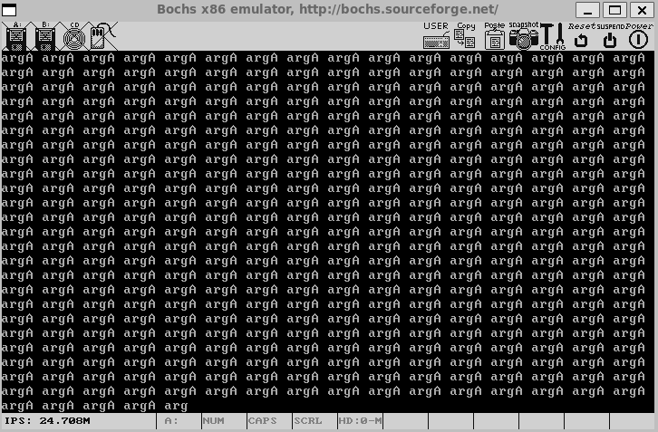

## 9.3 核心数据结构：双向链表

数据结构是程序设计的基石。队列作为一种先入先出的结构，在内核中广泛应用于进程就绪队列、锁等待队列等场景。本节将实现双向链表来支持后续这些需求，其特点是结点轻量、操作高效。

### 9.3.1 链表结构定义

**双向链表**的结点仅包含前驱和后继指针，不直接存储数据，而是通过指针关联到实际数据结构。这种设计使链表专注于逻辑关系，与数据存储解耦。

{width=65%}

头文件lib/kernel/**list.h**定义如下：

**关键设计说明：**

灵活关联数据：通过**elem2entry**宏，将链表结点转为实际结构体地址(如线程PCB)，实现数据与链表的绑定。

固定头尾结点：**head**和**tail**作为链表边界，新结点始终插入二者之间，head与tail本身不是链表的节点，简化边界处理。

```c
#ifndef __LIB_KERNEL_LIST_H
#define __LIB_KERNEL_LIST_H
#include "global.h"
#include "stdbool.h"

#define offset(struct_type, member) ((int)(&((struct_type*)0)->member))

#define elem2entry(struct_type, struct_member_name, elem_ptr) \
    (struct_type*)((int)elem_ptr - offset(struct_type, struct_member_name))

/*********** 定义链表结点成员结构 ***********/
/* 结点中不需要数据成员，只要求前驱和后继结点指针 */
struct list_elem {
    struct list_elem* prev; // 前驱结点
    struct list_elem* next; // 后继结点
};

/* 链表结构，用来实现队列 */
struct list {
    /* head 是队首，是固定不变的，不是第 1 个元素，第 1 个元素为 head.next */
    struct list_elem head;
    /* tail 是队尾，同样是固定不变的 */
    struct list_elem tail;
};


/* 自定义函数类型 function，用于在 list_traversal 中做回调函数 */
//typedef bool (function)(struct list_elem*, int arg);
typedef bool (*function)(struct list_elem*, int arg);

void list_init(struct list*);
void list_insert_before(struct list_elem* before, struct list_elem* elem);
void list_push(struct list* plist, struct list_elem* elem);
void list_iterate(struct list* plist);
void list_append(struct list* plist, struct list_elem* elem);
void list_remove(struct list_elem* pelem);
struct list_elem* list_pop(struct list* plist);
bool list_empty(struct list* plist);
uint32_t list_len(struct list* plist);
struct list_elem* list_traversal(struct list* plist, function func, int arg);
bool elem_find(struct list* plist, struct list_elem* obj_elem);
#endif
```

### 9.3.2 链表操作实现

链表的核心操作包括**初始化**、**插入**、**删除**和**遍历**。为保证线程安全，涉及队列修改的操作需**关中断**。

源文件lib/kernel/**list.c**实现如下：

```c
#include "list.h"
#include "interrupt.h"
#include "type.h"

/* 初始化双向链表 list */
void list_init(struct list* list) {
    list->head.prev = NULL;
    list->head.next = &list->tail;
    list->tail.prev = &list->head;
    list->tail.next = NULL;
}

/* 把链表元素 elem 插入在元素 before 之前 */
void list_insert_before(struct list_elem* before, struct list_elem* elem) {
    enum intr_status old_status = intr_disable();
    before->prev->next = elem;
    elem->prev = before->prev;
    elem->next = before;
    before->prev = elem;
    intr_set_status(old_status);
}

/* 添加元素到列表队首，类似栈 push 操作 */
void list_push(struct list* plist, struct list_elem* elem) {
    list_insert_before(plist->head.next, elem); // 在队头插入 elem
}

/* 追加元素到链表队尾，类似队列的先进先出操作 */
void list_append(struct list* plist, struct list_elem* elem) {
    list_insert_before(&plist->tail, elem);     // 在队尾的前面插入
}

/* 使元素 pelem 脱离链表 */
void list_remove(struct list_elem* pelem) {
    enum intr_status old_status = intr_disable();
    pelem->prev->next = pelem->next;
    pelem->next->prev = pelem->prev;
    intr_set_status(old_status);
}

/* 将链表第一个元素弹出并返回，类似栈的 pop 操作 */
struct list_elem* list_pop(struct list* plist) {
    struct list_elem* elem = plist->head.next;
    list_remove(elem);
    return elem;
}

/* 从链表中查找元素 obj_elem，成功时返回 true，失败时返回 false */
bool elem_find(struct list* plist, struct list_elem* obj_elem) {
    struct list_elem* elem = plist->head.next;
    while (elem != &plist->tail) {
        if (elem == obj_elem) {
            return true;
        }
        elem = elem->next;
    }
    return false;
}

/* 本函数的功能是遍历列表内所有元素，逐个判断是否有符合条件(使用回调函数)的元素。
 * 找到符合条件的元素返回元素指针，否则返回 NULL */
struct list_elem* list_traversal(struct list* plist, function func, int arg) {
    struct list_elem* elem = plist->head.next;
    /* 如果队列为空，就必然没有符合条件的结点，故直接返回 NULL */
    if (list_empty(plist)) {
        return NULL;
    }
    while (elem != &plist->tail) {
        if (func(elem, arg)) {
            // func 返回 ture，则认为该元素在回调函数中符合条件，命中，故停止继续遍历
            return elem;
        }
        elem = elem->next;
    }
    return NULL;
}

/* 返回链表长度 */
uint32_t list_len(struct list* plist) {
    struct list_elem* elem = plist->head.next;
    uint32_t length = 0;
    while (elem != &plist->tail) {
        length++;
        elem = elem->next;
    }
    return length;
}

/* 判断链表是否为空，空时返回 true，否则返回 false */
bool list_empty(struct list* plist) {   // 判断队列是否为空
    return (plist->head.next == &plist->tail ? true : false);
}
```

**关键设计说明：**

1. **原子性保障**：插入和删除操作通过关中断避免竞态条件。
2. **高效遍历**：   **list_traversal**支持回调函数筛选结点，灵活应对复杂查询。
3. **多场景适配**：**list_push**和 **list_append**分别支持栈式和队列式行为。

### 9.3.3 链表与线程管理的结合

链表操作与线程状态转换紧密结合，为多线程调度提供了底层支持。

双向链表通过线程PCB中的 **general_tag**和 **all_list_tag**字段关联线程，实现就绪队列和全线程队列的维护。

例如：

- **就绪队列管理**：调度器通过 **list_pop**获取下一个运行线程。

- **动态增删**：线程状态变化时，通过**list_remove**和**list_append**调整队列。

## 9.4 多线程调度

多线程调度是操作系统的核心功能，它通过**时间片轮转**和**优先级**机制实现线程间的公平调度。

本节从**调度基础**入手，逐步实现**调度器**、**任务切换**函数，并最终完成线程调度机制的测试与调试。

### 9.4.1 简单优先级调度的基础

为实现线程调度，需扩展PCB结构以支持**优先级**和**时间片**管理。以下是优化后的线程控制块定义(thread/**thread.h**内容)：

```c
struct task_struct {
    uint32_t* self_kstack;         // 线程内核栈指针
    enum task_status status;       // 线程状态（运行、就绪等）
    char name[16];                 // 线程名称
    uint8_t priority;              // 优先级，决定时间片长度
    uint8_t ticks;                 // 时间片计数器
    uint32_t elapsed_ticks;        // 线程总运行时间
    struct list_elem general_tag;  // 就绪队列节点
    struct list_elem all_list_tag; // 全部线程队列节点
    uint32_t* pgdir;               // 页目录指针（线程为NULL）
    uint32_t stack_magic;          // 栈边界标记
};
```

**关键扩展说明：**

- **优先级与时间片**：**priority**决定线程的时间片长度，**ticks**随时钟中断递减，为0时触发调度。

- **状态跟踪**： **elapsed_ticks**记录线程总运行时间，用于监控和调试。

- **队列管理**：通过**general_tag**和**all_list_tag**将线程接入就绪队列和全局队列，支持高效调度。

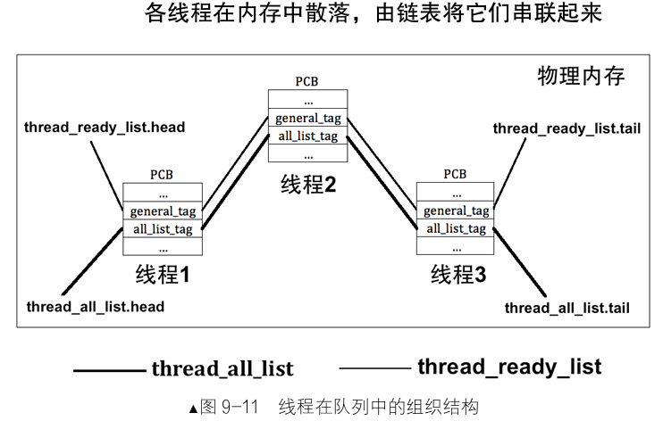

修改thread/**thread.c**，适配新的task_struct数据:

```c
#define PG_SIZE 4096  
struct task_struct* main_thread;        // 主线程 PCB  
struct list thread_ready_list;          // 就绪队列  
struct list thread_all_list;            // 所有任务队列  
static struct list_elem* thread_tag;    // 用于保存队列中的线程结点  
extern void switch_to(struct task_struct* cur, struct task_struct* next);  


/* 创建优先级为prio的线程，线程名name，线程所执行的函数是 function(func_arg) */  
struct task_struct* thread_start(char* name, \
                                 int prio, \
                                 thread_func function, \
                                 void* func_arg) {  
    /* pcb 都位于内核空间，包括用户进程的 pcb 也是在内核空间 */  
    struct task_struct* thread = get_kernel_pages(1);  
    init_thread(thread, name, prio);  
    thread_create(thread, function, func_arg);  
  
    ASSERT(!elem_find(&thread_ready_list, &thread->general_tag));  //确保之前不在队列中
    list_append(&thread_ready_list, &thread->general_tag);         //加入就绪线程队列

    ASSERT(!elem_find(&thread_all_list, &thread->all_list_tag));  //确保之前不在队列中
    list_append(&thread_all_list, &thread->all_list_tag);         //加入全部线程队列
  
    return thread;  
}  

/* 初始化线程基本信息 */  
void init_thread(struct task_struct* pthread, char* name, int prio) {  
    memset(pthread, 0, sizeof(*pthread));  
    strcpy(pthread->name, name);  
    if (pthread == main_thread) {  
        pthread->status = TASK_RUNNING;  //main线程初始化之前就是运行状态
    } else {  
        pthread->status = TASK_READY;  
    }  
    /* self_kstack 是线程自己在内核态下使用的栈顶地址 */  
    pthread->self_kstack = (uint32_t*)((uint32_t)pthread + PG_SIZE);  
    pthread->priority = prio;  
    pthread->ticks = prio;  
    pthread->elapsed_ticks = 0;  
    pthread->pgdir = NULL;  
    pthread->stack_magic = 0x19870916;        // 自定义的魔数  
} 

/* kernel_thread执行function(func_arg) */  
static void kernel_thread(thread_func* function, void* func_arg) {  
    intr_enable();                //开中断，避免后面时钟中断被屏蔽，而无法调度其他线程
    function(func_arg);  
}  


/* 获取当前线程 pcb 指针 */  
struct task_struct* running_thread() {  
    uint32_t esp;  
    asm ("mov %esp, %0" : "=g" (esp));  
    return (struct task_struct*)(esp & 0xfffff000);  //取esp整数部分，即pcb起始地址
}  

/* 将kernel中的main函数完善为主线程 */  
static void make_main_thread(void) {  
    /* 因为 main 线程早已运行，在loader.S中进入内核时的mov esp,0xc009f000,  
       就是为其预留pcb的，因此pcb地址为 0xc009e000,  
       不需要通过get_kernel_page另分配一页 */  
    main_thread = running_thread();  
    init_thread(main_thread, "main", 31);  

   /* main函数是当前线程，当前线程不在thread_ready_list中，所以只将其加在 thread_all_list中 */ 
    ASSERT(!elem_find(&thread_all_list, &main_thread->all_list_tag));  
    list_append(&thread_all_list, &main_thread->all_list_tag);  
}
```

### 9.4.2 时钟中断处理和调度的实现

多任务调度的核心是时钟中断驱动调度器。当时钟中断发生时，**时钟中断处理程序**更新线程时间片并触发调度，因此需先完善时钟中断处理逻辑。

#### 1. 完善中断处理机制

增加注册中断处理函数的接口，修改中断通用处理函数:(**interrupt.c**)

```c
/*static void general_intr_handler(uint8_t vec_nr) {
  if(vec_nr == 0x27 || vec_nr == 0x2f) {
     //IRQ7和IRQ15会产生伪中断,无需处理,0x2f是从片8259A上的最后一个IRQ引脚，保留项
     return;
  }
  put_str("int vector:0x");
  put_int(vec_nr);
  put_char('\n');
}*/

/* 通用的中断处理函数，一般用在异常出现时的处理 */  
static void general_intr_handler(uint8_t vec_nr) {  
    if (vec_nr == 0x27 || vec_nr == 0x2f) {  
        return; // IRQ7 和 IRQ15 会产生伪中断（spurious interrupt），无需处理  
    }  
    /* 将光标置为 0，从屏幕左上角清出一片打印异常信息的区域，方便阅读 */  
    set_cursor(0);  
    int cursor_pos = 0;  
    while(cursor_pos < 320) {  
        put_char(' ');  
        cursor_pos++;  
    }  

    set_cursor(0);            // 重置光标为屏幕左上角  
    put_str("!!!!!!     excetion message begin  !!!!!!!!!\n");  
    set_cursor(88);           // 从第2行第8个字符开始打印  
    put_str(intr_name[vec_nr]);  
    if (vec_nr == 14) {       // 若为Pagefault，将缺失的地址打印出来并暂停  
        int page_fault_vaddr = 0;  
        asm ("movl %cr2, %0" : "=r" (page_fault_vaddr));  
        // cr2 是存放造成page_fault的地址  
        put_str("\npage fault addr is "); 
        put_int(page_fault_vaddr);  
    }  
  
    put_str("\n!!!!!!     excetion message end    !!!!!!!!!\n");  
    // 进入中断处理程序就表示已经处在关中断情况下，不会出现调度进程的情况。故下面的死循环不会再被中断  
    while(1);  
}

...略
/* 在中断处理程序数组第vector_no个元素中注册安装中断处理程序function */
void register_handler(uint8_t vector_no, intr_handler function) {
    /* idt_table 数组中的函数是在进入中断后根据中断向量号调用的
       见kernel/kernel.S 的 call [idt_table + %1*4] */
    idt_table[vector_no] = function;
}
...略
```

#### 2. 注册时钟中断处理函数

将时钟中断处理函数注册到IDT(中断描述符表)，时钟中断处理函数功能包括为每次时钟中断减少当前线程的**ticks**，为0时进行**任务切换**。

```c
// timer.c
...略
uint32_t ticks;           // 本节加 ticks 是内核自中断开启以来总共的嘀嗒数 
...略

/* 本节加 时钟的中断处理函数 */
static void intr_timer_handler(void) {
    struct task_struct* cur_thread = running_thread();
    ASSERT(cur_thread->stack_magic == 0x19870916); // 检查栈是否溢出

    cur_thread->elapsed_ticks++;  // 记录此线程占用的 cpu 时间
    ticks++;                      // 从内核第一次处理时间中断后至今的滴哒数，内核态和用户态总和

    if (cur_thread->ticks == 0) { // 若进程时间片用完，就开始调度新的进程上 cpu
        schedule();
    } else {                      // 将当前进程的时间片-1
        cur_thread->ticks--;
    }
}

/* 初始化 PIT8253 */
void timer_init() {
    put_str("timer_init start\n");
    /* 设置 8253 的定时周期，也就是发中断的周期 */
    frequency_set(CONTRER0_PORT, \
                  COUNTER0_NO, \
                  READ_WRITE_LATCH, \
                  COUNTER_MODE, \
                  COUNTER0_VALUE);
    register_handler(0x20, intr_timer_handler); //本节加
    put_str("timer_init done\n");
}
```

#### 3. 实现调度器schedule

调度主要逻辑：

- **时间片处理**：时间片耗尽的线程重新加入就绪队列末尾，重置时间片。

- **线程选择**：采用先进先出(FIFO)策略，从就绪队列头部选取新线程。

- **状态更新**：新线程状态设为**TASK_RUNNING**，并通过**switch_to**切换上下文。

```c
// thread.c
/* 实现任务调度 */
void schedule() {
    ASSERT(intr_get_status() == INTR_OFF);
    struct task_struct* cur = running_thread();
    if (cur->status == TASK_RUNNING) {
        // 若此线程只是cpu时间片到了，将其加入到就绪队列尾
        ASSERT(!elem_find(&thread_ready_list, &cur->general_tag));
        list_append(&thread_ready_list, &cur->general_tag);
        cur->ticks = cur->priority; //ticks重置为其 priority
        cur->status = TASK_READY;
    } else {
        /* 若此线程需要某事件发生后才能继续上 cpu 运行，
           不需要将其加入队列，因为当前线程不在就绪队列中 */
    }
    ASSERT(!list_empty(&thread_ready_list));
    thread_tag = NULL;        // thread_tag 清空
    /* 将 thread_ready_list 队列中的第一个就绪线程弹出，
       准备将其调度上 cpu */
    thread_tag = list_pop(&thread_ready_list);
    struct task_struct* next = elem2entry(struct task_struct, \
                                          general_tag, \
                                          thread_tag);
    next->status = TASK_RUNNING;
    switch_to(cur, next);
}
```

### 9.4.3 任务切换函数switch_to

任务切换通过汇编函数 **switch_to**实现，其核心是保存老线程寄存器上下文、恢复新线程的寄存器上下文， **ret**指令跳转到新线程的执行地址，实现执行流切换。

此过程确保线程在切换后能从中断点继续执行，维持执行流的连续性。

下面先回顾一下**cdecl**机制，c语言遵守的是cdecl：

**cdecl约定示例**:subtract(3, 2)

- 参数从右向左入栈，返回地址入栈，调用者清理栈空间

```asm
; 主调者代码
push 2       ; 参数b入栈
push 3       ; 参数a入栈
call subtract
add esp, 8   ; 调用者清理栈

; 被调者subtract函数
subtract:
push ebp
mov ebp, esp
mov eax, [ebp+8]   ; 获取参数a
sub eax, [ebp+12]  ; 获取参数b
;函数逻辑完成后
mov esp, ebp
pop ebp
ret
```

{width=40%}

```asm
; thread/switch.s
[bits 32]
section .text
global switch_to

switch_to:
    push esi
    push edi
    push ebx
    push ebp                      ; 保存当前线程寄存器
    
    mov eax, [esp+20]             ; 获取当前线程PCB地址(参数cur)
    mov [eax], esp                ; 保存栈指针至PCB的self_kstack
    
    mov eax, [esp+24]             ; 获取新线程PCB地址(参数next)
    mov esp, [eax]                ; 加载新线程栈指针
    
    pop ebp
    pop ebx
    pop edi
    pop esi                       ; 恢复新线程寄存器
    ret                           ; 跳转到新线程执行
```

### 9.4.4 启用线程调度

在**thread.c**中创建线程机制初始化函数:

```c
// thread.c
...略
/* 初始化线程环境 */
void thread_init(void) {
    put_str("thread_init start\n");
    list_init(&thread_ready_list);
    list_init(&thread_all_list);
    /* 将当前 main 函数创建为线程 */
    make_main_thread();
    put_str("thread_init done\n");
}
...略
```

修改kernel/**init.c**,调用线程机制初始化函数：

```c
#include "print.h"
#include "interrupt.h"
#include "../device/timer.h"
#include "memory.h"
#include "thread.h"

/* 负责初始化所有模块 */
void init_all() {
    put_str("init_all\n");
    intr_init();    // 中断初始化中断
    timer_init();   // 定时器初始化     7.8加
    mem_init();     // 内存初始化       8.5.3加
    thread_init();  // 线程机制初始化   9.4.4加
}
```

创建**main.c**，验证线程调度机制的运行情况：

```c
// main.c
...略
void k_thread_a(void*);
void k_thread_b(void*);
int main(void) {
    put_str("I am kernel\n");
    init_all();

    thread_start("k_thread_a", 31, k_thread_a, "argA ");
    thread_start("k_thread_b", 8, k_thread_b, "argB ");

    intr_enable(); // 打开中断，使时钟中断起作用
    while(1) {
        put_str("Main ");
    }
    return 0;
}

/* 在线程中运行的函数 */
void k_thread_a(void* arg) {
    /* 用 void*来通用表示参数，
       被调用的函数知道自己需要什么类型的参数，自己转换再用 */
    char* para = arg;
    while(1) {
        put_str(para);
    }
}

/* 在线程中运行的函数 */
void k_thread_b(void* arg) {
    /* 用 void*来通用表示参数，
       被调用的函数知道自己需要什么类型的参数，自己转换再用 */
    char* para = arg;
    while(1) {
        put_str(para);
    }
}
```

创建kernel/**type.h**文件:

```c
#ifndef TYPE_H
#define TYPE_H

// 内核自定义 NULL
#ifndef NULL
#define NULL ((void*)0)
#endif

#endif
```

完善lib/kernel/**print.s**，原先print.s文件中的set_cursor不能由外部调用，需新建可供外部调用的set_cursor函数：

```asm
....略
global set_cursor
set_cursor:
    pushad                     ; 保存所有寄存器
    mov bx, [esp + 36]         ; cdecl: 参数 = pushad(32B) + ret_addr(4B) = 36
    
    ; --- 更新光标位置（与 .set_cursor 局部标签代码完全一致）---
    mov dx, 0x3D4
    mov al, 0x0E
    out dx, al
    mov dx, 0x3D5
    mov al, bh
    out dx, al

    mov dx, 0x3D4
    mov al, 0x0F
    out dx, al
    mov dx, 0x3D5
    mov al, bl
    out dx, al
    ; ---------------------------------------------------------
    popad
    ret                        ; cdecl: 调用者清理栈
```

完善lib/kernel/**print.h**：

```c
#ifndef __LIB_KERNEL_PRINT_H
#define __LIB_KERNEL_PRINT_H
#include "stdint.h"
void put_char(uint8_t char_asci);
void put_str(char* message);
void put_int(uint32_t num);  //以十六进制打印
void set_cursor(uint32_t pos);
#endif
```

**makefile**：

```shell
BUILD_DIR = ./build
ENTRY_POINT = 0xc0001500
AS = nasm
CC = gcc
LD = ld
LIB = -I lib/ -I lib/kernel/ -I lib/user/ -I kernel/ -I device/ -I thread/
ASFLAGS = -f elf
CFLAGS = -std=gnu11 -m32 $(LIB) -c -fno-builtin -fno-stack-protector -W -Wstrict-prototypes \
	-Wmissing-prototypes  
LDFLAGS = -m elf_i386 -Ttext $(ENTRY_POINT) -e main -Map $(BUILD_DIR)/kernel.map
OBJS = $(BUILD_DIR)/main.o $(BUILD_DIR)/init.o $(BUILD_DIR)/interrupt.o \
	$(BUILD_DIR)/timer.o $(BUILD_DIR)/kernel.o $(BUILD_DIR)/print.o \
	$(BUILD_DIR)/debug.o $(BUILD_DIR)/string.o $(BUILD_DIR)/bitmap.o            $(BUILD_DIR)/memory.o $(BUILD_DIR)/thread.o $(BUILD_DIR)/list.o $(BUILD_DIR)/switch.o 
  

#############  c代码编译   #############
$(BUILD_DIR)/main.o: kernel/main.c lib/kernel/print.h \
	kernel/stdint.h kernel/init.h
	$(CC) $(CFLAGS) $< -o $@

$(BUILD_DIR)/init.o: kernel/init.c kernel/init.h lib/kernel/print.h \
	kernel/stdint.h kernel/interrupt.h device/timer.h
	$(CC) $(CFLAGS) $< -o $@

$(BUILD_DIR)/interrupt.o: kernel/interrupt.c kernel/interrupt.h \
	kernel/stdint.h kernel/global.h lib/kernel/io.h lib/kernel/print.h
	$(CC) $(CFLAGS) $< -o $@ 

$(BUILD_DIR)/timer.o: device/timer.c device/timer.h kernel/stdint.h\
	lib/kernel/io.h lib/kernel/print.h
	$(CC) $(CFLAGS) $< -o $@

$(BUILD_DIR)/debug.o: kernel/debug.c kernel/debug.h \
	lib/kernel/print.h kernel/stdint.h kernel/interrupt.h
	$(CC) $(CFLAGS) $< -o $@
	
$(BUILD_DIR)/string.o: lib/string.c lib/string.h \
	kernel/global.h  kernel/debug.h
	$(CC) $(CFLAGS) $< -o $@
	
$(BUILD_DIR)/bitmap.o: lib/kernel/bitmap.c lib/kernel/bitmap.h \
	kernel/stdint.h  lib/string.h lib/kernel/print.h kernel/interrupt.h kernel/debug.h
	$(CC) $(CFLAGS) $< -o $@
	
$(BUILD_DIR)/memory.o: kernel/memory.c kernel/memory.h \
	kernel/stdint.h lib/kernel/print.h lib/kernel/bitmap.h  lib/string.h  kernel/debug.h
	$(CC) $(CFLAGS) $< -o $@
  
$(BUILD_DIR)/thread.o: thread/thread.c thread/thread.h \
	kernel/stdint.h  lib/string.h  kernel/global.h  kernel/memory.h
	$(CC) $(CFLAGS) $< -o $@
	
$(BUILD_DIR)/list.o: lib/kernel/list.c lib/kernel/list.h \
	kernel/global.h kernel/interrupt.h
	$(CC) $(CFLAGS) $< -o $@

#############    汇编代码编译    #############
$(BUILD_DIR)/kernel.o: kernel/kernel.s
	$(AS) $(ASFLAGS) $< -o $@

$(BUILD_DIR)/print.o: lib/kernel/print.s
	$(AS) $(ASFLAGS) $< -o $@
	
$(BUILD_DIR)/switch.o: thread/switch.s
	$(AS) $(ASFLAGS) $< -o $@

#############   链接所有目标文件   #############
$(BUILD_DIR)/kernel.bin: $(OBJS)
	$(LD) $(LDFLAGS) $^ -o $@

.PHONY : mk_dir hd clean all

mk_dir:
	if [ ! -d ./build ]; then mkdir ./build; fi

hd:
	dd if=$(BUILD_DIR)/kernel.bin of=hd60M.img bs=512 count=200 seek=9 conv=notrunc
  
clean:
	cd $(BUILD_DIR) && rm -f ./*

build: $(BUILD_DIR)/kernel.bin

all: mk_dir build hd
```

**调度效果：**

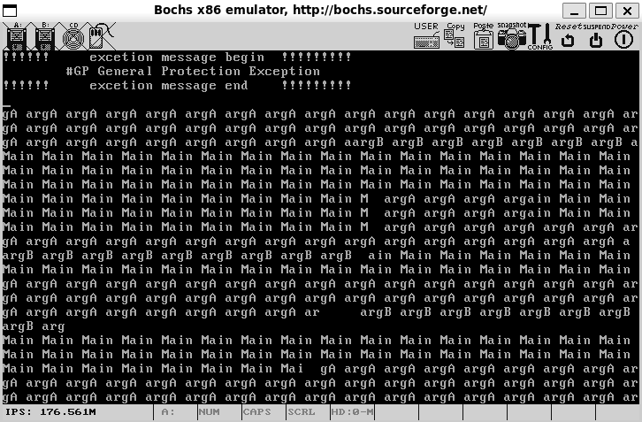

- 线程按时间片轮转执行，输出内容交替出现。

- 高优先级线程(如优先级31)获得更多时间片，输出频率更高。


### 9.4.5 一般保护性异常的调试

线程调度可能引发异常，需通过调试定位问题。一般保护性异常（GP）常由内存越界访问导致：**调试过程分析：**

```asm
#获取thread_start地址
nm build/kernel.bin | grep thread_start

#获取异常指令地址
lb 0xc0002f72
c
info b
d 1
info b
show extint
c

#定位异常指令
sba 27041520
c
r
```

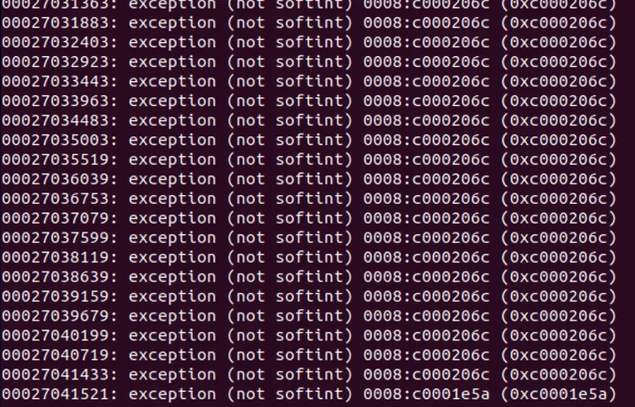

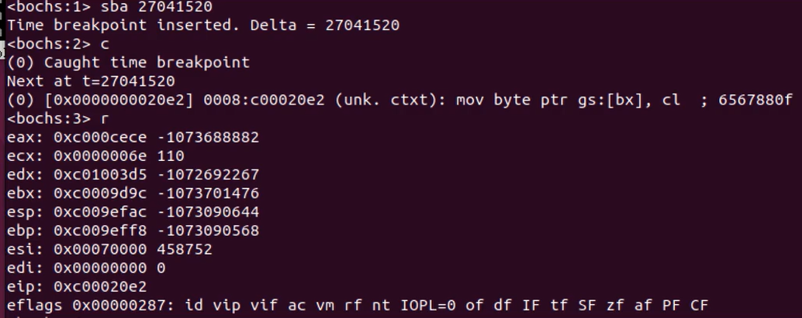

1. **异常定位**：通过bochs调试器命令捕获异常发生点。

```asm
mov byte ptr gs:[bx], cl  ;若bx超过显存段界限，触发GP异常
```

2. **原因分析**：寄存器 `bx`的值超越显存段界限（0x7FFF），导致内存访问违规。

## 本章要点总结

1. **线程基本概念**：线程是进程内的独立执行流，共享进程资源，提供细粒度并发。
2. **PCB核心作用**：线程控制块保存线程上下文信息，是线程调度的基础数据结构。
3. **双栈结构设计**：中断栈用于保护中断上下文，线程栈用于任务切换和函数执行。
4. **队列管理机制**：通过双向链表实现就绪队列和全局队列，支持高效的线程调度。
5. **优先级调度**：    基于优先级的时间片分配机制，确保高优先级线程获得更多执行时间。
6. **上下文切换**：    通过汇编代码实现寄存器保存与恢复，完成线程间的无缝切换。
7. **中断驱动调度**：时钟中断定期触发调度器，实现多线程的轮转执行。
8. **线程安全操作**：链表操作通过关中断保证原子性，防止并发访问冲突。

通过本章的实现，我们建立了完整的内核级线程机制，为操作系统的多任务处理能力奠定了坚实基础。后续章节将在此基础上进一步完善同步机制和进程管理功能。

## 本章依赖源码

```c
bochsrc.disk       1.4
mbr.s              4.3.5
boot.inc           5.3.5
loader.s           5.3.5
print.s print.h    第6章源码附件
  
io.h global.h stdint.h  init.h       7.6.1
kernel.s                             7.6.2
interrupt.c interrupt.h              第8章完整附件
timer.c  timer.h                     7.8
debub.h  debug.c                     8.2.2
string.h string.c                    8.3
bitmap.h bitmap.c                    8.4.2
stdbool.h                            8.4.2
memory.h  memory.c                   8.5.2
init.c                               8.5.3
```

## 本章源码附件

###9.4对应的thread/thread.h

```c
#ifndef __THREAD_THREAD_H
#define __THREAD_THREAD_H
#include "stdint.h"
#include "list.h"


/* 自定义通用函数类型，它将在很多线程函数中作为形参类型 */
typedef void thread_func(void*);

/* 进程或线程的状态 */
enum task_status {
    TASK_RUNNING,
    TASK_READY,
    TASK_BLOCKED,
    TASK_WAITING,
    TASK_HANGING,
    TASK_DIED
};

/************** 中断栈 intr_stack **************
 * 此结构用于中断发生时保护程序（线程或进程）的上下文环境：
 * 进程或线程被外部中断或软中断打断时，会按照此结构压入上下文
 * 寄存器，intr_exit 中的出栈操作是此结构的逆操作
 * 此栈在线程自己的内核栈中位置固定，所在页的最顶端
 **********************************************/
struct intr_stack {
    uint32_t vec_no;           // kernel.S 宏 VECTOR 中 push %1 压入的中断号
    uint32_t edi;
    uint32_t esi;
    uint32_t ebp;
    uint32_t esp_dummy;       //// pushad把esp也压入，但 sp不断变化，所以会被popad忽略
    uint32_t ebx;
    uint32_t edx;
    uint32_t ecx;
    uint32_t eax;
    uint32_t gs;
    uint32_t fs;
    uint32_t es;
    uint32_t ds;
    /* 以下由 cpu 从低特权级进入高特权级时压入 */
    uint32_t err_code;         // err_code 会被压入在 eip 之后
    void (*eip)(void);
    uint32_t cs;
    uint32_t eflags;
    void* esp;
    uint32_t ss;
};

/************** 线程栈 thread_stack **************
 * 线程自己的栈，用于存储线程中待执行的函数
 * 此结构在线程自己的内核栈中位置不固定，
 * 仅用在 switch_to 时保存线程环境。
 * 实际位置取决于实际运行情况。
 *************************************************/
struct thread_stack {
    uint32_t ebp;
    uint32_t ebx;
    uint32_t edi;
    uint32_t esi;
    /* 线程第一次执行时，eip 指向待调用的函数kernel_thread,其他时候，eip指向switch_to的返回地址*/
    void (*eip)(thread_func* func, void* func_arg);
    /**** 以下仅供第一次被调度上 cpu 时使用 ****/
    /* 参数 unused_ret 只为占位置充数为返回地址 */
    void (*unused_retaddr);
    thread_func* function;      // 由 kernel_thread 所调用的函数名
    void* func_arg;             // 由 kernel_thread 所调用的函数所需的参数
};

struct task_struct {
    uint32_t* self_kstack;        // 线程内核栈指针
    enum task_status status;      // 线程状态（运行、就绪等）
    char name[16];                // 线程名称
    uint8_t priority;             // 优先级，决定时间片长度
    uint8_t ticks;                // 时间片计数器
    uint32_t elapsed_ticks;       // 线程总运行时间
    struct list_elem general_tag;  // 就绪队列节点
    struct list_elem all_list_tag; // 全部线程队列节点
    uint32_t* pgdir;              // 页目录指针（线程为NULL）
    uint32_t stack_magic;         // 栈边界标记
};

struct task_struct* thread_start(char* name, int prio, thread_func function, void* func_arg);
void init_thread(struct task_struct* pthread, char* name, int prio);
void thread_create(struct task_struct* pthread, thread_func function, void* func_arg);
static void kernel_thread(thread_func* function, void* func_arg);
struct task_struct* running_thread(void);
static void make_main_thread(void);
struct task_struct* thread_start(char* name, int prio, thread_func function, void* func_arg);
void schedule(void);
void thread_init(void);
#endif
```

### 9.4对应的thread/thread.c

```c
#include "thread.h"
#include "stdint.h"
#include "string.h"
#include "global.h"
#include "memory.h"
#include "type.h" 
#include "interrupt.h"
#include "debug.h"
#include "print.h"

#define PG_SIZE 4096  

struct task_struct* main_thread;        // 主线程 PCB  
struct list thread_ready_list;          // 就绪队列  
struct list thread_all_list;            // 所有任务队列  
static struct list_elem* thread_tag;    // 用于保存队列中的线程结点  
extern void switch_to(struct task_struct* cur, struct task_struct* next);  

/* 获取当前线程 pcb 指针 */  
struct task_struct* running_thread(void) {  
    uint32_t esp;  
    asm("mov %%esp, %0" : "=g" (esp));  
    /* 取 esp 整数部分，即 pcb 起始地址 */  
    return (struct task_struct*)(esp & 0xfffff000);  
}  

/* 创建优先级为prio的线程，线程名name，线程所执行的函数是 function(func_arg) */  
struct task_struct* thread_start(char* name, \
                                 int prio, \
                                 thread_func function, \
                                 void* func_arg) {  
    /* pcb 都位于内核空间，包括用户进程的 pcb 也是在内核空间 */  
    struct task_struct* thread = get_kernel_pages(1);  
    init_thread(thread, name, prio);  
    thread_create(thread, function, func_arg);  
  
    ASSERT(!elem_find(&thread_ready_list, &thread->general_tag));  //确保之前不在队列中
    list_append(&thread_ready_list, &thread->general_tag);         //加入就绪线程队列

    ASSERT(!elem_find(&thread_all_list, &thread->all_list_tag));  //确保之前不在队列中
    list_append(&thread_all_list, &thread->all_list_tag);         //加入全部线程队列
  
    return thread;  
}  

/* 将 kernel 中的 main 函数完善为主线程 */  
static void make_main_thread(void) {  
    /* 因为 main 线程早已运行，  
       * 咱们在 loader.S 中进入内核时的 mov esp,0xc009f000,  
       * 就是为其预留 pcb 的，因此 pcb 地址为 0xc009e000,  
       * 不需要通过 get_kernel_page 另分配一页*/  
    main_thread = running_thread();  
    init_thread(main_thread, "main", 31);  

    /* main 函数是当前线程，当前线程不在 thread_ready_list 中，  
       * 所以只将其加在 thread_all_list 中 */  
    ASSERT(!elem_find(&thread_all_list, &main_thread->all_list_tag));  
    list_append(&thread_all_list, &main_thread->all_list_tag);  
}

/* 初始化线程基本信息 */  
void init_thread(struct task_struct* pthread, char* name, int prio) {  
    memset(pthread, 0, sizeof(*pthread));  
    strcpy(pthread->name, name);  

    if (pthread == main_thread) {  
        /* 由于把 main 函数也封装成一个线程，将其直接设为 TASK_RUNNING */  
        pthread->status = TASK_RUNNING;  
    } else {  
        pthread->status = TASK_READY;  
    }  
    /* self_kstack 是线程自己在内核态下使用的栈顶地址 */  
    pthread->self_kstack = (uint32_t*)((uint32_t)pthread + PG_SIZE);  
    pthread->priority = prio;  
    pthread->ticks = prio;  
    pthread->elapsed_ticks = 0;  
    pthread->pgdir = NULL;  
    pthread->stack_magic = 0x19870916;        // 自定义的魔数  
}  

void thread_init(void) {
    put_str("thread_init start\n");
    list_init(&thread_ready_list);
    list_init(&thread_all_list);
    /* 将当前 main 函数创建为线程 */
    make_main_thread();
    put_str("thread_init done\n");
}


/* 初始化线程栈，将待执行的函数和参数放到thread_stack 中相应的位置*/
void thread_create(struct task_struct* pthread, thread_func function, void* func_arg) {
    /* 先预留中断使用栈的空间 */
    pthread->self_kstack -= sizeof(struct intr_stack);
    /* 再留出线程栈空间，可见 thread.h 中定义 */
    pthread->self_kstack -= sizeof(struct thread_stack);
    struct thread_stack* kthread_stack = (struct thread_stack*)pthread->self_kstack;
    kthread_stack->eip = kernel_thread;
    kthread_stack->function = function;
    kthread_stack->func_arg = func_arg;
    kthread_stack->ebp = kthread_stack->ebx = \
    kthread_stack->esi = kthread_stack->edi = 0;
}
/* 由 kernel_thread 去执行 function(func_arg) */  
static void kernel_thread(thread_func* function, void* func_arg) {  
    /* 执行 function 前要开中断，  
       避免后面的时钟中断被屏蔽，而无法调度其他线程 */  
    intr_enable();  
    function(func_arg);  
}  

/* 实现任务调度 */
void schedule(void) {
    ASSERT(intr_get_status() == INTR_OFF);
    struct task_struct* cur = running_thread();
    if (cur->status == TASK_RUNNING) {
        // 若此线程只是 cpu 时间片到了，将其加入到就绪队列尾
        ASSERT(!elem_find(&thread_ready_list, &cur->general_tag));
        list_append(&thread_ready_list, &cur->general_tag);
        cur->ticks = cur->priority;
        // 重新将当前线程的 ticks 再重置为其 priority
        cur->status = TASK_READY;
    } else {
        /* 若此线程需要某事件发生后才能继续上 cpu 运行，
           不需要将其加入队列，因为当前线程不在就绪队列中 */
    }
    ASSERT(!list_empty(&thread_ready_list));
    thread_tag = NULL;        // thread_tag 清空
    /* 将 thread_ready_list 队列中的第一个就绪线程弹出，
       准备将其调度上 cpu */
    thread_tag = list_pop(&thread_ready_list);
    struct task_struct* next = elem2entry(struct task_struct, \
                                          general_tag, \
                                          thread_tag);
    next->status = TASK_RUNNING;
    switch_to(cur, next);
}
```

### 9.4对应的lib/kernel/print.h

```c
#ifndef __LIB_KERNEL_PRINT_H
#define __LIB_KERNEL_PRINT_H
#include "stdint.h"
void put_char(uint8_t char_asci);
void put_str(char* message);
void put_int(uint32_t num);  //以十六进制打印
void set_cursor(uint32_t pos);
#endif
```


###9.4对应的lib/kernel/print.s

```asm
TI_GDT equ 0
RPL0 equ 0
SELECTOR_VIDEO equ (0x0003<<3)+TI_GDT+RPL0

[bits 32]
section .text
global put_char

put_char:
    pushad                     ; 备份寄存器
    mov ax, SELECTOR_VIDEO     ; 设置视频段选择子
    mov gs, ax

    ; 获取光标位置（高8位）
    mov dx, 0x3D4
    mov al, 0x0E
    out dx, al
    mov dx, 0x3D5
    in al, dx
    mov ah, al

    ; 获取光标位置（低8位）
    mov dx, 0x3D4
    mov al, 0x0F
    out dx, al
    mov dx, 0x3D5
    in al, dx

    ; 光标值存入bx
    mov bx, ax
    mov ecx, [esp+36]          ; 获取传入的字符

    ; 判断字符类型
    cmp cl, 0x0D               ; 回车符
    jz .carriage_return
    cmp cl, 0x0A               ; 换行符
    jz .line_feed
    cmp cl, 0x08               ; 退格符
    jz .backspace
    
    jmp .printable

;退格
.backspace:
    dec bx                     ; 光标前移
    shl bx, 1                  ; 转换为显存偏移
    mov byte [gs:bx], 0x20     ; 写入空格
    inc bx
    mov byte [gs:bx], 0x07     ; 属性字节
    shr bx, 1
    jmp .set_cursor

;打印可见字符
.printable:
    shl bx, 1
    mov [gs:bx], cl            ; 写入字符
    inc bx
    mov byte [gs:bx], 0x07     ; 属性字节
    shr bx, 1
    inc bx                     ; 光标后移
    cmp bx, 2000               ; 是否需滚屏
    jl .set_cursor

;回车换行处理
.line_feed:
.carriage_return:
    ; 处理换行/回车：光标移到下一行首
    xor dx, dx
    mov ax, bx
    mov si, 80
    div si                     ; bx/80，商在ax，余数在dx
    sub bx, dx                 ; 回车：回到行首
    add bx, 80                 ; 换行：移到下一行
    cmp bx, 2000
    jl .set_cursor

;滚屏处理
.roll_screen:
    ; 滚屏：第1-24行内容上移，清空最后一行
    cld
    mov ecx, 960               ; 3840字节/4字节
    mov edi, 0xC00B8000        ; 第1行起始
    mov esi, 0xC00B80A0        ; 第2行起始
    rep movsd                  ; 复制内存
;滚屏时最后一行空白处理
    mov ebx, 3840              ; 最后一行起始偏移
    mov ecx, 80
.clear_line:
    mov word [gs:ebx], 0x0720  ; 黑底白字空格
    add ebx, 2
    loop .clear_line
    mov bx, 1920               ; 光标置最后一行首

;更新光标位置
.set_cursor:
    ; 更新光标位置寄存器
    mov dx, 0x3D4
    mov al, 0x0E
    out dx, al
    
    mov dx, 0x3D5
    mov al, bh
    out dx, al                 ; 写入高8位

    mov dx, 0x3D4
    mov al, 0x0F
    out dx, al
    
    mov dx, 0x3D5
    mov al, bl
    out dx, al                 ; 写入低8位

    popad                      ; 恢复寄存器
    ret
    
    
  
[bits 32]
section .text
global put_str
put_str:
    push ebx
    push ecx
    xor ecx, ecx
    mov ebx, [esp+12]          ; 获取字符串地址

.next_char:
    mov cl, [ebx]
    cmp cl, 0                   ; 遇到\0结束
    jz .done
    push ecx                    ; 参数入栈
    call put_char
    add esp, 4                  ; 清理栈
    inc ebx                     ; 下一个字符
    jmp .next_char

.done:
    pop ecx
    pop ebx
    ret


section .data
    put_int_buffer dq 0         ; 8字节缓冲区

section .text
global put_int

put_int:
    ; 保存所有寄存器
    pushad
    mov ebp, esp
    
    ; 获取参数（跳过8个pushad的寄存器和返回地址）
    mov eax, [ebp + 4 * 9]
    
    ; 初始化
    mov edx, eax                  ; 保存原始值
    mov edi, 7                    ; 缓冲区偏移，从高位开始
    mov ecx, 8                    ; 8个十六进制数字
    mov ebx, put_int_buffer      ; 缓冲区地址
    
    ; 将缓冲区清零
    mov dword [ebx], 0
    mov dword [ebx+4], 0
    
; 转换循环：将32位整数转为十六进制字符
.convert_loop:
    and edx, 0x0000000F          ; 取最低4位
    cmp edx, 9
    jg .hex_letter               ; 如果大于9，转为字母
    
    ; 数字0-9
    add edx, '0'                 ; 转为'0'-'9'
    jmp .store
    
.hex_letter:
    ; 字母A-F
    sub edx, 10
    add edx, 'A'                 ; 转为'A'-'F'
    
.store:
    ; 将字符存入缓冲区
    mov [ebx + edi], dl
    dec edi                     ; 移到下一个位置
    shr eax, 4                 ; 右移4位，处理下一个十六进制数字
    mov edx, eax
    loop .convert_loop
    
; edi=-1 从头开始扫描 跳过高位零
    inc edi
    cmp edi, 8
    je .full_zero               ; 如果全零，跳转到全零处理
    
.skip_zeros:
    ; 查找第一个非零字符
    mov cl, [ebx + edi]
    cmp cl, '0'
    jne .print                  ; 找到非零字符，开始打印
    inc edi
    cmp edi, 8
    jl .skip_zeros              ; 继续查找
    
    ; 如果到这里，说明全是零
    jmp .full_zero
    
.full_zero:
    ; 处理全零情况：输出单个'0'
    push dword '0'              ; 压入字符'0'
    call put_char               ; 调用put_char输出
    add esp, 4                  ; 清理栈
    jmp .end_function           ; 跳转到函数结束
    
.print:
    ; 输出十六进制字符串
.print_loop:
    movzx ecx, byte [ebx + edi] ; 获取字符（零扩展）
    push ecx                    ; 压入参数
    call put_char               ; 调用put_char输出字符
    add esp, 4                  ; 清理栈
    
    inc edi                     ; 移到下一个字符
    cmp edi, 8
    jl .print_loop              ; 继续输出直到8个字符都处理完
    
.end_function:
    ; 恢复所有寄存器
    popad
    ret

global set_cursor
set_cursor:
    pushad                     ; 保存所有寄存器
    mov bx, [esp + 36]         ; cdecl: 参数 = pushad(32B) + ret_addr(4B) = 36
    
    ; --- 更新光标位置（与 .set_cursor 局部标签代码完全一致）---
    mov dx, 0x3D4
    mov al, 0x0E
    out dx, al
    mov dx, 0x3D5
    mov al, bh
    out dx, al

    mov dx, 0x3D4
    mov al, 0x0F
    out dx, al
    mov dx, 0x3D5
    mov al, bl
    out dx, al
    ; ---------------------------------------------------------
    popad
    ret                        ; cdecl: 调用者清理栈
```

### 9.4对应的kernel/interrupt.h

```asm
#ifndef __KERNEL_INTERRUPT_H
#define __KERNEL_INTERRUPT_H

#include "stdint.h"

// 修改为接受一个uint8_t参数
typedef void (*intr_handler)(uint8_t vec_nr);
void intr_init(void);

/* 定义中断的两种状态 */
enum intr_status {
    INTR_OFF,    // 中断关闭
    INTR_ON      // 中断打开
};
enum intr_status intr_get_status(void);
enum intr_status intr_set_status(enum intr_status);
enum intr_status intr_enable(void);
enum intr_status intr_disable(void);
void register_handler(uint8_t vector_no, intr_handler function);

#endif
```

### 9.4对应的kernel/interrupt.c

```c
#include "global.h" 
#include "stdint.h" 
#include "io.h"
#include "print.h"
#include "interrupt.h"

#define IDT_DESC_CNT 0x21         // 目前总共支持的中断数

/* 主片和从片的端口定义 */
#define PIC_M_CTRL 0x20           // 主片的控制端口是0x20
#define PIC_M_DATA 0x21           // 主片的数据端口是0x21
#define PIC_S_CTRL 0xa0           // 从片的控制端口是0xa0
#define PIC_S_DATA 0xa1           // 从片的数据端口是0xa1

/* 定义eflags寄存器中的IF位 */
#define EFLAGS_IF 0x00000200

/* 获取eflags寄存器值 */
//#define GET_EFLAGS(EFLAG_VAR) asm volatile("pushfl;popl %0":"=r"(EFLAG_VAR))

/* 中断门描述符结构体 */
struct gate_desc {
    uint16_t   func_offset_low_word;   // 中断处理程序在目标代码段内的偏移量低16位
    uint16_t   selector;               // 中断处理程序目标代码段选择子
    uint8_t    dcount;                 // 双字计数字段，固定值
    uint8_t    attribute;              // 门描述符属性
    uint16_t   func_offset_high_word;  // 中断处理程序在目标代码段内的偏移量高16位
};

/* 静态函数声明 */
static void make_idt_desc(struct gate_desc* p_gdesc, uint8_t attr, intr_handler function);
static void idt_desc_init(void);
static void pic_init(void);


/* 全局变量声明 */
static struct gate_desc idt[IDT_DESC_CNT];   // idt是中断描述符表，本质上是中断门描述符数组
extern intr_handler intr_entry_table[IDT_DESC_CNT];  //声明引用kernel.s的中断处理函数入口数组

char* intr_name[IDT_DESC_CNT];          //用于保存异常的名字
intr_handler idt_table[IDT_DESC_CNT];   //定义中断处理程序数组,最终调用的是ide_table中的程序


/* 通用的中断处理函数，一般用在异常出现时的处理 */  
static void general_intr_handler(uint8_t vec_nr) {  
    if (vec_nr == 0x27 || vec_nr == 0x2f) {  
        return; // IRQ7 和 IRQ15 会产生伪中断（spurious interrupt），无需处理  
    }  
    /* 将光标置为 0，从屏幕左上角清出一片打印异常信息的区域，方便阅读 */  
    set_cursor(0);  
    int cursor_pos = 0;  
    while(cursor_pos < 320) {  
        put_char(' ');  
        cursor_pos++;  
    }  

    set_cursor(0);            // 重置光标为屏幕左上角  
    put_str("!!!!!!     excetion message begin  !!!!!!!!!\n");  
    set_cursor(88);           // 从第2行第8个字符开始打印  
    put_str(intr_name[vec_nr]);  
    if (vec_nr == 14) {       // 若为Pagefault，将缺失的地址打印出来并暂停  
        int page_fault_vaddr = 0;  
        asm volatile ("movl %%cr2, %0" : "=r" (page_fault_vaddr));
        // cr2 是存放造成 page_fault 的地址  
        put_str("\npage fault addr is "); 
        put_int(page_fault_vaddr);  
    }  
  
    put_str("\n!!!!!!     excetion message end    !!!!!!!!!\n");  
    // 进入中断处理程序就表示已经处在关中断情况下，不会出现调度进程的情况。故下面的死循环不会再被中断  
    while(1);  
}


/* 注册通用中断处理函数及异常名称 */
static void exception_init(void) {
    int i;
    for (i=0;i<IDT_DESC_CNT;i++) {
        idt_table[i] = general_intr_handler;// 默认为 general_intr_handler
        intr_name[i] = "unknown"; // 先统一赋值为 unknown
    }
    intr_name[0] = "#DE Divide Error";
    intr_name[1] = "#DB Debug Exception";
    intr_name[2] = "NMI Interrupt";
    intr_name[3] = "#BP Breakpoint Exception";
    intr_name[4] = "#OF Overflow Exception";
    intr_name[5] = "#BR BOUND Range Exceeded Exception";
    intr_name[6] = "#UD Invalid Opcode Exception";
    intr_name[7] = "#NM Device Not Available Exception";
    intr_name[8] = "#DF Double Fault Exception";
    intr_name[9] = "Coprocessor Segment Overrun";
    intr_name[10] = "#TS Invalid TSS Exception";
    intr_name[11] = "#NP Segment Not Present";
    intr_name[12] = "#SS Stack Fault Exception";
    intr_name[13] = "#GP General Protection Exception";
    intr_name[14] = "#PF Page-Fault Exception";
    // intr_name[15] 第15项是intel保留项，未使用
    intr_name[16] = "#MF x87 FPU Floating-Point Error";
    intr_name[17] = "#AC Alignment Check Exception";
    intr_name[18] = "#MC Machine-Check Exception";
    intr_name[19] = "#XF SIMD Floating-Point Exception";
}

/* 完成有关中断的所有初始化工作 - 主函数（调用者） */
void intr_init() {
    put_str("idt_init start\n");
    idt_desc_init();  // 初始化中断描述符表
    exception_init();  //异常名初始化并注册通常的中断处理函数
    pic_init();       // 初始化8259A
    
    /* 加载idt */
    uint64_t idt_operand = ((sizeof(idt) - 1) | ((uint64_t)((uint32_t)idt) << 16));
    asm volatile("lidt %0" : : "m"(idt_operand));
    put_str("idt_init done\n");
}

/* 初始化中断描述符表 - 被idt_init调用 */
static void idt_desc_init(void) {
    int i;
    for (i = 0; i < IDT_DESC_CNT; i++) {
        make_idt_desc(&idt[i], IDT_DESC_ATTR_DPL0, intr_entry_table[i]);
    }
    put_str("idt_desc_init done\n");
}

/* 创建中断门描述符 - 被idt_desc_init调用 */
static void make_idt_desc(struct gate_desc* p_gdesc, uint8_t attr, intr_handler function) {
    p_gdesc->func_offset_low_word = (uint32_t)function & 0x0000FFFF;
    p_gdesc->selector = SELECTOR_K_CODE;  // 修正：应该是SELECTOR_K_CODE
    p_gdesc->dcount = 0;                  // 固定值
    p_gdesc->attribute = attr;            // 门描述符属性
    p_gdesc->func_offset_high_word = ((uint32_t)function & 0xFFFF0000) >> 16;
}


/* 初始化可编程中断控制器 8259A - 被idt_init调用 */
static void pic_init(void) {
    /* 初始化主片 */
    outb(PIC_M_CTRL, 0x11);  // ICW1: 边沿触发, 级联8259, 需要ICW4
    outb(PIC_M_DATA, 0x20);  // ICW2: 起始中断向量号为0x20 (IR[0-7]为0x20~0x27)
    outb(PIC_M_DATA, 0x04);  // ICW3: IR2接从片
    outb(PIC_M_DATA, 0x01);  // ICW4: 8086模式, 正常EOI
    
    /* 初始化从片 */
    outb(PIC_S_CTRL, 0x11);  // ICW1: 边沿触发, 级联8259, 需要ICW4
    outb(PIC_S_DATA, 0x28);  // ICW2: 起始中断向量号为0x28 (IR[8-15]为0x28~0x2F)
    outb(PIC_S_DATA, 0x02);  // ICW3: 设置从片连接到主片的IR2引脚
    outb(PIC_S_DATA, 0x01);  // ICW4: 8086模式, 正常EOI
    
    /* 打开主片上IR0, 也就是目前只接受时钟产生的中断 */
    outb(PIC_M_DATA, 0xfe);  // 主片屏蔽字: 只开放IR0(时钟中断)
    outb(PIC_S_DATA, 0xff);  // 从片屏蔽字: 屏蔽所有中断
    
    put_str("pic_init done\n");
}

// 在interrupt.c中替换相关函数

/* 获取当前中断状态 */
enum intr_status intr_get_status(void) {
    uint32_t eflags;
    asm volatile ("pushfl; popl %0" : "=r"(eflags));
    return (eflags & EFLAGS_IF) ? INTR_ON : INTR_OFF;
}

/* 关中断并返回之前中断状态 */
enum intr_status intr_disable(void) {
    uint32_t eflags;
    asm volatile ("pushfl; popl %0; cli" : "=r"(eflags) : : "memory");
    return (eflags & EFLAGS_IF) ? INTR_ON : INTR_OFF;
}

/* 开中断并返回之前中断状态 */
enum intr_status intr_enable(void) {
    // 直接使用sti，不检查当前状态
    uint32_t eflags;
    asm volatile ("pushfl; popl %0; sti" : "=r"(eflags) : : "memory");
    return (eflags & EFLAGS_IF) ? INTR_ON : INTR_OFF;
}

/* 设置中断状态 */
enum intr_status intr_set_status(enum intr_status status) {
    return (status == INTR_ON) ? intr_enable() : intr_disable();
}

/* 在中断处理程序数组第 vector_no 个元素中
   注册安装中断处理程序 function */
void register_handler(uint8_t vector_no, intr_handler function) {
    /* idt_table 数组中的函数是在进入中断后根据中断向量号调用的
       * 见 kernel/kernel.S 的 call [idt_table + %1*4] */
    idt_table[vector_no] = function;
}
```

### 9.4对应的device/timer.c

```c
#include "timer.h"
#include "io.h"
#include "print.h"
#include "thread.h"  
#include "interrupt.h" 
#include "debug.h" 


#define PIT_CONTROL_PORT 0x43       //控制字寄存器端口


#define CONTRER0_PORT 0x40          //计数器0端口
#define COUNTER0_NO  0              //00  表选控制计数器0
#define READ_WRITE_LATCH 3          //11  先读写低字节 再读写高字节
#define COUNTER_MODE 2              //010 工作方式2


#define IRQ0_FREQUENCY 100
#define INPUT_FREQUENCY 1193180
#define COUNTER0_VALUE INPUT_FREQUENCY / IRQ0_FREQUENCY

uint32_t ticks;           // ticks 是内核自中断开启以来总共的嘀嗒数

/* 设置控制寄存器、初始化计数器0的初始值 */
static void frequency_set (uint8_t counter_port, uint8_t counter_no, uint8_t rw1,uint8_t counter_mode, uint16_t counter_value) {
  
  outb(PIT_CONTROL_PORT, (uint8_t)(counter_no << 6 | rw1 << 4 | counter_mode << 1));
  outb (counter_port, (uint8_t)counter_value);     //先写入counter_value的低8位
  outb (counter_port, (uint8_t)counter_value >> 8);//再写入counter_value的高8位
}

/* 时钟的中断处理函数 */
static void intr_timer_handler(uint8_t vector_no) {
    struct task_struct* cur_thread = running_thread();
    ASSERT(cur_thread->stack_magic == 0x19870916); // 检查栈是否溢出
    cur_thread->elapsed_ticks++;  // 记录此线程占用的 cpu 时间
    ticks++;                      // 从内核第一次处理时间中断后至今的滴哒数，内核态和用户态总合

    if (cur_thread->ticks == 0) { // 若进程时间片用完，就开始调度新的进程上 cpu
        schedule();
    } else {                      // 将当前进程的时间片-1
        cur_thread->ticks--;
    }
}

/* 初始化 PIT8253 */
void timer_init() {
    put_str("timer_init start\n");
    /* 设置 8253 的定时周期，也就是发中断的周期 */
    frequency_set(CONTRER0_PORT, \
                  COUNTER0_NO, \
                  READ_WRITE_LATCH, \
                  COUNTER_MODE, \
                  COUNTER0_VALUE);
    register_handler(0x20, intr_timer_handler);
    put_str("timer_init done\n");
}
```

### 9.4对应的kernel/main.c

```c
#include "print.h"
#include "init.h"
#include "memory.h"
#include "thread.h"
#include "interrupt.h"


void k_thread_a(void*);
void k_thread_b(void*);
int main(void) {
    put_str("I am kernel\n");
    init_all();

    thread_start("k_thread_a", 31, k_thread_a, "argA ");
    thread_start("k_thread_b", 8, k_thread_b, "argB ");

    intr_enable(); // 打开中断，使时钟中断起作用
    while(1) {
        put_str("Main ");
    }
    return 0;
}

/* 在线程中运行的函数 */
void k_thread_a(void* arg) {
    /* 用 void*来通用表示参数，
       被调用的函数知道自己需要什么类型的参数，自己转换再用 */
    char* para = arg;
    while(1) {
        put_str(para);
    }
}

/* 在线程中运行的函数 */
void k_thread_b(void* arg) {
    /* 用 void*来通用表示参数，
       被调用的函数知道自己需要什么类型的参数，自己转换再用 */
    char* para = arg;
    while(1) {
        put_str(para);
    }
}
```