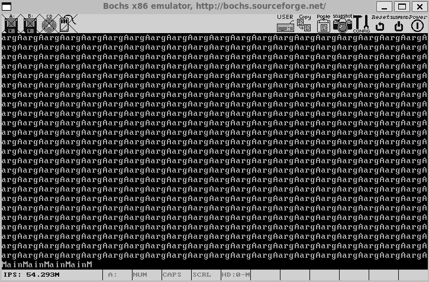
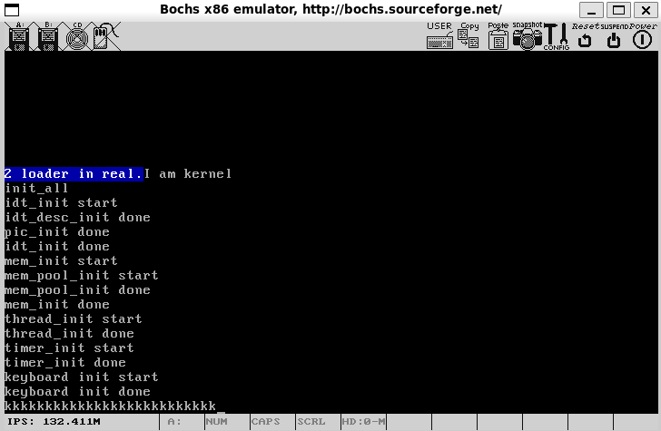
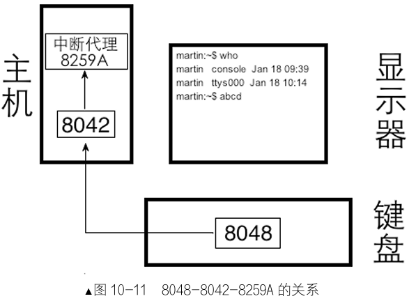
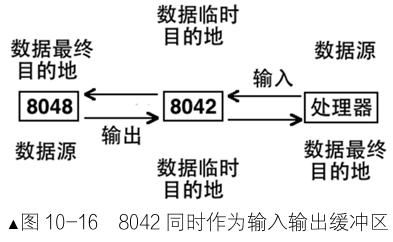
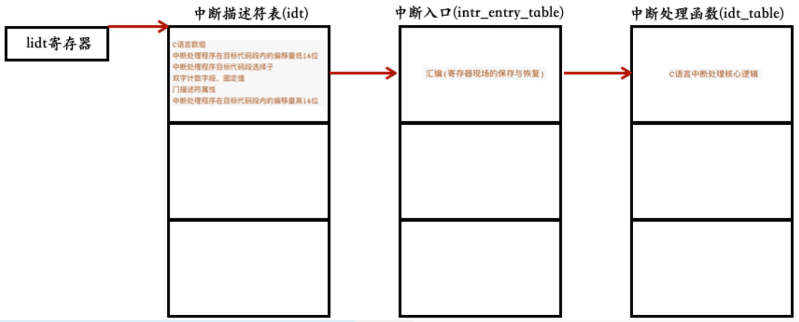
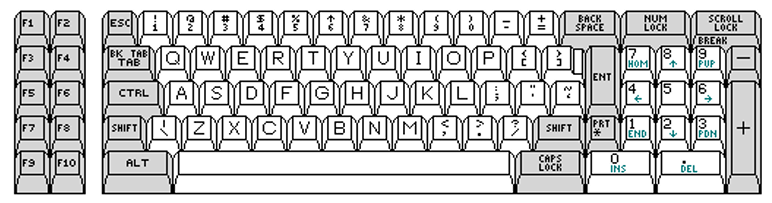
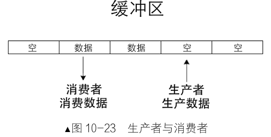
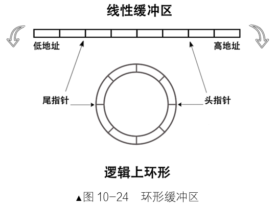
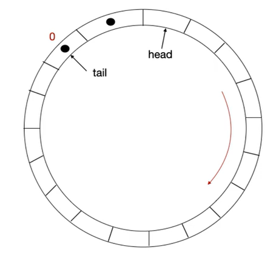
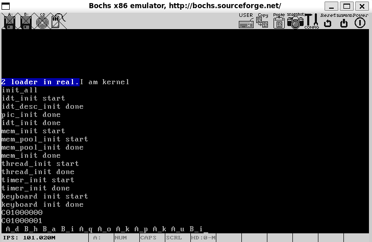

# 第10章 输入输出系统

在实现了多线程调度后，系统出现了字符打印**混乱**和**GP异常**问题，本章将引入**同步机制**来解决这些资源竞争问题，从**锁**的实现入手，确保临界区操作的原子性，为后续的**输入输出系统**奠定基础。

## 10.1 同步机制——锁

多线程环境下，对公共资源(如**显存**和**光标寄存器**)的访问可能导致数据竞争。本节通过分析GP异常和字符打印混乱问题，引入**原子操作**概念，并逐步实现基于**信号量的锁**机制，包括**线程阻塞**与**唤醒**功能。

### 10.1.1 排查GP异常，理解原子操作

在上一章中，字符打印混乱和GP异常的根本原因是**临界区代码**未实现**互斥访问**。通过以下步骤分析问题：


1. **问题现象**：

	- 字符串打印时字符丢失。
	- 输出中出现大片空缺。
	- GP异常，由寄存器bx值超出显存段引起。

2. **根本原因**：

    字符打印函数**put_char**包含三个步骤：**获取**光标值；将光标值转换为显存地址并**写入**字符；**更新**光标值。

    这三个步骤必须**原子性**执行，但任务调度可能在中途打断，导致多个线程覆盖显存或设置错误光标值。例如：

    - 线程A执行步骤1后被打断，线程B获取相同光标值，导致字符覆盖。

3. **临时解决方案**：

	在**put_str**前后关中断(**intr_disable**和**intr_enable**)，强制原子性。代码如下(摘自**main.c**)：

	```c
	while(1) {
	    intr_disable();      // 关中断
	    put_str("Main ");
	    intr_enable();       // 开中断
	};
	return 0;
	
	/* 在线程中运行的函数 */
	void k_thread_a(void* arg) {
	/* 用 void*来通用表示参数，
	被调用的函数知道自己需要什么类型的参数，自己转换再用 */
	    char* para = arg;
	    while(1) {
	        intr_disable();     // 关中断
	        put_str(para);
	        intr_enable();      // 开中断
	    }
	}
	
	/* 在线程中运行的函数 */
	void k_thread_b(void* arg) {
	/* 用 void*来通用表示参数，
	被调用的函数知道自己需要什么类型的参数，自己转换再用 */
	    char* para = arg;
	    while(1) {
	        intr_disable();     // 关中断
	        put_str(para);
	        intr_enable();      // 开中断
	    }
	}
	```
	
	此方法虽有效，但降低了多任务效率，需更科学的互斥机制。
	
4. **GP异常分析：**(获取--写入--**更新**)
	
	线程A已打印字符(**0x7ce**)，进入更新阶段，准备将光标寄存器更新至**0x7cf**(屏幕右下角)，仅写入高8位(**0x7**)后中断发生，切换至线程B(此时光标寄存器仍为**0x7ce**)。
	
	线程B读取光标**0x7ce**，输出字符后光标变为**0x7cf**，触发滚屏。准备更新光标时，已向显卡发出“写高8位”信号，但时间片耗尽中断，切换回线程A。
	
	线程A继续写入低8位**0xcf**，但显卡因前序信号将其误判为高8位，导致光标寄存器变为**0xcfcf**。

### 10.1.2 找出代码中的临界区

以下术语是理解同步机制的基础：

- **公共资源**： 被多个任务共享的资源，如显存和光标寄存器。

- **临界区**：    访问公共资源的指令代码区域(如**put_char**函数)。

- **互    斥**：    任意时刻仅一个任务可处于临界区。

- **竞争条件**：多个任务非互斥进入临界区，导致结果依赖于执行时序。

在字符打印问题中：

- 临界区是**put_char**函数。

- 未实现互斥时，线程混杂执行导致竞争条件(如字符覆盖和GP异常)。

- 关中断虽实现互斥，但应优化为更精细的**锁机制**。

### 10.1.3 信号量

信号量是一种**同步计数器**，信号量机制确保了对**公共资源**的访问有序进行，避免竞争条件。由Dijkstra提出，用于控制线程协作时序：

- **操作**：

    down(P操作)：信号量减1，若值0则阻塞线程。

    up(V操作)：     信号量加1，唤醒等待线程。

    信号量的初始值一般为正数，初始值为一的常用于实现锁。

- **二元信号量**：   初值为1，可实现锁(**down**获锁，**up**释放锁)。

### 10.1.4 线程的阻塞与唤醒

实现锁需先支持线程阻塞和唤醒：

- **阻塞原理**：将线程状态置为不可运行态(如**TASK_BLOCKED**)，使其不被调度器加入就绪队列。
- **唤醒原理**：将阻塞线程重新加入就绪队列，状态置为**TASK_READY**。

代码如下(thread/**thread.c**)：

```c
/* 当前线程将自己阻塞，标志其状态为stat */
void thread_block(enum task_status stat) {
    ASSERT(((stat == TASK_BLOCKED) || (stat == TASK_WAITING) || (stat == TASK_HANGING)));
    enum intr_status old_status = intr_disable();
    struct task_struct* cur_thread = running_thread();
    cur_thread->status = stat;  // 设置状态为不可运行
    schedule();  // 触发调度
    intr_set_status(old_status);
}

/* 将线程pthread解除阻塞 */
void thread_unblock(struct task_struct* pthread) {
    enum intr_status old_status = intr_disable();
    ASSERT(((pthread->status == TASK_BLOCKED) || (pthread->status == TASK_WAITING) || (pthread->status == TASK_HANGING)));
    if (pthread->status != TASK_READY) {
        ASSERT(!elem_find(&thread_ready_list, &pthread->general_tag));
        list_push(&thread_ready_list, &pthread->general_tag);  // 加入就绪队列队首
        pthread->status = TASK_READY;
    }
    intr_set_status(old_status);
}
```

注意：thread.h中需添加这两个新增函数的声明。

### 10.1.5 锁的实现

锁机制通过信号量确保临界区互斥，解决了资源竞争问题。下面基于二元信号量实现锁结构(thread/**sync.h**)：

```c
#ifndef __SYNC_H
#define __SYNC_H

#include "list.h"          // 包含链表操作
#include "thread.h"        // 包含线程结构定义
#include "stdint.h"        // 包含基本数据类型

/* 信号量结构 */
struct semaphore {
    uint8_t value;         // 信号量值
    struct list waiters;   // 等待队列
};

/* 锁结构 */
struct lock {
    struct task_struct* holder;        // 锁持有者
    struct semaphore semaphore;       // 二元信号量
    uint32_t holder_repeat_nr;        // 重复申请次数
};


/* ==================== 信号量操作 ==================== */


void sema_init(struct semaphore* psema, uint8_t value);
void sema_down(struct semaphore* psema);
void sema_up(struct semaphore* psema);

/* ==================== 锁操作 ==================== */


void lock_init(struct lock* plock);
void lock_acquire(struct lock* plock);
void lock_release(struct lock* plock);

#endif
```

初始化函数(thread/**sync.c**)：

```c
#include "sync.h"
#include "interrupt.h"     
#include "debug.h"         
#include "thread.h" 
#include "type.h" 

/* 初始化信号量 */
void sema_init(struct semaphore* psema, uint8_t value) {
    psema->value = value;
    list_init(&psema->waiters);
}

/* 初始化锁 */
void lock_init(struct lock* plock) {
    plock->holder = NULL;
    plock->holder_repeat_nr = 0;
    sema_init(&plock->semaphore, 1);  // 信号量初值为1
}


//信号量操作
/* 信号量down操作，信号量减一 */
void sema_down(struct semaphore* psema) {
    enum intr_status old_status = intr_disable();
    while (psema->value == 0) {  // 值为0时阻塞
        ASSERT(!elem_find(&psema->waiters, &running_thread()->general_tag));
        list_append(&psema->waiters, &running_thread()->general_tag);
        thread_block(TASK_BLOCKED);  // 阻塞当前线程
    }
    psema->value--;
    ASSERT(psema->value == 0);
    intr_set_status(old_status);
}

/* 信号量up操作，信号量加一*/
void sema_up(struct semaphore* psema) {
    enum intr_status old_status = intr_disable();
    ASSERT(psema->value == 0);
    if (!list_empty(&psema->waiters)) {
        struct task_struct* thread_blocked = elem2entry(struct task_struct, general_tag, list_pop(&psema->waiters));
        thread_unblock(thread_blocked);  // 唤醒等待线程
    // 含义：锁释放了，直接叫醒那个正在等锁的线程，让它去抢锁。
    }
    psema->value++;
    ASSERT(psema->value == 1);
    intr_set_status(old_status);
}

//锁的获取与释放：
/* 获取锁 */
void lock_acquire(struct lock* plock) {
    if (plock->holder != running_thread()) {  // 避免重复申请
        sema_down(&plock->semaphore);  // 信号量down
        plock->holder = running_thread();
        ASSERT(plock->holder_repeat_nr == 0);
        plock->holder_repeat_nr = 1;
    } else {
        plock->holder_repeat_nr++;
    }
}

/* 释放锁  */
void lock_release(struct lock* plock) {
    ASSERT(plock->holder == running_thread());
    if (plock->holder_repeat_nr > 1) {
        plock->holder_repeat_nr--;
        return;
    }
    ASSERT(plock->holder_repeat_nr == 1);
    plock->holder = NULL;  // 先置空持有者
    plock->holder_repeat_nr = 0;
    sema_up(&plock->semaphore);  // 信号量up
}
```

## 10.2 用锁实现终端输出

**终端**作为用户与系统交互的界面，需要保证输出内容的完整性。本节通过**锁机制**实现终端互斥访问，解决多线程**打印冲突问题**。

**终端设备抽象**

尽管系统仅支持单终端输出，但通过**锁**将终端抽象为共享设备，确保每次仅一个线程可访问显存资源。

(device/**console.h**)：

```c
#ifndef __CONSOLE_H
#define __CONSOLE_H

#include "stdint.h"  

/* 初始化终端锁 */
void console_init(void);
/* 获取终端锁（加锁） */
void console_acquire(void);
/* 释放终端锁（解锁） */
void console_release(void);
/* 安全输出字符串 */
void console_put_str(char* str);
/* 安全输出单个ASCII字符 */
void console_put_char(uint8_t char_asci);
/* 安全输出32位无符号整数（十六进制） */
void console_put_int(uint32_t num);

#endif
```

终端操作封装为以下函数(device/**console.c**)：

```c
#include "console.h"
#include "print.h"
#include "stdint.h"
#include "sync.h"
#include "thread.h"

static struct lock console_lock;  // 全局终端锁

/* 初始化终端锁 */
void console_init() {
    lock_init(&console_lock);
}

/* 获取终端锁 */
void console_acquire() {
    lock_acquire(&console_lock);
}

/* 释放终端锁 */
void console_release() {
    lock_release(&console_lock);
}

/* 终端安全输出字符串 */
void console_put_str(char* str) {
    console_acquire();    // 加锁
    put_str(str);         // 调用底层输出
    console_release();    // 解锁
}

/* 终端安全输出字符 */
void console_put_char(uint8_t char_asci) {
    console_acquire();
    put_char(char_asci);
    console_release();
}

/* 终端安全输出十六进制整数 */
void console_put_int(uint32_t num) {
    console_acquire();
    put_int(num);
    console_release();
}
```

**集成终端初始化**

终端初始化需在系统启动时完成(kernel/**init.c**)：

```c
#include "print.h"
#include "interrupt.h"
#include "../device/timer.h"
#include "memory.h"
#include "thread.h"
#include "console.h"

/* 负责初始化所有模块 */
void init_all(void) {
    put_str("init_all\n");
    intr_init();       // 中断初始化中断
    mem_init();        //内存初始化          8.5.3加
    thread_init();     //线程机制初始化       9.4.4加
    timer_init();      //定时器初始化        7.8加
    console_init();    // 终端初始化         10.2.2加
    
}
```

**应用终端输出**

线程通过终端函数替代直接输出（kernel/**main.c**）：

```c
#include "print.h"
#include "init.h"
#include "memory.h"
#include "thread.h"
#include "interrupt.h"
#include "console.h"


void k_thread_a(void*);
void k_thread_b(void*);

int main(void) {
    put_str("I am kernel\n");
    init_all();
    thread_start("k_thread_a", 31, k_thread_a, "argA");
    thread_start("k_thread_b", 8, k_thread_b, "argB");
    intr_enable();
    while(1) {
        console_put_str("Main");  
    };
    return 0;
}

void k_thread_a(void* arg) {
    char* para = arg;
    while(1) {
        console_put_str(para);
    }
}

void k_thread_b(void* arg) {
    char* para = arg;
    while(1) {
        console_put_str(para);
    }
}
```

```linenums="0"
.
├── boot.inc
├── device
│   ├── console.c   # 💡新增
│   ├── console.h   # 💡新增
│   ├── timer.c
│   └── timer.h
├── kernel
│   ├── debug.c
│   ├── debug.h
│   ├── global.h
│   ├── init.c
│   ├── init.h
│   ├── interrupt.c
│   ├── interrupt.h
│   ├── kernel.s
│   ├── main.c
│   ├── memory.c
│   ├── memory.h
│   ├── stdint.h
│   └── type.h
├── lib
│   ├── kernel
│   │   ├── bitmap.c
│   │   ├── bitmap.h
│   │   ├── io.h
│   │   ├── list.c
│   │   ├── list.h
│   │   ├── print.h
│   │   └── print.s
│   ├── stdbool.h
│   ├── string.c
│   └── string.h
├── loader.s
├── makefile
├── mbr.s
└── thread
    ├── switch.s
    ├── sync.c      # 💡新增
    ├── sync.h      # 💡新增
    ├── thread.c
    └── thread.h
```

**makefile**：

```shell
BUILD_DIR = ./build
ENTRY_POINT = 0xc0001500
AS = nasm
CC = gcc
LD = ld
LIB = -I lib/ -I lib/kernel/ -I lib/user/ -I kernel/ -I device/ -I thread/
ASFLAGS = -f elf
CFLAGS = -std=gnu11 -m32 $(LIB) -c -fno-builtin -fno-stack-protector -W -Wstrict-prototypes \
	-Wmissing-prototypes  
LDFLAGS = -m elf_i386 -Ttext $(ENTRY_POINT) -e main -Map $(BUILD_DIR)/kernel.map
OBJS = $(BUILD_DIR)/main.o   $(BUILD_DIR)/init.o    $(BUILD_DIR)/interrupt.o \
	     $(BUILD_DIR)/timer.o  $(BUILD_DIR)/kernel.o  $(BUILD_DIR)/print.o     \
	     $(BUILD_DIR)/debug.o  $(BUILD_DIR)/string.o  $(BUILD_DIR)/bitmap.o    \
	     $(BUILD_DIR)/memory.o $(BUILD_DIR)/thread.o  $(BUILD_DIR)/list.o      \
	     $(BUILD_DIR)/switch.o $(BUILD_DIR)/console.o $(BUILD_DIR)/sync.o 	   \
  

#############  c代码编译   #############
$(BUILD_DIR)/main.o: kernel/main.c
	$(CC) $(CFLAGS) $< -o $@

$(BUILD_DIR)/init.o: kernel/init.c kernel/init.h
	$(CC) $(CFLAGS) $< -o $@

$(BUILD_DIR)/interrupt.o: kernel/interrupt.c kernel/interrupt.h
	$(CC) $(CFLAGS) $< -o $@ 

$(BUILD_DIR)/timer.o: device/timer.c device/timer.h
	$(CC) $(CFLAGS) $< -o $@

$(BUILD_DIR)/debug.o: kernel/debug.c kernel/debug.h
	$(CC) $(CFLAGS) $< -o $@
	
$(BUILD_DIR)/string.o: lib/string.c lib/string.h
	$(CC) $(CFLAGS) $< -o $@
	
$(BUILD_DIR)/bitmap.o: lib/kernel/bitmap.c lib/kernel/bitmap.h
	$(CC) $(CFLAGS) $< -o $@
	
$(BUILD_DIR)/memory.o: kernel/memory.c kernel/memory.h
	$(CC) $(CFLAGS) $< -o $@
  
$(BUILD_DIR)/thread.o: thread/thread.c thread/thread.h
	$(CC) $(CFLAGS) $< -o $@
	
$(BUILD_DIR)/list.o: lib/kernel/list.c lib/kernel/list.h
	$(CC) $(CFLAGS) $< -o $@
	
$(BUILD_DIR)/sync.o: thread/sync.c thread/sync.h
	$(CC) $(CFLAGS) $< -o $@

$(BUILD_DIR)/console.o: device/console.c device/console.h
	$(CC) $(CFLAGS) $< -o $@

#############    汇编代码编译    #############
$(BUILD_DIR)/kernel.o: kernel/kernel.s
	$(AS) $(ASFLAGS) $< -o $@

$(BUILD_DIR)/print.o: lib/kernel/print.s
	$(AS) $(ASFLAGS) $< -o $@
	
$(BUILD_DIR)/switch.o: thread/switch.s
	$(AS) $(ASFLAGS) $< -o $@

#############   链接所有目标文件   #############
$(BUILD_DIR)/kernel.bin: $(OBJS)
	$(LD) $(LDFLAGS) $^ -o $@

.PHONY : mk_dir hd clean all

mk_dir:
	if [ ! -d ./build ]; then mkdir ./build; fi

hd:
	dd if=$(BUILD_DIR)/kernel.bin of=hd60M.img bs=512 count=200 seek=9 conv=notrunc
  
clean:
	cd $(BUILD_DIR) && rm -f ./*

build: $(BUILD_DIR)/kernel.bin

all: mk_dir build hd
```

**运行效果验证**

通过锁机制，终端输出不再出现字符覆盖或丢失。如下图所示，字符串按线程调度顺序完整打印，无交叉混乱现象：



## 10.3 从键盘获取输入

**键盘**作为最基础的输入设备，其驱动实现涉及硬件交互及数据转换。本节从键盘输入原理入手，完善中断处理系统，实现对键盘中断的简单响应。



### 10.3.1 键盘输入原理简介

键盘输入通过8048编码器和8042控制器协作完成：

- **8048编码器**：位于键盘内部，监测按键动作并生成扫描码。
- **8042控制器**：位于主板，接收扫描码并转换为**标准格式**，通过中断通知处理器。

{width=60%}

8048的扫描码有三套标准，最常用的位第二套标准，按键过程产生**通码**(按下)和**断码**(释放)，8042将第二套扫描码转换为第一套供系统处理。以下为键盘中断处理流程示意：

```linenums="0"
按键触发 → 8048发送扫描码 → 8042转换并存储 → 触发中断0x21 → 处理器执行中断处理程序
```

### 10.3.2 键盘扫描码

扫描码有三套标准，操作系统使用第一套扫描码(由8042转换)。关键扫描码对应关系如下(节选)：

| 键位     | 通码 | 断码 | 键位  | 通码 | 断码 |
| -------- | ---- | ---- | ----- | ---- | ---- |
| Esc      | 0x01 | 0x81 | A     | 0x1E | 0x9E |
| Enter    | 0x1C | 0x9C | Shift | 0x2A | 0xAA |
| CapsLock | 0x3A | 0xBA | 空格  | 0x39 | 0xB9 |

完整扫描码表涵盖主键盘区功能键。通码与断码满足关系：断码 = 通码 + 0x80。特殊键(如Ctrl、Alt)使用多字节编码，以0xE0为前缀。

### 10.3.3 8042简介

**8042**是连接8048和处理器的桥梁，处理器可以通过它控制8048的工作方式，然后让8048的工作成果通过8042回传给处理器。8042既可以是8048的**输入缓冲区**也可以是8048的**输出缓冲区**。

{width=40%}

8042作为IO接口，主要包含四个寄存器：

- **输出缓冲区（0x60）**：存储待读取的扫描码(只读)。

- **输入缓冲区（0x60）**：写入控制命令(只写)。

- **状态寄存器（0x64）**：记录8042工作状态(如缓冲区满)。

- **控制寄存器（0x64）**：配置8042工作模式。

键盘驱动通过端口读写与8042交互，例如：

```c
#define KBD_BUF_PORT 0x60  // 键盘缓冲区端口

static void intr_keyboard_handler() {
    uint8_t scancode = inb(KBD_BUF_PORT);  // 读取扫描码
    // 解析扫描码并转换为字符
}
```

### 10.3.4 测试键盘中断处理程序

实现简易键盘中断处理程序，验证扫描码解析流程。

**1. 初始化设置**：扩充中断处理中断向量号的范围，注册中断向量0x21，开启键盘中断。



**kernel/kernel.s**中新增15个中断入口:

```asm
VECTOR 0x21,ZERO ;键盘中断对应的入口
VECTOR 0x22,ZERO ;级联用的
VECTOR 0x23,ZERO ;串口2对应的入口
VECTOR 0x24,ZERO ;串口1对应的入口
VECTOR 0x25,ZERO ;并口2对应的入口
VECTOR 0x26,ZERO ;软盘对应的入口
VECTOR 0x27,ZERO ;并口1对应的入口
VECTOR 0x28,ZERO ;实时时钟对应的入口
VECTOR 0x29,ZERO ;重定向
VECTOR 0x2a,ZERO ;保留
VECTOR 0x2b,ZERO ;保留
VECTOR 0x2c,ZERO ;ps/2鼠标
VECTOR 0x2d,ZERO ;fpu浮点单元异常
VECTOR 0x2e,ZERO ;硬盘
VECTOR 0x2f,ZERO ;保留
```

**kernel/interrupt.c**暂时关闭时钟中断，打开**键盘中断**

```c
#define IDT_DESC_CNT 0x30                          //目前总共支持的中断数   本节修改

static struct gate_desc idt[IDT_DESC_CNT];         //个中断门描述符数组

char* intr_name[IDT_DESC_CNT];                     //用于保存异常的名字
extern intr_handler intr_entry_table[IDT_DESC_CNT];//声明kernel.s中的中断处理函数入口数组
intr_handler idt_table[IDT_DESC_CNT];              //定义中断处理程序数组


/*初始化可编程中断控制器8259A */
static void pic_init(void) {
  省略
  outb (PIC_M_DATA, 0xfd);         //本节修改fe修改为fd
  outb (PIC_S_DATA, 0xff);
  省略
}
```

**2. 注册键盘中断处理程序**

定义中断处理函数(device/**keyboard.c**)，读取扫描码并打印字符。

```c
#include"keyboard.h"
#include"print.h"
#include"interrupt.h"
#include"io.h"
#include"global.h"
#include"stdint.h"

#define KBD_BUF_PORT 0x60//键盘buffer寄存器端口号为0x60

/*键盘中断处理程序*/
static void intr_keyboard_handler(uint8_t vector_no) {
  put_char('k');
  /*  必须要读取输出缓冲区寄存器，否则8042不再继续响应键盘中断 */
  inb(KBD_BUF_PORT);
  return;
}

/* 键盘初始化 */
void keyboard_init(void) {
  put_str("keyboard init start\n");
  register_handler(0x21, intr_keyboard_handler);
  put_str("keyboard init done\n");
}
```

对应的**keyboard.h**文件:

```c
#ifndef __KEYBOARD_H
#define __KEYBOARD_H

/* 键盘缓冲寄存器端口号 */
#define KBD_BUF_PORT 0x60

/* 键盘初始化函数 */
void keyboard_init(void);

#endif
```

键盘初始化需在系统启动时完成(kernel/**init.c**)：

```c
#include "print.h"
#include "interrupt.h"
#include "../device/timer.h"
#include "memory.h"
#include "thread.h"
#include "console.h"
#include "init.h"
#include "keyboard.h"

/* 负责初始化所有模块 */
void init_all(void) {
    put_str("init_all\n");
    intr_init();       // 中断初始化中断
    mem_init();        //内存初始化          8.5.3加
    thread_init();     //线程机制初始化       9.4.4加
    timer_init();      //定时器初始化        7.8加
    console_init();    // 终端初始化         10.2.2加
    keyboard_init();   //键盘初始化          10.3.4加
}
```

**3. 测试**，预期按键后屏幕输出字符，验证中断触发。

修改**main**函数逻辑:

```c
#include "print.h"
#include "init.h"
#include "memory.h"
#include "thread.h"
#include "interrupt.h"
#include "console.h"


void k_thread_a(void*);
void k_thread_b(void*);

int main(void) {
    put_str("I am kernel\n");
    init_all();
    //thread_start("k_thread_a", 31, k_thread_a, "argA");  //本节注释
    //thread_start("k_thread_b", 8, k_thread_b, "argB");   //本节注释
    intr_enable();
    while(1); //{  //本节注释
        //console_put_str("Main");  //本节注释
    //};  //本节注释
    return 0;
}

void k_thread_a(void* arg) {
    char* para = arg;
    while(1) {
        console_put_str(para);
    }
}

void k_thread_b(void* arg) {
    char* para = arg;
    while(1) {
        console_put_str(para);
    }
}
```

```linenums="0"
.
├── boot.inc
├── device
│   ├── console.c
│   ├── console.h
│   ├── keyboard.c  # 💡新增
│   ├── keyboard.h  # 💡新增
│   ├── timer.c
│   └── timer.h
├── kernel
│   ├── debug.c
│   ├── debug.h
│   ├── global.h
│   ├── init.c      # 🛠️修改
│   ├── init.h
│   ├── interrupt.c # 🛠️修改
│   ├── interrupt.h
│   ├── kernel.s    # 🛠️修改
│   ├── main.c      # 🛠️修改
│   ├── memory.c
│   ├── memory.h
│   ├── stdint.h
│   └── type.h
├── lib
│   ├── kernel
│   │   ├── bitmap.c
│   │   ├── bitmap.h
│   │   ├── io.h
│   │   ├── list.c
│   │   ├── list.h
│   │   ├── print.h
│   │   └── print.s
│   ├── stdbool.h
│   ├── string.c
│   └── string.h
├── loader.s
├── makefile
├── mbr.s
└── thread
    ├── switch.s
    ├── sync.c
    ├── sync.h
    ├── thread.c
    └── thread.h
```

修改**makefile**:

```shell
BUILD_DIR = ./build
ENTRY_POINT = 0xc0001500
AS = nasm
CC = gcc
LD = ld
LIB = -I lib/ -I lib/kernel/ -I lib/user/ -I kernel/ -I device/ -I thread/
ASFLAGS = -f elf
CFLAGS = -std=gnu11 -m32 $(LIB) -c -fno-builtin -fno-stack-protector -W -Wstrict-prototypes \
	-Wmissing-prototypes  
LDFLAGS = -m elf_i386 -Ttext $(ENTRY_POINT) -e main -Map $(BUILD_DIR)/kernel.map
OBJS = $(BUILD_DIR)/main.o   $(BUILD_DIR)/init.o    $(BUILD_DIR)/interrupt.o \
	     $(BUILD_DIR)/timer.o  $(BUILD_DIR)/kernel.o  $(BUILD_DIR)/print.o     \
	     $(BUILD_DIR)/debug.o  $(BUILD_DIR)/string.o  $(BUILD_DIR)/bitmap.o    \
	     $(BUILD_DIR)/memory.o $(BUILD_DIR)/thread.o  $(BUILD_DIR)/list.o      \
	     $(BUILD_DIR)/switch.o $(BUILD_DIR)/console.o $(BUILD_DIR)/sync.o 	   \
	     $(BUILD_DIR)/keyboard.o
  

#############  c代码编译   #############
$(BUILD_DIR)/main.o: kernel/main.c
	$(CC) $(CFLAGS) $< -o $@

$(BUILD_DIR)/init.o: kernel/init.c kernel/init.h
	$(CC) $(CFLAGS) $< -o $@

$(BUILD_DIR)/interrupt.o: kernel/interrupt.c kernel/interrupt.h
	$(CC) $(CFLAGS) $< -o $@ 

$(BUILD_DIR)/timer.o: device/timer.c device/timer.h
	$(CC) $(CFLAGS) $< -o $@

$(BUILD_DIR)/debug.o: kernel/debug.c kernel/debug.h
	$(CC) $(CFLAGS) $< -o $@
	
$(BUILD_DIR)/string.o: lib/string.c lib/string.h
	$(CC) $(CFLAGS) $< -o $@
	
$(BUILD_DIR)/bitmap.o: lib/kernel/bitmap.c lib/kernel/bitmap.h
	$(CC) $(CFLAGS) $< -o $@
	
$(BUILD_DIR)/memory.o: kernel/memory.c kernel/memory.h
	$(CC) $(CFLAGS) $< -o $@
  
$(BUILD_DIR)/thread.o: thread/thread.c thread/thread.h
	$(CC) $(CFLAGS) $< -o $@
	
$(BUILD_DIR)/list.o: lib/kernel/list.c lib/kernel/list.h
	$(CC) $(CFLAGS) $< -o $@
	
$(BUILD_DIR)/sync.o: thread/sync.c thread/sync.h
	$(CC) $(CFLAGS) $< -o $@

$(BUILD_DIR)/console.o: device/console.c device/console.h
	$(CC) $(CFLAGS) $< -o $@
	
$(BUILD_DIR)/keyboard.o: device/keyboard.c device/keyboard.h
	$(CC) $(CFLAGS) $< -o $@

#############    汇编代码编译    #############
$(BUILD_DIR)/kernel.o: kernel/kernel.s
	$(AS) $(ASFLAGS) $< -o $@

$(BUILD_DIR)/print.o: lib/kernel/print.s
	$(AS) $(ASFLAGS) $< -o $@
	
$(BUILD_DIR)/switch.o: thread/switch.s
	$(AS) $(ASFLAGS) $< -o $@

#############   链接所有目标文件   #############
$(BUILD_DIR)/kernel.bin: $(OBJS)
	$(LD) $(LDFLAGS) $^ -o $@

.PHONY : mk_dir hd clean all

mk_dir:
	if [ ! -d ./build ]; then mkdir ./build; fi

hd:
	dd if=$(BUILD_DIR)/kernel.bin of=hd60M.img bs=512 count=200 seek=9 conv=notrunc
  
clean:
	cd $(BUILD_DIR) && rm -f ./*

build: $(BUILD_DIR)/kernel.bin

all: mk_dir build hd
```

**测试结果**如下所示，按键正确触发中断并输出字符：


## 10.4 编写键盘驱动

键盘作为系统核心输入设备，其驱动(中断处理系统)需要处理硬件**扫描码到字符**的转换。本节在已有键盘中断处理基础上，完善扫描码**解析**逻辑，实现**转义字符处理、按键状态管理**。

### 10.4.1 转义字符介绍

字符分**可见**字符和**控制**字符，键盘驱动需将扫描码转换为对应ASCII码。控制字符不可见，需用转义字符表示，C语言支持三种转义形式：

- 一般转义字符： 如`\t`（制表符）、`\b`（退格符）

- 八 进 制 转 义： 如`\033`表示Esc键

- 十六进制转义： 如`\x1b`表示Esc键

转义字符确保驱动能正确处理控制键，为扫描码转换提供基础。

### 10.4.2 处理扫描码

**驱动**：将复杂的硬件控制指令封装成一个过程，由此过程实施底层的控制细节，便于重复调用。

键盘驱动核心是将扫描码转换为字符，需处理按键状态(如Shift、CapsLock)和组合键。下面程序通过**二维数组**建立扫描码到字符的映射，并实现状态管理(修改device/**keyboard.c)**:



```c
#include "keyboard.h"
#include "print.h"
#include "interrupt.h"
#include "io.h"
#include "global.h"
#include "stdbool.h"
#include "ioqueue.h"

#define KBD_BUF_PORT 0x60

/* 控制字符定义 */
#define esc        '\033'
#define backspace  '\b'
#define tab        '\t'
#define enter      '\r'
#define delete     '\177'

#define char_invisible  0
#define ctrl_l_char     char_invisible
#define ctrl_r_char     char_invisible
#define shift_l_char    char_invisible
#define shift_r_char    char_invisible
#define alt_l_char      char_invisible
#define alt_r_char      char_invisible
#define caps_lock_char  char_invisible

/* 控制键通码和断码 */
#define shift_l_make    0x2a
#define shift_r_make    0x36
#define alt_l_make      0x38
#define alt_r_make      0xe038
#define alt_r_break     0xe0b8
#define ctrl_l_make     0x1d
#define ctrl_r_make     0xe01d
#define ctrl_r_break    0xe09d
#define caps_lock_make  0x3a

/* 状态管理变量 */
static bool ctrl_status, shift_status, alt_status, caps_lock_status, ext_scancode;

//扫描码从从0x00到0x3A  可以作为键盘映射表的索引 值为字符
static char keymap[][2] = {     
    {0, 0}, {esc, esc}, {'1', '!'}, {'2', '@'},
    {'3', '#'}, {'4', '$'}, {'5', '%'}, {'6', '^'},
    {'7', '&'}, {'8', '*'}, {'9', '('}, {'0', ')'},
    {'-', '_'}, {'=', '+'}, {backspace, backspace},
    {tab, tab}, {'q', 'Q'}, {'w', 'W'}, {'e', 'E'},
    {'r', 'R'}, {'t', 'T'}, {'y', 'Y'}, {'u', 'U'},
    {'i', 'I'}, {'o', 'O'}, {'p', 'P'}, {'[', '{'},
    {']', '}'}, {enter, enter}, {ctrl_l_char, ctrl_l_char},
    {'a', 'A'}, {'s', 'S'}, {'d', 'D'}, {'f', 'F'},
    {'g', 'G'}, {'h', 'H'}, {'j', 'J'}, {'k', 'K'},
    {'l', 'L'}, {';', ':'}, {'\'', '"'}, {'`', '~'},
    {shift_l_char, shift_l_char}, {'\\', '|'}, {'z', 'Z'},
    {'x', 'X'}, {'c', 'C'}, {'v', 'V'}, {'b', 'B'},
    {'n', 'N'}, {'m', 'M'}, {',', '<'}, {'.', '>'},
    {'/', '?'}, {shift_r_char, shift_r_char}, {'*', '*'},
    {alt_l_char, alt_l_char}, {' ', ' '}, {caps_lock_char, caps_lock_char}
};

/* 键盘中断处理程序 */
static void intr_keyboard_handler(void) {
    bool ctrl_down_last = ctrl_status;
    bool shift_down_last = shift_status;
    bool caps_lock_last = caps_lock_status;
    bool break_code;
    uint16_t scancode = inb(KBD_BUF_PORT);
    bool is_letter, is_digit_symbol;
    bool shift = false;
    uint8_t index = 0;
    char cur_char;

    if (scancode == 0xe0) {
        ext_scancode = true;
        return;
    }

    if (ext_scancode) {
        scancode = ((0xe000) | scancode);
        ext_scancode = false;
    }
    
    break_code = ((scancode & 0x0080) != 0);
    
    if (break_code) {
        uint16_t make_code = (scancode & 0xff7f);
        
        if (make_code == ctrl_l_make || make_code == ctrl_r_make) {
            ctrl_status = false;
        } else if (make_code == shift_l_make || make_code == shift_r_make) {
            shift_status = false;
        } else if (make_code == alt_l_make || make_code == alt_r_make) {
            alt_status = false;
        }
        return;
    } 
    
    /* 通码处理 */
    if ((scancode > 0x00 && scancode < 0x3b) || 
        (scancode == alt_r_make) || 
        (scancode == ctrl_r_make)) {
        
        index = (scancode & 0x00ff);
        
        /* 判断是否为字母键 */
        is_letter = (scancode >= 0x10 && scancode <= 0x1c) || 
                    (scancode >= 0x1e && scancode <= 0x26) || 
                    (scancode >= 0x2c && scancode <= 0x32);
        
        /* 判断是否为数字/符号键 */
        is_digit_symbol = (scancode >= 0x02 && scancode <= 0x0d) || 
                          (scancode >= 0x1a && scancode <= 0x1b) || 
                          (scancode >= 0x27 && scancode <= 0x29) || 
                          (scancode >= 0x33 && scancode <= 0x35);
        
        if (is_letter) {
            /* 字母键处理逻辑 */
            if (shift_down_last && caps_lock_last) {
                shift = false;
            } else if (shift_down_last || caps_lock_last) {
                shift = true;
            } else {
                shift = false;
            }
        } else if (is_digit_symbol) {
            shift = shift_down_last;
        }
        
        cur_char = keymap[index][shift];
        
        if (cur_char) {
            put_char(cur_char);
            return;
        }
        
        /* 更新控制键状态 */
        if (scancode == ctrl_l_make || scancode == ctrl_r_make) {
            ctrl_status = true;
        } else if (scancode == shift_l_make || scancode == shift_r_make) {
            shift_status = true;
        } else if (scancode == alt_l_make || scancode == alt_r_make) {
            alt_status = true;
        } else if (scancode == caps_lock_make) {
            caps_lock_status = !caps_lock_status;
        }
    }
}

/* 键盘初始化 */
void keyboard_init(void) {
    put_str("keyboard init start\n");
    register_handler(0x21, (intr_handler)intr_keyboard_handler);
    put_str("keyboard init done\n");
}
```

## 10.5 环形输入缓冲区

键盘产生的字符需要**临时存储**，以便后续处理(如命令解析)。本节引入生产者-消费者模型，实现**环形缓冲区**，并且多线程环境下可以使用。

{width=60%}

### 10.5.1 生产者与消费者问题简述

生产者-消费者模型是**线程同步**的经典案例，主要用于多个线程协作处理共享资源的场景。以食堂为例：厨师(生产者)将菜品放入窗口(缓冲区)，学生(消费者)从窗口取餐。

- **生产者**：生成数据并**放入**缓冲区(如键盘驱动产生字符)。

- **消费者**：从缓冲区**取出**数据并处理(如shell读取命令)。

- **缓冲区**：固定大小的共享存储区，协调生产者和消费者的速度差异，缓冲区满时生产者等待，空时消费者等待。

生产者-消费者模型核心需求：

- **互斥访问**：任意时刻仅一个线程可操作缓冲区。

- **同步协调**：缓冲区状态(空/满)控制线程阻塞与唤醒。

**环形缓冲区**通过头尾指针循环移动，实现逻辑上的环形存储，高效率地使用了环形缓冲区。

{width=60%}

### 10.5.2 环形缓冲区的实现

通过**数组**模拟环形缓冲区，支持高效的数据存取，缓冲区限制输入长度为63字符(bufsize-1)，超限后新字符被忽略，避免数据溢出。以下为缓冲区结构定义(device/**ioqueue.h**)：

```c
#ifndef __DEVICE_IOQUEUE_H
#define __DEVICE_IOQUEUE_H
#include "stdint.h"
#include "thread.h"
#include "sync.h"

#define bufsize 64

/* 环形队列 */
struct ioqueue {
// 生产者消费者问题
    struct lock lock;
    struct task_struct* producer;//记录缓冲区已满时,哪个生产者在此缓冲区上睡眠
    struct task_struct* consumer;//记录缓冲区为空时,哪个消费者在此缓冲区上睡眠
    char buf[bufsize];           // 缓冲区大小
    int32_t head;                // 队首，数据往队首处写入
    int32_t tail;                // 队尾，数据从队尾处读出
};

/* 函数声明 */
void ioqueue_init(struct ioqueue* ioq);          // 初始化队列
bool ioq_full(struct ioqueue* ioq);              // 判断队列是否满
bool ioq_empty(struct ioqueue* ioq);             // 判断队列是否空
char ioq_getchar(struct ioqueue* ioq);           // 从队列获取字符
void ioq_putchar(struct ioqueue* ioq, char byte); // 向队列写入字符

#endif
```

环形缓冲区**实现精髓**在于：用互斥锁保障临界区安全，并通过空则消费者挂起、满则生产者挂起，彻底规避忙等待。

所有操作强制在中断关闭状态下执行，确保内核级原子性，为设备I/O提供轻量、高效、安全的线程间通信机制(device/**ioqueue.c**)。

{width=50%}

```c
#include "ioqueue.h"
#include "interrupt.h"
#include "global.h"
#include "debug.h"
#include "stdbool.h"

/* 初始化io队列ioq */
void ioqueue_init(struct ioqueue* ioq) {
    lock_init(&ioq->lock);                 // 初始化io队列的锁
    ioq->producer = ioq->consumer = NULL;  // 生产者和消费者置空
    ioq->head = ioq->tail = 0;             // 队列首尾指向缓冲区数组第0个位置
}

/* 返回pos在缓冲区中的下一个位置值 */
static int32_t next_pos(int32_t pos) {
    return (pos + 1) % bufsize;
}

/* 判断队列是否已满 */
bool ioq_full(struct ioqueue* ioq) {
    ASSERT(intr_get_status() == INTR_OFF);
    return next_pos(ioq->head) == ioq->tail;
}

/* 判断队列是否已空 */
bool ioq_empty(struct ioqueue* ioq) {
    ASSERT(intr_get_status() == INTR_OFF);
    return ioq->head == ioq->tail;
}

/* 使当前生产者或消费者在此缓冲区上等待 */
static void ioq_wait(struct task_struct** waiter) {
    ASSERT(*waiter == NULL && waiter != NULL);
    *waiter = running_thread();
    thread_block(TASK_BLOCKED);
}

/* 唤醒 waiter */
static void wakeup(struct task_struct** waiter) {
    ASSERT(*waiter != NULL);
    thread_unblock(*waiter);
    *waiter = NULL;
}

/* 消费者从ioq队列中获取一个字符 */
char ioq_getchar(struct ioqueue* ioq) {
    ASSERT(intr_get_status() == INTR_OFF);
    lock_acquire(&ioq->lock);

/* 若缓冲区为空，把消费者ioq->consumer记为当前线程自己，将来生产者往缓冲区里装商品后，生产者知道唤醒哪个消费者*/
    while (ioq_empty(ioq)) {
        ioq_wait(&ioq->consumer);
    }

    char byte = ioq->buf[ioq->tail];     // 从缓冲区中取出
    ioq->tail = next_pos(ioq->tail);     // 把读游标移到下一位置

    lock_release(&ioq->lock);
    if (ioq->producer != NULL) {
        wakeup(&ioq->producer);          // 唤醒生产者
    }
    return byte;
}

/* 生产者往 ioq 队列中写入一个字符 byte */
void ioq_putchar(struct ioqueue* ioq, char byte) {
    ASSERT(intr_get_status() == INTR_OFF);
    lock_acquire(&ioq->lock);
/* 若缓冲区已经满了，把生产者ioq->producer记为自己，当缓冲区里的东西被消费者取完后让消费者知道唤醒哪个生产者 */
    while (ioq_full(ioq)) {
        ioq_wait(&ioq->producer);
    }

    ioq->buf[ioq->head] = byte;          // 把字节放入缓冲区中
    ioq->head = next_pos(ioq->head);     // 把写游标移到下一位置
  
    lock_release(&ioq->lock);
    if (ioq->consumer != NULL) {
        wakeup(&ioq->consumer);          // 唤醒消费者
    }
}
```

### 10.5.3 添加键盘输入缓冲区

修改(device/**keyboard.c**)，将环形缓冲区集成到键盘驱动中，临时存储输入字符,：

```c
...略
struct ioqueue kbd_buf;        //10.5.3增加，定义键盘缓冲区
...略

if (cur_char) {    
    if (!ioq_full(&kbd_buf)) {  //10.5.3修改
        //put_char(cur_char);     
        ioq_putchar(&kbd_buf, cur_char);
    }
    return;
}
...略

/* 键盘初始化 */
void keyboard_init() {
    put_str("keyboard init start\n");
    ioqueue_init(&kbd_buf);       //10.5.3增加
    register_handler(0x21, intr_keyboard_handler);
    put_str("keyboard init done\n");
}
```

完善对应的(device/**keyboard.h**)：

```c
#ifndef __KEYBOARD_H
#define __KEYBOARD_H

/* 键盘缓冲寄存器端口号 */
#define KBD_BUF_PORT 0x60

/* 键盘初始化函数 */
void keyboard_init(void);
extern struct ioqueue kbd_buf; // 10.5.3增加，定义键盘缓冲区

#endif
```

### 10.5.4 生产者与消费者实例测试

修改kernel/**interrupt.c**，同时开启时钟中断与键盘中断

```c
static void pic_init(void) {
    ...略
/* 测试键盘，打开键盘中断与时钟中断 */
    outb(PIC_M_DATA, 0xfc);     //10.5.4修改
    outb(PIC_S_DATA, 0xff);
    ...略
}
```

创建消费者线程验证缓冲区功能(**main.c**)：

```c
#include "print.h"
#include "init.h"
#include "memory.h"
#include "thread.h"
#include "interrupt.h"
#include "console.h"
#include "ioqueue.h"
#include "keyboard.h"


void k_thread_a(void*);
void k_thread_b(void*);

int main(void) {
    put_str("I am kernel\n");
    init_all();
    thread_start("consumer_a", 31, k_thread_a, " A_");
    thread_start("consumer_b", 31, k_thread_b, " B_");
    intr_enable();
    while(1);
    return 0;
}

/* 在线程中运行的函数 */
void k_thread_a(void* arg) {
    while(1) {
        enum intr_status old_status = intr_disable();
        if (!ioq_empty(&kbd_buf)) {
            console_put_str(arg);
            char byte = ioq_getchar(&kbd_buf);
            console_put_char(byte);
        }
        intr_set_status(old_status);
    }
}

/* 在线程中运行的函数 */
void k_thread_b(void* arg) {
    while(1) {
        enum intr_status old_status = intr_disable();
        if (!ioq_empty(&kbd_buf)) {
            console_put_str(arg);
            char byte = ioq_getchar(&kbd_buf);
            console_put_char(byte);
        }
        intr_set_status(old_status);
    }
}
```

```linenums="0"
.
├── boot.inc
├── device
│   ├── console.c
│   ├── console.h
│   ├── ioqueue.c    # 💡新增
│   ├── ioqueue.h    # 💡新增
│   ├── keyboard.c   # 🛠️修改
│   ├── keyboard.h   # 🛠️修改
│   ├── timer.c
│   └── timer.h
├── kernel
│   ├── debug.c
│   ├── debug.h
│   ├── global.h
│   ├── init.c
│   ├── init.h
│   ├── interrupt.c  # 🛠️修改
│   ├── interrupt.h
│   ├── kernel.s
│   ├── main.c
│   ├── memory.c
│   ├── memory.h
│   ├── stdint.h
│   └── type.h
├── lib
│   ├── kernel
│   │   ├── bitmap.c
│   │   ├── bitmap.h
│   │   ├── io.h
│   │   ├── list.c
│   │   ├── list.h
│   │   ├── print.h
│   │   └── print.s
│   ├── stdbool.h
│   ├── string.c
│   └── string.h
├── loader.s
├── makefile
├── mbr.s
└── thread
    ├── switch.s
    ├── sync.c
    ├── sync.h
    ├── thread.c
    └── thread.h
```

修改**makefile**:

```shell
BUILD_DIR = ./build
ENTRY_POINT = 0xc0001500
AS = nasm
CC = gcc
LD = ld
LIB = -I lib/ -I lib/kernel/ -I lib/user/ -I kernel/ -I device/ -I thread/
ASFLAGS = -f elf
CFLAGS = -std=gnu11 -m32 $(LIB) -c -fno-builtin -fno-stack-protector -W -Wstrict-prototypes \
	-Wmissing-prototypes  
LDFLAGS = -m elf_i386 -Ttext $(ENTRY_POINT) -e main -Map $(BUILD_DIR)/kernel.map
OBJS = $(BUILD_DIR)/main.o   $(BUILD_DIR)/init.o    $(BUILD_DIR)/interrupt.o \
	     $(BUILD_DIR)/timer.o  $(BUILD_DIR)/kernel.o  $(BUILD_DIR)/print.o     \
	     $(BUILD_DIR)/debug.o  $(BUILD_DIR)/string.o  $(BUILD_DIR)/bitmap.o    \
	     $(BUILD_DIR)/memory.o $(BUILD_DIR)/thread.o  $(BUILD_DIR)/list.o      \
	     $(BUILD_DIR)/switch.o $(BUILD_DIR)/console.o $(BUILD_DIR)/sync.o 	   \
	     $(BUILD_DIR)/keyboard.o $(BUILD_DIR)/ioqueue.o
  

#############  c代码编译   #############
$(BUILD_DIR)/main.o: kernel/main.c
	$(CC) $(CFLAGS) $< -o $@

$(BUILD_DIR)/init.o: kernel/init.c kernel/init.h
	$(CC) $(CFLAGS) $< -o $@

$(BUILD_DIR)/interrupt.o: kernel/interrupt.c kernel/interrupt.h
	$(CC) $(CFLAGS) $< -o $@ 

$(BUILD_DIR)/timer.o: device/timer.c device/timer.h
	$(CC) $(CFLAGS) $< -o $@

$(BUILD_DIR)/debug.o: kernel/debug.c kernel/debug.h
	$(CC) $(CFLAGS) $< -o $@
	
$(BUILD_DIR)/string.o: lib/string.c lib/string.h
	$(CC) $(CFLAGS) $< -o $@
	
$(BUILD_DIR)/bitmap.o: lib/kernel/bitmap.c lib/kernel/bitmap.h
	$(CC) $(CFLAGS) $< -o $@
	
$(BUILD_DIR)/memory.o: kernel/memory.c kernel/memory.h
	$(CC) $(CFLAGS) $< -o $@
  
$(BUILD_DIR)/thread.o: thread/thread.c thread/thread.h
	$(CC) $(CFLAGS) $< -o $@
	
$(BUILD_DIR)/list.o: lib/kernel/list.c lib/kernel/list.h
	$(CC) $(CFLAGS) $< -o $@
	
$(BUILD_DIR)/sync.o: thread/sync.c thread/sync.h
	$(CC) $(CFLAGS) $< -o $@

$(BUILD_DIR)/console.o: device/console.c device/console.h
	$(CC) $(CFLAGS) $< -o $@
	
$(BUILD_DIR)/keyboard.o: device/keyboard.c device/keyboard.h
	$(CC) $(CFLAGS) $< -o $@
	
$(BUILD_DIR)/ioqueue.o: device/ioqueue.c device/ioqueue.h
	$(CC) $(CFLAGS) $< -o $@

#############    汇编代码编译    #############
$(BUILD_DIR)/kernel.o: kernel/kernel.s
	$(AS) $(ASFLAGS) $< -o $@

$(BUILD_DIR)/print.o: lib/kernel/print.s
	$(AS) $(ASFLAGS) $< -o $@
	
$(BUILD_DIR)/switch.o: thread/switch.s
	$(AS) $(ASFLAGS) $< -o $@

#############   链接所有目标文件   #############
$(BUILD_DIR)/kernel.bin: $(OBJS)
	$(LD) $(LDFLAGS) $^ -o $@

.PHONY : mk_dir hd clean all

mk_dir:
	if [ ! -d ./build ]; then mkdir ./build; fi

hd:
	dd if=$(BUILD_DIR)/kernel.bin of=hd60M.img bs=512 count=200 seek=9 conv=notrunc
  
clean:
	cd $(BUILD_DIR) && rm -f ./*

build: $(BUILD_DIR)/kernel.bin

all: mk_dir build hd
```

**测试效果**：连续输入时字符被多个线程交替消费:



## 本章要点总结

- **原子操作必要性**：多线程访问公共资源时，临界区代码必须原子性执行，避免竞争条件。
- **锁  机  制  实  现**：通过二元信号量实现锁，提供互斥访问接口，替代低效的关中断方法。
- **终 端 输 出 同 步**：将锁集成到终端设备中，确保多线程环境下字符打印有序。
- **键 盘 输 入 处 理**： 通过扫描码解析和状态管理，实现字符转换和组合键支持。
- **环形缓冲 区应用**：通过生产者-消费者模型解决输入数据暂存和同步问题，为后续命令交互提供基础。

本章完成了输入输出系统的核心功能，标志着系统具备处理流式输入和输出的能力，为后续命令行交互奠定基础。

## 本章依赖源码

```c
bochsrc.disk       1.4
mbr.s              4.3.5
boot.inc           5.3.5
loader.s           5.3.5

  
io.h global.h stdint.h  init.h       7.6.1
kernel.s                             7.6.2
timer.h                              7.8
timer.c                              第9章源码附件
debub.h  debug.c                     8.2.2
string.h string.c                    8.3
bitmap.h bitmap.c                    8.4.2
stdbool.h                            8.4.2
memory.h  memory.c                   8.5.2
thread.h thread.c                    第9章源码附件
print.s print.h                      第9章源码附件
interrupt.c interrupt.h              第9章完整附件
list.h list.c                        9.3
switch.s                             9.4.3
init.c                               9.4.4
type.h                               9.4.4
```

## 本章源码附件

### 10.1.4对应的thread.c:

```c
#include "thread.h"
#include "stdint.h"
#include "string.h"
#include "global.h"
#include "memory.h"
#include "type.h" 
#include "interrupt.h"
#include "debug.h"
#include "print.h"

#define PG_SIZE 4096  

struct task_struct* main_thread;        // 主线程 PCB  
struct list thread_ready_list;          // 就绪队列  
struct list thread_all_list;            // 所有任务队列  
static struct list_elem* thread_tag;    // 用于保存队列中的线程结点  
extern void switch_to(struct task_struct* cur, struct task_struct* next);  

/* 获取当前线程 pcb 指针 */  
struct task_struct* running_thread(void) {  
    uint32_t esp;  
    asm("mov %%esp, %0" : "=g" (esp));  
    /* 取 esp 整数部分，即 pcb 起始地址 */  
    return (struct task_struct*)(esp & 0xfffff000);  
}  

/* 创建优先级为prio的线程，线程名name，线程所执行的函数是 function(func_arg) */  
struct task_struct* thread_start(char* name, \
                                 int prio, \
                                 thread_func function, \
                                 void* func_arg) {  
    /* pcb 都位于内核空间，包括用户进程的 pcb 也是在内核空间 */  
    struct task_struct* thread = get_kernel_pages(1);  
    init_thread(thread, name, prio);  
    thread_create(thread, function, func_arg);  
  
    ASSERT(!elem_find(&thread_ready_list, &thread->general_tag));  //确保之前不在队列中
    list_append(&thread_ready_list, &thread->general_tag);         //加入就绪线程队列

    ASSERT(!elem_find(&thread_all_list, &thread->all_list_tag));  //确保之前不在队列中
    list_append(&thread_all_list, &thread->all_list_tag);         //加入全部线程队列
  
    return thread;  
}  

/* 将 kernel 中的 main 函数完善为主线程 */  
static void make_main_thread(void) {  
    /* 因为 main 线程早已运行，  
       * 咱们在 loader.S 中进入内核时的 mov esp,0xc009f000,  
       * 就是为其预留 pcb 的，因此 pcb 地址为 0xc009e000,  
       * 不需要通过 get_kernel_page 另分配一页*/  
    main_thread = running_thread();  
    init_thread(main_thread, "main", 31);  

    /* main 函数是当前线程，当前线程不在 thread_ready_list 中，  
       * 所以只将其加在 thread_all_list 中 */  
    ASSERT(!elem_find(&thread_all_list, &main_thread->all_list_tag));  
    list_append(&thread_all_list, &main_thread->all_list_tag);  
}

/* 初始化线程基本信息 */  
void init_thread(struct task_struct* pthread, char* name, int prio) {  
    memset(pthread, 0, sizeof(*pthread));  
    strcpy(pthread->name, name);  

    if (pthread == main_thread) {  
        /* 由于把 main 函数也封装成一个线程，将其直接设为 TASK_RUNNING */  
        pthread->status = TASK_RUNNING;  
    } else {  
        pthread->status = TASK_READY;  
    }  
    /* self_kstack 是线程自己在内核态下使用的栈顶地址 */  
    pthread->self_kstack = (uint32_t*)((uint32_t)pthread + PG_SIZE);  
    pthread->priority = prio;  
    pthread->ticks = prio;  
    pthread->elapsed_ticks = 0;  
    pthread->pgdir = NULL;  
    pthread->stack_magic = 0x19870916;        // 自定义的魔数  
}  

void thread_init(void) {
    put_str("thread_init start\n");
    list_init(&thread_ready_list);
    list_init(&thread_all_list);
    /* 将当前 main 函数创建为线程 */
    make_main_thread();
    put_str("thread_init done\n");
}


/* 初始化线程栈，将待执行的函数和参数放到thread_stack 中相应的位置*/
void thread_create(struct task_struct* pthread, thread_func function, void* func_arg) {
    /* 先预留中断使用栈的空间 */
    pthread->self_kstack -= sizeof(struct intr_stack);
    /* 再留出线程栈空间，可见 thread.h 中定义 */
    pthread->self_kstack -= sizeof(struct thread_stack);
    struct thread_stack* kthread_stack = (struct thread_stack*)pthread->self_kstack;
    kthread_stack->eip = kernel_thread;
    kthread_stack->function = function;
    kthread_stack->func_arg = func_arg;
    kthread_stack->ebp = kthread_stack->ebx = \
    kthread_stack->esi = kthread_stack->edi = 0;
}
/* 由 kernel_thread 去执行 function(func_arg) */  
static void kernel_thread(thread_func* function, void* func_arg) {  
    /* 执行 function 前要开中断，  
       避免后面的时钟中断被屏蔽，而无法调度其他线程 */  
    intr_enable();  
    function(func_arg);  
}  

/* 实现任务调度 */
void schedule(void) {
    ASSERT(intr_get_status() == INTR_OFF);
    struct task_struct* cur = running_thread();
    if (cur->status == TASK_RUNNING) {
        // 若此线程只是 cpu 时间片到了，将其加入到就绪队列尾
        ASSERT(!elem_find(&thread_ready_list, &cur->general_tag));
        list_append(&thread_ready_list, &cur->general_tag);
        cur->ticks = cur->priority;
        // 重新将当前线程的 ticks 再重置为其 priority
        cur->status = TASK_READY;
    } else {
        /* 若此线程需要某事件发生后才能继续上 cpu 运行，
           不需要将其加入队列，因为当前线程不在就绪队列中 */
    }
    ASSERT(!list_empty(&thread_ready_list));
    thread_tag = NULL;        // thread_tag 清空
    /* 将 thread_ready_list 队列中的第一个就绪线程弹出，
       准备将其调度上 cpu */
    thread_tag = list_pop(&thread_ready_list);
    struct task_struct* next = elem2entry(struct task_struct, \
                                          general_tag, \
                                          thread_tag);
    next->status = TASK_RUNNING;
    switch_to(cur, next);
}
/* 当前线程将自己阻塞，标志其状态为stat */
void thread_block(enum task_status stat) {
    ASSERT(((stat == TASK_BLOCKED) || (stat == TASK_WAITING) || (stat == TASK_HANGING)));
    enum intr_status old_status = intr_disable();
    struct task_struct* cur_thread = running_thread();
    cur_thread->status = stat;  // 设置状态为不可运行
    schedule();  // 触发调度
    intr_set_status(old_status);
}

/* 将线程pthread解除阻塞 */
void thread_unblock(struct task_struct* pthread) {
    enum intr_status old_status = intr_disable();
    ASSERT(((pthread->status == TASK_BLOCKED) || (pthread->status == TASK_WAITING) || (pthread->status == TASK_HANGING)));
    if (pthread->status != TASK_READY) {
        ASSERT(!elem_find(&thread_ready_list, &pthread->general_tag));
        list_push(&thread_ready_list, &pthread->general_tag);  // 加入就绪队列队首
        pthread->status = TASK_READY;
    }
    intr_set_status(old_status);
}
```

### 10.1.4对应的thread.h:

```c
#ifndef __THREAD_THREAD_H
#define __THREAD_THREAD_H
#include "stdint.h"
#include "list.h"


/* 自定义通用函数类型，它将在很多线程函数中作为形参类型 */
typedef void thread_func(void*);

/* 进程或线程的状态 */
enum task_status {
    TASK_RUNNING,
    TASK_READY,
    TASK_BLOCKED,
    TASK_WAITING,
    TASK_HANGING,
    TASK_DIED
};

/************** 中断栈 intr_stack **************
 * 此结构用于中断发生时保护程序（线程或进程）的上下文环境：
 * 进程或线程被外部中断或软中断打断时，会按照此结构压入上下文
 * 寄存器，intr_exit 中的出栈操作是此结构的逆操作
 * 此栈在线程自己的内核栈中位置固定，所在页的最顶端
 **********************************************/
struct intr_stack {
    uint32_t vec_no;           // kernel.S 宏 VECTOR 中 push %1 压入的中断号
    uint32_t edi;
    uint32_t esi;
    uint32_t ebp;
    uint32_t esp_dummy;       //// pushad把esp也压入，但 sp不断变化，所以会被popad忽略
    uint32_t ebx;
    uint32_t edx;
    uint32_t ecx;
    uint32_t eax;
    uint32_t gs;
    uint32_t fs;
    uint32_t es;
    uint32_t ds;
    /* 以下由 cpu 从低特权级进入高特权级时压入 */
    uint32_t err_code;         // err_code 会被压入在 eip 之后
    void (*eip)(void);
    uint32_t cs;
    uint32_t eflags;
    void* esp;
    uint32_t ss;
};

/************** 线程栈 thread_stack **************
 * 线程自己的栈，用于存储线程中待执行的函数
 * 此结构在线程自己的内核栈中位置不固定，
 * 仅用在 switch_to 时保存线程环境。
 * 实际位置取决于实际运行情况。
 *************************************************/
struct thread_stack {
    uint32_t ebp;
    uint32_t ebx;
    uint32_t edi;
    uint32_t esi;
    /* 线程第一次执行时，eip 指向待调用的函数kernel_thread，其他时候，eip指向switch_to的返回地址*/
    void (*eip)(thread_func* func, void* func_arg);
    /**** 以下仅供第一次被调度上 cpu 时使用 ****/
    /* 参数 unused_ret 只为占位置充数为返回地址 */
    void (*unused_retaddr);
    thread_func* function;      // 由 kernel_thread 所调用的函数名
    void* func_arg;             // 由 kernel_thread 所调用的函数所需的参数
};

struct task_struct {
    uint32_t* self_kstack;        // 线程内核栈指针
    enum task_status status;      // 线程状态（运行、就绪等）
    char name[16];                // 线程名称
    uint8_t priority;             // 优先级，决定时间片长度
    uint8_t ticks;                // 时间片计数器
    uint32_t elapsed_ticks;       // 线程总运行时间
    struct list_elem general_tag;  // 就绪队列节点
    struct list_elem all_list_tag; // 全部线程队列节点
    uint32_t* pgdir;              // 页目录指针（线程为NULL）
    uint32_t stack_magic;         // 栈边界标记
};

struct task_struct* thread_start(char* name, int prio, thread_func function, void* func_arg);
void init_thread(struct task_struct* pthread, char* name, int prio);
void thread_create(struct task_struct* pthread, thread_func function, void* func_arg);
static void kernel_thread(thread_func* function, void* func_arg);
struct task_struct* running_thread(void);
static void make_main_thread(void);
struct task_struct* thread_start(char* name, int prio, thread_func function, void* func_arg);
void schedule(void);
void thread_init(void);
void thread_block(enum task_status stat);
void thread_unblock(struct task_struct* pthread);
#endif
```

### 10.3.4对应的kernel.s:

```asm
[bits 32]
%define ERROR_CODE nop ; 若相关异常CPU已自动压入错误码，为保持栈格式统一，此处不做操作
%define ZERO push 0    ; 若相关异常CPU未压入错误码，为统一栈格式，手工压入0

extern put_str    ; 外部函数声明
extern idt_table  ; 7.6.2 加

section .data
intr_str db "interrupt occur!", 0xa, 0
global intr_entry_table

intr_entry_table:

%macro VECTOR 2
section .text
intr%1entry: ; 每个中断处理程序
    %2
    ;保护上下文环境
    push ds
    push es
    push fs
    push gs
    pushad
    
    ; 发送EOI结束中断
    mov al,0x20
    out 0xa0,al
    out 0x20,al
    
    push %1
    call [idt_table+%1 * 4]
    jmp intr_exit

section .data
    dd intr%1entry
%endmacro

section .text
global intr_exit

intr_exit:
   add esp, 4     
   popad
   pop gs
   pop fs         
   pop es
   pop ds
   add esp, 4    
   iretd

VECTOR 0x00,ZERO
VECTOR 0x01,ZERO
VECTOR 0x02,ZERO
VECTOR 0x03,ZERO
VECTOR 0x04,ZERO
VECTOR 0x05,ZERO
VECTOR 0x06,ZERO
VECTOR 0x07,ZERO
VECTOR 0x08,ERROR_CODE
VECTOR 0x09,ZERO
VECTOR 0x0a,ERROR_CODE
VECTOR 0x0b,ERROR_CODE
VECTOR 0x0c,ERROR_CODE
VECTOR 0x0d,ERROR_CODE
VECTOR 0x0e,ERROR_CODE
VECTOR 0x0f,ZERO
VECTOR 0x10,ZERO
VECTOR 0x11,ERROR_CODE
VECTOR 0x12,ZERO
VECTOR 0x13,ZERO
VECTOR 0x14,ZERO
VECTOR 0x15,ZERO
VECTOR 0x16,ZERO
VECTOR 0x17,ZERO
VECTOR 0x18,ZERO
VECTOR 0x19,ZERO
VECTOR 0x1a,ZERO
VECTOR 0x1b,ZERO
VECTOR 0x1c,ZERO
VECTOR 0x1d,ZERO
VECTOR 0x1e,ERROR_CODE
VECTOR 0x1f,ZERO
VECTOR 0x20,ZERO ;时钟中断对应入口
VECTOR 0x21,ZERO ;键盘中断对应的入口
VECTOR 0x22,ZERO ;级联用的
VECTOR 0x23,ZERO ;串口2对应的入口
VECTOR 0x24,ZERO ;串口1对应的入口
VECTOR 0x25,ZERO ;并口2对应的入口
VECTOR 0x26,ZERO ;软盘对应的入口
VECTOR 0x27,ZERO ;并口1对应的入口
VECTOR 0x28,ZERO ;实时时钟对应的入口
VECTOR 0x29,ZERO ;重定向
VECTOR 0x2a,ZERO ;保留
VECTOR 0x2b,ZERO ;保留
VECTOR 0x2c,ZERO ;ps/2鼠标
VECTOR 0x2d,ZERO ;fpu浮点单元异常
VECTOR 0x2e,ZERO ;硬盘
VECTOR 0x2f,ZERO ;保留
```

### 10.3.4对应的interrupt.c:

```c
#include "global.h" 
#include "stdint.h" 
#include "io.h"
#include "print.h"
#include "interrupt.h"

#define IDT_DESC_CNT 0x30         // 目前总共支持的中断数

/* 主片和从片的端口定义 */
#define PIC_M_CTRL 0x20           // 主片的控制端口是0x20
#define PIC_M_DATA 0x21           // 主片的数据端口是0x21
#define PIC_S_CTRL 0xa0           // 从片的控制端口是0xa0
#define PIC_S_DATA 0xa1           // 从片的数据端口是0xa1

/* 定义eflags寄存器中的IF位 */
#define EFLAGS_IF 0x00000200

/* 获取eflags寄存器值 */
//#define GET_EFLAGS(EFLAG_VAR) asm volatile("pushfl;popl %0":"=r"(EFLAG_VAR))

/* 中断门描述符结构体 */
struct gate_desc {                     
    uint16_t   func_offset_low_word;   // 中断处理程序在目标代码段内的偏移量低16位
    uint16_t   selector;               // 中断处理程序目标代码段选择子
    uint8_t    dcount;                 // 双字计数字段，固定值
    uint8_t    attribute;              // 门描述符属性             
    uint16_t   func_offset_high_word;  // 中断处理程序在目标代码段内的偏移量高16位
};

/* 静态函数声明 */
static void make_idt_desc(struct gate_desc* p_gdesc, uint8_t attr, intr_handler function);
static void idt_desc_init(void);
static void pic_init(void);


/* 全局变量声明 */
static struct gate_desc idt[IDT_DESC_CNT];           // idt是中断描述符表，本质上是中断门描述符数组
extern intr_handler intr_entry_table[IDT_DESC_CNT];  //声明引用kernel.s的中断处理函数入口数组

char* intr_name[IDT_DESC_CNT];          //用于保存异常的名字
intr_handler idt_table[IDT_DESC_CNT];   //定义中断处理程序数组,最终调用的是ide_table中的程序


/* 通用的中断处理函数，一般用在异常出现时的处理 */  
static void general_intr_handler(uint8_t vec_nr) {  
    if (vec_nr == 0x27 || vec_nr == 0x2f) {  
        return; // IRQ7 和 IRQ15 会产生伪中断（spurious interrupt），无需处理  
    }  
    /* 将光标置为 0，从屏幕左上角清出一片打印异常信息的区域，方便阅读 */  
    set_cursor(0);  
    int cursor_pos = 0;  
    while(cursor_pos < 320) {  
        put_char(' ');  
        cursor_pos++;  
    }  

    set_cursor(0);            // 重置光标为屏幕左上角  
    put_str("!!!!!!     excetion message begin  !!!!!!!!!\n");  
    set_cursor(88);           // 从第2行第8个字符开始打印  
    put_str(intr_name[vec_nr]);  
    if (vec_nr == 14) {       // 若为Pagefault，将缺失的地址打印出来并暂停  
        int page_fault_vaddr = 0;  
        asm volatile ("movl %%cr2, %0" : "=r" (page_fault_vaddr));
        // cr2 是存放造成 page_fault 的地址  
        put_str("\npage fault addr is "); 
        put_int(page_fault_vaddr);  
    }  
  
    put_str("\n!!!!!!     excetion message end    !!!!!!!!!\n");  
    // 进入中断处理程序就表示已经处在关中断情况下，不会出现调度进程的情况。故下面的死循环不会再被中断  
    while(1);  
}


/* 注册通用中断处理函数及异常名称 */
static void exception_init(void) {
    int i;
    for (i=0;i<IDT_DESC_CNT;i++) {
        idt_table[i] = general_intr_handler;// 默认为 general_intr_handler
        intr_name[i] = "unknown"; // 先统一赋值为 unknown
    }
    intr_name[0] = "#DE Divide Error";
    intr_name[1] = "#DB Debug Exception";
    intr_name[2] = "NMI Interrupt";
    intr_name[3] = "#BP Breakpoint Exception";
    intr_name[4] = "#OF Overflow Exception";
    intr_name[5] = "#BR BOUND Range Exceeded Exception";
    intr_name[6] = "#UD Invalid Opcode Exception";
    intr_name[7] = "#NM Device Not Available Exception";
    intr_name[8] = "#DF Double Fault Exception";
    intr_name[9] = "Coprocessor Segment Overrun";
    intr_name[10] = "#TS Invalid TSS Exception";
    intr_name[11] = "#NP Segment Not Present";
    intr_name[12] = "#SS Stack Fault Exception";
    intr_name[13] = "#GP General Protection Exception";
    intr_name[14] = "#PF Page-Fault Exception";
    // intr_name[15] 第15项是intel保留项，未使用
    intr_name[16] = "#MF x87 FPU Floating-Point Error";
    intr_name[17] = "#AC Alignment Check Exception";
    intr_name[18] = "#MC Machine-Check Exception";
    intr_name[19] = "#XF SIMD Floating-Point Exception";
}

/* 完成有关中断的所有初始化工作 - 主函数（调用者） */
void intr_init() {
    put_str("idt_init start\n");
    idt_desc_init();  // 初始化中断描述符表
    exception_init();  //异常名初始化并注册通常的中断处理函数
    pic_init();       // 初始化8259A
    
    /* 加载idt */
    uint64_t idt_operand = ((sizeof(idt) - 1) | ((uint64_t)((uint32_t)idt) << 16));
    asm volatile("lidt %0" : : "m"(idt_operand));
    put_str("idt_init done\n");
}

/* 初始化中断描述符表 - 被idt_init调用 */
static void idt_desc_init(void) {
    int i;
    for (i = 0; i < IDT_DESC_CNT; i++) {
        make_idt_desc(&idt[i], IDT_DESC_ATTR_DPL0, intr_entry_table[i]);
    }
    put_str("idt_desc_init done\n");
}

/* 创建中断门描述符 - 被idt_desc_init调用 */
static void make_idt_desc(struct gate_desc* p_gdesc, uint8_t attr, intr_handler function) {
    p_gdesc->func_offset_low_word = (uint32_t)function & 0x0000FFFF;
    p_gdesc->selector = SELECTOR_K_CODE;  // 修正：应该是SELECTOR_K_CODE
    p_gdesc->dcount = 0;                  // 固定值
    p_gdesc->attribute = attr;            // 门描述符属性
    p_gdesc->func_offset_high_word = ((uint32_t)function & 0xFFFF0000) >> 16;
}


/* 初始化可编程中断控制器 8259A - 被idt_init调用 */
static void pic_init(void) {
    /* 初始化主片 */
    outb(PIC_M_CTRL, 0x11);  // ICW1: 边沿触发, 级联8259, 需要ICW4
    outb(PIC_M_DATA, 0x20);  // ICW2: 起始中断向量号为0x20 (IR[0-7]为0x20~0x27)
    outb(PIC_M_DATA, 0x04);  // ICW3: IR2接从片
    outb(PIC_M_DATA, 0x01);  // ICW4: 8086模式, 正常EOI
    
    /* 初始化从片 */
    outb(PIC_S_CTRL, 0x11);  // ICW1: 边沿触发, 级联8259, 需要ICW4
    outb(PIC_S_DATA, 0x28);  // ICW2: 起始中断向量号为0x28 (IR[8-15]为0x28~0x2F)
    outb(PIC_S_DATA, 0x02);  // ICW3: 设置从片连接到主片的IR2引脚
    outb(PIC_S_DATA, 0x01);  // ICW4: 8086模式, 正常EOI
    
    /* 打开主片上IR1 */
    outb(PIC_M_DATA, 0xfd);  // 主片屏蔽字: 只开放IR1(键盘中断)
    outb(PIC_S_DATA, 0xff);  // 从片屏蔽字: 屏蔽所有中断
    
    put_str("pic_init done\n");
}

// 在interrupt.c中替换相关函数

/* 获取当前中断状态 */
enum intr_status intr_get_status(void) {
    uint32_t eflags;
    asm volatile ("pushfl; popl %0" : "=r"(eflags));
    return (eflags & EFLAGS_IF) ? INTR_ON : INTR_OFF;
}

/* 关中断并返回之前中断状态 */
enum intr_status intr_disable(void) {
    uint32_t eflags;
    asm volatile ("pushfl; popl %0; cli" : "=r"(eflags) : : "memory");
    return (eflags & EFLAGS_IF) ? INTR_ON : INTR_OFF;
}

/* 开中断并返回之前中断状态 */
enum intr_status intr_enable(void) {
    // 直接使用sti，不检查当前状态
    uint32_t eflags;
    asm volatile ("pushfl; popl %0; sti" : "=r"(eflags) : : "memory");
    return (eflags & EFLAGS_IF) ? INTR_ON : INTR_OFF;
}

/* 设置中断状态 */
enum intr_status intr_set_status(enum intr_status status) {
    return (status == INTR_ON) ? intr_enable() : intr_disable();
}

/* 在中断处理程序数组第 vector_no 个元素中
   注册安装中断处理程序 function */
void register_handler(uint8_t vector_no, intr_handler function) {
    /* idt_table 数组中的函数是在进入中断后根据中断向量号调用的
       * 见 kernel/kernel.S 的 call [idt_table + %1*4] */
    idt_table[vector_no] = function;
}
```

### 10.5.3对应的keyboard.c:

```c
#include "keyboard.h"
#include "print.h"
#include "interrupt.h"
#include "io.h"
#include "global.h"
#include "stdbool.h"
#include "ioqueue.h"

#define KBD_BUF_PORT 0x60

/* 控制字符定义 */
#define esc        '\033'
#define backspace  '\b'
#define tab        '\t'
#define enter      '\r'
#define delete     '\177'

#define char_invisible  0
#define ctrl_l_char     char_invisible
#define ctrl_r_char     char_invisible
#define shift_l_char    char_invisible
#define shift_r_char    char_invisible
#define alt_l_char      char_invisible
#define alt_r_char      char_invisible
#define caps_lock_char  char_invisible

/* 控制键通码和断码 */
#define shift_l_make    0x2a
#define shift_r_make    0x36
#define alt_l_make      0x38
#define alt_r_make      0xe038
#define alt_r_break     0xe0b8
#define ctrl_l_make     0x1d
#define ctrl_r_make     0xe01d
#define ctrl_r_break    0xe09d
#define caps_lock_make  0x3a

struct ioqueue kbd_buf;

/* 状态管理变量 */
static bool ctrl_status, shift_status, alt_status, caps_lock_status, ext_scancode;

//扫描码从从0x00到0x3A  可以作为键盘映射表的索引 值为字符
static char keymap[][2] = {
    {0, 0}, {esc, esc}, {'1', '!'}, {'2', '@'},
    {'3', '#'}, {'4', '$'}, {'5', '%'}, {'6', '^'},
    {'7', '&'}, {'8', '*'}, {'9', '('}, {'0', ')'},
    {'-', '_'}, {'=', '+'}, {backspace, backspace},
    {tab, tab}, {'q', 'Q'}, {'w', 'W'}, {'e', 'E'},
    {'r', 'R'}, {'t', 'T'}, {'y', 'Y'}, {'u', 'U'},
    {'i', 'I'}, {'o', 'O'}, {'p', 'P'}, {'[', '{'},
    {']', '}'}, {enter, enter}, {ctrl_l_char, ctrl_l_char},
    {'a', 'A'}, {'s', 'S'}, {'d', 'D'}, {'f', 'F'},
    {'g', 'G'}, {'h', 'H'}, {'j', 'J'}, {'k', 'K'},
    {'l', 'L'}, {';', ':'}, {'\'', '"'}, {'`', '~'},
    {shift_l_char, shift_l_char}, {'\\', '|'}, {'z', 'Z'},
    {'x', 'X'}, {'c', 'C'}, {'v', 'V'}, {'b', 'B'},
    {'n', 'N'}, {'m', 'M'}, {',', '<'}, {'.', '>'},
    {'/', '?'}, {shift_r_char, shift_r_char}, {'*', '*'},
    {alt_l_char, alt_l_char}, {' ', ' '}, {caps_lock_char, caps_lock_char}
};

/* 键盘中断处理程序 */
static void intr_keyboard_handler(void) {
    bool ctrl_down_last = ctrl_status;
    bool shift_down_last = shift_status;
    bool caps_lock_last = caps_lock_status;
    bool break_code;
    uint16_t scancode = inb(KBD_BUF_PORT);
    bool is_letter, is_digit_symbol;
    bool shift = false;
    uint8_t index = 0;
    char cur_char;

    if (scancode == 0xe0) {
        ext_scancode = true;
        return;
    }

    if (ext_scancode) {
        scancode = ((0xe000) | scancode);
        ext_scancode = false;
    }
    
    break_code = ((scancode & 0x0080) != 0);
    
    if (break_code) {
        uint16_t make_code = (scancode & 0xff7f);
        
        if (make_code == ctrl_l_make || make_code == ctrl_r_make) {
            ctrl_status = false;
        } else if (make_code == shift_l_make || make_code == shift_r_make) {
            shift_status = false;
        } else if (make_code == alt_l_make || make_code == alt_r_make) {
            alt_status = false;
        }
        return;
    } 
    
    /* 通码处理 */
    if ((scancode > 0x00 && scancode < 0x3b) || 
        (scancode == alt_r_make) || 
        (scancode == ctrl_r_make)) {
        
        index = (scancode & 0x00ff);
        
        /* 判断是否为字母键 */
        is_letter = (scancode >= 0x10 && scancode <= 0x1c) || 
                    (scancode >= 0x1e && scancode <= 0x26) || 
                    (scancode >= 0x2c && scancode <= 0x32);
        
        /* 判断是否为数字/符号键 */
        is_digit_symbol = (scancode >= 0x02 && scancode <= 0x0d) || 
                          (scancode >= 0x1a && scancode <= 0x1b) || 
                          (scancode >= 0x27 && scancode <= 0x29) || 
                          (scancode >= 0x33 && scancode <= 0x35);
        
        if (is_letter) {
            /* 字母键处理逻辑 */
            if (shift_down_last && caps_lock_last) {
                shift = false;
            } else if (shift_down_last || caps_lock_last) {
                shift = true;
            } else {
                shift = false;
            }
        } else if (is_digit_symbol) {
            shift = shift_down_last;
        }
        
        cur_char = keymap[index][shift];
        
        if (cur_char) {
            if (!ioq_full(&kbd_buf)) {
                //put_char(cur_char);
                ioq_putchar(&kbd_buf, cur_char);
            }
            return;
        }
        
        /* 更新控制键状态 */
        if (scancode == ctrl_l_make || scancode == ctrl_r_make) {
            ctrl_status = true;
        } else if (scancode == shift_l_make || scancode == shift_r_make) {
            shift_status = true;
        } else if (scancode == alt_l_make || scancode == alt_r_make) {
            alt_status = true;
        } else if (scancode == caps_lock_make) {
            caps_lock_status = !caps_lock_status;
        }
    }
}

/* 键盘初始化 */
void keyboard_init(void) {
    put_str("keyboard init start\n");
    ioqueue_init(&kbd_buf);
    register_handler(0x21, (intr_handler)intr_keyboard_handler);
    put_str("keyboard init done\n");
}
```

### 10.5.4对应的interrupt.c:

```c
#include "global.h" 
#include "stdint.h" 
#include "io.h"
#include "print.h"
#include "interrupt.h"

#define IDT_DESC_CNT 0x30         // 目前总共支持的中断数

/* 主片和从片的端口定义 */
#define PIC_M_CTRL 0x20           // 主片的控制端口是0x20
#define PIC_M_DATA 0x21           // 主片的数据端口是0x21
#define PIC_S_CTRL 0xa0           // 从片的控制端口是0xa0
#define PIC_S_DATA 0xa1           // 从片的数据端口是0xa1

/* 定义eflags寄存器中的IF位 */
#define EFLAGS_IF 0x00000200

/* 获取eflags寄存器值 */
//#define GET_EFLAGS(EFLAG_VAR) asm volatile("pushfl;popl %0":"=r"(EFLAG_VAR))

/* 中断门描述符结构体 */
struct gate_desc {                     
    uint16_t   func_offset_low_word;   // 中断处理程序在目标代码段内的偏移量低16位
    uint16_t   selector;               // 中断处理程序目标代码段选择子
    uint8_t    dcount;                 // 双字计数字段，固定值
    uint8_t    attribute;              // 门描述符属性             
    uint16_t   func_offset_high_word;  // 中断处理程序在目标代码段内的偏移量高16位
};

/* 静态函数声明 */
static void make_idt_desc(struct gate_desc* p_gdesc, uint8_t attr, intr_handler function);
static void idt_desc_init(void);
static void pic_init(void);


/* 全局变量声明 */
static struct gate_desc idt[IDT_DESC_CNT];           // idt是中断描述符表，本质上是中断门描述符数组
extern intr_handler intr_entry_table[IDT_DESC_CNT];  //声明引用kernel.s的中断处理函数入口数组

char* intr_name[IDT_DESC_CNT];          //用于保存异常的名字
intr_handler idt_table[IDT_DESC_CNT];   //定义中断处理程序数组,最终调用的是ide_table中的程序


/* 通用的中断处理函数，一般用在异常出现时的处理 */  
static void general_intr_handler(uint8_t vec_nr) {  
    if (vec_nr == 0x27 || vec_nr == 0x2f) {  
        return; // IRQ7 和 IRQ15 会产生伪中断（spurious interrupt），无需处理  
    }  
    /* 将光标置为 0，从屏幕左上角清出一片打印异常信息的区域，方便阅读 */  
    set_cursor(0);  
    int cursor_pos = 0;  
    while(cursor_pos < 320) {  
        put_char(' ');  
        cursor_pos++;  
    }  

    set_cursor(0);            // 重置光标为屏幕左上角  
    put_str("!!!!!!     excetion message begin  !!!!!!!!!\n");  
    set_cursor(88);           // 从第2行第8个字符开始打印  
    put_str(intr_name[vec_nr]);  
    if (vec_nr == 14) {       // 若为Pagefault，将缺失的地址打印出来并暂停  
        int page_fault_vaddr = 0;  
        asm volatile ("movl %%cr2, %0" : "=r" (page_fault_vaddr));
        // cr2 是存放造成 page_fault 的地址  
        put_str("\npage fault addr is "); 
        put_int(page_fault_vaddr);  
    }  
  
    put_str("\n!!!!!!     excetion message end    !!!!!!!!!\n");  
    // 进入中断处理程序就表示已经处在关中断情况下，不会出现调度进程的情况。故下面的死循环不会再被中断  
    while(1);  
}


/* 注册通用中断处理函数及异常名称 */
static void exception_init(void) {
    int i;
    for (i=0;i<IDT_DESC_CNT;i++) {
        idt_table[i] = general_intr_handler;// 默认为 general_intr_handler
        intr_name[i] = "unknown"; // 先统一赋值为 unknown
    }
    intr_name[0] = "#DE Divide Error";
    intr_name[1] = "#DB Debug Exception";
    intr_name[2] = "NMI Interrupt";
    intr_name[3] = "#BP Breakpoint Exception";
    intr_name[4] = "#OF Overflow Exception";
    intr_name[5] = "#BR BOUND Range Exceeded Exception";
    intr_name[6] = "#UD Invalid Opcode Exception";
    intr_name[7] = "#NM Device Not Available Exception";
    intr_name[8] = "#DF Double Fault Exception";
    intr_name[9] = "Coprocessor Segment Overrun";
    intr_name[10] = "#TS Invalid TSS Exception";
    intr_name[11] = "#NP Segment Not Present";
    intr_name[12] = "#SS Stack Fault Exception";
    intr_name[13] = "#GP General Protection Exception";
    intr_name[14] = "#PF Page-Fault Exception";
    // intr_name[15] 第15项是intel保留项，未使用
    intr_name[16] = "#MF x87 FPU Floating-Point Error";
    intr_name[17] = "#AC Alignment Check Exception";
    intr_name[18] = "#MC Machine-Check Exception";
    intr_name[19] = "#XF SIMD Floating-Point Exception";
}

/* 完成有关中断的所有初始化工作 - 主函数（调用者） */
void intr_init() {
    put_str("idt_init start\n");
    idt_desc_init();  // 初始化中断描述符表
    exception_init();  //异常名初始化并注册通常的中断处理函数
    pic_init();       // 初始化8259A
    
    /* 加载idt */
    uint64_t idt_operand = ((sizeof(idt) - 1) | ((uint64_t)((uint32_t)idt) << 16));
    asm volatile("lidt %0" : : "m"(idt_operand));
    put_str("idt_init done\n");
}

/* 初始化中断描述符表 - 被idt_init调用 */
static void idt_desc_init(void) {
    int i;
    for (i = 0; i < IDT_DESC_CNT; i++) {
        make_idt_desc(&idt[i], IDT_DESC_ATTR_DPL0, intr_entry_table[i]);
    }
    put_str("idt_desc_init done\n");
}

/* 创建中断门描述符 - 被idt_desc_init调用 */
static void make_idt_desc(struct gate_desc* p_gdesc, uint8_t attr, intr_handler function) {
    p_gdesc->func_offset_low_word = (uint32_t)function & 0x0000FFFF;
    p_gdesc->selector = SELECTOR_K_CODE;  // 修正：应该是SELECTOR_K_CODE
    p_gdesc->dcount = 0;                  // 固定值
    p_gdesc->attribute = attr;            // 门描述符属性
    p_gdesc->func_offset_high_word = ((uint32_t)function & 0xFFFF0000) >> 16;
}


/* 初始化可编程中断控制器 8259A - 被idt_init调用 */
static void pic_init(void) {
    /* 初始化主片 */
    outb(PIC_M_CTRL, 0x11);  // ICW1: 边沿触发, 级联8259, 需要ICW4
    outb(PIC_M_DATA, 0x20);  // ICW2: 起始中断向量号为0x20 (IR[0-7]为0x20~0x27)
    outb(PIC_M_DATA, 0x04);  // ICW3: IR2接从片
    outb(PIC_M_DATA, 0x01);  // ICW4: 8086模式, 正常EOI
    
    /* 初始化从片 */
    outb(PIC_S_CTRL, 0x11);  // ICW1: 边沿触发, 级联8259, 需要ICW4
    outb(PIC_S_DATA, 0x28);  // ICW2: 起始中断向量号为0x28 (IR[8-15]为0x28~0x2F)
    outb(PIC_S_DATA, 0x02);  // ICW3: 设置从片连接到主片的IR2引脚
    outb(PIC_S_DATA, 0x01);  // ICW4: 8086模式, 正常EOI
    
    /* 打开主片上IR1 */
    outb(PIC_M_DATA, 0xfc);  // 主片屏蔽字: 开放IR0、1(时钟中断、键盘中断)
    outb(PIC_S_DATA, 0xff);  // 从片屏蔽字: 屏蔽所有中断
    
    put_str("pic_init done\n");
}

// 在interrupt.c中替换相关函数

/* 获取当前中断状态 */
enum intr_status intr_get_status(void) {
    uint32_t eflags;
    asm volatile ("pushfl; popl %0" : "=r"(eflags));
    return (eflags & EFLAGS_IF) ? INTR_ON : INTR_OFF;
}

/* 关中断并返回之前中断状态 */
enum intr_status intr_disable(void) {
    uint32_t eflags;
    asm volatile ("pushfl; popl %0; cli" : "=r"(eflags) : : "memory");
    return (eflags & EFLAGS_IF) ? INTR_ON : INTR_OFF;
}

/* 开中断并返回之前中断状态 */
enum intr_status intr_enable(void) {
    // 直接使用sti，不检查当前状态
    uint32_t eflags;
    asm volatile ("pushfl; popl %0; sti" : "=r"(eflags) : : "memory");
    return (eflags & EFLAGS_IF) ? INTR_ON : INTR_OFF;
}

/* 设置中断状态 */
enum intr_status intr_set_status(enum intr_status status) {
    return (status == INTR_ON) ? intr_enable() : intr_disable();
}

/* 在中断处理程序数组第 vector_no 个元素中
   注册安装中断处理程序 function */
void register_handler(uint8_t vector_no, intr_handler function) {
    /* idt_table 数组中的函数是在进入中断后根据中断向量号调用的
       * 见 kernel/kernel.S 的 call [idt_table + %1*4] */
    idt_table[vector_no] = function;
}
```