# 第11章 用户进程

操作系统核心职责之一是资源管理与安全隔离，在之前的内核开发中，内核运行在0特权级下，可以修改系统资源，但对用户进程而言，必须运行在受限的低特权级环境，消除高特权级安全隐患。

本章通过介绍**任务状态段**(TSS)和**局部描述符表**(LDT)，剖析CPU原生多任务的机制理论，但编程上采用Linux的风格实现多用户进程(多任务)，完成内核线程到用户进程的跨越，构建真正的进程隔离机制。

## 11.1 为什么要有任务状态段TSS

第5章介绍了TSS(Task State Segment)的**I/O位图**等简要功能，但设计上TSS(任务状态段)包含了更多的字段，在任务切换中可以扮演更重要的角色。

Linux等现代操作系统并未完全采用Intel CPU原生的硬件层面支持的任务切换方案，而是选择性使用TSS部分功能。

理解**TSS**需要从多任务起源说起，本节将探讨**TSS**与**任务切换**的关系。

> TSS 本身是内存数据结构，但被硬件直接使用。TR 寄存器 ➡️ 存放 TSS 描述符的选择子。CPU 在特权级切换时自动读/写 TSS。

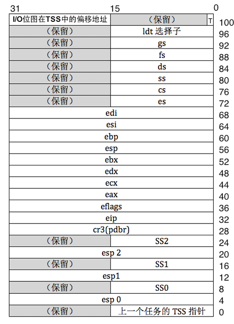

### 11.1.1 多任务的起源，很久很久以前

驾驶员依赖汽车提供的方向盘和刹车系统，软件能力取决于硬件支持，操作系统作为"硬件驾驶员"，其功能受限于CPU提供的特性。

早期CPU仅支持单任务，随着多任务需求增长，CPU厂商在硬件层面提供了原生多任务方案，其中最主要的就是LDT和TSS，希望避免软件实现的多任务在效率和安全性上的不足。

### 11.1.2 LDT简介

LDT(**局部描述符表**)存储任务私有资源，每个任务拥有独立的LDT，其描述符在GDT中注册。

CPU通过**LDTR**寄存器定位LDT，选择子中的TI位决定从LDT或GDT检索描述符，选择子高13位可索引8192（2^13）个描述符，支持大量任务创建。

> LDT 的段描述符存在 GDT 里；LDT 选择子就是指向 GDT 中这一项的 16bit 选择子，这个选择子被加载到 LDTR。

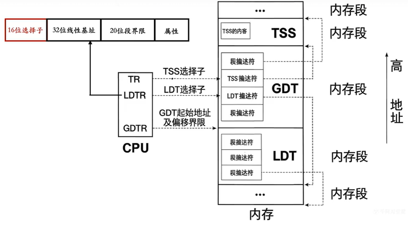

LDT与GDT对应，但LDT第0个描述符可用，而GDT第0个描述符保留用于错误检查。

{width=80%}

```c
// LDT描述符结构(系统段描述符，S=0, TYPE=0010)
struct gdt_desc {
    uint16_t limit_low_word;
    uint16_t base_low_word;
    uint8_t  base_mid_byte;
    uint8_t  attr_low_byte;
    uint8_t  limit_high_attr_high;
    uint8_t  base_high_byte;
};

// 使用lldt指令加载LDT选择子到LDTR仅需16位偏移值 lgdt时需16偏移+32位地址
asm volatile("lldt %w0" : : "r"(ldt_selector));
// lgdt 加载GDT 全局描述符表基址 + 界限（表本身在内存里，是 64 位的 gdtr 描述符）；
// lldt 只是加载LDT 的段选择子（LDT 描述符本身已经存在在 GDT 里面），所以只需要 16bit 选择子。
```

注意：虽然LDT为任务隔离提供基础，但任务切换需重新加载LDTR，比较麻烦，现代操作系统多采用平坦模型简化管理。

### 11.1.3 TSS的作用

TSS(**任务状态段**)保存任务运行时寄存器状态，是任务切换的核心数据结构。

每个任务关联独立TSS，CPU通过TR寄存器跟踪当前任务。任务切换时，CPU自动将当前任务状态保存到其TSS，并从新任务TSS加载上下文。

**TSS描述符**属于系统段描述符(S=0)，TYPE字段中B位表示任务繁忙状态，任务创建时B=0，执行时CPU自动置1，换下CPU时会被自动置0，B可以防止重入(任务调用任务任务自己)。

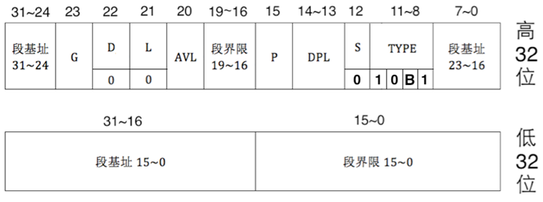{width=80%}

TSS包含关键字段：通用寄存器组、段寄存器、控制寄存器、特权级栈指针、I/O位图等，TSS中三组栈指针用于特权级切换，Linux仅使用esp0和ss0处理3级到0级的切换，设计程序时，结构体的成员和TSS示意图保持一致。

将TSS加载到寄存器TR的指令：**ltr**  “16位通用寄存器”或“16内存单元”

```c
// 32位TSS结构
struct tss {
    uint32_t backlink;    // 上一个任务TSS指针
    uint32_t esp0, ss0;   // 0特权级栈
    uint32_t esp1, ss1;   // 1特权级栈
    uint32_t esp2, ss2;   // 2特权级栈
    uint32_t cr3;
    uint32_t eip;
    uint32_t eflags;
    // ... 其他寄存器字段
};
```

### 11.1.4 CPU原生支持的任务切换方式

从CPU硬件特性而言：

1、按照CPU厂商的理想设计，任务的切换时，新任务对应的LDT信息加载到LDTR，对应TSS信息加载到TR。

2、TSS保存任务的状态，用于状态的恢复，LDT是任务的实体资源，就CPU特性而言LDT不是必须的，任务可将段描述符置于GDT。

3、任务是否切换取决于是否切换TSS，包含TSS选择子的**任务门描述符**可位于IDT、GDT、LDT。

任务之间的**调度关系**则依赖于TSS结构中的字段:

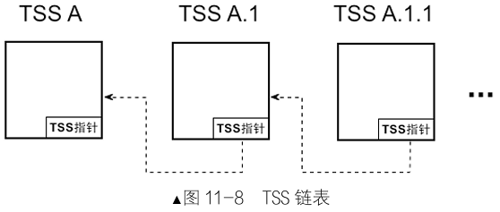{width=60%}

IDT中不能注册TSS描述符，因此对于任务切换，intel支持中断+任务门描述符选择子、call或jmp+TSS描述符选择子或任务门描述符选择子。

**中断+任务门描述符选择子切换步骤：**

1. 中断发生时，CPU通过中断向量号在**IDT**中找到任务门描述符。
2. 任务门描述符包含了TSS选择子，在**GDT**中索引定位TSS描述符。
3. 检查TSS描述符P位(段是否存在)，若为0则抛出异常。
4. 保存旧任务状态到旧TSS。
5. 加载新TSS值到寄存器。
6. 更新TR指向新TSS。
7. 设置新TSS的B位=1，eflags的**NT**位=1。
8. 将旧任务TSS选择子存入新任务TSS的**backlink**字段。
9. 开始执行新任务。

注意：进入新任务后，旧任务B位依然为1；新任务返回时，判断NT=1，通过backline数值利用**iretd指令**返回旧任务。

**call或jmp+TSS描述符选择子或任务门描述符选择子：**

- call指令实现嵌套任务切换，iretd返回时检查NT位。
- jmp指令实现非嵌套切换，不形成调用链。
- 操作数为TSS选择子或任务门选择子，忽略偏移量(如call 0x0010:0x1234)。

### 11.1.5 现代操作系统的任务切换方式

原生切换方案需频繁修改GDT，且步骤较多，效率低下(消耗300+时钟周期)。

CPU要求使用TSS是硬指标，但Linux采用优化方案，每个CPU创建**一个**TSS，仅一次性加载TSS和TR，所有任务共享，后续只是修改同一个TSS的内容；

任务状态保存在**内核栈**而非TSS。进程切换时仅涉及把TSS的SS0及esp0更新为新任务的内核栈的段地址及**栈指针**等必要操作，大幅减少开销，更新CR3寄存器修改**页表**，实现高效切换。

```c
// Linux风格的任务切换：仅更新TSS的esp0字段
void update_tss_esp(struct task_struct *pthread) {
    tss.esp0 = (uint32_t)((uint32_t *)pthread + PG_SIZE);
}
```

另外，Linux任务切换也不使用低效的call和jmp指令。

## 11.2 定义并初始化TSS

本节实现TSS结构**定义**及**加载**，为后续用户进程创建基础。

### TSS结构与全局变量定义

定义**TSS描述符**相关**属性**及**结构**，为后续程序提供数据基础。

修改kernel/**global.h**，增加以下内容：

```c
#define default_prio 31
#ifndef NULL
#define NULL ((void*)0)
#endif
#define USER_VADDR_START    0x08048000
#define USER_STACK3_VADDR   (0xC0000000 - 4096)

// GDT描述符属性
#define DESC_G_4K         1  // 段粒度，1表示4KB，0表示1B
#define DESC_G_1B         0  // 段粒度，0表示1B
#define DESC_D_32         1  // 操作数大小，1表示32位段，0表示16位段
#define DESC_L            0  // 64位代码段标记，32位系统设置为0
#define DESC_AVL          0  // 保留位，可供系统软件使用
#define DESC_P            1  // 段存在位，1表示段存在于内存中

// 描述符特权级
#define DESC_DPL_0        0  // 最高特权级，内核级
#define DESC_DPL_1        1  // 保留
#define DESC_DPL_2        2  // 保留
#define DESC_DPL_3        3  // 最低特权级，用户级

// 段类型位(S位)
#define DESC_S_SYS        0  // S=0，系统段（门描述符、TSS描述符等）
#define DESC_S_CODE       1  // S=1，代码段或数据段
#define DESC_S_DATA       DESC_S_CODE  // 数据段与代码段S位相同

// 段类型(TYPE字段)
#define DESC_TYPE_CODE    8  // 代码段类型：x=1(可执行),c=0(非依从),r=0(不可读),a=0(未访问)
#define DESC_TYPE_DATA    2  // 数据段类型：x=0(不可执行),e=0(向上扩展),w=1(可写),a=0(未访问)
#define DESC_TYPE_TSS     9  // TSS描述符类型：B=0(不忙)

// 用户段选择子（索引5,6）
#define SELECTOR_U_CODE   ((5 << 3)+(TI_GDT << 2)+RPL3)  // 用户代码段选择子
#define SELECTOR_U_DATA   ((6 << 3)+(TI_GDT << 2)+RPL3)  // 用户数据段选择子
#define SELECTOR_U_STACK  SELECTOR_U_DATA                // 用户栈段使用数据段选择子

// TSS选择子（索引4）
#define SELECTOR_TSS      ((4 << 3)+(TI_GDT << 2)+RPL0)  // TSS选择子

// GDT描述符属性组合（高4位）
#define GDT_ATTR_HIGH ((DESC_G_4K << 7)+(DESC_D_32 << 6)+(DESC_L << 5)+(DESC_AVL << 4))

// 用户段描述符属性组合（低字节，DPL=3）
#define GDT_CODE_ATTR_LOW_DPL3 ((DESC_P << 7)+(DESC_DPL_3 << 5)+(DESC_S_CODE << 4)+DESC_TYPE_CODE)
#define GDT_DATA_ATTR_LOW_DPL3 ((DESC_P << 7)+(DESC_DPL_3 << 5)+(DESC_S_DATA << 4)+DESC_TYPE_DATA)

// TSS描述符属性
#define TSS_DESC_D    0  
#define TSS_ATTR_HIGH ((DESC_G_1B << 7)+(TSS_DESC_D << 6)+(DESC_L << 5)+(DESC_AVL << 4)+0x0)  // TSS高属性字节
#define TSS_ATTR_LOW  ((DESC_P << 7)+(DESC_DPL_0 << 5)+(DESC_S_SYS << 4)+DESC_TYPE_TSS)       // TSS低属性字节

// GDT描述符结构体（8字节）
struct gdt_desc {
    uint16_t limit_low_word;       // 段限长低16位
    uint16_t base_low_word;        // 段基址低16位
    uint8_t  base_mid_byte;        // 段基址中间8位
    uint8_t  attr_low_byte;        // 属性低字节（P/DPL/S/TYPE）
    uint8_t  limit_high_attr_high; // 段限长高4位 + 属性高4位
    uint8_t  base_high_byte;       // 段基址高8位
};

```

### TSS初始化实现

完成TSS的**初始化**、加载TSS信息到**TR**寄存器。

先创建对应的userprog/**tss.h**头文件：

```c
#ifndef __USERPROG_TSS_H
#define __USERPROG_TSS_H
#include "thread.h"

/* 更新tss中esp0字段的值为pthread的0级线 */
void update_tss_esp(struct task_struct* pthread);
/* 在gdt中创建tss并重新加载gdt */
void tss_init(void);
#endif
```

再创建userprog/**tss.c**：

```c
#include "global.h"
#include "stdint.h"
#include "print.h"
#include "thread.h"
#include "string.h"
#include "stdint.h"
#include "tss.h"

/* 任务状态段tss结构 */
struct tss {
    uint32_t backlink;
    uint32_t* esp0;
    uint32_t ss0;
    uint32_t* esp1;
    uint32_t ss1;
    uint32_t* esp2;
    uint32_t ss2;
    uint32_t cr3;
    uint32_t (*eip) (void);
    uint32_t eflags;
    uint32_t eax;
    uint32_t ecx;
    uint32_t edx;
    uint32_t ebx;
    uint32_t esp;
    uint32_t ebp;
    uint32_t esi;
    uint32_t edi;
    uint32_t es;
    uint32_t cs;
    uint32_t ss;
    uint32_t ds;
    uint32_t fs;
    uint32_t gs;
    uint32_t ldt;
    uint32_t trace;
    uint32_t io_base;
};
static struct tss tss;

/* 更新tss中esp0字段的值为pthread的0级线 */
void update_tss_esp(struct task_struct* pthread) {
    tss.esp0 = (uint32_t*)((uint32_t)pthread + PG_SIZE);
}

/* 创建gdt描述符 */
static struct gdt_desc make_gdt_desc(uint32_t* desc_addr, uint32_t limit, uint8_t attr_low, uint8_t attr_high) {
    uint32_t desc_base = (uint32_t)desc_addr;
    struct gdt_desc desc;
    desc.limit_low_word =  limit & 0x0000ffff;
    desc.base_low_word  =  desc_base & 0x0000ffff;
    desc.base_mid_byte  =  ((desc_base & 0x00ff0000) >> 16);
    desc.attr_low_byte  =  (uint8_t)(attr_low);
    desc.limit_high_attr_high = (((limit & 0x000f0000) >> 16) + (uint8_t)(attr_high));
    desc.base_high_byte = desc_base >> 24;
    return desc;
}


/* 在gdt中创建tss并重新加载gdt，三步，一准备TSS结构、二GDT描述符安装、三寄存器加载 */
void tss_init() {
    put_str("tss_init start\n");
    uint32_t tss_size = sizeof(tss);
    memset(&tss, 0, tss_size);
    tss.ss0 = SELECTOR_K_STACK;
    tss.io_base = tss_size;

    /* gdt段基址为0x903(不是900)，把tss放到第4个位置，也就是0x903+0x20的位置 */
    /* 在gdt中添加dpl为0的TSS描述符 */
    *((struct gdt_desc*)0xc0000923) = make_gdt_desc((uint32_t*)&tss, tss_size - 1, TSS_ATTR_LOW,  \
       TSS_ATTR_HIGH);
    /* 在gdt中添加dpl为3的用户程序数据段和代码段描述符 */
    *((struct gdt_desc*)0xc000092B) = make_gdt_desc((uint32_t*)0,0xfffff, GDT_CODE_ATTR_LOW_DPL3, \
      GDT_ATTR_HIGH);
    *((struct gdt_desc*)0xc0000933) = make_gdt_desc((uint32_t*)0,0xfffff, GDT_DATA_ATTR_LOW_DPL3, \
      GDT_ATTR_HIGH);
     /* gdt指令需要16位的limit 32位的段基址 */
    uint64_t gdt_operand = ((8 * 7 - 1) | ((uint64_t)(uint32_t)0xc0000903 << 16)); // 7个描述符大小
    asm volatile ("lgdt %0" : : "m"(gdt_operand));
    asm volatile ("ltr %w0" : : "r"(SELECTOR_TSS));
    put_str("tss_init and ltr done\n");
}
```

根据 global.h 中的选择子定义，此时 GDT 共有 7 个描述符：

| 索引 | 偏移  | 选择子 | 内容                      |
| ---: | ----- | ------ | ------------------------- |
| 0    | 0x903 | -      | 空描述符（必选）          |
| 1    | 0x90B | 0x08   | 内核代码段                |
| 2    | 0x913 | 0x10   | 内核数据段                |
| 3    | 0x91B | 0x18   | 内核 GS（显存）           |
| 4    | 0x923 | 0x20   | TSS 描述符 ← tss_init 新增 |
| 5    | 0x92B | 0x28   | 用户代码段 ← tss_init 新增 |
| 6    | 0x933 | 0x30   | 用户数据段 ← tss_init 新增 |

**修改init.c**,增加tss初始化程序：

```c
#include "print.h"
#include "interrupt.h"
#include "../device/timer.h"
#include "memory.h"
#include "thread.h"
#include "console.h"
#include "init.h"
#include "keyboard.h"
#include "tss.h"

/* 负责初始化所有模块 */
void init_all(void) {
    put_str("init_all\n");
    intr_init();       // 中断初始化中断
    mem_init();        //内存初始化          8.5.3加
    thread_init();     //线程机制初始化       9.4.4加
    timer_init();      //定时器初始化        7.8加
    console_init();    // 终端初始化         10.2.2加
    keyboard_init();   //键盘初始化          10.3.4加
    tss_init();        //TSS初始化         11.2加
}

```

### TSS初始化流程说明及验证

TSS初始化过程可分为三个主要步骤：

1. **TSS 结  构 准 备**：清空TSS实例并设置关键字段(ss0和io_base)
2. **GDT描述符安装**：在GDT中安装TSS描述符和用户段描述符
3. **寄  存  器  加  载**：使用lgdt和ltr指令激活新GDT和TSS

初始化完成后，CPU可通过TR寄存器访问TSS。通过update_tss_esp函数可在进程切换时更新0特权级栈指针，确保中断处理正确性。


## 11.3 实现用户进程

本节将详细介绍实现用户进程的**原理**和**步骤**。用户程序基于现有线程框架实现，这需要解决特权级切换、独立地址空间等核心问题。

### 11.3.1 实现用户进程的原理

用户进程基于线程框架实现，通过**替换**部分线程执行函数为进程初始化例程，完成向用户态的切换。先回顾一下相关程序(thread/**thread.c**):

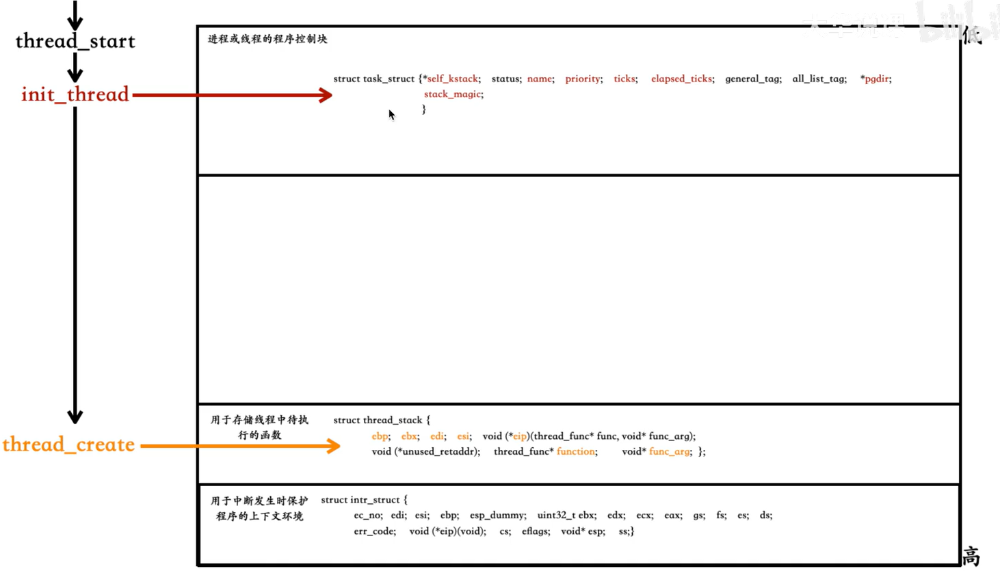

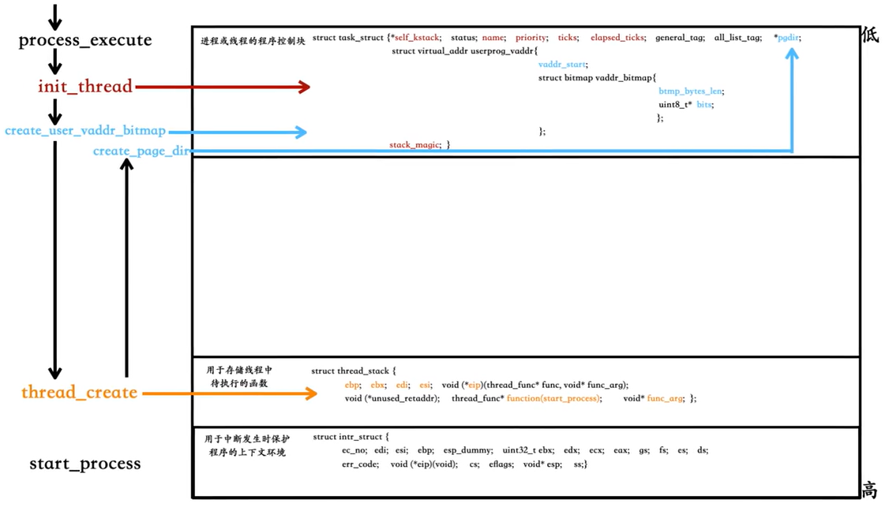

```c
/* 创建优先级为prio的线程，线程名name，线程所执行的函数是 function(func_arg) */  
struct task_struct* thread_start(char* name, \
                                 int prio, \
                                 thread_func function, \
                                 void* func_arg) {  
    /* pcb 都位于内核空间，包括用户进程的 pcb 也是在内核空间 */  
    struct task_struct* thread = get_kernel_pages(1);  
    init_thread(thread, name, prio);             //初始化PCB
    thread_create(thread, function, func_arg);   //初始化线程栈
  
    ASSERT(!elem_find(&thread_ready_list, &thread->general_tag));  //确保之前不在队列中
    list_append(&thread_ready_list, &thread->general_tag);         //加入就绪线程队列

    ASSERT(!elem_find(&thread_all_list, &thread->all_list_tag));  //确保之前不在队列中
    list_append(&thread_all_list, &thread->all_list_tag);         //加入全部线程队列
  
    return thread;  
}  
```

### 11.3.2 用户进程的虚拟地址空间

用户进程拥有独立的4GB虚拟地址空间，通过**页表**实现隔离。进程PCB需要维护**虚拟地址池位图**，跟踪内存分配情况，在task_struct要增加一个成员，就绪队列、所有任务队列这两个数据要加上外部使用声明。

修改thread/**thread.h**:

```c
#include "stdint.h"
#include "list.h"
#include "bitmap.h"
#include "memory.h"

extern struct list thread_ready_list;    //11.3.2加
extern struct list thread_all_list;      //11.3.2加

...略

/* 进程或线程的pcb，程序控制块 */
struct task_struct {
    uint32_t* self_kstack;        // 各内核线程都用自己的内核栈
    enum task_status status;
    char name[16];
    uint8_t priority;
  
...略

/* general_tag的作用是用于线程在一般的队列中的结点 */
    struct list_elem general_tag;

/* all_list_tag的作用是用于线程队列 thread_all_list 中的结点 */
    struct list_elem all_list_tag;

    uint32_t* pgdir;                      // 线程为NULL
    struct virtual_addr userprog_vaddr;   // 用户进程的虚拟地址池     11.3.2加
    uint32_t stack_magic;
// 用这串数字做栈的边界标记，用于检测栈的溢出
};
```

### 11.3.3 为进程创建页表和3特权级栈

进程需要独立的**页表**和**用户栈**(3特权级)，通过扩展内存管理功能实现资源分配。修改对应的kernel/**memory.h**：

```c
#ifndef __KERNEL_MEMORY_H
#define __KERNEL_MEMORY_H

#include "stdint.h"
#include "bitmap.h"

/* 内存池类型标记 */
enum pool_flags {
    PF_KERNEL = 1,  /* 内核内存池 */
    PF_USER   = 2   /* 用户内存池 */
};

/* 页表项属性标志位 */
#define PG_P_1   1   /* 页表项存在位 */
#define PG_P_0   0   /* 页表项不存在 */
#define PG_RW_R  0   /* 读/执行权限 */
#define PG_RW_W  2   /* 读/写/执行权限 */
#define PG_US_S  0   /* 系统级权限 */
#define PG_US_U  4   /* 用户级权限 */

/* 虚拟地址池结构体 */
struct virtual_addr {
    struct bitmap vaddr_bitmap;  /* 虚拟地址位图结构 */
    uint32_t vaddr_start;        /* 虚拟地址分配起始地址 */
};

extern struct pool kernel_pool, user_pool;

void  mem_init(void);
void* get_kernel_pages(uint32_t pg_cnt);
void* get_user_pages(uint32_t pg_cnt);                   //11.3.3加
void* get_a_page(enum pool_flags pf, uint32_t vaddr);    //11.3.3加
uint32_t addr_v2p(uint32_t vaddr);                       //11.3.3加

#endif 
```

修改kernel/**memory.c**：

```c
// area1 数据准备(以下数据转移至global.h)
#define PG_SIZE 4096                // 一页4K
#define MEM_BITMAP_BASE 0xc009a000  // 位图基地址
#define K_HEAP_START 0xc0100000     // 内核堆起始地址1M
#define MEM_SIZE 0X2000000          //内存大小32M


...略
struct pool {
...略
    struct lock lock;                  // 申请内存时互斥 11.3.3加
};

...略

/* 虚拟内存池中申请pg_cnt个虚拟页(用户或内核)，成功则返回虚拟页的起始地址 */
static void* vaddr_get(enum pool_flags pf, uint32_t pg_cnt) {
    int vaddr_start = 0, bit_idx_start = -1;
    uint32_t cnt = 0;
    if (pf == PF_KERNEL) {  // 内核内存池
...略
    } else {                // 用户内存池  11.3.3加
        struct task_struct* cur = running_thread();
        bit_idx_start = bitmap_scan(&cur->userprog_vaddr.vaddr_bitmap, pg_cnt);
        if (bit_idx_start == -1) {
            return NULL;
        }
        while(cnt < pg_cnt) {
            bitmap_set(&cur->userprog_vaddr.vaddr_bitmap, bit_idx_start + cnt++, 1);
        }
        vaddr_start = cur->userprog_vaddr.vaddr_start + bit_idx_start * PG_SIZE;
        /* (0xc0000000 - PG_SIZE)作为用户3级栈已经在start_process被分配 */
        ASSERT((uint32_t)vaddr_start < (0xc0000000 - PG_SIZE));
    }
    return (void*)vaddr_start;
}

...略

/* 在用户空间中申请pg_cnt个4k内存，并返回其虚拟地址  11.3.3加 */
void* get_user_pages(uint32_t pg_cnt) {
    lock_acquire(&user_pool.lock);
    void* vaddr = malloc_page(PF_USER, pg_cnt);
    memset(vaddr, 0, pg_cnt * PG_SIZE);
    lock_release(&user_pool.lock);
    return vaddr;
}

/* 将虚拟地址vaddr与物理地址关联，仅支持一页空间分配  11.3.3加 */
void* get_a_page(enum pool_flags pf, uint32_t vaddr) {
    struct pool* mem_pool = pf & PF_KERNEL ? &kernel_pool : &user_pool;
    lock_acquire(&mem_pool->lock);

    /* 先将虚拟地址对应的位图置1 */
    struct task_struct* cur = running_thread();
    int32_t bit_idx = -1;

/* 若当前是用户进程申请用户内存，就修改用户进程自己的虚拟地址位图 */
    if (cur->pgdir != NULL && pf == PF_USER) {
        bit_idx = (vaddr - cur->userprog_vaddr.vaddr_start) / PG_SIZE;
        ASSERT(bit_idx > 0);
        bitmap_set(&cur->userprog_vaddr.vaddr_bitmap, bit_idx, 1);

    } else if (cur->pgdir == NULL && pf == PF_KERNEL) {
/* 如果是内核线程申请内核内存，就修改kernel_vaddr_pool */
        bit_idx = (vaddr - kernel_vaddr_pool.vaddr_start) / PG_SIZE;
        ASSERT(bit_idx > 0);
        bitmap_set(&kernel_vaddr_pool.vaddr_bitmap, bit_idx, 1);
    } else {
        PANIC("get_a_page:not allow kernel alloc userspace or user alloc kernelspace by get_a_page");
    }

    void* page_phyaddr = palloc(mem_pool);
    if (page_phyaddr == NULL) {
        return NULL;
    }
    page_table_add((void*)vaddr, page_phyaddr);
    lock_release(&mem_pool->lock);
    return (void*)vaddr;
}

/* 将虚拟地址转化为物理地址 11.3.3加 */
uint32_t addr_v2p(uint32_t vaddr) {
    uint32_t* pte = pte_ptr(vaddr);
     //(*pte)的值是页表所在的物理页框地址， 去掉其低12位的页表项属性+虚拟地址vaddr的低12位
    return ((*pte & 0xfffff000) + (vaddr & 0x00000fff));
}

/* 初始化内存池 */
static void mem_pool_init(uint32_t all_mem) {
    put_str("  mem_pool_init start\n");
...略
    lock_init(&kernel_pool.lock);    //11.3.3加
    lock_init(&user_pool.lock);      //11.3.3加
...略
```

```linenums="0"
                    虚拟地址分配
                    ┌─────────┐
                    │vaddr_get│
                    └────┬────┘
           PF_KERNEL /          \ PF_USER
                     /            \
      kernel_vaddr_pool    cur->userprog_vaddr
      (全局唯一)            (每进程一份)
           │                      │
           ▼                      ▼
      内核虚拟地址             用户虚拟地址
      (0xC0100000+)          (0x08048000+)
           │                      │
           ▼                      ▼
      malloc_page(pf)  ──  PF 选择物理池  ──► 内核线程: kernel_pool
                                              用户进程: user_pool
           │
           ▼
      page_table_add()  ── 不同的 pgdir ──► 内核共用 pgdir
                                            用户各有 pgdir
```

修改kernel/debug.h，增加**PANIC**定义：

```c
#ifndef __KERNEL_DEBUG_H
#define __KERNEL_DEBUG_H
#define NULL ((void*)0)

void panic_spin(char* filename, int line, const char* func, const char* condition);

/* 定义ASSERT宏 */
#ifdef NDEBUG
    #define ASSERT(CONDITION) ((void)0)
#else
    #define ASSERT(CONDITION) \
        if (CONDITION) {} else { \
            panic_spin(__FILE__, __LINE__, __func__, #CONDITION); \
        }
#endif

#define PANIC(cond) panic_spin(__FILE__, __LINE__, __func__, cond)

#endif
```

### 11.3.4 用户进程创建的流程

用户进程创建采用分层设计，整体流程清晰明确：

```c linenums="0"
进程创建流程：
1. process_execute(user_prog, ...)                 调用开始
   ↓
2. get_kernel_pages(1)                             申请PCB内存
   ↓
3. init_thread                                     初始化线程基础信息
   ↓
4. create_user_vaddr_bitmap                        创建虚拟地址位图
   ↓
5. thread_create(thread, start_process, user_prog) 关键步骤
   ↓
6. create_page_dir                                 创建进程页表
   ↓
7. list_append                                     加入就绪队列
   ↓
8. 等待调度器调度执行
```

### 11.3.5 实现用户进程

修改kernel/**global.h**，增加eflags属性位相关数据，调整了global.h部分内容的位置，鉴于global.h涵盖了type.h的内容，将type.h删除：

```c
...略

#define EFLAGS_MBS          (1 << 1)        // 此项必须要设置
#define EFLAGS_IF_1         (1 << 9)        // if 为 1，开中断
#define EFLAGS_IF_0         0               // if 为 0，关中断
#define EFLAGS_IOPL_3       (3 << 12)       // IOPL3，用于测试用户程序在非系统调用下进行IO

#define EFLAGS_IOPL_0       (0 << 12)       // IOPL0

#define NULL                ((void*)0)
#define DIV_ROUND_UP(X, STEP) ((X + STEP - 1) / (STEP))
#define true                1
#define false               0

#define PG_SIZE             4096
```

同时，需将包含type.h的内容进行删除：

```shell
root@DESKTOP-P4JEDQL:/usr/local/bochs# grep -rni "type.h"
kernel/type.h:1:#ifndef TYPE_H
kernel/type.h:2:#define TYPE_H
grep: bin/bochs: binary file matches
grep: bin/bximage: binary file matches
share/doc/bochs/CHANGES:2276: [1368239] broken grater than 4GB size of sparse type hd image
thread/sync.c:5:#include "type.h" 
thread/thread.c:6:#include "type.h" 
lib/kernel/list.c:3:#include "type.h"
```

创建userprog/**process.c**，实现进程创建的核心函数，整合各个组件完成进程初始化。通过模拟中断返回过程进入3特权级，在内核栈中构建完整的用户上下文：


```c
#include "process.h"
#include "thread.h"
#include "memory.h"
#include "global.h"
#include "interrupt.h"
#include "print.h"
#include "string.h"
#include "sync.h"
#include "bitmap.h"
#include "stdint.h"

extern void intr_exit(void);

/* 创建用户进程 */
void process_execute(void* filename, char* name) {
    /* pcb内核的数据结构，由内核来维护进程信息，因此要在内核内存池中申请 */
    struct task_struct* thread = get_kernel_pages(1);
    init_thread(thread, name, default_prio);
    create_user_vaddr_bitmap(thread);
    thread_create(thread, start_process, filename);
    thread->pgdir = create_page_dir(); // ★ 这是进程和线程的本质分水岭

    enum intr_status old_status = intr_disable();
    ASSERT(!elem_find(&thread_ready_list, &thread->general_tag));
    list_append(&thread_ready_list, &thread->general_tag);

    ASSERT(!elem_find(&thread_all_list, &thread->all_list_tag));
    list_append(&thread_all_list, &thread->all_list_tag);
    intr_set_status(old_status);
}


/* 创建用户进程虚拟地址位图 */
void create_user_vaddr_bitmap(struct task_struct* user_prog) {
    user_prog->userprog_vaddr.vaddr_start = USER_VADDR_START;
    uint32_t bitmap_pg_cnt = DIV_ROUND_UP(\
        (0xc0000000 - USER_VADDR_START) / PG_SIZE / 8 , PG_SIZE);
  
    user_prog->userprog_vaddr.vaddr_bitmap.bits =\
        get_kernel_pages(bitmap_pg_cnt);
    user_prog->userprog_vaddr.vaddr_bitmap.btmp_bytes_len =\
        (0xc0000000 - USER_VADDR_START) / PG_SIZE / 8;
  
    bitmap_init(&user_prog->userprog_vaddr.vaddr_bitmap);
}

/* 上半部分,构建用户进程初始上下文信息 */
void start_process(void* filename_) {
    void* function = filename_;
    struct task_struct* cur = running_thread();
    cur->self_kstack += sizeof(struct thread_stack);
    struct intr_stack* proc_stack = (struct intr_stack*)cur->self_kstack;
    proc_stack->edi = proc_stack->esi = \
    proc_stack->ebp = proc_stack->esp_dummy = 0;

    proc_stack->ebx = proc_stack->edx = \
    proc_stack->ecx = proc_stack->eax = 0;

    proc_stack->gs = 0;               // 用户态用不上，直接初始为 0
    proc_stack->ds = proc_stack->es = proc_stack->fs = SELECTOR_U_DATA;
    proc_stack->ss = SELECTOR_U_DATA;
    proc_stack->cs = SELECTOR_U_CODE;
    proc_stack->eip = function;       // 待执行的用户程序地址
    proc_stack->eflags = (EFLAGS_IOPL_0 | EFLAGS_MBS | EFLAGS_IF_1);
    proc_stack->esp = (void*)((uint32_t)get_a_page(PF_USER, \
                              USER_STACK3_VADDR) + PG_SIZE);
    proc_stack->ss = SELECTOR_U_DATA;
    asm volatile ("movl %0, %%esp; jmp intr_exit" : : "g"(proc_stack) : "memory");
    //iret指令执行时，依次pop eip、cs、eflages、esp、ss
}

/* 下半部分。创建页目录表，将当前页表的表示内核空间的pde复制，返回页目录的虚拟地址*/
uint32_t* create_page_dir(void) {
    /* 用户进程的页表不能让用户直接访问到，所以在内核空间来申请 */
    uint32_t* page_dir_vaddr = get_kernel_pages(1);
    if (page_dir_vaddr == NULL) {
        console_put_str("create_page_dir: get_kernel_page failed!");
        return NULL;
    }
/*************************** 1  先 复 制 页 表 *********************************/
    /* page_dir_vaddr + 0x300 * 4 是内核页目录的第768项 */
    memcpy((uint32_t*)((uint32_t)page_dir_vaddr + 0x300 * 4), \
        (uint32_t*)(0xfffff000+0x300 * 4), 1024);
/*************************** 2  更新页目录地址 ***************************/
    uint32_t new_page_dir_phy_addr = addr_v2p((uint32_t)page_dir_vaddr);
    /* 页目录地址是存入在页目录的最后一项，更新页目录地址为新页目录的物理地址 */
    page_dir_vaddr[1023] = new_page_dir_phy_addr | PG_US_U | PG_RW_W | PG_P_1;
    return page_dir_vaddr;
}
```

总结对比：内核线程 vs 用户进程

| 维度         | 内核线程                     | 用户进程                                  |
| ------------ | ---------------------------- | ----------------------------------------- |
| `pgdir`      | `NULL`                       | 独立页目录（`create_page_dir` 创建）      |
| 页目录内容   | 只用内核 256 项              | 复制内核 256 项 + 用户空间空白            |
| 虚拟地址位图 | 无（共用 `kernel_vaddr_pool`） | `userprog_vaddr`（每进程独立）             |
| 首次入口     | `kernel_thread(func, arg)`   | `start_process` → `intr_exit` → `iretd` → 用户入口 |
| 运行特权级   | 始终 Ring 0                  | Ring 3（可陷入 Ring 0）                   |
| TSS `esp0`  | 不需要（本身就在 Ring 0）    | 每次调度需更新                            |
| PCB 位置     | 内核空间                     | 内核空间（但映射在各进程的高 1GB）        |

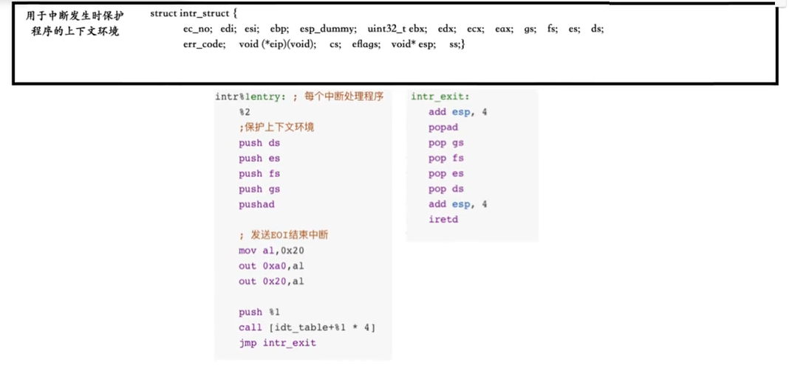

### 11.3.6 bss简介

bss特性：

```c
/*
 * - 作用：存储未初始化全局变量和静态变量
 * - 空间特点：程序文件中不存在实体，仅记录大小信息，不占用文件大小，仅占用内存空间
 * - 链接时合并到数据段，影响用户进程内存布局规划
 * - 加载时由操作系统初始化为0，数据段的文件大小与内存大小差距正好为bss节的大小
 */
```

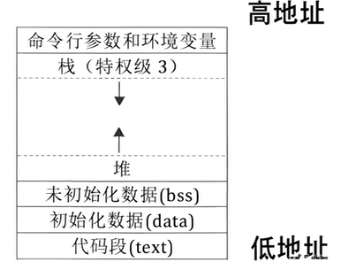{width=40%}

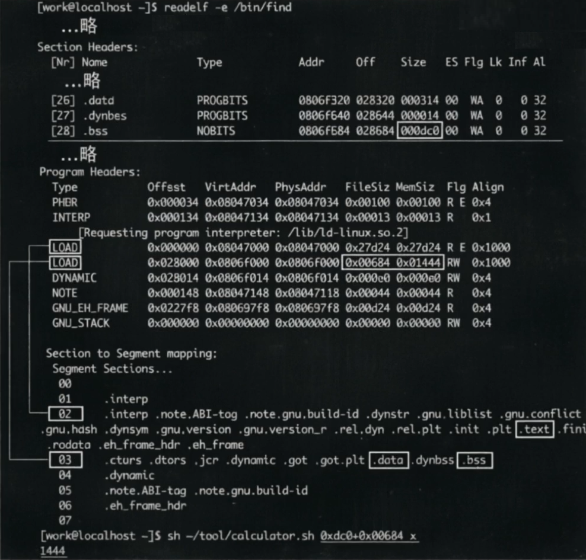

### 11.3.7 让进程跑起来—用户进程的调度

在任务切换时需正确激活新进程的运行环境，修改thread/t**hread.c**调度逻辑，增加激活新进程运行环境的步骤：

```c
...略

#include "process.h"
...略

/* 实现任务调度 */
void schedule() {
...略
    thread_tag = list_pop(&thread_ready_list);
    struct task_struct* next =elem2entry(struct task_struct, general_tag, thread_tag);
  
    next->status = TASK_RUNNING;

    /* 激活任务页表等 */
    process_activate(next);   //11.3.7加
    switch_to(cur, next);
}
```

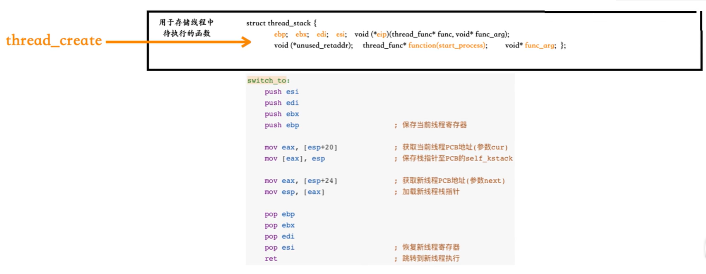

修改userprog/**process.c**，实现**进程激活**和**页表切换**功能，即设置TSS的cr3及esp0寄存器，确保任务调度时环境正确切换:

```c
/* 激活线程或进程的页表，更新tss中的esp0为进程的特权级0的栈 */
void process_activate(struct task_struct* p_thread) {
    ASSERT(p_thread != NULL);
    page_dir_activate(p_thread);
/* 内核线程特权级本身就是0，故不需要更新esp0*/
    if (p_thread->pgdir) {
        update_tss_esp(p_thread);//更新该进程的esp0,用于此进程被中断时保留上下文
    }
}


/* 激活该进程或线程的页表，当前任务可能是线程，不恢复页表的话，线程就会使用进程的页表了 */
void page_dir_activate(struct task_struct* p_thread) {
/* 若为内核线程，需要重新填充页表为 0x100000 */
    uint32_t pagedir_phy_addr = 0x100000;  // 默认为内核线程的页目录物理地址
    if (p_thread->pgdir != NULL) {         // 用户态进程有自己的页目录表
        pagedir_phy_addr = addr_v2p((uint32_t)p_thread->pgdir);
    }
/* 更新页目录寄存器 cr3，使新页表生效 */
    asm volatile ("movl %0, %%cr3" : : "r"(pagedir_phy_addr) : "memory");
}
```

结合当前process.c的所有内容，**创建**对应的userprog/**process.h**头文件：

```c
#ifndef __USERPROG_PROCESS_H
#define __USERPROG_PROCESS_H
#include "thread.h"
#include "stdint.h"

/* 创建用户进程 */
void process_execute(void* filename, char* name);
/* 创建用户进程虚拟地址位图 */
void create_user_vaddr_bitmap(struct task_struct* user_prog);
/* 构建用户进程初始上下文信息 */
void start_process(void* filename_);
/* 创建页目录表，返回页目录的虚拟地址 */
uint32_t* create_page_dir(void);
void process_activate(struct task_struct* p_thread);
void page_dir_activate(struct task_struct* p_thread);

#endif
```

### 11.3.8 测试用户进程

修改**main.c**，测试验证用户进程功能，确认特权级切换和进程隔离效果。

```c
#include "print.h"
#include "init.h"
#include "thread.h"
#include "process.h"
#include "console.h"
#include "interrupt.h"

void k_thread_a(void*);
void k_thread_b(void*);
void u_prog_a(void);
void u_prog_b(void);

int volatile test_var_a = 0, test_var_b = 0;

int main(void) {
    put_str("I am kernel\n");
    init_all();

    thread_start("k_thread_a", 31, k_thread_a, "argA ");
    thread_start("k_thread_b", 31, k_thread_b, "argB ");
    process_execute(u_prog_a, "user_prog_a");
    process_execute(u_prog_b, "user_prog_b");

    intr_enable();
    while(1);
    return 0;
}

/* 在线程中运行的函数 */
void k_thread_a(void* arg) {
    char* para = arg;
    while(1) {
        console_put_str("A:");
        console_put_int(test_var_a);
        console_put_str("   ");
    }
}

/* 在线程中运行的函数 */
void k_thread_b(void* arg) {
    char* para = arg;
    while(1) {
        console_put_str("B:");
        console_put_int(test_var_b);
        console_put_str("   ");
    }
}

/* 测试用户进程 */
void u_prog_a(void) {
    while(1) {
        test_var_a++;
    }
}

/* 测试用户进程 */
void u_prog_b(void) {
    while(1) {
        test_var_b++;
    }
}
```

```linenums="0"
.
├── device
│   ├── console.c
│   ├── console.h
│   ├── ioqueue.c
│   ├── ioqueue.h
│   ├── keyboard.c
│   ├── keyboard.h
│   ├── timer.c
│   └── timer.h
├── kernel
│   ├── debug.c
│   ├── debug.h
│   ├── global.h     # 🛠️ 修改
│   ├── init.c
│   ├── init.h
│   ├── interrupt.c
│   ├── interrupt.h
│   ├── kernel.s
│   ├── main.c
│   ├── memory.c     # 🛠️ 修改
│   ├── memory.h
│   ├── stdint.h
│   └── type.h
├── lib
│   ├── kernel
│   │   ├── bitmap.c
│   │   ├── bitmap.h
│   │   ├── io.h
│   │   ├── list.c
│   │   ├── list.h
│   │   ├── print.c
│   │   ├── print.h
│   │   └── print.s
│   ├── stdbool.h
│   ├── string.c
│   └── string.h
├── makefile
├── thread
│   ├── switch.s
│   ├── sync.c
│   ├── sync.h
│   ├── thread.c
│   └── thread.h
└── userprog         #💡新增
    ├── process.c
    ├── process.h
    ├── tss.c
    └── tss.h
```

修改**makefile**:

```shell
BUILD_DIR = ./build
ENTRY_POINT = 0xc0001500
AS = nasm
CC = gcc
LD = ld
LIB = -I lib/ -I lib/kernel/ -I lib/user/ -I kernel/ -I device/ -I thread/ -I userprog/
ASFLAGS = -f elf
CFLAGS = -std=gnu11 -m32 $(LIB) -c -fno-builtin -fno-stack-protector -W -Wstrict-prototypes \
	-Wmissing-prototypes  
LDFLAGS = -m elf_i386 -Ttext $(ENTRY_POINT) -e main -Map $(BUILD_DIR)/kernel.map
OBJS = $(BUILD_DIR)/main.o     $(BUILD_DIR)/init.o    $(BUILD_DIR)/interrupt.o   \
	     $(BUILD_DIR)/timer.o    $(BUILD_DIR)/kernel.o  $(BUILD_DIR)/print.o       \
	     $(BUILD_DIR)/debug.o    $(BUILD_DIR)/string.o  $(BUILD_DIR)/bitmap.o      \
	     $(BUILD_DIR)/memory.o   $(BUILD_DIR)/thread.o  $(BUILD_DIR)/list.o        \
	     $(BUILD_DIR)/switch.o   $(BUILD_DIR)/console.o $(BUILD_DIR)/sync.o 	     \
	     $(BUILD_DIR)/keyboard.o $(BUILD_DIR)/ioqueue.o $(BUILD_DIR)/tss.o         \
	     $(BUILD_DIR)/process.o  \
  

#############  c代码编译   #############
$(BUILD_DIR)/main.o: kernel/main.c
	$(CC) $(CFLAGS) $< -o $@

$(BUILD_DIR)/init.o: kernel/init.c kernel/init.h
	$(CC) $(CFLAGS) $< -o $@

$(BUILD_DIR)/interrupt.o: kernel/interrupt.c kernel/interrupt.h
	$(CC) $(CFLAGS) $< -o $@ 

$(BUILD_DIR)/timer.o: device/timer.c device/timer.h
	$(CC) $(CFLAGS) $< -o $@

$(BUILD_DIR)/debug.o: kernel/debug.c kernel/debug.h
	$(CC) $(CFLAGS) $< -o $@
	
$(BUILD_DIR)/string.o: lib/string.c lib/string.h
	$(CC) $(CFLAGS) $< -o $@
	
$(BUILD_DIR)/bitmap.o: lib/kernel/bitmap.c lib/kernel/bitmap.h
	$(CC) $(CFLAGS) $< -o $@
	
$(BUILD_DIR)/memory.o: kernel/memory.c kernel/memory.h
	$(CC) $(CFLAGS) $< -o $@
  
$(BUILD_DIR)/thread.o: thread/thread.c thread/thread.h
	$(CC) $(CFLAGS) $< -o $@
	
$(BUILD_DIR)/list.o: lib/kernel/list.c lib/kernel/list.h
	$(CC) $(CFLAGS) $< -o $@
	
$(BUILD_DIR)/sync.o: thread/sync.c thread/sync.h
	$(CC) $(CFLAGS) $< -o $@

$(BUILD_DIR)/console.o: device/console.c device/console.h
	$(CC) $(CFLAGS) $< -o $@
	
$(BUILD_DIR)/keyboard.o: device/keyboard.c device/keyboard.h
	$(CC) $(CFLAGS) $< -o $@
	
$(BUILD_DIR)/ioqueue.o: device/ioqueue.c device/ioqueue.h
	$(CC) $(CFLAGS) $< -o $@
	
$(BUILD_DIR)/tss.o: userprog/tss.c userprog/tss.c
	$(CC) $(CFLAGS) $< -o $@
	
$(BUILD_DIR)/process.o: userprog/process.c userprog/process.c
	$(CC) $(CFLAGS) $< -o $@

#############    汇编代码编译    #############
$(BUILD_DIR)/kernel.o: kernel/kernel.s
	$(AS) $(ASFLAGS) $< -o $@

$(BUILD_DIR)/print.o: lib/kernel/print.s
	$(AS) $(ASFLAGS) $< -o $@
	
$(BUILD_DIR)/switch.o: thread/switch.s
	$(AS) $(ASFLAGS) $< -o $@

#############   链接所有目标文件   #############
$(BUILD_DIR)/kernel.bin: $(OBJS)
	$(LD) $(LDFLAGS) $^ -o $@

.PHONY : mk_dir hd clean all

mk_dir:
	if [ ! -d ./build ]; then mkdir ./build; fi

hd:
	dd if=$(BUILD_DIR)/kernel.bin of=hd60M.img bs=512 count=200 seek=9 conv=notrunc
  
clean:
	cd $(BUILD_DIR) && rm -f ./*

build: $(BUILD_DIR)/kernel.bin

all: mk_dir build hd
```

**测试效果**：

从测试效果可以看出线程A和线程B打印的数据不断变化，说明进程A和进程B在同步完成数据的递增，线程和进程都得到了正确的执行。

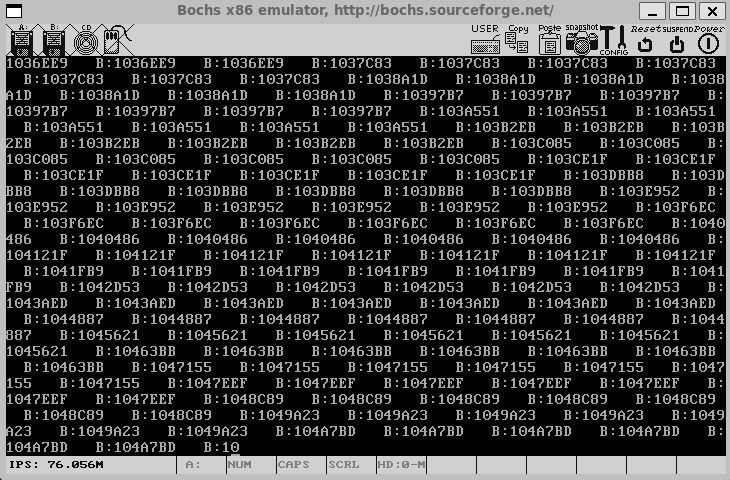

## 本章要点总结

本章通过对比CPU原生方案与实际内核软件优化实践，完整实现了用户进程创建、调度的核心机制，为构建真正的多任务操作系统迈出关键一步。

1. **TSS 核 心 作 用**： 保存任务状态，支持硬件级任务切换，现代操作系统仅利用其esp0字段处理特权级切换。
2. **LDT与地址隔离**： 管理任务私有资源，但平坦模型简化了现代系统设计。
3. **特权级切换机制**：通过模拟中断返回过程进入3特权级。
4. **进 程 地 址 空 间**：独立页表实现4GB虚拟地址隔离，共享内核空间减少内存开销。
5. **创 建 进 程 逻 辑**：复用线程框架，通过修改上下文和调度逻辑实现高效进程管理。
6. **实    战    验    证**：测试进程证实特权级切换和内存隔离正确性，为后续文件系统支持奠定基础。

## 本章依赖源码

```c
bochsrc.disk       1.4
mbr.s              4.3.5
boot.inc           5.3.5
loader.s           5.3.5

  
io.h global.h stdint.h  init.h       7.6.1
kernel.s                             10.3.4源码附件
timer.h                              7.8
timer.c                              第9章源码附件
debub.h  debug.c                     8.2.2
string.h string.c                    8.3
bitmap.h bitmap.c                    8.4.2
stdbool.h                            8.4.2
memory.h  memory.c                   8.5.2
thread.h thread.c                    10.1.4源码附件
print.s print.h                      第9章源码附件
interrupt.h                          第9章完整附件
interrupt.c                          10.5.4源码附件
list.h list.c                        9.3
switch.s                             9.4.3
init.c                               10.3.4
type.h                               9.4.4
sync.h  sync.c                       10.1.5
console.h console.c                  10.2
keyboard.h                           10.5.3
keyboard.c                           10.5.3源码附件
ioqueue.h  ioqueue.c                 10.5.2
```
## 本章源码附件


### 11.2对应的global.h:

```c
#ifndef __KERNEL_GLOBAL_H
#define __KERNEL_GLOBAL_H

#include "stdint.h"

#define default_prio 31
#ifndef NULL
#define NULL ((void*)0)
#endif
#define USER_VADDR_START    0x08048000
#define USER_STACK3_VADDR   (0xC0000000 - 4096)


/* ==================== 描述符通用属性 ==================== */
#define DESC_G_4K         1     // 粒度4K
#define DESC_G_1B          0     // 粒度1B
#define DESC_D_32         1     // 32位模式
#define DESC_L            0     // 64位代码标记(0=32位)
#define DESC_AVL          0     // CPU保留位
#define DESC_P            1     // 段存在位

/* 特权级 */
#define DESC_DPL_0        0
#define DESC_DPL_1        1
#define DESC_DPL_2        2
#define DESC_DPL_3        3

/* 段类型(S位) */
#define DESC_S_SYS        0            // 系统段(S=0)
#define DESC_S_CODE       1            // 代码段(S=1)
#define DESC_S_DATA       DESC_S_CODE  // 数据段(S=1)

/* 段类型(TYPE) */
#define DESC_TYPE_DATA    2     // 数据段: 不可执行,向上扩展,可写
#define DESC_TYPE_CODE    8     // 代码段: 可执行,非依从,不可读
#define DESC_TYPE_TSS     9     // TSS: 不忙


/* ==================== 选择子定义 ==================== */
/* 请求特权级(RPL) */
#define RPL0 0
#define RPL1 1
#define RPL2 2
#define RPL3 3

/* 表指示符(TI) */
#define TI_GDT 0
#define TI_LDT 1

/* 内核段选择子 */
#define SELECTOR_K_CODE   ((1 << 3) + (TI_GDT << 2) + RPL0)
#define SELECTOR_K_DATA   ((2 << 3) + (TI_GDT << 2) + RPL0)
#define SELECTOR_K_STACK  SELECTOR_K_DATA
#define SELECTOR_K_GS     ((3 << 3) + (TI_GDT << 2) + RPL0)  // 显存段
#define SELECTOR_TSS      ((4 << 3) + (TI_GDT << 2) + RPL0)  // TSS

/* 用户段选择子 */
#define SELECTOR_U_CODE   ((5 << 3) + (TI_GDT << 2) + RPL3)
#define SELECTOR_U_DATA   ((6 << 3) + (TI_GDT << 2) + RPL3)
#define SELECTOR_U_STACK  SELECTOR_U_DATA

/* ==================== 中断描述符属性 ==================== */
#define IDT_DESC_P        1     // 存在位
#define IDT_DESC_DPL0     0
#define IDT_DESC_DPL3     3
#define IDT_DESC_32_TYPE  0xE  // 32位中断门
#define IDT_DESC_16_TYPE  0x6  // 16位中断门(保留)

/* 中断门属性字节 */
#define IDT_DESC_ATTR_DPL0  ((IDT_DESC_P << 7) + (IDT_DESC_DPL0 << 5) + IDT_DESC_32_TYPE)
#define IDT_DESC_ATTR_DPL3  ((IDT_DESC_P << 7) + (IDT_DESC_DPL3 << 5) + IDT_DESC_32_TYPE)

/* ==================== GDT描述符属性组合 ==================== */
/* 高属性字节(bit 47-40) */
#define GDT_ATTR_HIGH  ((DESC_G_4K << 7) + (DESC_D_32 << 6) + (DESC_L << 5) + (DESC_AVL << 4))

/* 低属性字节(bit 39-32) - 用户态 */
#define GDT_CODE_ATTR_LOW_DPL3 ((DESC_P << 7) + (DESC_DPL_3 << 5) + (DESC_S_CODE << 4) + DESC_TYPE_CODE)
#define GDT_DATA_ATTR_LOW_DPL3 ((DESC_P << 7) + (DESC_DPL_3 << 5) + (DESC_S_DATA << 4) + DESC_TYPE_DATA)

/* ==================== TSS描述符属性 ==================== */
#define TSS_DESC_D       0     // TSS描述符D位(B位)
#define TSS_ATTR_HIGH    ((DESC_G_1B << 7) + (TSS_DESC_D << 6) + (DESC_L << 5) + (DESC_AVL << 4) + 0x0)
#define TSS_ATTR_LOW     ((DESC_P << 7) + (DESC_DPL_0 << 5) + (DESC_S_SYS << 4) + DESC_TYPE_TSS)


/* ==================== 数据结构定义 ==================== */
struct gdt_desc {
    uint16_t limit_low_word;       // 段限长低16位
    uint16_t base_low_word;        // 基地址低16位
    uint8_t  base_mid_byte;        // 基地址中8位
    uint8_t  attr_low_byte;        // 属性低字节(包括P/DPL/S/TYPE)
    uint8_t  limit_high_attr_high; // 限长高4位 + 属性高4位
    uint8_t  base_high_byte;       // 基地址高8位
};

#endif
```

### 11.2对应的init.c:

```c
#include "print.h"
#include "interrupt.h"
#include "../device/timer.h"
#include "memory.h"
#include "thread.h"
#include "console.h"
#include "init.h"
#include "keyboard.h"
#include "tss.h"

/* 负责初始化所有模块 */
void init_all(void) {
    put_str("init_all\n");
    intr_init();       // 中断初始化中断
    mem_init();        //内存初始化          8.5.3加
    thread_init();     //线程机制初始化       9.4.4加
    timer_init();      //定时器初始化        7.8加
    console_init();    // 终端初始化         10.2.2加
    keyboard_init();   //键盘初始化          10.3.4加
    tss_init();        //TSS初始化         11.2加
}
```

### 11.3.2对应的thread.h:

```c
#ifndef __THREAD_THREAD_H
#define __THREAD_THREAD_H

#include "stdint.h"
#include "list.h"
#include "bitmap.h"
#include "memory.h"

extern struct list thread_ready_list;    //11.3.2加
extern struct list thread_all_list;      //11.3.2加

/* 自定义通用函数类型，它将在很多线程函数中作为形参类型 */
typedef void thread_func(void*);

/* 进程或线程的状态 */
enum task_status {
    TASK_RUNNING,
    TASK_READY,
    TASK_BLOCKED,
    TASK_WAITING,
    TASK_HANGING,
    TASK_DIED
};

/************** 中断栈 intr_stack **************
 * 此结构用于中断发生时保护程序（线程或进程）的上下文环境：
 * 进程或线程被外部中断或软中断打断时，会按照此结构压入上下文
 * 寄存器，intr_exit 中的出栈操作是此结构的逆操作
 * 此栈在线程自己的内核栈中位置固定，所在页的最顶端
 **********************************************/
struct intr_stack {
    uint32_t vec_no;           // kernel.S 宏 VECTOR 中 push %1 压入的中断号
    uint32_t edi;
    uint32_t esi;
    uint32_t ebp;
    uint32_t esp_dummy;       //// pushad把esp也压入，但 sp不断变化，所以会被popad忽略
    uint32_t ebx;
    uint32_t edx;
    uint32_t ecx;
    uint32_t eax;
    uint32_t gs;
    uint32_t fs;
    uint32_t es;
    uint32_t ds;
    /* 以下由 cpu 从低特权级进入高特权级时压入 */
    uint32_t err_code;         // err_code 会被压入在 eip 之后
    void (*eip)(void);
    uint32_t cs;
    uint32_t eflags;
    void* esp;
    uint32_t ss;
};

/************** 线程栈 thread_stack **************
 * 线程自己的栈，用于存储线程中待执行的函数
 * 此结构在线程自己的内核栈中位置不固定，
 * 仅用在 switch_to 时保存线程环境。
 * 实际位置取决于实际运行情况。
 *************************************************/
struct thread_stack {
    uint32_t ebp;
    uint32_t ebx;
    uint32_t edi;
    uint32_t esi;
    /* 线程第一次执行时，eip 指向待调用的函数kernel_thread，其他时候，eip指向switch_to的返回地址*/
    void (*eip)(thread_func* func, void* func_arg);
    /**** 以下仅供第一次被调度上 cpu 时使用 ****/
    /* 参数 unused_ret 只为占位置充数为返回地址 */
    void (*unused_retaddr);
    thread_func* function;      // 由 kernel_thread 所调用的函数名
    void* func_arg;             // 由 kernel_thread 所调用的函数所需的参数
};

struct task_struct {
    uint32_t* self_kstack;        // 线程内核栈指针
    enum task_status status;      // 线程状态（运行、就绪等）
    char name[16];                // 线程名称
    uint8_t priority;             // 优先级，决定时间片长度
    uint8_t ticks;                // 时间片计数器
    uint32_t elapsed_ticks;       // 线程总运行时间
    struct list_elem general_tag;  // 就绪队列节点
    struct list_elem all_list_tag; // 全部线程队列节点
    uint32_t* pgdir;              // 页目录指针（线程为NULL）
    struct virtual_addr userprog_vaddr;   // 用户进程的虚拟地址池     11.3.2加
    uint32_t stack_magic;         // 栈边界标记
};

struct task_struct* thread_start(char* name, int prio, thread_func function, void* func_arg);
void init_thread(struct task_struct* pthread, char* name, int prio);
void thread_create(struct task_struct* pthread, thread_func function, void* func_arg);
static void kernel_thread(thread_func* function, void* func_arg);
struct task_struct* running_thread(void);
static void make_main_thread(void);
struct task_struct* thread_start(char* name, int prio, thread_func function, void* func_arg);
void schedule(void);
void thread_init(void);
void thread_block(enum task_status stat);
void thread_unblock(struct task_struct* pthread);
#endif
```

### 11.3.3对应的memory.c:

```c
#include "memory.h"
#include "stdint.h"
#include "print.h"
#include "bitmap.h"
#include "string.h"
#include "debug.h"
#include "sync.h"
#include "thread.h" 
#include "global.h" 

static void page_table_add(void* _vaddr, void* _page_phyaddr);
static void* palloc(struct pool* m_pool);
static void* malloc_page(enum pool_flags pf, uint32_t pg_cnt);


/* 物理内存池结构 */
struct pool {
    struct bitmap pool_bitmap;  // 物理内存位图
    struct lock lock;           // 申请内存时互斥
    uint32_t phy_addr_start;    // 物理内存起始地址
    uint32_t pool_size;         // 内存池容量
};

/* 全局内存池实例 */
struct pool kernel_pool, user_pool;       // 内核物理内存池 用户物理内存池
struct virtual_addr kernel_vaddr_pool;    // 此结构用于给内核分配虚拟地址

/* 地址转换宏 */
#define PDE_IDX(addr) ((addr & 0xffc00000) >> 22)  // 页目录索引
#define PTE_IDX(addr) ((addr & 0x003ff000) >> 12)  // 页表索引

/* 获取虚拟地址对应的页目录项指针*/
static uint32_t* pde_ptr(uint32_t vaddr) {
    //0xfffff000是特殊地址 利用页目录表1023项的映射页目录表自身
    uint32_t* pde = (uint32_t*)(0xfffff000 + PDE_IDX(vaddr) * 4);
    return pde;
}

/* 获取虚拟地址对应的页表项指针*/
static uint32_t* pte_ptr(uint32_t vaddr) {
    uint32_t* pte=(uint32_t*)(0xffc00000+( (vaddr & 0xffc00000)>>10) + PTE_IDX(vaddr) * 4);
    return pte;
}

// area2 内存池初始化，建立完整的内存管理框架，包括物理内存划分和虚拟地址空间设置

/* 内存池初始化 */
static void mem_pool_init(uint32_t all_mem) {
    put_str("mem_pool_init start\n");
    // 计算已使用内存（低端1MB+已分配页表空间）
    uint32_t page_table_size = PG_SIZE * 256;        //加起来256个页框,1M
    uint32_t used_mem = page_table_size + 0x100000;  // 低1M加1M的页目录表和页表占用的空间
    uint32_t free_mem = all_mem - used_mem;
    uint16_t all_free_pages = free_mem / PG_SIZE;    //可分配页
    
    // 计算分配空闲页给内核和用户,单位为页
    uint16_t kernel_free_pages = all_free_pages / 2;
    uint16_t user_free_pages = all_free_pages - kernel_free_pages;
    
    // 计算位图长度（每页对应1位）,单位为字节 
    uint32_t kbm_length = kernel_free_pages / 8;  //余数对应页直接丢弃 不算在内
    uint32_t ubm_length = user_free_pages / 8;
  
    kernel_free_pages = kbm_length*8;
    user_free_pages = ubm_length*8;
  
    // 计算内存池起始地址
    uint32_t kp_start = used_mem;  // 内核物理内存池的起始地址 计算后为2M
    uint32_t up_start = kp_start + kernel_free_pages * PG_SIZE;  // 用户物理内存池起始地址
    
    // 初始化内核物理内存池
    kernel_pool.phy_addr_start = kp_start;
    kernel_pool.pool_size = kernel_free_pages * PG_SIZE;
    kernel_pool.pool_bitmap.btmp_bytes_len = kbm_length;     //位图字节数
    kernel_pool.pool_bitmap.bits = (void*)MEM_BITMAP_BASE; 
    lock_init(&kernel_pool.lock);//11.3.3加
    
    // 初始化用户物理内存池
    user_pool.phy_addr_start = up_start;
    user_pool.pool_size = user_free_pages * PG_SIZE;
    user_pool.pool_bitmap.btmp_bytes_len = ubm_length;       
    user_pool.pool_bitmap.bits = (void*)(MEM_BITMAP_BASE + kbm_length); 
    lock_init(&user_pool.lock);//11.3.3加
    
    // 初始化位图
    bitmap_init(&kernel_pool.pool_bitmap);
    bitmap_init(&user_pool.pool_bitmap);
    
    // 初始化内核虚拟地址池 匹配内核物理内存池大小
    kernel_vaddr_pool.vaddr_bitmap.btmp_bytes_len = kbm_length;
    kernel_vaddr_pool.vaddr_bitmap.bits = (void*)(MEM_BITMAP_BASE + kbm_length + ubm_length);
    kernel_vaddr_pool.vaddr_start = K_HEAP_START;
    
    // 初始化位图
    bitmap_init(&kernel_vaddr_pool.vaddr_bitmap);
    
    put_str("mem_pool_init done\n");
}

// 内存管理部分初始化入口
void mem_init() {
    put_str("mem_init start\n");
    //uint32_t mem_bytes_total = (*(uint32_t*)(0xb00)); //此地址存储了物理内存大小
    uint32_t mem_bytes_total=MEM_SIZE;
    mem_pool_init(mem_bytes_total);
    put_str("mem_init done\n");
}

// area3 页分配，核心部分，主要包括虚拟地址分配、物理页分配和页表映射三个步骤

/* 在虚拟地址池中分配pg_cnt个虚拟页  返回分配后的虚拟地址起始地址信息 */
static void* vaddr_get(enum pool_flags pf, uint32_t pg_cnt) {
    int vaddr_start = 0, bit_idx_start = -1;
    uint32_t cnt = 0;
    if (pf == PF_KERNEL) {
        bit_idx_start = bitmap_scan(&kernel_vaddr_pool.vaddr_bitmap, pg_cnt); 
        if (bit_idx_start == -1) {
            return NULL;
        }
        while (cnt < pg_cnt) {
            bitmap_set(&kernel_vaddr_pool.vaddr_bitmap, bit_idx_start + cnt, 1);
            cnt++;
        }
        //计算获得分配的虚拟地址其实地址
        vaddr_start = kernel_vaddr_pool.vaddr_start + bit_idx_start * PG_SIZE;
        put_int(kernel_vaddr_pool.vaddr_start);
        put_int(bit_idx_start);
        put_str("\n");
    } else {
        // 用户内存池
        struct task_struct* cur = running_thread();
        bit_idx_start = bitmap_scan(&cur->userprog_vaddr.vaddr_bitmap, pg_cnt);
        if (bit_idx_start == -1) {
            return NULL;
        }

        while(cnt < pg_cnt) {
            bitmap_set(&cur->userprog_vaddr.vaddr_bitmap, bit_idx_start + cnt++, 1);
        }
        vaddr_start = cur->userprog_vaddr.vaddr_start + bit_idx_start * PG_SIZE;

        /* (0xc0000000 - PG_SIZE)作为用户3级栈已经在start_process被分配 */
        ASSERT((uint32_t)vaddr_start < (0xc0000000 - PG_SIZE));
    }
    return (void*)vaddr_start;
}
  
  
/* 在用户空间中申请4k内存，并返回其虚拟地址 */
void* get_user_pages(uint32_t pg_cnt) {
    lock_acquire(&user_pool.lock);
    void* vaddr = malloc_page(PF_USER, pg_cnt);
    memset(vaddr, 0, pg_cnt * PG_SIZE);
    lock_release(&user_pool.lock);
    return vaddr;
}

/* 设置地址vaddr对应的用户或者内核虚拟地址池，分配一页物理内存，并进行关联，仅支持一页空间分配 */
void* get_a_page(enum pool_flags pf, uint32_t vaddr) {
    struct pool* mem_pool = pf & PF_KERNEL ? &kernel_pool : &user_pool;
    lock_acquire(&mem_pool->lock);

    /* 先将虚拟地址对应的位图置1 */
    struct task_struct* cur = running_thread();
    int32_t bit_idx = -1;

/* 若当前是用户进程申请用户内存，就修改用户进程自己的虚拟地址位图 */
    if (cur->pgdir != NULL && pf == PF_USER) {
        bit_idx = (vaddr - cur->userprog_vaddr.vaddr_start) / PG_SIZE;
        ASSERT(bit_idx > 0);
        bitmap_set(&cur->userprog_vaddr.vaddr_bitmap, bit_idx, 1);

    } else if (cur->pgdir == NULL && pf == PF_KERNEL) {
/* 如果是内核线程申请内核内存，就修改kernel_vaddr_pool */
        bit_idx = (vaddr - kernel_vaddr_pool.vaddr_start) / PG_SIZE;
        ASSERT(bit_idx > 0);
        bitmap_set(&kernel_vaddr_pool.vaddr_bitmap, bit_idx, 1);
    } else {
        PANIC("get_a_page:not allow kernel alloc userspace or user alloc kernelspace by get_a_page");
    }

    void* page_phyaddr = palloc(mem_pool);
    if (page_phyaddr == NULL) {
        return NULL;
    }
    page_table_add((void*)vaddr, page_phyaddr);
    lock_release(&mem_pool->lock);
    return (void*)vaddr;
}

/* 得到虚拟地址映射到的物理地址 */
uint32_t addr_v2p(uint32_t vaddr) {
    uint32_t* pte = pte_ptr(vaddr);
/* (*pte)的值是页表所在的物理页框地址，
 * 去掉其低12位的页表项属性+虚拟地址vaddr的低12位 */
    return ((*pte & 0xfffff000) + (vaddr & 0x00000fff));
}
  

/* 在物理内存池中分配1个物理页  返回分配的物理地址起始地址信息*/
static void* palloc(struct pool* m_pool) {
    int bit_idx = bitmap_scan(&m_pool->pool_bitmap, 1); //1个物理页
    if (bit_idx == -1) {
        return NULL;
    }
    bitmap_set(&m_pool->pool_bitmap, bit_idx, 1);
    uint32_t page_phyaddr = m_pool->phy_addr_start + bit_idx * PG_SIZE;
    return (void*)page_phyaddr;
}

/* 设置页目录项、页表项，在页表中添加虚拟地址到物理地址的映射 */
static void page_table_add(void* _vaddr, void* _page_phyaddr) {
    uint32_t  vaddr = (uint32_t)_vaddr;
    uint32_t  page_phyaddr = (uint32_t)_page_phyaddr;
    uint32_t* pde = pde_ptr(vaddr);
    uint32_t* pte = pte_ptr(vaddr);
    
    if (*pde & 0x00000001) {           // 页目录项对应的页表存在
        ASSERT(!(*pte & 0x00000001));
        *pte = (page_phyaddr | PG_US_U | PG_RW_W | PG_P_1);
    } else {                            // 创建新页表
        uint32_t pde_phyaddr = (uint32_t)palloc(&kernel_pool);
        *pde = (pde_phyaddr | PG_US_U | PG_RW_W | PG_P_1);     //设置页目录表项
        memset( (void*)((int)pte & 0xfffff000), 0, PG_SIZE );  // 清空新页表
        *pte = (page_phyaddr | PG_US_U | PG_RW_W | PG_P_1);
    }
   
}

/* 分配pg_cnt个页(包括物理页 虚拟地址页 映射关系设置)*/
static void* malloc_page(enum pool_flags pf, uint32_t pg_cnt) {
    ASSERT(pg_cnt > 0 && pg_cnt < 3840);
    // 分配虚拟地址
    void* vaddr_start = vaddr_get(pf, pg_cnt);
    if (vaddr_start == NULL) {
        return NULL;
    }
    
    uint32_t vaddr = (uint32_t)vaddr_start;
    uint32_t cnt = pg_cnt;
    struct pool* mem_pool = (pf == PF_KERNEL) ? &kernel_pool : &user_pool;//物理池指针
    
    // 为每个虚拟页分配物理页并建立映射
    while (cnt-- > 0) {
        void* page_phyaddr = palloc(mem_pool);
        if (page_phyaddr == NULL) {
                           // 分配失败应回滚已分配资源
          return NULL; 
        }
        page_table_add((void*)vaddr, page_phyaddr);
        vaddr += PG_SIZE;
    }
    return vaddr_start;
}

/* 内核内存分配接口 malloc_page的简单封装 */
void* get_kernel_pages(uint32_t pg_cnt) {
    void* vaddr = malloc_page(PF_KERNEL, pg_cnt);
    if (vaddr != NULL) {
        memset(vaddr, 0, pg_cnt * PG_SIZE);  // 清空分配的内存
    }
    return vaddr;
}

```

### 11.3.5对应的global.h:

```c
#ifndef __KERNEL_GLOBAL_H
#define __KERNEL_GLOBAL_H

#include "stdint.h"

#define default_prio 31 
#define USER_VADDR_START    0x08048000
#define USER_STACK3_VADDR (0xc0000000 - 0x1000)
#define NULL                ((void*)0)
#define DIV_ROUND_UP(X, STEP) ((X + STEP - 1) / (STEP))
#define true                1
#define false               0

#define PG_SIZE 4096                // 一页4K
#define MEM_BITMAP_BASE 0xc009a000  // 位图基地址
#define K_HEAP_START 0xc0100000     // 内核堆起始地址1M
#define MEM_SIZE 0X2000000          //内存大小32M

/* ==================== 描述符通用属性 ==================== */
#define DESC_G_4K         1     // 粒度4K
#define DESC_G_1B         0     // 粒度1B
#define DESC_D_32         1     // 32位模式
#define DESC_L            0     // 64位代码标记(0=32位)
#define DESC_AVL          0     // CPU保留位
#define DESC_P            1     // 段存在位

/* 特权级 */
#define DESC_DPL_0        0
#define DESC_DPL_1        1
#define DESC_DPL_2        2
#define DESC_DPL_3        3

/* 段类型(S位) */
#define DESC_S_SYS        0            // 系统段(S=0)
#define DESC_S_CODE       1            // 代码段(S=1)
#define DESC_S_DATA       DESC_S_CODE  // 数据段(S=1)

/* 段类型(TYPE) */
#define DESC_TYPE_DATA    2     // 数据段: 不可执行,向上扩展,可写
#define DESC_TYPE_CODE    8     // 代码段: 可执行,非依从,不可读
#define DESC_TYPE_TSS     9     // TSS: 不忙


/* ==================== 选择子定义 ==================== */
/* 请求特权级(RPL) */
#define RPL0 0
#define RPL1 1
#define RPL2 2
#define RPL3 3

/* 表指示符(TI) */
#define TI_GDT 0
#define TI_LDT 1

/* 内核段选择子 */
#define SELECTOR_K_CODE   ((1 << 3) + (TI_GDT << 2) + RPL0)
#define SELECTOR_K_DATA   ((2 << 3) + (TI_GDT << 2) + RPL0)
#define SELECTOR_K_STACK  SELECTOR_K_DATA
#define SELECTOR_K_GS     ((3 << 3) + (TI_GDT << 2) + RPL0)  // 显存段
#define SELECTOR_TSS      ((4 << 3) + (TI_GDT << 2) + RPL0)  // TSS

/* 用户段选择子 */
#define SELECTOR_U_CODE   ((5 << 3) + (TI_GDT << 2) + RPL3)
#define SELECTOR_U_DATA   ((6 << 3) + (TI_GDT << 2) + RPL3)
#define SELECTOR_U_STACK  SELECTOR_U_DATA

/* ==================== 中断描述符属性 ==================== */
#define IDT_DESC_P        1     // 存在位
#define IDT_DESC_DPL0     0
#define IDT_DESC_DPL3     3
#define IDT_DESC_32_TYPE  0xE  // 32位中断门
#define IDT_DESC_16_TYPE  0x6  // 16位中断门(保留)

/* 中断门属性字节 */
#define IDT_DESC_ATTR_DPL0  ((IDT_DESC_P << 7) + (IDT_DESC_DPL0 << 5) + IDT_DESC_32_TYPE)
#define IDT_DESC_ATTR_DPL3  ((IDT_DESC_P << 7) + (IDT_DESC_DPL3 << 5) + IDT_DESC_32_TYPE)

/* ==================== GDT描述符属性组合 ==================== */
/* 高属性字节(bit 47-40) */
#define GDT_ATTR_HIGH  ((DESC_G_4K << 7) + (DESC_D_32 << 6) + (DESC_L << 5) + (DESC_AVL << 4))

/* 低属性字节(bit 39-32) - 用户态 */
#define GDT_CODE_ATTR_LOW_DPL3 ((DESC_P << 7) + (DESC_DPL_3 << 5) + (DESC_S_CODE << 4) + DESC_TYPE_CODE)
#define GDT_DATA_ATTR_LOW_DPL3 ((DESC_P << 7) + (DESC_DPL_3 << 5) + (DESC_S_DATA << 4) + DESC_TYPE_DATA)

/* ==================== TSS描述符属性 ==================== */
#define TSS_DESC_D       0     // TSS描述符D位(B位)
#define TSS_ATTR_HIGH    ((DESC_G_1B << 7) + (TSS_DESC_D << 6) + (DESC_L << 5) + (DESC_AVL << 4) + 0x0)
#define TSS_ATTR_LOW     ((DESC_P << 7) + (DESC_DPL_0 << 5) + (DESC_S_SYS << 4) + DESC_TYPE_TSS)


/* ==================== 数据结构定义 ==================== */
struct gdt_desc {
    uint16_t limit_low_word;       // 段限长低16位
    uint16_t base_low_word;        // 基地址低16位
    uint8_t  base_mid_byte;        // 基地址中8位
    uint8_t  attr_low_byte;        // 属性低字节(包括P/DPL/S/TYPE)
    uint8_t  limit_high_attr_high; // 限长高4位 + 属性高4位
    uint8_t  base_high_byte;       // 基地址高8位
};

#define EFLAGS_MBS          (1 << 1)        // 
#define EFLAGS_IF_1         (1 << 9)        // if 为 1，开中断
#define EFLAGS_IF_0         0               // if 为 0，关中断
#define EFLAGS_IOPL_3       (3 << 12)       // IOPL3，用于测试用户程序在非系统调用下进行IO
#define EFLAGS_IOPL_0       (0 << 12)       // IOPL0


#endif

```

### 11.3.5对应的sync.c:

删除了type.h

```c
#include "sync.h"
#include "interrupt.h"     
#include "debug.h"         
#include "thread.h" 

/* 初始化信号量 */
void sema_init(struct semaphore* psema, uint8_t value) {
    psema->value = value;
    list_init(&psema->waiters);
}

/* 初始化锁 */
void lock_init(struct lock* plock) {
    plock->holder = NULL;
    plock->holder_repeat_nr = 0;
    sema_init(&plock->semaphore, 1);  // 信号量初值为1
}


//信号量操作
/* 信号量down操作，信号量减一 */
void sema_down(struct semaphore* psema) {
    enum intr_status old_status = intr_disable();
    while (psema->value == 0) {  // 值为0时阻塞
        ASSERT(!elem_find(&psema->waiters, &running_thread()->general_tag));
        list_append(&psema->waiters, &running_thread()->general_tag);
        thread_block(TASK_BLOCKED);  // 阻塞当前线程
    }
    psema->value--;
    ASSERT(psema->value == 0);
    intr_set_status(old_status);
}

/* 信号量up操作，信号量加一*/
void sema_up(struct semaphore* psema) {
    enum intr_status old_status = intr_disable();
    ASSERT(psema->value == 0);
    if (!list_empty(&psema->waiters)) {
        struct task_struct* thread_blocked = elem2entry(struct task_struct, general_tag, list_pop(&psema->waiters));
        thread_unblock(thread_blocked);  // 唤醒等待线程
    }
    psema->value++;
    ASSERT(psema->value == 1);
    intr_set_status(old_status);
}

//锁的获取与释放：
/* 获取锁 */
void lock_acquire(struct lock* plock) {
    if (plock->holder != running_thread()) {  // 避免重复申请
        sema_down(&plock->semaphore);  // 信号量down
        plock->holder = running_thread();
        ASSERT(plock->holder_repeat_nr == 0);
        plock->holder_repeat_nr = 1;
    } else {
        plock->holder_repeat_nr++;
    }
}

/* 释放锁  */
void lock_release(struct lock* plock) {
    ASSERT(plock->holder == running_thread());
    if (plock->holder_repeat_nr > 1) {
        plock->holder_repeat_nr--;
        return;
    }
    ASSERT(plock->holder_repeat_nr == 1);
    plock->holder = NULL;  // 先置空持有者
    plock->holder_repeat_nr = 0;
    sema_up(&plock->semaphore);  // 信号量up
}
```


### 11.3.5对应的list.c:

删除了type.h

```c
#include "list.h"
#include "interrupt.h"

/* 初始化双向链表 list */
void list_init(struct list* list) {
    list->head.prev = NULL;
    list->head.next = &list->tail;
    list->tail.prev = &list->head;
    list->tail.next = NULL;
}

/* 把链表元素 elem 插入在元素 before 之前 */
void list_insert_before(struct list_elem* before, struct list_elem* elem) {
    enum intr_status old_status = intr_disable();
    before->prev->next = elem;
    elem->prev = before->prev;
    elem->next = before;
    before->prev = elem;
    intr_set_status(old_status);
}

/* 添加元素到列表队首，类似栈 push 操作 */
void list_push(struct list* plist, struct list_elem* elem) {
    list_insert_before(plist->head.next, elem); // 在队头插入 elem
}

/* 追加元素到链表队尾，类似队列的先进先出操作 */
void list_append(struct list* plist, struct list_elem* elem) {
    list_insert_before(&plist->tail, elem);     // 在队尾的前面插入
}

/* 使元素 pelem 脱离链表 */
void list_remove(struct list_elem* pelem) {
    enum intr_status old_status = intr_disable();
    pelem->prev->next = pelem->next;
    pelem->next->prev = pelem->prev;
    intr_set_status(old_status);
}

/* 将链表第一个元素弹出并返回，类似栈的 pop 操作 */
struct list_elem* list_pop(struct list* plist) {
    struct list_elem* elem = plist->head.next;
    list_remove(elem);
    return elem;
}

/* 从链表中查找元素 obj_elem，成功时返回 true，失败时返回 false */
bool elem_find(struct list* plist, struct list_elem* obj_elem) {
    struct list_elem* elem = plist->head.next;
    while (elem != &plist->tail) {
        if (elem == obj_elem) {
            return true;
        }
        elem = elem->next;
    }
    return false;
}

/* 本函数的功能是遍历列表内所有元素，逐个判断是否有符合条件(使用回调函数)的元素。
 * 找到符合条件的元素返回元素指针，否则返回 NULL */
struct list_elem* list_traversal(struct list* plist, function func, int arg) {
    struct list_elem* elem = plist->head.next;
    /* 如果队列为空，就必然没有符合条件的结点，故直接返回 NULL */
    if (list_empty(plist)) {
        return NULL;
    }
    while (elem != &plist->tail) {
        if (func(elem, arg)) {
            // func 返回 ture，则认为该元素在回调函数中符合条件，命中，故停止继续遍历
            return elem;
        }
        elem = elem->next;
    }
    return NULL;
}

/* 返回链表长度 */
uint32_t list_len(struct list* plist) {
    struct list_elem* elem = plist->head.next;
    uint32_t length = 0;
    while (elem != &plist->tail) {
        length++;
        elem = elem->next;
    }
    return length;
}

/* 判断链表是否为空，空时返回 true，否则返回 false */
bool list_empty(struct list* plist) {   // 判断队列是否为空
    return (plist->head.next == &plist->tail ? true : false);
}
```

### 11.3.7对应的thread.c:

```c
#include "thread.h"
#include "stdint.h"
#include "string.h"
#include "global.h"
#include "memory.h"
#include "interrupt.h"
#include "debug.h"
#include "print.h"
#include "process.h"


struct task_struct* main_thread;        // 主线程 PCB  
struct list thread_ready_list;          // 就绪队列  
struct list thread_all_list;            // 所有任务队列  
static struct list_elem* thread_tag;    // 用于保存队列中的线程结点  
extern void switch_to(struct task_struct* cur, struct task_struct* next);  

/* 获取当前线程 pcb 指针 */  
struct task_struct* running_thread(void) {  
    uint32_t esp;  
    asm("mov %%esp, %0" : "=g" (esp));  
    /* 取 esp 整数部分，即 pcb 起始地址 */  
    return (struct task_struct*)(esp & 0xfffff000);  
}  

/* 创建优先级为prio的线程，线程名name，线程所执行的函数是 function(func_arg) */  
struct task_struct* thread_start(char* name, \
                                 int prio, \
                                 thread_func function, \
                                 void* func_arg) {  
    /* pcb 都位于内核空间，包括用户进程的 pcb 也是在内核空间 */  
    struct task_struct* thread = get_kernel_pages(1);  
    init_thread(thread, name, prio);  
    thread_create(thread, function, func_arg);  
  
    ASSERT(!elem_find(&thread_ready_list, &thread->general_tag));  //确保之前不在队列中
    list_append(&thread_ready_list, &thread->general_tag);         //加入就绪线程队列

    ASSERT(!elem_find(&thread_all_list, &thread->all_list_tag));  //确保之前不在队列中
    list_append(&thread_all_list, &thread->all_list_tag);         //加入全部线程队列
  
    return thread;  
}  

/* 将 kernel 中的 main 函数完善为主线程 */  
static void make_main_thread(void) {  
    /* 因为 main 线程早已运行，  
       * 咱们在 loader.S 中进入内核时的 mov esp,0xc009f000,  
       * 就是为其预留 pcb 的，因此 pcb 地址为 0xc009e000,  
       * 不需要通过 get_kernel_page 另分配一页*/  
    main_thread = running_thread();  
    init_thread(main_thread, "main", 31);  

    /* main 函数是当前线程，当前线程不在 thread_ready_list 中，  
       * 所以只将其加在 thread_all_list 中 */  
    ASSERT(!elem_find(&thread_all_list, &main_thread->all_list_tag));  
    list_append(&thread_all_list, &main_thread->all_list_tag);  
}

/* 初始化线程基本信息 */  
void init_thread(struct task_struct* pthread, char* name, int prio) {  
    memset(pthread, 0, sizeof(*pthread));  
    strcpy(pthread->name, name);  

    if (pthread == main_thread) {  
        /* 由于把 main 函数也封装成一个线程，将其直接设为 TASK_RUNNING */  
        pthread->status = TASK_RUNNING;  
    } else {  
        pthread->status = TASK_READY;  
    }  
    /* self_kstack 是线程自己在内核态下使用的栈顶地址 */  
    pthread->self_kstack = (uint32_t*)((uint32_t)pthread + PG_SIZE);  
    pthread->priority = prio;  
    pthread->ticks = prio;  
    pthread->elapsed_ticks = 0;  
    pthread->pgdir = NULL;  
    pthread->stack_magic = 0x19870916;        // 自定义的魔数  
}  

void thread_init(void) {
    put_str("thread_init start\n");
    list_init(&thread_ready_list);
    list_init(&thread_all_list);
    /* 将当前 main 函数创建为线程 */
    make_main_thread();
    put_str("thread_init done\n");
}


/* 初始化线程栈，将待执行的函数和参数放到thread_stack 中相应的位置*/
void thread_create(struct task_struct* pthread, thread_func function, void* func_arg) {
    /* 先预留中断使用栈的空间 */
    pthread->self_kstack -= sizeof(struct intr_stack);
    /* 再留出线程栈空间，可见 thread.h 中定义 */
    pthread->self_kstack -= sizeof(struct thread_stack);
    struct thread_stack* kthread_stack = (struct thread_stack*)pthread->self_kstack;
    kthread_stack->eip = kernel_thread;
    kthread_stack->function = function;
    kthread_stack->func_arg = func_arg;
    kthread_stack->ebp = kthread_stack->ebx = \
    kthread_stack->esi = kthread_stack->edi = 0;
}
/* 由 kernel_thread 去执行 function(func_arg) */  
static void kernel_thread(thread_func* function, void* func_arg) {  
    /* 执行 function 前要开中断，  
       避免后面的时钟中断被屏蔽，而无法调度其他线程 */  
    intr_enable();  
    function(func_arg);  
}  

/* 实现任务调度 */
void schedule(void) {
    ASSERT(intr_get_status() == INTR_OFF);
    struct task_struct* cur = running_thread();
    if (cur->status == TASK_RUNNING) {
        // 若此线程只是 cpu 时间片到了，将其加入到就绪队列尾
        ASSERT(!elem_find(&thread_ready_list, &cur->general_tag));
        list_append(&thread_ready_list, &cur->general_tag);
        cur->ticks = cur->priority;
        // 重新将当前线程的 ticks 再重置为其 priority
        cur->status = TASK_READY;
    } else {
        /* 若此线程需要某事件发生后才能继续上 cpu 运行，
           不需要将其加入队列，因为当前线程不在就绪队列中 */
    }
    ASSERT(!list_empty(&thread_ready_list));
    thread_tag = NULL;        // thread_tag 清空
    /* 将 thread_ready_list 队列中的第一个就绪线程弹出，
       准备将其调度上 cpu */
    thread_tag = list_pop(&thread_ready_list);
    struct task_struct* next = elem2entry(struct task_struct, \
                                          general_tag, \
                                          thread_tag);
    next->status = TASK_RUNNING;
    process_activate(next);   //11.3.7加
    switch_to(cur, next);
}
/* 当前线程将自己阻塞，标志其状态为stat */
void thread_block(enum task_status stat) {
    ASSERT(((stat == TASK_BLOCKED) || (stat == TASK_WAITING) || (stat == TASK_HANGING)));
    enum intr_status old_status = intr_disable();
    struct task_struct* cur_thread = running_thread();
    cur_thread->status = stat;  // 设置状态为不可运行
    schedule();  // 触发调度
    intr_set_status(old_status);
}

/* 将线程pthread解除阻塞 */
void thread_unblock(struct task_struct* pthread) {
    enum intr_status old_status = intr_disable();
    ASSERT(((pthread->status == TASK_BLOCKED) || (pthread->status == TASK_WAITING) || (pthread->status == TASK_HANGING)));
    if (pthread->status != TASK_READY) {
        ASSERT(!elem_find(&thread_ready_list, &pthread->general_tag));
        list_push(&thread_ready_list, &pthread->general_tag);  // 加入就绪队列队首
        pthread->status = TASK_READY;
    }
    intr_set_status(old_status);
}
```

### 11.3.7对应的process.c:

```c
#include "process.h"
#include "thread.h"
#include "memory.h"
#include "global.h"
#include "interrupt.h"
#include "print.h"
#include "string.h"
#include "sync.h"
#include "bitmap.h"
#include "stdint.h"
#include "tss.h"
#include "debug.h"
#include "console.h"

extern void intr_exit(void);

/* 创建用户进程 */
void process_execute(void* filename, char* name) {
    /* pcb内核的数据结构，由内核来维护进程信息，因此要在内核内存池中申请 */
    struct task_struct* thread = get_kernel_pages(1);
    init_thread(thread, name, default_prio);
    create_user_vaddr_bitmap(thread);
    thread_create(thread, start_process, filename);
    thread->pgdir = create_page_dir();

    enum intr_status old_status = intr_disable();
    ASSERT(!elem_find(&thread_ready_list, &thread->general_tag));
    list_append(&thread_ready_list, &thread->general_tag);

    ASSERT(!elem_find(&thread_all_list, &thread->all_list_tag));
    list_append(&thread_all_list, &thread->all_list_tag);
    intr_set_status(old_status);
}

/* 创建用户进程虚拟地址位图 */
void create_user_vaddr_bitmap(struct task_struct* user_prog) {
    user_prog->userprog_vaddr.vaddr_start = USER_VADDR_START;
    uint32_t bitmap_pg_cnt = DIV_ROUND_UP(\
        (0xc0000000 - USER_VADDR_START) / PG_SIZE / 8 , PG_SIZE);
  
    user_prog->userprog_vaddr.vaddr_bitmap.bits =\
        get_kernel_pages(bitmap_pg_cnt);
    user_prog->userprog_vaddr.vaddr_bitmap.btmp_bytes_len =\
        (0xc0000000 - USER_VADDR_START) / PG_SIZE / 8;
  
    bitmap_init(&user_prog->userprog_vaddr.vaddr_bitmap);
}

/* 上半部分,构建用户进程初始上下文信息 */
void start_process(void* filename_) {
    void* function = filename_;
    struct task_struct* cur = running_thread();
    cur->self_kstack += sizeof(struct thread_stack);
    struct intr_stack* proc_stack = (struct intr_stack*)cur->self_kstack;
    proc_stack->edi = proc_stack->esi = \
    proc_stack->ebp = proc_stack->esp_dummy = 0;

    proc_stack->ebx = proc_stack->edx = \
    proc_stack->ecx = proc_stack->eax = 0;

    proc_stack->gs = 0;               // 用户态用不上，直接初始为 0
    proc_stack->ds = proc_stack->es = proc_stack->fs = SELECTOR_U_DATA;
    proc_stack->ss = SELECTOR_U_DATA;
    proc_stack->cs = SELECTOR_U_CODE;
    proc_stack->eip = function;       // 待执行的用户程序地址
    proc_stack->eflags = (EFLAGS_IOPL_0 | EFLAGS_MBS | EFLAGS_IF_1);
    proc_stack->esp = (void*)((uint32_t)get_a_page(PF_USER, \
                              USER_STACK3_VADDR) + PG_SIZE);
    proc_stack->ss = SELECTOR_U_DATA;
    asm volatile ("movl %0, %%esp; jmp intr_exit" \
        : : "g"(proc_stack) : "memory");
}

/* 下半部分。创建页目录表，将当前页表的表示内核空间的pde复制，返回页目录的虚拟地址*/
uint32_t* create_page_dir(void) {
    /* 用户进程的页表不能让用户直接访问到，所以在内核空间来申请 */
    uint32_t* page_dir_vaddr = get_kernel_pages(1);
    if (page_dir_vaddr == NULL) {
        console_put_str("create_page_dir: get_kernel_page failed!");
        return NULL;
    }
/*************************** 1  先 复 制 页 表 *********************************/
    /* page_dir_vaddr + 0x300 * 4 是内核页目录的第768项 */
    memcpy((uint32_t*)((uint32_t)page_dir_vaddr + 0x300 * 4), \
        (uint32_t*)(0xfffff000+0x300 * 4), 1024);
/*************************** 2  更新页目录地址 ***************************/
    uint32_t new_page_dir_phy_addr = addr_v2p((uint32_t)page_dir_vaddr);
    /* 页目录地址是存入在页目录的最后一项，更新页目录地址为新页目录的物理地址 */
    page_dir_vaddr[1023] = new_page_dir_phy_addr | PG_US_U | PG_RW_W | PG_P_1;
    return page_dir_vaddr;
}
/* 激活线程或进程的页表，更新tss中的esp0为进程的特权级0的栈 */
void process_activate(struct task_struct* p_thread) {
    ASSERT(p_thread != NULL);
    page_dir_activate(p_thread);
/* 内核线程特权级本身就是0，故不需要更新esp0*/
    if (p_thread->pgdir) {
        update_tss_esp(p_thread);//更新该进程的esp0,用于此进程被中断时保留上下文
    }
}


/* 激活该进程或线程的页表，当前任务可能是线程，不恢复页表的话，线程就会使用进程的页表了 */
void page_dir_activate(struct task_struct* p_thread) {
/* 若为内核线程，需要重新填充页表为 0x100000 */
    uint32_t pagedir_phy_addr = 0x100000;  // 默认为内核的页目录物理地址，即内核线程所用的页目录表
    if (p_thread->pgdir != NULL) {         // 用户态进程有自己的页目录表
        pagedir_phy_addr = addr_v2p((uint32_t)p_thread->pgdir);
    }
/* 更新页目录寄存器 cr3，使新页表生效 */
    asm volatile ("movl %0, %%cr3" : : "r"(pagedir_phy_addr) : "memory");
}
```