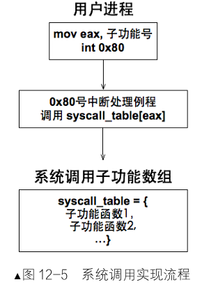
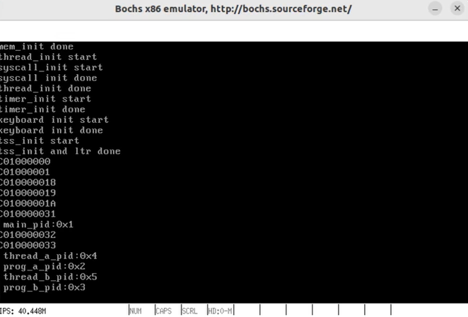
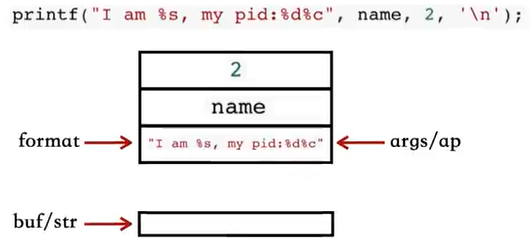

# 第12章 进一步完善内核

上一章我们构建了进程与线程的基本框架，让任务得以在系统中并发运行。然而，此时的用户程序仍像是被禁锢在孤岛之上：它们无法主动请求内核服务，无法向屏幕输出信息，更无法动态管理内存。

本章将打破这些壁垒，通过实现系统调用机制，为用户程序打开内核的大门；构建标准输出函数**printf**，让用户进程学会“说话”；并完善堆内存管理，赋予程序动态申请与释放内存的能力。

至此，我们的操作系统将从一个单纯的任务调度器，进化为具备完整服务能力的现代操作系统雏形。

## 12.1 Linux系统调用浅析

操作系统是硬件与软件之间的桥梁。为了安全与稳定，内核将用户程序限制在特权级较低的状态，禁止其直接操作硬件或访问内核数据。当用户程序需要打印文件、读写磁盘或创建进程时，必须向内核发起请求。

这种由用户态主动陷入内核态以获取服务的机制，称为**系统调用**。Linux 通过软中断**int 0x80**统一入口处理系统调用。为了区分不同的功能，调用前需将子功能号存入**eax**寄存器。内核的中断处理例程根据**eax**的值查表跳转至具体的处理函数。

###用户态接口演变

在 Linux 发展过程中，用户态发起系统调用的方式经历了**从宏到库函数**的演变。

**库函数 syscall(间接调用)**

现代 Linux 推荐使用glibc提供的**syscall**库函数。它封装了底层细节，支持变参，具有良好的跨平台性。

```c
// man syscall 查看原型
#define _GNU_SOURCE
#include <unistd.h>
#include <sys/syscall.h>

int syscall(int number, ...);
```

- **原理**：**number**为系统调用号(如 SYS_getpid)。该函数内部通过汇编指令触发中断。
- **特点**：灵活，统一接口，但属于用户态库函数，非内核直接提供。

**宏 _syscallX (直接调用 - 已废弃)**

早期 Linux 提供了一组宏 **_syscall0**到 **_syscall6**，用于直接在用户代码中生成系统调用包装函数。

虽然已被标记为过时(OBSOLETE)，但其实现思路清晰，非常适合用于理解系统调用原理及构建简易操作系统。

**宏定义示例 (`_syscall3`)：**
此宏利用内联汇编，将参数放入指定寄存器并触发中断。

```asm
#define _syscall3(type, name, type1, arg1, type2, arg2, type3, arg3) \
type name(type1 arg1, type2 arg2, type3 arg3) { \
    long res; \
    asm volatile ("push %%ebx; \
                   movl %2, %%ebx; \
                   int $0x80; \
                   pop %%ebx" \
                  : "=a"(res) \
                  : "0"(NR_##name), "ri"((long)(arg1)), \
                    "c"((long)(arg2)), "d"((long)(arg3)) \
                  : "memory"); \
    return (type)res; \
}
```

**关键逻辑解析：**

1. 参数传递：Linux 约定使用寄存器传参以提高效率，避免多次内存访问。

	`eax`: 系统调用号 (子功能号)；`ebx`: 第1个参数；`ecx`: 第2个参数；`edx`: 第3个参数；`esi`, `edi`: 第4、5个参数

2. **现场保护**：`push %%ebx` 保存原值，因为 `ebx` 将被用作传参寄存器。

3. **触发中断**：`int $0x80` 使 CPU 从用户态 (Ring 3) 切换至内核态 (Ring 0)。

4. **返回值**：中断返回后，结果存储在 `eax` 中，由变量 `res` 接收。

**多参数处理 (`_syscall6`)：**
当参数超过寄存器数量时，Linux 采用混合策略：中间4个参数仍用寄存器，第1个和第6个参数通过内存结构体传递。

```asm
#define _syscall6(type, name, type1, arg1, type2, arg2, type3, arg3, \
                  type4, arg4, type5, arg5, type6, arg6) \
type name(type1 arg1, type2 arg2, type3 arg3, type4 arg4, type5 arg5, type6 arg6) { \
    long res; \
    struct { long a1; long a6; } s = {(long)arg1, (long)arg6}; \
    asm volatile ("push %%ebp; push %%ebx; \
                   movl 4(%2), %%ebp; \
                   movl 0(%2), %%ebx; \
                   movl %1, %%eax; \
                   int $0x80; \
                   pop %%ebx; pop %%ebp" \
                  : "=a"(res) \
                  : "i"(NR_##name), "0"((long)(&s)), \
                    "c"((long)(arg2)), "d"((long)(arg3)), \
                    "S"((long)(arg4)), "D"((long)(arg5)) \
                  : "memory"); \
    return (type)res; \
}
```

> **注**：尽管 `_syscall` 宏已废弃，且存在安全隐患，但其“寄存器传参 + 软中断”的核心机制依然是现代系统调用的基石。本章将借鉴此思路，实现一个支持最多3个参数的简易系统调用框架。

------

## 12.2 系统调用的实现

本节将参照Linux 的设计，在我们的内核中实现完整的系统调用机制。核心思路分为**内核态处理**与**用户态接口**两部分，通过中断门连接。

### 12.2.3 实现系统调用接口

根据Linux系统调用的实现方法，为支持 0 到 3 个参数的系统调用，定义 **_syscall** 宏系列。

创建文件lib/user/**syscall.c**：

```c#
/* 无参数的系统调用 */
#define _syscall0(NUMBER) ({\
    int retval;\
    asm volatile (\
        "int $0x80"\
        : "=a" (retval)\
        : "a" (NUMBER)\
        : "memory"\
    );\
    retval;\
})

/* 一个参数的系统调用 */
#define _syscall1(NUMBER, ARG1) ({\
    int retval;\
    asm volatile (\
        "int $0x80"\
        : "=a" (retval)\
        : "a" (NUMBER), "b" (ARG1)\
        : "memory"\
    );\
    retval;\
})

/* 两个参数的系统调用 */
#define _syscall2(NUMBER, ARG1, ARG2) ({\
    int retval;\
    asm volatile (\
        "int $0x80"\
        : "=a" (retval)\
        : "a" (NUMBER), "b" (ARG1), "c" (ARG2)\
        : "memory"\
    );\
    retval;\
})

/* 三个参数的系统调用 */
#define _syscall3(NUMBER, ARG1, ARG2, ARG3) ({\
    int retval;\
    asm volatile (\
        "int $0x80"\
        : "=a" (retval)\
        : "a" (NUMBER), "b" (ARG1), "c" (ARG2), "d" (ARG3)\
        : "memory"\
    );\
    retval;\
})
```

创建lib/user/**syscall.h**头文件：

```c
#ifndef __LIB_USER_SYSCALL_H
#define __LIB_USER_SYSCALL_H

enum SYSCALL_NR {
    SYS_GETPID,   // 默认值为 0
    // 后续可添加 SYS_WRITE 等
};

#endif 
```

### 12.2.1 系统调用实现框架

系统调用实现流程：用户进程通过中断向量0x80 进入内核，内核查表调用具体子功能函数，可概括为以下四个步骤，形成了一个闭环的请求 - 响应机制。

| 步骤  | 动作描述                                                     | 涉及组件                       |
| ----- | ------------------------------------------------------------ | ------------------------------ |
| **1** | **用户发起**：用户调用接口，将子功能号写入 eax，执行**int 0x80** | 用户进程、_syscall宏           |
| **2** | **中断入口**：CPU 响应中断，切换栈与特权级，跳转至 **0x80**号中断处理程序 | IDT、CPU 硬件                  |
| **3** | **分发处理**：内核根据 eax 查表 (**syscall_table**)，调用对应的内核函数 | syscall_handler、syscall_table |
| **4** | **返回结果**：内核函数执行完毕，返回值写入 eax，恢复现场返回用户态 | 中断退出代码                   |

用户调用接口---执行int 0x80---0X80中断处理程序--根据eax查询表---调用内核函数

{width=30%}

### 12.2.2 增加 0x80 号中断描述符

在全局描述符表 (IDT) 中注册**0x80**号中断。与普通硬件中断不同，系统调用允许用户态主动触发，因此其描述符的特权级 (DPL) 必须设为3。修改文件kernel/**interrupt.c**：

```c
#define IDT_DESC_CNT 0x81              // 支持中断数扩展至 0x80 12.2.2加

extern uint32_t syscall_handler(void); // 声明外部中断处理例程 12.2.2加

static void idt_desc_init(void) {
    int i, lastindex = IDT_DESC_CNT - 1;
    for (i = 0; i < IDT_DESC_CNT; i++) {
        make_idt_desc(&idt[i], IDT_DESC_ATTR_DPL0, intr_entry_table[i]);
    }
    // 单独处理系统调用：DPL=3 允许用户态访问，处理函数为 syscall_handler
    make_idt_desc(&idt[lastindex], IDT_DESC_ATTR_DPL3, (intr_handler)syscall_handler);  //12.2.2加
    put_str("idt desc init done\n");
}
```

### 12.2.4 增加 0x80 号中断处理例程

增加**syscall_handler**，保存现场、从寄存器提取参数、查表调用内核函数，并将返回值写回用户上下文。这是系统调用的核心枢纽。

修改文件kernel/**kernel.s**:

```asm
[bits 32]
; 0x80 号中断处理例程
extern syscall_table
global syscall_handler
syscall_handler:
    ; 1. 保存上下文 (与常规中断一致)
    push 0              ; 占位错误码，保持栈格式统一
    push ds
    push es
    push fs
    push gs
    pushad              ; 压入 EAX, ECX, EDX, EBX, ESP, EBP, ESI, EDI
    push 0x80           ; 占位中断号

    ; 2. 为子功能函数准备参数 (C 调用约定：右向左入栈)
    push edx            ; 第3个参数
    push ecx            ; 第2个参数
    push ebx            ; 第1个参数

    ; 3. 查表调用子功能函数
    ; eax 中存储的是子功能号，每个表项占 4 字节
    call [syscall_table + eax * 4]
    
    add esp, 12         ; 平衡栈，跳过刚才压入的 3 个参数

    ; 4. 将返回值写回内核栈中保存 EAX 的位置
    ; 此时esp指向 push 0x80 的位置。pushad 压入了8个寄存器，EAX是第一个，偏移量为 7*4,
    ;加上push 0x80的4字节，总偏移为 8*4。
    mov [esp + 8 * 4], eax

    ; 5. 恢复上下文并返回
    jmp intr_exit
```

### 12.2.5 初始化系统调用和实现sys_getpid

创建**全局数组**来映射子功能号与内核函数指针，并实现第一个系统调用**getpid**，用于获取进程 ID。

创建并完成**表的初始化**、实现**子功能**处理函数，创建文件userprog/**syscall-init.c**：

```c
#include "stdint.h"   
#include "print.h"    
#include "thread.h" 
#include "global.h"
#include "syscall-init.h"
#include "syscall.h"

#define syscall_nr 32


typedef void* syscall;
syscall syscall_table[syscall_nr]; // 系统调用表

/* 子功能：获取当前任务 PID */
uint32_t sys_getpid(void) {
    return running_thread()->pid;
}

/* 初始化系统调用表 */
void syscall_init(void) {
    put_str("syscall_init start\n");
    syscall_table[SYS_GETPID] = sys_getpid; //注册SYS_GETPID(号为0) 后面会有相关枚举类
    put_str("syscall init done\n");
}


```

创建对应的头文件userprog/**syscall-init.h**：

```c
#ifndef __SYSCALL_H
#define __SYSCALL_H

#include "stdint.h"


/* 函数声明 */
void syscall_init(void);
uint32_t sys_getpid(void);

#endif
```

在pcb上增加pid字段，建立系统调用getpid的数据基础。修改文件thread/**thread.h**：

```c
typedef int16_t pid_t;
struct task_struct {
    uint32_t* self_kstack;
    pid_t pid;              // 12.2.5新增：进程/线程 ID
    enum task_status status;
    // ... 其他成员
};
```

增加进程pid分配功能，实现安全的PID分配机制，增加线程初始化步骤，修改文件thread/**thread.c**：

```c
#include "sync.h"
#include "syscall-init.h"


static struct lock pid_lock; // 12.2.5加PID 分配锁

static pid_t allocate_pid(void) {  //12.2.5加
    static pid_t next_pid = 0;
    lock_acquire(&pid_lock);
    next_pid++;              // 简单自增，首个任务 PID 为 1
    lock_release(&pid_lock);
    return next_pid;
}

void init_thread(struct task_struct* pthread, char* name, int prio) {
    memset(pthread, 0, sizeof(*pthread));
    pthread->pid = allocate_pid(); // 12.2.5加 创建时分配 PID
    strcpy(pthread->name, name);
    // ...
}

void thread_init(void) {
    put_str("thread_init start\n");
    list_init(&thread_ready_list);
    list_init(&thread_all_list);
    lock_init(&pid_lock);        //12.2.5加
    syscall_init();              //12.2.5加
    /* 将当前 main 函数创建为线程 */
    make_main_thread();
    put_str("thread_init done\n");
}
```

### 12.2.6 添加用户系统调用getpid

将系统调用宏封装**接口函数**,先修改文件lib/user/**syscall.h**,增加声明：

```c
#include "stdint.h"

uint32_t getpid(void);
```

修改文件lib/user/**syscall.c**，增加getpid用户接口，：

```c
#include "syscall.h"
#include "stdint.h"

/* 用户态接口：getpid */
uint32_t getpid(void) {
    return _syscall0(SYS_GETPID);
}
```

### 12.2.7 在用户进程中的系统调用

接下来在用户进程中**测试getpid**。我们在main.c中创建两个用户进程和两个内核线程，分别获取并打印它们的PID。

创建**kernel/main.c：**

```c
#include "print.h"
#include "init.h"
#include "thread.h"
#include "process.h"
#include "console.h"
#include "interrupt.h"
#include "stdint.h"
#include "syscall-init.h"
#include "syscall.h"

void k_thread_a(void*);
void k_thread_b(void*);
void u_prog_a(void);
void u_prog_b(void);
int prog_a_pid = 0, prog_b_pid = 0;

int main(void) {
    put_str("I am kernel\n");
    init_all();

    process_execute(u_prog_a, "user_prog_a");
    process_execute(u_prog_b, "user_prog_b");

    intr_enable();
    console_put_str(" main_pid:0x");
    console_put_int(sys_getpid());
    console_put_char('\n');
    thread_start("k_thread_a", 31, k_thread_a, "argA ");
    thread_start("k_thread_b", 31, k_thread_b, "argB ");
    while(1);
    return 0;
}

/* 在线程中运行的函数 */
void k_thread_a(void* arg) {
    char* para = arg;
    console_put_str(" thread_a_pid:0x");
    console_put_int(sys_getpid());
    console_put_char('\n');
    console_put_str(" prog_a_pid:0x");
    console_put_int(prog_a_pid);
    console_put_char('\n');
    while(1);
}

/* 在线程中运行的函数 */
void k_thread_b(void* arg) {
    char* para = arg;
    console_put_str(" thread_b_pid:0x");
    console_put_int(sys_getpid());
    console_put_char('\n');
    console_put_str(" prog_b_pid:0x");
    console_put_int(prog_b_pid);
    console_put_char('\n');
    while(1);
}

/* 测试用户进程 */
void u_prog_a(void) {
    prog_a_pid = getpid();
    while(1);
}

/* 测试用户进程 */
void u_prog_b(void) {
    prog_b_pid = getpid();
    while(1);
}
```

编译运行：

```c
BUILD_DIR = ./build
ENTRY_POINT = 0xc0001500
AS = nasm
CC = gcc
LD = ld
LIB = -I lib/ -I lib/kernel/ -I lib/user/ -I kernel/ -I device/ -I thread/ -I userprog/
ASFLAGS = -f elf
CFLAGS = -std=gnu11 -m32 $(LIB) -c -fno-builtin -fno-stack-protector -W -Wstrict-prototypes \
	-Wmissing-prototypes  
LDFLAGS = -m elf_i386 -Ttext $(ENTRY_POINT) -e main -Map $(BUILD_DIR)/kernel.map
OBJS = $(BUILD_DIR)/main.o     $(BUILD_DIR)/init.o    $(BUILD_DIR)/interrupt.o    \
	     $(BUILD_DIR)/timer.o    $(BUILD_DIR)/kernel.o  $(BUILD_DIR)/print.o        \
	     $(BUILD_DIR)/debug.o    $(BUILD_DIR)/string.o  $(BUILD_DIR)/bitmap.o       \
	     $(BUILD_DIR)/memory.o   $(BUILD_DIR)/thread.o  $(BUILD_DIR)/list.o         \
	     $(BUILD_DIR)/switch.o   $(BUILD_DIR)/console.o $(BUILD_DIR)/sync.o 	      \
	     $(BUILD_DIR)/keyboard.o $(BUILD_DIR)/ioqueue.o $(BUILD_DIR)/tss.o          \
	     $(BUILD_DIR)/process.o  $(BUILD_DIR)/syscall.o $(BUILD_DIR)/syscall-init.o \
  

#############  c代码编译   #############
$(BUILD_DIR)/main.o: kernel/main.c
	$(CC) $(CFLAGS) $< -o $@

$(BUILD_DIR)/init.o: kernel/init.c kernel/init.h
	$(CC) $(CFLAGS) $< -o $@

$(BUILD_DIR)/interrupt.o: kernel/interrupt.c kernel/interrupt.h
	$(CC) $(CFLAGS) $< -o $@ 

$(BUILD_DIR)/timer.o: device/timer.c device/timer.h
	$(CC) $(CFLAGS) $< -o $@

$(BUILD_DIR)/debug.o: kernel/debug.c kernel/debug.h
	$(CC) $(CFLAGS) $< -o $@
	
$(BUILD_DIR)/string.o: lib/string.c lib/string.h
	$(CC) $(CFLAGS) $< -o $@
	
$(BUILD_DIR)/bitmap.o: lib/kernel/bitmap.c lib/kernel/bitmap.h
	$(CC) $(CFLAGS) $< -o $@
	
$(BUILD_DIR)/memory.o: kernel/memory.c kernel/memory.h
	$(CC) $(CFLAGS) $< -o $@
  
$(BUILD_DIR)/thread.o: thread/thread.c thread/thread.h
	$(CC) $(CFLAGS) $< -o $@
	
$(BUILD_DIR)/list.o: lib/kernel/list.c lib/kernel/list.h
	$(CC) $(CFLAGS) $< -o $@
	
$(BUILD_DIR)/sync.o: thread/sync.c thread/sync.h
	$(CC) $(CFLAGS) $< -o $@

$(BUILD_DIR)/console.o: device/console.c device/console.h
	$(CC) $(CFLAGS) $< -o $@
	
$(BUILD_DIR)/keyboard.o: device/keyboard.c device/keyboard.h
	$(CC) $(CFLAGS) $< -o $@
	
$(BUILD_DIR)/ioqueue.o: device/ioqueue.c device/ioqueue.h
	$(CC) $(CFLAGS) $< -o $@
	
$(BUILD_DIR)/tss.o: userprog/tss.c userprog/tss.h
	$(CC) $(CFLAGS) $< -o $@
	
$(BUILD_DIR)/process.o: userprog/process.c userprog/process.h
	$(CC) $(CFLAGS) $< -o $@
  
$(BUILD_DIR)/syscall.o: lib/user/syscall.c lib/user/syscall.h
	$(CC) $(CFLAGS) $< -o $@
  
$(BUILD_DIR)/syscall-init.o: userprog/syscall-init.c userprog/syscall-init.h
	$(CC) $(CFLAGS) $< -o $@

#############    汇编代码编译    #############
$(BUILD_DIR)/kernel.o: kernel/kernel.s
	$(AS) $(ASFLAGS) $< -o $@

$(BUILD_DIR)/print.o: lib/kernel/print.s
	$(AS) $(ASFLAGS) $< -o $@
	
$(BUILD_DIR)/switch.o: thread/switch.s
	$(AS) $(ASFLAGS) $< -o $@

#############   链接所有目标文件   #############
$(BUILD_DIR)/kernel.bin: $(OBJS)
	$(LD) $(LDFLAGS) $^ -o $@

.PHONY : mk_dir hd clean all

mk_dir:
	if [ ! -d ./build ]; then mkdir ./build; fi

hd:
	dd if=$(BUILD_DIR)/kernel.bin of=hd60M.img bs=512 count=200 seek=9 conv=notrunc
  
clean:
	cd $(BUILD_DIR) && rm -f ./*

build: $(BUILD_DIR)/kernel.bin

all: mk_dir build hd
```

**运行结果**显示：主线程 PID 为 1，用户进程与内核线程依次获得递增的 PID，验证了系统调用链路的通畅。



### 12.2.8 系统调用之栈传递参数

前文提到，寄存器传参效率高。若需通过栈传递参数(例如参数极多时)，关键在于如何在内核态访问用户态栈。

当发生特权级提升的中断时，CPU 会自动将用户态的 **SS** 和 **ESP**压入内核栈，这是跨特权级访问栈的原理。

但因涉及多次内存读写，性能不如寄存器传参，故正式实现中仍采用寄存器方案。下面进行展示：

**用户态宏改造 (_syscall3栈传参版)：**

```asm
/* 三个参数的系统调用 */
#define _syscall3(NUMBER, ARG0, ARG1, ARG2) ({
    int retval;
    asm volatile (
        "pushl %[arg2]; pushl %[arg1]; pushl %[arg0]; "
        "pushl %[number]; int $0x80; addl $16, %%esp"
        : "=a" (retval)
        : [number] "i" (NUMBER),
          [arg0] "g" (ARG0),
          [arg1] "g" (ARG1),
          [arg2] "g" (ARG2)
        : "memory"
    );
    retval;
})
```

**内核态改造 (syscall_handler栈传参版)：**

```asm
[bits 32]
extern syscall_table
section .text
global syscall_handler
syscall_handler:

; 系统调用传入的参数在用户栈中，此时是内核栈
;1 保存上下文环境
    push 0              ; 压入 0，使栈中格式统一

    push ds
    push es
    push fs
    push gs
    pushad              ; PUSHAD 指令压入 32 位寄存器，其入栈顺序是：
                        ; EAX,ECX,EDX,EBX,ESP,EBP,ESI,EDI

    push 0x80           ; 此位置压入 0x80 也是为了保持统一的栈格式

;2 从内核栈中获取 cpu 自动压入的用户栈指针esp的值
    mov ebx, [esp + 4 + 48 + 4 + 12]

;3 再把参数重新压在内核栈中，此时 ebx 是用户栈指针
    由于此处只压入了三个参数，所以目前系统调用最多支持 3 个参数
    push dword [ebx + 12]   ; 系统调用的第 3 个参数
    push dword [ebx + 8]    ; 系统调用的第 2 个参数
    push dword [ebx + 4]    ; 系统调用的第 1 个参数
    mov edx, [ebx]          ; 系统调用的子功能号

    ; 编译器会在栈中根据 C 函数声明匹配正确数量的参数
    call [syscall_table + edx*4]
    add esp, 12             ; 跨过上面的三个参数

;4 将 call 调用后的返回值存入待当前内核栈中 eax 的位置
    mov [esp + 8*4], eax
    jmp intr_exit           ; intr_exit 返回，恢复上下文
```

------

## 12.3 让用户进程“说话”

此前用户进程只能通过内核线程“代劳”打印信息。本节将实现标准C库中最核心的**printf**函数，让用户进程具备独立输出能力。这依赖于可变参数解析与新的**write**系统调用。

### 12.3.1 可变参数的原理

**printf**的强大之处在于其参数个数不固定。这并非真正的“动态”，而是基于**C 调用约定**的静态布局技巧,主要是编译器层面进行的处理。

1. **入栈顺序**：参数从右向左依次压栈。
2. **解析依据**：格式化字符串(如 `"%d %s"`)中的**%**标记指示了后续参数的类型和位置。
3. **访问机制**：通过指针遍历栈内存，按格式说明符逐个提取参数。

### 12.3.2 实现系统调用 write

**printf**的最终输出依赖于底层的**write**系统调用。在文件系统完善前，我们先实现一个简易版：直接将字符串打印到控制台。

**用户态处理**:

增加功能号，修改文件lib/user/**syscall.h**(完整)：

```c
#ifndef __LIB_USER_SYSCALL_H
#define __LIB_USER_SYSCALL_H

#include "stdint.h"

enum SYSCALL_NR {
    SYS_GETPID,
    SYS_WRITE                //12.3.2加
};

uint32_t getpid(void);
uint32_t write(char* str);    //12.3.2加

#endif
```

增加用户接口write，修改文件lib/user/**syscall.c**：

```c
uint32_t write(char* str) {           //12.3.2加
    return _syscall1(SYS_WRITE, str);
}
```

**内核态处理**:

实现内核处理函数，增加系统调用初始化步骤，修改文件userprog/syscall-init.c：

```c
/* 打印字符串 str（未实现文件系统前的版本）*/
uint32_t sys_write(char* str) {
    console_put_str(str);
    return strlen(str);
}

/* 初始化系统调用 */
void syscall_init(void) {
    put_str("syscall_init start\n");
    syscall_table[SYS_GETPID] = sys_getpid;
    syscall_table[SYS_WRITE] = sys_write;        //12.3.2加
    put_str("syscall_init done\n");
}
```

修改userprog/syscall-init.h头文件，增加sys_write的声明：

```c
#ifndef __SYSCALL_H
#define __SYSCALL_H

#include "stdint.h"


/* 函数声明 */
void syscall_init(void);
uint32_t sys_getpid(void);
uint32_t sys_write(char* str);

#endif
```

### 12.3.3 实现 printf

**printf**的本质是：**格式化拼接 + 输出**。我们将实现**vsprintf**进行字符串拼接，再调用write 输出。

创建文件lib/**stdio.h**:

```c
#ifndef _STDIO_H
#define _STDIO_H

#include "stdint.h"
#include "string.h"

typedef char* va_list;

// 函数声明
uint32_t vsprintf(char* str, const char* format, va_list ap);
uint32_t sprintf(char* buf, const char* format, ...);
uint32_t printf(const char* format, ...);

#endif
```

创建文件lib/**stdio.c**，实现printf函数：

{width=60%}

```c
#include "print.h"
#include "init.h"
#include "thread.h"
#include "process.h"
#include "console.h"
#include "interrupt.h"
#include "stdio.h"
#include "syscall.h"

#define va_start(ap, v)  ap = (va_list)&v      // 把ap指向第一个固定参数 v
#define va_arg(ap, t)    *((t*)(ap += 4))      // ap指向下一个参数并返回其值
#define va_end(ap)       ap = NULL             // 清除 ap

/* 将整型转换成字符（integer to ascii） */
static void itoa(uint32_t value, char** buf_ptr_addr, uint8_t base) {
    uint32_t m = value % base;                // 求模，最先掉下来的是最低位
    uint32_t i = value / base;                // 取整
    if (i) {                                  // 如果倍数不为 0，则递归调用
        itoa(i, buf_ptr_addr, base);
    }
    if (m < 10) {                             // 如果余数是 0~9
        *((*buf_ptr_addr)++) = m + '0';       // 将数字 0~9 转换为字符 '0'~'9'
    } else {                                  // 否则余数是 A~F
        *((*buf_ptr_addr)++) = m - 10 + 'A';  // 将数字 A~F 转换为字符 'A'~'F'
    }
}

/* 将参数 ap 按照格式 format 输出到字符串 str，并返回替换后 str 长度 */
uint32_t vsprintf(char* str, const char* format, va_list ap) {
    char* buf_ptr = str;
    const char* index_ptr = format;
    char index_char = *index_ptr;
    int32_t arg_int;
    char* arg_str;
    while(index_char) {
        if (index_char != '%') {
            *(buf_ptr++) = index_char;
            index_char = *(++index_ptr);
            continue;
        }
        index_char = *(++index_ptr);          // 得到%后面的字符
        switch (index_char) {
            case 's':
                arg_str = va_arg(ap, char*);
                strcpy(buf_ptr, arg_str);
                buf_ptr += strlen(arg_str);
                index_char = *(++index_ptr);
                break;

            case 'c':
                *(buf_ptr++) = va_arg(ap, char);
                index_char = *(++index_ptr);
                break;

            case 'd':
                arg_int = va_arg(ap, int);
                /* 若是负数，将其转为正数后，在正数前面输出个负号'-' */
                if (arg_int < 0) {
                    arg_int = 0 - arg_int;
                    *buf_ptr++ = '-';
                }
                itoa(arg_int, &buf_ptr, 10);
                index_char = *(++index_ptr);
                break;

            case 'x':
                arg_int = va_arg(ap, int);
                itoa(arg_int, &buf_ptr, 16);
                index_char = *(++index_ptr);
                // 跳过格式字符并更新 index_char
                break;
        }
    }
    return strlen(str);
}

/* 同 printf 不同的地方就是字符串不是写到终端，而是写到 buf 中 */
uint32_t sprintf(char* buf, const char* format, ...) {
    va_list args;
    uint32_t retval;
    va_start(args, format);
    retval = vsprintf(buf, format, args);
    va_end(args);
    return retval;
}

/* 格式化输出字符串format */
uint32_t printf(const char* format, ...) {
    va_list args;
    va_start(args, format);                   // 使 args 指向 format
    char buf[1024] = {0};                     // 用于存储拼接后的字符串
    vsprintf(buf, format, args);
    va_end(args);
    return write(buf);
}
```

**测试效果：**
用户进程现在可以直接调用**printf("My PID is %d\n", getpid());**，屏幕上将正确显示格式化后的信息。

```c
#include "print.h"
#include "init.h"
#include "thread.h"
#include "process.h"
#include "console.h"
#include "interrupt.h"
#include "stdio.h"
#include "syscall-init.h"
#include "syscall.h"

void k_thread_a(void*);
void k_thread_b(void*);
void u_prog_a(void);
void u_prog_b(void);

int volatile test_var_a = 0, test_var_b = 0;

int main(void) {
    put_str("I am kernel\n");
    init_all();

    thread_start("k_thread_a", 31, k_thread_a, "argA ");
    thread_start("k_thread_b", 31, k_thread_b, "argB ");
    process_execute(u_prog_a, "user_prog_a");
    process_execute(u_prog_b, "user_prog_b");

    intr_enable();
    while(1);
    return 0;
}

/* 在线程中运行的函数 */
void k_thread_a(void* arg) {
    char* para = arg;
    console_put_str("thread_a_pid:");
    console_put_int(sys_getpid());
    console_put_char('\n');
    while(1);
}

/* 在线程中运行的函数 */
void k_thread_b(void* arg) {
    char* para = arg;
    console_put_str("thread_b_pid:");
    console_put_int(sys_getpid());
    console_put_char('\n');
    while(1);
}

/* 测试用户进程 */
void u_prog_a(void) {
    char* name = "prog_a";
    printf("I am %s, my pid:%d%c", name, getpid(), '\n');   
    while(1);
}

/* 测试用户进程 */
void u_prog_b(void) {
    char* name = "prog_b";
    printf("I am %s, my pid:%d%c", name, getpid(), '\n');
    while(1);
}
```

------

**编译运行：**

```c
BUILD_DIR = ./build
ENTRY_POINT = 0xc0001500
AS = nasm
CC = gcc
LD = ld
LIB = -I lib/ -I lib/kernel/ -I lib/user/ -I kernel/ -I device/ -I thread/ -I userprog/
ASFLAGS = -f elf
CFLAGS = -std=gnu11 -m32 $(LIB) -c -fno-builtin -fno-stack-protector -W -Wstrict-prototypes \
	-Wmissing-prototypes  
LDFLAGS = -m elf_i386 -Ttext $(ENTRY_POINT) -e main -Map $(BUILD_DIR)/kernel.map
OBJS = $(BUILD_DIR)/main.o     $(BUILD_DIR)/init.o    $(BUILD_DIR)/interrupt.o    \
	     $(BUILD_DIR)/timer.o    $(BUILD_DIR)/kernel.o  $(BUILD_DIR)/print.o        \
	     $(BUILD_DIR)/debug.o    $(BUILD_DIR)/string.o  $(BUILD_DIR)/bitmap.o       \
	     $(BUILD_DIR)/memory.o   $(BUILD_DIR)/thread.o  $(BUILD_DIR)/list.o         \
	     $(BUILD_DIR)/switch.o   $(BUILD_DIR)/console.o $(BUILD_DIR)/sync.o 	      \
	     $(BUILD_DIR)/keyboard.o $(BUILD_DIR)/ioqueue.o $(BUILD_DIR)/tss.o          \
	     $(BUILD_DIR)/process.o  $(BUILD_DIR)/syscall.o $(BUILD_DIR)/syscall-init.o \
       $(BUILD_DIR)/stdio.o          \
  

#############  c代码编译   #############
$(BUILD_DIR)/main.o: kernel/main.c
	$(CC) $(CFLAGS) $< -o $@

$(BUILD_DIR)/init.o: kernel/init.c kernel/init.h
	$(CC) $(CFLAGS) $< -o $@

$(BUILD_DIR)/interrupt.o: kernel/interrupt.c kernel/interrupt.h
	$(CC) $(CFLAGS) $< -o $@ 

$(BUILD_DIR)/timer.o: device/timer.c device/timer.h
	$(CC) $(CFLAGS) $< -o $@

$(BUILD_DIR)/debug.o: kernel/debug.c kernel/debug.h
	$(CC) $(CFLAGS) $< -o $@
	
$(BUILD_DIR)/string.o: lib/string.c lib/string.h
	$(CC) $(CFLAGS) $< -o $@
	
$(BUILD_DIR)/bitmap.o: lib/kernel/bitmap.c lib/kernel/bitmap.h
	$(CC) $(CFLAGS) $< -o $@
	
$(BUILD_DIR)/memory.o: kernel/memory.c kernel/memory.h
	$(CC) $(CFLAGS) $< -o $@
  
$(BUILD_DIR)/thread.o: thread/thread.c thread/thread.h
	$(CC) $(CFLAGS) $< -o $@
	
$(BUILD_DIR)/list.o: lib/kernel/list.c lib/kernel/list.h
	$(CC) $(CFLAGS) $< -o $@
	
$(BUILD_DIR)/sync.o: thread/sync.c thread/sync.h
	$(CC) $(CFLAGS) $< -o $@

$(BUILD_DIR)/console.o: device/console.c device/console.h
	$(CC) $(CFLAGS) $< -o $@
	
$(BUILD_DIR)/keyboard.o: device/keyboard.c device/keyboard.h
	$(CC) $(CFLAGS) $< -o $@
	
$(BUILD_DIR)/ioqueue.o: device/ioqueue.c device/ioqueue.h
	$(CC) $(CFLAGS) $< -o $@
	
$(BUILD_DIR)/tss.o: userprog/tss.c userprog/tss.h
	$(CC) $(CFLAGS) $< -o $@
	
$(BUILD_DIR)/process.o: userprog/process.c userprog/process.h
	$(CC) $(CFLAGS) $< -o $@
  
$(BUILD_DIR)/syscall.o: lib/user/syscall.c lib/user/syscall.h
	$(CC) $(CFLAGS) $< -o $@
  
$(BUILD_DIR)/syscall-init.o: userprog/syscall-init.c userprog/syscall-init.h
	$(CC) $(CFLAGS) $< -o $@
  
$(BUILD_DIR)/stdio.o: lib/stdio.c lib/stdio.h
	$(CC) $(CFLAGS) $< -o $@

#############    汇编代码编译    #############
$(BUILD_DIR)/kernel.o: kernel/kernel.s
	$(AS) $(ASFLAGS) $< -o $@

$(BUILD_DIR)/print.o: lib/kernel/print.s
	$(AS) $(ASFLAGS) $< -o $@
	
$(BUILD_DIR)/switch.o: thread/switch.s
	$(AS) $(ASFLAGS) $< -o $@

#############   链接所有目标文件   #############
$(BUILD_DIR)/kernel.bin: $(OBJS)
	$(LD) $(LDFLAGS) $^ -o $@

.PHONY : mk_dir hd clean all

mk_dir:
	if [ ! -d ./build ]; then mkdir ./build; fi

hd:
	dd if=$(BUILD_DIR)/kernel.bin of=hd60M.img bs=512 count=200 seek=9 conv=notrunc
  
clean:
	cd $(BUILD_DIR) && rm -f ./*

build: $(BUILD_DIR)/kernel.bin

all: mk_dir build hd
```

**测试效果：**


## 12.4 完善堆内存管理

此前的内存分配仅支持**页框**(4KB)粒度，无法满足小内存需求。本节引入**Arena**机制，实现类似malloc/free的细粒度堆内存管理。

### 12.4.1 malloc底层原理

核心思想是将大块内存(Arena)切割成固定规格的小内存块(Mem Block)。

- **Arena**：                                  一块连续的内存区域(通常为 1 页框)，作为内存池。
- **Mem Block**：                         Arena 中被切分出的等大小小块。
- **Mem Block Desc (描述符)**：管理同规格所有 Arena的空闲块链表。

**规格设计：**设定 7 种规格(16B ~ 1024B，按2倍递增)。

- **小内存 (≤1024B)**：查找对应规格的描述符，从其空闲链表分配。若链表空，则新申请一页作为Arena，切分后加入链表。
- **大内存 (>1024B)**：直接分配连续页框，不切分，描述符指针置空。

### 12.4.2 底层初始化

为支持堆内存管理，需要设计与实现相关管理数据，主要包括结构体arena、mem_block、mem_block_desc，并且实现内核态和用户态的mem_block_desc**数组**。

定义mem_block、mem_block_desc数据，修改文件kernel/**memory.h**：

```c
#include "list.h"
#include "interrupt.h"  

struct mem_block {
    struct list_elem free_elem; // 嵌入链表节点
};


struct mem_block_desc {
    uint32_t block_size;          // 块大小
    uint32_t blocks_per_arena;    // 单Arena可容纳块数
    struct list free_list;        // 空闲块链表
};

#define DESC_CNT 7    //7种规格16、32、64、128、265、512、1024

void block_desc_init(struct mem_block_desc* desc_array);
```

定义arena数据，定义并初始化内核态7种规格的描述符，修改文件**memory.c**：

```c
/* 内存仓库 */
struct arena {
    struct mem_block_desc* desc;    // 此 arena 关联的 mem_block_desc
    /* large 为 ture 时，cnt 表示的是页框数。否则 cnt 表示空闲 mem_block 数量 */
    uint32_t cnt;
    bool large;
};

struct mem_block_desc k_block_descs[DESC_CNT];      // 内核内存块描述符数组

/* 为malloc做准备,初始化内存快数组 */
void block_desc_init(struct mem_block_desc* desc_array) {
    uint16_t desc_idx, block_size = 16;

    /* 初始化每个 mem_block_desc 描述符 */
    for (desc_idx = 0; desc_idx < DESC_CNT; desc_idx++) {
        desc_array[desc_idx].block_size = block_size;
        /* 初始化 arena 中的内存块数量 */
        desc_array[desc_idx].blocks_per_arena = (PG_SIZE - sizeof(struct arena)) / block_size;
        list_init(&desc_array[desc_idx].free_list);
        block_size *= 2;    // 更新为下一个规格内存块
    }
}


// 内存管理部分初始化入口
void mem_init() {
    put_str("mem_init start\n");
    //uint32_t mem_bytes_total = (*(uint32_t*)(0xb00)); //此地址存储了物理内存大小
    uint32_t mem_bytes_total=MEM_SIZE;
    mem_pool_init(mem_bytes_total);
    block_desc_init(k_block_descs);           //12.4.2加
    put_str("mem_init done\n");
}
```

用户进程的PCB中也需**u_block_desc**数组，在进程创建时初始化，在**process.c**的process_execute函数中增加该数组的初始化步骤。

增加u_block_desc数组，修改文件**thread.h**:

```c
struct task_struct {
    uint32_t* self_kstack;        // 线程内核栈指针
    pid_t pid;                    // 新增：进程/线程 ID
    enum task_status status;      // 线程状态（运行、就绪等）
    char name[16];                // 线程名称
    uint8_t priority;             // 优先级，决定时间片长度
    uint8_t ticks;                // 时间片计数器
    uint32_t elapsed_ticks;       // 线程总运行时间
    struct list_elem general_tag;  // 就绪队列节点
    struct list_elem all_list_tag; // 全部线程队列节点
    uint32_t* pgdir;              // 页目录指针（线程为NULL）
    struct virtual_addr userprog_vaddr;   // 用户进程的虚拟地址池      11.3.2加
    struct mem_block_desc u_block_desc[DESC_CNT];   //进程内存块描述符 12.4.3加
    uint32_t stack_magic;         // 栈边界标记
};
```

增加u_block_desc数据初始化步骤，修改文件**process.c**:

```c
/* 创建用户进程 */
void process_execute(void* filename, char* name) {
    /* pcb内核的数据结构，由内核来维护进程信息，因此要在内核内存池中申请 */
    struct task_struct* thread = get_kernel_pages(1);
    init_thread(thread, name, default_prio);
    create_user_vaddr_bitmap(thread);
    thread_create(thread, start_process, filename);
    thread->pgdir = create_page_dir();
    block_desc_init(thread->u_block_desc);         //12.4.3加

    enum intr_status old_status = intr_disable();
    ASSERT(!elem_find(&thread_ready_list, &thread->general_tag));
    list_append(&thread_ready_list, &thread->general_tag);

    ASSERT(!elem_find(&thread_all_list, &thread->all_list_tag));
    list_append(&thread_all_list, &thread->all_list_tag);
    intr_set_status(old_status);
}
```

### 12.4.3 实现sys_malloc

实现**sys_malloc**，根据申请大小选择分配策略进行分配，修改文件kernel/**memory.c**

```c
/* 返回arena中第idx个内存块的地址 */
static struct mem_block* arena2block(struct arena* a, uint32_t idx) {
    return (struct mem_block*) ((uint32_t)a + sizeof(struct arena) + idx * a->desc->block_size);
}

/* 返回内存块b所在的arena地址 */
static struct arena* block2arena(struct mem_block* b) {
    return (struct arena*) ((uint32_t)b & 0xfffff000);
}

/* 在堆中申请size个字节内存 */
void* sys_malloc(uint32_t size) {
    enum pool_flags PF;
    struct pool* mem_pool;
    uint32_t pool_size;
    struct mem_block_desc* descs;
    struct task_struct* cur_thread = running_thread();

    /* 判断用哪个内存池 */
    if (cur_thread->pgdir == NULL) {      // 若为内核线程
        PF = PF_KERNEL;
        pool_size = kernel_pool.pool_size;
        mem_pool = &kernel_pool;
        descs = k_block_descs;
    } else {                              // 用户进程pcb中的pgdir会在为其分配页表时创建
        PF = PF_USER;
        pool_size = user_pool.pool_size;
        mem_pool = &user_pool;
        descs = cur_thread->u_block_desc;
    }

    /* 若申请的内存不在内存池容量范围内，则直接返回 NULL */
    if (!(size > 0 && size < pool_size)) {
        return NULL;
    }

    struct arena* a;
    struct mem_block* b;
    lock_acquire(&mem_pool->lock);

    /* 超过最大内存块1024，就分配页框 */
    if (size > 1024) {
        uint32_t page_cnt = DIV_ROUND_UP(size + sizeof(struct arena), PG_SIZE);
        // 向上取整需要的页框数
        a = malloc_page(PF, page_cnt);

        if (a != NULL) {
            memset(a, 0, page_cnt * PG_SIZE);     // 将分配的内存清0
            /* 对于分配的大块页框，将desc置为NULL，cnt置为页框数，large置为true */
            a->desc = NULL;
            a->cnt = page_cnt;
            a->large = true;
            lock_release(&mem_pool->lock);
            return (void*)(a + 1); // 跨过arena大小，把剩下的内存返回
        } else {
            lock_release(&mem_pool->lock);
            return NULL;
        }
    } else {    // 若申请的内存小于等于1024，可在各种规格的mem_block_desc中去适配
        uint8_t desc_idx;
        //从内存块描述符中匹配合适的内存块规格 从小往大后，找到后退出
        for (desc_idx = 0; desc_idx < DESC_CNT; desc_idx++) {
            if (size <= descs[desc_idx].block_size) {
                break;
            }
        }

        // 若mem_block_desc的free_list中已经没有可用的mem_block，就创建新的arena提供 mem_block
        if (list_empty(&descs[desc_idx].free_list)) {
            a = malloc_page(PF, 1);       // 分配1页框作为 arena
            if (a == NULL) {
                lock_release(&mem_pool->lock);
                return NULL;
            }
            memset(a, 0, PG_SIZE);

            // 对于分配的小块内存，将desc置为相应内存块描述符，cnt置为此arena可用的内存块数，large置为false
            a->desc = &descs[desc_idx];
            a->large = false;
            a->cnt = descs[desc_idx].blocks_per_arena;
            uint32_t block_idx;

            enum intr_status old_status = intr_disable();

            /* 开始将arena拆分成内存块，并添加到内存块描述符的free_list 中 */
            for (block_idx = 0; block_idx < descs[desc_idx].blocks_per_arena; block_idx++) {
                b = arena2block(a, block_idx);
                ASSERT(!elem_find(&a->desc->free_list, &b->free_elem));
                list_append(&a->desc->free_list, &b->free_elem);
            }
            intr_set_status(old_status);
        }

        /* 开始分配内存块 */
        b = elem2entry(struct mem_block, free_elem, list_pop(&(descs[desc_idx].free_list)) );
        memset(b, 0, descs[desc_idx].block_size);

        a = block2arena(b);   // 获取内存块 b 所在的 arena
        a->cnt--;             // 将此 arena 中的空闲内存块数减 1
        lock_release(&mem_pool->lock);
        return (void*)b;
    }
}
```

注：需在memory.h文件中新增sys_malloc声明。

测试，修改mian.c:

```c
int main(void) {
    put_str("I am kernel\n");
    init_all();
    intr_enable();
    thread_start("k_thread_a", 31, k_thread_a, "I am thread_a");
    thread_start("k_thread_b", 31, k_thread_b, "I am thread_b");
    while(1);
    return 0;
}

/* 在线程中运行的函数 */
void k_thread_a(void* arg) {
    char* para = arg;
    void* addr = sys_malloc(33);
    console_put_str(" I am thread_a, sys_malloc(33), addr is 0x");
    console_put_int((int)addr);
    console_put_char('\n');
    while(1);
}

/* 在线程中运行的函数 */
void k_thread_b(void* arg) {
    char* para = arg;
    void* addr = sys_malloc(63);
    console_put_str(" I am thread_b, sys_malloc(63), addr is 0x");
    console_put_int((int)addr);
    console_put_char('\n');
    while(1);
}
```

### 12.4.4 内存的释放

释放是分配的逆过程，需还原**位图**、**页表**映射及**虚拟地址池**。后续sys_free的实现依赖于这些基础功能函数，修改文件**memory.c**：

```c
/* 将物理地址pg_phy_addr回收到物理内存池，即位图置0 */
static void pfree(uint32_t pg_phy_addr) {
    struct pool* mem_pool;
    uint32_t bit_idx = 0;
    if (pg_phy_addr >= user_pool.phy_addr_start) {      // 用户物理内存池
        mem_pool = &user_pool;
        bit_idx = (pg_phy_addr - user_pool.phy_addr_start) / PG_SIZE;
    } else {                                            // 内核物理内存池
        mem_pool = &kernel_pool;
        bit_idx = (pg_phy_addr - kernel_pool.phy_addr_start) / PG_SIZE;
    }
    bitmap_set(&mem_pool->pool_bitmap, bit_idx, 0);     // 将位图中该位清 0
}

/* 去掉页表中虚拟地址vaddr的映射，只去掉vaddr对应的pte */
static void page_table_pte_remove(uint32_t vaddr) {
    uint32_t* pte = pte_ptr(vaddr);
    *pte &= ~PG_P_1;                                    // 将页表项 pte 的 P 位置 0
    asm volatile ("invlpg %0"::"m" (vaddr):"memory");   // 更新 tlb
}

/* 在虚拟地址池中释放以_vaddr起始的连续pg_cnt个虚拟页地址，即位图置0 */
static void vaddr_remove(enum pool_flags pf, void* _vaddr, uint32_t pg_cnt) {
    uint32_t bit_idx_start = 0, vaddr = (uint32_t)_vaddr, cnt = 0;

    if (pf == PF_KERNEL) {                              // 内核虚拟内存池
        bit_idx_start = (vaddr - kernel_vaddr_pool.vaddr_start) / PG_SIZE;
        while(cnt < pg_cnt) {
            bitmap_set(&kernel_vaddr_pool.vaddr_bitmap, bit_idx_start + cnt++, 0);
        }
    } else {                                            // 用户虚拟内存池
        struct task_struct* cur_thread = running_thread();
        bit_idx_start = (vaddr - cur_thread->userprog_vaddr.vaddr_start) / PG_SIZE;
        while(cnt < pg_cnt) {
            bitmap_set(&cur_thread->userprog_vaddr.vaddr_bitmap, bit_idx_start + cnt++, 0);
        }
    }
}

/* 释放以虚拟地址vaddr为起始的cnt个物理页框 */
static void mfree_page(enum pool_flags pf, void* _vaddr, uint32_t pg_cnt) {
    uint32_t pg_phy_addr;
    uint32_t vaddr = (int32_t)_vaddr, page_cnt = 0;
    ASSERT(pg_cnt >=1 && vaddr % PG_SIZE == 0);
    pg_phy_addr = addr_v2p(vaddr);  //获取虚拟地址vaddr对应的物理地址

  
    /* 确保待释放的物理内存存在低端1MB+ 4KB大小的页目录 +4KB大小的页表地址范围外 */
    ASSERT((pg_phy_addr % PG_SIZE) == 0 && pg_phy_addr >= 0x102000);

    /* 判断pg_phy_addr属于用户物理内存池还是内核物理内存池 */
    if (pg_phy_addr >= user_pool.phy_addr_start) {      // 位于 user_pool 内存池
        vaddr -= PG_SIZE;
        while (page_cnt < pg_cnt) {
            vaddr += PG_SIZE;
            pg_phy_addr = addr_v2p(vaddr);
            /* 确保物理地址属于用户物理内存池 */
            ASSERT((pg_phy_addr % PG_SIZE) == 0 && pg_phy_addr >= user_pool.phy_addr_start);
            pfree(pg_phy_addr);          //先将对应的物理页框归还到内存池
            page_table_pte_remove(vaddr);//再从页表中清除此虚拟地址所在的页表项pte
            page_cnt++;
        }
        vaddr_remove(pf, _vaddr, pg_cnt);   //清空虚拟地址的位图中的相应位
    } else {                                            // 位于 kernel_pool 内存池
        vaddr -= PG_SIZE;
        while (page_cnt < pg_cnt) {
            vaddr += PG_SIZE;
            pg_phy_addr = addr_v2p(vaddr);
            /* 确保待释放的物理内存只属于内核物理内存池 */
            ASSERT((pg_phy_addr % PG_SIZE) == 0 && \
                   pg_phy_addr >= kernel_pool.phy_addr_start && \
                   pg_phy_addr < user_pool.phy_addr_start);

            pfree(pg_phy_addr);          //先将对应的物理页框归还到内存池
            page_table_pte_remove(vaddr);//再从页表中清除此虚拟地址所在的页表项 pte
            page_cnt++;
        }
        vaddr_remove(pf, _vaddr, pg_cnt);//清空虚拟地址的位图中的相应位
    }
}
```

### 12.4.5 实现sys_free

统一处理大小内存的释放逻辑，修改文件kernel/**memory.c**：

```c
/* 回收内存 ptr */
void sys_free(void* ptr) {
    ASSERT(ptr != NULL);
    if (ptr != NULL) {
        enum pool_flags PF;
        struct pool* mem_pool;

        /* 判断是线程，还是进程 */
        if (running_thread()->pgdir == NULL) {
            ASSERT((uint32_t)ptr >= K_HEAP_START);
            PF = PF_KERNEL;
            mem_pool = &kernel_pool;
        } else {
            PF = PF_USER;
            mem_pool = &user_pool;
        }

        lock_acquire(&mem_pool->lock);
        struct mem_block* b = ptr;
        struct arena* a = block2arena(b);                   //mem_block转换成arena, 获取元信息

        ASSERT(a->large == 0 || a->large == 1);
        if (a->desc == NULL && a->large == true) {          //大于1024的内存
            mfree_page(PF, a, a->cnt);
        } else {                                            //小于等于 1024 的内存块
            list_append(&a->desc->free_list, &b->free_elem);//先将内存块回收到 free_list

            //再判断此arena中的内存块是否都是空闲，如果是就释放 arena */
            if (++a->cnt == a->desc->blocks_per_arena) {
                uint32_t block_idx;
                for (block_idx = 0; block_idx < a->desc->blocks_per_arena; block_idx++) {
                    struct mem_block* b = arena2block(a, block_idx);
                    ASSERT(elem_find(&a->desc->free_list, &b->free_elem));
                    list_remove(&b->free_elem);
                }
                mfree_page(PF, a, 1);
            }
        }
        lock_release(&mem_pool->lock);
    }
}
```

注：在memory.h中增加sys_free声明。

测试，修改mian.c:

```c
int main(void) {
    put_str("I am kernel\n");
    init_all();
    intr_enable();
    thread_start("k_thread_a", 31, k_thread_a, "I am thread_a");
    thread_start("k_thread_b", 31, k_thread_b, "I am thread_b ");
    while(1);
    return 0;
}

/* 在线程中运行的函数 */
void k_thread_a(void* arg) {
    char* para = arg;
    void* addr1;
    void* addr2;
    void* addr3;
    void* addr4;
    void* addr5;
    void* addr6;
    void* addr7;

    console_put_str(" thread_a start\n");
    int max = 1000;
    while (max-- > 0) {
        int size = 128;
        addr1 = sys_malloc(size);
        size *= 2;
        addr2 = sys_malloc(size);
        size *= 2;
        addr3 = sys_malloc(size);
        sys_free(addr1);
        addr4 = sys_malloc(size);
        size *= 2; size *= 2; size *= 2; size *= 2;
        size *= 2; size *= 2; size *= 2;
        addr5 = sys_malloc(size);
        addr6 = sys_malloc(size);
        sys_free(addr5);
        size *= 2;
        addr7 = sys_malloc(size);
        sys_free(addr6);
        sys_free(addr7);
        sys_free(addr2);
        sys_free(addr3);
        sys_free(addr4);
    }
    console_put_str(" thread_a end\n");
    while(1);
}

/* 在线程中运行的函数 */
void k_thread_b(void* arg) {
    char* para = arg;
    void* addr1;
    void* addr2;
    void* addr3;
    void* addr4;
    void* addr5;
    void* addr6;
    void* addr7;
    void* addr8;
    void* addr9;

    int max = 1000;
    console_put_str(" thread_b start\n");
    while (max-- > 0) {
        int size = 9;
        addr1 = sys_malloc(size);
        size *= 2;
        addr2 = sys_malloc(size);
        size *= 2;
        sys_free(addr2);
        addr3 = sys_malloc(size);
        sys_free(addr1);
        addr4 = sys_malloc(size);
        addr5 = sys_malloc(size);
        addr6 = sys_malloc(size);
        sys_free(addr5);
        size *= 2;
        addr7 = sys_malloc(size);
        sys_free(addr6);
        sys_free(addr7);
        sys_free(addr3);
        sys_free(addr4);

        size *= 2; size *= 2; size *= 2;
        addr1 = sys_malloc(size);
        addr2 = sys_malloc(size);
        addr3 = sys_malloc(size);
        addr4 = sys_malloc(size);
        addr5 = sys_malloc(size);
        addr6 = sys_malloc(size);
        addr7 = sys_malloc(size);
        addr8 = sys_malloc(size);
        addr9 = sys_malloc(size);

        sys_free(addr1);
        sys_free(addr2);
        sys_free(addr3);
        sys_free(addr4);
        sys_free(addr5);
        sys_free(addr6);
        sys_free(addr7);
        sys_free(addr8);
        sys_free(addr9);
    }
    console_put_str(" thread_b end\n");
    while(1);
}
```

### 12.4.6 实现系统调用malloc和free

接下来将内核功能封装为用户态系统调用。

**1. 头文件 (`lib/user/syscall.h`)**

```c
enum SYSCALL_NR {
    SYS_GETPID, SYS_WRITE, SYS_MALLOC, SYS_FREE
};
void* malloc(uint32_t size);
void free(void* ptr);
```

**2. 用户接口 (`lib/user/syscall.c`)**

```c
void* malloc(uint32_t size) {
    return (void*)_syscall1(SYS_MALLOC, size);
}
void free(void* ptr) {
    _syscall1(SYS_FREE, ptr);
}
```

**3. 内核注册 (`userprog/syscall-init.c`)**

```c
syscall_table[SYS_MALLOC] = sys_malloc;
syscall_table[SYS_FREE] = sys_free;
```

**测试验证：**
用户进程调用 malloc(256)和 free()，地址分配呈现规律的 256 字节间隔，且多次分配释放后内存位图状态复原，证明堆管理系统运行稳定。

```c
#include "print.h"
#include "init.h"
#include "thread.h"
#include "process.h"
#include "console.h"
#include "interrupt.h"
#include "stdio.h"
#include "syscall-init.h"
#include "syscall.h" 

void k_thread_a(void*);
void k_thread_b(void*);
void u_prog_a(void);
void u_prog_b(void);

int main(void) {
    put_str("I am kernel\n");
    init_all();
    intr_enable();
    process_execute(u_prog_a, "u_prog_a");
    process_execute(u_prog_b, "u_prog_b");
    thread_start("k_thread_a", 31, k_thread_a, "I am thread_a");
    thread_start("k_thread_b", 31, k_thread_b, "I am thread_b");
    while(1);
    return 0;
}

/* 在线程中运行的函数 */
void k_thread_a(void* arg) {
    void* addr1 = sys_malloc(256);
    void* addr2 = sys_malloc(255);
    void* addr3 = sys_malloc(254);
    console_put_str(" thread_a malloc addr:0x");
    console_put_int((int)addr1);
    console_put_char(',');
    console_put_int((int)addr2);
    console_put_char(',');
    console_put_int((int)addr3);
    console_put_char('\n');

    int cpu_delay = 100000;
    while(cpu_delay-- > 0);
    sys_free(addr1);
    sys_free(addr2);
    sys_free(addr3);
    while(1);
}

/* 在线程中运行的函数 */
void k_thread_b(void* arg) {
    // 代码同 k_thread_a
    void* addr1 = sys_malloc(256);
    void* addr2 = sys_malloc(255);
    void* addr3 = sys_malloc(254);
    console_put_str(" thread_b malloc addr:0x");
    console_put_int((int)addr1);
    console_put_char(',');
    console_put_int((int)addr2);
    console_put_char(',');
    console_put_int((int)addr3);
    console_put_char('\n');

    int cpu_delay = 100000;
    while(cpu_delay-- > 0);
    sys_free(addr1);
    sys_free(addr2);
    sys_free(addr3);
    while(1);
}

/* 测试用户进程 */
void u_prog_a(void) {
    void* addr1 = malloc(256);
    void* addr2 = malloc(255);
    void* addr3 = malloc(254);
    printf(" prog_a malloc addr:0x%x,0x%x,0x%x\n", \
           (int)addr1, (int)addr2, (int)addr3);

    int cpu_delay = 100000;
    while(cpu_delay-- > 0);
    free(addr1);
    free(addr2);
    free(addr3);
    while(1);
}

/* 测试用户进程 */
void u_prog_b(void) {
    // 代码同 u_prog_a
    void* addr1 = malloc(256);
    void* addr2 = malloc(255);
    void* addr3 = malloc(254);
    printf(" prog_b malloc addr:0x%x,0x%x,0x%x\n", \
           (int)addr1, (int)addr2, (int)addr3);

    int cpu_delay = 100000;
    while(cpu_delay-- > 0);
    free(addr1);
    free(addr2);
    free(addr3);
    while(1);
}
```

**运行结果：**


#本章要点总结

通过本章，操作系统具备了服务用户程序的核心能力，为后续文件系统与复杂应用的开发奠定了坚实基础。

**系 统 调 用 机 制**：实现了基于int 0x80的用户态到内核态的通道。

​			        构建了syscall_table分发机制，支持参数寄存器传递。

​			        完成了**getpid**、**write**、**malloc**、**free**四个核心系统调用。

**标准输出printf**： 利用可变参数宏 (va_start, va_arg) 解析参数列表。

​		      	 通过**vsprintf**实现格式化字符串拼接，支持 `%d`, `%x`, `%s`, `%c`。

​			       依赖**write**系统调用将结果输出至控制台。

**堆  内  存  管  理**：引入**Arena** 和**Mem Block Desc**结构，实现了细粒度内存分配。

​			      支持16B~1024B的7种规格小内存快速分配，以及 >1024B 的大内存直接分配。

​			      实现了**sys_malloc**和**sys_free**，具备内存块的分配与回收功能。

#本章源码附件

##12.2.2的interrupt.c

```c
#include "global.h" 
#include "stdint.h" 
#include "io.h"
#include "print.h"
#include "interrupt.h"

#define IDT_DESC_CNT 0x81      // 支持中断数扩展至 0x80

/* 主片和从片的端口定义 */
#define PIC_M_CTRL 0x20           // 主片的控制端口是0x20
#define PIC_M_DATA 0x21           // 主片的数据端口是0x21
#define PIC_S_CTRL 0xa0           // 从片的控制端口是0xa0
#define PIC_S_DATA 0xa1           // 从片的数据端口是0xa1

/* 定义eflags寄存器中的IF位 */
#define EFLAGS_IF 0x00000200

/* 获取eflags寄存器值 */
//#define GET_EFLAGS(EFLAG_VAR) asm volatile("pushfl;popl %0":"=r"(EFLAG_VAR))

/* 中断门描述符结构体 */
struct gate_desc {                     
    uint16_t   func_offset_low_word;   // 中断处理程序在目标代码段内的偏移量低16位
    uint16_t   selector;               // 中断处理程序目标代码段选择子
    uint8_t    dcount;                 // 双字计数字段，固定值
    uint8_t    attribute;              // 门描述符属性             
    uint16_t   func_offset_high_word;  // 中断处理程序在目标代码段内的偏移量高16位
};

extern uint32_t syscall_handler(void); // 声明外部中断处理例程

/* 静态函数声明 */
static void make_idt_desc(struct gate_desc* p_gdesc, uint8_t attr, intr_handler function);
static void idt_desc_init(void);
static void pic_init(void);


/* 全局变量声明 */
static struct gate_desc idt[IDT_DESC_CNT];           // idt是中断描述符表，本质上是中断门描述符数组
extern intr_handler intr_entry_table[IDT_DESC_CNT];  //声明引用kernel.s的中断处理函数入口数组

char* intr_name[IDT_DESC_CNT];          //用于保存异常的名字
intr_handler idt_table[IDT_DESC_CNT];   //定义中断处理程序数组,最终调用的是ide_table中的程序


/* 通用的中断处理函数，一般用在异常出现时的处理 */  
static void general_intr_handler(uint8_t vec_nr) {  
    if (vec_nr == 0x27 || vec_nr == 0x2f) {  
        return; // IRQ7 和 IRQ15 会产生伪中断（spurious interrupt），无需处理  
    }  
    /* 将光标置为 0，从屏幕左上角清出一片打印异常信息的区域，方便阅读 */  
    set_cursor(0);  
    int cursor_pos = 0;  
    while(cursor_pos < 320) {  
        put_char(' ');  
        cursor_pos++;  
    }  

    set_cursor(0);            // 重置光标为屏幕左上角  
    put_str("!!!!!!     excetion message begin  !!!!!!!!!\n");  
    set_cursor(88);           // 从第2行第8个字符开始打印  
    put_str(intr_name[vec_nr]);  
    if (vec_nr == 14) {       // 若为Pagefault，将缺失的地址打印出来并暂停  
        int page_fault_vaddr = 0;  
        asm volatile ("movl %%cr2, %0" : "=r" (page_fault_vaddr));
        // cr2 是存放造成 page_fault 的地址  
        put_str("\npage fault addr is "); 
        put_int(page_fault_vaddr);  
    }  
  
    put_str("\n!!!!!!     excetion message end    !!!!!!!!!\n");  
    // 进入中断处理程序就表示已经处在关中断情况下，不会出现调度进程的情况。故下面的死循环不会再被中断  
    while(1);  
}


/* 注册通用中断处理函数及异常名称 */
static void exception_init(void) {
    int i;
    for (i=0;i<IDT_DESC_CNT;i++) {
        idt_table[i] = general_intr_handler;// 默认为 general_intr_handler
        intr_name[i] = "unknown"; // 先统一赋值为 unknown
    }
    intr_name[0] = "#DE Divide Error";
    intr_name[1] = "#DB Debug Exception";
    intr_name[2] = "NMI Interrupt";
    intr_name[3] = "#BP Breakpoint Exception";
    intr_name[4] = "#OF Overflow Exception";
    intr_name[5] = "#BR BOUND Range Exceeded Exception";
    intr_name[6] = "#UD Invalid Opcode Exception";
    intr_name[7] = "#NM Device Not Available Exception";
    intr_name[8] = "#DF Double Fault Exception";
    intr_name[9] = "Coprocessor Segment Overrun";
    intr_name[10] = "#TS Invalid TSS Exception";
    intr_name[11] = "#NP Segment Not Present";
    intr_name[12] = "#SS Stack Fault Exception";
    intr_name[13] = "#GP General Protection Exception";
    intr_name[14] = "#PF Page-Fault Exception";
    // intr_name[15] 第15项是intel保留项，未使用
    intr_name[16] = "#MF x87 FPU Floating-Point Error";
    intr_name[17] = "#AC Alignment Check Exception";
    intr_name[18] = "#MC Machine-Check Exception";
    intr_name[19] = "#XF SIMD Floating-Point Exception";
}

/* 完成有关中断的所有初始化工作 - 主函数（调用者） */
void intr_init() {
    put_str("idt_init start\n");
    idt_desc_init();  // 初始化中断描述符表
    exception_init();  //异常名初始化并注册通常的中断处理函数
    pic_init();       // 初始化8259A
    
    /* 加载idt */
    uint64_t idt_operand = ((sizeof(idt) - 1) | ((uint64_t)((uint32_t)idt) << 16));
    asm volatile("lidt %0" : : "m"(idt_operand));
    put_str("idt_init done\n");
}


static void idt_desc_init(void) {
    int i, lastindex = IDT_DESC_CNT - 1;
    for (i = 0; i < IDT_DESC_CNT; i++) {
        make_idt_desc(&idt[i], IDT_DESC_ATTR_DPL0, intr_entry_table[i]);
    }
    // 单独处理系统调用：DPL=3 允许用户态访问，处理函数为 syscall_handler
    make_idt_desc(&idt[lastindex], IDT_DESC_ATTR_DPL3, (intr_handler)syscall_handler);
    put_str("idt desc init done\n");
}


/* 创建中断门描述符 - 被idt_desc_init调用 */
static void make_idt_desc(struct gate_desc* p_gdesc, uint8_t attr, intr_handler function) {
    p_gdesc->func_offset_low_word = (uint32_t)function & 0x0000FFFF;
    p_gdesc->selector = SELECTOR_K_CODE;  // 修正：应该是SELECTOR_K_CODE
    p_gdesc->dcount = 0;                  // 固定值
    p_gdesc->attribute = attr;            // 门描述符属性
    p_gdesc->func_offset_high_word = ((uint32_t)function & 0xFFFF0000) >> 16;
}


/* 初始化可编程中断控制器 8259A - 被idt_init调用 */
static void pic_init(void) {
    /* 初始化主片 */
    outb(PIC_M_CTRL, 0x11);  // ICW1: 边沿触发, 级联8259, 需要ICW4
    outb(PIC_M_DATA, 0x20);  // ICW2: 起始中断向量号为0x20 (IR[0-7]为0x20~0x27)
    outb(PIC_M_DATA, 0x04);  // ICW3: IR2接从片
    outb(PIC_M_DATA, 0x01);  // ICW4: 8086模式, 正常EOI
    
    /* 初始化从片 */
    outb(PIC_S_CTRL, 0x11);  // ICW1: 边沿触发, 级联8259, 需要ICW4
    outb(PIC_S_DATA, 0x28);  // ICW2: 起始中断向量号为0x28 (IR[8-15]为0x28~0x2F)
    outb(PIC_S_DATA, 0x02);  // ICW3: 设置从片连接到主片的IR2引脚
    outb(PIC_S_DATA, 0x01);  // ICW4: 8086模式, 正常EOI
    
    /* 打开主片上IR1 */
    outb(PIC_M_DATA, 0xfc);  // 主片屏蔽字: 开放IR0、1(时钟中断、键盘中断)
    outb(PIC_S_DATA, 0xff);  // 从片屏蔽字: 屏蔽所有中断
    
    put_str("pic_init done\n");
}

// 在interrupt.c中替换相关函数

/* 获取当前中断状态 */
enum intr_status intr_get_status(void) {
    uint32_t eflags;
    asm volatile ("pushfl; popl %0" : "=r"(eflags));
    return (eflags & EFLAGS_IF) ? INTR_ON : INTR_OFF;
}

/* 关中断并返回之前中断状态 */
enum intr_status intr_disable(void) {
    uint32_t eflags;
    asm volatile ("pushfl; popl %0; cli" : "=r"(eflags) : : "memory");
    return (eflags & EFLAGS_IF) ? INTR_ON : INTR_OFF;
}

/* 开中断并返回之前中断状态 */
enum intr_status intr_enable(void) {
    // 直接使用sti，不检查当前状态
    uint32_t eflags;
    asm volatile ("pushfl; popl %0; sti" : "=r"(eflags) : : "memory");
    return (eflags & EFLAGS_IF) ? INTR_ON : INTR_OFF;
}

/* 设置中断状态 */
enum intr_status intr_set_status(enum intr_status status) {
    return (status == INTR_ON) ? intr_enable() : intr_disable();
}

/* 在中断处理程序数组第 vector_no 个元素中
   注册安装中断处理程序 function */
void register_handler(uint8_t vector_no, intr_handler function) {
    /* idt_table 数组中的函数是在进入中断后根据中断向量号调用的
       * 见 kernel/kernel.S 的 call [idt_table + %1*4] */
    idt_table[vector_no] = function;
}

```

##12.2.4的kernel.s

```asm
[bits 32]
%define ERROR_CODE nop ; 若相关异常CPU已自动压入错误码，为保持栈格式统一，此处不做操作
%define ZERO push 0    ; 若相关异常CPU未压入错误码，为统一栈格式，手工压入0

extern put_str    ; 外部函数声明
extern idt_table  ; 7.6.2 加

section .data
intr_str db "interrupt occur!", 0xa, 0
global intr_entry_table

intr_entry_table:

%macro VECTOR 2
section .text
intr%1entry: ; 每个中断处理程序
    %2
    ;保护上下文环境
    push ds
    push es
    push fs
    push gs
    pushad
    
    ; 发送EOI结束中断
    mov al,0x20
    out 0xa0,al
    out 0x20,al
    
    push %1
    call [idt_table+%1 * 4]
    jmp intr_exit

section .data
    dd intr%1entry
%endmacro

section .text
global intr_exit

intr_exit:
   add esp, 4     
   popad
   pop gs
   pop fs         
   pop es
   pop ds
   add esp, 4    
   iretd

VECTOR 0x00,ZERO
VECTOR 0x01,ZERO
VECTOR 0x02,ZERO
VECTOR 0x03,ZERO
VECTOR 0x04,ZERO
VECTOR 0x05,ZERO
VECTOR 0x06,ZERO
VECTOR 0x07,ZERO
VECTOR 0x08,ERROR_CODE
VECTOR 0x09,ZERO
VECTOR 0x0a,ERROR_CODE
VECTOR 0x0b,ERROR_CODE
VECTOR 0x0c,ERROR_CODE
VECTOR 0x0d,ERROR_CODE
VECTOR 0x0e,ERROR_CODE
VECTOR 0x0f,ZERO
VECTOR 0x10,ZERO
VECTOR 0x11,ERROR_CODE
VECTOR 0x12,ZERO
VECTOR 0x13,ZERO
VECTOR 0x14,ZERO
VECTOR 0x15,ZERO
VECTOR 0x16,ZERO
VECTOR 0x17,ZERO
VECTOR 0x18,ZERO
VECTOR 0x19,ZERO
VECTOR 0x1a,ZERO
VECTOR 0x1b,ZERO
VECTOR 0x1c,ZERO
VECTOR 0x1d,ZERO
VECTOR 0x1e,ERROR_CODE
VECTOR 0x1f,ZERO
VECTOR 0x20,ZERO ;时钟中断对应入口
VECTOR 0x21,ZERO ;键盘中断对应的入口
VECTOR 0x22,ZERO ;级联用的
VECTOR 0x23,ZERO ;串口2对应的入口
VECTOR 0x24,ZERO ;串口1对应的入口
VECTOR 0x25,ZERO ;并口2对应的入口
VECTOR 0x26,ZERO ;软盘对应的入口
VECTOR 0x27,ZERO ;并口1对应的入口
VECTOR 0x28,ZERO ;实时时钟对应的入口
VECTOR 0x29,ZERO ;重定向
VECTOR 0x2a,ZERO ;保留
VECTOR 0x2b,ZERO ;保留
VECTOR 0x2c,ZERO ;ps/2鼠标
VECTOR 0x2d,ZERO ;fpu浮点单元异常
VECTOR 0x2e,ZERO ;硬盘
VECTOR 0x2f,ZERO ;保留

[bits 32]
; 0x80 号中断处理例程
extern syscall_table
global syscall_handler
syscall_handler:
    ; 1. 保存上下文 (与常规中断一致)
    push 0              ; 占位错误码，保持栈格式统一
    push ds
    push es
    push fs
    push gs
    pushad              ; 压入 EAX, ECX, EDX, EBX, ESP, EBP, ESI, EDI
    push 0x80           ; 占位中断号

    ; 2. 为子功能函数准备参数 (C 调用约定：右向左入栈)
    push edx            ; 第3个参数
    push ecx            ; 第2个参数
    push ebx            ; 第1个参数

    ; 3. 查表调用子功能函数
    ; eax 中存储的是子功能号，每个表项占 4 字节
    call [syscall_table + eax * 4]
    
    add esp, 12         ; 平衡栈，跳过刚才压入的 3 个参数

    ; 4. 将返回值写回内核栈中保存 EAX 的位置
    ; 此时esp指向 push 0x80 的位置。pushad 压入了8个寄存器，EAX是第一个，偏移量为 7*4,
    ;加上push 0x80的4字节，总偏移为 8*4。
    mov [esp + 8 * 4], eax

    ; 5. 恢复上下文并返回
    jmp intr_exit
```

##12.2.5的thread.h

```c
#ifndef __THREAD_THREAD_H
#define __THREAD_THREAD_H

#include "stdint.h"
#include "list.h"
#include "bitmap.h"
#include "memory.h"


extern struct list thread_ready_list;    //11.3.2加
extern struct list thread_all_list;      //11.3.2加

/* 自定义通用函数类型，它将在很多线程函数中作为形参类型 */
typedef void thread_func(void*);
typedef int16_t pid_t;

/* 进程或线程的状态 */
enum task_status {
    TASK_RUNNING,
    TASK_READY,
    TASK_BLOCKED,
    TASK_WAITING,
    TASK_HANGING,
    TASK_DIED
};

/************** 中断栈 intr_stack **************
 * 此结构用于中断发生时保护程序（线程或进程）的上下文环境：
 * 进程或线程被外部中断或软中断打断时，会按照此结构压入上下文
 * 寄存器，intr_exit 中的出栈操作是此结构的逆操作
 * 此栈在线程自己的内核栈中位置固定，所在页的最顶端
 **********************************************/
struct intr_stack {
    uint32_t vec_no;           // kernel.S 宏 VECTOR 中 push %1 压入的中断号
    uint32_t edi;
    uint32_t esi;
    uint32_t ebp;
    uint32_t esp_dummy;       //// pushad把esp也压入，但 sp不断变化，所以会被popad忽略
    uint32_t ebx;
    uint32_t edx;
    uint32_t ecx;
    uint32_t eax;
    uint32_t gs;
    uint32_t fs;
    uint32_t es;
    uint32_t ds;
    /* 以下由 cpu 从低特权级进入高特权级时压入 */
    uint32_t err_code;         // err_code 会被压入在 eip 之后
    void (*eip)(void);
    uint32_t cs;
    uint32_t eflags;
    void* esp;
    uint32_t ss;
};

/************** 线程栈 thread_stack **************
 * 线程自己的栈，用于存储线程中待执行的函数
 * 此结构在线程自己的内核栈中位置不固定，
 * 仅用在 switch_to 时保存线程环境。
 * 实际位置取决于实际运行情况。
 *************************************************/
struct thread_stack {
    uint32_t ebp;
    uint32_t ebx;
    uint32_t edi;
    uint32_t esi;
    /* 线程第一次执行时，eip 指向待调用的函数kernel_thread,其他时候，eip指向switch_to的返回地址*/
    void (*eip)(thread_func* func, void* func_arg);
    /**** 以下仅供第一次被调度上 cpu 时使用 ****/
    /* 参数 unused_ret 只为占位置充数为返回地址 */
    void (*unused_retaddr);
    thread_func* function;      // 由 kernel_thread 所调用的函数名
    void* func_arg;             // 由 kernel_thread 所调用的函数所需的参数
};

struct task_struct {
    uint32_t* self_kstack;        // 线程内核栈指针
    pid_t pid;                    // 新增：进程/线程 ID
    enum task_status status;      // 线程状态（运行、就绪等）
    char name[16];                // 线程名称
    uint8_t priority;             // 优先级，决定时间片长度
    uint8_t ticks;                // 时间片计数器
    uint32_t elapsed_ticks;       // 线程总运行时间
    struct list_elem general_tag;  // 就绪队列节点
    struct list_elem all_list_tag; // 全部线程队列节点
    uint32_t* pgdir;              // 页目录指针（线程为NULL）
    struct virtual_addr userprog_vaddr;   // 用户进程的虚拟地址池     11.3.2加
    uint32_t stack_magic;         // 栈边界标记
};

struct task_struct* thread_start(char* name, int prio, thread_func function, void* func_arg);
void init_thread(struct task_struct* pthread, char* name, int prio);
void thread_create(struct task_struct* pthread, thread_func function, void* func_arg);
static void kernel_thread(thread_func* function, void* func_arg);
struct task_struct* running_thread(void);
static void make_main_thread(void);
struct task_struct* thread_start(char* name, int prio, thread_func function, void* func_arg);
void schedule(void);
void thread_init(void);
void thread_block(enum task_status stat);
void thread_unblock(struct task_struct* pthread);
#endif

```

##12.2.5的thread.c

```c
#include "thread.h"
#include "stdint.h"
#include "string.h"
#include "global.h"
#include "memory.h"
#include "interrupt.h"
#include "debug.h"
#include "print.h"
#include "process.h"
#include "sync.h"
#include "syscall-init.h"

#define PG_SIZE 4096  

struct task_struct* main_thread;        // 主线程 PCB  
struct list thread_ready_list;          // 就绪队列  
struct list thread_all_list;            // 所有任务队列  
static struct list_elem* thread_tag;    // 用于保存队列中的线程结点  
static struct lock pid_lock; // PID 分配锁
extern void switch_to(struct task_struct* cur, struct task_struct* next);  

static pid_t allocate_pid(void) {
    static pid_t next_pid = 0;
    lock_acquire(&pid_lock);
    next_pid++;              // 简单自增，首个任务 PID 为 1
    lock_release(&pid_lock);
    return next_pid;
}

/* 获取当前线程 pcb 指针 */  
struct task_struct* running_thread(void) {  
    uint32_t esp;  
    asm("mov %%esp, %0" : "=g" (esp));  
    /* 取 esp 整数部分，即 pcb 起始地址 */  
    return (struct task_struct*)(esp & 0xfffff000);  
}  

/* 创建优先级为prio的线程，线程名name，线程所执行的函数是 function(func_arg) */  
struct task_struct* thread_start(char* name, \
                                 int prio, \
                                 thread_func function, \
                                 void* func_arg) {  
    /* pcb 都位于内核空间，包括用户进程的 pcb 也是在内核空间 */  
    struct task_struct* thread = get_kernel_pages(1);  
    init_thread(thread, name, prio);  
    thread_create(thread, function, func_arg);  
  
    ASSERT(!elem_find(&thread_ready_list, &thread->general_tag));  //确保之前不在队列中
    list_append(&thread_ready_list, &thread->general_tag);         //加入就绪线程队列

    ASSERT(!elem_find(&thread_all_list, &thread->all_list_tag));  //确保之前不在队列中
    list_append(&thread_all_list, &thread->all_list_tag);         //加入全部线程队列
  
    return thread;  
}  

/* 将 kernel 中的 main 函数完善为主线程 */  
static void make_main_thread(void) {  
    /* 因为 main 线程早已运行，  
       * 咱们在 loader.S 中进入内核时的 mov esp,0xc009f000,  
       * 就是为其预留 pcb 的，因此 pcb 地址为 0xc009e000,  
       * 不需要通过 get_kernel_page 另分配一页*/ 
    main_thread = running_thread();  
    init_thread(main_thread, "main", 31);  
    /* main 函数是当前线程，当前线程不在 thread_ready_list 中，  
       * 所以只将其加在 thread_all_list 中 */  
    ASSERT(!elem_find(&thread_all_list, &main_thread->all_list_tag));
    list_append(&thread_all_list, &main_thread->all_list_tag);  
}

/* 初始化线程基本信息 */  
void init_thread(struct task_struct* pthread, char* name, int prio) { 
    memset(pthread, 0, sizeof(*pthread));
    pthread->pid = allocate_pid(); // 创建时分配 PID
    strcpy(pthread->name, name);  
    if (pthread == main_thread) {  
        /* 由于把 main 函数也封装成一个线程，将其直接设为 TASK_RUNNING */  
        pthread->status = TASK_RUNNING;  
    } else {  
        pthread->status = TASK_READY;  
    }  
    /* self_kstack 是线程自己在内核态下使用的栈顶地址 */  
    pthread->self_kstack = (uint32_t*)((uint32_t)pthread + PG_SIZE);  
    pthread->priority = prio;  
    pthread->ticks = prio;  
    pthread->elapsed_ticks = 0;  
    pthread->pgdir = NULL;  
    pthread->stack_magic = 0x19870916;        // 自定义的魔数  
}  


void thread_init(void) {
    put_str("thread_init start\n");
    list_init(&thread_ready_list);
    list_init(&thread_all_list);
    lock_init(&pid_lock);        //12.2.5加
    syscall_init();              //12.2.5加
    /* 将当前 main 函数创建为线程 */
    make_main_thread();
    put_str("thread_init done\n");
}


/* 初始化线程栈，将待执行的函数和参数放到thread_stack 中相应的位置*/
void thread_create(struct task_struct* pthread, thread_func function, void* func_arg) {
    /* 先预留中断使用栈的空间 */
    pthread->self_kstack -= sizeof(struct intr_stack);
    /* 再留出线程栈空间，可见 thread.h 中定义 */
    pthread->self_kstack -= sizeof(struct thread_stack);
    struct thread_stack* kthread_stack = (struct thread_stack*)pthread->self_kstack;
    kthread_stack->eip = kernel_thread;
    kthread_stack->function = function;
    kthread_stack->func_arg = func_arg;
    kthread_stack->ebp = kthread_stack->ebx = \
    kthread_stack->esi = kthread_stack->edi = 0;
}
/* 由 kernel_thread 去执行 function(func_arg) */  
static void kernel_thread(thread_func* function, void* func_arg) {  
    /* 执行 function 前要开中断，  
       避免后面的时钟中断被屏蔽，而无法调度其他线程 */  
    intr_enable();  
    function(func_arg);  
}  

/* 实现任务调度 */
void schedule(void) {
    ASSERT(intr_get_status() == INTR_OFF);
    struct task_struct* cur = running_thread();
    if (cur->status == TASK_RUNNING) {
        // 若此线程只是 cpu 时间片到了，将其加入到就绪队列尾
        ASSERT(!elem_find(&thread_ready_list, &cur->general_tag));
        list_append(&thread_ready_list, &cur->general_tag);
        cur->ticks = cur->priority;
        // 重新将当前线程的 ticks 再重置为其 priority
        cur->status = TASK_READY;
    } else {
        /* 若此线程需要某事件发生后才能继续上 cpu 运行，
           不需要将其加入队列，因为当前线程不在就绪队列中 */
    }
    ASSERT(!list_empty(&thread_ready_list));
    thread_tag = NULL;        // thread_tag 清空
    /* 将 thread_ready_list 队列中的第一个就绪线程弹出，
       准备将其调度上 cpu */
    thread_tag = list_pop(&thread_ready_list);
    struct task_struct* next = elem2entry(struct task_struct, \
                                          general_tag, \
                                          thread_tag);
    next->status = TASK_RUNNING;
    process_activate(next);   //11.3.7加
    switch_to(cur, next);
}
/* 当前线程将自己阻塞，标志其状态为stat */
void thread_block(enum task_status stat) {
    ASSERT(((stat == TASK_BLOCKED) || (stat == TASK_WAITING) || (stat == TASK_HANGING)));
    enum intr_status old_status = intr_disable();
    struct task_struct* cur_thread = running_thread();
    cur_thread->status = stat;  // 设置状态为不可运行
    schedule();  // 触发调度
    intr_set_status(old_status);
}

/* 将线程pthread解除阻塞 */
void thread_unblock(struct task_struct* pthread) {
    enum intr_status old_status = intr_disable();
    ASSERT(((pthread->status == TASK_BLOCKED) || (pthread->status == TASK_WAITING) || (pthread->status == TASK_HANGING)));
    if (pthread->status != TASK_READY) {
        ASSERT(!elem_find(&thread_ready_list, &pthread->general_tag));
        list_push(&thread_ready_list, &pthread->general_tag);  // 加入就绪队列队首
        pthread->status = TASK_READY;
    }
    intr_set_status(old_status);
}
```

##12.2.6的syscall.h

```c
#ifndef __LIB_USER_SYSCALL_H
#define __LIB_USER_SYSCALL_H

#include "stdint.h"

enum SYSCALL_NR {
    SYS_GETPID,   // 默认值为 0
    // 后续可添加 SYS_WRITE 等
};

uint32_t getpid(void);

#endif 
```

##12.2.6的syscall.c

```c
#include "syscall.h"
#include "stdint.h"

/* 无参数的系统调用 */
#define _syscall0(NUMBER) ({\
    int retval;\
    asm volatile (\
        "int $0x80"\
        : "=a" (retval)\
        : "a" (NUMBER)\
        : "memory"\
    );\
    retval;\
})

/* 一个参数的系统调用 */
#define _syscall1(NUMBER, ARG1) ({\
    int retval;\
    asm volatile (\
        "int $0x80"\
        : "=a" (retval)\
        : "a" (NUMBER), "b" (ARG1)\
        : "memory"\
    );\
    retval;\
})

/* 两个参数的系统调用 */
#define _syscall2(NUMBER, ARG1, ARG2) ({\
    int retval;\
    asm volatile (\
        "int $0x80"\
        : "=a" (retval)\
        : "a" (NUMBER), "b" (ARG1), "c" (ARG2)\
        : "memory"\
    );\
    retval;\
})

/* 三个参数的系统调用 */
#define _syscall3(NUMBER, ARG1, ARG2, ARG3) ({\
    int retval;\
    asm volatile (\
        "int $0x80"\
        : "=a" (retval)\
        : "a" (NUMBER), "b" (ARG1), "c" (ARG2), "d" (ARG3)\
        : "memory"\
    );\
    retval;\
})

/* 用户态接口：getpid */
uint32_t getpid(void) {
    return _syscall0(SYS_GETPID);
}
```

##12.3.2的syscall.c

```c
#include "syscall.h"
#include "stdint.h"

/* 无参数的系统调用 */
#define _syscall0(NUMBER) ({\
    int retval;\
    asm volatile (\
        "int $0x80"\
        : "=a" (retval)\
        : "a" (NUMBER)\
        : "memory"\
    );\
    retval;\
})

/* 一个参数的系统调用 */
#define _syscall1(NUMBER, ARG1) ({\
    int retval;\
    asm volatile (\
        "int $0x80"\
        : "=a" (retval)\
        : "a" (NUMBER), "b" (ARG1)\
        : "memory"\
    );\
    retval;\
})

/* 两个参数的系统调用 */
#define _syscall2(NUMBER, ARG1, ARG2) ({\
    int retval;\
    asm volatile (\
        "int $0x80"\
        : "=a" (retval)\
        : "a" (NUMBER), "b" (ARG1), "c" (ARG2)\
        : "memory"\
    );\
    retval;\
})

/* 三个参数的系统调用 */
#define _syscall3(NUMBER, ARG1, ARG2, ARG3) ({\
    int retval;\
    asm volatile (\
        "int $0x80"\
        : "=a" (retval)\
        : "a" (NUMBER), "b" (ARG1), "c" (ARG2), "d" (ARG3)\
        : "memory"\
    );\
    retval;\
})

/* 用户态接口：getpid */
uint32_t getpid(void) {
    return _syscall0(SYS_GETPID);
}

uint32_t write(char* str) {           //12.3.2加
    return _syscall1(SYS_WRITE, str);
}
```

##12.3.2的syscall-init.c

```c
#include "stdint.h"   
#include "print.h"    
#include "thread.h" 
#include "global.h"
#include "syscall-init.h"
#include "syscall.h"
#include "string.h"
#include "console.h"

#define syscall_nr 32
typedef void* syscall;
syscall syscall_table[syscall_nr]; // 系统调用表

/* 子功能：获取当前任务 PID */
uint32_t sys_getpid(void) {
    return running_thread()->pid;
}

uint32_t sys_write(char* str) {
    console_put_str(str);
    return strlen(str); // 返回写入字符数
}

/* 初始化系统调用表 */
void syscall_init(void) {
    put_str("syscall_init start\n");
    syscall_table[SYS_GETPID] = sys_getpid; // 注册SYS_GETPID(号为 0)
    syscall_table[SYS_WRITE] =  sys_write;
    put_str("syscall init done\n");
}
```

##12.4的memory.h

```c
#ifndef __KERNEL_MEMORY_H
#define __KERNEL_MEMORY_H

#include "stdint.h"
#include "bitmap.h"
#include "list.h"
#include "interrupt.h"  

/* 内存池类型标记 */
enum pool_flags {
    PF_KERNEL = 1,  /* 内核内存池 */
    PF_USER   = 2   /* 用户内存池 */
};

/* 页表项属性标志位 */
#define PG_P_1   1   /* 页表项存在位 */
#define PG_P_0   0   /* 页表项不存在 */
#define PG_RW_R  0   /* 读/执行权限 */
#define PG_RW_W  2   /* 读/写/执行权限 */
#define PG_US_S  0   /* 系统级权限 */
#define PG_US_U  4   /* 用户级权限 */

/* 虚拟地址池结构体 */
struct virtual_addr {
    struct bitmap vaddr_bitmap;  /* 虚拟地址位图结构 */
    uint32_t vaddr_start;        /* 虚拟地址分配起始地址 */
};

extern struct pool kernel_pool, user_pool;

struct mem_block {
    struct list_elem free_elem; // 嵌入链表节点
};


struct mem_block_desc {
    uint32_t block_size;          // 块大小
    uint32_t blocks_per_arena;    // 单Arena可容纳块数
    struct list free_list;        // 空闲块链表
};

#define DESC_CNT 7    //7种规格16、32、64、128、265、512、1024

void  mem_init(void);
void* get_kernel_pages(uint32_t pg_cnt);
void* get_user_pages(uint32_t pg_cnt);
void* get_a_page(enum pool_flags pf, uint32_t vaddr);
uint32_t addr_v2p(uint32_t vaddr);
void*  sys_malloc(uint32_t size);
void sys_free(void* ptr);
void block_desc_init(struct mem_block_desc* desc_array);

#endif 

```

##12.4的memory.c

```c
#include "memory.h"
#include "stdint.h"
#include "print.h"
#include "bitmap.h"
#include "string.h"
#include "debug.h"
#include "sync.h"
#include "thread.h" 
#include "global.h" 

static void page_table_add(void* _vaddr, void* _page_phyaddr);
static void* palloc(struct pool* m_pool);
static void* malloc_page(enum pool_flags pf, uint32_t pg_cnt);


/* 物理内存池结构 */
struct pool {
    struct bitmap pool_bitmap;  // 物理内存位图
    struct lock lock;                  // 申请内存时互斥
    uint32_t phy_addr_start;    // 物理内存起始地址
    uint32_t pool_size;         // 内存池容量
};
/* 内存仓库 */
struct arena {
    struct mem_block_desc* desc;    // 此 arena 关联的 mem_block_desc
    /* large 为 ture 时，cnt 表示的是页框数。否则 cnt 表示空闲 mem_block 数量 */
    uint32_t cnt;
    bool large;
};

struct mem_block_desc k_block_descs[DESC_CNT];      // 内核内存块描述符数组
/* 全局内存池实例 */
struct pool kernel_pool, user_pool;  // 内核物理内存池 用户内存池
struct virtual_addr kernel_vaddr_pool;    // 此结构用于给内核分配虚拟地址

/* 地址转换宏 */
#define PDE_IDX(addr) ((addr & 0xffc00000) >> 22)  // 页目录索引
#define PTE_IDX(addr) ((addr & 0x003ff000) >> 12)  // 页表索引

/* 为malloc做准备,初始化内存快数组 */
void block_desc_init(struct mem_block_desc* desc_array) {
    uint16_t desc_idx, block_size = 16;

    /* 初始化每个 mem_block_desc 描述符 */
    for (desc_idx = 0; desc_idx < DESC_CNT; desc_idx++) {
        desc_array[desc_idx].block_size = block_size;
        /* 初始化 arena 中的内存块数量 */
        desc_array[desc_idx].blocks_per_arena = (PG_SIZE - sizeof(struct arena)) / block_size;
        list_init(&desc_array[desc_idx].free_list);
        block_size *= 2;    // 更新为下一个规格内存块
    }
}

/* 获取虚拟地址对应的页目录项指针*/
static uint32_t* pde_ptr(uint32_t vaddr) {
    //0xfffff000是特殊地址 利用页目录表1023项的映射页目录表自身
    uint32_t* pde = (uint32_t*)(0xfffff000 + PDE_IDX(vaddr) * 4);
    return pde;
}

/* 获取虚拟地址对应的页表项指针*/
static uint32_t* pte_ptr(uint32_t vaddr) {
    uint32_t* pte=(uint32_t*)(0xffc00000+( (vaddr & 0xffc00000)>>10) + PTE_IDX(vaddr) * 4);
    return pte;
}

// area2 内存池初始化，建立完整的内存管理框架，包括物理内存划分和虚拟地址空间设置

/* 内存池初始化 */
static void mem_pool_init(uint32_t all_mem) {
    put_str("mem_pool_init start\n");
    // 计算已使用内存（低端1MB+已分配页表空间）
    uint32_t page_table_size = PG_SIZE * 256;        //加起来256个页框,1M
    uint32_t used_mem = page_table_size + 0x100000;  // 低1M加1M的页目录表和页表占用的空间
    uint32_t free_mem = all_mem - used_mem;
    uint16_t all_free_pages = free_mem / PG_SIZE;    //可分配页
    
    // 计算分配空闲页给内核和用户,单位为页
    uint16_t kernel_free_pages = all_free_pages / 2;
    uint16_t user_free_pages = all_free_pages - kernel_free_pages;
    
    // 计算位图长度（每页对应1位）,单位为字节 
    uint32_t kbm_length = kernel_free_pages / 8;  //余数对应页直接丢弃 不算在内
    uint32_t ubm_length = user_free_pages / 8;
  
    kernel_free_pages = kbm_length*8;
    user_free_pages = ubm_length*8;
  
    // 计算内存池起始地址
    uint32_t kp_start = used_mem;  // 内核物理内存池的起始地址 计算后为2M
    uint32_t up_start = kp_start + kernel_free_pages * PG_SIZE;  // 用户物理内存池起始地址
    
    // 初始化内核物理内存池
    kernel_pool.phy_addr_start = kp_start;
    kernel_pool.pool_size = kernel_free_pages * PG_SIZE;
    kernel_pool.pool_bitmap.btmp_bytes_len = kbm_length;     //位图字节数
    kernel_pool.pool_bitmap.bits = (void*)MEM_BITMAP_BASE; 
    lock_init(&kernel_pool.lock);
    
    // 初始化用户物理内存池
    user_pool.phy_addr_start = up_start;
    user_pool.pool_size = user_free_pages * PG_SIZE;
    user_pool.pool_bitmap.btmp_bytes_len = ubm_length;       
    user_pool.pool_bitmap.bits = (void*)(MEM_BITMAP_BASE + kbm_length); 
    lock_init(&user_pool.lock);
    
    // 初始化位图
    bitmap_init(&kernel_pool.pool_bitmap);
    bitmap_init(&user_pool.pool_bitmap);
    
    // 初始化内核虚拟地址池 匹配内核物理内存池大小
    kernel_vaddr_pool.vaddr_bitmap.btmp_bytes_len = kbm_length;
    kernel_vaddr_pool.vaddr_bitmap.bits = (void*)(MEM_BITMAP_BASE + kbm_length + ubm_length);
    kernel_vaddr_pool.vaddr_start = K_HEAP_START;
    
    // 初始化位图
    bitmap_init(&kernel_vaddr_pool.vaddr_bitmap);
    
    put_str("mem_pool_init done\n");
}

// 内存管理部分初始化入口
void mem_init() {
    put_str("mem_init start\n");
    //uint32_t mem_bytes_total = (*(uint32_t*)(0xb00)); //此地址存储了物理内存大小
    uint32_t mem_bytes_total=MEM_SIZE;
    mem_pool_init(mem_bytes_total);
    block_desc_init(k_block_descs);           //12.4.2加
    put_str("mem_init done\n");
}

// area3 页分配，核心部分，主要包括虚拟地址分配、物理页分配和页表映射三个步骤

/* 在虚拟地址池中分配pg_cnt个虚拟页  返回分配后的虚拟地址起始地址信息 */
static void* vaddr_get(enum pool_flags pf, uint32_t pg_cnt) {
    int vaddr_start = 0, bit_idx_start = -1;
    uint32_t cnt = 0;
    if (pf == PF_KERNEL) {
        bit_idx_start = bitmap_scan(&kernel_vaddr_pool.vaddr_bitmap, pg_cnt); 
        if (bit_idx_start == -1) {
            return NULL;
        }
        while (cnt < pg_cnt) {
            bitmap_set(&kernel_vaddr_pool.vaddr_bitmap, bit_idx_start + cnt, 1);
            cnt++;
        }
        //计算获得分配的虚拟地址其实地址
        vaddr_start = kernel_vaddr_pool.vaddr_start + bit_idx_start * PG_SIZE;
        put_int(kernel_vaddr_pool.vaddr_start);
        put_int(bit_idx_start);
        put_str("\n");
    } else {
        // 用户内存池
        struct task_struct* cur = running_thread();
        bit_idx_start = bitmap_scan(&cur->userprog_vaddr.vaddr_bitmap, pg_cnt);
        if (bit_idx_start == -1) {
            return NULL;
        }

        while(cnt < pg_cnt) {
            bitmap_set(&cur->userprog_vaddr.vaddr_bitmap, bit_idx_start + cnt++, 1);
        }
        vaddr_start = cur->userprog_vaddr.vaddr_start + bit_idx_start * PG_SIZE;

        /* (0xc0000000 - PG_SIZE)作为用户3级栈已经在start_process被分配 */
        ASSERT((uint32_t)vaddr_start < (0xc0000000 - PG_SIZE));
    }
    return (void*)vaddr_start;
}
  
  
/* 在用户空间中申请4k内存，并返回其虚拟地址 */
void* get_user_pages(uint32_t pg_cnt) {
    lock_acquire(&user_pool.lock);
    void* vaddr = malloc_page(PF_USER, pg_cnt);
    memset(vaddr, 0, pg_cnt * PG_SIZE);
    lock_release(&user_pool.lock);
    return vaddr;
}

/* 设置地址vaddr对应的用户或者内核虚拟地址池，分配一页物理内存，并进行关联，仅支持一页空间分配 */
void* get_a_page(enum pool_flags pf, uint32_t vaddr) {
    struct pool* mem_pool = pf & PF_KERNEL ? &kernel_pool : &user_pool;
    lock_acquire(&mem_pool->lock);

    /* 先将虚拟地址对应的位图置1 */
    struct task_struct* cur = running_thread();
    int32_t bit_idx = -1;

/* 若当前是用户进程申请用户内存，就修改用户进程自己的虚拟地址位图 */
    if (cur->pgdir != NULL && pf == PF_USER) {
        bit_idx = (vaddr - cur->userprog_vaddr.vaddr_start) / PG_SIZE;
        ASSERT(bit_idx > 0);
        bitmap_set(&cur->userprog_vaddr.vaddr_bitmap, bit_idx, 1);

    } else if (cur->pgdir == NULL && pf == PF_KERNEL) {
/* 如果是内核线程申请内核内存，就修改kernel_vaddr_pool */
        bit_idx = (vaddr - kernel_vaddr_pool.vaddr_start) / PG_SIZE;
        ASSERT(bit_idx > 0);
        bitmap_set(&kernel_vaddr_pool.vaddr_bitmap, bit_idx, 1);
    } else {
        PANIC("get_a_page:not allow kernel alloc userspace or user alloc kernelspace by get_a_page");
    }

    void* page_phyaddr = palloc(mem_pool);
    if (page_phyaddr == NULL) {
        return NULL;
    }
    page_table_add((void*)vaddr, page_phyaddr);
    lock_release(&mem_pool->lock);
    return (void*)vaddr;
}

/* 得到虚拟地址映射到的物理地址 */
uint32_t addr_v2p(uint32_t vaddr) {
    uint32_t* pte = pte_ptr(vaddr);
/* (*pte)的值是页表所在的物理页框地址，
 * 去掉其低12位的页表项属性+虚拟地址vaddr的低12位 */
    return ((*pte & 0xfffff000) + (vaddr & 0x00000fff));
}
  

/* 在物理内存池中分配1个物理页  返回分配的物理地址起始地址信息*/
static void* palloc(struct pool* m_pool) {
    int bit_idx = bitmap_scan(&m_pool->pool_bitmap, 1); //1个物理页
    if (bit_idx == -1) {
        return NULL;
    }
    bitmap_set(&m_pool->pool_bitmap, bit_idx, 1);
    uint32_t page_phyaddr = m_pool->phy_addr_start + bit_idx * PG_SIZE;
    return (void*)page_phyaddr;
}

/* 设置页目录项、页表项，在页表中添加虚拟地址到物理地址的映射 */
static void page_table_add(void* _vaddr, void* _page_phyaddr) {
    uint32_t  vaddr = (uint32_t)_vaddr;
    uint32_t  page_phyaddr = (uint32_t)_page_phyaddr;
    uint32_t* pde = pde_ptr(vaddr);
    uint32_t* pte = pte_ptr(vaddr);
    
    if (*pde & 0x00000001) {           // 页目录项对应的页表存在
        ASSERT(!(*pte & 0x00000001));
        *pte = (page_phyaddr | PG_US_U | PG_RW_W | PG_P_1);
    } else {                            // 创建新页表
        uint32_t pde_phyaddr = (uint32_t)palloc(&kernel_pool);
        *pde = (pde_phyaddr | PG_US_U | PG_RW_W | PG_P_1);     //设置页目录表项
        memset( (void*)((int)pte & 0xfffff000), 0, PG_SIZE );  // 清空新页表
        *pte = (page_phyaddr | PG_US_U | PG_RW_W | PG_P_1);
    }
   
}

/* 分配pg_cnt个页(包括物理页 虚拟地址页 映射关系设置)*/
static void* malloc_page(enum pool_flags pf, uint32_t pg_cnt) {
    ASSERT(pg_cnt > 0 && pg_cnt < 3840);
    // 分配虚拟地址
    void* vaddr_start = vaddr_get(pf, pg_cnt);
    if (vaddr_start == NULL) {
        return NULL;
    }
    
    uint32_t vaddr = (uint32_t)vaddr_start;
    uint32_t cnt = pg_cnt;
    struct pool* mem_pool = (pf == PF_KERNEL) ? &kernel_pool : &user_pool;//物理池指针
    
    // 为每个虚拟页分配物理页并建立映射
    while (cnt-- > 0) {
        void* page_phyaddr = palloc(mem_pool);
        if (page_phyaddr == NULL) {
                           // 分配失败应回滚已分配资源
          return NULL; 
        }
        page_table_add((void*)vaddr, page_phyaddr);
        vaddr += PG_SIZE;
    }
    return vaddr_start;
}

/* 内核内存分配接口 malloc_page的简单封装 */
void* get_kernel_pages(uint32_t pg_cnt) {
    void* vaddr = malloc_page(PF_KERNEL, pg_cnt);
    if (vaddr != NULL) {
        memset(vaddr, 0, pg_cnt * PG_SIZE);  // 清空分配的内存
    }
    return vaddr;
}

/* 返回arena中第idx个内存块的地址 */
static struct mem_block* arena2block(struct arena* a, uint32_t idx) {
    return (struct mem_block*) ((uint32_t)a + sizeof(struct arena) + idx * a->desc->block_size);
}

/* 返回内存块b所在的arena地址 */
static struct arena* block2arena(struct mem_block* b) {
    return (struct arena*) ((uint32_t)b & 0xfffff000);
}

/* 在堆中申请size个字节内存 */
void* sys_malloc(uint32_t size) {
    enum pool_flags PF;
    struct pool* mem_pool;
    uint32_t pool_size;
    struct mem_block_desc* descs;
    struct task_struct* cur_thread = running_thread();

    /* 判断用哪个内存池 */
    if (cur_thread->pgdir == NULL) {      // 若为内核线程
        PF = PF_KERNEL;
        pool_size = kernel_pool.pool_size;
        mem_pool = &kernel_pool;
        descs = k_block_descs;
    } else {                              // 用户进程pcb中的pgdir会在为其分配页表时创建
        PF = PF_USER;
        pool_size = user_pool.pool_size;
        mem_pool = &user_pool;
        descs = cur_thread->u_block_desc;
    }

    /* 若申请的内存不在内存池容量范围内，则直接返回 NULL */
    if (!(size > 0 && size < pool_size)) {
        return NULL;
    }

    struct arena* a;
    struct mem_block* b;
    lock_acquire(&mem_pool->lock);

    /* 超过最大内存块1024，就分配页框 */
    if (size > 1024) {
        uint32_t page_cnt = DIV_ROUND_UP(size + sizeof(struct arena), PG_SIZE);
        // 向上取整需要的页框数
        a = malloc_page(PF, page_cnt);

        if (a != NULL) {
            memset(a, 0, page_cnt * PG_SIZE);     // 将分配的内存清0
            /* 对于分配的大块页框，将desc置为NULL，cnt置为页框数，large置为true */
            a->desc = NULL;
            a->cnt = page_cnt;
            a->large = true;
            lock_release(&mem_pool->lock);
            return (void*)(a + 1); // 跨过arena大小，把剩下的内存返回
        } else {
            lock_release(&mem_pool->lock);
            return NULL;
        }
    } else {    // 若申请的内存小于等于1024，可在各种规格的mem_block_desc中去适配
        uint8_t desc_idx;
        //从内存块描述符中匹配合适的内存块规格 从小往大后，找到后退出
        for (desc_idx = 0; desc_idx < DESC_CNT; desc_idx++) {
            if (size <= descs[desc_idx].block_size) {
                break;
            }
        }

        // 若mem_block_desc的free_list中已经没有可用的mem_block，就创建新的arena提供 mem_block
        if (list_empty(&descs[desc_idx].free_list)) {
            a = malloc_page(PF, 1);       // 分配1页框作为 arena
            if (a == NULL) {
                lock_release(&mem_pool->lock);
                return NULL;
            }
            memset(a, 0, PG_SIZE);

            // 对于分配的小块内存，将desc置为相应内存块描述符，cnt置为此arena可用的内存块数，large置为false
            a->desc = &descs[desc_idx];
            a->large = false;
            a->cnt = descs[desc_idx].blocks_per_arena;
            uint32_t block_idx;

            enum intr_status old_status = intr_disable();

            /* 开始将arena拆分成内存块，并添加到内存块描述符的free_list 中 */
            for (block_idx = 0; block_idx < descs[desc_idx].blocks_per_arena; block_idx++) {
                b = arena2block(a, block_idx);
                ASSERT(!elem_find(&a->desc->free_list, &b->free_elem));
                list_append(&a->desc->free_list, &b->free_elem);
            }
            intr_set_status(old_status);
        }

        /* 开始分配内存块 */
        b = elem2entry(struct mem_block, free_elem, list_pop(&(descs[desc_idx].free_list)) );
        memset(b, 0, descs[desc_idx].block_size);

        a = block2arena(b);   // 获取内存块 b 所在的 arena
        a->cnt--;             // 将此 arena 中的空闲内存块数减 1
        lock_release(&mem_pool->lock);
        return (void*)b;
    }
}

/* 将物理地址pg_phy_addr回收到物理内存池，即位图置0 */
static void pfree(uint32_t pg_phy_addr) {
    struct pool* mem_pool;
    uint32_t bit_idx = 0;
    if (pg_phy_addr >= user_pool.phy_addr_start) {      // 用户物理内存池
        mem_pool = &user_pool;
        bit_idx = (pg_phy_addr - user_pool.phy_addr_start) / PG_SIZE;
    } else {                                            // 内核物理内存池
        mem_pool = &kernel_pool;
        bit_idx = (pg_phy_addr - kernel_pool.phy_addr_start) / PG_SIZE;
    }
    bitmap_set(&mem_pool->pool_bitmap, bit_idx, 0);     // 将位图中该位清 0
}

/* 去掉页表中虚拟地址vaddr的映射，只去掉vaddr对应的pte */
static void page_table_pte_remove(uint32_t vaddr) {
    uint32_t* pte = pte_ptr(vaddr);
    *pte &= ~PG_P_1;                                    // 将页表项 pte 的 P 位置 0
    asm volatile ("invlpg %0"::"m" (vaddr):"memory");   // 更新 tlb
}

/* 在虚拟地址池中释放以_vaddr起始的连续pg_cnt个虚拟页地址，即位图置0 */
static void vaddr_remove(enum pool_flags pf, void* _vaddr, uint32_t pg_cnt) {
    uint32_t bit_idx_start = 0, vaddr = (uint32_t)_vaddr, cnt = 0;

    if (pf == PF_KERNEL) {                              // 内核虚拟内存池
        bit_idx_start = (vaddr - kernel_vaddr_pool.vaddr_start) / PG_SIZE;
        while(cnt < pg_cnt) {
            bitmap_set(&kernel_vaddr_pool.vaddr_bitmap, bit_idx_start + cnt++, 0);
        }
    } else {                                            // 用户虚拟内存池
        struct task_struct* cur_thread = running_thread();
        bit_idx_start = (vaddr - cur_thread->userprog_vaddr.vaddr_start) / PG_SIZE;
        while(cnt < pg_cnt) {
            bitmap_set(&cur_thread->userprog_vaddr.vaddr_bitmap, bit_idx_start + cnt++, 0);
        }
    }
}

/* 释放以虚拟地址vaddr为起始的cnt个物理页框 */
static void mfree_page(enum pool_flags pf, void* _vaddr, uint32_t pg_cnt) {
    uint32_t pg_phy_addr;
    uint32_t vaddr = (int32_t)_vaddr, page_cnt = 0;
    ASSERT(pg_cnt >=1 && vaddr % PG_SIZE == 0);
    pg_phy_addr = addr_v2p(vaddr);  //获取虚拟地址vaddr对应的物理地址

  
    /* 确保待释放的物理内存存在低端1MB+ 4KB大小的页目录 +4KB大小的页表地址范围外 */
    ASSERT((pg_phy_addr % PG_SIZE) == 0 && pg_phy_addr >= 0x102000);

    /* 判断pg_phy_addr属于用户物理内存池还是内核物理内存池 */
    if (pg_phy_addr >= user_pool.phy_addr_start) {      // 位于 user_pool 内存池
        vaddr -= PG_SIZE;
        while (page_cnt < pg_cnt) {
            vaddr += PG_SIZE;
            pg_phy_addr = addr_v2p(vaddr);
            /* 确保物理地址属于用户物理内存池 */
            ASSERT((pg_phy_addr % PG_SIZE) == 0 && pg_phy_addr >= user_pool.phy_addr_start);
            pfree(pg_phy_addr);          //先将对应的物理页框归还到内存池
            page_table_pte_remove(vaddr);//再从页表中清除此虚拟地址所在的页表项pte
            page_cnt++;
        }
        vaddr_remove(pf, _vaddr, pg_cnt);   //清空虚拟地址的位图中的相应位
    } else {                                            // 位于 kernel_pool 内存池
        vaddr -= PG_SIZE;
        while (page_cnt < pg_cnt) {
            vaddr += PG_SIZE;
            pg_phy_addr = addr_v2p(vaddr);
            /* 确保待释放的物理内存只属于内核物理内存池 */
            ASSERT((pg_phy_addr % PG_SIZE) == 0 && \
                   pg_phy_addr >= kernel_pool.phy_addr_start && \
                   pg_phy_addr < user_pool.phy_addr_start);

            pfree(pg_phy_addr);          //先将对应的物理页框归还到内存池
            page_table_pte_remove(vaddr);//再从页表中清除此虚拟地址所在的页表项 pte
            page_cnt++;
        }
        vaddr_remove(pf, _vaddr, pg_cnt);//清空虚拟地址的位图中的相应位
    }
}

/* 回收内存 ptr */
void sys_free(void* ptr) {
    ASSERT(ptr != NULL);
    if (ptr != NULL) {
        enum pool_flags PF;
        struct pool* mem_pool;

        /* 判断是线程，还是进程 */
        if (running_thread()->pgdir == NULL) {
            ASSERT((uint32_t)ptr >= K_HEAP_START);
            PF = PF_KERNEL;
            mem_pool = &kernel_pool;
        } else {
            PF = PF_USER;
            mem_pool = &user_pool;
        }

        lock_acquire(&mem_pool->lock);
        struct mem_block* b = ptr;
        struct arena* a = block2arena(b);                   //mem_block转换成arena, 获取元信息

        ASSERT(a->large == 0 || a->large == 1);
        if (a->desc == NULL && a->large == true) {          //大于1024的内存
            mfree_page(PF, a, a->cnt);
        } else {                                            //小于等于 1024 的内存块
            list_append(&a->desc->free_list, &b->free_elem);//先将内存块回收到 free_list

            //再判断此arena中的内存块是否都是空闲，如果是就释放 arena */
            if (++a->cnt == a->desc->blocks_per_arena) {
                uint32_t block_idx;
                for (block_idx = 0; block_idx < a->desc->blocks_per_arena; block_idx++) {
                    struct mem_block* b = arena2block(a, block_idx);
                    ASSERT(elem_find(&a->desc->free_list, &b->free_elem));
                    list_remove(&b->free_elem);
                }
                mfree_page(PF, a, 1);
            }
        }
        lock_release(&mem_pool->lock);
    }
}
```

##12.4的thread.h

```c
#ifndef __THREAD_THREAD_H
#define __THREAD_THREAD_H

#include "stdint.h"
#include "list.h"
#include "bitmap.h"
#include "memory.h"


extern struct list thread_ready_list;    //11.3.2加
extern struct list thread_all_list;      //11.3.2加

/* 自定义通用函数类型，它将在很多线程函数中作为形参类型 */
typedef void thread_func(void*);
typedef int16_t pid_t;

/* 进程或线程的状态 */
enum task_status {
    TASK_RUNNING,
    TASK_READY,
    TASK_BLOCKED,
    TASK_WAITING,
    TASK_HANGING,
    TASK_DIED
};

/************** 中断栈 intr_stack **************
 * 此结构用于中断发生时保护程序（线程或进程）的上下文环境：
 * 进程或线程被外部中断或软中断打断时，会按照此结构压入上下文
 * 寄存器，intr_exit 中的出栈操作是此结构的逆操作
 * 此栈在线程自己的内核栈中位置固定，所在页的最顶端
 **********************************************/
struct intr_stack {
    uint32_t vec_no;           // kernel.S 宏 VECTOR 中 push %1 压入的中断号
    uint32_t edi;
    uint32_t esi;
    uint32_t ebp;
    uint32_t esp_dummy;       //// pushad把esp也压入，但 sp不断变化，所以会被popad忽略
    uint32_t ebx;
    uint32_t edx;
    uint32_t ecx;
    uint32_t eax;
    uint32_t gs;
    uint32_t fs;
    uint32_t es;
    uint32_t ds;
    /* 以下由 cpu 从低特权级进入高特权级时压入 */
    uint32_t err_code;         // err_code 会被压入在 eip 之后
    void (*eip)(void);
    uint32_t cs;
    uint32_t eflags;
    void* esp;
    uint32_t ss;
};

/************** 线程栈 thread_stack **************
 * 线程自己的栈，用于存储线程中待执行的函数
 * 此结构在线程自己的内核栈中位置不固定，
 * 仅用在 switch_to 时保存线程环境。
 * 实际位置取决于实际运行情况。
 *************************************************/
struct thread_stack {
    uint32_t ebp;
    uint32_t ebx;
    uint32_t edi;
    uint32_t esi;
    /* 线程第一次执行时，eip 指向待调用的函数kernel_thread,其他时候，eip指向switch_to的返回地址*/
    void (*eip)(thread_func* func, void* func_arg);
    /**** 以下仅供第一次被调度上 cpu 时使用 ****/
    /* 参数 unused_ret 只为占位置充数为返回地址 */
    void (*unused_retaddr);
    thread_func* function;      // 由 kernel_thread 所调用的函数名
    void* func_arg;             // 由 kernel_thread 所调用的函数所需的参数
};

struct task_struct {
    uint32_t* self_kstack;        // 线程内核栈指针
    pid_t pid;                    // 新增：进程/线程 ID
    enum task_status status;      // 线程状态（运行、就绪等）
    char name[16];                // 线程名称
    uint8_t priority;             // 优先级，决定时间片长度
    uint8_t ticks;                // 时间片计数器
    uint32_t elapsed_ticks;       // 线程总运行时间
    struct list_elem general_tag;  // 就绪队列节点
    struct list_elem all_list_tag; // 全部线程队列节点
    uint32_t* pgdir;              // 页目录指针（线程为NULL）
    struct virtual_addr userprog_vaddr;   // 用户进程的虚拟地址池     11.3.2加
    struct mem_block_desc u_block_desc[DESC_CNT];   //进程内存块描述符 12.4.3加
    uint32_t stack_magic;         // 栈边界标记
};

struct task_struct* thread_start(char* name, int prio, thread_func function, void* func_arg);
void init_thread(struct task_struct* pthread, char* name, int prio);
void thread_create(struct task_struct* pthread, thread_func function, void* func_arg);
static void kernel_thread(thread_func* function, void* func_arg);
struct task_struct* running_thread(void);
static void make_main_thread(void);
struct task_struct* thread_start(char* name, int prio, thread_func function, void* func_arg);
void schedule(void);
void thread_init(void);
void thread_block(enum task_status stat);
void thread_unblock(struct task_struct* pthread);
#endif
```

##12.4的process.c

```c
#include "process.h"
#include "thread.h"
#include "memory.h"
#include "global.h"
#include "interrupt.h"
#include "print.h"
#include "string.h"
#include "sync.h"
#include "bitmap.h"
#include "stdint.h"
#include "tss.h"
#include "debug.h"
#include "console.h"

extern void intr_exit(void);

/* 创建用户进程 */
void process_execute(void* filename, char* name) {
    /* pcb内核的数据结构，由内核来维护进程信息，因此要在内核内存池中申请 */
    struct task_struct* thread = get_kernel_pages(1);
    init_thread(thread, name, default_prio);
    create_user_vaddr_bitmap(thread);
    thread_create(thread, start_process, filename);
    thread->pgdir = create_page_dir();
    block_desc_init(thread->u_block_desc);         //12.4.3加

    enum intr_status old_status = intr_disable();
    ASSERT(!elem_find(&thread_ready_list, &thread->general_tag));
    list_append(&thread_ready_list, &thread->general_tag);

    ASSERT(!elem_find(&thread_all_list, &thread->all_list_tag));
    list_append(&thread_all_list, &thread->all_list_tag);
    intr_set_status(old_status);
}

/* 创建用户进程虚拟地址位图 */
void create_user_vaddr_bitmap(struct task_struct* user_prog) {
    user_prog->userprog_vaddr.vaddr_start = USER_VADDR_START;
    uint32_t bitmap_pg_cnt = DIV_ROUND_UP(\
        (0xc0000000 - USER_VADDR_START) / PG_SIZE / 8 , PG_SIZE);
  
    user_prog->userprog_vaddr.vaddr_bitmap.bits =\
        get_kernel_pages(bitmap_pg_cnt);
    user_prog->userprog_vaddr.vaddr_bitmap.btmp_bytes_len =\
        (0xc0000000 - USER_VADDR_START) / PG_SIZE / 8;
  
    bitmap_init(&user_prog->userprog_vaddr.vaddr_bitmap);
}

/* 上半部分,构建用户进程初始上下文信息 */
void start_process(void* filename_) {
    void* function = filename_;
    struct task_struct* cur = running_thread();
    cur->self_kstack += sizeof(struct thread_stack);
    struct intr_stack* proc_stack = (struct intr_stack*)cur->self_kstack;
    proc_stack->edi = proc_stack->esi = \
    proc_stack->ebp = proc_stack->esp_dummy = 0;

    proc_stack->ebx = proc_stack->edx = \
    proc_stack->ecx = proc_stack->eax = 0;

    proc_stack->gs = 0;               // 用户态用不上，直接初始为 0
    proc_stack->ds = proc_stack->es = proc_stack->fs = SELECTOR_U_DATA;
    proc_stack->ss = SELECTOR_U_DATA;
    proc_stack->cs = SELECTOR_U_CODE;
    proc_stack->eip = function;       // 待执行的用户程序地址
    proc_stack->eflags = (EFLAGS_IOPL_0 | EFLAGS_MBS | EFLAGS_IF_1);
    proc_stack->esp = (void*)((uint32_t)get_a_page(PF_USER, \
                              USER_STACK3_VADDR) + PG_SIZE);
    proc_stack->ss = SELECTOR_U_DATA;
    asm volatile ("movl %0, %%esp; jmp intr_exit" \
        : : "g"(proc_stack) : "memory");
}

/* 下半部分。创建页目录表，将当前页表的表示内核空间的pde复制，返回页目录的虚拟地址*/
uint32_t* create_page_dir(void) {
    /* 用户进程的页表不能让用户直接访问到，所以在内核空间来申请 */
    uint32_t* page_dir_vaddr = get_kernel_pages(1);
    if (page_dir_vaddr == NULL) {
        console_put_str("create_page_dir: get_kernel_page failed!");
        return NULL;
    }
/*************************** 1  先 复 制 页 表 *********************************/
    /* page_dir_vaddr + 0x300 * 4 是内核页目录的第768项 */
    memcpy((uint32_t*)((uint32_t)page_dir_vaddr + 0x300 * 4), \
        (uint32_t*)(0xfffff000+0x300 * 4), 1024);
/*************************** 2  更新页目录地址 ***************************/
    uint32_t new_page_dir_phy_addr = addr_v2p((uint32_t)page_dir_vaddr);
    /* 页目录地址是存入在页目录的最后一项，更新页目录地址为新页目录的物理地址 */
    page_dir_vaddr[1023] = new_page_dir_phy_addr | PG_US_U | PG_RW_W | PG_P_1;
    return page_dir_vaddr;
}
/* 激活线程或进程的页表，更新tss中的esp0为进程的特权级0的栈 */
void process_activate(struct task_struct* p_thread) {
    ASSERT(p_thread != NULL);
    page_dir_activate(p_thread);
/* 内核线程特权级本身就是0，故不需要更新esp0*/
    if (p_thread->pgdir) {
        update_tss_esp(p_thread);//更新该进程的esp0,用于此进程被中断时保留上下文
    }
}


/* 激活该进程或线程的页表，当前任务可能是线程，不恢复页表的话，线程就会使用进程的页表了 */
void page_dir_activate(struct task_struct* p_thread) {
/* 若为内核线程，需要重新填充页表为 0x100000 */
    uint32_t pagedir_phy_addr = 0x100000;  // 默认为内核的页目录物理地址，即内核线程所用的页目录表
    if (p_thread->pgdir != NULL) {         // 用户态进程有自己的页目录表
        pagedir_phy_addr = addr_v2p((uint32_t)p_thread->pgdir);
    }
/* 更新页目录寄存器 cr3，使新页表生效 */
    asm volatile ("movl %0, %%cr3" : : "r"(pagedir_phy_addr) : "memory");
}
```

##12.4的syscall.h

```c
#ifndef __LIB_USER_SYSCALL_H
#define __LIB_USER_SYSCALL_H

#include "stdint.h"

enum SYSCALL_NR {
    SYS_GETPID, SYS_WRITE, SYS_MALLOC, SYS_FREE
};

uint32_t getpid(void);
uint32_t write(char* str);    //12.3.2加
void* malloc(uint32_t size);
void free(void* ptr);


#endif

```

##12.4的syscall.c

```c
#include "syscall.h"
#include "stdint.h"

/* 无参数的系统调用 */
#define _syscall0(NUMBER) ({\
    int retval;\
    asm volatile (\
        "int $0x80"\
        : "=a" (retval)\
        : "a" (NUMBER)\
        : "memory"\
    );\
    retval;\
})

/* 一个参数的系统调用 */
#define _syscall1(NUMBER, ARG1) ({\
    int retval;\
    asm volatile (\
        "int $0x80"\
        : "=a" (retval)\
        : "a" (NUMBER), "b" (ARG1)\
        : "memory"\
    );\
    retval;\
})

/* 两个参数的系统调用 */
#define _syscall2(NUMBER, ARG1, ARG2) ({\
    int retval;\
    asm volatile (\
        "int $0x80"\
        : "=a" (retval)\
        : "a" (NUMBER), "b" (ARG1), "c" (ARG2)\
        : "memory"\
    );\
    retval;\
})

/* 三个参数的系统调用 */
#define _syscall3(NUMBER, ARG1, ARG2, ARG3) ({\
    int retval;\
    asm volatile (\
        "int $0x80"\
        : "=a" (retval)\
        : "a" (NUMBER), "b" (ARG1), "c" (ARG2), "d" (ARG3)\
        : "memory"\
    );\
    retval;\
})

/* 用户态接口：getpid */
uint32_t getpid(void) {
    return _syscall0(SYS_GETPID);
}

uint32_t write(char* str) {           //12.3.2加
    return _syscall1(SYS_WRITE, str);
}

void* malloc(uint32_t size) {
    return (void*)_syscall1(SYS_MALLOC, size);
}
void free(void* ptr) {
    _syscall1(SYS_FREE, ptr);
}
```

##12.4的syscall-init.c

```c
#include "stdint.h"   
#include "print.h"    
#include "thread.h" 
#include "global.h"
#include "syscall-init.h"
#include "syscall.h"
#include "string.h"
#include "console.h"

#define syscall_nr 32
typedef void* syscall;
syscall syscall_table[syscall_nr]; // 系统调用表

/* 子功能：获取当前任务 PID */
uint32_t sys_getpid(void) {
    return running_thread()->pid;
}

uint32_t sys_write(char* str) {
    console_put_str(str);
    return strlen(str); // 返回写入字符数
}

/* 初始化系统调用表 */
void syscall_init(void) {
    put_str("syscall_init start\n");
    syscall_table[SYS_GETPID] = sys_getpid; // 注册SYS_GETPID(号为 0)
    syscall_table[SYS_WRITE] =  sys_write;
    syscall_table[SYS_MALLOC] = sys_malloc;
    syscall_table[SYS_FREE] = sys_free;
    put_str("syscall init done\n");
}

```
