# 第13章 编写硬盘驱动程序

此前我们已初步接触硬盘读写，但操作尚显零散。为构建完整的文件系统，必须建立一套体系化的磁盘驱动机制。本章将从**虚拟硬盘创建**、**分区表解析**入手，最终实现完整的**硬盘驱动程序**，为文件系统奠定基石。

## 13.1 硬盘及分区表

文件系统需依托于磁盘介质。现有的**hd60M.img**仅作为启动裸盘存储内核，本节将创建另一块硬盘用于安装文件系统，并深入理解硬盘物理结构与分区表机制。

### 13.1.1 创建从盘及获取安装的磁盘数

**磁盘结构:**

磁盘是低速设备，操作系统以“簇”或“块”(多个扇区)为单位进行 I/O 优化，但物理读写的基本单位仍是**扇区** (通常512字节)。理解以下物理概念有助于掌握分区本质：

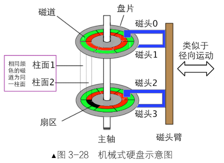{width=60%}

- **扇区 (Sector)**: 磁盘读写最小单位，编号从 1 开始。
- **磁道 (Track)**: 盘片上的同心圆，由扇区组成。
- **磁头 (Head)**: 对应盘面号，多盘片并行读写。
- **柱面 (Cylinder)**: 所有盘面上编号相同的磁道集合。分区粒度通常为柱面。

利用**bximage**工具创建一块80MB的虚拟硬盘作为从盘。创建过程需指定磁盘类型、映像格式及容量，关键参数如下：

- **柱面 (Cylinders)**: 162
- **磁头 (Heads)**: 16
- **每磁道扇区数 (Sectors per track)**: 63
- **总扇区数**: 163,296
- **总大小**: 约 79.73 MB

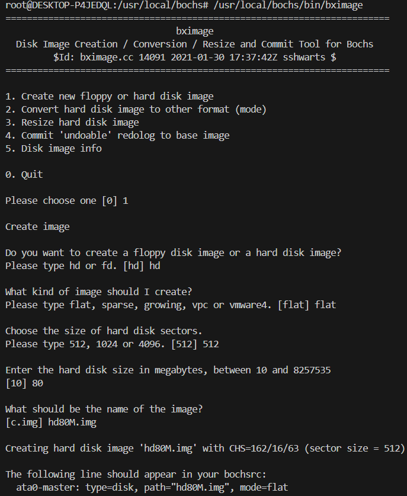{width=85%}

生成文件hd80M.img后，需在 Bochs 配置文件(bochsrc)中将其注册为从盘(ata0-slave)。配置示例如下：

```ini
ata0-master: type=disk, path="hd60M.img", mode=flat, cylinders=121, heads=16, spt=63
ata0-slave:  type=disk, path="hd80M.img", mode=flat, cylinders=162, heads=16, spt=63
```

**验证硬盘识别：**
BIOS 会将检测到的硬盘数量存储在物理地址**0x475**处。

- 添加从盘前：该地址值为**0x01**(仅主盘)。
- 添加从盘后：该地址值变为**0x02**(主盘 + 从盘)。

可通过 Bochs 调试命令验证：

```bash linenums="0"
xp/b 0x475     # 输出应为 0x02，表示成功识别两块硬盘
```

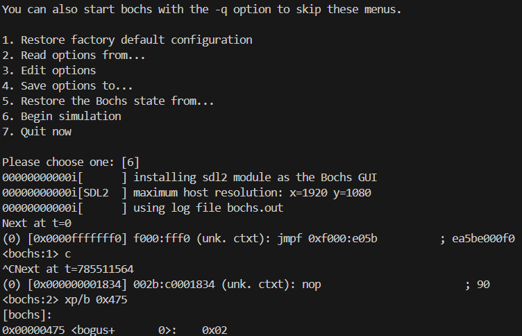{width=85%}

### 13.1.3 磁盘分区表浅析

**分区策略：**

MBR分区表**限制**源于其结构：主引导记录(MBR)位于硬盘首扇区，仅64字节用于分区表，且划分为4个16字节表项，故仅支持4个分区。MBR 分区表仅支持 4 个表项。为突破限制，同时兼容原有结构，引入**扩展分区** (ID 0x05)，其内部可包含多个**逻辑分区**。

- **主分区**: 直接位于MBR分区表中，最多4个。
- **扩展分区**: 占用一个主分区表项，内部通过链表结构管理逻辑分区。
- **逻辑分区**: 位于扩展分区内，编号从5开始。

分区表(DPT, Disk Partition Table)是操作系统管理磁盘的地图。MBR扇区(LBA 0)结构如下：

- **0 ~ 445 字节**: 引导代码 (MBR)。
- **446 ~ 509 字节 (0x1BE ~ 0x1FD)**: 分区表 (4 项 × 16 字节)。
- **510 ~ 511 字节**: 魔数0x55AA。

**分区表项结构 (16 字节):**

| 偏移量 | 数据宽度 | 描 述 |
| ---- | ---- | ---- |
| 0 | 1 | 活动分区标记，此标记有两种取值，0x80 和 0。<br>0x80 表示活动分区，也就是此分区的引导扇区中包含引导程序，可引导。只要是可执行加载执行的程序都可作为引导程序，不要误以为引导程序一定得是内核提供的程序，尽管通常情况下都是内核加载器。<br>0 表示非活动分区，不可引导。<br>其他值非法 |
| 1 | 1 | 分区起始磁头号 |
| 2 | 1 | 分区起始扇区号 |
| 3 | 1 | 分区起始柱面号 |
| 4 | 1 | 文件系统类型 ID，如 0 表示不可识别的文件系统，1 表示 FAT32 |
| 5 | 1 | 分区结束磁头号 |
| 6 | 1 | 分区结束扇区号 |
| 7 | 1 | 分区结束柱面号 |
| 8 | 4 | 分区起始偏移扇区 |
| 12 | 4 | 分区容量扇区数 |

**链式扩展分区机制：**
扩展分区内的每个子分区起始处都有一个**EBR (Extended Boot Record, 扩展引导记录)**，结构与MBR类似。EBR 中的分区表项含义特殊：

1. **第一项**: 描述当前逻辑分区的元信息。
2. **第二项**: 指向下一个子扩展分区 (EBR) 的偏移量，形成链表。

**分区布局解析实例：**
通过分析**hd80M.img**的十六进制数据，可还原分区链表：

1. **MBR (LBA 0)**:

	​	表项 1: 主分区 sdb1，类型 0x83，起始 0x3F，长度0x7DC1。

	​	表项 4: 扩展分区，类型 0x05，起始0x7E00，长度0x1FFE0。

2. **EBR1 (LBA 0x7E00)**:

	​	表项 1: 逻辑分区 sdb5，类型 0x66，相对起始0x3F(绝对0x7E3F)。

	​	表项 2: 下一 EBR 相对偏移0x46E0。

3. **EBR2 (LBA 0xC4E0)**:

	​	表项 1: 逻辑分区sdb6，类型0x66。

	​	表项 2: 下一 EBR相对偏移0xA950。

以此类推，形成单向链表。下图展示了完整的分区布局逻辑：

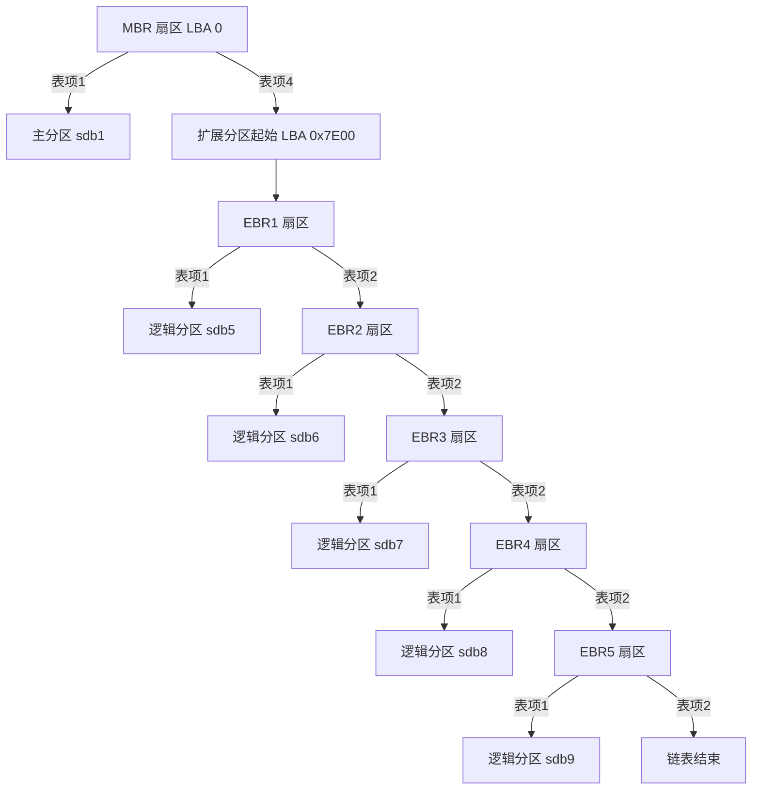

### 13.1.2 创建磁盘分区表

使用**fdisk**对**hd80M.img**进行分区操作，流程概览如下：

**设置分区：**

创建主分区1和扩展分区4:

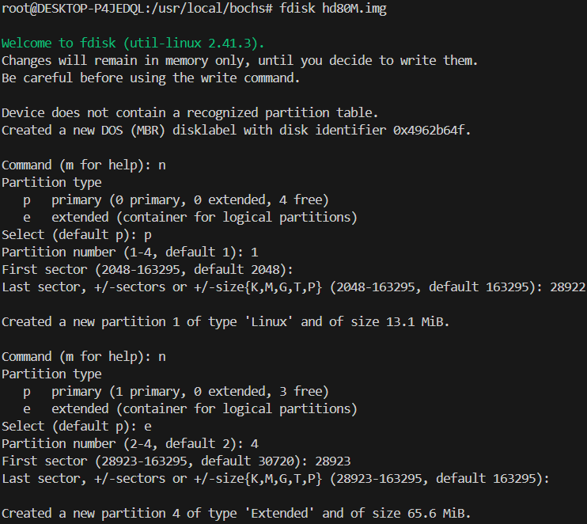{width=90%}

创建逻辑分区5到9:

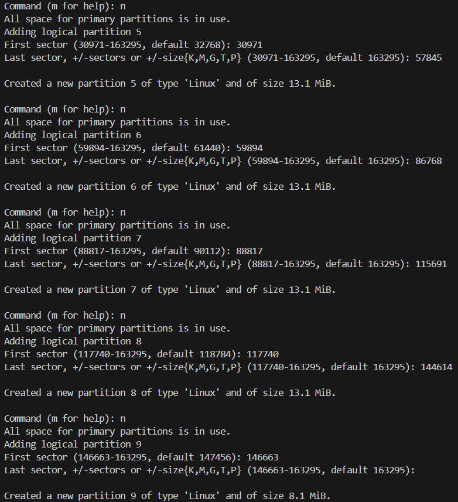{width=90%}

显示分区情况：

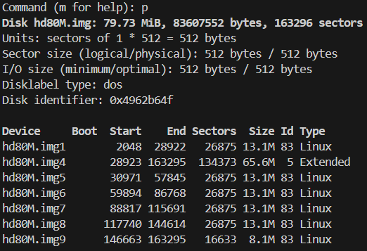{width=67%}

修改逻辑分区ID并查看：

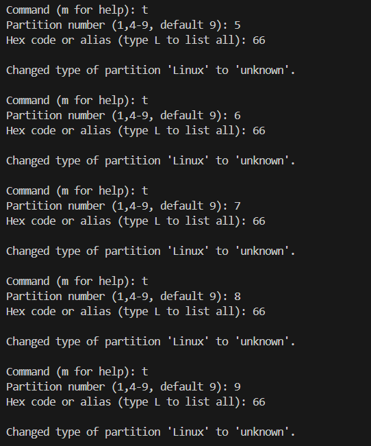{width=67%}
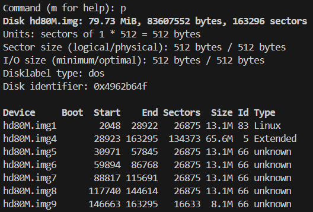{width=67%}

保存分区设置并查看：

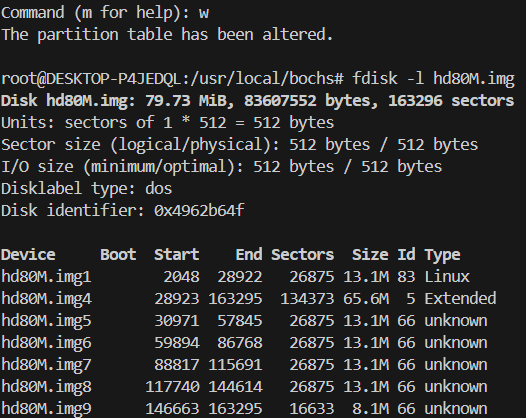{width=67%}

分区完成后，`hd80M.img` 保持原有大小，因为柱面和磁头参数未变。

> MBR 里编号 1~4 只能是主 / 扩展分区；**5 及以上全部是逻辑分区**，放在扩展分区内部，靠 EBR 链式链表管理。这里创建了 5 个逻辑分区（img5~img9），这就是扩展分区解决 4 分区上限的效果。
>
> 空间关系

> - 扩展分区 img4：从 28923 一直覆盖到磁盘末尾 163295，整个 65.6M 空间作为容器。
> - img5~img9 全部**嵌套在 img4 扩展分区内部**，由 EBR 链表串联。

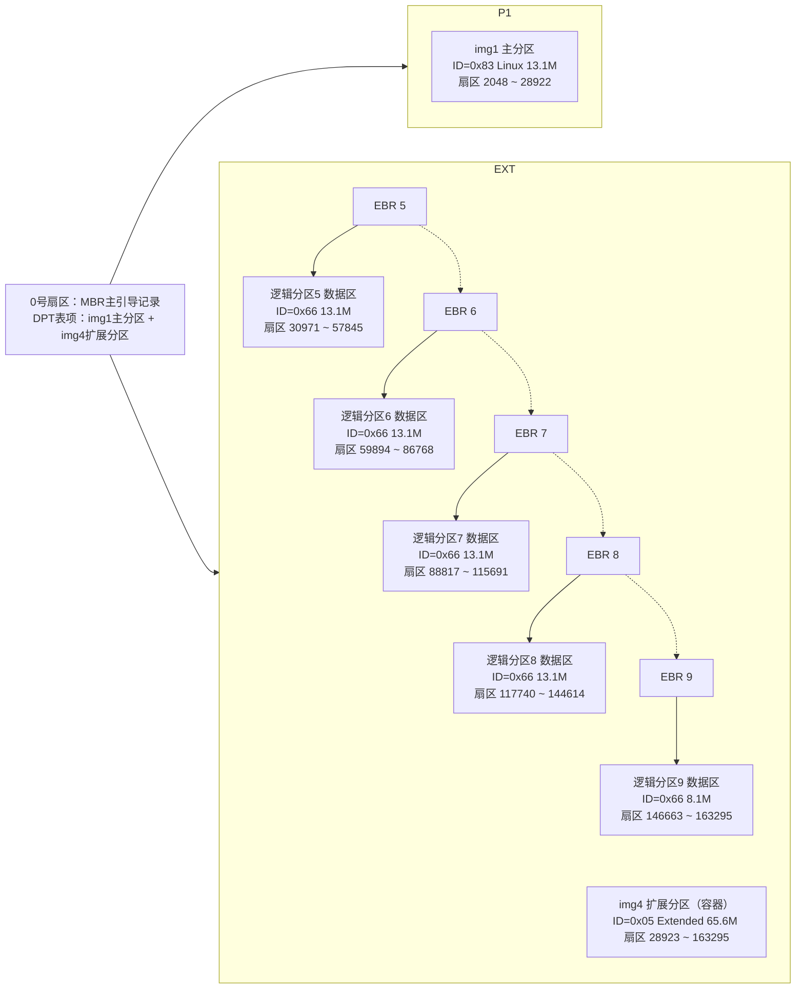

## 13.2 编写硬盘驱动程序

**驱动程序**是操作系统与硬件之间的桥梁，它封装了底层硬件繁琐的寄存器操作，为上层提供简洁易用的接口。本节的目的是编写一个完整的IDE硬盘驱动程序，包括**初始化**、**读写扇区**、**中断处理**以及**分区扫描**功能。

> IDE(Integrated Drive Electronics，集成驱动器电子电路) 是早期并行硬盘接口标准，名字来源于设计特点：**把硬盘控制器电路直接集成在硬盘本体上**。在此之前硬盘控制电路是独立的适配卡，插在主板扩展槽上，硬盘只负责存储。IDE 集成后，主板和硬盘之间只用简单的排线传输数据，大幅简化了硬件设计。

> **别名关系**
>
> IDE 标准化后正式名称为 **ATA（Advanced Technology Attachment）**；为了和后来的串行 SATA 区分，也叫 **PATA（Parallel ATA，并行 ATA）**。日常语境里 IDE / ATA / PATA 基本指代同一种接口。

### 13.2.1 硬盘初始化

我们需要用数据在逻辑上抽象并管理硬盘硬件，为此，需定义通道、硬盘、分区的数据结构，并在**ide_init**函数中进行初始化。

进行**前期准备**工作，设置中断控制器，打开从片上的IRQ14和IRQ15以接收硬盘中断，修改**interrupt.c**:

```c
static void pic_init(void) {
    ... 
    // 0xf8: 0b 1111 1000
    // 0xbf: 0b 1011 1111
    // 0 = 开放，1 = 屏蔽
    outb(PIC_M_DATA, 0xf8);  // 主片， 开放IR0、1(时钟中断、键盘中断、从片)，IRQ2用于级联从片
    outb(PIC_S_DATA, 0xbf);  // 打开从片上的IRQ14（硬盘）
    ...
}
```

```linenums="0"
CPU
 └─ 主片 8259A (端口 0x20/0x21)
    ├─ IR0  →  时钟（已开放）
    ├─ IR1  →  键盘（已开放）
    ├─ IR2  →  级联从片（已开放）  ← 关键！从片的中断信号通过这里汇聚
    ├─ IR3~IR7 → 其他（屏蔽）
    │
    └─ 从片 8259A (端口 0xa0/0xa1)
       ├─ IR14 → 硬盘（已开放）    ← 唯一开放的从片中断
       └─ 其他 → 屏蔽
```

并在内核中实现一个方便的格式化输出函数printk，创建lib/kernel/**stdio-kernel.c**。

```c
#include "stdio.h"
#include "print.h"
#include "stdio-kernel.h"
#include "console.h"

void printk(const char* format, ...) {
    va_list args;
    va_start(args, format);      // args 指向 format
    char buf[1024] = {0};
    vsprintf(buf, format, args); // 反复调用 va_arg 获取可变参数的值
    va_end(args);
    console_put_str(buf);
}
```

创建对应的**stdio-kernel.h**:

```c
#ifndef __PRINTK_H__
#define __PRINTK_H__

#define va_start(ap, v)  ap = (va_list)&v      // 把ap指向第一个固定参数 v
#define va_arg(ap, t)    *((t*)(ap += 4))      // ap指向下一个参数并返回其值
#define va_end(ap)       ap = NULL             // 清除 ap


// 打印函数声明
void printk(const char* format, ...);

#endif
```

```c linenums="0"
printk("hello %d %c", 42, 'A');

高地址
                  ┌───────────────┐
                  │ 'A' = 0x41    │  ← 第3个参数 (可变参数 #2)
  esp+12 ───────> │               │     4 字节
                  ├───────────────┤
                  │ 42            │  ← 第2个参数 (可变参数 #1)
  esp+8  ───────> │               │     4 字节
                  ├───────────────┤
                  │ fmt 指针      │  ← 第1个参数 (固定参数 format)
  esp+4  ───────> │               │     4 字节
                  ├───────────────┤
                  │ 返回地址 eip   │  ← call 压入的
  esp    ───────> │               │     4 字节
                  └───────────────┘
低地址
```

定义**核心数据**结构，完成硬件的抽象工作，创建device/**ide.h**：

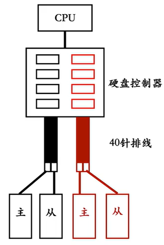{width=30%}

```c
#ifndef DEVICE_IDE_H
#define DEVICE_IDE_H

#include "stdint.h"
#include "sync.h"
#include "list.h" 

/*分区结构*/
struct partition {
    uint32_t start_lba;         //起始扇区
    uint32_t sec_cnt;           //扇区数
    struct disk* my_disk;       //分区所属的硬盘
    struct list_elem part_tag;  //用于队列中的标记
    char name[8];               //分区名称
    struct super_block* sb;     //本分区的超级块
    struct bitmap block_bitmap; //块位图
    struct bitmap inode_bitmap; //i结点位图
    struct list open_inodes;    //本分区打开的i结点队列
};

/*硬盘结构*/
struct disk {
    char name[8];                     //本硬盘的名称
    struct ide_channel* my_channel;   //此块硬盘归属于哪个ide通道
    uint8_t dev_no;                   //本硬盘是主0，还是从1
    struct partition prim_parts[4];   //主分区顶多是4个
    struct partition logic_parts[8];  //逻辑分区
};

/*ata通道结构*/
struct ide_channel {
    char name[8];              //本ata通道名称
    uint16_t port_base;        //本通道的起始端口号
    uint8_t irq_no;            //本通道所用的中断号
    struct lock lock;          //通道锁
    bool expecting_intr;       //表示等待硬盘的中断
    struct semaphore disk_done;//用于阻塞、唤醒驱动程序
    struct disk devices[2];    //一个通道上连接两个硬盘，一主一从
};

#endif
```

接下来，定义一组寄存器端口和关键位的宏，实现初始化函数，创建device/**ide.c**：

```c
#include "ide.h"   
#include "list.h"
#include "stdint.h"
#include "string.h"
#include "init.h"
#include "sync.h"

/* 定义硬盘各寄存器的端口号 */
#define reg_data(channel)      (channel->port_base + 0)
#define reg_error(channel)     (channel->port_base + 1)
#define reg_sect_cnt(channel)  (channel->port_base + 2)
#define reg_lba_l(channel)     (channel->port_base + 3)
#define reg_lba_m(channel)     (channel->port_base + 4)
#define reg_lba_h(channel)     (channel->port_base + 5)
#define reg_dev(channel)       (channel->port_base + 6)
#define reg_status(channel)    (channel->port_base + 7)
#define reg_cmd(channel)       (reg_status(channel))
#define reg_alt_status(channel) (channel->port_base + 0x206)
#define reg_ctl(channel)       reg_alt_status(channel)

/* reg_alt_status 寄存器的一些关键位 */
#define BIT_ALT_STAT_BSY    0x80  // 硬盘忙
#define BIT_ALT_STAT_DRDY   0x40  // 驱动器准备好
#define BIT_ALT_STAT_DRQ    0x8   // 数据传输准备好了

/* device 寄存器的一些关键位 */
#define BIT_DEV_MBS         0xa0  // 第 7 位和第 5 位固定为 1
#define BIT_DEV_LBA         0x40
#define BIT_DEV_DEV         0x10

/* 一些硬盘操作的指令 */
#define CMD_IDENTIFY        0xec  // identify指令
#define CMD_READ_SECTOR     0x20  // 读扇区指令
#define CMD_WRITE_SECTOR    0x30  // 写扇区指令

/* 定义可读写的最大扇区数，调试用的 */
#define max_lba ((80*1024*1024/512) - 1)  //只支持80MB硬盘

uint8_t channel_cnt;            // 按硬盘数计算的通道数
struct ide_channel channels[2]; // 有两个 ide 通道

/* 硬盘数据结构初始化 */
void ide_init() {
    printk("ide_init start\n");
    uint8_t hd_cnt = *(uint8_t*)(0x475);  // 获取硬盘的数量
    ASSERT(hd_cnt > 0);
    channel_cnt = DIV_ROUND_UP(hd_cnt, 2);
    // 一个ide通道上有两个硬盘，根据硬盘数量反推有几个ide通道

    struct ide_channel* channel;
    uint8_t channel_no = 0;

    /* 处理每个通道上的硬盘 */
    while (channel_no < channel_cnt) {
        channel = &channels[channel_no];
        sprintf(channel->name, "ide%d", channel_no);

        /* 为每个ide通道初始化端口基址及中断向量 */
        switch (channel_no) {
            case 0:
                channel->port_base = 0x1f0;
                // ide0 通道的起始端口号是 0x1f0
                channel->irq_no = 0x20 + 14;
                // 从片 8259a 上倒数第二的中断引脚，是ide0通道的中断向量号
                break;
            case 1:
                channel->port_base = 0x170;
                // ide1 通道的起始端口号是 0x170
                channel->irq_no = 0x20 + 15;
                // 从 8259A 上的最后一个中断引脚
                // 我们用来响应 ide1 通道上的硬盘中断
                break;
        }

        channel->expecting_intr = false;
        // 未向硬盘写入指令时不期待硬盘的中断
        lock_init(&channel->lock);

        /* 初始化为0，目的是向硬盘控制器请求数据后，
           硬盘驱动sema_down此信号量会阻塞线程，
           直到中断处理程序将此信号量sema_up，唤醒线程 */
        sema_init(&channel->disk_done, 0);
        channel_no++;  // 下一个 channel
    }
    printk("ide_init done\n");
}
```

将硬盘初始化加入内核初始化的步骤中：

```c
#include "print.h"
#include "interrupt.h"
#include "../device/timer.h"
#include "memory.h"
#include "thread.h"
#include "console.h"
#include "init.h"
#include "keyboard.h"
#include "tss.h"
#include "ide.h"

/* 负责初始化所有模块 */
void init_all(void) {
    put_str("init_all\n");
    intr_init();       // 中断初始化中断
    mem_init();        //内存初始化          8.5.3加
    thread_init();     //线程机制初始化       9.4.4加
    timer_init();      //定时器初始化        7.8加
    console_init();    // 终端初始化         10.2.2加
    keyboard_init();   //键盘初始化          10.3.4加
    tss_init();        //TSS初始化         11.2加
    ide_init();        //硬盘初始化         13.2.2加
}

```

### 13.2.2 实现thread_yield和idle线程

在深入硬盘驱动前，需要完善一些底层支持。

实现一个**idle**线程，当系统无任务可运行时，调度器会运行此线程，它通过hlt指令挂起CPU，降低功耗。

实现**thread_yield**函数允许线程主动让出CPU，与thread_block不同，它让出后线程状态为就绪，可以被再次调度。

修改**thread.c**:

```c
static struct task_struct* idle_thread;   // idle 线程

/* 系统空闲时运行的线程 13.2.2加 */
static void idle(void* arg UNUSED) {
    while(1) {
        thread_block(TASK_BLOCKED);
        // 执行hlt时必须要保证目前处在开中断的情况下
        // hlt 让 CPU 暂停，只有中断信号（IRQ）能把它唤醒。
        // 如果此时中断是关的（IF=0），那 CPU 就真的永远睡过去了
        // 这一句只在 idle 被唤醒之后才会执行
        asm volatile ("sti; hlt" : : : "memory");
    }
}

/* 实现任务调度 */
void schedule() {
  .....
    /* 如果就绪队列中没有可运行的任务, 就唤醒idle 13.2.2加*/
    if (list_empty(&thread_ready_list)) {
        thread_unblock(idle_thread);
    }
  .....
}

/* 主动让出 cpu, 换其他线程运行 13.2.2加*/
void thread_yield(void) {
    struct task_struct* cur = running_thread();
    enum intr_status old_status = intr_disable();
    ASSERT(!elem_find(&thread_ready_list, &cur->general_tag));
    list_append(&thread_ready_list, &cur->general_tag);
    cur->status = TASK_READY;
    schedule();
    intr_set_status(old_status);
}

/* 初始化线程环境 */
void thread_init(void) {
    put_str("thread_init start\n");

    list_init(&thread_ready_list);
    list_init(&thread_all_list);
    lock_init(&pid_lock);

    /* 将当前 main 函数创建为线程 */
    make_main_thread();

    /* 创建 idle 线程 */
    idle_thread = thread_start("idle", 10, idle, NULL);   //13.2.2加
    put_str("thread_init done\n");
}
```

```linenums="0"
                    ┌──────────────────────────────────┐
                    │                                  │
                    ▼                                  │
  idle 被调度上 CPU（从 switch_to 返回）                │
                    │                                  │
                    ▼                                  │
  执行 thread_block(TASK_BLOCKED)                       │
  → 自己标记为 TASK_BLOCKED                             │
  → 从就绪队列移除                                      │
  → 调用 schedule() 触发调度                            │
                    │                                  │
                    ▼                                  │
  schedule() 切换到别的线程（main / 用户进程...）        │
  idle 被挂起，CPU 跑别的活                             │
                    │                                  │
                    ▼                                  │
  所有线程都阻塞了，就绪队列空了                         │
                    │                                  │
                    ▼                                  │
  schedule() 发现就绪队列空                             │
  → thread_unblock(idle_thread) 把 idle 加回就绪队列    │
  → switch_to 切换回 idle                              │
                    │                                  │
                    ▼                                  │
  idle 从 thread_block 返回                            │
  → sti（开中断）                                      │
  → hlt（CPU 进入低功耗等待状态）                       │
                    │                                  │
                    ▼                                  │
  某个中断来了（时钟/键盘/硬盘...）                      │
  → CPU 被唤醒，处理中断                                │
  → 中断可能 unblock 了某个线程                         │
  → hlt 后面的代码继续执行，回到 while(1) 循环顶部       │
  → 再次 thread_block                                  │
                    │                                  │
                    └──────────────────────────────────┘
```

| 没有 idle 线程 | 有 idle 线程 |
| --- | --- |
| 就绪队列空时，`schedule()` 里的 `ASSERT(!list_empty(...))` 直接崩溃 | 总有一个线程可以调度，不会崩溃 |
| 没有工作时 CPU 疯狂空转（`while(1)` 占满 100%） | `hlt` 让 CPU 进入低功耗，省电降温 |
| 无法区分“系统死机”和“系统空闲” | idle 线程存在 = 系统活着，只是没活干 |

修改对应的头文件**thread.h**。

### 13.2.3 实现简单的休眠函数

硬盘是低速设备，操作需要较长时间。在等待硬盘期间，驱动程序应让出CPU。实现一个简单的毫秒级休眠函数，它基于时钟中断工作。

修改**timer.c**:

```c

#define mil_seconds_per_intr (1000 / IRQ0_FREQUENCY)   //13.2.3加
...略

/* 以tick为单位的sleep, 任何时间形式的sleep会转换此 ticks 形式 13.2.3加 */
static void ticks_to_sleep(uint32_t sleep_ticks) {
    uint32_t start_tick = ticks;
    /* 若间隔的 ticks 数不够便让出 cpu */
    while (ticks - start_tick < sleep_ticks) {
        thread_yield();
    }
}

/* 以毫秒为单位的sleep  1秒= 1000毫秒 13.2.3加 */
void mtime_sleep(uint32_t m_seconds) {
    uint32_t sleep_ticks = DIV_ROUND_UP(m_seconds, mil_seconds_per_intr);
    ASSERT(sleep_ticks > 0);
    ticks_to_sleep(sleep_ticks);
}
...略
```

修改对应的头文件timer.h。

### 13.2.4 完善硬盘驱动程序

现在实现硬盘读写的核心例程。包括选择硬盘、选择扇区、发送命令、读写数据、等待硬盘就绪以及硬盘中断处理程序。

基于上述函数，实现上层的**ide_read**和**ide_write**，两者逻辑类似，区别在于写操作时，是先检查硬盘状态并写入数据，然后再阻塞等待中断。

**注意**：由于硬盘一次最多处理256个扇区，大块数据需要分次处理。在发出命令后，驱动程序通过信号量阻塞自己，等待硬盘中断唤醒。

修改**ide.c**:

```c
/* 选择读写的硬盘 */
static void select_disk(struct disk* hd) {
    uint8_t reg_device = BIT_DEV_MBS | BIT_DEV_LBA;
    if (hd->dev_no == 1) {    // 若是从盘就置 DEV 位为 1
        reg_device |= BIT_DEV_DEV;
    }
    outb(reg_dev(hd->my_channel), reg_device);
}

/* 写入起始扇区地址及要读写的扇区数,针对硬盘控制器 */
static void select_sector(struct disk* hd, uint32_t lba, uint8_t sec_cnt) {
    ASSERT(lba <= max_lba);
    struct ide_channel* channel = hd->my_channel;

    /* 写入要读写的扇区数*/
    outb(reg_sect_cnt(channel), sec_cnt);
    // 如果sec_cnt为0，则表示写入256个扇区

    /* 写入lba地址，即扇区号 */
    outb(reg_lba_l(channel), lba);
    // lba地址的低8位，不用单独取出低8位
    // outb函数中的汇编指令 outb %b0, %w1 会只用 al

    outb(reg_lba_m(channel), lba >> 8);   // lba 地址的 8~15 位
    outb(reg_lba_h(channel), lba >> 16);  // lba 地址的 16~23 位

    /* 因为 lba 地址的第 24~27 位要存储在 device 寄存器的 0~3 位，
     * 所以在此处把 device 寄存器再重新写入一次*/
    outb(reg_dev(channel), BIT_DEV_MBS | BIT_DEV_LBA | \
         (hd->dev_no == 1 ? BIT_DEV_DEV : 0) | lba >> 24);
}

/* 向通道channel发命令cmd */
static void cmd_out(struct ide_channel* channel, uint8_t cmd) {
    /* 只要向硬盘发出了命令便将此标记置为true，硬盘中断处理程序需要根据它来判断 */
    channel->expecting_intr = true;
    outb(reg_cmd(channel), cmd);
}

/* 硬盘读入sec_cnt个扇区的数据到buf */
static void read_from_sector(struct disk* hd, void* buf, uint8_t sec_cnt) {
    uint32_t size_in_byte;
    if (sec_cnt == 0) {
        /* 因为sec_cnt是8位变量，由主调函数将其赋值时，若为 256 则会将最高位的1丢掉变为0 */
        size_in_byte = 256 * 512;
    } else {
        size_in_byte = sec_cnt * 512;
    }
    insw(reg_data(hd->my_channel), buf, size_in_byte / 2);
}

/* 将buf中sec_cnt扇区的数据写入硬盘 */
static void write2sector(struct disk* hd, void* buf, uint8_t sec_cnt) {
    uint32_t size_in_byte;
    if (sec_cnt == 0) {
        /* 因为sec_cnt是8位变量，由主调函数将其赋值时，若为256则会将最高位的1丢掉变为0 */
        size_in_byte = 256 * 512;
    } else {
        size_in_byte = sec_cnt * 512;
    }
    outsw(reg_data(hd->my_channel), buf, size_in_byte / 2);
}

/* 最多等待30秒 */
static bool busy_wait(struct disk* hd) {
    struct ide_channel* channel = hd->my_channel;
    uint16_t time_limit = 30 * 1000;      // 最多等待 30000 毫秒
    while (time_limit -= 10 >= 0) {
        if (!(inb(reg_status(channel)) & BIT_STAT_BSY)) {
            return (inb(reg_status(channel)) & BIT_STAT_DRQ);
        } else {
            mtime_sleep(10);              // 睡眠 10 毫秒
        }
    }
    return false;
}

/* 从硬盘读取sec_cnt个扇区到buf */
void ide_read(struct disk* hd, uint32_t lba, void* buf, uint32_t sec_cnt) {
    ASSERT(lba <= max_lba);
    ASSERT(sec_cnt > 0);

    lock_acquire(&hd->my_channel->lock);

    /* 1 先选择操作的硬盘 */
    select_disk(hd);

    uint32_t secs_op;         // 每次操作的扇区数
    uint32_t secs_done = 0;   // 已完成的扇区数
    while (secs_done < sec_cnt) {
        if ((secs_done + 256) <= sec_cnt) {
            secs_op = 256;
        } else {
            secs_op = sec_cnt - secs_done;
        }

        /* 2 写入待读入的扇区数和起始扇区号 */
        select_sector(hd, lba + secs_done, secs_op);

        /* 3 执行的命令写入 reg_cmd 寄存器 */
        cmd_out(hd->my_channel, CMD_READ_SECTOR); // 准备开始读数据

        /************************** 阻塞自己的时机 **************************/
        /* 在硬盘已经开始工作（开始在内部读数据或写数据）后才能阻塞自己，现在硬盘已经开始忙了
           将自己阻塞，等待硬盘完成读操作后通过中断处理程序唤醒自己*/
        sema_down(&hd->my_channel->disk_done);
        /*******************************************************************/

        /* 4 检测硬盘状态是否可读 */
        /* 醒来后开始执行下面代码*/
        if (!busy_wait(hd)) {    // 若失败
            char error[64];
            sprintf(error, "%s read sector %d failed!!!!!!\n", hd->name, lba);
            PANIC(error);
        }

        /* 5 把数据从硬盘的缓冲区中读出 */
        read_from_sector(hd, (void*)((uint32_t)buf + secs_done * 512), secs_op);
        secs_done += secs_op;
    }
    lock_release(&hd->my_channel->lock);
}

/* 将buf中sec_cnt扇区数据写入硬盘 */
void ide_write(struct disk* hd, uint32_t lba, void* buf, uint32_t sec_cnt) {
    ASSERT(lba <= max_lba);
    ASSERT(sec_cnt > 0);
    lock_acquire(&hd->my_channel->lock);

    /* 1 先选择操作的硬盘 */
    select_disk(hd);

    uint32_t secs_op;         // 每次操作的扇区数
    uint32_t secs_done = 0;   // 已完成的扇区数
    while (secs_done < sec_cnt) {
        if ((secs_done + 256) <= sec_cnt) {
            secs_op = 256;
        } else {
            secs_op = sec_cnt - secs_done;
        }

        /* 2 写入待写入的扇区数和起始扇区号 */
        select_sector(hd, lba + secs_done, secs_op);

        /* 3 执行的命令写入 reg_cmd 寄存器 */
        cmd_out(hd->my_channel, CMD_WRITE_SECTOR);
        // 准备开始写数据

        /* 4 检测硬盘状态是否可读 */
        if (!busy_wait(hd)) {    // 若失败
            char error[64];
            sprintf(error, "%s write sector %d failed!!!!!!\n", hd->name, lba);
            PANIC(error);
        }

        /* 5 将数据写入硬盘 */
        write2sector(hd, (void*)((uint32_t)buf + secs_done * 512), secs_op);

        /* 在硬盘响应期间阻塞自己 */
        sema_down(&hd->my_channel->disk_done);
        secs_done += secs_op;
    }
    /* 醒来后开始释放锁*/
    lock_release(&hd->my_channel->lock);
}

/* 硬盘中断处理程序，一个通道上的主、从盘共享一个中断线。
   当中断发生时，需判断是否是期待的中断，并唤醒被阻塞的驱动程序。 */
void intr_hd_handler(uint8_t irq_no) {
    ASSERT(irq_no == 0x2e || irq_no == 0x2f);
    uint8_t ch_no = irq_no - 0x2e;
    struct ide_channel* channel = &channels[ch_no];
    ASSERT(channel->irq_no == irq_no);

    /* 不必担心此中断是否对应的是这一次的 expecting_intr，
     * 每次读写硬盘时会申请锁，从而保证了同步一致性 */
    if (channel->expecting_intr) {
        channel->expecting_intr = false;
        sema_up(&channel->disk_done);

        /* 读取状态寄存器，使硬盘控制器认为此次的中断已被处理，从而硬盘可以继续执行新的读写 */
        inb(reg_status(channel));
    }
}

/* 硬盘数据结构初始化，在ide_init函数中注册这个中断处理程序 */
void ide_init() {
    printk("ide_init start\n");
    ...略

    /* 处理每个通道上的硬盘 */
    while (channel_no < channel_cnt) {
     ...
        register_handler(channel->irq_no, intr_hd_handler);  13.2.4加
     ...
       
    }
    printk("ide_init done\n");
}
```

### 13.2.5 获取硬盘信息，扫描分区表

驱动程序的核心功能已就绪，现在用两件工作来验证：向硬盘发送identify命令**获取信息**，**扫描硬盘**上的分区表。

**获取硬盘信息**：identify命令返回的硬盘信息以字为单位，需相邻字节位置互换处理。

**扫描分区表**：   分区表扫描是一个递归过程，从MBR开始，遍历所有EBR，提取主分区和逻辑分区信息。

> ATA 协议把字符串按大端打包在 16 位字里，而 x86 CPU 是小端序，读取后字符串的两个字符自然就反过来了，所以需要互换才能还原正确的字符串顺序。数值字段因为协议本身就是小端存的，反而不需要处理。

修改**ide.c**:

​		 在ide_init的最后，我们调用**identify_disk**和**partition_scan**来检测并打印所有硬盘和分区信息。

​                  对于启动盘(hd60M.img, 即sda)，我们跳过其分区扫描，因为它是一个裸盘。

```c
略
/* 用于记录总扩展分区的起始lba，初始为0，partition_scan时以此为标记 */
int32_t ext_lba_base = 0;

uint8_t p_no = 0, l_no = 0;       // 用来记录硬盘主分区和逻辑分区的下标

struct list partition_list;        // 分区队列

/* 构建一个 16 字节大小的结构体，用来存分区表项 */
struct partition_table_entry {
    uint8_t bootable;             // 是否可引导
    uint8_t start_head;           // 起始磁头号
    uint8_t start_sec;            // 起始扇区号
    uint8_t start_chs;            // 起始柱面号
    uint8_t fs_type;              // 分区类型
    uint8_t end_head;             // 结束磁头号
    uint8_t end_sec;              // 结束扇区号
    uint8_t end_chs;              // 结束柱面号
    /* 更需要关注的是下面这两项 */
    uint32_t start_lba;           // 本分区起始扇区的 lba 地址
    uint32_t sec_cnt;             // 本分区的扇区数目
} __attribute__ ((packed));       // 保证此结构是 16 字节大小

/* 引导扇区，mbr或ebr所在的扇区 */
struct boot_sector {
    uint8_t other[446];           // 引导代码
    struct partition_table_entry partition_table[4]; // 分区表中有 4 项，共 64 字节
    uint16_t signature;           // 启动扇区的结束标志是 0x55,0xaa,
} __attribute__ ((packed));

略

/* 将dst中len个相邻字节交换位置后存入buf*/
static void swap_pairs_bytes(const char* dst, char* buf, uint32_t len) {
    uint8_t idx;
    for (idx = 0; idx < len; idx += 2) {
        /* buf 中存储数组中相邻元素交换位置后的字符串 */
        buf[idx] = *(dst+idx+1);
        buf[idx+1] = *(dst+idx);
    }
    buf[idx] = '\0';
}

/* 获得硬盘参数信息 */
static void identify_disk(struct disk* hd) {
    char id_info[512];
    select_disk(hd);
    cmd_out(hd->my_channel, CMD_IDENTIFY);
    /* 向硬盘发送指令后便通过信号量阻塞自己,
     * 待硬盘处理完成后,通过中断处理程序将自己唤醒 */
    sema_down(&hd->my_channel->disk_done);

    /* 醒来后开始执行下面代码 */
    if (!busy_wait(hd)) {      // 若失败
        char error[64];
        sprintf(error, "%s identify failed!!!!!!\n", hd->name);
        PANIC(error);
    }
    read_from_sector(hd, id_info, 1);

    char buf[64];
    uint8_t sn_start = 10 * 2, sn_len = 20, md_start = 27 * 2, md_len = 40;
    swap_pairs_bytes(&id_info[sn_start], buf, sn_len);
    printk("  disk %s info:\n      SN: %s\n", hd->name, buf);
    memset(buf, 0, sizeof(buf));
    swap_pairs_bytes(&id_info[md_start], buf, md_len);
    printk("      MODULE: %s\n", buf);
    uint32_t sectors = *(uint32_t*)&id_info[60 * 2];
    printk("      SECTORS: %d\n", sectors);
    printk("      CAPACITY: %dMB\n", sectors * 512 / 1024 / 1024);
}

/* 扫描硬盘hd中地址为ext_lba的扇区中的所有分区 */
static void partition_scan(struct disk* hd, uint32_t ext_lba) {
    struct boot_sector* bs = sys_malloc(sizeof(struct boot_sector));
    ide_read(hd, ext_lba, bs, 1);
    uint8_t part_idx = 0;
    struct partition_table_entry* p = bs->partition_table;

    /* 遍历分区表4个分区表项 */
    while (part_idx++ < 4) {
        if (p->fs_type == 0x5) {   // 若为扩展分区
            if (ext_lba_base != 0) {
                /* 子扩展分区的start_lba是相对于主引导扇区中的总扩展分区地址 */
                partition_scan(hd, p->start_lba + ext_lba_base);
            } else {
                // ext_lba_base为0表示是第一次读取引导块，也就是主引导记录所在的扇区
                /* 记录下扩展分区的起始lba地址，后面所有的扩展分区地址都相对于此 */
                ext_lba_base = p->start_lba;
                partition_scan(hd, p->start_lba);
            }
        } else if (p->fs_type != 0) {   // 若是有效的分区类型
            if (ext_lba == 0) {                    // 此时全是主分区
                hd->prim_parts[p_no].start_lba = ext_lba + p->start_lba;
                hd->prim_parts[p_no].sec_cnt = p->sec_cnt;
                hd->prim_parts[p_no].my_disk = hd;
                list_append(&partition_list, &hd->prim_parts[p_no].part_tag);
                sprintf(hd->prim_parts[p_no].name, "%s%d", hd->name, p_no + 1);
                p_no++;
                ASSERT(p_no < 4);        // 0,1,2,3
            } else {
                hd->logic_parts[l_no].start_lba = ext_lba + p->start_lba;
                hd->logic_parts[l_no].sec_cnt = p->sec_cnt;
                hd->logic_parts[l_no].my_disk = hd;
                list_append(&partition_list, &hd->logic_parts[l_no].part_tag);
                sprintf(hd->logic_parts[l_no].name, "%s%d", hd->name, l_no + 5);
                // 逻辑分区数字从5开始，主分区是1~4
                l_no++;
                if (l_no >= 8)   // 只支持8个逻辑分区，避免数组越界
                    return;
            }
        }
        p++;
    }
    sys_free(bs);
}

略


/* 打印分区信息 */
static bool partition_info(struct list_elem* pelem, int arg) {
    struct partition* part = elem2entry(struct partition, part_tag, pelem);
    printk("  %s start_lba:0x%x, sec_cnt:0x%x\n", \
           part->name, part->start_lba, part->sec_cnt);

/* 在此处 return false 与函数本身功能无关，
 * 只是为了让主调函数 list_traversal 继续向下遍历元素 */
    return false;
}

/* 硬盘数据结构初始化 */
void ide_init() {
   ...

    /* 处理每个通道上的硬盘 */
    while (channel_no < channel_cnt) {
        ......
        /* 分别获取两个硬盘的参数及分区信息 */
        while (dev_no < 2) {
            .....
            sprintf(hd->name, "sd%c", 'a' + channel_no * 2 + dev_no);
            identify_disk(hd);	 // 获取硬盘参数
            if (dev_no != 0) {	 // 内核本身的裸硬盘(hd60M.img)不处理
                partition_scan(hd, 0);  // 扫描该硬盘上的分区  
            }
            p_no = 0, l_no = 0;
            dev_no++; 
        }
        dev_no = 0;			  	   // 将硬盘驱动器号置0,为下一个channel的两个硬盘初始化。
        channel_no++;				   // 下一个channel
    }
    printk("\n  all partition info\n");
    /* 打印所有分区信息 */
    list_traversal(&partition_list, partition_info, (int)NULL);   
    printk("ide_init done\n");
}
```

完善生成对应的**ide.h**文件。

修改**main.c**

```c
#include "print.h"
#include "init.h"
#include "thread.h"
#include "process.h"
#include "console.h"
#include "interrupt.h"
#include "stdio.h"
#include "syscall-init.h"
#include "syscall.h" 

void k_thread_a(void*);
void k_thread_b(void*);
void u_prog_a(void);
void u_prog_b(void);

int main(void) {
    put_str("I am kernel\n");
    init_all();
    intr_enable();
    process_execute(u_prog_a, "u_prog_a");
    process_execute(u_prog_b, "u_prog_b");
    thread_start("k_thread_a", 31, k_thread_a, "I am thread_a");
    thread_start("k_thread_b", 31, k_thread_b, "I am thread_b");
    while(1);
    return 0;
}

/* 在线程中运行的函数 */
void k_thread_a(void* arg) {
    void* addr1 = sys_malloc(256);
    void* addr2 = sys_malloc(255);
    void* addr3 = sys_malloc(254);
    //console_put_str(" thread_a malloc addr:0x");
    //console_put_int((int)addr1);
    //console_put_char(',');
    //console_put_int((int)addr2);
    //console_put_char(',');
    //console_put_int((int)addr3);
    //console_put_char('\n');

    int cpu_delay = 100000;
    while(cpu_delay-- > 0);
    sys_free(addr1);
    sys_free(addr2);
    sys_free(addr3);
    while(1);
}

/* 在线程中运行的函数 */
void k_thread_b(void* arg) {
    // 代码同 k_thread_a
    void* addr1 = sys_malloc(256);
    void* addr2 = sys_malloc(255);
    void* addr3 = sys_malloc(254);
    //console_put_str(" thread_b malloc addr:0x");
    //console_put_int((int)addr1);
    //console_put_char(',');
    //console_put_int((int)addr2);
    //console_put_char(',');
    //console_put_int((int)addr3);
    //console_put_char('\n');

    int cpu_delay = 100000;
    while(cpu_delay-- > 0);
    sys_free(addr1);
    sys_free(addr2);
    sys_free(addr3);
    while(1);
}

/* 测试用户进程 */
void u_prog_a(void) {
    void* addr1 = malloc(256);
    void* addr2 = malloc(255);
    void* addr3 = malloc(254);
    //printf(" prog_a malloc addr:0x%x,0x%x,0x%x\n", (int)addr1, (int)addr2, (int)addr3);

    int cpu_delay = 100000;
    while(cpu_delay-- > 0);
    free(addr1);
    free(addr2);
    free(addr3);
    while(1);
}

/* 测试用户进程 */
void u_prog_b(void) {
    // 代码同 u_prog_a
    void* addr1 = malloc(256);
    void* addr2 = malloc(255);
    void* addr3 = malloc(254);
    //printf(" prog_b malloc addr:0x%x,0x%x,0x%x\n", (int)addr1, (int)addr2, (int)addr3);

    int cpu_delay = 100000;
    while(cpu_delay-- > 0);
    free(addr1);
    free(addr2);
    free(addr3);
    while(1);
}

```

```linenums="0"
.
├── boot.inc
├── device
│   ├── console.c
│   ├── console.h
│   ├── ide.c             #💡新增
│   ├── ide.h             #💡新增
│   ├── ioqueue.c
│   ├── ioqueue.h
│   ├── keyboard.c
│   ├── keyboard.h
│   ├── timer.c           #🛠️修改
│   └── timer.h
├── kernel
│   ├── debug.c
│   ├── debug.h
│   ├── global.h
│   ├── init.c
│   ├── init.h
│   ├── interrupt.c        #🛠️修改
│   ├── interrupt.h
│   ├── kernel.s
│   ├── main.c
│   ├── memory.c
│   ├── memory.h
│   └── stdint.h
├── lib
│   ├── kernel
│   │   ├── bitmap.c
│   │   ├── bitmap.h
│   │   ├── io.h
│   │   ├── list.c
│   │   ├── list.h
│   │   ├── print.c
│   │   ├── print.h
│   │   ├── print.s
│   │   ├── stdio-kernel.c  #💡新增
│   │   └── stdio-kernel.h  #💡新增
│   ├── stdbool.h
│   ├── stdio.c
│   ├── stdio.h
│   ├── string.c
│   ├── string.h
│   └── user
│       ├── syscall.c
│       └── syscall.h
├── loader.s
├── makefile
├── mbr.s
├── thread
│   ├── switch.s
│   ├── sync.c
│   ├── sync.h
│   ├── thread.c            #🛠️修改
│   └── thread.h
└── userprog
    ├── process.c
    ├── process.h
    ├── syscall-init.c
    ├── syscall-init.h
    ├── tss.c
    └── tss.h
```

**编译运行**

```c
BUILD_DIR = ./build
ENTRY_POINT = 0xc0001500
AS = nasm
CC = gcc
LD = ld
LIB = -I lib/ -I lib/kernel/ -I lib/user/ -I kernel/ -I device/ -I thread/ -I userprog/
ASFLAGS = -f elf
CFLAGS = -std=gnu11 -m32 $(LIB) -c -fno-builtin -fno-stack-protector -W -Wstrict-prototypes \
	-Wmissing-prototypes  
LDFLAGS = -m elf_i386 -Ttext $(ENTRY_POINT) -e main -Map $(BUILD_DIR)/kernel.map
OBJS = $(BUILD_DIR)/main.o     $(BUILD_DIR)/init.o    $(BUILD_DIR)/interrupt.o    \
	     $(BUILD_DIR)/timer.o    $(BUILD_DIR)/kernel.o  $(BUILD_DIR)/print.o        \
	     $(BUILD_DIR)/debug.o    $(BUILD_DIR)/string.o  $(BUILD_DIR)/bitmap.o       \
	     $(BUILD_DIR)/memory.o   $(BUILD_DIR)/thread.o  $(BUILD_DIR)/list.o         \
	     $(BUILD_DIR)/switch.o   $(BUILD_DIR)/console.o $(BUILD_DIR)/sync.o 	      \
	     $(BUILD_DIR)/keyboard.o $(BUILD_DIR)/ioqueue.o $(BUILD_DIR)/tss.o          \
	     $(BUILD_DIR)/process.o  $(BUILD_DIR)/syscall.o $(BUILD_DIR)/syscall-init.o \
       $(BUILD_DIR)/stdio.o    $(BUILD_DIR)/stdio-kernel.o  $(BUILD_DIR)/ide.o    \
  

#############  c代码编译   #############
$(BUILD_DIR)/main.o: kernel/main.c
	$(CC) $(CFLAGS) $< -o $@

$(BUILD_DIR)/init.o: kernel/init.c kernel/init.h
	$(CC) $(CFLAGS) $< -o $@

$(BUILD_DIR)/interrupt.o: kernel/interrupt.c kernel/interrupt.h
	$(CC) $(CFLAGS) $< -o $@ 

$(BUILD_DIR)/timer.o: device/timer.c device/timer.h
	$(CC) $(CFLAGS) $< -o $@

$(BUILD_DIR)/debug.o: kernel/debug.c kernel/debug.h
	$(CC) $(CFLAGS) $< -o $@
	
$(BUILD_DIR)/string.o: lib/string.c lib/string.h
	$(CC) $(CFLAGS) $< -o $@
	
$(BUILD_DIR)/bitmap.o: lib/kernel/bitmap.c lib/kernel/bitmap.h
	$(CC) $(CFLAGS) $< -o $@
	
$(BUILD_DIR)/memory.o: kernel/memory.c kernel/memory.h
	$(CC) $(CFLAGS) $< -o $@
  
$(BUILD_DIR)/thread.o: thread/thread.c thread/thread.h
	$(CC) $(CFLAGS) $< -o $@
	
$(BUILD_DIR)/list.o: lib/kernel/list.c lib/kernel/list.h
	$(CC) $(CFLAGS) $< -o $@
	
$(BUILD_DIR)/sync.o: thread/sync.c thread/sync.h
	$(CC) $(CFLAGS) $< -o $@

$(BUILD_DIR)/console.o: device/console.c device/console.h
	$(CC) $(CFLAGS) $< -o $@
	
$(BUILD_DIR)/keyboard.o: device/keyboard.c device/keyboard.h
	$(CC) $(CFLAGS) $< -o $@
	
$(BUILD_DIR)/ioqueue.o: device/ioqueue.c device/ioqueue.h
	$(CC) $(CFLAGS) $< -o $@
	
$(BUILD_DIR)/tss.o: userprog/tss.c userprog/tss.h
	$(CC) $(CFLAGS) $< -o $@
	
$(BUILD_DIR)/process.o: userprog/process.c userprog/process.h
	$(CC) $(CFLAGS) $< -o $@
  
$(BUILD_DIR)/syscall.o: lib/user/syscall.c lib/user/syscall.h
	$(CC) $(CFLAGS) $< -o $@
  
$(BUILD_DIR)/syscall-init.o: userprog/syscall-init.c userprog/syscall-init.h
	$(CC) $(CFLAGS) $< -o $@
  
$(BUILD_DIR)/stdio.o: lib/stdio.c lib/stdio.h
	$(CC) $(CFLAGS) $< -o $@
  
$(BUILD_DIR)/stdio-kernel.o: lib/kernel/stdio-kernel.c lib/kernel/stdio-kernel.h
	$(CC) $(CFLAGS) $< -o $@
  
$(BUILD_DIR)/ide.o: device/ide.c device/ide.h
	$(CC) $(CFLAGS) $< -o $@

#############    汇编代码编译    #############
$(BUILD_DIR)/kernel.o: kernel/kernel.s
	$(AS) $(ASFLAGS) $< -o $@

$(BUILD_DIR)/print.o: lib/kernel/print.s
	$(AS) $(ASFLAGS) $< -o $@
	
$(BUILD_DIR)/switch.o: thread/switch.s
	$(AS) $(ASFLAGS) $< -o $@

#############   链接所有目标文件   #############
$(BUILD_DIR)/kernel.bin: $(OBJS)
	$(LD) $(LDFLAGS) $^ -o $@

.PHONY : mk_dir hd clean all

mk_dir:
	if [ ! -d ./build ]; then mkdir ./build; fi

hd:
	dd if=$(BUILD_DIR)/kernel.bin of=hd60M.img bs=512 count=200 seek=9 conv=notrunc
  
clean:
	cd $(BUILD_DIR) && rm -f ./*

build: $(BUILD_DIR)/kernel.bin

all: mk_dir build hd
```

**运行结果**

编译运行后，我们可以看到硬盘的详细信息（序列号、型号、容量）以及扫描到的所有分区及其起始扇区和大小，这与我们之前用 `fdisk`创建的分区信息完全一致，证明硬盘驱动程序工作正常。

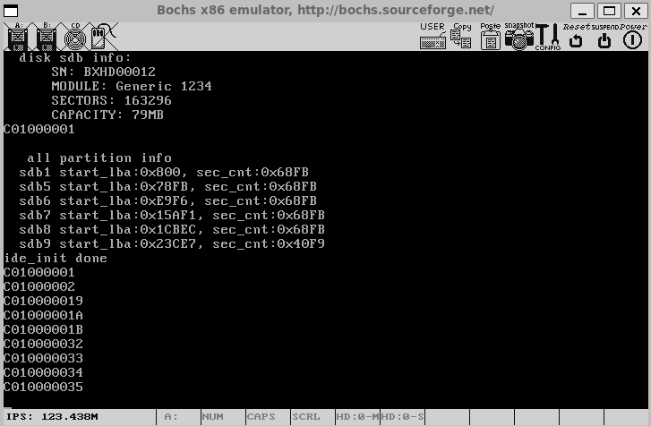

## 本章要点总结

**硬盘与分区基础**：理解了硬盘的物理结构(柱面、磁头、扇区)和逻辑结构(分区)。掌握了MBR的结构，以及主分区、扩展分区、逻辑分区的关系和链式分区表的工作原理。

**驱动程序框架**：构建了代表ATA通道、硬盘和分区的核心数据结构。驱动程序是对硬件端口的封装，旨在简化上层操作。

**内核支持完善**：实现了printk用于内核输出，thread_yield用于主动让出CPU，idle线程用于CPU空闲时挂起，以及基于时钟中断的休眠函数mtime_sleep。

**硬盘操作流程**：

​	**读扇区**：选择硬盘 -> 写入扇区地址和数量 -> 发送读命令 -> 阻塞等待中断 -> 中断唤醒后检查状态 -> 从数据端口读入数据。

​	**写扇区**：选择硬盘 -> 写入地址和数量 -> 检查状态 -> 向数据端口写出数据 -> 发送写命令 -> 阻塞等待中断。

​	通过通道锁和信号量(disk_done)实现了同一通道的互斥访问和命令完成的通知。

**中断处理**：硬盘操作完成后通过中断通知CPU。中断处理程序通过expecting_intr标志判断是否为期待的中断，并唤醒等待的驱动线程。

**功能验证**：通过identify命令成功获取硬盘身份信息，并通过递归扫描分区表，成功识别出了硬盘上的所有主分区和逻辑分区，为下一章实现文件系统做好了准备。

## 本章源码附件

### 13.1.1的bochsrc.disk

```c
megs : 64
romimage: file=/usr/local/bochs/share/bochs/BIOS-bochs-latest
vgaromimage: file=/usr/local/bochs/share/bochs/VGABIOS-lgpl-latest
boot: disk
log: bochs.out
mouse:enabled=0
keyboard:keymap=/usr/local/bochs/share/bochs/keymaps/x11-pc-us.map
ata0:enabled=1,ioaddr1=0x1f0,ioaddr2=0x3f0,irq=14
ata0-master: type=disk, path="hd60M.img", mode=flat,cylinders=121,heads=16,spt=63
ata0-slave:  type=disk, path="hd80M.img", mode=flat,cylinders=162,heads=16,spt=63
#gdbstub:enabled=1,port=1234,text_base=0,data_base=0,bss_base=0
```

### 13.2.1的interrupt.c

```c
#include "global.h" 
#include "stdint.h" 
#include "io.h"
#include "print.h"
#include "interrupt.h"

#define IDT_DESC_CNT 0x81      // 支持中断数扩展至 0x80

/* 主片和从片的端口定义 */
#define PIC_M_CTRL 0x20           // 主片的控制端口是0x20
#define PIC_M_DATA 0x21           // 主片的数据端口是0x21
#define PIC_S_CTRL 0xa0           // 从片的控制端口是0xa0
#define PIC_S_DATA 0xa1           // 从片的数据端口是0xa1

/* 定义eflags寄存器中的IF位 */
#define EFLAGS_IF 0x00000200

/* 获取eflags寄存器值 */
//#define GET_EFLAGS(EFLAG_VAR) asm volatile("pushfl;popl %0":"=r"(EFLAG_VAR))

/* 中断门描述符结构体 */
struct gate_desc {                     
    uint16_t   func_offset_low_word;   // 中断处理程序在目标代码段内的偏移量低16位
    uint16_t   selector;               // 中断处理程序目标代码段选择子
    uint8_t    dcount;                 // 双字计数字段，固定值
    uint8_t    attribute;              // 门描述符属性             
    uint16_t   func_offset_high_word;  // 中断处理程序在目标代码段内的偏移量高16位
};

extern uint32_t syscall_handler(void); // 声明外部中断处理例程

/* 静态函数声明 */
static void make_idt_desc(struct gate_desc* p_gdesc, uint8_t attr, intr_handler function);
static void idt_desc_init(void);
static void pic_init(void);


/* 全局变量声明 */
static struct gate_desc idt[IDT_DESC_CNT];           // idt是中断描述符表，本质上是中断门描述符数组
extern intr_handler intr_entry_table[IDT_DESC_CNT];  //声明引用kernel.s的中断处理函数入口数组

char* intr_name[IDT_DESC_CNT];          //用于保存异常的名字
intr_handler idt_table[IDT_DESC_CNT];   //定义中断处理程序数组,最终调用的是ide_table中的程序


/* 通用的中断处理函数，一般用在异常出现时的处理 */  
static void general_intr_handler(uint8_t vec_nr) {  
    if (vec_nr == 0x27 || vec_nr == 0x2f) {  
        return; // IRQ7 和 IRQ15 会产生伪中断（spurious interrupt），无需处理  
    }  
    /* 将光标置为 0，从屏幕左上角清出一片打印异常信息的区域，方便阅读 */  
    set_cursor(0);  
    int cursor_pos = 0;  
    while(cursor_pos < 320) {  
        put_char(' ');  
        cursor_pos++;  
    }  

    set_cursor(0);            // 重置光标为屏幕左上角  
    put_str("!!!!!!     excetion message begin  !!!!!!!!!\n");  
    set_cursor(88);           // 从第2行第8个字符开始打印  
    put_str(intr_name[vec_nr]);  
    if (vec_nr == 14) {       // 若为Pagefault，将缺失的地址打印出来并暂停  
        int page_fault_vaddr = 0;  
        asm volatile ("movl %%cr2, %0" : "=r" (page_fault_vaddr));
        // cr2 是存放造成 page_fault 的地址  
        put_str("\npage fault addr is "); 
        put_int(page_fault_vaddr);  
    }  
  
    put_str("\n!!!!!!     excetion message end    !!!!!!!!!\n");  
    // 进入中断处理程序就表示已经处在关中断情况下，不会出现调度进程的情况。故下面的死循环不会再被中断  
    while(1);  
}


/* 注册通用中断处理函数及异常名称 */
static void exception_init(void) {
    int i;
    for (i=0;i<IDT_DESC_CNT;i++) {
        idt_table[i] = general_intr_handler;// 默认为 general_intr_handler
        intr_name[i] = "unknown"; // 先统一赋值为 unknown
    }
    intr_name[0] = "#DE Divide Error";
    intr_name[1] = "#DB Debug Exception";
    intr_name[2] = "NMI Interrupt";
    intr_name[3] = "#BP Breakpoint Exception";
    intr_name[4] = "#OF Overflow Exception";
    intr_name[5] = "#BR BOUND Range Exceeded Exception";
    intr_name[6] = "#UD Invalid Opcode Exception";
    intr_name[7] = "#NM Device Not Available Exception";
    intr_name[8] = "#DF Double Fault Exception";
    intr_name[9] = "Coprocessor Segment Overrun";
    intr_name[10] = "#TS Invalid TSS Exception";
    intr_name[11] = "#NP Segment Not Present";
    intr_name[12] = "#SS Stack Fault Exception";
    intr_name[13] = "#GP General Protection Exception";
    intr_name[14] = "#PF Page-Fault Exception";
    // intr_name[15] 第15项是intel保留项，未使用
    intr_name[16] = "#MF x87 FPU Floating-Point Error";
    intr_name[17] = "#AC Alignment Check Exception";
    intr_name[18] = "#MC Machine-Check Exception";
    intr_name[19] = "#XF SIMD Floating-Point Exception";
}

/* 完成有关中断的所有初始化工作 - 主函数（调用者） */
void intr_init() {
    put_str("idt_init start\n");
    idt_desc_init();  // 初始化中断描述符表
    exception_init();  //异常名初始化并注册通常的中断处理函数
    pic_init();       // 初始化8259A
    
    /* 加载idt */
    uint64_t idt_operand = ((sizeof(idt) - 1) | ((uint64_t)((uint32_t)idt) << 16));
    asm volatile("lidt %0" : : "m"(idt_operand));
    put_str("idt_init done\n");
}


static void idt_desc_init(void) {
    int i, lastindex = IDT_DESC_CNT - 1;
    for (i = 0; i < IDT_DESC_CNT; i++) {
        make_idt_desc(&idt[i], IDT_DESC_ATTR_DPL0, intr_entry_table[i]);
    }
    // 单独处理系统调用：DPL=3 允许用户态访问，处理函数为 syscall_handler
    make_idt_desc(&idt[lastindex], IDT_DESC_ATTR_DPL3, (intr_handler)syscall_handler);
    put_str("idt desc init done\n");
}


/* 创建中断门描述符 - 被idt_desc_init调用 */
static void make_idt_desc(struct gate_desc* p_gdesc, uint8_t attr, intr_handler function) {
    p_gdesc->func_offset_low_word = (uint32_t)function & 0x0000FFFF;
    p_gdesc->selector = SELECTOR_K_CODE;  // 修正：应该是SELECTOR_K_CODE
    p_gdesc->dcount = 0;                  // 固定值
    p_gdesc->attribute = attr;            // 门描述符属性
    p_gdesc->func_offset_high_word = ((uint32_t)function & 0xFFFF0000) >> 16;
}


/* 初始化可编程中断控制器 8259A - 被idt_init调用 */
static void pic_init(void) {
    /* 初始化主片 */
    outb(PIC_M_CTRL, 0x11);  // ICW1: 边沿触发, 级联8259, 需要ICW4
    outb(PIC_M_DATA, 0x20);  // ICW2: 起始中断向量号为0x20 (IR[0-7]为0x20~0x27)
    outb(PIC_M_DATA, 0x04);  // ICW3: IR2接从片
    outb(PIC_M_DATA, 0x01);  // ICW4: 8086模式, 正常EOI
    
    /* 初始化从片 */
    outb(PIC_S_CTRL, 0x11);  // ICW1: 边沿触发, 级联8259, 需要ICW4
    outb(PIC_S_DATA, 0x28);  // ICW2: 起始中断向量号为0x28 (IR[8-15]为0x28~0x2F)
    outb(PIC_S_DATA, 0x02);  // ICW3: 设置从片连接到主片的IR2引脚
    outb(PIC_S_DATA, 0x01);  // ICW4: 8086模式, 正常EOI
    
       
    outb(PIC_M_DATA, 0xf8);  // 主片， 开放IR0、1(时钟中断、键盘中断、从片)，IRQ2用于级联从片
    outb(PIC_S_DATA, 0xbf);  // 打开从片上的IRQ14（硬盘）
    
    put_str("pic_init done\n");
}

// 在interrupt.c中替换相关函数

/* 获取当前中断状态 */
enum intr_status intr_get_status(void) {
    uint32_t eflags;
    asm volatile ("pushfl; popl %0" : "=r"(eflags));
    return (eflags & EFLAGS_IF) ? INTR_ON : INTR_OFF;
}

/* 关中断并返回之前中断状态 */
enum intr_status intr_disable(void) {
    uint32_t eflags;
    asm volatile ("pushfl; popl %0; cli" : "=r"(eflags) : : "memory");
    return (eflags & EFLAGS_IF) ? INTR_ON : INTR_OFF;
}

/* 开中断并返回之前中断状态 */
enum intr_status intr_enable(void) {
    // 直接使用sti，不检查当前状态
    uint32_t eflags;
    asm volatile ("pushfl; popl %0; sti" : "=r"(eflags) : : "memory");
    return (eflags & EFLAGS_IF) ? INTR_ON : INTR_OFF;
}

/* 设置中断状态 */
enum intr_status intr_set_status(enum intr_status status) {
    return (status == INTR_ON) ? intr_enable() : intr_disable();
}

/* 在中断处理程序数组第 vector_no 个元素中
   注册安装中断处理程序 function */
void register_handler(uint8_t vector_no, intr_handler function) {
    /* idt_table 数组中的函数是在进入中断后根据中断向量号调用的
       * 见 kernel/kernel.S 的 call [idt_table + %1*4] */
    idt_table[vector_no] = function;
}


```

### 13.2.2的thread.c

```c
#include "thread.h"
#include "stdint.h"
#include "string.h"
#include "global.h"
#include "memory.h"
#include "interrupt.h"
#include "debug.h"
#include "print.h"
#include "process.h"
#include "sync.h"
#include "syscall-init.h"

#define PG_SIZE 4096  

struct task_struct* main_thread;        // 主线程 PCB  
struct list thread_ready_list;          // 就绪队列  
struct list thread_all_list;            // 所有任务队列  
static struct list_elem* thread_tag;    // 用于保存队列中的线程结点  
static struct lock pid_lock; // PID 分配锁
static struct task_struct* idle_thread;   // idle 线程
extern void switch_to(struct task_struct* cur, struct task_struct* next);  

static pid_t allocate_pid(void) {
    static pid_t next_pid = 0;
    lock_acquire(&pid_lock);
    next_pid++;              // 简单自增，首个任务 PID 为 1
    lock_release(&pid_lock);
    return next_pid;
}

/* 获取当前线程 pcb 指针 */  
struct task_struct* running_thread(void) {  
    uint32_t esp;  
    asm("mov %%esp, %0" : "=g" (esp));  
    /* 取 esp 整数部分，即 pcb 起始地址 */  
    return (struct task_struct*)(esp & 0xfffff000);  
}  

/* 创建优先级为prio的线程，线程名name，线程所执行的函数是 function(func_arg) */  
struct task_struct* thread_start(char* name, \
                                 int prio, \
                                 thread_func function, \
                                 void* func_arg) {  
    /* pcb 都位于内核空间，包括用户进程的 pcb 也是在内核空间 */  
    struct task_struct* thread = get_kernel_pages(1);  
    init_thread(thread, name, prio);  
    thread_create(thread, function, func_arg);  
  
    ASSERT(!elem_find(&thread_ready_list, &thread->general_tag));  //确保之前不在队列中
    list_append(&thread_ready_list, &thread->general_tag);         //加入就绪线程队列

    ASSERT(!elem_find(&thread_all_list, &thread->all_list_tag));  //确保之前不在队列中
    list_append(&thread_all_list, &thread->all_list_tag);         //加入全部线程队列
  
    return thread;  
}  

/* 将 kernel 中的 main 函数完善为主线程 */  
static void make_main_thread(void) {  
    /* 因为 main 线程早已运行，  
       * 咱们在 loader.S 中进入内核时的 mov esp,0xc009f000,  
       * 就是为其预留 pcb 的，因此 pcb 地址为 0xc009e000,  
       * 不需要通过 get_kernel_page 另分配一页*/ 
    main_thread = running_thread();  
    init_thread(main_thread, "main", 31);  
    /* main 函数是当前线程，当前线程不在 thread_ready_list 中，  
       * 所以只将其加在 thread_all_list 中 */  
    ASSERT(!elem_find(&thread_all_list, &main_thread->all_list_tag));
    list_append(&thread_all_list, &main_thread->all_list_tag);  
}

/* 初始化线程基本信息 */  
void init_thread(struct task_struct* pthread, char* name, int prio) { 
    memset(pthread, 0, sizeof(*pthread));
    pthread->pid = allocate_pid(); // 创建时分配 PID
    strcpy(pthread->name, name);  
    if (pthread == main_thread) {  
        /* 由于把 main 函数也封装成一个线程，将其直接设为 TASK_RUNNING */  
        pthread->status = TASK_RUNNING;  
    } else {  
        pthread->status = TASK_READY;  
    }  
    /* self_kstack 是线程自己在内核态下使用的栈顶地址 */  
    pthread->self_kstack = (uint32_t*)((uint32_t)pthread + PG_SIZE);  
    pthread->priority = prio;  
    pthread->ticks = prio;  
    pthread->elapsed_ticks = 0;  
    pthread->pgdir = NULL;  
    pthread->stack_magic = 0x19870916;        // 自定义的魔数  
}  

/* 系统空闲时运行的线程 */
static void idle(void* arg) {
    while(1) {
        thread_block(TASK_BLOCKED);
        //执行 hlt 时必须要保证目前处在开中断的情况下
        asm volatile ("sti; hlt" : : : "memory");
    }
}


void thread_init(void) {
    put_str("thread_init start\n");
    list_init(&thread_ready_list);
    list_init(&thread_all_list);
    lock_init(&pid_lock);        //12.2.5加
    syscall_init();              //12.2.5加
    /* 将当前 main 函数创建为线程 */
    make_main_thread();
    idle_thread = thread_start("idle", 10, idle, NULL);//13.2.2加
    put_str("thread_init done\n");
}


/* 初始化线程栈，将待执行的函数和参数放到thread_stack 中相应的位置*/
void thread_create(struct task_struct* pthread, thread_func function, void* func_arg) {
    /* 先预留中断使用栈的空间 */
    pthread->self_kstack -= sizeof(struct intr_stack);
    /* 再留出线程栈空间，可见 thread.h 中定义 */
    pthread->self_kstack -= sizeof(struct thread_stack);
    struct thread_stack* kthread_stack = (struct thread_stack*)pthread->self_kstack;
    kthread_stack->eip = kernel_thread;
    kthread_stack->function = function;
    kthread_stack->func_arg = func_arg;
    kthread_stack->ebp = kthread_stack->ebx = \
    kthread_stack->esi = kthread_stack->edi = 0;
}
/* 由 kernel_thread 去执行 function(func_arg) */  
static void kernel_thread(thread_func* function, void* func_arg) {  
    /* 执行 function 前要开中断，  
       避免后面的时钟中断被屏蔽，而无法调度其他线程 */  
    intr_enable();  
    function(func_arg);  
}  

/* 实现任务调度 */
void schedule(void) {
    ASSERT(intr_get_status() == INTR_OFF);
    struct task_struct* cur = running_thread();
    if (cur->status == TASK_RUNNING) {
        // 若此线程只是 cpu 时间片到了，将其加入到就绪队列尾
        ASSERT(!elem_find(&thread_ready_list, &cur->general_tag));
        list_append(&thread_ready_list, &cur->general_tag);
        cur->ticks = cur->priority;
        // 重新将当前线程的 ticks 再重置为其 priority
        cur->status = TASK_READY;
    } else {
        /* 若此线程需要某事件发生后才能继续上 cpu 运行，
           不需要将其加入队列，因为当前线程不在就绪队列中 */
    }
  /* 如果就绪队列中没有可运行的任务, 就唤醒 idle  13.2.2加 */
    if (list_empty(&thread_ready_list)) {
        thread_unblock(idle_thread);
    }
    ASSERT(!list_empty(&thread_ready_list));
    thread_tag = NULL;        // thread_tag 清空
    /* 将 thread_ready_list 队列中的第一个就绪线程弹出，
       准备将其调度上 cpu */
    thread_tag = list_pop(&thread_ready_list);
    struct task_struct* next = elem2entry(struct task_struct, \
                                          general_tag, \
                                          thread_tag);
    next->status = TASK_RUNNING;
    process_activate(next);   //11.3.7加
    switch_to(cur, next);
}
/* 当前线程将自己阻塞，标志其状态为stat */
void thread_block(enum task_status stat) {
    ASSERT(((stat == TASK_BLOCKED) || (stat == TASK_WAITING) || (stat == TASK_HANGING)));
    enum intr_status old_status = intr_disable();
    struct task_struct* cur_thread = running_thread();
    cur_thread->status = stat;  // 设置状态为不可运行
    schedule();  // 触发调度
    intr_set_status(old_status);
}

/* 将线程pthread解除阻塞 */
void thread_unblock(struct task_struct* pthread) {
    enum intr_status old_status = intr_disable();
    ASSERT(((pthread->status == TASK_BLOCKED) || (pthread->status == TASK_WAITING) || (pthread->status == TASK_HANGING)));
    if (pthread->status != TASK_READY) {
        ASSERT(!elem_find(&thread_ready_list, &pthread->general_tag));
        list_push(&thread_ready_list, &pthread->general_tag);  // 加入就绪队列队首
        pthread->status = TASK_READY;
    }
    intr_set_status(old_status);
}


/* 主动让出 cpu, 换其他线程运行 */
void thread_yield(void) {
    struct task_struct* cur = running_thread();
    enum intr_status old_status = intr_disable();
    ASSERT(!elem_find(&thread_ready_list, &cur->general_tag));
    list_append(&thread_ready_list, &cur->general_tag);
    cur->status = TASK_READY;
    schedule();
    intr_set_status(old_status);
}
```

### 13.2.2的thread.h

```c
#ifndef __THREAD_THREAD_H
#define __THREAD_THREAD_H

#include "stdint.h"
#include "list.h"
#include "bitmap.h"
#include "memory.h"


extern struct list thread_ready_list;    //11.3.2加
extern struct list thread_all_list;      //11.3.2加

/* 自定义通用函数类型，它将在很多线程函数中作为形参类型 */
typedef void thread_func(void*);
typedef int16_t pid_t;

/* 进程或线程的状态 */
enum task_status {
    TASK_RUNNING,
    TASK_READY,
    TASK_BLOCKED,
    TASK_WAITING,
    TASK_HANGING,
    TASK_DIED
};

/************** 中断栈 intr_stack **************
 * 此结构用于中断发生时保护程序（线程或进程）的上下文环境：
 * 进程或线程被外部中断或软中断打断时，会按照此结构压入上下文
 * 寄存器，intr_exit 中的出栈操作是此结构的逆操作
 * 此栈在线程自己的内核栈中位置固定，所在页的最顶端
 **********************************************/
struct intr_stack {
    uint32_t vec_no;           // kernel.S 宏 VECTOR 中 push %1 压入的中断号
    uint32_t edi;
    uint32_t esi;
    uint32_t ebp;
    uint32_t esp_dummy;       //// pushad把esp也压入，但 sp不断变化，所以会被popad忽略
    uint32_t ebx;
    uint32_t edx;
    uint32_t ecx;
    uint32_t eax;
    uint32_t gs;
    uint32_t fs;
    uint32_t es;
    uint32_t ds;
    /* 以下由 cpu 从低特权级进入高特权级时压入 */
    uint32_t err_code;         // err_code 会被压入在 eip 之后
    void (*eip)(void);
    uint32_t cs;
    uint32_t eflags;
    void* esp;
    uint32_t ss;
};

/************** 线程栈 thread_stack **************
 * 线程自己的栈，用于存储线程中待执行的函数
 * 此结构在线程自己的内核栈中位置不固定，
 * 仅用在 switch_to 时保存线程环境。
 * 实际位置取决于实际运行情况。
 *************************************************/
struct thread_stack {
    uint32_t ebp;
    uint32_t ebx;
    uint32_t edi;
    uint32_t esi;
    /* 线程第一次执行时，eip 指向待调用的函数kernel_thread，其他时候，eip指向switch_to的返回地址*/
    void (*eip)(thread_func* func, void* func_arg);
    /**** 以下仅供第一次被调度上 cpu 时使用 ****/
    /* 参数 unused_ret 只为占位置充数为返回地址 */
    void (*unused_retaddr);
    thread_func* function;      // 由 kernel_thread 所调用的函数名
    void* func_arg;             // 由 kernel_thread 所调用的函数所需的参数
};

struct task_struct {
    uint32_t* self_kstack;        // 线程内核栈指针
    pid_t pid;                    // 新增：进程/线程 ID
    enum task_status status;      // 线程状态（运行、就绪等）
    char name[16];                // 线程名称
    uint8_t priority;             // 优先级，决定时间片长度
    uint8_t ticks;                // 时间片计数器
    uint32_t elapsed_ticks;       // 线程总运行时间
    struct list_elem general_tag;  // 就绪队列节点
    struct list_elem all_list_tag; // 全部线程队列节点
    uint32_t* pgdir;              // 页目录指针（线程为NULL）
    struct virtual_addr userprog_vaddr;   // 用户进程的虚拟地址池     11.3.2加
    struct mem_block_desc u_block_desc[DESC_CNT];   //进程内存块描述符 12.4.3加
    uint32_t stack_magic;         // 栈边界标记
};

struct task_struct* thread_start(char* name, int prio, thread_func function, void* func_arg);
void init_thread(struct task_struct* pthread, char* name, int prio);
void thread_create(struct task_struct* pthread, thread_func function, void* func_arg);
static void kernel_thread(thread_func* function, void* func_arg);
struct task_struct* running_thread(void);
static void make_main_thread(void);
struct task_struct* thread_start(char* name, int prio, thread_func function, void* func_arg);
void schedule(void);
void thread_init(void);
void thread_block(enum task_status stat);
void thread_unblock(struct task_struct* pthread);
void thread_yield(void);
#endif

```

### 13.2.3的timer.c

```c
#include "timer.h"
#include "io.h"
#include "print.h"
#include "thread.h"  
#include "interrupt.h" 
#include "debug.h" 
#include "console.h" 


#define PIT_CONTROL_PORT 0x43       //控制字寄存器端口


#define CONTRER0_PORT 0x40          //计数器0端口
#define COUNTER0_NO  0              //00  表选控制计数器0
#define READ_WRITE_LATCH 3          //11  先读写低字节 再读写高字节
#define COUNTER_MODE 2              //010 工作方式2


#define IRQ0_FREQUENCY 100
#define INPUT_FREQUENCY 1193180
#define COUNTER0_VALUE INPUT_FREQUENCY / IRQ0_FREQUENCY

#define mil_seconds_per_intr (1000 / IRQ0_FREQUENCY)     //12.2.3加


uint32_t ticks;           // ticks 是内核自中断开启以来总共的嘀嗒数

/* 设置控制寄存器、初始化计数器0的初始值 */
static void frequency_set (uint8_t counter_port, uint8_t counter_no, uint8_t rw1,uint8_t counter_mode, uint16_t counter_value) {
  
  outb(PIT_CONTROL_PORT, (uint8_t)(counter_no << 6 | rw1 << 4 | counter_mode << 1));
  outb (counter_port, (uint8_t)counter_value);     //先写入counter_value的低8位
  outb (counter_port, (uint8_t)counter_value >> 8);//再写入counter_value的高8位
}

/* 时钟的中断处理函数 */
static void intr_timer_handler(uint8_t vector_no) {
    struct task_struct* cur_thread = running_thread();
    ASSERT(cur_thread->stack_magic == 0x19870916); // 检查栈是否溢出
    cur_thread->elapsed_ticks++;  // 记录此线程占用的 cpu 时间
    ticks++;                      // 从内核第一次处理时间中断后至今的滴哒数，内核态和用户态总合

    if (cur_thread->ticks == 0) { // 若进程时间片用完，就开始调度新的进程上 cpu
        schedule();
    } else {                      // 将当前进程的时间片-1
        cur_thread->ticks--;
    }
}

/* 初始化 PIT8253 */
void timer_init() {
    put_str("timer_init start\n");
    /* 设置 8253 的定时周期，也就是发中断的周期 */
    frequency_set(CONTRER0_PORT, \
                  COUNTER0_NO, \
                  READ_WRITE_LATCH, \
                  COUNTER_MODE, \
                  COUNTER0_VALUE);
    register_handler(0x20, intr_timer_handler);
    put_str("timer_init done\n");
}


/* 以tick为单位的sleep, 任何时间形式的sleep会转换此 ticks 形式 12.2.3加 */
static void ticks_to_sleep(uint32_t sleep_ticks) {
    uint32_t start_tick = ticks;
    /* 若间隔的 ticks 数不够便让出 cpu */
    while (ticks - start_tick < sleep_ticks) {
        thread_yield();
    }
}

/* 以毫秒为单位的sleep  1秒= 1000毫秒 13.2.3加 */
void mtime_sleep(uint32_t m_seconds) {
    uint32_t sleep_ticks = DIV_ROUND_UP(m_seconds, mil_seconds_per_intr);
    ASSERT(sleep_ticks > 0);
    ticks_to_sleep(sleep_ticks);
}

```

### 13.2.3的timer.h

```c
#ifndef _DEVICE_TIMER_H
#define _DEVICE_TIMER_H

#include "stdint.h"
/* 定时器初始化函数 */
void timer_init(void);
void mtime_sleep(uint32_t m_seconds);
#endif
```

### 13.2.4的ide.c

```c
#include "ide.h"    
#include "list.h"
#include "stdint.h"
#include "string.h"
#include "init.h"
#include "sync.h"

/* 定义硬盘各寄存器的端口号 */
#define reg_data(channel)      (channel->port_base + 0)
#define reg_error(channel)     (channel->port_base + 1)
#define reg_sect_cnt(channel)  (channel->port_base + 2)
#define reg_lba_l(channel)     (channel->port_base + 3)
#define reg_lba_m(channel)     (channel->port_base + 4)
#define reg_lba_h(channel)     (channel->port_base + 5)
#define reg_dev(channel)       (channel->port_base + 6)
#define reg_status(channel)    (channel->port_base + 7)
#define reg_cmd(channel)       (reg_status(channel))
#define reg_alt_status(channel) (channel->port_base + 0x206)
#define reg_ctl(channel)       reg_alt_status(channel)

/* reg_alt_status 寄存器的一些关键位 */
#define BIT_ALT_STAT_BSY    0x80  // 硬盘忙
#define BIT_ALT_STAT_DRDY   0x40  // 驱动器准备好
#define BIT_ALT_STAT_DRQ    0x8   // 数据传输准备好了

/* device 寄存器的一些关键位 */
#define BIT_DEV_MBS         0xa0  // 第 7 位和第 5 位固定为 1
#define BIT_DEV_LBA         0x40
#define BIT_DEV_DEV         0x10

/* 一些硬盘操作的指令 */
#define CMD_IDENTIFY        0xec  // identify指令
#define CMD_READ_SECTOR     0x20  // 读扇区指令
#define CMD_WRITE_SECTOR    0x30  // 写扇区指令

/* 定义可读写的最大扇区数，调试用的 */
#define max_lba ((80*1024*1024/512) - 1)  //只支持80MB硬盘

uint8_t channel_cnt;            // 按硬盘数计算的通道数
struct ide_channel channels[2]; // 有两个 ide 通道


/* 选择读写的硬盘 */
static void select_disk(struct disk* hd) {
    uint8_t reg_device = BIT_DEV_MBS | BIT_DEV_LBA;
    if (hd->dev_no == 1) {    // 若是从盘就置 DEV 位为 1
        reg_device |= BIT_DEV_DEV;
    }
    outb(reg_dev(hd->my_channel), reg_device);
}

/* 写入起始扇区地址及要读写的扇区数,针对硬盘控制器 */
static void select_sector(struct disk* hd, uint32_t lba, uint8_t sec_cnt) {
    ASSERT(lba <= max_lba);
    struct ide_channel* channel = hd->my_channel;

    /* 写入要读写的扇区数*/
    outb(reg_sect_cnt(channel), sec_cnt);
    // 如果sec_cnt为0，则表示写入256个扇区

    /* 写入lba地址，即扇区号 */
    outb(reg_lba_l(channel), lba);
    // lba地址的低8位，不用单独取出低8位
    // outb函数中的汇编指令 outb %b0, %w1 会只用 al

    outb(reg_lba_m(channel), lba >> 8);   // lba 地址的 8~15 位
    outb(reg_lba_h(channel), lba >> 16);  // lba 地址的 16~23 位

    /* 因为 lba 地址的第 24~27 位要存储在 device 寄存器的 0~3 位，
     * 所以在此处把 device 寄存器再重新写入一次*/
    outb(reg_dev(channel), BIT_DEV_MBS | BIT_DEV_LBA | \
         (hd->dev_no == 1 ? BIT_DEV_DEV : 0) | lba >> 24);
}

/* 向通道channel发命令cmd */
static void cmd_out(struct ide_channel* channel, uint8_t cmd) {
    /* 只要向硬盘发出了命令便将此标记置为true，硬盘中断处理程序需要根据它来判断 */
    channel->expecting_intr = true;
    outb(reg_cmd(channel), cmd);
}

/* 硬盘读入sec_cnt个扇区的数据到buf */
static void read_from_sector(struct disk* hd, void* buf, uint8_t sec_cnt) {
    uint32_t size_in_byte;
    if (sec_cnt == 0) {
        /* 因为sec_cnt是8位变量，由主调函数将其赋值时，若为 256 则会将最高位的1丢掉变为0 */
        size_in_byte = 256 * 512;
    } else {
        size_in_byte = sec_cnt * 512;
    }
    insw(reg_data(hd->my_channel), buf, size_in_byte / 2);
}

/* 将buf中sec_cnt扇区的数据写入硬盘 */
static void write2sector(struct disk* hd, void* buf, uint8_t sec_cnt) {
    uint32_t size_in_byte;
    if (sec_cnt == 0) {
        /* 因为sec_cnt是8位变量，由主调函数将其赋值时，若为256则会将最高位的1丢掉变为0 */
        size_in_byte = 256 * 512;
    } else {
        size_in_byte = sec_cnt * 512;
    }
    outsw(reg_data(hd->my_channel), buf, size_in_byte / 2);
}

/* 等待30秒 */
static bool busy_wait(struct disk* hd) {
    struct ide_channel* channel = hd->my_channel;
    uint16_t time_limit = 30 * 1000;      // 可以等待 30000 毫秒
    while (time_limit -= 10 >= 0) {
        if (!(inp(reg_status(channel)) & BIT_STAT_BSY)) {
            return (inp(reg_status(channel)) & BIT_STAT_DRQ);
        } else {
            mtime_sleep(10);              // 睡眠 10 毫秒
        }
    }
    return false;
}

/* 从硬盘读取sec_cnt个扇区到buf */
void ide_read(struct disk* hd, uint32_t lba, void* buf, uint32_t sec_cnt) {
    ASSERT(lba <= max_lba);
    ASSERT(sec_cnt > 0);

    lock_acquire(&hd->my_channel->lock);

    /* 1 先选择操作的硬盘 */
    select_disk(hd);

    uint32_t secs_op;         // 每次操作的扇区数
    uint32_t secs_done = 0;   // 已完成的扇区数
    while (secs_done < sec_cnt) {
        if ((secs_done + 256) <= sec_cnt) {
            secs_op = 256;
        } else {
            secs_op = sec_cnt - secs_done;
        }

        /* 2 写入待读入的扇区数和起始扇区号 */
        select_sector(hd, lba + secs_done, secs_op);

        /* 3 执行的命令写入 reg_cmd 寄存器 */
        cmd_out(hd->my_channel, CMD_READ_SECTOR); // 准备开始读数据

        /************************** 阻塞自己的时机 **************************/
        /* 在硬盘已经开始工作（开始在内部读数据或写数据）后才能阻塞自己，现在硬盘已经开始忙了
           将自己阻塞，等待硬盘完成读操作后通过中断处理程序唤醒自己*/
        sema_down(&hd->my_channel->disk_done);
        /*******************************************************************/

        /* 4 检测硬盘状态是否可读 */
        /* 醒来后开始执行下面代码*/
        if (!busy_wait(hd)) {    // 若失败
            char error[64];
            sprintf(error, "%s read sector %d failed!!!!!!\n", hd->name, lba);
            PANIC(error);
        }

        /* 5 把数据从硬盘的缓冲区中读出 */
        read_from_sector(hd, (void*)((uint32_t)buf + secs_done * 512), secs_op);
        secs_done += secs_op;
    }
    lock_release(&hd->my_channel->lock);
}

/* 将buf中sec_cnt扇区数据写入硬盘 */
void ide_write(struct disk* hd, uint32_t lba, void* buf, uint32_t sec_cnt) {
    ASSERT(lba <= max_lba);
    ASSERT(sec_cnt > 0);
    lock_acquire(&hd->my_channel->lock);

    /* 1 先选择操作的硬盘 */
    select_disk(hd);

    uint32_t secs_op;         // 每次操作的扇区数
    uint32_t secs_done = 0;   // 已完成的扇区数
    while (secs_done < sec_cnt) {
        if ((secs_done + 256) <= sec_cnt) {
            secs_op = 256;
        } else {
            secs_op = sec_cnt - secs_done;
        }

        /* 2 写入待写入的扇区数和起始扇区号 */
        select_sector(hd, lba + secs_done, secs_op);

        /* 3 执行的命令写入 reg_cmd 寄存器 */
        cmd_out(hd->my_channel, CMD_WRITE_SECTOR);
        // 准备开始写数据

        /* 4 检测硬盘状态是否可读 */
        if (!busy_wait(hd)) {    // 若失败
            char error[64];
            sprintf(error, "%s write sector %d failed!!!!!!\n", hd->name, lba);
            PANIC(error);
        }

        /* 5 将数据写入硬盘 */
        write2sector(hd, (void*)((uint32_t)buf + secs_done * 512), secs_op);

        /* 在硬盘响应期间阻塞自己 */
        sema_down(&hd->my_channel->disk_done);
        secs_done += secs_op;
    }
    /* 醒来后开始释放锁*/
    lock_release(&hd->my_channel->lock);
}

/* 硬盘中断处理程序，一个通道上的主、从盘共享一个中断线。
   当中断发生时，需判断是否是期待的中断，并唤醒被阻塞的驱动程序。 */
void intr_hd_handler(uint8_t irq_no) {
    ASSERT(irq_no == 0x2e || irq_no == 0x2f);
    uint8_t ch_no = irq_no - 0x2e;
    struct ide_channel* channel = &channels[ch_no];
    ASSERT(channel->irq_no == irq_no);

    /* 不必担心此中断是否对应的是这一次的 expecting_intr，
     * 每次读写硬盘时会申请锁，从而保证了同步一致性 */
    if (channel->expecting_intr) {
        channel->expecting_intr = false;
        sema_up(&channel->disk_done);

        /* 读取状态寄存器，使硬盘控制器认为此次的中断已被处理，从而硬盘可以继续执行新的读写 */
        inp(reg_status(channel));
    }
}

/* 硬盘数据结构初始化 */
void ide_init() {
    printk("ide_init start\n");
    uint8_t hd_cnt = *(uint8_t*)(0x475);  // 获取硬盘的数量
    ASSERT(hd_cnt > 0);
    channel_cnt = DIV_ROUND_UP(hd_cnt, 2);
    // 一个ide通道上有两个硬盘，根据硬盘数量反推有几个ide通道

    struct ide_channel* channel;
    uint8_t channel_no = 0;

    /* 处理每个通道上的硬盘 */
    while (channel_no < channel_cnt) {
        channel = &channels[channel_no];
        sprintf(channel->name, "ide%d", channel_no);

        /* 为每个ide通道初始化端口基址及中断向量 */
        switch (channel_no) {
            case 0:
                channel->port_base = 0x1f0;
                // ide0 通道的起始端口号是 0x1f0
                channel->irq_no = 0x20 + 14;
                // 从片 8259a 上倒数第二的中断引脚
                // 硬盘，也就是 ide0 通道的中断向量号
                break;
            case 1:
                channel->port_base = 0x170;
                // ide1 通道的起始端口号是 0x170
                channel->irq_no = 0x20 + 15;
                // 从 8259A 上的最后一个中断引脚
                // 我们用来响应 ide1 通道上的硬盘中断
                break;
        }

        channel->expecting_intr = false;
        // 未向硬盘写入指令时不期待硬盘的中断
        lock_init(&channel->lock);

        /* 初始化为0，目的是向硬盘控制器请求数据后，
           硬盘驱动 sema_down 此信号量会阻塞线程，
           直到中断处理程序将此信号量 sema_up，唤醒线程 */
        sema_init(&channel->disk_done, 0);
        channel_no++;  // 下一个 channel
    }
    /* 处理每个通道上的硬盘 */
    while (channel_no < channel_cnt) {
        register_handler(channel->irq_no, intr_hd_handler);
        channel_no++;   // 下一个 channel
    }
    printk("ide_init done\n");
}
```

### 13.2.5的ide.c

```c
#include "ide.h"    
#include "list.h"
#include "stdint.h"
#include "string.h"
#include "init.h"
#include "sync.h"
#include "io.h"
#include "debug.h"
#include "stdio-kernel.h"
#include "stdio.h"
#include "timer.h"

/* 定义硬盘各寄存器的端口号 */
#define reg_data(channel)      (channel->port_base + 0)
#define reg_error(channel)     (channel->port_base + 1)
#define reg_sect_cnt(channel)  (channel->port_base + 2)
#define reg_lba_l(channel)     (channel->port_base + 3)
#define reg_lba_m(channel)     (channel->port_base + 4)
#define reg_lba_h(channel)     (channel->port_base + 5)
#define reg_dev(channel)       (channel->port_base + 6)
#define reg_status(channel)    (channel->port_base + 7)
#define reg_cmd(channel)       (reg_status(channel))
#define reg_alt_status(channel) (channel->port_base + 0x206)
#define reg_ctl(channel)       reg_alt_status(channel)

/* reg_alt_status 寄存器的一些关键位 */
#define BIT_ALT_STAT_BSY    0x80  // 硬盘忙
#define BIT_ALT_STAT_DRDY   0x40  // 驱动器准备好
#define BIT_ALT_STAT_DRQ    0x8   // 数据传输准备好了

/* device 寄存器的一些关键位 */
#define BIT_DEV_MBS         0xa0  // 第 7 位和第 5 位固定为 1
#define BIT_DEV_LBA         0x40
#define BIT_DEV_DEV         0x10

/* 一些硬盘操作的指令 */
#define CMD_IDENTIFY        0xec  // identify指令
#define CMD_READ_SECTOR     0x20  // 读扇区指令
#define CMD_WRITE_SECTOR    0x30  // 写扇区指令

/* 定义可读写的最大扇区数，调试用的 */
#define max_lba ((80*1024*1024/512) - 1)  //只支持80MB硬盘

uint8_t channel_cnt;            // 按硬盘数计算的通道数
struct ide_channel channels[2]; // 有两个 ide 通道

/* 用于记录总扩展分区的起始lba，初始为0，partition_scan时以此为标记 */
int32_t ext_lba_base = 0;

uint8_t p_no = 0, l_no = 0;       // 用来记录硬盘主分区和逻辑分区的下标

struct list partition_list;        // 分区队列

/* 构建一个 16 字节大小的结构体，用来存分区表项 */
struct partition_table_entry {
    uint8_t bootable;             // 是否可引导
    uint8_t start_head;           // 起始磁头号
    uint8_t start_sec;            // 起始扇区号
    uint8_t start_chs;            // 起始柱面号
    uint8_t fs_type;              // 分区类型
    uint8_t end_head;             // 结束磁头号
    uint8_t end_sec;              // 结束扇区号
    uint8_t end_chs;              // 结束柱面号
    /* 更需要关注的是下面这两项 */
    uint32_t start_lba;           // 本分区起始扇区的 lba 地址
    uint32_t sec_cnt;             // 本分区的扇区数目
} __attribute__ ((packed));       // 保证此结构是 16 字节大小

/* 引导扇区，mbr或ebr所在的扇区 */
struct boot_sector {
    uint8_t other[446];           // 引导代码
    struct partition_table_entry partition_table[4]; // 分区表中有 4 项，共 64 字节
    uint16_t signature;           // 启动扇区的结束标志是 0x55,0xaa,
} __attribute__ ((packed));


/* 选择读写的硬盘 */
static void select_disk(struct disk* hd) {
    uint8_t reg_device = BIT_DEV_MBS | BIT_DEV_LBA;
    if (hd->dev_no == 1) {    // 若是从盘就置 DEV 位为 1
        reg_device |= BIT_DEV_DEV;
    }
    outb(reg_dev(hd->my_channel), reg_device);
}

/* 写入起始扇区地址及要读写的扇区数,针对硬盘控制器 */
static void select_sector(struct disk* hd, uint32_t lba, uint8_t sec_cnt) {
    ASSERT(lba <= max_lba);
    struct ide_channel* channel = hd->my_channel;

    /* 写入要读写的扇区数*/
    outb(reg_sect_cnt(channel), sec_cnt);
    // 如果sec_cnt为0，则表示写入256个扇区

    /* 写入lba地址，即扇区号 */
    outb(reg_lba_l(channel), lba);
    // lba地址的低8位，不用单独取出低8位
    // outb函数中的汇编指令 outb %b0, %w1 会只用 al

    outb(reg_lba_m(channel), lba >> 8);   // lba 地址的 8~15 位
    outb(reg_lba_h(channel), lba >> 16);  // lba 地址的 16~23 位

    /* 因为 lba 地址的第 24~27 位要存储在 device 寄存器的 0~3 位，
     * 所以在此处把 device 寄存器再重新写入一次*/
    outb(reg_dev(channel), BIT_DEV_MBS | BIT_DEV_LBA | \
         (hd->dev_no == 1 ? BIT_DEV_DEV : 0) | lba >> 24);
}

/* 向通道channel发命令cmd */
static void cmd_out(struct ide_channel* channel, uint8_t cmd) {
    /* 只要向硬盘发出了命令便将此标记置为true，硬盘中断处理程序需要根据它来判断 */
    channel->expecting_intr = true;
    outb(reg_cmd(channel), cmd);
}

/* 硬盘读入sec_cnt个扇区的数据到buf */
static void read_from_sector(struct disk* hd, void* buf, uint8_t sec_cnt) {
    uint32_t size_in_byte;
    if (sec_cnt == 0) {
        /* 因为sec_cnt是8位变量，由主调函数将其赋值时，若为 256 则会将最高位的1丢掉变为0 */
        size_in_byte = 256 * 512;
    } else {
        size_in_byte = sec_cnt * 512;
    }
    insw(reg_data(hd->my_channel), buf, size_in_byte / 2);
}

/* 将buf中sec_cnt扇区的数据写入硬盘 */
static void write2sector(struct disk* hd, void* buf, uint8_t sec_cnt) {
    uint32_t size_in_byte;
    if (sec_cnt == 0) {
        /* 因为sec_cnt是8位变量，由主调函数将其赋值时，若为256则会将最高位的1丢掉变为0 */
        size_in_byte = 256 * 512;
    } else {
        size_in_byte = sec_cnt * 512;
    }
    outsw(reg_data(hd->my_channel), buf, size_in_byte / 2);
}

/* 等待30秒 */
static bool busy_wait(struct disk* hd) {
    struct ide_channel* channel = hd->my_channel;
    uint16_t time_limit = 30 * 1000;      // 可以等待 30000 毫秒
    while (time_limit -= 10 >= 0) {
        if (!(inb(reg_status(channel)) & BIT_ALT_STAT_BSY)) {
            return (inb(reg_status(channel)) & BIT_ALT_STAT_DRQ);
        } else {
            mtime_sleep(10);              // 睡眠 10 毫秒
        }
    }
    return false;
}

/* 从硬盘读取sec_cnt个扇区到buf */
void ide_read(struct disk* hd, uint32_t lba, void* buf, uint32_t sec_cnt) {
    ASSERT(lba <= max_lba);
    ASSERT(sec_cnt > 0);

    lock_acquire(&hd->my_channel->lock);

    /* 1 先选择操作的硬盘 */
    select_disk(hd);

    uint32_t secs_op;         // 每次操作的扇区数
    uint32_t secs_done = 0;   // 已完成的扇区数
    while (secs_done < sec_cnt) {
        if ((secs_done + 256) <= sec_cnt) {
            secs_op = 256;
        } else {
            secs_op = sec_cnt - secs_done;
        }

        /* 2 写入待读入的扇区数和起始扇区号 */
        select_sector(hd, lba + secs_done, secs_op);

        /* 3 执行的命令写入 reg_cmd 寄存器 */
        cmd_out(hd->my_channel, CMD_READ_SECTOR); // 准备开始读数据

        /************************** 阻塞自己的时机 **************************/
        /* 在硬盘已经开始工作（开始在内部读数据或写数据）后才能阻塞自己，现在硬盘已经开始忙了
           将自己阻塞，等待硬盘完成读操作后通过中断处理程序唤醒自己*/
        sema_down(&hd->my_channel->disk_done);
        /*******************************************************************/

        /* 4 检测硬盘状态是否可读 */
        /* 醒来后开始执行下面代码*/
        if (!busy_wait(hd)) {    // 若失败
            char error[64];
            sprintf(error, "%s read sector %d failed!!!!!!\n", hd->name, lba);
            PANIC(error);
        }

        /* 5 把数据从硬盘的缓冲区中读出 */
        read_from_sector(hd, (void*)((uint32_t)buf + secs_done * 512), secs_op);
        secs_done += secs_op;
    }
    lock_release(&hd->my_channel->lock);
}

/* 将buf中sec_cnt扇区数据写入硬盘 */
void ide_write(struct disk* hd, uint32_t lba, void* buf, uint32_t sec_cnt) {
    ASSERT(lba <= max_lba);
    ASSERT(sec_cnt > 0);
    lock_acquire(&hd->my_channel->lock);

    /* 1 先选择操作的硬盘 */
    select_disk(hd);

    uint32_t secs_op;         // 每次操作的扇区数
    uint32_t secs_done = 0;   // 已完成的扇区数
    while (secs_done < sec_cnt) {
        if ((secs_done + 256) <= sec_cnt) {
            secs_op = 256;
        } else {
            secs_op = sec_cnt - secs_done;
        }

        /* 2 写入待写入的扇区数和起始扇区号 */
        select_sector(hd, lba + secs_done, secs_op);

        /* 3 执行的命令写入 reg_cmd 寄存器 */
        cmd_out(hd->my_channel, CMD_WRITE_SECTOR);
        // 准备开始写数据

        /* 4 检测硬盘状态是否可读 */
        if (!busy_wait(hd)) {    // 若失败
            char error[64];
            sprintf(error, "%s write sector %d failed!!!!!!\n", hd->name, lba);
            PANIC(error);
        }

        /* 5 将数据写入硬盘 */
        write2sector(hd, (void*)((uint32_t)buf + secs_done * 512), secs_op);

        /* 在硬盘响应期间阻塞自己 */
        sema_down(&hd->my_channel->disk_done);
        secs_done += secs_op;
    }
    /* 醒来后开始释放锁*/
    lock_release(&hd->my_channel->lock);
}

/* 硬盘中断处理程序，一个通道上的主、从盘共享一个中断线。
   当中断发生时，需判断是否是期待的中断，并唤醒被阻塞的驱动程序。 */
void intr_hd_handler(uint8_t irq_no) {
    ASSERT(irq_no == 0x2e || irq_no == 0x2f);
    uint8_t ch_no = irq_no - 0x2e;
    struct ide_channel* channel = &channels[ch_no];
    ASSERT(channel->irq_no == irq_no);
    /* 不必担心此中断是否对应的是这一次的 expecting_intr，
     * 每次读写硬盘时会申请锁，从而保证了同步一致性 */
    if (channel->expecting_intr) {
        channel->expecting_intr = false;
        sema_up(&channel->disk_done);

        /* 读取状态寄存器，使硬盘控制器认为此次的中断已被处理，从而硬盘可以继续执行新的读写 */
        inb(reg_status(channel));
    }
}


/* 将dst中len个相邻字节交换位置后存入buf*/
static void swap_pairs_bytes(const char* dst, char* buf, uint32_t len) {
    uint8_t idx;
    for (idx = 0; idx < len; idx += 2) {
        /* buf 中存储数组中相邻元素交换位置后的字符串 */
        buf[idx] = *(dst+idx+1);
        buf[idx+1] = *(dst+idx);
    }
    buf[idx] = '\0';
}

/* 获得硬盘参数信息 */
static void identify_disk(struct disk* hd) {
    char id_info[512];
    select_disk(hd);
    cmd_out(hd->my_channel, CMD_IDENTIFY);
    /* 向硬盘发送指令后便通过信号量阻塞自己,
     * 待硬盘处理完成后,通过中断处理程序将自己唤醒 */
    sema_down(&hd->my_channel->disk_done);
    /* 醒来后开始执行下面代码 */
    if (!busy_wait(hd)) {      // 若失败
        char error[64];
        sprintf(error, "%s identify failed!!!!!!\n", hd->name);
        PANIC(error);
    }
    read_from_sector(hd, id_info, 1);
    char buf[64];
    uint8_t sn_start = 10 * 2, sn_len = 20, md_start = 27 * 2, md_len = 40;
    swap_pairs_bytes(&id_info[sn_start], buf, sn_len);
    printk("  disk %s info:\n      SN: %s\n", hd->name, buf);
    memset(buf, 0, sizeof(buf));
    swap_pairs_bytes(&id_info[md_start], buf, md_len);
    printk("      MODULE: %s\n", buf);
    uint32_t sectors = *(uint32_t*)&id_info[60 * 2];
    printk("      SECTORS: %d\n", sectors);
    printk("      CAPACITY: %dMB\n", sectors * 512 / 1024 / 1024);
}

/* 扫描硬盘hd中地址为ext_lba的扇区中的所有分区 */
static void partition_scan(struct disk* hd, uint32_t ext_lba) {
    struct boot_sector* bs = sys_malloc(sizeof(struct boot_sector));
    ide_read(hd, ext_lba, bs, 1);
    uint8_t part_idx = 0;
    struct partition_table_entry* p = bs->partition_table;

    /* 遍历分区表4个分区表项 */
    while (part_idx++ < 4) {
        if (p->fs_type == 0x5) {   // 若为扩展分区
            if (ext_lba_base != 0) {
                /* 子扩展分区的start_lba是相对于主引导扇区中的总扩展分区地址 */
                partition_scan(hd, p->start_lba + ext_lba_base);
            } else {
                // ext_lba_base为0表示是第一次读取引导块，也就是主引导记录所在的扇区
                /* 记录下扩展分区的起始lba地址，后面所有的扩展分区地址都相对于此 */
                ext_lba_base = p->start_lba;
                partition_scan(hd, p->start_lba);
            }
        } else if (p->fs_type != 0) {   // 若是有效的分区类型
            if (ext_lba == 0) {                    // 此时全是主分区
                hd->prim_parts[p_no].start_lba = ext_lba + p->start_lba;
                hd->prim_parts[p_no].sec_cnt = p->sec_cnt;
                hd->prim_parts[p_no].my_disk = hd;
                list_append(&partition_list, &hd->prim_parts[p_no].part_tag);
                sprintf(hd->prim_parts[p_no].name, "%s%d", hd->name, p_no + 1);
                p_no++;
                ASSERT(p_no < 4);        // 0,1,2,3
            } else {
                hd->logic_parts[l_no].start_lba = ext_lba + p->start_lba;
                hd->logic_parts[l_no].sec_cnt = p->sec_cnt;
                hd->logic_parts[l_no].my_disk = hd;
                list_append(&partition_list, &hd->logic_parts[l_no].part_tag);
                sprintf(hd->logic_parts[l_no].name, "%s%d", hd->name, l_no + 5);
                // 逻辑分区数字从5开始，主分区是1~4
                l_no++;
                if (l_no >= 8)   // 只支持8个逻辑分区，避免数组越界
                    return;
            }
        }
        p++;
    }
    sys_free(bs);
}

/* 打印分区信息 */
static bool partition_info(struct list_elem* pelem, int arg) {
    struct partition* part = elem2entry(struct partition, part_tag, pelem);
    printk("  %s start_lba:0x%x, sec_cnt:0x%x\n", \
           part->name, part->start_lba, part->sec_cnt);

/* 在此处 return false 与函数本身功能无关，
 * 只是为了让主调函数 list_traversal 继续向下遍历元素 */
    return false;
}


/* 硬盘数据结构初始化 */
void ide_init() {
    printk("ide_init start\n");
    uint8_t hd_cnt = *((uint8_t*)(0x475));	      // 获取硬盘的数量
    ASSERT(hd_cnt > 0);
    list_init(&partition_list);
    channel_cnt = DIV_ROUND_UP(hd_cnt, 2);	   // 一个通道上有两个硬盘,反推有几个ide通道
    struct ide_channel* channel;
    uint8_t channel_no = 0, dev_no = 0; 

    /* 处理每个通道上的硬盘 */
    while (channel_no < channel_cnt) {
        channel = &channels[channel_no];
        sprintf(channel->name, "ide%d", channel_no);

        /* 为每个ide通道初始化端口基址及中断向量 */
        switch (channel_no) {
        case 0:
            channel->port_base	 = 0x1f0;	   // ide0通道的起始端口号是0x1f0
            channel->irq_no	 = 0x20 + 14;	   // ide0通道的的中断向量号
            break;
        case 1:
            channel->port_base	 = 0x170;	   // ide1通道的起始端口号是0x170
            channel->irq_no	 = 0x20 + 15;	   // ide1通道上的硬盘中断
            break;
        }

        channel->expecting_intr = false;		   // 未向硬盘写入指令时不期待硬盘的中断
        lock_init(&channel->lock);		     

    /* 初始化为0,目的是向硬盘控制器请求数据后,硬盘驱动sema_down此信号量会阻塞线程,
       直到硬盘完成后通过发中断,由中断处理程序将此信号量sema_up,唤醒线程. */
        sema_init(&channel->disk_done, 0);

        register_handler(channel->irq_no, intr_hd_handler);

        /* 分别获取两个硬盘的参数及分区信息 */
        while (dev_no < 2) {
            struct disk* hd = &channel->devices[dev_no];
            hd->my_channel = channel;
            hd->dev_no = dev_no;
            sprintf(hd->name, "sd%c", 'a' + channel_no * 2 + dev_no);
            identify_disk(hd);	 // 获取硬盘参数
            if (dev_no != 0) {	 // 内核本身的裸硬盘(hd60M.img)不处理
                partition_scan(hd, 0);  // 扫描该硬盘上的分区  
            }
            p_no = 0, l_no = 0;
            dev_no++; 
        }
        dev_no = 0;			  	   // 将硬盘驱动器号置0,为下一个channel的两个硬盘初始化。
        channel_no++;				   // 下一个channel
    }
    printk("\n   all partition info\n");
    /* 打印所有分区信息 */
    list_traversal(&partition_list, partition_info, (int)NULL);
    printk("ide_init done\n");
}
```

### 13.2.5的ide.h

```c
#ifndef DEVICE_IDE_H
#define DEVICE_IDE_H

#include "stdint.h"
#include "sync.h"
#include "list.h" 

/*分区结构*/
struct partition {
    uint32_t start_lba;         //起始扇区
    uint32_t sec_cnt;           //扇区数
    struct disk* my_disk;       //分区所属的硬盘
    struct list_elem part_tag;  //用于队列中的标记
    char name[8];               //分区名称
    struct super_block* sb;     //本分区的超级块
    struct bitmap block_bitmap; //块位图
    struct bitmap inode_bitmap; //i结点位图
    struct list open_inodes;    //本分区打开的i结点队列
};

/*硬盘结构*/
struct disk {
    char name[8];                     //本硬盘的名称
    struct ide_channel* my_channel;   //此块硬盘归属于哪个ide通道
    uint8_t dev_no;                   //本硬盘是主0，还是从1
    struct partition prim_parts[4];   //主分区顶多是4个
    struct partition logic_parts[8];  //逻辑分区
};

/*ata通道结构*/
struct ide_channel {
    char name[8];               //本ata通道名称
    uint16_t port_base;        //本通道的起始端口号
    uint8_t irq_no;            //本通道所用的中断号
    struct lock lock;          //通道锁
    bool expecting_intr;       //表示等待硬盘的中断
    struct semaphore disk_done;//用于阻塞、唤醒驱动程序
    struct disk devices[2];    //一个通道上连接两个硬盘，一主一从
};

void ide_init(void);
void ide_read(struct disk* hd, uint32_t lba, void* buf, uint32_t sec_cnt);
void ide_write(struct disk* hd, uint32_t lba, void* buf, uint32_t sec_cnt);
void intr_hd_handler(uint8_t irq_no);

#endif
```
