# 第14章 文件系统

操作系统如同精密的机器，文件系统则是其**存储记忆**的核心。前一章节我们完成了设备驱动的实现，使系统能够与硬件交互。本章我们将构建文件系统，让操作系统真正拥有持久化存储的能力。本章通过理解inode、目录项、超级块等核心概念，逐步实现一个完整的文件系统，最终能够加载和执行用户程序。

## 14.1 文件系统概念简介

在深入代码实现前，我们需要明确文件系统的理论基础。本节将介绍现代文件系统的核心**设计思想**，为后续实践奠定基础。

### 14.1.1 inode、间接块索引表、FCB简介

硬盘作为低速设备，其读写单位是**扇区**。为避免频繁访问，操作系统通常积攒足够数据后一次性读写，这个"足够大小"称为块。块是文件系统的基本单位，文件至少占据一个块，大文件则被拆分成多个块存储。关键问题在于：如何高效组织这些分散的块？

若文件分配表(FAT, File Allocation Table)使用**链式结构**组织文件块，每个块末尾存储下一个块的地址。这种方式虽节省空间，但访问效率低下：要访问第n个块，必须从头遍历前n-1个块，每次访问都涉及硬盘寻道，极大降低了性能。

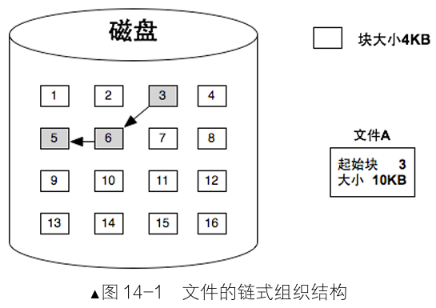{width=50%}

UNIX系统采用更高效的<span style="color:blue;">**索引结构**</span>。每个文件拥有一个**inode**(index node)，其中包含指向文件数据块的索引表。索引表是块地址数组，通过下标直接访问任意块，避免了链式遍历。这种设计既保持了磁盘空间利用率，又大幅提升访问速度。

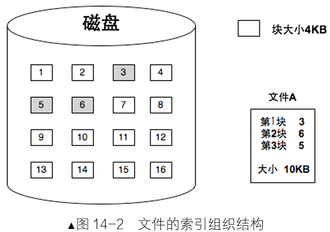{width=50%}

为应对超大文件，UNIX设计了**多级间接索引**：

- 前**12**个索引项直接指向数据块(直接块)；
- 第**13**项指向一级间接块索引表(可管理**256**个块)；
- 第**14**项指向二级间接块索引表(可管理**256×256**个块)；
- 第**15**项指向三级间接块索引表(可管理**256³**个块)。

**inode**本质上是文件控制块(FCB, File Control Block)的一种，记录文件的元信息，可用于管理、控制文件，inode相当于通往文件实体数据块的大门，作用类似于内存段的段描述符。

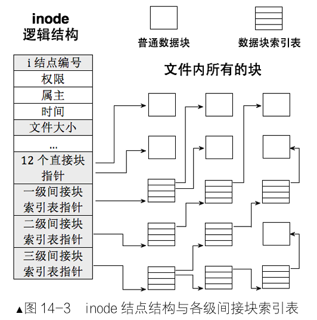{width=50%}

在Linux中，每个分区有固定数量的**inode**，通过inode数组(inode table)统一管理，数组下标即为inode编号。这种设计使文件系统既能高效管理文件，又能精确控制资源分配。

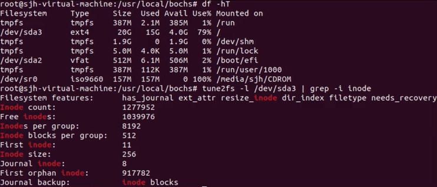

### 14.1.2 目录项与目录简介

inode虽重要，却缺少对用户最友好的属性：**文件名**，用户通过文件名访问文件，而非inode编号。

解决这一矛盾的关键在于**目录项**。通过**目录项**，文件系统建立了文件名与inode的映射关系。

在Linux中，目录本身也是文件，拥有自己的inode。目录文件的数据块中存储的不是普通数据，而是目录项列表。每个目录项包含三个核心信息：文件名、对应inode编号、文件类型(普通文件或目录)

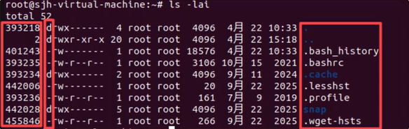

查找文件时，系统首先在目录中定位文件名对应的目录项，获取inode编号，再通过inode找到文件数据。这一过程形成清晰的访问链路：


根目录('/')是整个文件系统的起点。每个分区的根目录位置固定，系统启动时直接从此开始查找。所有文件查找最终都追溯到根目录。

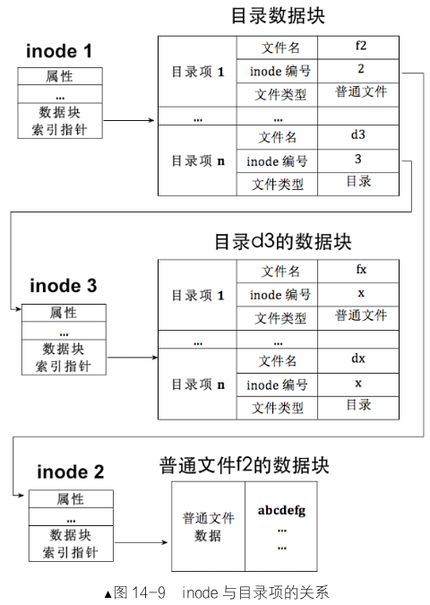{width=65%}

### 14.1.3 超级块与文件系统布局

文件系统需要全局视角来管理资源，**超级块**(super block)正是承担这一角色的核心数据结构，超级块存储文件系统的元信息，如同操作系统的"配置文件"，**超级块**固定存储在分区第2扇区，占用1个扇区。这种固定位置设计确保系统启动时能快速定位文件系统元信息，无需额外搜索。完整的文件系统**布局**从分区起始处依次排列：

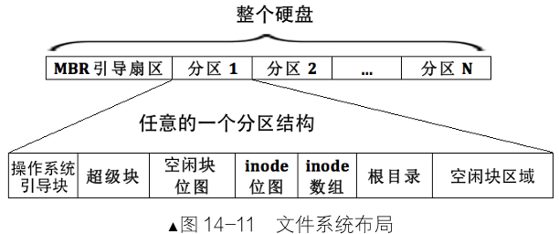{width=65%}

超级块包含以下关键信息：空闲块位图的地址和大小、inode数组的地址及大小、inode位图地址及大小、根目录的地址和大小。

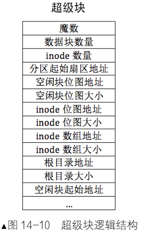{width=30%}

## 14.2 创建文件系统

理论准备就绪，现在开始实践。本节将实现文件系统的**核心数据结构**，并完成分区**格式化**工作。

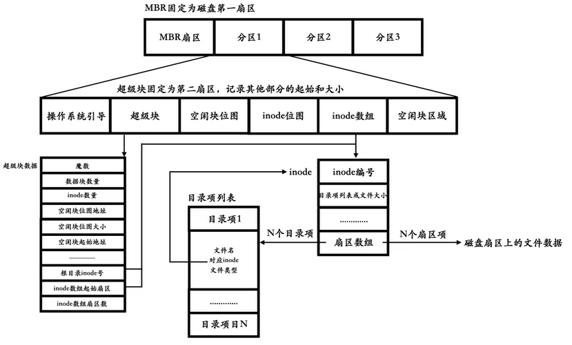

### 14.2.1 创建超级块、i结点、目录项数据

定义**超级块**对应的数据结构，创建fs/**super_block.h**：

```c
#ifndef _FS_SUPER_BLOCK_H
#define _FS_SUPER_BLOCK_H

#include "stdint.h" // 使用自定义的头文件

/* 扇区大小定义，用于计算下方的填充字节 */
#define SECTOR_SIZE 512

/* 超级块 */
struct super_block {
    uint32_t magic;                // 文件系统类型标识
    uint32_t sec_cnt;              // 本分区总扇区数
    uint32_t inode_cnt;            // 本分区inode数量
    uint32_t part_lba_base;        // 本分区起始LBA地址
    uint32_t block_bitmap_lba;     // 块位图起始扇区
    uint32_t block_bitmap_sects;   // 块位图占用扇区数
    uint32_t inode_bitmap_lba;     // inode位图起始扇区
    uint32_t inode_bitmap_sects;   // inode位图占用扇区数
    uint32_t inode_table_lba;      // inode表起始扇区
    uint32_t inode_table_sects;    // inode表占用扇区数
    uint32_t data_start_lba;       // 数据区起始扇区
    uint32_t root_inode_no;        // 根目录inode号
    uint32_t dir_entry_size;       // 目录项大小
    uint8_t pad[460];              // 填充至512字节 (12个uint32_t占48字节 + 460 = 512)
} __attribute__((packed));

#endif
```

定义**inode**结构，描述文件的核心属性，创建fs/**inode.h：**

```c
#ifndef __FS_INODE_H
#define __FS_INODE_H

#include "stdint.h"
#include "stdbool.h"      
#include "list.h"        

/* inode结构 */
struct inode {
    uint32_t i_no;              // inode编号
    uint32_t i_size;            // 文件时，i_size指文件大小，若是目录，指目录项大小之和
    uint32_t i_open_cnts;       // 文件被打开次数
    bool write_deny;            // 写保护标志
    uint32_t i_sectors[13];     // 总共支持128+12=140块(扇区)[0-11]是直接块 [12]存储一级间接块指针
    struct list_elem inode_tag; // 用于inode链表(此链表为已打开的inode队列，可视为内存缓冲区)
};

#endif
```

定义**目录和目录项**结构，创建fs/**dir.h**：

```c
#ifndef __FS_DIR_H
#define __FS_DIR_H

#include "stdint.h"
#include "inode.h"
#include "global.h"

#define MAX_FILE_NAME_LEN 16  // 最大文件名长度

/* 目录结构(内存中使用)*/
struct dir {
    struct inode* inode;      // 指向inode
    uint32_t dir_pos;         // 目录内偏移
    uint8_t dir_buf[512];     // 目录数据缓存
};

/* 目录项结构(磁盘上存储)*/
struct dir_entry {
    char filename[MAX_FILE_NAME_LEN]; // 文件名
    uint32_t i_no;                    // 对应inode编号
    enum file_types f_type;           // 文件类型
};

#endif
```

定义基本文件类型，创建fs/**fs.h**：

```c
#ifndef __FS_FS_H
#define __FS_FS_H

#include "stdint.h"

#define MAX_FILES_PER_PART 4096   // 每个分区所支持最大创建的文件数
#define BITS_PER_SECTOR 4096      // 每扇区的位数
#define SECTOR_SIZE 512           // 扇区字节大小
#define BLOCK_SIZE SECTOR_SIZE    // 块字节大小

/* 文件类型 */
enum file_types {
    FT_UNKNOWN,     // 不支持的文件类型
    FT_REGULAR,     // 普通文件
    FT_DIRECTORY    // 目录
};

void filesys_init();

#endif
```

### 14.2.2 创建文件系统

**格式化分区**是创建文件系统的关键步骤，函数**partition_format**完成这一工作。文件系统初始化函数**filesys_init**自动检测并格式化分区。创建文件fs/**fs.c**：

!!! note "格式化"

    格式化 = 在分区内部，写入文件系统元数据（管理结构，例如写入超级块、空闲位图、inode 数组）。也就是在一个分区上创建文件系统。

    区分两个概念：

    - 低级格式化：对磁盘划分扇区、标记坏道（现在硬盘出厂就做好，用户一般不做）。
    - 高级格式化（日常说的格式化）：创建文件系统，这是我们 OS 课程讲的。

```c
// ===================== ide.h =====================
/*硬盘结构*/
struct disk {
    char name[8];                     //本硬盘的名称
    struct ide_channel* my_channel;   //此块硬盘归属于哪个ide通道
    uint8_t dev_no;                   //本硬盘是主0，还是从1
    struct partition prim_parts[4];   //主分区顶多是4个
    struct partition logic_parts[8];  //逻辑分区
};

/*ata通道结构*/
struct ide_channel {
    char name[8];              //本ata通道名称
    uint16_t port_base;        //本通道的起始端口号
    uint8_t irq_no;            //本通道所用的中断号
    struct lock lock;          //通道锁
    bool expecting_intr;       //表示等待硬盘的中断
    struct semaphore disk_done;//用于阻塞、唤醒驱动程序
    struct disk devices[2];    //一个通道上连接两个硬盘，一主一从
};
```

```c
#include "stdint.h"
#include "fs.h"
#include "inode.h"
#include "ide.h"
#include "memory.h"
#include "super_block.h"
#include "dir.h"
#include "stdio-kernel.h"
#include "string.h"
#include "debug.h"


/* 格式化分区,也就是初始化分区的元信息,创建文件系统 */
static void partition_format(struct partition* part) {
    /* 为方便实现,一个块大小是一扇区 */
    uint32_t boot_sector_sects = 1;	  
    uint32_t super_block_sects = 1;
   // inode位图占用的扇区数
    uint32_t inode_bitmap_sects = DIV_ROUND_UP(MAX_FILES_PER_PART, BITS_PER_SECTOR);
    uint32_t inode_table_sects = DIV_ROUND_UP(((sizeof(struct inode) * MAX_FILES_PER_PART)), SECTOR_SIZE);//inode数组所占的扇区数量
    uint32_t used_sects = boot_sector_sects + super_block_sects + inode_bitmap_sects + inode_table_sects;
    uint32_t free_sects = part->sec_cnt - used_sects;  

  /************简单处理块位图占据的扇区数(用于块位图的实际空间会比数值ß偏大)*********/
    uint32_t block_bitmap_sects;
  //1、所有空闲扇区对应的位图扇区数   2、空闲扇区减去位图扇区   3、重新计算
    block_bitmap_sects = DIV_ROUND_UP(free_sects, BITS_PER_SECTOR); 
    uint32_t block_bitmap_bit_len = free_sects - block_bitmap_sects;  
    block_bitmap_sects = DIV_ROUND_UP(block_bitmap_bit_len, BITS_PER_SECTOR);  
    /*********************************************************/
    
    /* 超级块初始化 */
    struct super_block sb;
    sb.magic = 0x19590318;
    sb.sec_cnt = part->sec_cnt;
    sb.part_lba_base = part->start_lba;
    sb.inode_cnt = MAX_FILES_PER_PART;

    sb.block_bitmap_lba = sb.part_lba_base + 2;	 // 0块是引导块,1块是超级块
    sb.block_bitmap_sects = block_bitmap_sects;

    sb.inode_bitmap_lba = sb.block_bitmap_lba + sb.block_bitmap_sects;
    sb.inode_bitmap_sects = inode_bitmap_sects;

    sb.inode_table_lba = sb.inode_bitmap_lba + sb.inode_bitmap_sects;
    sb.inode_table_sects = inode_table_sects; 
   
    //数据区的起始就是inode数组的结束
    sb.data_start_lba = sb.inode_table_lba + sb.inode_table_sects;  
    sb.root_inode_no = 0;
    sb.dir_entry_size = sizeof(struct dir_entry);

    printk("%s info:\n", part->name);
    printk("   magic:0x%x\n   part_lba_base:0x%x\n   all_sectors:0x%x\n   inode_cnt:0x%x\n   block_bitmap_lba:0x%x\n   block_bitmap_sectors:0x%x\n   inode_bitmap_lba:0x%x\n   inode_bitmap_sectors:0x%x\n   inode_table_lba:0x%x\n   inode_table_sectors:0x%x\n   data_start_lba:0x%x\n", sb.magic, sb.part_lba_base, sb.sec_cnt, sb.inode_cnt, sb.block_bitmap_lba, sb.block_bitmap_sects, sb.inode_bitmap_lba, sb.inode_bitmap_sects, sb.inode_table_lba, sb.inode_table_sects, sb.data_start_lba);

    struct disk* hd = part->my_disk;
    /*******************************
     * 1 将超级块写入本分区的1扇区 *
     ******************************/
    ide_write(hd, part->start_lba + 1, &sb, 1);
    printk("   super_block_lba:0x%x\n", part->start_lba + 1);

    /* 找出数据量最大的元信息,用其尺寸做存储缓冲区*/
    uint32_t buf_size = (sb.block_bitmap_sects >= sb.inode_bitmap_sects ? sb.block_bitmap_sects : sb.inode_bitmap_sects);
    buf_size = (buf_size >= sb.inode_table_sects ? buf_size : sb.inode_table_sects) * SECTOR_SIZE;
    uint8_t* buf = (uint8_t*)sys_malloc(buf_size); // 申请的内存由内存管理系统清0后返回
    
    /**************************************
     * 2 将块位图初始化并写入sb.block_bitmap_lba *
     *************************************/
    /* 初始化块位图block_bitmap */
    buf[0] |= 0x01;       // 第0个块预留给根目录,位图中先占位
    //计算出块位图最后一字节的偏移
    uint32_t block_bitmap_last_byte = block_bitmap_bit_len / 8; 
    //计算出块位图最后一位的偏移
    uint8_t  block_bitmap_last_bit  = block_bitmap_bit_len % 8; 
    //last_size是位图所在最后一个扇区中，不足一扇区的其余部分
    uint32_t last_size = SECTOR_SIZE - (block_bitmap_last_byte % SECTOR_SIZE);
  

    /* 1 先将位图最后一字节到其所在的扇区的结束全置为1,即超出实际块数的部分直接置为已占用*/
    memset(&buf[block_bitmap_last_byte], 0xff, last_size);
    
    /* 2 再将上一步中覆盖的最后一字节内的有效位重新置0 */
    uint8_t bit_idx = 0;
    while (bit_idx < block_bitmap_last_bit) {
        buf[block_bitmap_last_byte] &= ~(1 << bit_idx++);
    }
    ide_write(hd, sb.block_bitmap_lba, buf, sb.block_bitmap_sects);

    /***************************************
     * 3 将inode位图初始化并写入sb.inode_bitmap_lba *
     ***************************************/
    /* 先清空缓冲区*/
    memset(buf, 0, buf_size);
    buf[0] |= 0x1;      // 第0个inode分给了根目录
    /* 由于inode_table中共4096个inode,位图inode_bitmap正好占用1扇区,
        * 即inode_bitmap_sects等于1, 所以位图中的位全都代表inode_table中的inode,
        * 无须再像block_bitmap那样单独处理最后一扇区的剩余部分,
        * inode_bitmap所在的扇区中没有多余的无效位 */
    ide_write(hd, sb.inode_bitmap_lba, buf, sb.inode_bitmap_sects);

    /***************************************
     * 4 将inode数组初始化并写入sb.inode_table_lba *
     ***************************************/
    /* 准备写inode_table中的第0项,即根目录所在的inode */
    memset(buf, 0, buf_size);  // 先清空缓冲区buf
    struct inode* i = (struct inode*)buf; 
    i->i_size = sb.dir_entry_size * 2;	 // .和..
    i->i_no = 0;   // 根目录占inode数组中第0个inode
    i->i_sectors[0] = sb.data_start_lba;	     // 由于上面的memset,i_sectors数组的其它元素都初始化为0 
    ide_write(hd, sb.inode_table_lba, buf, sb.inode_table_sects);
    
    /***************************************
     * 5 将根目录初始化并写入sb.data_start_lba
     ***************************************/
    /* 写入根目录的两个目录项.和.. */
    memset(buf, 0, buf_size);
    struct dir_entry* p_de = (struct dir_entry*)buf;

    /* 初始化当前目录"." */
    memcpy(p_de->filename, ".", 1);
    p_de->i_no = 0;
    p_de->f_type = FT_DIRECTORY;
    p_de++;

    /* 初始化当前目录父目录".." */
    memcpy(p_de->filename, "..", 2);
    p_de->i_no = 0;   // 根目录的父目录依然是根目录自己
    p_de->f_type = FT_DIRECTORY;

    /* sb.data_start_lba已经分配给了根目录,里面是根目录的目录项 */
    ide_write(hd, sb.data_start_lba, buf, 1);

    printk("   root_dir_lba:0x%x\n", sb.data_start_lba);
    printk("%s format done\n", part->name);
    sys_free(buf);
}


/* 在磁盘上搜索文件系统,若没有则格式化分区创建文件系统 */
void filesys_init() {
    uint8_t channel_no = 0, dev_no, part_idx = 0;

    /* sb_buf用来存储从硬盘上读入的超级块 */
    struct super_block* sb_buf = (struct super_block*)sys_malloc(SECTOR_SIZE);

    if (sb_buf == NULL) {
        PANIC("alloc memory failed!");
    }
    printk("searching filesystem......\n");
    while (channel_no < channel_cnt) {  //遍历两个通道
        dev_no = 0;
        while(dev_no < 2) { //遍历通道下1主1从两个硬盘
            if (dev_no == 0) {   // 跨过裸盘hd60M.img
                dev_no++;
                continue;
            }
            struct disk* hd = &channels[channel_no].devices[dev_no];
            struct partition* part = hd->prim_parts;
            while(part_idx < 12) {   // 遍历硬盘的分区，4个主分区+8个逻辑
                if (part_idx == 4) {  // 开始处理逻辑分区
                    part = hd->logic_parts;
                }
            
            /*channels数组是全局变量,默认值为0,disk属于其嵌套结构,
            * partition又为disk的嵌套结构,因此partition中的成员默认也为0.
            * 若partition未初始化,则partition中的成员仍为0. 
            * 下面处理存在的分区. */
                if (part->sec_cnt != 0) {  // 如果分区存在
                    memset(sb_buf, 0, SECTOR_SIZE);

                    /* 读出分区的超级块,根据魔数是否正确来判断是否存在文件系统 */
                    ide_read(hd, part->start_lba + 1, sb_buf, 1);   

                    /* 只支持自己的文件系统.若磁盘上已经有文件系统就不再格式化了 */
                    if (sb_buf->magic == 0x19590318) {
                        printk("%s has filesystem\n", part->name);
                    } else {			  // 其它文件系统不支持,一律按无文件系统处理
                        printk("formatting %s`s partition %s......\n", hd->name, part->name);
                        partition_format(part);
                    }
                }
                part_idx++;
                part++;	// 下一分区
            }
            dev_no++;	// 下一磁盘
        }
        channel_no++;	// 下一通道
    }
    sys_free(sb_buf);
}

```

```linenums="0"
partition_format(part)
│
├─ 1. 计算各区域大小
│     ├─ 引导扇区: 1
│     ├─ 超级块: 1
│     ├─ inode位图: 1 (4096/4096)
│     ├─ inode表: 256 (32*4096/512)
│     ├─ 块位图: 两次计算解决自引用问题
│     └─ 剩余: 数据区
│
├─ 2. 构造超级块 sb
│     └─ 推算所有 LBA 地址
│
├─ 3. 写超级块 → LBA+1
│
├─ 4. 写块位图 → 预留 bit0，处理边界无效位
│
├─ 5. 写 inode 位图 → 预留 bit0
│
├─ 6. 写 inode 表 → 初始化 inode[0]（根目录）
│
└─ 7. 写根目录数据 → "." 和 ".."


filesys_init()
│
├─ 准备: 申请 sb_buf（临时超级块缓冲区）
│
├─ 遍历所有通道/磁盘/分区
│   ├─ 跳过引导盘 dev_no==0
│   ├─ 跳过不存在的分区 sec_cnt==0
│   ├─ 读超级块（start_lba + 1）
│   │   ├─ magic == 0x19590318 → 已有文件系统，跳过
│   │   └─ 否则 → partition_format 格式化
│   └─ 12 个分区槽位（4主+8逻辑）全部扫完
│
├─ list_traversal 遍历 partition_list
│   └─ mount_partition 找到 "sdb1" 并挂载
│       ├─ cur_part = 找到的分区指针
│       ├─ 读超级块 → cur_part->sb
│       ├─ 读块位图 → cur_part->block_bitmap.bits
│       ├─ 读 inode 位图 → cur_part->inode_bitmap.bits
│       └─ 初始化 cur_part->open_inodes
│
├─ open_root_dir(cur_part) → 打开根目录，初始化 root_dir
│
└─ 初始化 file_table[32] → 所有 fd_inode 置 NULL
```

### 14.2.3 挂载分区

创建文件系统后，需要将其挂载到内存以便操作，**挂载过程**将磁盘元信息加载到内存，修改文件fs/**fs.c**：

```c
extern struct list partition_list;
struct partition* cur_part;	 // 默认情况下操作的是哪个分区

/* 在分区链表中找到名为part_name的分区,并将其指针赋值给cur_part */
static bool mount_partition(struct list_elem* pelem, int arg) {
    char* part_name = (char*)arg;
    struct partition* part = elem2entry(struct partition, part_tag, pelem);
    if (!strcmp(part->name, part_name)) {
        cur_part = part;
        struct disk* hd = cur_part->my_disk;

        /* sb_buf用来存储从硬盘上读入的超级块 */
        struct super_block* sb_buf = (struct super_block*)sys_malloc(SECTOR_SIZE);

        /* 在内存中创建分区cur_part的超级块 */
        cur_part->sb = (struct super_block*)sys_malloc(sizeof(struct super_block));
        if (cur_part->sb == NULL) {
            PANIC("alloc memory failed!");
        }

        /* 读入超级块 */
        memset(sb_buf, 0, SECTOR_SIZE);
        ide_read(hd, cur_part->start_lba + 1, sb_buf, 1);   

        /* 把sb_buf中超级块的信息复制到分区的超级块sb中。*/
        memcpy(cur_part->sb, sb_buf, sizeof(struct super_block)); 

        /**********     将硬盘上的块位图读入到内存    ****************/
        cur_part->block_bitmap.bits = (uint8_t*)sys_malloc(sb_buf->block_bitmap_sects * SECTOR_SIZE);
        if (cur_part->block_bitmap.bits == NULL) {
            PANIC("alloc memory failed!");
        }
        cur_part->block_bitmap.btmp_bytes_len = sb_buf->block_bitmap_sects * SECTOR_SIZE;
        /* 从硬盘上读入块位图到分区的block_bitmap.bits */
        ide_read(hd, sb_buf->block_bitmap_lba, cur_part->block_bitmap.bits, sb_buf->block_bitmap_sects);   
        /*************************************************************/

        /**********     将硬盘上的inode位图读入到内存    ************/
        cur_part->inode_bitmap.bits = (uint8_t*)sys_malloc(sb_buf->inode_bitmap_sects * SECTOR_SIZE);
        if (cur_part->inode_bitmap.bits == NULL) {
            PANIC("alloc memory failed!");
        }
        cur_part->inode_bitmap.btmp_bytes_len = sb_buf->inode_bitmap_sects * SECTOR_SIZE;
        /* 从硬盘上读入inode位图到分区的inode_bitmap.bits */
        ide_read(hd, sb_buf->inode_bitmap_lba, cur_part->inode_bitmap.bits, sb_buf->inode_bitmap_sects);   
        /*************************************************************/

        list_init(&cur_part->open_inodes);
        printk("mount %s done!\n", part->name);

    /* 此处返回true是为了迎合主调函数list_traversal的实现,与函数本身功能无关。
        只有返回true时list_traversal才会停止遍历,减少了后面元素无意义的遍历.*/
        sys_free(sb_buf);
        return true;
    }
    return false;     // 使list_traversal继续遍历
}


/* 文件系统初始化（包含挂载） */
void filesys_init() {
    // ...（前面的代码）
    
    // 默认挂载sdb1分区
    char default_part[8] = "sdb1";
    list_traversal(&partition_list, mount_partition, (int)default_part);
}
```

!!! note "挂载分区"

    这个极简文件系统里，mount_partition 做的事情就是：

    1. 在 partition_list 链表中找到名字叫 "sdb1" 的那个分区
    2. 把这个分区的三大元数据从磁盘加载到内存：超级块、块位图、inode位图
    3. 把这个分区设为默认操作对象 cur_part

```linenums="0"
partition_format (格式化)      mount_partition (挂载)
───────────────────────────   ────────────────────────
构造超级块        → 写入硬盘   读硬盘 → 还原超级块到内存
初始化块位图      → 写入硬盘   读硬盘 → 还原块位图到内存
初始化 inode 位图 → 写入硬盘   读硬盘 → 还原 inode 位图到内存
创建根目录        → 写入硬盘   (后续由 open_root_dir 处理)


执行完 mount_partition 后，分区在内存中的状态：

硬盘 (sdb1)                        内存
┌──────────────┐                  ┌──────────────────────────┐
│ LBA+0 引导扇区│                  │ cur_part 结构体           │
├──────────────┤                  │  ├── sb ──────────────┐  │
│ LBA+1 超级块  │──ide_read──→     │  │   超级块结构体副本   │  │
├──────────────┤                  │  ├── block_bitmap ───┐ │  │
│ 块位图        │──ide_read──→     │  │   bits → malloc 来的│ │  │
├──────────────┤                  │  ├── inode_bitmap ──┐ │ │  │
│ inode 位图    │──ide_read──→     │  │   bits → malloc 来的│ │ │  │
├──────────────┤                  │  └── open_inodes (初始化)│
│ inode 数组    │                  └──────────────────────────┘
├──────────────┤
│ 数据区        │                   sb_buf 已释放 (临时用)
└──────────────┘
```

> 格式化是"从零搭建"，挂载是"把搭好的东西加载进来用"。两者共享同一份硬盘布局协议（超级块中定义的 LBA 位置），这也是文件系统能在重启后依然可用的原因——元数据持久化在硬盘上了。

将文件系统初始化加入全局初始化过程，修改**init.c**:

```c
#include "print.h"
#include "interrupt.h"
#include "../device/timer.h"
#include "memory.h"
#include "thread.h"
#include "console.h"
#include "init.h"
#include "keyboard.h"
#include "tss.h"
#include "ide.h"
#include "fs.h"

/* 负责初始化所有模块 */
void init_all(void) {
    put_str("init_all\n");
    intr_init();       // 中断初始化中断
    mem_init();        //内存初始化          8.5.3加
    thread_init();     //线程机制初始化       9.4.4加
    timer_init();      //定时器初始化        7.8加
    console_init();    // 终端初始化         10.2.2加
    keyboard_init();   //键盘初始化          10.3.4加
    tss_init();        //TSS初始化          11.2加
    ide_init();        //硬盘初始化          13.2.2加
    filesys_init();   // 初始化文件系统       14.2.3加
}
```

## 14.3 文件描述符简介

文件操作的核心是**文件描述符**，本节将深入解析其原理与实现。

### 14.3.1 文件描述符原理

在Linux中，所有文件操作都基于文件描述符(file descriptor)。理解文件描述符需要区分inode与文件结构：

- **inode**：     描述文件存储属性(权限、位置、大小等)，一个文件对应一个inode
- **文件结构**：描述文件操作状态(读写位置、打开标志等)，一个打开操作对应一个文件结构

当文件被多次打开时，会产生多个文件结构，但它们共享同一个inode。文件描述符本质是进程PCB中文件描述符**数组的下标**，通过它可找到对应的文件结构，进而访问inode和文件数据。文件描述符与inode关联关系图：

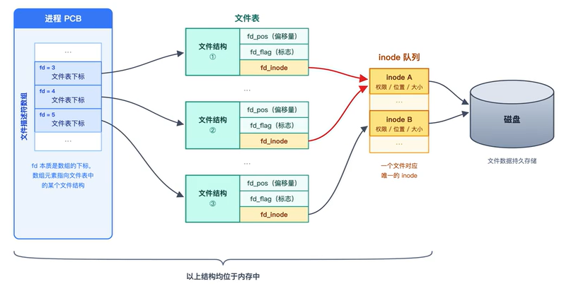

这种设计实现了重要特性：

1. 同一文件可被多次打开，各操作互不影响(偏移量独立)
2. 文件内容共享，修改对所有打开实例可见
3. 每个进程有独立文件描述符空间，避免冲突

### 14.3.2 文件描述符的实现

在**task_struct**中添加文件描述符数组、进程所在的工作目录的inode编号、进程pid，修改thread.h：

```c
#define MAX_FILES_OPEN_PER_PROC 8  // 每进程最大打开文件数

/* 进程/线程PCB */
struct task_struct {
    // ... 其他成员
    int32_t fd_table[MAX_FILES_OPEN_PER_PROC];    // 文件描述符数组
    uint32_t cwd_inode_nr;                        // 进程所在的工作目录的inode编号
    int16_t parent_pid;                           // 父进程pid
  ...
};
```

初始化时增加标准文件描述符等信息处理步骤，修改**thread.c**：

```c
/* 初始化线程基本信息 */
void init_thread(struct task_struct* pthread, char* name, int prio) {
    // ... 其他初始化
    
    pthread->stack_magic = 0x19870916; // 定义的边界数字
  
    // 预留标准输入输出
    pthread->fd_table[0] = 0;
    pthread->fd_table[1] = 1;
    pthread->fd_table[2] = 2;
    /* 其余的全置为-1 */
    uint8_t fd_idx = 3;
    while (fd_idx < MAX_FILES_OPEN_PER_PROC)
    {
        pthread->fd_table[fd_idx] = -1;
        fd_idx++;
    }
    pthread->cwd_inode_nr = 0;         // 以根目录做为默认工作路径
    pthread->parent_pid = -1;          // -1表示没有父进程
}
```

## 14.4 文件操作相关的基础函数

本节实现文件操作的核心函数，包括**inode**操作、**文件**操作和**目录**操作。

### 14.4.1 inode操作有关的函数

对文件或目录的操作离不开inode的处理，接下来实现inode操作函数，操作函数见头文件内容。

创建对应的头文件fs/**inode.h**:

```c
#ifndef __FS_INODE_H
#define __FS_INODE_H

#include "stdint.h"
#include "ide.h"
#include "inode.h"
#include "debug.h"
#include "super_block.h"
#include "string.h"
#include "interrupt.h"

/* 将inode写入到分区part */
void inode_sync(struct partition *part, struct inode *inode, void *io_buf);

/* 根据i结点号返回相应的i结点 */
struct inode *inode_open(struct partition *part, uint32_t inode_no);

/* 关闭inode或减少inode的打开数 */
void inode_close(struct inode *inode);

/* 初始化new_inode */
void inode_init(uint32_t inode_no, struct inode *new_inode);

#endif  // __FS_INODE_H
```

创建文件fs/**inode.c**：

```c
#include "stdint.h"
#include "ide.h"
#include "inode.h"
#include "debug.h"
#include "super_block.h"
#include "string.h"
#include "interrupt.h"

/* 用来存储inode位置 */
struct inode_position {
   bool	 two_sec;	    // inode是否跨扇区
   uint32_t sec_lba;	// inode所在的扇区号
   uint32_t off_size;	// inode在扇区内的字节偏移量
};

/* 获取inode所在的扇区和扇区内的偏移量 */
static void inode_locate(struct partition *part, uint32_t inode_no, struct inode_position *inode_pos)
{
    /* inode_table在硬盘上是连续的 */
    ASSERT(inode_no < 4096);
    uint32_t inode_table_lba = part->sb->inode_table_lba;

    uint32_t inode_size = sizeof(struct inode);
    uint32_t off_size = inode_no * inode_size; // 第inode_no号I结点相对于inode_table_lba的字节偏移量
    uint32_t off_sec = off_size / 512;         // 第inode_no号I结点相对于inode_table_lba的扇区偏移量
    uint32_t off_size_in_sec = off_size % 512; // 待查找的inode所在扇区中的起始地址

    /* 判断此i结点是否跨越2个扇区 */
    uint32_t left_in_sec = 512 - off_size_in_sec;
    if (left_in_sec < inode_size)
    {      // 若扇区内剩下的空间不足以容纳一个inode,必然是I结点跨越了2个扇区
        inode_pos->two_sec = true;
    }else{ // 否则,所查找的inode未跨扇区
        inode_pos->two_sec = false;
    }
    inode_pos->sec_lba = inode_table_lba + off_sec;
    inode_pos->off_size = off_size_in_sec;
}


/* 将inode写入到分区part */
void inode_sync(struct partition *part, struct inode *inode, void *io_buf){   
    // io_buf是用于硬盘io的缓冲区
    uint8_t inode_no = inode->i_no;
    struct inode_position inode_pos;
    inode_locate(part, inode_no, &inode_pos); // inode位置信息会存入inode_pos
    ASSERT(inode_pos.sec_lba <= (part->start_lba + part->sec_cnt));

    /* 硬盘中的inode中的成员inode_tag和i_open_cnts是不需要的,
     * 它们只在内存中记录链表位置和被多少进程共享 */
    struct inode pure_inode;
    memcpy(&pure_inode, inode, sizeof(struct inode));

    /* 以下inode的三个成员只存在于内存中,现在将inode同步到硬盘,清掉这三项即可 */
    pure_inode.i_open_cnts = 0;
    pure_inode.write_deny = false; // 置为false,以保证在硬盘中读出时为可写
    pure_inode.inode_tag.prev = pure_inode.inode_tag.next = NULL;

    char *inode_buf = (char *)io_buf;
    if (inode_pos.two_sec){  // 若是跨了两个扇区,就要读出两个扇区再写入两个扇区
        /* 读写硬盘是以扇区为单位,若写入的数据小于一扇区,要将原硬盘上的内容先读出来
           再和新数据拼成一扇区后再写入  */
      
        // inode在format中写入硬盘时是连续写入的,所以读入2块扇区
        ide_read(part->my_disk, inode_pos.sec_lba, inode_buf, 2); 

        /* 开始将待写入的inode拼入到这2个扇区中的相应位置 */
        memcpy((inode_buf + inode_pos.off_size), &pure_inode, sizeof(struct inode));
        /* 将拼接好的数据再写入磁盘 */
        ide_write(part->my_disk, inode_pos.sec_lba, inode_buf, 2);
    }else{ // 若只是一个扇区
        ide_read(part->my_disk, inode_pos.sec_lba, inode_buf, 1);
        memcpy((inode_buf + inode_pos.off_size), &pure_inode, sizeof(struct inode));
        ide_write(part->my_disk, inode_pos.sec_lba, inode_buf, 1);
    }
}

/* 根据编号返回相应的i结点 */
struct inode *inode_open(struct partition *part, uint32_t inode_no){
    /* 先在已打开inode链表中找inode,此链表是为提速创建的缓冲区 */
    struct list_elem *elem = part->open_inodes.head.next;
    struct inode *inode_found;
    while (elem != &part->open_inodes.tail){
        inode_found = elem2entry(struct inode, inode_tag, elem);
        if (inode_found->i_no == inode_no){
            inode_found->i_open_cnts++;
            return inode_found;
        }
        elem = elem->next;
    }

    /*如open_inodes链表中找不到,继续从硬盘上读入此inode并加入到此链表 */
    struct inode_position inode_pos;

    /* inode位置信息会存入inode_pos, 包括inode所在扇区地址和扇区内的字节偏移量 */
    inode_locate(part, inode_no, &inode_pos);

    /* 临时将cur_pbc->pgdir置为NULL，目的是使得通过sys_malloc创建的新inode被所有任务共享,
     * 需要将inode置于内核空间 */
    struct task_struct *cur = running_thread();
    uint32_t *cur_pagedir_bak = cur->pgdir;
    cur->pgdir = NULL;
    
  /* 以上三行代码完成后下面分配的内存将位于内核区 */
    inode_found = (struct inode *)sys_malloc(sizeof(struct inode));
    /* 恢复pgdir */
    cur->pgdir = cur_pagedir_bak;

    char *inode_buf;
    if (inode_pos.two_sec){ // 考虑跨扇区的情况
        inode_buf = (char *)sys_malloc(1024);
        /* i结点表是被partition_format函数连续写入扇区的,所以下面可以连续读出来 */
        ide_read(part->my_disk, inode_pos.sec_lba, inode_buf, 2);
    }else{ // 否则,所查找的inode未跨扇区,一个扇区大小的缓冲区足够
        inode_buf = (char *)sys_malloc(512);
        ide_read(part->my_disk, inode_pos.sec_lba, inode_buf, 1);
    }
  
    memcpy(inode_found, inode_buf + inode_pos.off_size, sizeof(struct inode));

    /* 因为一会很可能要用到此inode,故将其插入到队首便于提前检索到 */
    list_push(&part->open_inodes, &inode_found->inode_tag);
    inode_found->i_open_cnts = 1;

    sys_free(inode_buf);
    return inode_found;
}


/* 关闭inode或减少inode的打开数 */
void inode_close(struct inode *inode){
    /* 若没有进程再打开此文件,将此inode去掉并释放空间 */
    enum intr_status old_status = intr_disable();
    if (--inode->i_open_cnts == 0){
        list_remove(&inode->inode_tag); // 将I结点从part->open_inodes中去掉
      
        /* inode_open时为实现inode被所有进程共享,
         * 已经在sys_malloc为inode分配了内核空间,
         * 释放inode时也要确保释放的是内核内存池 */
        struct task_struct *cur = running_thread();
        uint32_t *cur_pagedir_bak = cur->pgdir;
        cur->pgdir = NULL;
        sys_free(inode);
        cur->pgdir = cur_pagedir_bak;
    }
    intr_set_status(old_status);
}

/* 初始化new_inode */
void inode_init(uint32_t inode_no, struct inode *new_inode){
    new_inode->i_no = inode_no;
    new_inode->i_size = 0;
    new_inode->i_open_cnts = 0;
    new_inode->write_deny = false;

    /* 初始化块索引数组i_sector */
    uint8_t sec_idx = 0;
    while (sec_idx < 13){
        /* i_sectors[12]为一级间接块地址 */
        new_inode->i_sectors[sec_idx] = 0;
        sec_idx++;
    }
}

```

!!! note "inode要放在内核空间"

    如果在进程的用户空间分配 inode，那么：

    - 不同进程有不同的页表（pgdir 指向当前进程的页表）
    - 进程切换后，页表变了，之前分配的内存就访问不到了
    - 但多个进程可能共享同一个 inode（比如 fork 后的父子进程打开了同一个文件）
  
    解决方案：把 inode 放在内核空间——内核空间的页表映射是所有进程共享的，不管在哪个进程上下文中，同一个内核地址都能访问到同一块物理内存。

    怎么做到的？ 临时把 cur->pgdir 置为 NULL，此时 sys_malloc 会走内核内存池的分配逻辑（而不是当前进程的用户内存池），分配出来的页帧会映射到内核地址空间。分配完立刻恢复进程的页表。

    这个 trick 只在 inode 这种跨进程共享的内核级数据结构上使用，普通用户态内存分配不会这么做。

### 14.4.2 文件相关的函数

实现文件描述符的两级管理机制(全局文件表 + 进程fd_table)，并通过位图算法高效管理磁盘资源的分配与回收。

主要包括负责三个核心功能：**管理**全局文件表和进程文件描述符的分配、**分配**inode节点和数据块存储空间，以及将内存中的位图数据**同步**到硬盘。


先创建fs/**file.h**文件：

```c
#ifndef _FS_FILE_H
#define _FS_FILE_H

#include "stdint.h"
#include "list.h" 

/* 前向声明，防止循环依赖 */
struct inode;

#define MAX_PATH_LEN 512 // 路径最大长度
#define MAX_FILE_OPEN 32 // 系统最大打开文件数

/* 文件结构 */
struct file {
    uint32_t fd_pos;      // 当前文件操作偏移
    uint32_t fd_flag;     // 文件打开标志
    struct inode* fd_inode; // 指向inode
};

/* 标准文件描述符 */
enum std_fd {
    stdin_no,   // 0: 标准输入
    stdout_no,  // 1: 标准输出
    stderr_no   // 2: 标准错误
};

/* 位图类型 */
enum bitmap_type {
    INODE_BITMAP, // inode位图
    BLOCK_BITMAP  // 块位图
};

/* 用来记录查找文件过程中已找到的上级路径,也就是查找文件过程中"走过的地方" */
struct path_search_record{
    char searched_path[MAX_PATH_LEN]; // 查找过程中的父路径
    struct dir *parent_dir;           // 文件或目录所在的直接目录
    enum file_types file_type;        // 找到的是普通文件还是目录,找不到将为未知类型(FT_UNKNOWN)
};

int32_t path_depth_cnt(char *pathname);

#endif
```

实现文件操作相关基础函数，创建fs/**file.c**文件：

```c
#include "file.h"
#include "inode.h"
#include "super_block.h"
#include "bitmap.h"
#include "fs.h"
#include "ide.h"
#include "stdio-kernel.h"
#include "global.h"
#include "thread.h"
#include "interrupt.h"

/* 文件表 */
struct file file_table[MAX_FILE_OPEN];

/* 从文件表file_table获取一个空闲位，成功返回下标，失败返回-1 */
int32_t get_free_slot_in_global(void) {
    uint32_t fd_idx = 3;
    while (fd_idx < MAX_FILE_OPEN) {
        if (file_table[fd_idx].fd_inode == NULL) {
            break;
        }
        fd_idx++;
    }
  
    if (fd_idx == MAX_FILE_OPEN) {
        printk("exceed max open files\n");
        return -1;
    }
    return fd_idx;
}

/* 将全局描述符下标安装到进程或线程自己的文件描述符数组fd_table中，成功返回下标，失败返回-1 */
int32_t pcb_fd_install(int32_t globa_fd_idx) {
    struct task_struct* cur = running_thread();
    uint8_t local_fd_idx = 3; // 跨过标准输入输出错误
    while (local_fd_idx < MAX_FILES_OPEN_PER_PROC) {
        if (cur->fd_table[local_fd_idx] == -1) { // -1表示free_slot
            cur->fd_table[local_fd_idx] = globa_fd_idx;
            break;
        }
        local_fd_idx++;
    }

    if (local_fd_idx == MAX_FILES_OPEN_PER_PROC) {
        printk("exceed max open files_per_proc\n");
        return -1;
    }
    return local_fd_idx;
}

/* 分配一个i结点，返回i结点号 */
int32_t inode_bitmap_alloc(struct partition* part) {
    int32_t bit_idx = bitmap_scan(&part->inode_bitmap, 1);
    if(bit_idx == -1) {
        return -1;
    }
    bitmap_set(&part->inode_bitmap, bit_idx, 1);
    return bit_idx;
}

/* 分配1个扇区，返回其扇区地址 */
int32_t block_bitmap_alloc(struct partition* part) {
    int32_t bit_idx = bitmap_scan(&part->block_bitmap, 1);
    if (bit_idx == -1) {
        return -1;
    }
    bitmap_set(&part->block_bitmap, bit_idx, 1);
    /* 和inode_bitmap_alloc不同，此处返回的不是位图索引， 而是具体可用的扇区地址 */
    return (part->sb->data_start_lba + bit_idx);
}

/* 将内存中位图第bit_idx位所在的512字节同步到硬盘 */
void bitmap_sync(struct partition* part, uint32_t bit_idx, uint8_t btmp) {
    uint32_t off_sec =  bit_idx / 4096;        // 本i结点索引相对于位图的扇区偏移量
    uint32_t off_size = off_sec * BLOCK_SIZE;  // 本i结点索引相对于位图的字节偏移量
   
    uint32_t sec_lba;
    uint8_t* bitmap_off;
    /* 需要被同步到硬盘的位图只有inode_bitmap和block_bitmap */
    switch (btmp) {
        case INODE_BITMAP:
            sec_lba = part->sb->inode_bitmap_lba + off_sec;
            bitmap_off = part->inode_bitmap.bits + off_size;
            break;

        case BLOCK_BITMAP:
            sec_lba = part->sb->block_bitmap_lba + off_sec;
            bitmap_off = part->block_bitmap.bits + off_size;
            break;
    }
    ide_write(part->my_disk, sec_lba, bitmap_off, 1);
}
```

```linenums="0"
        用户程序看到的                  内核内部实际用的
        ─────────────                  ──────────────
        
local fd = 5   ──→   cur->fd_table[5] = 8   ──→   file_table[8]
(进程私有)            (进程私有映射表)                (系统级共享表)
                                                       │
                                                       └─→ inode
```

### 14.4.3 目录相关的函数

实现文件系统的**目录操作**，核心功能是打开根目录和通用目录，并通过循环读取磁盘块来**搜索目录项**以匹配指定文件名。

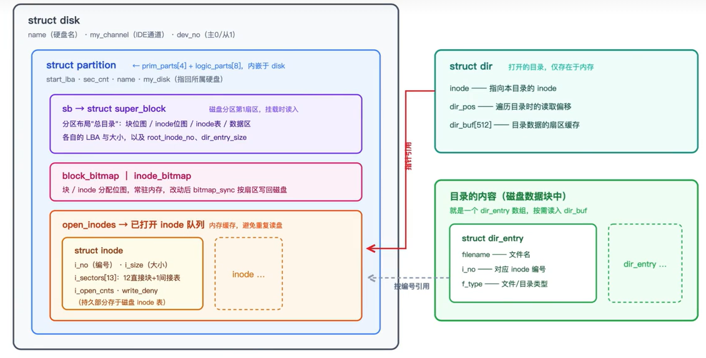

创建对应的头文件fs/**dir.h**:

```c
#ifndef __FS_DIR_H
#define __FS_DIR_H

#include "inode.h"
#include "super_block.h"
#include "stdio-kernel.h"
#include "string.h"
#include "debug.h"
#include "file.h"

/* 外部全局变量声明 */
extern struct partition* cur_part;
extern struct dir root_dir;  // 根目录

/* 打开根目录 */
void open_root_dir(struct partition *part);

/* 在分区part上打开i结点为inode_no的目录并返回目录指针 */
struct dir *dir_open(struct partition *part, uint32_t inode_no);

/* 在part分区内的pdir目录内寻找名为name的文件或目录,
 * 找到后返回true，并将其目录项存入dir_e,否则返回false */
bool search_dir_entry(struct partition *part, struct dir *pdir, const char *name, struct dir_entry *dir_e);

/* 关闭目录 */
void dir_close(struct dir *dir);

/* 在内存中初始化目录项p_de */
void create_dir_entry(char *filename, uint32_t inode_no, uint8_t file_type, struct dir_entry *p_de);

/* 将目录项p_de写入父目录parent_dir中,io_buf由主调函数提供 */
bool sync_dir_entry(struct dir *parent_dir, struct dir_entry *p_de, void *io_buf);

#endif  // __FS_DIR_H
```

创建fs/**dir.c**文件：

```c
#include "dir.h"
#include "inode.h"
#include "super_block.h"
#include "stdio-kernel.h"
#include "string.h"
#include "debug.h"
#include "file.h"

extern struct partition* cur_part;
struct dir root_dir; // 根目录

/* 打开根目录 */
void open_root_dir(struct partition *part){
    root_dir.inode = inode_open(part, part->sb->root_inode_no);
    root_dir.dir_pos = 0;
}

/* 打开目录并返回目录指针 */
struct dir *dir_open(struct partition *part, uint32_t inode_no){
    struct dir *pdir = (struct dir *)sys_malloc(sizeof(struct dir));
    pdir->inode = inode_open(part, inode_no);
    pdir->dir_pos = 0;
    return pdir;
}


/* 目录内寻找名为name的文件或目录,找到后返回true并将其目录项存入dir_e,否则返回false */
bool search_dir_entry(struct partition *part, struct dir *pdir, const char *name, struct dir_entry *dir_e){
    uint32_t block_cnt = 140; // 12个直接块+128个一级间接块=140块

    /* 12个直接块大小+128个间接块,共560字节 */
    uint32_t *all_blocks = (uint32_t *)sys_malloc(48 + 512);
    if (all_blocks == NULL){
        printk("search_dir_entry: sys_malloc for all_blocks failed");
        return false;
    }

    uint32_t block_idx = 0;
    while (block_idx < 12){
        all_blocks[block_idx] = pdir->inode->i_sectors[block_idx];
        block_idx++;
    }
    block_idx = 0;

    if (pdir->inode->i_sectors[12] != 0){ // 若含有一级间接块表
        ide_read(part->my_disk, pdir->inode->i_sectors[12], all_blocks + 12, 1);
    }
    /* 至此,all_blocks存储的是该文件或目录的所有扇区地址 */
  
    /* 写目录项的时候已保证目录项不跨扇区, 只申请容纳1个扇区的内存 */
    uint8_t *buf = (uint8_t *)sys_malloc(SECTOR_SIZE);
    struct dir_entry *p_de = (struct dir_entry *)buf;      // p_de设置为buf起始地址
    uint32_t dir_entry_size = part->sb->dir_entry_size;
    uint32_t dir_entry_cnt = SECTOR_SIZE / dir_entry_size; // 1扇区内可容纳的目录项个数

    /* 开始在所有块中查找目录项 */
    while (block_idx < block_cnt){
        /* 块地址为0时表示该块中无数据,继续在其它块中找 */
        if (all_blocks[block_idx] == 0){
            block_idx++;
            continue;
        }
        ide_read(part->my_disk, all_blocks[block_idx], buf, 1);
        uint32_t dir_entry_idx = 0;
      
        /* 遍历扇区中所有目录项 */
        while (dir_entry_idx < dir_entry_cnt){
            /* 若找到了,就直接复制整个目录项 */
            if (!strcmp(p_de->filename, name)){
                memcpy(dir_e, p_de, dir_entry_size);
                sys_free(buf);
                sys_free(all_blocks);
                return true;
            }
            dir_entry_idx++;
            p_de++;
        }//while结束
        block_idx++;
        p_de = (struct dir_entry *)buf; // 需要恢复p_de指向为buf
        memset(buf, 0, SECTOR_SIZE);    // 将buf清0,下次再用
    } //while结束
  
    sys_free(buf);
    sys_free(all_blocks);
    return false;
}

/* 关闭目录 */
void dir_close(struct dir *dir){
    /*************      根目录不能关闭     ***************
     *1 根目录自打开后就不应该关闭,否则还需要再次open_root_dir();
     *2 root_dir所在的内存是低端1M之内,并非在堆中,free会出问题 */
    if (dir == &root_dir){
        /* 不做任何处理直接返回*/
        return;
    }
    inode_close(dir->inode);
    sys_free(dir);
}


/* 在内存中初始化目录项p_de */
void create_dir_entry(char *filename, uint32_t inode_no, uint8_t file_type, struct dir_entry *p_de){
    ASSERT(strlen(filename) <= MAX_FILE_NAME_LEN);

    /* 初始化目录项 */
    memcpy(p_de->filename, filename, strlen(filename));
    p_de->i_no = inode_no;
    p_de->f_type = file_type;
}


/* 将目录项p_de的数据，写入父目录parent_dir中,io_buf由主调函数提供
   实现了目录项的动态分配和管理，是文件系统创建文件/目录的关键操作 */
bool sync_dir_entry(struct dir *parent_dir, struct dir_entry *p_de, void *io_buf){
    struct inode *dir_inode = parent_dir->inode;
    uint32_t dir_size = dir_inode->i_size;
    uint32_t dir_entry_size = cur_part->sb->dir_entry_size;

    ASSERT(dir_size % dir_entry_size == 0); // dir_size应该是dir_entry_size的整数倍

    uint32_t dir_entrys_per_sec = (512 / dir_entry_size); // 每扇区最大的目录项数目
    int32_t block_lba = -1;

    /* 将该目录的所有扇区地址(12个直接块+ 128个间接块)存入all_blocks */
    uint8_t block_idx = 0;
    uint32_t all_blocks[140] = {0}; // all_blocks保存目录所有的块

    /* 将12个直接块存入all_blocks */
    while (block_idx < 12){
        all_blocks[block_idx] = dir_inode->i_sectors[block_idx];
        block_idx++;
    }

    struct dir_entry *dir_e = (struct dir_entry *)io_buf; // dir_e用来在io_buf中遍历目录项
    int32_t block_bitmap_idx = -1;

    /* 开始遍历所有块以寻找目录项空位,若已有扇区中没有空闲位,
     * 在不超过文件大小的情况下申请新扇区来存储新目录项 */
    block_idx = 0;
    while (block_idx < 140){ // 文件(包括目录)最大支持12个直接块+128个间接块＝140个块
        block_bitmap_idx = -1;
        if (all_blocks[block_idx] == 0){ // 对应位置还没有分配扇区
            block_lba = block_bitmap_alloc(cur_part);
            if (block_lba == -1){
                printk("alloc block bitmap for sync_dir_entry failed\n");
                return false;
            }

            /* 每分配一个块就同步一次block_bitmap */
            block_bitmap_idx = block_lba - cur_part->sb->data_start_lba;
            ASSERT(block_bitmap_idx != -1);
            bitmap_sync(cur_part, block_bitmap_idx, BLOCK_BITMAP);

            block_bitmap_idx = -1;
            if (block_idx < 12){ // 若是直接块
                dir_inode->i_sectors[block_idx] = all_blocks[block_idx] = block_lba;
            }else if (block_idx == 12){    // 若是尚未分配一级间接块表(block_idx等于12表示第0个间接块地址为0)
                dir_inode->i_sectors[12] = block_lba; // 将上面分配的块做为一级间接块表地址
                block_lba = -1;
                block_lba = block_bitmap_alloc(cur_part); // 再分配一个块做为第0个间接块
                if (block_lba == -1){
                    block_bitmap_idx = dir_inode->i_sectors[12] - cur_part->sb->data_start_lba;
                    bitmap_set(&cur_part->block_bitmap, block_bitmap_idx, 0);
                    dir_inode->i_sectors[12] = 0;
                    printk("alloc block bitmap for sync_dir_entry failed\n");
                    return false;
                }
                /* 每分配一个块就同步一次block_bitmap */
                block_bitmap_idx = block_lba - cur_part->sb->data_start_lba;
                ASSERT(block_bitmap_idx != -1);
                bitmap_sync(cur_part, block_bitmap_idx, BLOCK_BITMAP);

                all_blocks[12] = block_lba;//all_blocks就是存储有目录项扇区编号的数据 不包括一级间接表自身的扇区
                /* 把新分配的第0个间接块地址写入一级间接块表 */
                ide_write(cur_part->my_disk, dir_inode->i_sectors[12], all_blocks + 12, 1);
            }else{ // 若是间接块已分配
                all_blocks[block_idx] = block_lba;
                /* 把新分配的第(block_idx-12)个间接块地址写入一级间接块表 */
                ide_write(cur_part->my_disk, dir_inode->i_sectors[12], all_blocks + 12, 1);
            }//if (block_idx < 12)结束

            /* 再将新目录项p_de写入新分配的间接块 */
            memset(io_buf, 0, 512);
            memcpy(io_buf, p_de, dir_entry_size);
            ide_write(cur_part->my_disk, all_blocks[block_idx], io_buf, 1);
            dir_inode->i_size += dir_entry_size;
            return true;
        }//if (all_blocks[block_idx] == 0)结束

        /* 若第block_idx块已存在,将其读进内存,然后在该块中查找空目录项 */
        ide_read(cur_part->my_disk, all_blocks[block_idx], io_buf, 1);
        /* 在扇区内查找空目录项 */
        uint8_t dir_entry_idx = 0;
        while (dir_entry_idx < dir_entrys_per_sec){
            if ((dir_e + dir_entry_idx)->f_type == FT_UNKNOWN){ 
                // FT_UNKNOWN为0,无论是初始化或是删除文件后,都会将f_type置为FT_UNKNOWN.
                memcpy(dir_e + dir_entry_idx, p_de, dir_entry_size);
                ide_write(cur_part->my_disk, all_blocks[block_idx], io_buf, 1);

                dir_inode->i_size += dir_entry_size;
                return true;
            }
            dir_entry_idx++;
        } //while (dir_entry_idx < dir_entrys_per_sec)结束
      
        block_idx++;
    }//while (block_idx < 140)结束
  
    printk("directory is full!\n");
    return false;
}
```

```linenums="0"
一个目录的数据扇区布局是：

每个扇区 (512 字节):
┌──── dir_entry[0] ────┬──── dir_entry[1] ────┬─── ... ────┬──── dir_entry[15] ───┐
│ filename[16]         │ filename[16]         │            │ filename[16]         │
│ i_no(4)              │ i_no(4)              │            │ i_no(4)              │
│ f_type(1)            │ f_type(1)            │            │ f_type(1)            │
└──────────────────────┴──────────────────────┴────────────┴──────────────────────┘
         32 字节              32 字节                      32 字节


search_dir_entry(part, pdir, name, dir_e)
│
├─ sys_malloc all_blocks[140]    (560 字节)
│   前 48 字节: 直接块 LBA
│   后 512 字节: 间接块读入缓冲
│
├─ 收集直接块: all_blocks[0..11] = inode->i_sectors[0..11]
│
├─ 收集间接块:
│   if i_sectors[12] != 0:
│     ide_read(i_sectors[12], all_blocks + 12, 1)  ← 读一次，填 128 个 LBA
│
├─ sys_malloc buf[512]           (目录项读取缓冲)
│   p_de = (struct dir_entry*)buf
│
├─ 外层循环 block_idx 0 → 139:
│   ├─ all_blocks[block_idx] == 0? → continue（跳过未分配块）
│   ├─ ide_read(all_blocks[block_idx], buf, 1)  ← 读 1 个数据扇区
│   │
│   ├─ 内层循环 dir_entry_idx 0 → 15:
│   │   ├─ strcmp(p_de->filename, name) == 0?
│   │   │   ├─ YES → memcpy(dir_e, p_de, 32)
│   │   │   │        free(buf), free(all_blocks)
│   │   │   │        return true ✅
│   │   │   └─ NO  → p_de++, 继续
│   │
│   ├─ p_de = buf           ← 重置指针
│   └─ memset(buf, 0, 512)  ← 清零残留
│
├─ free(buf), free(all_blocks)
└─ return false ❌
```

### 14.4.4 路径解析相关的函数

路径解析是文件操作的基础，**path_parse**用于从路径字符串中提取最顶层的文件或目录名，并跳过多余的斜杠；**path_depth_cnt**则利用前者计算给定路径的层级深度：

```c
/* 将最上层路径名称解析出来 */
static char* path_parse(char* pathname, char* name_store) {
    if (pathname[0] == '/') {    // 根目录不需要单独解析
        /* 路径中出现 1 个或多个连续的字符'/'，将这些'/'跳过，如"///a/b" */
        while(*(++pathname) == '/');
    }

    /* 开始一般的路径解析 */
    while (*pathname != '/' && *pathname != 0) {
        *name_store++ = *pathname++;
    }

    if (pathname[0] == 0) {    // 若路径字符串为空，则返回 NULL
        return NULL;
    }
    return pathname;
}

/* 返回路径深度，比如/a/b/c，深度为 3 */
int32_t path_depth_cnt(char* pathname) {
    ASSERT(pathname != NULL);
    char* p = pathname;
    char name[MAX_FILE_NAME_LEN];
                        // 用于 path_parse 的参数做路径解析
    uint32_t depth = 0;

    /* 解析路径，从中拆分出各级名称 */
    p = path_parse(p, name);
    while (name[0]) {
        depth++;
        memset(name, 0, MAX_FILE_NAME_LEN);
        if (p) {        // 如果 p 不等于 NULL，继续分析路径
            p = path_parse(p, name);
        }
    }
    return depth;
}
```

### 14.4.5 实现文件检索功能

增加部分数据结构，修改fs.h：

```c
#define MAX_PATH_LEN 512      // 路径最大长度

/* 文件类型 */
enum file_types {
    FT_UNKNOWN,     // 不支持的文件类型
    FT_REGULAR,     // 普通文件
    FT_DIRECTORY    // 目录
};

/* 打开文件的选项 */
enum oflags {
    O_RDONLY,       // 只读
    O_WRONLY,       // 只写
    O_RDWR,         // 读写
    O_CREAT = 4     // 创建
};

/* 用来记录查找文件过程中已找到的上级路径，
 * 也就是查找文件过程中“走过的地方” */
struct path_search_record {
    char searched_path[MAX_PATH_LEN];      // 查找过程中的父路径
    struct dir* parent_dir;      // 文件或目录所在的直接父目录
    enum file_types file_type;
    // 找到的是普通文件，还是目录，找不到将为未知类型(FT_UNKNOWN)
};
```

这段代码用于在文件系统中根据给定的路径名搜索文件或目录。如果找到，它会返回该文件或目录的索引节点号，并记录下搜索过程中经过的父目录等信息；如果找不到，则返回-1。修改fs.c：

```c
/* 搜索文件pathname，若找到则返回其inode号，否则返回-1 */
static int search_file(const char* pathname, struct path_search_record* searched_record) {

    /* 如果待查找的是根目录，为避免下面无用的查找，
     * 直接返回已知根目录信息 */
    if (!strcmp(pathname, "/") || !strcmp(pathname, "/.") || \
    !strcmp(pathname, "/..")) {
        searched_record->parent_dir = &root_dir;
        searched_record->file_type = FT_DIRECTORY;
        searched_record->searched_path[0] = 0;    // 搜索路径置空
        return 0;
    }

    uint32_t path_len = strlen(pathname);
    /* 保证pathname至少是这样的路径/x，且小于最大长度 */
    ASSERT(pathname[0] == '/' && path_len > 1 && \
    path_len < MAX_PATH_LEN);
    char* sub_path = (char*)pathname;
    struct dir* parent_dir = &root_dir;
    struct dir_entry dir_e;

    /* 记录路径解析出来的各级名称，如路径"/a/b/c",
     * 数组name每次的值分别是"a","b","c" */
    char name[MAX_FILE_NAME_LEN] = {0};

    searched_record->parent_dir = parent_dir;
    searched_record->file_type = FT_UNKNOWN;
    uint32_t parent_inode_no = 0;  // 父目录的inode号

    sub_path = path_parse(sub_path, name);
    while (name[0]) {      // 若第一个字符就是结束符，结束循环
        /* 记录查找过的路径，但不能超过searched_path的长度512字节 */
        ASSERT(strlen(searched_record->searched_path) < 512);

        /* 记录已存在的父目录 */
        strcat(searched_record->searched_path, "/");
        strcat(searched_record->searched_path, name);

        /* 在所给的目录中查找文件 */
        if (search_dir_entry(cur_part, parent_dir, name, &dir_e)) {
            memset(name, 0, MAX_FILE_NAME_LEN);
            /* 若sub_path不等于NULL，也就是未结束时继续拆分路径 */
            if (sub_path) {
                sub_path = path_parse(sub_path, name);
            }

            if (FT_DIRECTORY == dir_e.f_type) {   // 如果被打开的是目录
                parent_inode_no = parent_dir->inode->i_no;
                dir_close(parent_dir);
                parent_dir = dir_open(cur_part, dir_e.i_no); // 更新父目录
                searched_record->parent_dir = parent_dir;
                continue;
            } else if (FT_REGULAR == dir_e.f_type) {   // 若是普通文件
                searched_record->file_type = FT_REGULAR;
                return dir_e.i_no;
            }
        } else {   //若找不到，则返回-1
            /* 找不到目录项时，要留着parent_dir不要关闭，
             * 若是创建新文件的话需要在parent_dir中创建 */
            return -1;
        }
    }

    /* 执行到此，必然是遍历了完整路径，
     * 并且查找的文件或目录只有同名目录存在 */
    dir_close(searched_record->parent_dir);

    /* 保存被查找目录的直接父目录 */
    searched_record->parent_dir = dir_open(cur_part, parent_inode_no);
    searched_record->file_type = FT_DIRECTORY;
    return dir_e.i_no;
}
```

## 14.5 创建文件
经过前期大量的准备工作，现在离目标已经很接近了。本节我们将实现普通文件的创建功能（不包括目录，目录创建安排在后续章节）。

### 14.5.1 实现file_create

为实现文件的创建工作，我们在file.c中增加函数file_create。在介绍此函数前，先讨论创建文件需要考虑的工作：

1. **inode分配**：文件需要inode来描述大小、位置等属性，需向inode bitmap申请位图获得inode号
2. **数据块分配**：inode->i_sectors存储文件具体扇区地址，需向block_bitmap申请可用块
3. **目录项更新**：新文件存在于某目录中，该目录的inode->i_size需增加目录项大小
4. **事务处理**：若某步操作失败，需回滚之前已成功的操作
5. **数据同步**：修改后的inode_bitmap、block_bitmap、inode等需同步到硬盘

下面是file_create的实现代码，已添加详细注释。修改**file.c：**

```c
/*创建文件，若成功则返回文件描述符，否则返回-1*/
int32_t file_create(struct dir* parent_dir, char* filename, uint8_t flag) {
    /*后续操作的公共缓冲区*/
    void* io_buf = sys_malloc(1024);
    if (io_buf == NULL) {
        printk("in file_creat: sys_malloc for io_buf failed\n");
        return -1;
    }

    uint8_t rollback_step = 0;  // 用于操作失败时回滚各资源状态

    /*1. 为新文件分配inode*/
    int32_t inode_no = inode_bitmap_alloc(cur_part);
    if (inode_no == -1) {
        printk("in file_creat: allocate inode failed\n");
        return -1;
    }

    /*此inode要从堆中申请内存，不可生成局部变量(函数退出时会释放)*/
    struct inode* new_file_inode = (struct inode*)sys_malloc(sizeof(struct inode));
    if (new_file_inode == NULL) {
        printk("file_create: sys_malloc for inode failed\n");
        rollback_step = 1;
        goto rollback;
    }
    
    /*2. 初始化inode*/
    inode_init(inode_no, new_file_inode);

    /*3. 获取文件表空闲位置*/
    int fd_idx = get_free_slot_in_global();
    if (fd_idx == -1) {
        printk("exceed max open files\n");
        rollback_step = 2;
        goto rollback;
    }
    
    /*4. 初始化文件表项*/
    file_table[fd_idx].fd_inode = new_file_inode;
    file_table[fd_idx].fd_pos = 0;
    file_table[fd_idx].fd_flag = flag;
    file_table[fd_idx].fd_inode->write_deny = false;

    /*5. 创建目录项*/
    struct dir_entry new_dir_entry;
    memset(&new_dir_entry, 0, sizeof(struct dir_entry));
    create_dir_entry(filename, inode_no, FT_REGULAR, &new_dir_entry);

    /*6. 将目录项写入父目录*/
    if (!sync_dir_entry(parent_dir, &new_dir_entry, io_buf)) {
        printk("sync dir_entry to disk failed\n");
        rollback_step = 3;
        goto rollback;
    }

    /*7. 同步父目录inode到硬盘*/
    memset(io_buf, 0, 1024);
    inode_sync(cur_part, parent_dir->inode, io_buf);

    /*8. 同步新文件inode到硬盘*/
    memset(io_buf, 0, 1024);
    inode_sync(cur_part, new_file_inode, io_buf);

    /*9. 同步inode位图到硬盘*/
    bitmap_sync(cur_part, inode_no, INODE_BITMAP);

    /*10. 将新文件inode添加到打开列表*/
    list_push(&cur_part->open_inodes, &new_file_inode->inode_tag);
    new_file_inode->i_open_cnts = 1;

    sys_free(io_buf);
    return pcb_fd_install(fd_idx);

/*创建文件需要创建相关的多个资源，若某步失败则会执行到下面的回滚步骤*/
rollback:
    switch(rollback_step) {
        case 3:
            /*失败时，将file_table中的相应位清空*/
            memset(&file_table[fd_idx], 0, sizeof(struct file));
        case 2:
            sys_free(new_file_inode);
        case 1:
            /*如果新文件的inode创建失败，之前位图中分配的inode_no也要恢复*/
            bitmap_set(&cur_part->inode_bitmap, inode_no, 0);
            break;
    }
    sys_free(io_buf);
    return -1;
}
```

```linenums="0"
file_create(parent_dir, filename, flag)
│
├─ sys_malloc io_buf(1024)
│
├─ 1. inode_bitmap_alloc  ────────── 失败 → return -1
│   在内存 inode 位图分配 bit
│
├─ 2. sys_malloc inode 内存
│   inode_init 初始化              ────────── 失败 → rollback_step=1, goto rollback
│
├─ 3. get_free_slot_in_global      ────────── 失败 → rollback_step=2, goto rollback
│
├─ 4. 填 file_table[fd_idx] 三要素
│
├─ 5. create_dir_entry 内存构造
│   sync_dir_entry 写父目录磁盘    ────────── 失败 → rollback_step=3, goto rollback
│
├─ 6. inode_sync 父目录 inode → 磁盘
│
├─ 7. inode_sync 新文件 inode → 磁盘
│
├─ 8. bitmap_sync inode位图 → 磁盘
│
├─ 9. list_push open_inodes + i_open_cnts=1
│
├─ sys_free(io_buf)
├─ return pcb_fd_install(fd_idx)
│
└─ rollback:
    ├─ case 3: 清空 file_table
    ├─ case 2: sys_free(inode)    (fall through)
    ├─ case 1: bitmap_set 恢复bit=0  (fall through)
    ├─ sys_free(io_buf)
    └─ return -1
```

**函数解析**：

- **参数**：父目录指针、文件名、创建标识
  
- **返回值**：成功返回文件描述符，失败返回-1
  
- **核心步骤**：
    1. 申请1024字节的IO缓冲区（2个扇区），用于后续硬盘操作
    2. 为新文件分配inode编号，并初始化inode结构
    3. 从全局文件表中获取空闲文件描述符
    4. 初始化文件表项，设置文件位置、标志和写锁状态
    5. 创建目录项并同步到父目录
    6. 依次同步父目录inode、新文件inode和inode位图到硬盘
    7. 将新文件inode添加到打开inode列表
   
- **错误处理**：采用回滚机制，根据失败步骤执行相应的资源释放

**回滚设计**：

- `rollback_step`记录操作步骤，失败时跳转到对应回滚点
- 采用switch-case无break设计，确保执行所有必要的回滚操作
- 从后往前回滚：先释放文件表项，再释放inode内存，最后恢复位图

### 14.5.2 实现sys_open

现在实现创建文件的核心函数sys_open，它是open系统调用的内核实现。open函数功能比creat更通用，通过O_CREAT标志可以实现文件创建。

```c
/*打开或创建文件成功后，返回文件描述符，否则返回-1*/
int32_t sys_open(const char* pathname, uint8_t flags) {
    /*对目录要用dir_open，这里只支持打开文件*/
    if (pathname[strlen(pathname) - 1] == '/') {
        printk("can't open a directory %s\n", pathname);
        return -1;
    }
    
    ASSERT(flags <= 7);
    int32_t fd = -1;       // 默认为找不到
    
    struct path_search_record searched_record;
    memset(&searched_record, 0, sizeof(struct path_search_record));
    
    /*记录目录深度，帮助判断中间某个目录不存在的情况*/
    uint32_t pathname_depth = path_depth_cnt((char*)pathname);
    
    /*先检查文件是否存在*/
    int inode_no = search_file(pathname, &searched_record);
    bool found = inode_no != -1 ? true : false;
    
    if (searched_record.file_type == FT_DIRECTORY) {
        printk("can't open a directory with open(), use opendir() to instead\n");
        dir_close(searched_record.parent_dir);
        return -1;
    }
    
    uint32_t path_searched_depth = path_depth_cnt(searched_record.searched_path);
    
    /*判断是否访问到全部路径*/
    if (pathname_depth != path_searched_depth) {
        printk("cannot access %s: Not a directory, subpath %s isn't exist\n", 
               pathname, searched_record.searched_path);
        dir_close(searched_record.parent_dir);
        return -1;
    }
    
    /*文件不存在且不要求创建*/
    if (!found && !(flags & O_CREAT)) {
        printk("in path %s, file %s isn't exist\n", 
               searched_record.searched_path, (strrchr(searched_record.searched_path, '/') + 1));
        dir_close(searched_record.parent_dir);
        return -1;
    }
    /*文件已存在但要求创建*/
    else if (found && (flags & O_CREAT)) {
        printk("%s has already exist!\n", pathname);
        dir_close(searched_record.parent_dir);
        return -1;
    }
    
    switch (flags & O_CREAT) {
        case O_CREAT:
            printk("creating file\n");
            fd = file_create(searched_record.parent_dir, (strrchr(pathname, '/') + 1), flags);
            dir_close(searched_record.parent_dir);
            break;
        default:
            /*其余为打开文件*/
            fd = file_open(inode_no, flags);
    }
    
    return fd;
}
```

**函数解析**：

- **参数**：文件路径（绝对路径）、打开标志
  
- **返回值**：成功返回文件描述符，失败返回-1
  
- **核心逻辑**：
    1. 验证路径不是目录（以'/'结尾）
    2. 检查标志有效性
    3. 使用path_search_record记录路径搜索过程
    4. 通过search_file查找文件，判断存在性和类型
    5. 验证路径完整性，确保中间目录都存在
    6. 根据标志处理不同情况：
        - O_CREAT且文件不存在：调用file_create创建
        - 其他情况：调用file_open打开已有文件


- **错误处理**：

    - 路径是目录时拒绝打开
    - 中间目录不存在时提示具体缺失路径
    - 文件已存在时拒绝重复创建
    - 文件不存在且不要求创建时返回错误

**关键设计**：

- `path_search_record`结构记录搜索过程，包含已搜索路径和父目录信息
- 路径深度检查确保路径完整性
- 目录由调用者负责关闭，支持后续在父目录中创建文件

### 14.5.3 在文件系统上创建第1个文件

为验证文件创建功能，我们在main.c中添加测试代码：

```c
#include "init.h"      
#include "print.h"     
#include "syscall.h"   
#include "stdio.h"     

int main(void) {
    put_str("I am kernel\n");
    init_all();
    /*在根目录下创建文件file1*/
    sys_open("/file1", O_CREAT);
    while(1);
    return 0;
}
```

**测试结果分析**：

1. 创建前根目录内容：仅包含"."和".."两个目录项
2. 创建后根目录内容：新增"file1"目录项，inode编号为1
3. 验证重复创建：尝试再次创建同名文件会失败，提示文件已存在
4. 磁盘验证：通过xxd工具查看硬盘数据，确认file1的目录项已正确写入

## 14.6 文件的打开与关闭

文件读写操作需要先打开文件获取描述符，使用完毕后需要关闭文件释放资源。

### 14.6.1 文件的打开
文件打开的核心操作由file_open完成，它基于已有的inode实现。修改**file.c**：

> 文件的打开：把磁盘上已存在的文件加载进内存并打开——在全局文件表占槽位、读 inode（缓存优先）、初始化文件指针、处理写锁、最后返回文件描述符。

```c
/*打开编号为inode_no的inode对应的文件，若成功则返回文件描述符，否则返回-1*/
int32_t file_open(uint32_t inode_no, uint8_t flag) {
    int fd_idx = get_free_slot_in_global();
    if (fd_idx == -1) {
        printk("exceed max open files\n");
        return -1;
    }
    
    file_table[fd_idx].fd_inode = inode_open(cur_part, inode_no);
    file_table[fd_idx].fd_pos = 0;  // 每次打开文件，重置文件指针到开头
    file_table[fd_idx].fd_flag = flag;
    
    bool* write_deny = &file_table[fd_idx].fd_inode->write_deny;
    
    /*写操作需要检查写锁*/
    if (flag & O_WRONLY || flag & O_RDWR) {
        enum intr_status old_status = intr_disable();
        if (!(*write_deny)) {
            *write_deny = true;  // 占用写锁
            intr_set_status(old_status);
        } else {
            intr_set_status(old_status);
            printk("file can't be write now, try again later\n");
            return -1;
        }
    }
    
    return pcb_fd_install(fd_idx);
}
```

**核心机制**：

- **写锁保护**：通过write_deny标志防止多个进程同时写同一文件
- **临界区**：使用中断禁用确保写锁操作的原子性
- **文件指针**：每次打开文件时重置fd_pos为0，确保从文件开头读写

修改fs.c，完善对flag哦安段的switch结构，增加对其他标识的支持：

```c
...略
/* 打开或创建文件成功后，返回pcb中fd_table中的下标，否则返回-1 */
int32_t sys_open(const char* pathname, uint8_t flag) {
...略
    switch (flags & O_CREAT) {
        case O_CREAT:
            printk("creating file\n");
            fd = file_create(searched_record.parent_dir, \
            (strrchr(pathname, '/') + 1), flag);
            dir_close(searched_record.parent_dir);
            break;
        default:
            /* 其余情况均为打开已存在文件
             * O_RDONLY,O_WRONLY,O_RDWR */
            fd = file_open(inode_no, flags);
    }
...略
```

### 14.6.2 文件的关闭

文件关闭操作相对简单，主要释放资源和恢复状态。修改file.c：

```c
/*关闭文件*/
int32_t file_close(struct file* file) {
    if (file == NULL) {
        return -1;
    }
    file->fd_inode->write_deny = false;  // 释放写锁
    inode_close(file->fd_inode);
    file->fd_inode = NULL;  // 使文件结构可用
    return 0;
}
```

修改fs.c:

这段程序主要包含两个功能：一是通过 `fd_local2global` 函数将进程局部的文件描述符转换为系统全局文件表的下标；二是通过 `sys_close` 系统调用关闭指定的文件（标准输入输出除外），并回收该文件描述符以便复用。

```c
...略
/* 将文件描述符转化为文件表的下标 */
static uint32_t fd_local2global(uint32_t local_fd) {
    struct task_struct* cur = running_thread();
    int32_t global_fd = cur->fd_table[local_fd];
    ASSERT(global_fd >= 0 && global_fd < MAX_FILE_OPEN);
    return (uint32_t)global_fd;
}

/* 关闭文件描述符 fd 指向的文件，成功返回 0，否则返回-1 */
int32_t sys_close(int32_t fd) {
    int32_t ret = -1;   // 返回值默认为-1，即失败
    if (fd > 2) {
        uint32_t _fd = fd_local2global(fd);
        ret = file_close(&file_table[_fd]);
        running_thread()->fd_table[fd] = -1; // 使该文件描述符位可用
    }
    return ret;
}
...略
```

**测试代码**：

```c
#include "print.h"
#include "init.h"
#include "thread.h"
#include "process.h"
#include "console.h"
#include "interrupt.h"
#include "stdio.h"
#include "syscall-init.h"
#include "syscall.h" 

void k_thread_a(void*);
void k_thread_b(void*);
void u_prog_a(void);
void u_prog_b(void);

int main(void) {
    put_str("I am kernel\n");
    init_all();
    process_execute(u_prog_a, "u_prog_a");
    process_execute(u_prog_b, "u_prog_b");
    thread_start("k_thread_a", 31, k_thread_a, "I am thread_a");
    thread_start("k_thread_b", 31, k_thread_b, "I am thread_b");

    uint32_t fd = sys_open("/file1", O_RDONLY);
    printf("fd:%d\n", fd);
    sys_close(fd);
    printf("%d closed now\n", fd);
    while(1);
    return 0;
}

/* 在线程中运行的函数 */
void k_thread_a(void* arg) {
    void* addr1 = sys_malloc(256);
    void* addr2 = sys_malloc(255);
    void* addr3 = sys_malloc(254);

    int cpu_delay = 100000;
    while(cpu_delay-- > 0);
    sys_free(addr1);
    sys_free(addr2);
    sys_free(addr3);
    while(1);
}

/* 在线程中运行的函数 */
void k_thread_b(void* arg) {
    // 代码同 k_thread_a
    void* addr1 = sys_malloc(256);
    void* addr2 = sys_malloc(255);
    void* addr3 = sys_malloc(254);

    int cpu_delay = 100000;
    while(cpu_delay-- > 0);
    sys_free(addr1);
    sys_free(addr2);
    sys_free(addr3);
    while(1);
}

/* 测试用户进程 */
void u_prog_a(void) {
    void* addr1 = malloc(256);
    void* addr2 = malloc(255);
    void* addr3 = malloc(254);

    int cpu_delay = 100000;
    while(cpu_delay-- > 0);
    free(addr1);
    free(addr2);
    free(addr3);
    while(1);
}

/* 测试用户进程 */
void u_prog_b(void) {
    // 代码同 u_prog_a
    void* addr1 = malloc(256);
    void* addr2 = malloc(255);
    void* addr3 = malloc(254);

    int cpu_delay = 100000;
    while(cpu_delay-- > 0);
    free(addr1);
    free(addr2);
    free(addr3);
    while(1);
}

```

**验证结果**：成功输出"fd: 3"和"3 closed now"，表明文件打开和关闭功能正常。

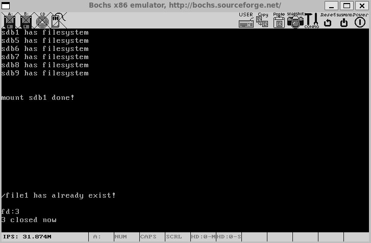

## 14.7 实现文件写入

文件写入是文件系统的核心功能，需要处理数据分配、块管理、错误回滚等复杂问题。

### 14.7.1 实现file_write
file_write函数负责将数据写入文件，处理块分配和数据组织。这段程序实现了内核级的**文件写入功能** (`file_write`)，它根据文件大小自动处理**直接块**和**一级间接块**的分配逻辑，并将数据写入磁盘。


修改file.c：

```c
...略
/* 把 buf 中的 count 个字节写入 file，
 * 成功则返回写入的字节数，失败则返回-1 */
int32_t file_write(struct file* file, const void* buf, uint32_t count) {
    if ((file->fd_inode->i_size + count) > (BLOCK_SIZE * 140)) {
        // 文件目前最大只支持 512*140=71680 字节
        printk("exceed max file_size 71680 bytes, write file failed\n");
        return -1;
    }

    uint8_t* io_buf = sys_malloc(512);
    if (io_buf == NULL) {
        printk("file_write: sys_malloc for io_buf failed\n");
        return -1;
    }

    uint32_t* all_blocks = (uint32_t*)sys_malloc(BLOCK_SIZE + 48);
    // 用来记录文件所有的块地址
    if (all_blocks == NULL) {
        printk("file_write: sys_malloc for all_blocks failed\n");
        return -1;
    }

    const uint8_t* src = buf;         // 用 src 指向 buf 中待写入的数据
    uint32_t bytes_written = 0;       // 用来记录已写入数据大小
    uint32_t size_left = count;       // 用来记录未写入数据大小
    int32_t block_lba = -1;           // 块地址
    uint32_t block_bitmap_idx = 0;    // 用来记录 block 对应于 block_bitmap 中的索引，作为参数传给 bitmap_sync

    uint32_t sec_idx;                 // 用来索引扇区
    uint32_t sec_lba;                 // 扇区地址
    uint32_t sec_off_bytes;           // 扇区内字节偏移量
    uint32_t sec_left_bytes;          // 扇区内剩余字节数量
    uint32_t chunk_size;              // 每次写入硬盘的数据块大小
    int32_t indirect_block_table;     // 用来获取一级间接表地址
    uint32_t block_idx;               // 块索引

    /* 判断文件是否是第一次写，如果是，先为其分配一个块 */
    if (file->fd_inode->i_sectors[0] == 0) {
        block_lba = block_bitmap_alloc(cur_part);
        if (block_lba == -1) {
            printk("file_write: block_bitmap_alloc failed\n");
            return -1;
        }
        file->fd_inode->i_sectors[0] = block_lba;

        /* 每分配一个块就将位图同步到硬盘 */
        block_bitmap_idx = block_lba - cur_part->sb->data_start_lba;
        ASSERT(block_bitmap_idx != 0);
        bitmap_sync(cur_part, block_bitmap_idx, BLOCK_BITMAP);
    }

    /* 写入 count 个字节前，该文件已经占用的块数 */
    uint32_t file_has_used_blocks = file->fd_inode->i_size / BLOCK_SIZE + 1;

    /* 存储 count 字节后该文件将占用的块数 */
    uint32_t file_will_use_blocks = (file->fd_inode->i_size + count) / BLOCK_SIZE + 1;
    ASSERT(file_will_use_blocks <= 140);

    /* 通过此增量判断是否需要分配扇区，如增量为 0，表示原扇区够用 */
    uint32_t add_blocks = file_will_use_blocks - file_has_used_blocks;

    /* 将写文件所用到的块地址收集到 all_blocks，系统中块大小等于扇区大小，
     * 后面都统一在 all_blocks 中获取写入扇区地址 */
    if (add_blocks == 0) {
        /* 在同一扇区内写入数据，不涉及到分配新扇区 */
        if (file_will_use_blocks <= 12) {  // 文件数据量将在 12 块之内
            block_idx = file_has_used_blocks - 1;
            // 指向最后一个已有数据的扇区
            all_blocks[block_idx] = file->fd_inode->i_sectors[block_idx];
        } else {
            /* 未写入新数据之前已经占用了间接块，需要将间接块地址读进来 */
            ASSERT(file->fd_inode->i_sectors[12] != 0);
            indirect_block_table = file->fd_inode->i_sectors[12];
            ide_read(cur_part->my_disk, indirect_block_table, all_blocks + 12, 1);
        }
    } else {
        /* 若有增量，便涉及到分配新扇区及是否分配一级间接块表，
         * 下面要分三种情况处理 */

        /* 第一种情况：12 个直接块够用 */
        if (file_will_use_blocks <= 12) {
            /* 先将有剩余空间的可继续用的扇区地址写入 all_blocks */
            block_idx = file_has_used_blocks - 1;
            ASSERT(file->fd_inode->i_sectors[block_idx] != 0);
            all_blocks[block_idx] = file->fd_inode->i_sectors[block_idx];

            /* 再将未来要用的扇区分配好后写入 all_blocks */
            block_idx = file_has_used_blocks; // 指向第一个要分配的新扇区
            while (block_idx < file_will_use_blocks) {
                block_lba = block_bitmap_alloc(cur_part);
                if (block_lba == -1) {
                    printk("file_write: block_bitmap_alloc for situation 1 failed\n");
                    return -1;
                }

                /* 写文件时，不应该存在块未使用，但已经分配扇区的情况，
                 * 当文件删除时，就会把块地址清 0 */
                ASSERT(file->fd_inode->i_sectors[block_idx] == 0);
                // 确保尚未分配扇区地址
                file->fd_inode->i_sectors[block_idx] = all_blocks[block_idx] = block_lba;

                /* 每分配一个块就将位图同步到硬盘 */
                block_bitmap_idx = block_lba - cur_part->sb->data_start_lba;
                bitmap_sync(cur_part, block_bitmap_idx, BLOCK_BITMAP);

                block_idx++; // 下一个分配的新扇区
            }
        } else if (file_has_used_blocks <= 12 && file_will_use_blocks > 12) {
            /* 第二种情况：旧数据在 12 个直接块内，新数据将使用间接块 */

            /* 先将有剩余空间的可继续用的扇区收集到 all_blocks */
            block_idx = file_has_used_blocks - 1;
            // 指向旧数据所在的最后一个扇区
            all_blocks[block_idx] = file->fd_inode->i_sectors[block_idx];

            /* 创建一级间接块表 */
            block_lba = block_bitmap_alloc(cur_part);
            if (block_lba == -1) {
                printk("file_write: block_bitmap_alloc for situation 2 failed\n");
                return -1;
            }

            ASSERT(file->fd_inode->i_sectors[12] == 0);
            // 确保一级间接块表未分配
            /* 分配一级间接块索引表 */
            indirect_block_table = file->fd_inode->i_sectors[12] = block_lba;

            block_idx = file_has_used_blocks;
            // 第一个未使用的块，即本文件最后一个已经使用的直接块的下一块

            while (block_idx < file_will_use_blocks) {
                block_lba = block_bitmap_alloc(cur_part);
                if (block_lba == -1) {
                    printk("file_write: block_bitmap_alloc for situation 2 failed\n");
                    return -1;
                }

                if (block_idx < 12) {
                    // 新创建的 0~11 块直接存入 all_blocks 数组
                    ASSERT(file->fd_inode->i_sectors[block_idx] == 0);
                    // 确保尚未分配扇区地址
                    file->fd_inode->i_sectors[block_idx] = all_blocks[block_idx] = block_lba;
                } else {
                    // 间接块只写入到 all_block 数组中，待全部分配完成后一次性同步到硬盘
                    all_blocks[block_idx] = block_lba;
                }

                /* 每分配一个块就将位图同步到硬盘 */
                block_bitmap_idx = block_lba - cur_part->sb->data_start_lba;
                bitmap_sync(cur_part, block_bitmap_idx, BLOCK_BITMAP);

                block_idx++; // 下一个新扇区
            }
            ide_write(cur_part->my_disk, indirect_block_table, all_blocks + 12, 1); // 同步一级间接块表到硬盘
        } else if (file_has_used_blocks > 12) {
            /* 第三种情况：新数据占据间接块 */
            ASSERT(file->fd_inode->i_sectors[12] != 0);
            // 已经具备了一级间接块表
            indirect_block_table = file->fd_inode->i_sectors[12];
            // 获取一级间接表地址

            /* 已使用的间接块也将被读入 all_blocks，无需单独收录 */
            ide_read(cur_part->my_disk, indirect_block_table, all_blocks + 12, 1); // 获取所有间接块地址

            block_idx = file_has_used_blocks;
            // 第一个未使用的间接块，即已经使用的间接块的下一块

            while (block_idx < file_will_use_blocks) {
                block_lba = block_bitmap_alloc(cur_part);
                if (block_lba == -1) {
                    printk("file_write: block_bitmap_alloc for situation 3 failed\n");
                    return -1;
                }
                all_blocks[block_idx++] = block_lba;

                /* 每分配一个块就将位图同步到硬盘 */
                block_bitmap_idx = block_lba - cur_part->sb->data_start_lba;
                bitmap_sync(cur_part, block_bitmap_idx, BLOCK_BITMAP);
            }
            ide_write(cur_part->my_disk, indirect_block_table, all_blocks + 12, 1); // 同步一级间接块表到硬盘
        }
    }

    /* 用到的块地址已经收集到 all_blocks 中，下面开始写数据 */
    bool first_write_block = true; // 含有剩余空间的块标识
    file->fd_pos = file->fd_inode->i_size - 1;
    // 置 fd_pos 为文件大小-1，下面在写数据时随时更新

    while (bytes_written < count) { // 直到写完所有数据
        memset(io_buf, 0, BLOCK_SIZE);
        sec_idx = file->fd_inode->i_size / BLOCK_SIZE;
        sec_lba = all_blocks[sec_idx];
        sec_off_bytes = file->fd_inode->i_size % BLOCK_SIZE;
        sec_left_bytes = BLOCK_SIZE - sec_off_bytes;

        /* 判断此次写入硬盘的数据大小 */
        chunk_size = size_left < sec_left_bytes ? size_left : sec_left_bytes;

        if (first_write_block) {
            ide_read(cur_part->my_disk, sec_lba, io_buf, 1);
            first_write_block = false;
        }

        memcpy(io_buf + sec_off_bytes, src, chunk_size);
        ide_write(cur_part->my_disk, sec_lba, io_buf, 1);
        printk("file write at lba 0x%x\n", sec_lba); // 调试，完成后去掉

        src += chunk_size;             // 将指针推移到下个新数据
        file->fd_inode->i_size += chunk_size; // 更新文件大小
        file->fd_pos += chunk_size;
        bytes_written += chunk_size;
        size_left -= chunk_size;
    }

    inode_sync(cur_part, file->fd_inode, io_buf);
    sys_free(all_blocks);
    sys_free(io_buf);
    return bytes_written;
}
...略
```

**关键设计**：

1. **文件大小限制**：最大支持140个块（71680字节）
   
2. **块管理策略**：
   
    - 直接块：前12个块直接存储在inode的i_sectors数组
    - 间接块：第13个块存储间接块地址表，支持128个间接块
  
3. **数据写入流程**：
   
    - 计算需要分配的新块数
    - 收集所有相关块地址（包括已有块和新分配块）
    - 从文件末尾开始追加数据
    - 首次写入块时需读取原有数据保护
  
4. **错误处理**：
   
    - 内存分配失败检查
    - 块分配失败回滚
    - 数据写入失败处理

### 14.7.2 改进sys_write及write系统调用

sys_write作为系统调用入口，处理标准输出和文件写入，修改**fs.c**：

```c
/*将buf中连续count个字节写入文件描述符fd，成功则返回写入的字节数，失败返回-1*/
int32_t sys_write(int32_t fd, const void* buf, uint32_t count) {
    if (fd < 0) {
        printk("sys_write: fd error\n");
        return -1;
    }
    
    /*标准输出特殊处理*/
    if (fd == stdout_no) {
        char tmp_buf[1024] = {0};
        memcpy(tmp_buf, buf, count);
        console_put_str(tmp_buf);
        return count;
    }
    
    /*文件写入处理*/
    uint32_t _fd = fd_local2global(fd);
    struct file* wr_file = &file_table[_fd];
    
    if (wr_file->fd_flag & O_WRONLY || wr_file->fd_flag & O_RDWR) {
        uint32_t bytes_written = file_write(wr_file, buf, count);
        return bytes_written;
    } else {
        console_put_str("sys_write: not allowed to write file without flag O_RDWR or O_WRONLY\n");
        return -1;
    }
}
```

**周边代码更新**：

1. **用户态系统调用**,修改lib/user/syscall.c：
```c
/*把buf中count个字符写入文件描述符fd*/
uint32_t write(int32_t fd, const void* buf, uint32_t count) {
    return _syscall3(SYS_WRITE, fd, buf, count);
}
```

2. **printf函数**,修改lib/stdio.c：
```c
/*格式化输出字符串format*/
uint32_t printf(const char* format, ...) {
    va_list args;
    va_start(args, format);
    char buf[1024] = {0};
    vsprintf(buf, format, args);
    va_end(args);
    return write(1, buf, strlen(buf));  // fd=1表示标准输出
}
```

### 14.7.3 把数据写入文件

测试文件写入功能，创建main.c：

```c
int main(void){
    put_str("I am kernel\n");
    init_all();
    process_execute(u_prog_a, "u_prog_a");
    process_execute(u_prog_b, "u_prog_b");
    thread_start("k_thread_a", 31, k_thread_a, "I am thread_a");
    thread_start("k_thread_b", 31, k_thread_b, "I am thread_b");

    uint32_t fd = sys_open("/file1", O_RDWR);
    printf("fd:%d\n", fd);
    sys_write(fd, "hello,world\n", 12);
    sys_close(fd);
    printf("%d closed now\n", fd);
    while(1);
    return 0;
}
```

**验证结果**：

1. 通过xxd工具查看磁盘数据，确认"hello,world"已正确写入
2. 检查file1的inode信息：
    - i_size = 12（写入12字节）
    - i_sectors[0] = 0x2ab（数据块地址）
3. 再次写入相同内容，验证追加功能：
    - i_size变为24
    - 文件内容包含两个"hello,world"

## 14.8 读取文件

文件读取与写入对称，需要处理块寻址和数据提取。

### 14.8.1 实现file_read
file_read函数从文件中读取数据：

```c
/*从文件file中读取count个字节写入buf，返回读出的字节数，若到文件尾则返回-1*/
int32_t file_read(struct file* file, void* buf, uint32_t count) {
    uint8_t* buf_dst = (uint8_t*)buf;
    uint32_t size = count;
    uint32_t size_left = size;
    
    /*检查是否到文件尾*/
    if ((file->fd_pos + count) > file->fd_inode->i_size) {
        size = file->fd_inode->i_size - file->fd_pos;
        size_left = size;
        if (size == 0) {
            return -1;  // 已到文件尾
        }
    }
    
    /*申请缓冲区*/
    uint8_t* io_buf = sys_malloc(BLOCK_SIZE);
    if (io_buf == NULL) {
        printk("file_read: sys_malloc for io_buf failed\n");
        return -1;
    }
    
    uint32_t* all_blocks = (uint32_t*)sys_malloc(BLOCK_SIZE + 48);
    if (all_blocks == NULL) {
        printk("file_read: sys_malloc for all_blocks failed\n");
        return -1;
    }
    
    /*计算读取范围*/
    uint32_t block_read_start_idx = file->fd_pos / BLOCK_SIZE;
    uint32_t block_read_end_idx = (file->fd_pos + size) / BLOCK_SIZE;
    uint32_t read_blocks = block_read_end_idx - block_read_start_idx + 1;
    
    /*收集相关块地址*/
    // ...（块地址收集逻辑，类似file_write）
    
    /*读取数据*/
    uint32_t bytes_read = 0;
    while (bytes_read < size) {
        uint32_t sec_idx = file->fd_pos / BLOCK_SIZE;
        uint32_t sec_lba = all_blocks[sec_idx];
        uint32_t sec_off_bytes = file->fd_pos % BLOCK_SIZE;
        
        /*计算本次读取大小*/
        uint32_t sec_left_bytes = BLOCK_SIZE - sec_off_bytes;
        uint32_t chunk_size = size_left < sec_left_bytes ? size_left : sec_left_bytes;
        
        /*读取数据块并复制到目标缓冲区*/
        memset(io_buf, 0, BLOCK_SIZE);
        ide_read(cur_part->my_disk, sec_lba, io_buf, 1);
        memcpy(buf_dst, io_buf + sec_off_bytes, chunk_size);
        
        /*更新状态*/
        buf_dst += chunk_size;
        file->fd_pos += chunk_size;
        bytes_read += chunk_size;
        size_left -= chunk_size;
    }
    
    sys_free(all_blocks);
    sys_free(io_buf);
    return bytes_read;
}
```

### 14.8.2 实现sys_read与功能验证
sys_read作为系统调用入口：

```c
/*从文件描述符fd指向的文件中读取count个字节到buf，若成功则返回读出的字节数，到文件尾则返回-1*/
int32_t sys_read(int32_t fd, void* buf, uint32_t count) {
    if (fd < 0) {
        printk("sys_read: fd error\n");
        return -1;
    }
    ASSERT(buf != NULL);
    uint32_t _fd = fd_local2global(fd);
    return file_read(&file_table[_fd], buf, count);
}
```

**测试代码**：
```c
uint32_t fd = sys_open("/file1", O_RDWR);
printf("open /file1, fd: %d\n", fd);

char buf[64] = {0};
int read_bytes = sys_read(fd, buf, 18);
printf("1_read %d bytes:\n%s\n", read_bytes, buf);

memset(buf, 0, 64);
read_bytes = sys_read(fd, buf, 6);
printf("2_read %d bytes:\n%s\n", read_bytes, buf);

memset(buf, 0, 64);
read_bytes = sys_read(fd, buf, 6);
printf("3_read %d bytes:\n%s\n", read_bytes, buf);

printf("___close file1 and reopen___\n");
sys_close(fd);

fd = sys_open("/file1", O_RDWR);
memset(buf, 0, 64);
read_bytes = sys_read(fd, buf, 24);
printf("4_read %d bytes:\n%s\n", read_bytes, buf);

sys_close(fd);
```

**测试结果**：

1. 首次读取18字节：输出"hello,world\nhello,wo"
2. 第二次读取6字节：输出"rld\n"
3. 第三次读取6字节：返回-1（已到文件尾）
4. 重新打开后读取24字节：完整输出两行"hello,world\n"

## 14.9 实现文件读写指针定位功能

文件指针定位允许在不关闭文件的情况下重新设置读写位置。

### 核心实现
```c
/*设置文件读写指针，成功返回新的偏移量，失败返回-1*/
int32_t sys_lseek(int32_t fd, off_t offset, int whence) {
    if (fd < 0) {
        printk("sys_lseek: fd error\n");
        return -1;
    }
    
    uint32_t _fd = fd_local2global(fd);
    struct file* file = &file_table[_fd];
    
    off_t new_pos = -1;
    switch (whence) {
        case SEEK_SET:  // 从文件开头
            new_pos = offset;
            break;
        case SEEK_CUR:  // 从当前位置
            new_pos = file->fd_pos + offset;
            break;
        case SEEK_END:  // 从文件末尾
            new_pos = file->fd_inode->i_size + offset;
            break;
        default:
            printk("sys_lseek: invalid whence\n");
            return -1;
    }
    
    /*验证新位置有效性*/
    if (new_pos < 0 || new_pos > file->fd_inode->i_size) {
        printk("sys_lseek: invalid position\n");
        return -1;
    }
    
    file->fd_pos = new_pos;
    return new_pos;
}
```

**功能验证**：
```c
uint32_t fd = sys_open("/file1", O_RDWR);
char buf[32] = {0};

/*读取前12字节*/
sys_read(fd, buf, 12);
printf("first read: %s\n", buf);

/*定位到文件开头*/
sys_lseek(fd, 0, SEEK_SET);

/*重新读取*/
memset(buf, 0, 32);
sys_read(fd, buf, 12);
printf("after seek: %s\n", buf);

sys_close(fd);
```

## 14.10 删除文件

文件删除需要清理inode、数据块和目录项。

### 14.10.3 实现sys_unlink与功能验证
```c
/*删除文件(非目录)，成功返回0，失败返回-1*/
int32_t sys_unlink(const char* pathname) {
    ASSERT(strlen(pathname) < MAX_PATH_LEN);
    
    /*检查文件是否存在*/
    struct path_search_record searched_record;
    memset(&searched_record, 0, sizeof(struct path_search_record));
    int inode_no = search_file(pathname, &searched_record);
    
    if (inode_no == -1) {
        printk("file %s not found!\n", pathname);
        dir_close(searched_record.parent_dir);
        return -1;
    }
    
    /*不能删除目录*/
    if (searched_record.file_type == FT_DIRECTORY) {
        printk("can't delete a directory with unlink(), use rmdir() to instead\n");
        dir_close(searched_record.parent_dir);
        return -1;
    }
    
    /*检查文件是否正在使用*/
    uint32_t file_idx = 0;
    while (file_idx < MAX_FILE_OPEN) {
        if (file_table[file_idx].fd_inode != NULL && 
            (uint32_t)inode_no == file_table[file_idx].fd_inode->i_no) {
            break;
        }
        file_idx++;
    }
    
    if (file_idx < MAX_FILE_OPEN) {
        dir_close(searched_record.parent_dir);
        printk("file %s is in use, not allow to delete!\n", pathname);
        return -1;
    }
    
    /*删除目录项并释放资源*/
    void* io_buf = sys_malloc(SECTOR_SIZE * 2);
    if (io_buf == NULL) {
        dir_close(searched_record.parent_dir);
        printk("sys_unlink: malloc for io_buf failed\n");
        return -1;
    }
    
    struct dir* parent_dir = searched_record.parent_dir;
    delete_dir_entry(cur_part, parent_dir, inode_no, io_buf);
    inode_release(cur_part, inode_no);
    
    sys_free(io_buf);
    dir_close(searched_record.parent_dir);
    return 0;
}
```

**验证结果**：

- 删除前：block_bitmap=3, inode_bitmap=3
- 删除后：block_bitmap=1, inode_bitmap=1
- 根目录中不再存在file1的目录项
- inode_table中file1的inode被清空

## 14.11 创建目录

目录创建比文件创建更复杂，需要处理目录项"."和".."。

### 14.11.1 实现sys_mkdir创建目录
```c
/*创建目录pathname，成功返回0，失败返回-1*/
int32_t sys_mkdir(const char* pathname) {
    uint8_t rollback_step = 0;
    void* io_buf = sys_malloc(SECTOR_SIZE * 2);
    if (io_buf == NULL) {
        printk("sys_mkdir: sys_malloc for io_buf failed\n");
        return -1;
    }
    
    struct path_search_record searched_record;
    memset(&searched_record, 0, sizeof(struct path_search_record));
    int inode_no = search_file(pathname, &searched_record);
    
    /*检查同名文件/目录是否存在*/
    if (inode_no != -1) {
        printk("sys_mkdir: file or directory %s exist!\n", pathname);
        rollback_step = 1;
        goto rollback;
    }
    
    /*验证路径完整性*/
    uint32_t pathname_depth = path_depth_cnt((char*)pathname);
    uint32_t path_searched_depth = path_depth_cnt(searched_record.searched_path);
    if (pathname_depth != path_searched_depth) {
        printk("sys_mkdir: cannot access %s: Not a directory, subpath %s isn't exist\n", 
               pathname, searched_record.searched_path);
        rollback_step = 1;
        goto rollback;
    }
    
    struct dir* parent_dir = searched_record.parent_dir;
    char* dirname = strrchr(searched_record.searched_path, '/') + 1;
    
    /*分配inode和数据块*/
    inode_no = inode_bitmap_alloc(cur_part);
    if (inode_no == -1) {
        printk("sys_mkdir: allocate inode failed\n");
        rollback_step = 1;
        goto rollback;
    }
    
    struct inode new_dir_inode;
    inode_init(inode_no, &new_dir_inode);
    
    int32_t block_lba = block_bitmap_alloc(cur_part);
    if (block_lba == -1) {
        printk("sys_mkdir: block_bitmap_alloc for create directory failed\n");
        rollback_step = 2;
        goto rollback;
    }
    
    new_dir_inode.i_sectors[0] = block_lba;
    bitmap_sync(cur_part, block_lba - cur_part->sb->data_start_lba, BLOCK_BITMAP);
    
    /*创建目录项"."和".."*/
    memset(io_buf, 0, SECTOR_SIZE * 2);
    struct dir_entry* p_de = (struct dir_entry*)io_buf;
    
    /*"."目录项*/
    memcpy(p_de->filename, ".", 1);
    p_de->i_no = inode_no;
    p_de->f_type = FT_DIRECTORY;
    
    p_de++;
    
    /*".."目录项*/
    memcpy(p_de->filename, "..", 2);
    p_de->i_no = parent_dir->inode->i_no;
    p_de->f_type = FT_DIRECTORY;
    
    ide_write(cur_part->my_disk, new_dir_inode.i_sectors[0], io_buf, 1);
    new_dir_inode.i_size = 2 * cur_part->sb->dir_entry_size;
    
    /*在父目录中添加新目录项*/
    struct dir_entry new_dir_entry;
    memset(&new_dir_entry, 0, sizeof(struct dir_entry));
    create_dir_entry(dirname, inode_no, FT_DIRECTORY, &new_dir_entry);
    
    if (!sync_dir_entry(parent_dir, &new_dir_entry, io_buf)) {
        printk("sys_mkdir: sync_dir_entry to disk failed!\n");
        rollback_step = 2;
        goto rollback;
    }
    
    /*同步元数据到硬盘*/
    inode_sync(cur_part, parent_dir->inode, io_buf);
    inode_sync(cur_part, &new_dir_inode, io_buf);
    bitmap_sync(cur_part, inode_no, INODE_BITMAP);
    
    sys_free(io_buf);
    dir_close(searched_record.parent_dir);
    return 0;

rollback:
    switch(rollback_step) {
        case 2:
            bitmap_set(&cur_part->inode_bitmap, inode_no, 0);
        case 1:
            dir_close(searched_record.parent_dir);
            break;
    }
    sys_free(io_buf);
    return -1;
}
```

### 14.11.2 创建目录功能验证
**测试代码**：
```c
printf("/dir1/subdir1 create %s!\n", sys_mkdir("/dir1/subdir1") == 0 ? "done" : "fail");
printf("/dir1 create %s!\n", sys_mkdir("/dir1") == 0 ? "done" : "fail");
printf("now, /dir1/subdir1 create %s!\n", sys_mkdir("/dir1/subdir1") == 0 ? "done" : "fail");

int fd = sys_open("/dir1/subdir1/file2", O_CREAT | O_RDWR);
if (fd != -1) {
    printf("/dir1/subdir1/file2 create done!\n");
    sys_write(fd, "Catch me if you can!\n", 21);
    sys_lseek(fd, 0, SEEK_SET);
    char buf[32] = {0};
    sys_read(fd, buf, 21);
    printf("/dir1/subdir1/file2 says:\n%s", buf);
    sys_close(fd);
}
```

**验证结果**：

- 根目录新增dir1目录项
- dir1目录包含"."、".."和subdir1三个目录项
- subdir1目录包含"."、".."和file2三个目录项
- file2文件正确存储" Catch me if you can!\n"内容

## 14.12 遍历目录

目录遍历需要打开目录、读取目录项、关闭目录。

### 14.12.1 打开目录和关闭目录
```c
/*目录打开成功后返回目录指针，失败返回NULL*/
struct dir* sys_opendir(const char* name) {
    ASSERT(strlen(name) < MAX_PATH_LEN);
    
    /*根目录特殊处理*/
    if ((name[0] == '/' && name[1] == '\0') || name[0] == '.') {
        return &root_dir;
    }
    
    /*搜索目录*/
    struct path_search_record searched_record;
    memset(&searched_record, 0, sizeof(struct path_search_record));
    int inode_no = search_file(name, &searched_record);
    struct dir* ret = NULL;
    
    if (inode_no == -1) {
        printk("In %s, sub path %s not exist\n", name, searched_record.searched_path);
    } else {
        if (searched_record.file_type == FT_REGULAR) {
            printk("%s is regular file!\n", name);
        } else if (searched_record.file_type == FT_DIRECTORY) {
            ret = dir_open(cur_part, inode_no);
        }
    }
    
    dir_close(searched_record.parent_dir);
    return ret;
}

/*成功关闭目录p_dir返回0，失败返回-1*/
int32_t sys_closedir(struct dir* dir) {
    int32_t ret = -1;
    if (dir != NULL) {
        dir_close(dir);
        ret = 0;
    }
    return ret;
}
```

### 14.12.2 读取1个目录项
dir_read函数从目录中读取单个目录项：

```c
/*读取目录，成功返回1个目录项，失败返回NULL*/
struct dir_entry* dir_read(struct dir* dir) {
    struct dir_entry* dir_e = (struct dir_entry*)dir->dirbuf;
    struct inode* dir_inode = dir->inode;
    uint32_t all_blocks[140] = {0};
    uint32_t block_cnt = 12;
    
    /*收集所有块地址*/
    uint32_t block_idx = 0;
    while (block_idx < 12) {
        all_blocks[block_idx] = dir_inode->i_sectors[block_idx];
        block_idx++;
    }
    
    if (dir_inode->i_sectors[12] != 0) {
        ide_read(cur_part->my_disk, dir_inode->i_sectors[12], all_blocks + 12, 1);
        block_cnt = 140;
    }
    
    block_idx = 0;
    uint32_t cur_dir_entry_pos = 0;
    uint32_t dir_entry_size = cur_part->sb->dir_entry_size;
    uint32_t dir_entrys_per_sec = SECTOR_SIZE / dir_entry_size;
    
    /*遍历目录*/
    while (dir->dir_pos < dir_inode->i_size) {
        if (dir->dir_pos >= dir_inode->i_size) {
            return NULL;
        }
        
        if (all_blocks[block_idx] == 0) {
            block_idx++;
            continue;
        }
        
        memset(dir_e, 0, SECTOR_SIZE);
        ide_read(cur_part->my_disk, all_blocks[block_idx], dir_e, 1);
        uint32_t dir_entry_idx = 0;
        
        /*遍历块内目录项*/
        while (dir_entry_idx < dir_entrys_per_sec) {
            if ((dir_e + dir_entry_idx)->f_type) {  // 有效目录项
                if (cur_dir_entry_pos < dir->dir_pos) {
                    cur_dir_entry_pos += dir_entry_size;
                    dir_entry_idx++;
                    continue;
                }
                
                ASSERT(cur_dir_entry_pos == dir->dir_pos);
                dir->dir_pos += dir_entry_size;
                return dir_e + dir_entry_idx;
            }
            dir_entry_idx++;
        }
        block_idx++;
    }
    
    return NULL;
}
```

### 14.12.3 实现sys_readdir及sys_rewinddir
```c
/*读取目录dir的1个目录项，成功后返回其目录项地址，到目录尾时或出错时返回NULL*/
struct dir_entry* sys_readdir(struct dir* dir) {
    ASSERT(dir != NULL);
    return dir_read(dir);
}

/*把目录dir的指针dir_pos置0*/
void sys_rewinddir(struct dir* dir) {
    dir->dir_pos = 0;
}
```

**测试结果**：

```
/dir1/subdir1 open done!
content:
directory .
directory ..
regular file2
/dir1/subdir1 close done!
```

## 14.13 删除目录

删除目录需要确保目录为空，然后清理资源。

### 14.13.1 删除目录与判断空目录
```c
/*判断目录是否为空*/
bool dir_is_empty(struct dir* dir) {
    struct inode* dir_inode = dir->inode;
    /*空目录只包含.和..两个目录项*/
    return (dir_inode->i_size == cur_part->sb->dir_entry_size * 2);
}

/*在父目录parent_dir中删除child_dir*/
int32_t dir_remove(struct dir* parent_dir, struct dir* child_dir) {
    struct inode* child_dir_inode = child_dir->inode;
    
    /*空目录只在inode->i_sectors[0]中有扇区*/
    int32_t block_idx = 1;
    while (block_idx < 13) {
        ASSERT(child_dir_inode->i_sectors[block_idx] == 0);
        block_idx++;
    }
    
    void* io_buf = sys_malloc(SECTOR_SIZE * 2);
    if (io_buf == NULL) {
        printk("dir_remove: malloc for io_buf failed\n");
        return -1;
    }
    
    /*删除目录项并释放资源*/
    delete_dir_entry(cur_part, parent_dir, child_dir_inode->i_no, io_buf);
    inode_release(cur_part, child_dir_inode->i_no);
    
    sys_free(io_buf);
    return 0;
}
```

### 14.13.2 实现sys_rmdir及功能验证
```c
/*删除空目录，成功时返回0，失败时返回-1*/
int32_t sys_rmdir(const char* pathname) {
    struct path_search_record searched_record;
    memset(&searched_record, 0, sizeof(struct path_search_record));
    int inode_no = search_file(pathname, &searched_record);
    ASSERT(inode_no != 0);
    
    int retval = -1;
    if (inode_no == -1) {
        printk("In %s, sub path %s not exist\n", pathname, searched_record.searched_path);
    } else {
        if (searched_record.file_type == FT_REGULAR) {
            printk("%s is regular file!\n", pathname);
        } else {
            struct dir* dir = dir_open(cur_part, inode_no);
            if (!dir_is_empty(dir)) {
                printk("dir %s is not empty, it is not allowed to delete a nonempty directory!\n", pathname);
            } else {
                if (!dir_remove(searched_record.parent_dir, dir)) {
                    retval = 0;
                }
            }
            dir_close(dir);
        }
    }
    
    dir_close(searched_record.parent_dir);
    return retval;
}
```

**验证结果**：

- 尝试删除非空目录失败
- 删除文件后目录变为空，成功删除
- 目录项和inode资源正确释放

## 14.14 任务的工作目录

工作目录允许进程在特定目录下操作，无需完整路径。

### 14.14.1 显示当前工作目录的原理及基础代码
```c
/*获得父目录的inode编号*/
uint32_t get_parent_dir_inode_nr(uint32_t child_inode_nr, void* io_buf) {
    struct inode* child_dir_inode = inode_open(cur_part, child_inode_nr);
    ASSERT(child_dir_inode->i_sectors[0]);
    
    /*读取目录的第0个块，包含.和..目录项*/
    ide_read(cur_part->my_disk, child_dir_inode->i_sectors[0], io_buf, 1);
    struct dir_entry* dir_e = (struct dir_entry*)io_buf;
    
    inode_close(child_dir_inode);
    ASSERT(dir_e[1].i_no < 4096 && dir_e[1].f_type == FT_DIRECTORY);
    return dir_e[1].i_no;  // 返回..即父目录的inode编号
}

/*在inode编号为p_inode_nr的目录中查找inode编号为c_inode_nr的子目录的名字*/
static int get_child_dir_name(uint32_t p_inode_nr, uint32_t c_inode_nr, char* path, void* io_buf) {
    struct inode* parent_dir_inode = inode_open(cur_part, p_inode_nr);
    
    /*收集所有块地址*/
    uint8_t block_idx = 0;
    uint32_t all_blocks[140] = {0};
    uint32_t block_cnt = 12;
    
    while (block_idx < 12) {
        all_blocks[block_idx] = parent_dir_inode->i_sectors[block_idx];
        block_idx++;
    }
    
    if (parent_dir_inode->i_sectors[12]) {
        ide_read(cur_part->my_disk, parent_dir_inode->i_sectors[12], all_blocks + 12, 1);
        block_cnt = 140;
    }
    
    inode_close(parent_dir_inode);
    
    struct dir_entry* dir_e = (struct dir_entry*)io_buf;
    uint32_t dir_entry_size = cur_part->sb->dir_entry_size;
    uint32_t dir_entrys_per_sec = (512 / dir_entry_size);
    
    /*遍历所有块和目录项*/
    block_idx = 0;
    while (block_idx < block_cnt) {
        if (all_blocks[block_idx]) {
            ide_read(cur_part->my_disk, all_blocks[block_idx], io_buf, 1);
            uint8_t dir_e_idx = 0;
            
            while (dir_e_idx < dir_entrys_per_sec) {
                if ((dir_e + dir_e_idx)->i_no == c_inode_nr) {
                    strcat(path, "/");
                    strcat(path, (dir_e + dir_e_idx)->filename);
                    return 0;
                }
                dir_e_idx++;
            }
        }
        block_idx++;
    }
    
    return -1;
}
```

### 14.14.2 实现sys_getcwd
```c
/*把当前工作目录绝对路径写入buf，size是buf的大小*/
char* sys_getcwd(char* buf, uint32_t size) {
    ASSERT(buf != NULL);
    void* io_buf = sys_malloc(SECTOR_SIZE);
    if (io_buf == NULL) {
        return NULL;
    }
    
    struct task_struct* cur_thread = running_thread();
    int32_t parent_inode_nr = 0;
    int32_t child_inode_nr = cur_thread->cwd_inode_nr;
    
    /*根目录特殊处理*/
    if (child_inode_nr == 0) {
        buf[0] = '/';
        buf[1] = '\0';
        return buf;
    }
    
    memset(buf, 0, size);
    char full_path_reverse[MAX_PATH_LEN] = {0};
    
    /*从下往上逐层找父目录*/
    while (child_inode_nr) {
        parent_inode_nr = get_parent_dir_inode_nr(child_inode_nr, io_buf);
        if (get_child_dir_name(parent_inode_nr, child_inode_nr, full_path_reverse, io_buf) == -1) {
            sys_free(io_buf);
            return NULL;
        }
        child_inode_nr = parent_inode_nr;
    }
    
    /*反转路径*/
    char* last_slash;
    while ((last_slash = strrchr(full_path_reverse, '/'))) {
        uint16_t len = strlen(buf);
        strcpy(buf + len, last_slash);
        *last_slash = '\0';
    }
    
    sys_free(io_buf);
    return buf;
}
```

### 14.14.3 实现sys_chdir改变工作目录
```c
/*更改当前工作目录为绝对路径path，成功则返回0，失败返回-1*/
int32_t sys_chdir(const char* path) {
    int32_t ret = -1;
    struct path_search_record searched_record;
    memset(&searched_record, 0, sizeof(struct path_search_record));
    
    int inode_no = search_file(path, &searched_record);
    if (inode_no != -1) {
        if (searched_record.file_type == FT_DIRECTORY) {
            running_thread()->cwd_inode_nr = inode_no;
            ret = 0;
        } else {
            printk("sys_chdir: %s is regular file or other!\n", path);
        }
    }
    
    dir_close(searched_record.parent_dir);
    return ret;
}
```

**测试结果**：

```
cwd: /
change cwd now
cwd: /dir1
```

## 14.15 获得文件属性

文件属性查询提供文件的元数据信息。

### 14.15.1 ls命令的幕后功臣
ls命令通过stat系统调用获取文件属性，包括：
- inode编号
- 文件大小
- 文件类型
- 权限信息（本系统暂不支持）
- 时间戳（本系统暂不支持）

### 14.15.2 实现sys_stat
```c
/*文件属性结构体*/
struct stat {
    uint32_t st_ino;       // inode编号
    uint32_t st_size;      // 尺寸
    enum file_type st_filetype; // 文件类型
};

/*在buf中填充文件结构相关信息，成功时返回0，失败返回-1*/
int32_t sys_stat(const char* path, struct stat* buf) {
    /*根目录特殊处理*/
    if (!strcmp(path, "/") || !strcmp(path, "/.") || !strcmp(path, "/..")) {
        buf->st_filetype = FT_DIRECTORY;
        buf->st_ino = 0;
        buf->st_size = root_dir.inode->i_size;
        return 0;
    }
    
    int32_t ret = -1;
    struct path_search_record searched_record;
    memset(&searched_record, 0, sizeof(struct path_search_record));
    
    int inode_no = search_file(path, &searched_record);
    if (inode_no != -1) {
        struct inode* obj_inode = inode_open(cur_part, inode_no);
        buf->st_size = obj_inode->i_size;
        inode_close(obj_inode);
        
        buf->st_filetype = searched_record.file_type;
        buf->st_ino = inode_no;
        ret = 0;
    } else {
        printk("sys_stat: %s not found\n", path);
    }
    
    dir_close(searched_record.parent_dir);
    return ret;
}
```

```linenums="0"
.
├── boot.inc
├── device
│   ├── console.c
│   ├── console.h
│   ├── ide.c
│   ├── ide.h
│   ├── ioqueue.c
│   ├── ioqueue.h
│   ├── keyboard.c
│   ├── keyboard.h
│   ├── timer.c
│   └── timer.h
├── fs                 #💡新增
│   ├── dir.c
│   ├── dir.h
│   ├── file.c
│   ├── file.h
│   ├── fs.c
│   ├── fs.h
│   ├── inode.c
│   ├── inode.h
│   └── super_block.h
├── kernel
│   ├── debug.c
│   ├── debug.h
│   ├── global.h
│   ├── init.c
│   ├── init.h
│   ├── interrupt.c
│   ├── interrupt.h
│   ├── kernel.s
│   ├── main.c
│   ├── memory.c
│   ├── memory.h
│   └── stdint.h
├── lib
│   ├── kernel
│   │   ├── bitmap.c
│   │   ├── bitmap.h
│   │   ├── io.h
│   │   ├── list.c
│   │   ├── list.h
│   │   ├── print.c
│   │   ├── print.h
│   │   ├── print.s
│   │   ├── stdio-kernel.c
│   │   └── stdio-kernel.h
│   ├── stdbool.h
│   ├── stdio.c
│   ├── stdio.h
│   ├── string.c
│   ├── string.h
│   └── user
│       ├── syscall.c
│       └── syscall.h
├── loader.s
├── makefile
├── mbr.s
├── thread
│   ├── switch.s
│   ├── sync.c
│   ├── sync.h
│   ├── thread.c
│   └── thread.h
└── userprog
    ├── process.c
    ├── process.h
    ├── syscall-init.c
    ├── syscall-init.h
    ├── tss.c
    └── tss.h
```

**测试结果**：

```
/ info
ino: 0
size: 96
filetype: directory

/dir1 info
ino: 2
size: 48
filetype: directory
```

## 本章要点总结

1. **文件系统架构**：
    - 采用inode-based设计，每个文件/目录对应一个inode
    - 支持12个直接块 + 128个间接块，最大文件大小71680字节
    - 目录项包含文件名、inode编号和文件类型

2. **核心功能实现**：
    - **文件操作**：创建、打开、关闭、读写、删除
    - **目录操作**：创建、遍历、删除（仅空目录）
    - **文件指针**：lseek支持随机访问
    - **工作目录**：getcwd/chdir管理进程当前目录
    - **文件属性**：stat获取文件元数据

3. **关键机制**：
    - **事务处理**：文件/目录操作采用回滚机制保证原子性
    - **资源管理**：inode和数据块分配/回收
    - **写锁保护**：防止多进程同时写同一文件
    - **路径解析**：search_file逐层解析路径组件

4. **数据结构**：
    - inode：存储文件元数据（大小、块地址等）
    - dir_entry：目录项结构
    - path_search_record：记录路径搜索过程
    - file：文件描述符结构

5. **系统调用接口**：
    - open/read/write/close：标准文件I/O
    - mkdir/rmdir/opendir/readdir：目录操作
    - lseek：文件指针定位
    - getcwd/chdir：工作目录管理
    - stat：文件属性查询

6. **设计原则**：
    - 模块化：分离文件操作和目录操作
    - 安全性：验证路径有效性，检查操作权限
    - 一致性：错误处理和资源回收
    - 性能：批量IO操作，减少磁盘访问

本章实现了完整的文件系统功能，为用户程序提供了统一的文件访问接口。通过精心设计的数据结构和算法，系统能够高效地管理存储资源，保证数据的完整性和一致性。后续章节将进一步优化文件系统性能，支持更复杂的特性如文件权限、符号链接等。

## 本章源码附件

### 14.2.3的fs.c

```c
#include "stdint.h"
#include "fs.h"
#include "inode.h"
#include "ide.h"
#include "memory.h"
#include "super_block.h"
#include "dir.h"
#include "stdio-kernel.h"
#include "string.h"
#include "debug.h"

extern struct list partition_list;
struct partition* cur_part;	 // 默认情况下操作的是哪个分区

/* 在分区链表中找到名为part_name的分区,并将其指针赋值给cur_part */
static bool mount_partition(struct list_elem* pelem, int arg) {
    char* part_name = (char*)arg;
    struct partition* part = elem2entry(struct partition, part_tag, pelem);
    if (!strcmp(part->name, part_name)) {
        cur_part = part;
        struct disk* hd = cur_part->my_disk;

        /* sb_buf用来存储从硬盘上读入的超级块 */
        struct super_block* sb_buf = (struct super_block*)sys_malloc(SECTOR_SIZE);

        /* 在内存中创建分区cur_part的超级块 */
        cur_part->sb = (struct super_block*)sys_malloc(sizeof(struct super_block));
        if (cur_part->sb == NULL) {
            PANIC("alloc memory failed!");
        }

        /* 读入超级块 */
        memset(sb_buf, 0, SECTOR_SIZE);
        ide_read(hd, cur_part->start_lba + 1, sb_buf, 1);   

        /* 把sb_buf中超级块的信息复制到分区的超级块sb中。*/
        memcpy(cur_part->sb, sb_buf, sizeof(struct super_block)); 

        /**********     将硬盘上的块位图读入到内存    ****************/
        cur_part->block_bitmap.bits = (uint8_t*)sys_malloc(sb_buf->block_bitmap_sects * SECTOR_SIZE);
        if (cur_part->block_bitmap.bits == NULL) {
            PANIC("alloc memory failed!");
        }
        cur_part->block_bitmap.btmp_bytes_len = sb_buf->block_bitmap_sects * SECTOR_SIZE;
        /* 从硬盘上读入块位图到分区的block_bitmap.bits */
        ide_read(hd, sb_buf->block_bitmap_lba, cur_part->block_bitmap.bits, sb_buf->block_bitmap_sects);   
        /*************************************************************/

        /**********     将硬盘上的inode位图读入到内存    ************/
        cur_part->inode_bitmap.bits = (uint8_t*)sys_malloc(sb_buf->inode_bitmap_sects * SECTOR_SIZE);
        if (cur_part->inode_bitmap.bits == NULL) {
            PANIC("alloc memory failed!");
        }
        cur_part->inode_bitmap.btmp_bytes_len = sb_buf->inode_bitmap_sects * SECTOR_SIZE;
        /* 从硬盘上读入inode位图到分区的inode_bitmap.bits */
        ide_read(hd, sb_buf->inode_bitmap_lba, cur_part->inode_bitmap.bits, sb_buf->inode_bitmap_sects);   
        /*************************************************************/

        list_init(&cur_part->open_inodes);
        printk("mount %s done!\n", part->name);

    /* 此处返回true是为了迎合主调函数list_traversal的实现,与函数本身功能无关。
        只有返回true时list_traversal才会停止遍历,减少了后面元素无意义的遍历.*/
        sys_free(sb_buf);
        return true;
    }
    return false;     // 使list_traversal继续遍历
}

/* 格式化分区,也就是初始化分区的元信息,创建文件系统 */
static void partition_format(struct partition* part) {
    /* 为方便实现,一个块大小是一扇区 */
    uint32_t boot_sector_sects = 1;	  
    uint32_t super_block_sects = 1;
    uint32_t inode_bitmap_sects = DIV_ROUND_UP(MAX_FILES_PER_PART, BITS_PER_SECTOR);// I结点位图占用的扇区数
    uint32_t inode_table_sects = DIV_ROUND_UP(((sizeof(struct inode) * MAX_FILES_PER_PART)), SECTOR_SIZE);
    uint32_t used_sects = boot_sector_sects + super_block_sects + inode_bitmap_sects + inode_table_sects;
    uint32_t free_sects = part->sec_cnt - used_sects;  

    /************** 简单处理块位图占据的扇区数 ***************/
    uint32_t block_bitmap_sects;
    block_bitmap_sects = DIV_ROUND_UP(free_sects, BITS_PER_SECTOR);   //所有空闲扇区对应的位图扇区数
    uint32_t block_bitmap_bit_len = free_sects - block_bitmap_sects;  //空闲扇区减去位图扇区
    block_bitmap_sects = DIV_ROUND_UP(block_bitmap_bit_len, BITS_PER_SECTOR);  //重新计算
    /*********************************************************/
    
    /* 超级块初始化 */
    struct super_block sb;
    sb.magic = 0x19590318;
    sb.sec_cnt = part->sec_cnt;
    sb.inode_cnt = MAX_FILES_PER_PART;
    sb.part_lba_base = part->start_lba;

    sb.block_bitmap_lba = sb.part_lba_base + 2;	 // 0块是引导块,1块是超级块
    sb.block_bitmap_sects = block_bitmap_sects;

    sb.inode_bitmap_lba = sb.block_bitmap_lba + sb.block_bitmap_sects;
    sb.inode_bitmap_sects = inode_bitmap_sects;

    sb.inode_table_lba = sb.inode_bitmap_lba + sb.inode_bitmap_sects;
    sb.inode_table_sects = inode_table_sects; 

    sb.data_start_lba = sb.inode_table_lba + sb.inode_table_sects;  //数据区的起始就是inode数组的结束
    sb.root_inode_no = 0;
    sb.dir_entry_size = sizeof(struct dir_entry);

    printk("%s info:\n", part->name);
    printk("   magic:0x%x\n   part_lba_base:0x%x\n   all_sectors:0x%x\n   inode_cnt:0x%x\n   block_bitmap_lba:0x%x\n   block_bitmap_sectors:0x%x\n   inode_bitmap_lba:0x%x\n   inode_bitmap_sectors:0x%x\n   inode_table_lba:0x%x\n   inode_table_sectors:0x%x\n   data_start_lba:0x%x\n", sb.magic, sb.part_lba_base, sb.sec_cnt, sb.inode_cnt, sb.block_bitmap_lba, sb.block_bitmap_sects, sb.inode_bitmap_lba, sb.inode_bitmap_sects, sb.inode_table_lba, sb.inode_table_sects, sb.data_start_lba);

    struct disk* hd = part->my_disk;
    /*******************************
     * 1 将超级块写入本分区的1扇区 *
     ******************************/
    ide_write(hd, part->start_lba + 1, &sb, 1);
    printk("   super_block_lba:0x%x\n", part->start_lba + 1);

    /* 找出数据量最大的元信息,用其尺寸做存储缓冲区*/
    uint32_t buf_size = (sb.block_bitmap_sects >= sb.inode_bitmap_sects ? sb.block_bitmap_sects : sb.inode_bitmap_sects);
    buf_size = (buf_size >= sb.inode_table_sects ? buf_size : sb.inode_table_sects) * SECTOR_SIZE;
    uint8_t* buf = (uint8_t*)sys_malloc(buf_size);	// 申请的内存由内存管理系统清0后返回
    
    /**************************************
     * 2 将块位图初始化并写入sb.block_bitmap_lba *
     *************************************/
    /* 初始化块位图block_bitmap */
    buf[0] |= 0x01;       // 第0个块预留给根目录,位图中先占位
    uint32_t block_bitmap_last_byte = block_bitmap_bit_len / 8; //计算出块位图最后一字节的偏移
    uint8_t  block_bitmap_last_bit  = block_bitmap_bit_len % 8; //计算出块位图最后一位的偏移
    uint32_t last_size = SECTOR_SIZE - (block_bitmap_last_byte % SECTOR_SIZE);// last_size是位图所在最后一个扇区中，不足一扇区的其余部分

    /* 1 先将位图最后一字节到其所在的扇区的结束全置为1,即超出实际块数的部分直接置为已占用*/
    memset(&buf[block_bitmap_last_byte], 0xff, last_size);
    
    /* 2 再将上一步中覆盖的最后一字节内的有效位重新置0 */
    uint8_t bit_idx = 0;
    while (bit_idx < block_bitmap_last_bit) {
        buf[block_bitmap_last_byte] &= ~(1 << bit_idx++);
    }
    ide_write(hd, sb.block_bitmap_lba, buf, sb.block_bitmap_sects);

    /***************************************
     * 3 将inode位图初始化并写入sb.inode_bitmap_lba *
     ***************************************/
    /* 先清空缓冲区*/
    memset(buf, 0, buf_size);
    buf[0] |= 0x1;      // 第0个inode分给了根目录
    /* 由于inode_table中共4096个inode,位图inode_bitmap正好占用1扇区,
        * 即inode_bitmap_sects等于1, 所以位图中的位全都代表inode_table中的inode,
        * 无须再像block_bitmap那样单独处理最后一扇区的剩余部分,
        * inode_bitmap所在的扇区中没有多余的无效位 */
    ide_write(hd, sb.inode_bitmap_lba, buf, sb.inode_bitmap_sects);

    /***************************************
     * 4 将inode数组初始化并写入sb.inode_table_lba *
     ***************************************/
    /* 准备写inode_table中的第0项,即根目录所在的inode */
    memset(buf, 0, buf_size);  // 先清空缓冲区buf
    struct inode* i = (struct inode*)buf; 
    i->i_size = sb.dir_entry_size * 2;	 // .和..
    i->i_no = 0;   // 根目录占inode数组中第0个inode
    i->i_sectors[0] = sb.data_start_lba;	     // 由于上面的memset,i_sectors数组的其它元素都初始化为0 
    ide_write(hd, sb.inode_table_lba, buf, sb.inode_table_sects);
    
    /***************************************
     * 5 将根目录初始化并写入sb.data_start_lba
     ***************************************/
    /* 写入根目录的两个目录项.和.. */
    memset(buf, 0, buf_size);
    struct dir_entry* p_de = (struct dir_entry*)buf;

    /* 初始化当前目录"." */
    memcpy(p_de->filename, ".", 1);
    p_de->i_no = 0;
    p_de->f_type = FT_DIRECTORY;
    p_de++;

    /* 初始化当前目录父目录".." */
    memcpy(p_de->filename, "..", 2);
    p_de->i_no = 0;   // 根目录的父目录依然是根目录自己
    p_de->f_type = FT_DIRECTORY;

    /* sb.data_start_lba已经分配给了根目录,里面是根目录的目录项 */
    ide_write(hd, sb.data_start_lba, buf, 1);

    printk("   root_dir_lba:0x%x\n", sb.data_start_lba);
    printk("%s format done\n", part->name);
    sys_free(buf);
}


/* 在磁盘上搜索文件系统,若没有则格式化分区创建文件系统 */
void filesys_init() {
    uint8_t channel_no = 0, dev_no, part_idx = 0;

    /* sb_buf用来存储从硬盘上读入的超级块 */
    struct super_block* sb_buf = (struct super_block*)sys_malloc(SECTOR_SIZE);

    if (sb_buf == NULL) {
        PANIC("alloc memory failed!");
    }
    printk("searching filesystem......\n");
    while (channel_no < channel_cnt) {  //遍历两个通道
        dev_no = 0;
        while(dev_no < 2) { //遍历通道下1主1从两个硬盘
            if (dev_no == 0) {   // 跨过裸盘hd60M.img
                dev_no++;
                continue;
            }
            struct disk* hd = &channels[channel_no].devices[dev_no];
            struct partition* part = hd->prim_parts;
            while(part_idx < 12) {   // 遍历硬盘的分区，4个主分区+8个逻辑
                if (part_idx == 4) {  // 开始处理逻辑分区
                    part = hd->logic_parts;
                }
            
            /*channels数组是全局变量,默认值为0,disk属于其嵌套结构,
            * partition又为disk的嵌套结构,因此partition中的成员默认也为0.
            * 若partition未初始化,则partition中的成员仍为0. 
            * 下面处理存在的分区. */
                if (part->sec_cnt != 0) {  // 如果分区存在
                    memset(sb_buf, 0, SECTOR_SIZE);

                    /* 读出分区的超级块,根据魔数是否正确来判断是否存在文件系统 */
                    ide_read(hd, part->start_lba + 1, sb_buf, 1);   

                    /* 只支持自己的文件系统.若磁盘上已经有文件系统就不再格式化了 */
                    if (sb_buf->magic == 0x19590318) {
                        printk("%s has filesystem\n", part->name);
                    } 
                    else {			  // 其它文件系统不支持,一律按无文件系统处理
                        printk("formatting %s`s partition %s......\n", hd->name, part->name);
                        partition_format(part);
                    }
                }
                part_idx++;
                part++;	// 下一分区
            }
            dev_no++;	// 下一磁盘
        }
        channel_no++;	// 下一通道
    }
    sys_free(sb_buf);
  // 默认挂载sdb1分区
    char default_part[8] = "sdb1";
    list_traversal(&partition_list, mount_partition, (int)default_part);
}

```

### 14.3.2的thread.h

```c
#ifndef __THREAD_THREAD_H
#define __THREAD_THREAD_H

#include "stdint.h"
#include "list.h"
#include "bitmap.h"
#include "memory.h"


extern struct list thread_ready_list;    //11.3.2加
extern struct list thread_all_list;      //11.3.2加
#define MAX_FILES_OPEN_PER_PROC 8        // 每进程最大打开文件数14.3.2加
/* 自定义通用函数类型，它将在很多线程函数中作为形参类型 */
typedef void thread_func(void*);
typedef int16_t pid_t;

/* 进程或线程的状态 */
enum task_status {
    TASK_RUNNING,
    TASK_READY,
    TASK_BLOCKED,
    TASK_WAITING,
    TASK_HANGING,
    TASK_DIED
};

/************** 中断栈 intr_stack **************
 * 此结构用于中断发生时保护程序（线程或进程）的上下文环境：
 * 进程或线程被外部中断或软中断打断时，会按照此结构压入上下文
 * 寄存器，intr_exit 中的出栈操作是此结构的逆操作
 * 此栈在线程自己的内核栈中位置固定，所在页的最顶端
 **********************************************/
struct intr_stack {
    uint32_t vec_no;           // kernel.S 宏 VECTOR 中 push %1 压入的中断号
    uint32_t edi;
    uint32_t esi;
    uint32_t ebp;
    uint32_t esp_dummy;       //// pushad把esp也压入，但 sp不断变化，所以会被popad忽略
    uint32_t ebx;
    uint32_t edx;
    uint32_t ecx;
    uint32_t eax;
    uint32_t gs;
    uint32_t fs;
    uint32_t es;
    uint32_t ds;
    /* 以下由 cpu 从低特权级进入高特权级时压入 */
    uint32_t err_code;         // err_code 会被压入在 eip 之后
    void (*eip)(void);
    uint32_t cs;
    uint32_t eflags;
    void* esp;
    uint32_t ss;
};

/************** 线程栈 thread_stack **************
 * 线程自己的栈，用于存储线程中待执行的函数
 * 此结构在线程自己的内核栈中位置不固定，
 * 仅用在 switch_to 时保存线程环境。
 * 实际位置取决于实际运行情况。
 *************************************************/
struct thread_stack {
    uint32_t ebp;
    uint32_t ebx;
    uint32_t edi;
    uint32_t esi;
    /* 线程第一次执行时，eip 指向待调用的函数kernel_thread，其他时候，eip指向switch_to的返回地址*/
    void (*eip)(thread_func* func, void* func_arg);
    /**** 以下仅供第一次被调度上 cpu 时使用 ****/
    /* 参数 unused_ret 只为占位置充数为返回地址 */
    void (*unused_retaddr);
    thread_func* function;      // 由 kernel_thread 所调用的函数名
    void* func_arg;             // 由 kernel_thread 所调用的函数所需的参数
};

struct task_struct {
    uint32_t* self_kstack;        // 线程内核栈指针
    pid_t pid;                    // 新增：进程/线程 ID
    enum task_status status;      // 线程状态（运行、就绪等）
    char name[16];                // 线程名称
    uint8_t priority;             // 优先级，决定时间片长度
    uint8_t ticks;                // 时间片计数器
    uint32_t elapsed_ticks;       // 线程总运行时间
    int32_t fd_table[MAX_FILES_OPEN_PER_PROC];  // 文件描述符数组 14.3.2加
    uint32_t cwd_inode_nr;                      // 进程所在的工作目录的inode编号，14.3.2
    int16_t parent_pid;                         // 父进程pid，14.3.2
    struct list_elem general_tag;  // 就绪队列节点
    struct list_elem all_list_tag; // 全部线程队列节点
    uint32_t* pgdir;              // 页目录指针（线程为NULL）
    struct virtual_addr userprog_vaddr;   // 用户进程的虚拟地址池     11.3.2加
    struct mem_block_desc u_block_desc[DESC_CNT];   //进程内存块描述符 12.4.3加
    uint32_t stack_magic;         // 栈边界标记
};

struct task_struct* thread_start(char* name, int prio, thread_func function, void* func_arg);
void init_thread(struct task_struct* pthread, char* name, int prio);
void thread_create(struct task_struct* pthread, thread_func function, void* func_arg);
static void kernel_thread(thread_func* function, void* func_arg);
struct task_struct* running_thread(void);
static void make_main_thread(void);
struct task_struct* thread_start(char* name, int prio, thread_func function, void* func_arg);
void schedule(void);
void thread_init(void);
void thread_block(enum task_status stat);
void thread_unblock(struct task_struct* pthread);
void thread_yield(void);
#endif
```

### 14.3.2的thread.c

```c
#include "thread.h"
#include "stdint.h"
#include "string.h"
#include "global.h"
#include "memory.h"
#include "interrupt.h"
#include "debug.h"
#include "print.h"
#include "process.h"
#include "sync.h"
#include "syscall-init.h"

#define PG_SIZE 4096  

struct task_struct* main_thread;        // 主线程 PCB  
struct list thread_ready_list;          // 就绪队列  
struct list thread_all_list;            // 所有任务队列  
static struct list_elem* thread_tag;    // 用于保存队列中的线程结点  
static struct lock pid_lock; // PID 分配锁
static struct task_struct* idle_thread;   // idle 线程
extern void switch_to(struct task_struct* cur, struct task_struct* next);  

static pid_t allocate_pid(void) {
    static pid_t next_pid = 0;
    lock_acquire(&pid_lock);
    next_pid++;              // 简单自增，首个任务 PID 为 1
    lock_release(&pid_lock);
    return next_pid;
}

/* 获取当前线程 pcb 指针 */  
struct task_struct* running_thread(void) {  
    uint32_t esp;  
    asm("mov %%esp, %0" : "=g" (esp));  
    /* 取 esp 整数部分，即 pcb 起始地址 */  
    return (struct task_struct*)(esp & 0xfffff000);  
}  

/* 创建优先级为prio的线程，线程名name，线程所执行的函数是 function(func_arg) */  
struct task_struct* thread_start(char* name, \
                                 int prio, \
                                 thread_func function, \
                                 void* func_arg) {  
    /* pcb 都位于内核空间，包括用户进程的 pcb 也是在内核空间 */  
    struct task_struct* thread = get_kernel_pages(1);  
    init_thread(thread, name, prio);  
    thread_create(thread, function, func_arg);  
  
    ASSERT(!elem_find(&thread_ready_list, &thread->general_tag));  //确保之前不在队列中
    list_append(&thread_ready_list, &thread->general_tag);         //加入就绪线程队列

    ASSERT(!elem_find(&thread_all_list, &thread->all_list_tag));  //确保之前不在队列中
    list_append(&thread_all_list, &thread->all_list_tag);         //加入全部线程队列
  
    return thread;  
}  

/* 将 kernel 中的 main 函数完善为主线程 */  
static void make_main_thread(void) {  
    /* 因为 main 线程早已运行，  
       * 咱们在 loader.S 中进入内核时的 mov esp,0xc009f000,  
       * 就是为其预留 pcb 的，因此 pcb 地址为 0xc009e000,  
       * 不需要通过 get_kernel_page 另分配一页*/ 
    main_thread = running_thread();  
    init_thread(main_thread, "main", 31);  
    /* main 函数是当前线程，当前线程不在 thread_ready_list 中，  
       * 所以只将其加在 thread_all_list 中 */  
    ASSERT(!elem_find(&thread_all_list, &main_thread->all_list_tag));
    list_append(&thread_all_list, &main_thread->all_list_tag);  
}

/* 初始化线程基本信息 */  
void init_thread(struct task_struct* pthread, char* name, int prio) { 
    memset(pthread, 0, sizeof(*pthread));
    pthread->pid = allocate_pid(); // 创建时分配 PID
    strcpy(pthread->name, name);  
    if (pthread == main_thread) {  
        /* 由于把 main 函数也封装成一个线程，将其直接设为 TASK_RUNNING */  
        pthread->status = TASK_RUNNING;  
    } else {  
        pthread->status = TASK_READY;  
    }  
    /* self_kstack 是线程自己在内核态下使用的栈顶地址 */  
    pthread->self_kstack = (uint32_t*)((uint32_t)pthread + PG_SIZE);  
    pthread->priority = prio;  
    pthread->ticks = prio;  
    pthread->elapsed_ticks = 0;  
    pthread->pgdir = NULL;  
    pthread->stack_magic = 0x19870916;        // 自定义的魔数
  // 预留标准输入输出
    pthread->fd_table[0] = 0;  // 标准输入
    pthread->fd_table[1] = 1;  // 标准输出
    pthread->fd_table[2] = 2;  // 标准错误
    
    // 其余位置初始化为-1（空闲）
    uint8_t fd_idx = 3;
    while (fd_idx < MAX_FILES_OPEN_PER_PROC) {
        pthread->fd_table[fd_idx] = -1;
        fd_idx++;
    }
    pthread->cwd_inode_nr = 0;         // 以根目录做为默认工作路径
    pthread->parent_pid = -1;          // -1表示没有父进程
}  

/* 系统空闲时运行的线程 */
static void idle(void* arg) {
    while(1) {
        thread_block(TASK_BLOCKED);
        //执行 hlt 时必须要保证目前处在开中断的情况下
        asm volatile ("sti; hlt" : : : "memory");
    }
}


void thread_init(void) {
    put_str("thread_init start\n");
    list_init(&thread_ready_list);
    list_init(&thread_all_list);
    lock_init(&pid_lock);        //12.2.5加
    syscall_init();              //12.2.5加
    /* 将当前 main 函数创建为线程 */
    make_main_thread();
    idle_thread = thread_start("idle", 10, idle, NULL);//13.2.2加
    put_str("thread_init done\n");
}


/* 初始化线程栈，将待执行的函数和参数放到thread_stack 中相应的位置*/
void thread_create(struct task_struct* pthread, thread_func function, void* func_arg) {
    /* 先预留中断使用栈的空间 */
    pthread->self_kstack -= sizeof(struct intr_stack);
    /* 再留出线程栈空间，可见 thread.h 中定义 */
    pthread->self_kstack -= sizeof(struct thread_stack);
    struct thread_stack* kthread_stack = (struct thread_stack*)pthread->self_kstack;
    kthread_stack->eip = kernel_thread;
    kthread_stack->function = function;
    kthread_stack->func_arg = func_arg;
    kthread_stack->ebp = kthread_stack->ebx = \
    kthread_stack->esi = kthread_stack->edi = 0;
}
/* 由 kernel_thread 去执行 function(func_arg) */  
static void kernel_thread(thread_func* function, void* func_arg) {  
    /* 执行 function 前要开中断，  
       避免后面的时钟中断被屏蔽，而无法调度其他线程 */  
    intr_enable();  
    function(func_arg);  
}  

/* 实现任务调度 */
void schedule(void) {
    ASSERT(intr_get_status() == INTR_OFF);
    struct task_struct* cur = running_thread();
    if (cur->status == TASK_RUNNING) {
        // 若此线程只是 cpu 时间片到了，将其加入到就绪队列尾
        ASSERT(!elem_find(&thread_ready_list, &cur->general_tag));
        list_append(&thread_ready_list, &cur->general_tag);
        cur->ticks = cur->priority;
        // 重新将当前线程的 ticks 再重置为其 priority
        cur->status = TASK_READY;
    } else {
        /* 若此线程需要某事件发生后才能继续上 cpu 运行，
           不需要将其加入队列，因为当前线程不在就绪队列中 */
    }
  /* 如果就绪队列中没有可运行的任务, 就唤醒 idle  13.2.2加 */
    if (list_empty(&thread_ready_list)) {
        thread_unblock(idle_thread);
    }
    ASSERT(!list_empty(&thread_ready_list));
    thread_tag = NULL;        // thread_tag 清空
    /* 将 thread_ready_list 队列中的第一个就绪线程弹出，
       准备将其调度上 cpu */
    thread_tag = list_pop(&thread_ready_list);
    struct task_struct* next = elem2entry(struct task_struct, \
                                          general_tag, \
                                          thread_tag);
    next->status = TASK_RUNNING;
    process_activate(next);   //11.3.7加
    switch_to(cur, next);
}
/* 当前线程将自己阻塞，标志其状态为stat */
void thread_block(enum task_status stat) {
    ASSERT(((stat == TASK_BLOCKED) || (stat == TASK_WAITING) || (stat == TASK_HANGING)));
    enum intr_status old_status = intr_disable();
    struct task_struct* cur_thread = running_thread();
    cur_thread->status = stat;  // 设置状态为不可运行
    schedule();  // 触发调度
    intr_set_status(old_status);
}

/* 将线程pthread解除阻塞 */
void thread_unblock(struct task_struct* pthread) {
    enum intr_status old_status = intr_disable();
    ASSERT(((pthread->status == TASK_BLOCKED) || (pthread->status == TASK_WAITING) || (pthread->status == TASK_HANGING)));
    if (pthread->status != TASK_READY) {
        ASSERT(!elem_find(&thread_ready_list, &pthread->general_tag));
        list_push(&thread_ready_list, &pthread->general_tag);  // 加入就绪队列队首
        pthread->status = TASK_READY;
    }
    intr_set_status(old_status);
}


/* 主动让出 cpu, 换其他线程运行 */
void thread_yield(void) {
    struct task_struct* cur = running_thread();
    enum intr_status old_status = intr_disable();
    ASSERT(!elem_find(&thread_ready_list, &cur->general_tag));
    list_append(&thread_ready_list, &cur->general_tag);
    cur->status = TASK_READY;
    schedule();
    intr_set_status(old_status);
}
```

### 14.4.4的dir.c

```c
#include "dir.h"
#include "inode.h"
#include "super_block.h"
#include "ide.h"
#include "memory.h"
#include "string.h"
#include "stdio-kernel.h"
#include "global.h"

struct dir root_dir;              // 根目录

/* 打开根目录 */
void open_root_dir(struct partition* part) {
    root_dir.inode = inode_open(part, part->sb->root_inode_no);
    root_dir.dir_pos = 0;
}

/* 在分区 part 上打开 i 节点为 inode_no 的目录并返回目录指针 */
struct dir* dir_open(struct partition* part, uint32_t inode_no) {
    struct dir* pdir = (struct dir*)sys_malloc(sizeof(struct dir));
    pdir->inode = inode_open(part, inode_no);
    pdir->dir_pos = 0;
    return pdir;
}

/* 在 part 分区内的 pdir 目录内寻找名为 name 的文件或目录，
 * 找到后返回 true 并将其目录项存入 dir_e, 否则返回 false */
bool search_dir_entry(struct partition* part, struct dir* pdir, \
                      const char* name, struct dir_entry* dir_e) {
    uint32_t block_cnt = 140;   // 12 个直接块+128 个一级间接块=140 块

    /* 12 个直接块大小+128 个间接块,共 560 字节 */
    uint32_t* all_blocks = (uint32_t*)sys_malloc(48 + 512);
    if (all_blocks == NULL) {
        printk("search_dir_entry: sys_malloc for all_blocks failed");
        return false;
    }

    uint32_t block_idx = 0;
    while (block_idx < 12) {
        all_blocks[block_idx] = pdir->inode->i_sectors[block_idx];
        block_idx++;
    }

    block_idx = 0;

    if (pdir->inode->i_sectors[12] != 0) {    // 若含有一级间接块表
        ide_read(part->my_disk, \
                 pdir->inode->i_sectors[12], all_blocks + 12, 1);
    }
    /* 至此, all_blocks 存储的是该文件或目录的所有扇区地址 */

    /* 写目录项的时候已保证目录项不跨扇区,
     * 这样读目录项时容易处理, 只申请容纳 1 个扇区的内存 */
    uint8_t* buf = (uint8_t*)sys_malloc(SECTOR_SIZE);
    struct dir_entry* p_de = (struct dir_entry*)buf;        // p_de 为指向目录项的指针, 值为 buf 起始地址
    uint32_t dir_entry_size = part->sb->dir_entry_size;
    uint32_t dir_entry_cnt = SECTOR_SIZE / dir_entry_size;  // 1 扇区内可容纳的目录项个数

    /* 开始在所有块中查找目录项 */
    while (block_idx < block_cnt) {
        /* 块地址为 0 时表示该块中无数据, 继续在其他块中找 */
        if (all_blocks[block_idx] == 0) {
            block_idx++;
            continue;
        }
        ide_read(part->my_disk, all_blocks[block_idx], buf, 1);

        uint32_t dir_entry_idx = 0;
        /* 遍历扇区中所有目录项 */
        while (dir_entry_idx < dir_entry_cnt) {
            /* 若找到了, 就直接复制整个目录项 */
            if (!strcmp(p_de->filename, name)) {
                memcpy(dir_e, p_de, dir_entry_size);
                sys_free(buf);
                sys_free(all_blocks);
                return true;
            }
            dir_entry_idx++;
            p_de++;
        }
        block_idx++;
        p_de = (struct dir_entry*)buf;
        // 此时 p_de 已经指向扇区内最后一个完整目录项,
        // 需要恢复 p_de 指向为 buf
        memset(buf, 0, SECTOR_SIZE);      // 将 buf 清 0, 下次再用
    }

    sys_free(buf);
    sys_free(all_blocks);
    return false;
}

/* 关闭目录 */
void dir_close(struct dir* dir) {
/***************  根目录不能关闭  ***************
 *1 根目录自打开后就不应该关闭，否则还需要再次 open_root_dir();
 *2 root_dir 所在的内存是低端 1MB 之内，并非在堆中，free 会出问题 */
    if (dir == &root_dir) {
    /* 不做任何处理直接返回 */
        return;
    }
    inode_close(dir->inode);
    sys_free(dir);
}

/* 在内存中初始化目录项 p_de */
void create_dir_entry(char* filename, uint32_t inode_no, \
uint8_t file_type, struct dir_entry* p_de) {
    ASSERT(strlen(filename) <= MAX_FILE_NAME_LEN);

    /* 初始化目录项 */
    memcpy(p_de->filename, filename, strlen(filename));
    p_de->i_no = inode_no;
    p_de->f_type = file_type;
}

/* 将目录项p_de写入父目录parent_dir中，io_buf由主调函数提供 */
bool sync_dir_entry(struct dir* parent_dir, \
struct dir_entry* p_de, void* io_buf) {
    struct inode* dir_inode = parent_dir->inode;
    uint32_t dir_size = dir_inode->i_size;
    uint32_t dir_entry_size = cur_part->sb->dir_entry_size;

    ASSERT(dir_size % dir_entry_size == 0);
    // dir_size应该是dir_entry_size的整数倍

    uint32_t dir_entrys_per_sec = (512 / dir_entry_size);
    // 每扇区最大的目录项数目

    int32_t block_lba = -1;

    /* 将该目录的所有扇区地址
     * (12个直接块+128个间接块)存入all_blocks */
    uint8_t block_idx = 0;
    uint32_t all_blocks[140] = {0};   // all_blocks保存目录所有的块

    /* 将12个直接块存入all_blocks */
    while (block_idx < 12) {
        all_blocks[block_idx] = dir_inode->i_sectors[block_idx];
        block_idx++;
    }

    struct dir_entry* dir_e = (struct dir_entry*)io_buf;
    // dir_e用来在io_buf中遍历目录项

    int32_t block_bitmap_idx = -1;

    /* 开始遍历所有块以寻找目录项空位，若已有扇区中没有空位，
     * 在不超过文件大小的情况下申请新扇区来存储新目录项 */
    block_idx = 0;
    while (block_idx < 140) {
        // 文件（包括目录）最大支持12个直接块+128个间接块=140个块

        block_bitmap_idx = -1;
        if (all_blocks[block_idx] == 0) {   // 在三种情况下分配块
            block_lba = block_bitmap_alloc(cur_part);
            if (block_lba == -1) {
                printk("alloc block bitmap for sync_dir_entry failed\n");
                return false;
            }

            /* 每分配一个块就同步一次block_bitmap */
            block_bitmap_idx = block_lba - cur_part->sb->data_start_lba;
            ASSERT(block_bitmap_idx != -1);
            bitmap_sync(cur_part, block_bitmap_idx, BLOCK_BITMAP);

            block_bitmap_idx = -1;
            if (block_idx < 12) {   // 若是直接块
                dir_inode->i_sectors[block_idx] = \
                    all_blocks[block_idx] = block_lba;
            } else if (block_idx == 12) {
                // 若是尚未分配一级间接块表（block_idx等于12表示第0个间接块地址为0）

                dir_inode->i_sectors[12] = block_lba;
                // 将上面分配的块作为一级间接块表地址
                block_lba = -1;
                block_lba = block_bitmap_alloc(cur_part);
                // 再分配一个块作为第0个间接块
                if (block_lba == -1) {
                    block_bitmap_idx = dir_inode->i_sectors[12] - \
                        cur_part->sb->data_start_lba;
                    bitmap_set(&cur_part->block_bitmap, \
                        block_bitmap_idx, 0);
                    dir_inode->i_sectors[12] = 0;
                    printk("alloc block bitmap for sync_dir_entry failed\n");
                    return false;
                }

                /* 每分配一个块就同步一次block_bitmap */
                block_bitmap_idx = block_lba - cur_part->sb->data_start_lba;
                ASSERT(block_bitmap_idx != -1);
                bitmap_sync(cur_part, block_bitmap_idx, BLOCK_BITMAP);

                all_blocks[12] = block_lba;
                /* 把新分配的第0个间接块地址写入一级间接块表 */
                ide_write(cur_part->my_disk, \
                    dir_inode->i_sectors[12], all_blocks + 12, 1);
            } else {    // 若是间接块未分配
                all_blocks[block_idx] = block_lba;
                /* 把新分配的第(block_idx-12)个间接块地址写入一级间接块表 */
                ide_write(cur_part->my_disk, \
                    dir_inode->i_sectors[12], all_blocks + 12, 1);
            }

            /* 再将新目录项p_de写入新分配的间接块 */
            // 将io_buf清0
            memset(io_buf, 0, 512);
            memcpy(io_buf, p_de, dir_entry_size);
            ide_write(cur_part->my_disk, all_blocks[block_idx], io_buf, 1);
            dir_inode->i_size += dir_entry_size;
            return true;
        }

        /* 若第block_idx块已存在，将其读进内存，\
         * 然后在该块中查找空目录项 */
        ide_read(cur_part->my_disk, all_blocks[block_idx], io_buf, 1);
        /* 在扇区内查找空目录项 */
        uint8_t dir_entry_idx = 0;
        while (dir_entry_idx < dir_entrys_per_sec) {
            if ((dir_e + dir_entry_idx)->f_type == FT_UNKNOWN) {
                // FT_UNKNOWN为0，无论是初始化，或是删除文件后，
                // 都会将f_type置为FT_UNKNOWN

                memcpy(dir_e + dir_entry_idx, p_de, dir_entry_size);
                ide_write(cur_part->my_disk, all_blocks[block_idx], io_buf, 1);

                dir_inode->i_size += dir_entry_size;
                return true;
            }
            dir_entry_idx++;
        }
        block_idx++;
    }
    printk("directory is full!\n");
    return false;
}

/* 将最上层路径名称解析出来 */
static char* path_parse(char* pathname, char* name_store) {
    if (pathname[0] == '/') {    // 根目录不需要单独解析
        /* 路径中出现 1 个或多个连续的字符'/'，将这些'/'跳过，如"///a/b" */
        while(*(++pathname) == '/');
    }

    /* 开始一般的路径解析 */
    while (*pathname != '/' && *pathname != 0) {
        *name_store++ = *pathname++;
    }

    if (pathname[0] == 0) {    // 若路径字符串为空，则返回 NULL
        return NULL;
    }
    return pathname;
}

/* 返回路径深度，比如/a/b/c，深度为 3 */
int32_t path_depth_cnt(char* pathname) {
    ASSERT(pathname != NULL);
    char* p = pathname;
    char name[MAX_FILE_NAME_LEN];
                        // 用于 path_parse 的参数做路径解析
    uint32_t depth = 0;

    /* 解析路径，从中拆分出各级名称 */
    p = path_parse(p, name);
    while (name[0]) {
        depth++;
        memset(name, 0, MAX_FILE_NAME_LEN);
        if (p) {        // 如果 p 不等于 NULL，继续分析路径
            p = path_parse(p, name);
        }
    }
    return depth;
}

```

### 14.4.5的fs.h

```c
#ifndef _FS_FILE_H
#define _FS_FILE_H

#include "stdint.h"
#include "list.h" 

/* 前向声明，防止循环依赖 */
struct inode;

/* 文件结构 */
struct file {
    uint32_t fd_pos;      // 当前文件操作偏移
    uint32_t fd_flag;     // 文件打开标志
    struct inode* fd_inode; // 指向inode
};

/* 标准文件描述符 */
enum std_fd {
    stdin_no,   // 0: 标准输入
    stdout_no,  // 1: 标准输出
    stderr_no   // 2: 标准错误
};

/* 位图类型 */
enum bitmap_type {
    INODE_BITMAP, // inode位图
    BLOCK_BITMAP  // 块位图
};

#define MAX_FILE_OPEN 32 // 系统最大打开文件数

#define MAX_PATH_LEN 512      // 路径最大长度

/* 文件类型 */
enum file_types {
    FT_UNKNOWN,     // 不支持的文件类型
    FT_REGULAR,     // 普通文件
    FT_DIRECTORY    // 目录
};

/* 打开文件的选项 */
enum oflags {
    O_RDONLY,       // 只读
    O_WRONLY,       // 只写
    O_RDWR,         // 读写
    O_CREAT = 4     // 创建
};

/* 用来记录查找文件过程中已找到的上级路径，
 * 也就是查找文件过程中“走过的地方” */
struct path_search_record {
    char searched_path[MAX_PATH_LEN];      // 查找过程中的父路径
    struct dir* parent_dir;      // 文件或目录所在的直接父目录
    enum file_types file_type;
    // 找到的是普通文件，还是目录，找不到将为未知类型(FT_UNKNOWN)
};

#endif
```

### 14.4.5的fs.c

```c
#include "fs.h"
#include "stdio.h"
#include "string.h"
#include "ide.h"
#include "disk.h"
#include "memory.h"
#include "print.h"

struct partition* cur_part;     // 默认情况下操作的是哪个分区

/* 在分区链表中找到名为 part_name 的分区，并将其指针赋值给 cur_part */
static bool mount_partition(struct list_elem* pelem, int arg) {
    char* part_name = (char*)arg;
    struct partition* part = elem2entry(struct partition, part_tag, pelem);
    if (!strcmp(part->name, part_name)) {
        cur_part = part;
        struct disk* hd = cur_part->my_disk;

        /* sb_buf 用来存储从硬盘上读入的超级块 */
        struct super_block* sb_buf = \
            (struct super_block*)sys_malloc(SECTOR_SIZE);

        /* 在内存中创建分区 cur_part 的超级块 */
        cur_part->sb = (struct super_block*) \
            sys_malloc(sizeof(struct super_block));
        if (cur_part->sb == NULL) {
            PANIC("alloc memory failed!");
        }

        /* 读入超级块 */
        memset(sb_buf, 0, SECTOR_SIZE);
        ide_read(hd, cur_part->start_lba + 1, sb_buf, 1);

        /* 把 sb_buf 中超级块的信息复制到分区的超级块 sb 中 */
        memcpy(cur_part->sb, sb_buf, sizeof(struct super_block));

        /********** 将硬盘上的块位图读入到内存 **********/
        cur_part->block_bitmap.bits = \
            (uint8_t*)sys_malloc(sb_buf->block_bitmap_sects * SECTOR_SIZE);
        if (cur_part->block_bitmap.bits == NULL) {
            PANIC("alloc memory failed!");
        }
        cur_part->block_bitmap.btmp_bytes_len = \
            sb_buf->block_bitmap_sects * SECTOR_SIZE;

        /* 从硬盘上读入块位图到分区的 block_bitmap.bits */
        ide_read(hd, sb_buf->block_bitmap_lba, \
                 cur_part->block_bitmap.bits, sb_buf->block_bitmap_sects);
        /***********************************************************/

        /********** 将硬盘上的 inode 位图读入到内存 **********/
        cur_part->inode_bitmap.bits = \
            (uint8_t*)sys_malloc(sb_buf->inode_bitmap_sects * SECTOR_SIZE);
        if (cur_part->inode_bitmap.bits == NULL) {
            PANIC("alloc memory failed!");
        }
        cur_part->inode_bitmap.btmp_bytes_len = \
            sb_buf->inode_bitmap_sects * SECTOR_SIZE;

        /* 从硬盘上读入 inode 位图到分区的 inode_bitmap.bits */
        ide_read(hd, sb_buf->inode_bitmap_lba, \
                 cur_part->inode_bitmap.bits, sb_buf->inode_bitmap_sects);
        /***********************************************************/

        list_init(&cur_part->open_inodes);
        printk("mount %s done!\n", part->name);

        /* 此处返回 true 是为了迎合主调函数 list_traversal 的实现，
         * 与函数本身功能无关。
         * 只有返回 true 时 list_traversal 才会停止遍历，
         * 减少了后面元素无意义的遍历 */
        return true;
    }
    return false;   // 使 list_traversal 继续遍历
}

struct partition* cur_part;     // 默认情况下操作的是哪个分区
/* 在分区链表中找到名为 part_name 的分区，并将其指针赋值给 cur_part */
static bool mount_partition(struct list_elem* pelem, int arg) {
    char* part_name = (char*)arg;
    struct partition* part = elem2entry(struct partition, part_tag, pelem);
    if (!strcmp(part->name, part_name)) {
        cur_part = part;
        struct disk* hd = cur_part->my_disk;

        /* sb_buf 用来存储从硬盘上读入的超级块 */
        struct super_block* sb_buf = \
            (struct super_block*)sys_malloc(SECTOR_SIZE);

        /* 在内存中创建分区 cur_part 的超级块 */
        cur_part->sb = (struct super_block*) \
            sys_malloc(sizeof(struct super_block));
        if (cur_part->sb == NULL) {
            PANIC("alloc memory failed!");
        }

        /* 读入超级块 */
        memset(sb_buf, 0, SECTOR_SIZE);
        ide_read(hd, cur_part->start_lba + 1, sb_buf, 1);

        /* 把 sb_buf 中超级块的信息复制到分区的超级块 sb 中 */
        memcpy(cur_part->sb, sb_buf, sizeof(struct super_block));

        /********** 将硬盘上的块位图读入到内存 **********/
        cur_part->block_bitmap.bits = \
            (uint8_t*)sys_malloc(sb_buf->block_bitmap_sects * SECTOR_SIZE);
        if (cur_part->block_bitmap.bits == NULL) {
            PANIC("alloc memory failed!");
        }
        cur_part->block_bitmap.btmp_bytes_len = \
            sb_buf->block_bitmap_sects * SECTOR_SIZE;

        /* 从硬盘上读入块位图到分区的 block_bitmap.bits */
        ide_read(hd, sb_buf->block_bitmap_lba, \
                 cur_part->block_bitmap.bits, sb_buf->block_bitmap_sects);
        /***********************************************************/

        /********** 将硬盘上的 inode 位图读入到内存 **********/
        cur_part->inode_bitmap.bits = \
            (uint8_t*)sys_malloc(sb_buf->inode_bitmap_sects * SECTOR_SIZE);
        if (cur_part->inode_bitmap.bits == NULL) {
            PANIC("alloc memory failed!");
        }
        cur_part->inode_bitmap.btmp_bytes_len = \
            sb_buf->inode_bitmap_sects * SECTOR_SIZE;

        /* 从硬盘上读入 inode 位图到分区的 inode_bitmap.bits */
        ide_read(hd, sb_buf->inode_bitmap_lba, \
                 cur_part->inode_bitmap.bits, sb_buf->inode_bitmap_sects);
        /***********************************************************/

        list_init(&cur_part->open_inodes);
        printk("mount %s done!\n", part->name);

        /* 此处返回 true 是为了迎合主调函数 list_traversal 的实现，
         * 与函数本身功能无关。
         * 只有返回 true 时 list_traversal 才会停止遍历，
         * 减少了后面元素无意义的遍历 */
        return true;
    }
    return false;   // 使 list_traversal 继续遍历
}

/* 格式化分区，初始化元信息 */
static void partition_format(struct disk* hd, struct partition* part) {
    uint32_t boot_sector_sects = 1;
    uint32_t super_block_sects = 1;
    uint32_t inode_bitmap_sects = DIV_ROUND_UP(MAX_FILES_PER_PART, BITS_PER_SECTOR);
    uint32_t inode_table_sects = DIV_ROUND_UP(sizeof(struct inode) * MAX_FILES_PER_PART, SECTOR_SIZE);
    
    // 计算已用扇区和空闲扇区
    uint32_t used_sects = boot_sector_sects + super_block_sects + 
                         inode_bitmap_sects + inode_table_sects;
    uint32_t free_sects = part->sec_cnt - used_sects;
    
    // 计算块位图所需扇区
    uint32_t block_bitmap_sects;
    block_bitmap_sects = DIV_ROUND_UP(free_sects, BITS_PER_SECTOR);
    uint32_t block_bitmap_bit_len = free_sects - block_bitmap_sects;
    block_bitmap_sects = DIV_ROUND_UP(block_bitmap_bit_len, BITS_PER_SECTOR);
    
    // 初始化超级块
    struct super_block sb;
    sb.magic = 0x19590318;
    sb.sec_cnt = part->sec_cnt;
    sb.inode_cnt = MAX_FILES_PER_PART;
    sb.part_lba_base = part->start_lba;
    sb.block_bitmap_lba = sb.part_lba_base + 2;  // 跳过引导块和超级块
    sb.block_bitmap_sects = block_bitmap_sects;
    sb.inode_bitmap_lba = sb.block_bitmap_lba + sb.block_bitmap_sects;
    sb.inode_bitmap_sects = inode_bitmap_sects;
    sb.inode_table_lba = sb.inode_bitmap_lba + sb.inode_bitmap_sects;
    sb.inode_table_sects = inode_table_sects;
    sb.data_start_lba = sb.inode_table_lba + sb.inode_table_sects;
    sb.root_inode_no = 0;  // 根目录使用inode 0
    sb.dir_entry_size = sizeof(struct dir_entry);
    
    // 将超级块写入磁盘
    ide_write(hd, part->start_lba + 1, &sb, 1);
    
    // 申请内存缓冲区
    uint32_t buf_size = (sb.block_bitmap_sects >= sb.inode_bitmap_sects ? 
                        sb.block_bitmap_sects : sb.inode_bitmap_sects);
    buf_size = (buf_size >= sb.inode_table_sects ? buf_size : sb.inode_table_sects) * SECTOR_SIZE;
    uint8_t* buf = (uint8_t*)sys_malloc(buf_size);
    
    // 初始化块位图：第0块预留给根目录
    buf[0] |= 0x01;
    // ...（位图初始化代码）
    
    // 初始化inode位图：第0号inode预留给根目录
    memset(buf, 0, buf_size);
    buf[0] |= 0x1;
    ide_write(hd, sb.inode_bitmap_lba, buf, sb.inode_bitmap_sects);
    
    // 初始化根目录inode
    memset(buf, 0, buf_size);
    struct inode* i = (struct inode*)buf;
    i->i_size = sb.dir_entry_size * 2;  // .和..两个目录项
    i->i_no = 0;
    i->i_sectors[0] = sb.data_start_lba;  // 根目录数据块位置
    
    // 写入inode表
    ide_write(hd, sb.inode_table_lba, buf, sb.inode_table_sects);
    
    // 创建根目录的.和..目录项
    memset(buf, 0, buf_size);
    struct dir_entry* p_de = (struct dir_entry*)buf;
    
    // 初始化当前目录"."
    memcpy(p_de->filename, ".", 1);
    p_de->i_no = 0;
    p_de->f_type = FT_DIRECTORY;
    p_de++;
    
    // 初始化父目录".."
    memcpy(p_de->filename, "..", 2);
    p_de->i_no = 0;  // 根目录的父目录仍是自己
    p_de->f_type = FT_DIRECTORY;
    
    // 写入根目录
    ide_write(hd, sb.data_start_lba, buf, 1);
    
    sys_free(buf);
}


/* 初始化文件系统 */
void filesys_init() {
    uint8_t channel_no = 0, dev_no, part_idx = 0;
    struct super_block* sb_buf = (struct super_block*)sys_malloc(SECTOR_SIZE);
    
    printk("searching filesystem......\n");
    while (channel_no < channel_cnt) {
        dev_no = 0;
        while (dev_no < 2) {
            if (dev_no == 0) {  // 跳过裸盘
                dev_no++;
                continue;
            }
            
            struct disk* hd = &channels[channel_no].devices[dev_no];
            struct partition* part = hd->prim_parts;
            
            while (part_idx < 12) {  // 4主分区+8逻辑分区
                if (part_idx == 4)  // 切换到逻辑分区
                    part = hd->logic_parts;
                
                if (part->sec_cnt != 0) {  // 分区存在
                    memset(sb_buf, 0, SECTOR_SIZE);
                    ide_read(hd, part->start_lba + 1, sb_buf, 1);
                    
                    // 检查魔数判断是否存在文件系统
                    if (sb_buf->magic == 0x19590318) {
                        printk("%s has filesystem\n", part->name);
                    } else {
                        printk("formatting partition %s......\n", part->name);
                        partition_format(hd, part);
                    }
                }
                part_idx++;
                part++;
            }
            dev_no++;
        }
        channel_no++;
    }
    sys_free(sb_buf);
    // 默认挂载sdb1分区
    char default_part[8] = "sdb1";
    list_traversal(&partition_list, mount_partition, (int)default_part);
}

/* 搜索文件pathname，若找到则返回其inode号，否则返回-1 */
static int search_file(const char* pathname, struct path_search_record* searched_record) {

    /* 如果待查找的是根目录，为避免下面无用的查找，
     * 直接返回已知根目录信息 */
    if (!strcmp(pathname, "/") || !strcmp(pathname, "/.") || \
    !strcmp(pathname, "/..")) {
        searched_record->parent_dir = &root_dir;
        searched_record->file_type = FT_DIRECTORY;
        searched_record->searched_path[0] = 0;    // 搜索路径置空
        return 0;
    }

    uint32_t path_len = strlen(pathname);
    /* 保证pathname至少是这样的路径/x，且小于最大长度 */
    ASSERT(pathname[0] == '/' && path_len > 1 && \
    path_len < MAX_PATH_LEN);
    char* sub_path = (char*)pathname;
    struct dir* parent_dir = &root_dir;
    struct dir_entry dir_e;

    /* 记录路径解析出来的各级名称，如路径"/a/b/c",
     * 数组name每次的值分别是"a","b","c" */
    char name[MAX_FILE_NAME_LEN] = {0};

    searched_record->parent_dir = parent_dir;
    searched_record->file_type = FT_UNKNOWN;
    uint32_t parent_inode_no = 0;  // 父目录的inode号

    sub_path = path_parse(sub_path, name);
    while (name[0]) {      // 若第一个字符就是结束符，结束循环
        /* 记录查找过的路径，但不能超过searched_path的长度512字节 */
        ASSERT(strlen(searched_record->searched_path) < 512);

        /* 记录已存在的父目录 */
        strcat(searched_record->searched_path, "/");
        strcat(searched_record->searched_path, name);

        /* 在所给的目录中查找文件 */
        if (search_dir_entry(cur_part, parent_dir, name, &dir_e)) {
            memset(name, 0, MAX_FILE_NAME_LEN);
            /* 若sub_path不等于NULL，也就是未结束时继续拆分路径 */
            if (sub_path) {
                sub_path = path_parse(sub_path, name);
            }

            if (FT_DIRECTORY == dir_e.f_type) {   // 如果被打开的是目录
                parent_inode_no = parent_dir->inode->i_no;
                dir_close(parent_dir);
                parent_dir = dir_open(cur_part, dir_e.i_no); // 更新父目录
                searched_record->parent_dir = parent_dir;
                continue;
            } else if (FT_REGULAR == dir_e.f_type) {   // 若是普通文件
                searched_record->file_type = FT_REGULAR;
                return dir_e.i_no;
            }
        } else {   //若找不到，则返回-1
            /* 找不到目录项时，要留着parent_dir不要关闭，
             * 若是创建新文件的话需要在parent_dir中创建 */
            return -1;
        }
    }

    /* 执行到此，必然是遍历了完整路径，
     * 并且查找的文件或目录只有同名目录存在 */
    dir_close(searched_record->parent_dir);

    /* 保存被查找目录的直接父目录 */
    searched_record->parent_dir = dir_open(cur_part, parent_inode_no);
    searched_record->file_type = FT_DIRECTORY;
    return dir_e.i_no;
}
```

### 14.5的file.c

```c

```

### 14.6的file.c

```c

```

### 14.6的fs.c

```c

```

### 14.7.1的fs.c

```c

```

### 13.1.1的bochsrc.disk

```c

```
