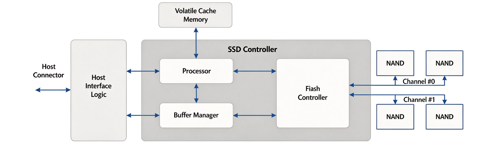
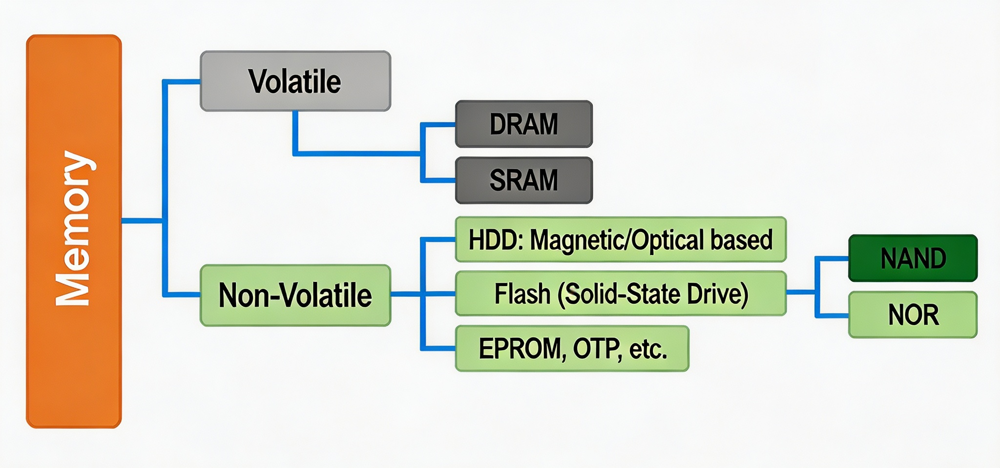
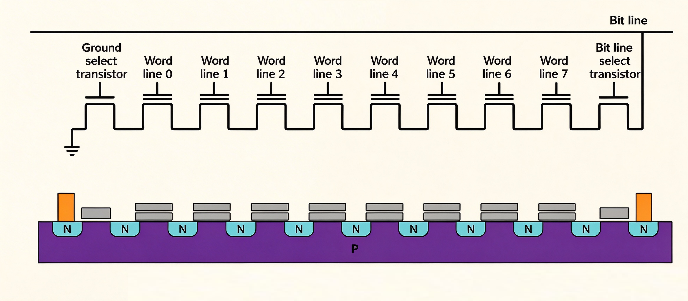
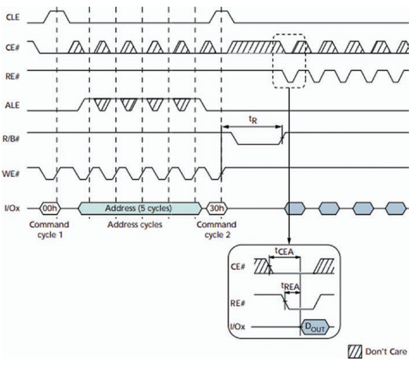
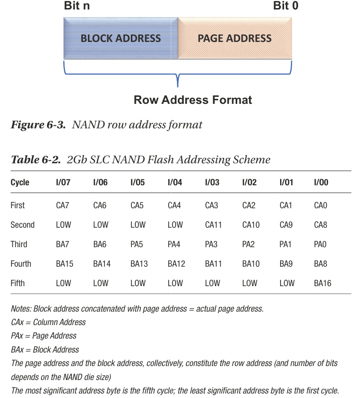

# A Beginner’s Guide to SSD Firmware

## CH1 Introduction to SSD Firmware
1. SSD结构图: 

    

## CH2 Understanding the Role of Firmware in SSDs

## CH3 The History and Evolution of SSD Firmware

## CH4 Basics of Flash Memory
1. Memory种类: 
   
    { width=80% }

2. NAND memory architecture：

    { width=95% }

## CH5 3D Vertical NAND

## CH6 Basic Understanding of NAND Flash Interface
1. 列地址和行地址

    - 列地址（Column Address）

        - 寻址粒度：针对 NAND 闪存单个物理页的内部字节寻址，可理解为**页内字节偏移量**，用于精确定位一页中的具体数据位置。
        - DDR 接口特性：在双数据率（DDR）接口下，列地址的最低位必须固定为 0，以此保证每次传输的字节数恒为偶数，优化数据处理效率。

    - 行地址（Row Address）

        - 寻址粒度：面向更大范围的存储单元，用于寻址 NAND 闪存中完整的物理页与物理块，实现页级、块级的单元选中。
        - 发送顺序：当操作需要同时下发列地址与行地址时，固定遵循**先列地址、后行地址**的顺序，二者拆分为多个独立的 8 位地址周期依次发送。

2. NAND Flash 标准页读（READ PAGE）操作的时序图：

    

    | 信号 | 全称 | 方向 | 作用 | 有效规则 |
    | --- | --- | --- | --- | --- |
    | CLE | Command Latch Enable 命令锁存使能 | 主控 → NAND | 标记当前 I/O 总线传输的是命令 | 高电平有效 |
    | CE# | Chip Enable 芯片使能 | 主控 → NAND | 选中 / 取消选中这颗 NAND 芯片 | 带 `#` 表示低电平有效；拉低 = 选中，拉高 = 不选中 |
    | RE# | Read Enable 读使能 | 主控 → NAND | 读数据时的时钟脉冲，每跳一次输出一个字节 | 低电平有效 |
    | ALE | Address Latch Enable 地址锁存使能 | 主控 → NAND | 标记当前 I/O 总线传输的是地址 | 高电平有效 |
    | R/B# | Ready/Busy 就绪 / 忙 | NAND → 主控 | NAND 给主控的状态反馈，告诉主控“我正在内部干活”还是“干完了” | 低电平 = 忙，高电平 = 就绪 |
    | WE# | Write Enable 写使能 | 主控 → NAND | 写命令 / 地址 / 数据时的锁存脉冲；上升沿把 I/O 上的内容锁进 NAND | 低电平有效 |
    | I/Ox | 数据总线 | 双向 | 既可以发命令 / 地址 / 写数据，也可以读数据 | 命令、地址、数据都走这组线 |

    **阶段 1：Command cycle 1（发第一个命令 00h）**

    1. 主控拉低 **CE#**，选中这颗 NAND 芯片。
    2. 主控拉高 **CLE**（告诉 NAND：接下来发的是命令），ALE 保持低。
    3. 主控把命令码 `00h` 放到 **I/O** 总线上。
    4. 主控拉低再拉高 **WE#**，在 WE# 的上升沿，`00h` 被锁存进 NAND 的命令寄存器。
    5. 发完后 CLE 拉低，第一个命令周期结束。

    > 
    > 00h 是页读操作的 “首命令”，作用是告诉 NAND：接下来要发读操作的地址了。

    **阶段 2：Address cycles（发 5 个周期的地址）**

    1. 主控拉高 **ALE**（告诉 NAND：接下来发的是地址），CLE 保持低。
    2. 连续发出 **5 个 WE# 脉冲**，每一个 WE# 上升沿锁存 1 字节地址，一共 5 个地址周期。
        - 前 2 字节：**列地址（Column Address）**，也就是页内的字节偏移
        - 后 3 字节：**行地址（Row Address）**，也就是块号 + 页号
    3. 5 个地址发完，ALE 拉低。

    > 
    > NAND 的 I/O 只有 8 位，地址不能一次性发完，必须拆成一个字节一个字节串行发送，这叫 “地址复用”。

    **阶段 3：Command cycle 2（发第二个命令 30h）**

    1. 主控再次拉高 **CLE**。
    2. 把确认命令 `30h` 放到 I/O 总线上。
    3. 再发一个 WE# 脉冲，上升沿锁存`30h`命令。
    4. 发完后 CLE 拉低，主控的写入动作暂时结束。

    > 
    > `30h`是页读的 “启动命令”。发完这个命令，NAND 才真正开始工作：把指定物理页的数据，从 NAND 存储阵列搬运到内部的缓存寄存器里。

    **阶段 4：R/B# 忙等待（tR 时间）**

    1. 收到 30h 命令后，NAND 立刻开始内部读页操作，同时把 **R/B# 拉低**，通知主控：我正在忙，不要发新命令。
    2. `tR` 就是 NAND 的**页读取时间**（典型值几十微秒，比如 25μs~100μs），是 NAND 最核心的性能参数之一。
    3. 这段时间主控可以轮询 R/B# 引脚，或者发读状态命令，直到 R/B# 变回高电平，代表数据已经准备好，存在 NAND 内部缓存里了。

    **阶段 5：数据输出（连续读数据）**

    1. R/B# 拉高后，主控开始连续发 **RE# 脉冲**。
    2. 每一个 RE# 有效沿，NAND 就把下一个字节的数据放到 I/O 总线上，主控采样读取。
    3. 图中 RE# 连续的方波，对应 I/O 上一个个输出的数据字节（六边形的`DOUT`）。
    4. 这段时间 CLE、ALE 都保持低电平，因为当前是纯数据传输。

3. 例子：我们以**2Gb SLC NAND** 为实例：

    

    **前置规则**

    5 个地址周期是 NAND 标准异步接口的典型配置，遵循两个固定规则：

    1. **顺序固定**：先发列地址（2 个周期），再发行地址（3 个周期）
    2. **字节序固定**：每个地址都按「低字节先发，高字节后发」的小端序发送
    3. 每个地址周期对应 1 个 WE# 脉冲，WE# 上升沿锁存 1 字节地址，对应时序图里 ALE 拉高期间的 5 个阴影脉冲。

    **例子：对应书中的 2Gb SLC NAND**

    先明确这颗 NAND 的硬件参数：

    - 页大小：2048 字节数据 + 64 字节冗余区 = 2112 字节 / 页 → 列地址需要 11 位，占 2 个周期
    - 块大小：64 页 / 块 → 页地址占 6 位
    - 地址结构：
        - Cycle 1、2：列地址（Column Address, CA）
        - Cycle 3、4、5：行地址（Row Address）= 块地址（Block Address, BA） + 页地址（Page Address, PA）

    **访问目标**

    读取：**第 100 个块、第 30 页、页内偏移 0x0100（256 字节）** 处的数据。

    **逐周期拆解**

    表格

    | 地址周期 | 地址类型 | 传输内容 | 数值（16 进制） | 对应位含义 |
    | --- | --- | --- | --- | --- |
    | Cycle 1 | 列地址低字节 | CA[7:0] | `0x00` | 页内偏移的低 8 位 |
    | Cycle 2 | 列地址高字节 | CA[11:8] | `0x01` | 页内偏移的高 4 位，高 4 位补 0 |
    | Cycle 3 | 行地址低字节 | BA[7:6] + PA[5:0] | `0x1E` | 高 2 位是块地址第 7、6 位，低 6 位是页地址（30 = 0x1E） |
    | Cycle 4 | 行地址中字节 | BA[15:8] | `0x19` | 块地址的中间 8 位 |
    | Cycle 5 | 行地址高字节 | BA[16] | `0x00` | 块地址的最高位，其余位补 0 |

    对应时序图里的表现：ALE 拉高后，连续发 5 个 WE# 脉冲，依次把 `00h → 01h → 1Eh → 19h → 00h` 锁存进 NAND。

4. Command Cycles and Address Cycles

    | Command | Command Cycle 1 | Number of Address Cycles | Data Cycles Required 1 | Command Cycle 2 | Valid During Busy |
    | --- | --- | --- | --- | --- | --- |
    | READ PAGE | 00h | 5 | No | 30h | No |
    | READ PAGE CACHE SEQUENTIAL | 31h | — | No | — | No |
    | READ PAGE CACHE SEQUENTIAL LAST | 3Fh | — | No | — | No |
    | READ for INTERNAL DATA MOVE | 00h | 5 | No | 35h | No |
    | RANDOM DATA READ | 05h | 2 | No | E0h | No |
    | READ ID | 90h | 1 | No | — | No |
    | READ STATUS | 70h | — | No | — | Yes |
    | PROGRAM PAGE | 80h | 5 | Yes | 10h | No |
    | PROGRAM PAGE CACHE | 80h | 5 | Yes | 15h | No |
    | PROGRAM for INTERNAL DATA MOVE | 85h | 5 | Optional | 10h | No |
    | RANDOM DATA INPUT | 85h | 2 | Yes | — | No |
    | ERASE BLOCK | 60h | 3 | No | D0h | No |
    | RESET | FFh | — | No | — | Yes |