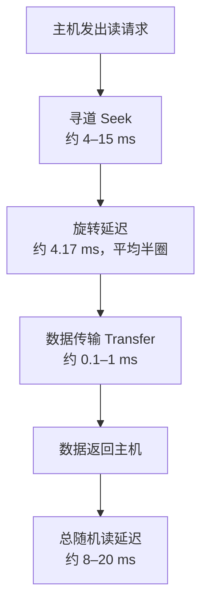
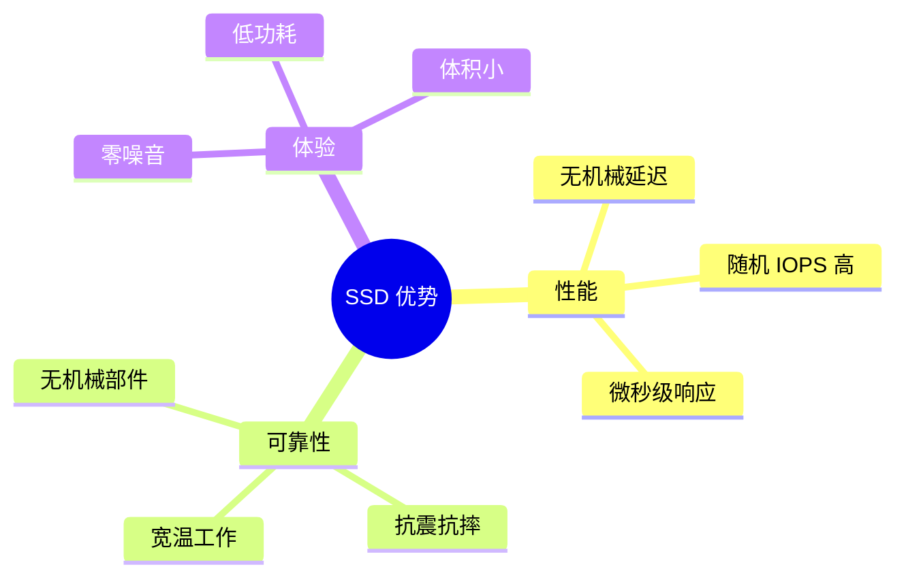
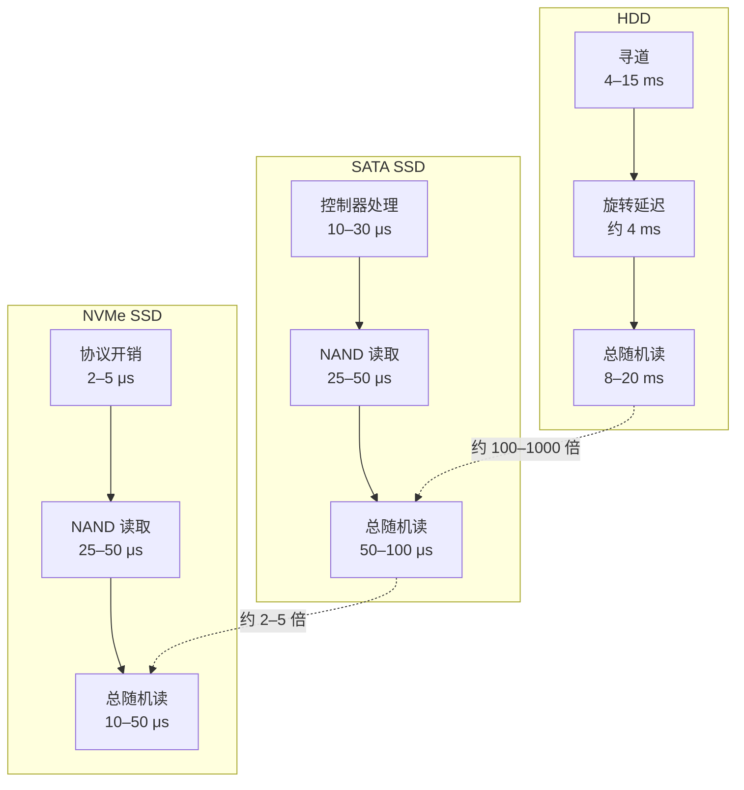
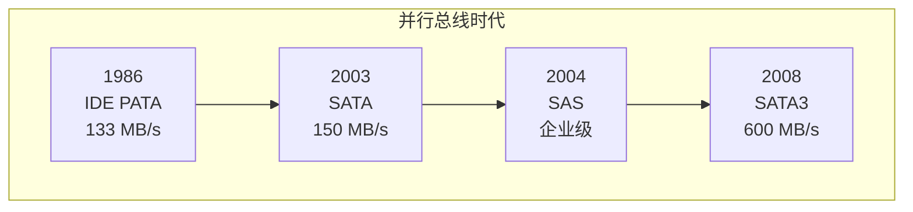
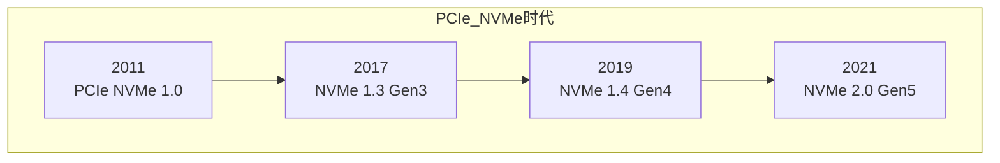
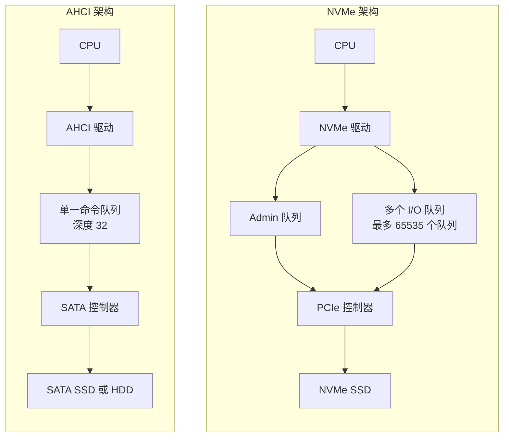
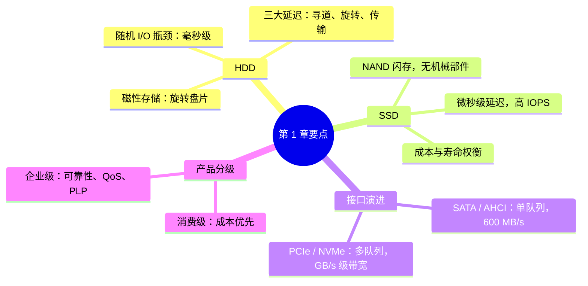

第 1 章 存储介质演进史

> **本章目标**：理解 HDD 与 SSD 的根本差异，建立存储技术演进的整体脉络  

## 章节概述

存储设备是计算机的「长期记忆」——断电后数据仍然保留。过去几十年，机械硬盘（HDD, Hard Disk Drive）长期占据主导地位；2007 年前后，固态硬盘（SSD, Solid State Drive）开始走入消费市场，并逐步改变了存储行业的格局。

本章从 HDD 的工作原理讲起，解释 SSD 为何能取代 HDD 成为主流系统盘，对比两者的核心指标，梳理存储接口从 SATA 到 NVMe 的演进脉络，并概览消费级与企业级 SSD 的工程差异。读完本章，你将建立存储技术的「时间线视角」，为后续深入 NAND 原理和 NVMe 协议打下基础。

---

## 1.1 机械硬盘（HDD）工作原理简述

### 核心概念

机械硬盘是一种**基于磁性存储**的非易失性存储设备。数据以磁化方向的形式记录在旋转的金属或玻璃盘片（Platter）上，通过磁头（Head）读写。

一块典型的 3.5 英寸 HDD 包含以下关键部件：

| 部件 | 英文 | 作用 |
| --- | --- | --- |
| 盘片 | Platter | 涂有磁性材料的圆盘，数据实际存储位置 |
| 磁头 | Read/Write Head | 悬浮在盘片上方约 10 nm 处，读写磁信号 |
| 主轴电机 | Spindle Motor | 驱动盘片以固定转速旋转（常见 5400/7200/10000 RPM） |
| 音圈电机 | Voice Coil Motor (VCM) | 驱动磁头臂做径向移动（寻道） |
| 控制器 | Controller / SoC | 管理读写流程、信号处理、接口通信 |
| 缓存 | DRAM Cache | 缓冲读写数据，减少盘片访问次数 |

{width=60%}

<p align="center">HDD 内部结构剖面示意<br>图 1-1：机械硬盘内部结构示意（盘片、磁头、主轴电机、音圈电机）</p>

### 一次读操作的三个阶段

HDD 读取数据时，磁头必须**物理移动**到正确的位置，因此一次读操作包含三个串行的耗时阶段：



| 阶段 | 英文 | 含义 | 典型耗时（7200 RPM） |
| --- | --- | --- | --- |
| **寻道** | Seek | 磁头臂移动到目标磁道 | 约 4–15 ms（取决于移动距离） |
| **旋转延迟** | Rotational Latency | 等待目标扇区旋转到磁头下方 | 约 4.17 ms（平均半圈） |
| **数据传输** | Transfer | 从盘片读取数据并传输 | 约 0.1–1 ms（取决于数据量） |

**一次随机读的总延迟 ≈ 寻道 + 旋转延迟 + 传输 ≈ 8–20 ms**（典型值，随 HDD 型号和负载变化）。

### 生活类比：图书馆找书

想象你在一个巨大的圆形图书馆里找一本书：

1. **寻道** = 从当前书架走到目标书架（磁头移动到目标磁道）
2. **旋转延迟** = 书架是旋转的，你得等目标那本转到面前（盘片旋转到目标扇区）
3. **数据传输** = 把书拿下来阅读（从盘片读取数据）

书架越多（盘片数越多）、Library 越大（容量越大），找到书的时间不一定更短——因为仍然需要「走过去 + 等待旋转」。

### 关键参数

| 参数 | 含义 | 典型值 |
| --- | --- | --- |
| 转速 | 盘片每分钟旋转圈数 | 5400 / 7200 / 10000 / 15000 RPM |
| 位密度 | 单位面积存储的 bit 数 | 持续提升，现代 HDD 约 1–2 Tb/in² |
| 缓存 | 板载 DRAM 大小 | 64 MB – 512 MB |
| 接口 | 连接主机的方式 | SATA 3（6 Gb/s）或 SAS 12 Gb/s |

> **要点**：HDD 的性能瓶颈在于**机械运动**——磁头寻道和盘片旋转无法通过「加缓存」根本消除，这直接导致了 HDD 在随机 I/O 场景下的天然劣势。

---

## 1.2 固态硬盘（SSD）的出现与优势

### 历史背景

SSD 的概念并不新——基于 DRAM 的 SSD 在 20 世纪 90 年代就已用于高端服务器。但 DRAM 掉电丢数据且成本极高，无法大规模普及。真正的转折点是 **NAND Flash** 技术的成熟：

| 时间 | 里程碑 |
| --- | --- |
| 1980s | Flash 存储器发明（Toshiba 提出 NAND Flash 概念） |
| 1991 | 首款商用 SSD（StorageTek，基于 DRAM） |
| 2006–2007 | 三星、SanDisk 等推出基于 NAND 的消费级 SSD |
| 2008 | Intel X25-M 发布，SSD 性能优势引发行业关注 |
| 2013–2015 | PCIe NVMe SSD 开始替代 SATA SSD 成为高性能主流 |
| 2020s | QLC 3D NAND 普及，NVMe 2.0 规范发布 |

推动 SSD 普及的核心因素：

* **NAND 成本持续下降**：/GB从2007年的约50/GB 降至 2020 年代的约 $0.05–0.10/GB
* **移动设备需求**：笔记本、智能手机需要抗震、低功耗、小体积的存储
* **数据中心性能需求**：随机 I/O 密集型应用（数据库、虚拟化）需要高 IOPS

### SSD 的核心优势



| 优势 | 说明 |
| --- | --- |
| **极低延迟** | 无寻道和旋转延迟，随机读延迟约 10–100 μs，比 HDD 快 **2–3 个数量级** |
| **高 IOPS** | 随机 4K 读可达 10 万–100 万 IOPS，HDD 通常仅 100–200 IOPS |
| **抗震** | 无机械部件，适合笔记本、工业、车载等场景 |
| **低噪音** | 无电机和磁头运动，完全静音 |
| **低功耗** | 典型活跃功耗 2–5 W（HDD 约 6–10 W），空闲更低 |
| **体积小** | M.2 2280 仅 22×80 mm，远小于 3.5 英寸 HDD |

### SSD 的局限（客观认识）

本教程不回避 SSD 的不足——理解局限才能正确选型：

| 局限 | 原因 | 影响 |
| --- | --- | --- |
| **单位容量成本更高** | NAND 制造成本仍高于磁性存储 | 大容量冷数据存储 HDD 仍有优势 |
| **写入寿命有限** | NAND 每个块有有限的 P/E（擦写）次数 | 需关注 TBW/DWPD 指标 |
| **性能可能波动** | GC（垃圾回收）运行时占用后端带宽 | 持续写入时可能出现性能下降 |
| **数据恢复困难** | 无机械结构，物理损坏后数据恢复极难 | 重要数据需备份 |

> 这些局限将在后续章节逐一深入：P/E 寿命见 第 5 章，GC 性能波动见 第 13 章。

---

## 1.3 HDD vs SSD 核心对比

### 全方位对比表

以下数值为**行业典型范围**（2020 年代主流产品），非某一特定型号的 benchmark 结果：

| 对比维度 | HDD（7200 RPM） | SATA SSD | NVMe SSD（PCIe Gen4 x4） |
| --- | --- | --- | --- |
| **顺序读** | 约 150–250 MB/s | 约 500–560 MB/s | 约 5000–7500 MB/s |
| **顺序写** | 约 150–250 MB/s | 约 450–530 MB/s | 约 4000–7000 MB/s |
| **随机 4K 读 IOPS** | 约 100–200 | 约 50K–100K | 约 500K–1M+ |
| **随机 4K 写 IOPS** | 约 100–200 | 约 50K–90K | 约 300K–1M+ |
| **随机读延迟** | 约 8–15 ms | 约 50–100 μs | 约 10–50 μs |
| **功耗（活跃）** | 约 6–10 W | 约 2–4 W | 约 3–8 W |
| **噪音** | 可闻电机/寻道声 | 静音 | 静音 |
| **抗震性** | 差（磁头碰撞风险） | 优 | 优 |
| **$/GB（2024 约）** | 约 $0.01–0.03 | 约 $0.05–0.10 | 约 $0.06–0.12 |
| **典型容量** | 1–20 TB | 256 GB–4 TB | 256 GB–8 TB |

### 延迟对比：数量级的差异

延迟是 HDD 与 SSD 最本质的差异。用对数刻度更能体现这一差距：



> **1 ms = 1000 μs**。HDD 一次随机读约 10 ms = 10,000 μs，而 NVMe SSD 约 20 μs——差距约 **500 倍**。

### 场景选型建议

| 场景 | 推荐 | 原因 |
| --- | --- | --- |
| 操作系统盘 / 应用启动 | **NVMe SSD** | 低延迟、高 IOPS 直接提升体验 |
| 数据库 / 虚拟化 | **企业级 NVMe SSD** | 高并发随机 I/O + 高 DWPD |
| 视频编辑 / 大文件传输 | **NVMe SSD** | 高顺序带宽 |
| 大容量冷数据归档 | **HDD** | 最低 $/GB，顺序读写足够 |
| 备份 / 容灾存储 | **HDD 或混合** | 容量优先，部分热数据可用 SSD |
| 笔记本 / 移动设备 | **SSD** （M.2 NVMe 或 SATA） | 抗震、低功耗、小体积 |

---

## 1.4 存储接口演进：SATA → SAS → PCIe → NVMe

存储接口的演进主线是：**更宽的通道 + 更低的协议开销 + 更高的并行度**。

### 接口演进时间线





### 各代接口核心参数

| 接口 | 协议 | 带宽（单通道） | 队列深度 | 典型场景 |
| --- | --- | --- | --- | --- |
| **PATA/IDE** | ATA | 最高 133 MB/s | 1 | 已淘汰 |
| **SATA III** | AHCI | 600 MB/s（6 Gb/s） | 1 命令队列（32 深度） | 消费级 HDD/SSD |
| **SAS 12G** | SAS | 1200 MB/s（12 Gb/s） | 多队列 | 企业级 HDD/SSD |
| **PCIe Gen3 x4** | NVMe | 约 4 GB/s | 65535 队列 × 65535 深度 | 消费级/企业级 SSD |
| **PCIe Gen4 x4** | NVMe | 约 8 GB/s | 同左 | 主流高性能 SSD |
| **PCIe Gen5 x4** | NVMe | 约 16 GB/s | 同左 | 旗舰级 SSD |

### 为什么 AHCI 成为 SATA SSD 的瓶颈

AHCI（Advanced Host Controller Interface）为机械硬盘设计，核心假设是**单队列、高延迟**设备。它存在三大瓶颈：



| AHCI 瓶颈 | 具体限制 | NVMe 的改进 |
| --- | --- | --- |
| **单队列** | 所有命令进一个队列，多核 CPU 争抢锁 | 最多 65535 个 I/O 队列，每核一个 |
| **队列深度浅** | 最大 32 条在途命令 | 每队列最大 65535 条在途命令 |
| **协议开销大** | 每次命令多次 MMIO 寄存器访问 | 基于内存的 SQ/CQ 环，Doorbell 通知 |
| **带宽受限** | SATA 物理层上限 600 MB/s | PCIe Gen4 x4 约 8 GB/s |

### PCIe 带宽计算

PCIe 带宽由 **Generation（代数）** 和 **Lane 数** 决定：

```
理论带宽 = 每 Lane 速率 × Lane 数 × 编码效率  
  
编码效率：Gen1/2 用 8b/10b（80%），Gen3+ 用 128b/130b（约 98.5%）
```

| 配置 | 每 Lane 速率 | x4 理论带宽 | 实际可用（约） |
| --- | --- | --- | --- |
| PCIe Gen3 x4 | 8 GT/s | 约 4 GB/s | 约 3.5 GB/s |
| PCIe Gen4 x4 | 16 GT/s | 约 8 GB/s | 约 7 GB/s |
| PCIe Gen5 x4 | 32 GT/s | 约 16 GB/s | 约 14 GB/s |

> NVMe 协议详解见 第 19 章，PCIe 基础见 第 18 章。

---

## 1.5 消费级 vs 企业级 SSD 差异概览

SSD 并非「一块快盘」这么简单——消费级和企业级产品在工程设计上有系统性差异。


<p align="center">消费级 vs 企业级 SSD 应用场景对比<br>图 1-2：消费级 SSD（笔记本、PC）与企业级 SSD（数据中心、数据库）的典型应用场景</p>

### 核心差异对比

| 维度 | 消费级 SSD | 企业级 SSD |
| --- | --- | --- |
| **目标工作负载** | 日常办公、游戏、轻创作 | 7×24 数据中心、数据库、云 |
| **DWPD** | 约 0.1–1（低写入强度） | 约 1–10+（高写入强度） |
| **TBW（1TB 盘典型）** | 约 150–600 TB | 约 1000–10000+ TB |
| **断电保护（PLP）** | 通常无或部分有 | 标配（电容 + 固件刷写） |
| **双端口（Dual Port）** | 无 | 常见（高可用路径冗余） |
| **数据路径保护** | 通常无 | DIF/DIX 端到端保护 |
| **QoS 一致性** | 不保证 | 严格 SLA（99.9% 延迟上限） |
| **加密** | 可选（Opal） | 标配（AES-256 / FIPS 140-2） |
| **质保** | 3–5 年 | 5 年 + 按 TBW 质保 |
| **形态** | M.2 2280、2.5" SATA | U.2、U.3、E1.S、E3.S |
| **价格（$/GB）** | 低 | 高（约 2–5 倍） |

### 关键概念预习

**DWPD**（Drive Writes Per Day，每日全盘写入次数）：衡量 SSD 每天能承受多少次「写满全盘容量」。企业级通常 ≥ 1 DWPD，意味着 1 TB 盘每天可写入 1 TB 数据，持续 5 年。

**PLP**（Power Loss Protection，断电保护）：企业级 SSD 板载大容量电容，检测到断电时将 DRAM 缓存和映射表紧急刷入 NAND，防止数据丢失。消费级 SSD 通常没有这一设计。

**QoS**（Quality of Service，服务质量）：企业级 SSD 承诺在 99.9% 或 99.99% 的时间窗口内，延迟不超过某个上限（如 99.9% 的 4K 读 < 200 μs）。

> TBW、OP（超量预留）等消费级参数的详细解读见 第 2 章。断电保护机制见 第 17 章。

---

## 本章小结



* **HDD** 的性能瓶颈是机械运动（寻道 + 旋转），随机读延迟约 **8–20 ms**
* **SSD** 基于 NAND Flash，无机械延迟，随机读延迟约 **10–100 μs**，比 HDD 快 2–3 个数量级
* 存储接口从 **SATA/AHCI**（单队列、600 MB/s）演进到 **PCIe/NVMe**（多队列、GB/s 级带宽）
* **消费级 SSD** 成本优先，**企业级 SSD** 在 PLP、DWPD、QoS、双端口等方面有系统性增强
* SSD 并非万能：$/GB 仍高于 HDD，写入寿命有限，GC 可能导致性能波动

---

## 常见问题 FAQ

**Q1：SSD 会完全取代 HDD 吗？**

不会完全取代，但会在更多场景成为默认选择。HDD 在 $/GB 上仍有 3–10 倍优势，大容量冷存储（归档、备份、监控录像）仍大量使用 HDD。系统盘、数据库、热数据则已基本被 SSD 占领。

**Q2：SATA SSD 和 NVMe SSD 差距大吗？**

差距显著。SATA SSD 受 AHCI + SATA III 双重限制，顺序读写上限约 560 MB/s；NVMe SSD（PCIe Gen4 x4）顺序读可达 7000 MB/s 以上，随机 IOPS 也高出数倍。新购 SSD 建议优先选 NVMe。

**Q3：企业级 SSD 能用于家用吗？**

可以，但通常「大材小用」——企业级盘价格更高、功耗更大，家用工作负载无法发挥 DWPD 和 QoS 优势。除非你有高强度写入需求（如 8K 视频持续剪辑、Chia 挖矿等），否则消费级 SSD 足够。

**Q4：HDD 还有优势吗？**

有。三点核心优势：最低 $/GB、成熟的大容量（单盘 20 TB+）、数据恢复相对可行（机械结构损坏后仍有专业恢复手段）。适合归档和备份场景。

**Q5：「闪存盘（U 盘）」和 SSD 是什么关系？**

U 盘和 SSD 都使用 NAND Flash，但 U 盘通常使用成本更低的 TLC/QLC 颗粒、简化的控制器、USB 接口，性能和耐久远低于 SSD。SSD 则使用更高品质的 NAND、强大的控制器和 FTL 固件。

---

**1. HDD 一次随机读操作包含哪三个耗时阶段？各阶段的典型耗时是多少？****2. 为什么 NVMe SSD 比 SATA SSD 快得多？请从接口和协议两个层面解释。****3. 以下场景应选 HDD 还是 SSD？为什么？****4. 消费级 SSD 和企业级 SSD 在工程设计上的三个关键差异是什么？****5. PCIe Gen4 x4 的理论带宽是多少？如何计算？**

## 延伸阅读

| 资源 | 说明 |
| --- | --- |
| NVM Express 官网 | NVMe 规范下载与技术资源 |
| Flash Memory Summit 公开演讲 | 存储行业最新技术趋势 |
| Linux NVMe 文档 | Linux 内核 NVMe 驱动架构 |
| SNIA 存储术语表 | 权威存储术语定义 |
| 本书 第 2 章 | SSD 参数解读与选购指南 |
| 本书 第 18 章 | PCIe 协议深入讲解 |
| 本书 第 19 章 | NVMe 协议架构详解 |

---

> **下一章预告**：第 2 章 SSD 是什么：从用户视角理解—— 我们将从「用户能看到什么」的角度，解读 SSD 的外观形态、性能参数（IOPS、延迟、TBW）、以及选购时常见的参数陷阱。